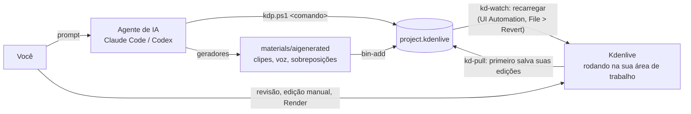

<div align="center">

# movie-engine

**Um agente de IA edita seu vídeo no Kdenlive enquanto você assiste, e você pode assumir o controle a qualquer momento.**

Agentes de programação com IA (Claude Code, Codex) criam e alteram projetos reais do Kdenlive: filmes, vídeos explicativos e shorts verticais. As edições aparecem ao vivo no editor que você tem aberto. Portátil, para Windows, sem patches no editor.


[English](../../README.md) · [简体中文](README.zh-CN.md) · [हिन्दी](README.hi.md) · [Español](README.es.md) · [Français](README.fr.md) · [العربية](README.ar.md) · [বাংলা](README.bn.md) · **Português** · [Русский](README.ru.md) · [اردو](README.ur.md) · [Bahasa Indonesia](README.id.md) · [Deutsch](README.de.md) · [日本語](README.ja.md) · [Türkçe](README.tr.md) · [한국어](README.ko.md)

*Esta é uma tradução; a versão de referência é o README em inglês.*

</div>

---

## Conteúdo

- [Por quê](#por-quê)
- [Como funciona](#como-funciona)
- [Recursos](#recursos)
- [Requisitos](#requisitos)
- [Instalação](#instalação)
- [Início rápido](#início-rápido)
- [Trabalhando com o agente](#trabalhando-com-o-agente)
- [A linha de comando de edição (`kdp.ps1`)](#a-linha-de-comando-de-edição-kdpps1)
- [Sincronização ao vivo com o editor aberto](#sincronização-ao-vivo-com-o-editor-aberto)
- [Geradores: o que o Kdenlive não consegue fazer](#geradores-o-que-o-kdenlive-não-consegue-fazer)
- [Narração e som](#narração-e-som)
- [Idioma da interface](#idioma-da-interface)
- [Estrutura de pastas](#estrutura-de-pastas)
- [Testes e provas](#testes-e-provas)
- [Limitações](#limitações)
- [Solução de problemas](#solução-de-problemas)
- [Perguntas frequentes](#perguntas-frequentes)
- [Como contribuir](#como-contribuir)
- [Agradecimentos](#agradecimentos)
- [Licença](#licença)

## Por quê

Editores de vídeo são feitos para mãos no mouse. Agentes de IA são bons em estrutura, timing e repetição: posicionar 300 clipes no ritmo da música, sincronizar cada legenda com a voz, refazer uma cena depois de um feedback. Mas eles não conseguem sair clicando por uma interface gráfica sem tomar conta da sua área de trabalho.

O Kdenlive é um editor open source robusto, mas no Windows ele **não tem API de automação**: o controle via D-Bus só existe nas builds para Linux, e os forks que adicionam um estão abandonados ou não são seguros. O movie-engine resolve isso sem modificar o editor:

1. O agente edita o arquivo de projeto `.kdenlive` por meio de uma linha de comando testada (`engine/kdp.ps1`).
2. O Kdenlive em execução recebe a ordem de recarregar o arquivo via Windows UI Automation, sem teclas, sem mouse e sem roubar o foco.
3. Suas próprias edições não salvas são salvas primeiro e nunca são sobrescritas.

Assim, o agente edita e você revisa, ou você edita à mão. Vocês dois trabalham no mesmo projeto, no mesmo editor, ao mesmo tempo.

## Como funciona



Todo comando de edição segue o mesmo ciclo seguro:

1. **Pull.** Se o Kdenlive tiver alterações não salvas, ele recebe a ordem de salvá-las (o botão Salvar da barra de ferramentas via UI Automation), e o salvamento é confirmado.
2. **Edição.** O comando altera o XML sob um lock, após uma verificação de hash e com um snapshot para desfazer. Se o arquivo mudou nesse meio-tempo, nada é gravado.
3. **Recarga.** O watcher identifica a marca da IA e executa File > Revert no editor aberto. Só conta como sucesso quando o widget da linha do tempo foi de fato reconstruído.
4. **Conflito.** Se você começou a editar nesse intervalo, nada é recarregado e seu trabalho permanece. A versão da IA é guardada à parte, e o agente reaplica a alteração por cima da sua.

## Recursos

- **Edição completa do projeto sem a interface gráfica**: cerca de 120 comandos cobrindo bin, linha do tempo, efeitos, composições, faixas, guias, marcadores, legendas, sequências, velocidade e remapeamento de tempo, apresentações de slides, títulos, proxies, renderização e desfazer/refazer. Veja a [referência de comandos](#a-linha-de-comando-de-edição-kdpps1).
- **Sincronização ao vivo com o editor aberto.** As edições da IA aparecem no Kdenlive que você está olhando; suas edições não salvas são salvas primeiro e nunca se perdem.
- **Nunca atrapalha sua área de trabalho.** Sem roubo de foco, teclas ou entrada de mouse. Os editores de teste rodam em uma área de trabalho invisível do Windows.
- **Portátil.** Editor, configurações, Node.js, fontes e ferramentas ficam em uma única pasta. Copie-a para outro PC e ela funciona; nada é gravado em Program Files nem no seu perfil do Windows.
- **Geradores para o que o Kdenlive não consegue fazer**: texto cinético letra por letra, anotações desenhadas à mão, cenas de interface em 3D, animações de cursor e longos filmes explicativos interativos. Eles são renderizados na GPU com motion blur real e posicionados na linha do tempo como clipes comuns.
- **Narração com timing por palavra** (Microsoft Edge TTS, sem chave de API). Legendas e ações disparam na palavra exata.
- **Efeitos sonoros sintetizados** (whoosh, clique, pop, riser, impacto e outros), gerados em código.
- **Comprovado, não presumido.** Todo comando tem uma verificação de resultado, efeitos e composições são testados um a um, e os resultados brutos estão em `docs/proof/`.
- **Instruções para agentes incluídas.** O `AGENTS.md` e as skills em `.claude/skills/` ensinam ao Claude Code e ao Codex o fluxo de trabalho, o formato de arquivo e as armadilhas.

## Requisitos

| | |
|---|---|
| Sistema operacional | Windows 10 ou 11, x64 |
| Editor | Build portátil (standalone) do Kdenlive **26.08.3**. Outras versões não foram testadas. |
| Node.js | 18 ou mais recente: o `.zip` para Windows x64 do nodejs.org, descompactado em `engine/node/` |
| Navegador | Microsoft Edge (parte do Windows); usado em modo headless pelos renderizadores de cena |
| Agente | [Claude Code](https://claude.com/claude-code) ou Codex. Opcional: todas as ferramentas também podem ser executadas à mão. |
| Disco | cerca de 1 GB para o editor e as ferramentas, mais a sua mídia |
| GPU | qualquer GPU com codificação H.264 por hardware acelera o `film-render.mjs` (sem ela, ele recorre ao software) |

## Instalação

Tudo é instalado **dentro da pasta**. Nada exige direitos de administrador.

```powershell
git clone https://github.com/vladtarrow/movie-engine.git
cd movie-engine
```

**1. Node.js.** Baixe o `.zip` para Windows x64 do Node.js 18 ou mais recente em <https://nodejs.org/en/download> e descompacte o conteúdo em `engine\node\`, de modo que `engine\node\node.exe` e `engine\node\npm.cmd` fiquem lá. Não é preciso instalador nem Node do sistema. Todos os scripts rodam por meio de `engine\node.cmd`, nunca por um Node do sistema.

**2. Pacotes do Node** para a ferramenta de voz e os renderizadores (as versões estão fixadas em `engine/voice/package.json`):

```powershell
engine\node\npm.cmd install --prefix engine\voice
```

**3. Kdenlive 26.08.3 portátil.** Baixe `kdenlive-26.08.3_standalone.exe` de <https://download.kde.org/stable/kdenlive/26.08/windows/> para `engine\installer\`, verifique-o e descompacte-o:

```powershell
(Get-FileHash engine\installer\kdenlive-26.08.3_standalone.exe -Algorithm SHA256).Hash
# esperado: A25427B1DFF2C17E3B0386E991BB1A719382BB3176D1A90E441CDAEB6E0A967D
engine\installer\kdenlive-26.08.3_standalone.exe -o"engine\Kdenlive" -y
```

O editor fica em `engine\Kdenlive\kdenlive-26.08.3_standalone\bin\`. Ele já inclui `melt.exe` e `ffmpeg.exe`.

**4. Primeira execução.**

```powershell
engine\kdenlive.cmd
```

O Kdenlive guarda todas as configurações em `engine\profile-kdenlive\`, não no seu perfil do Windows. Na primeira execução, ele mostra um assistente de configuração que aparece uma única vez.

## Início rápido

### Com um agente

Abra a pasta no Claude Code (ou no Codex) e peça com suas próprias palavras:

> Crie um novo projeto vertical a 30 fps chamado "launch-teaser". Coloque na linha do tempo as três capturas de tela de `materials/designers/launch/`, com 2,5 s cada e uma transição cruzada curta, adicione uma narração a partir de `script.txt` e sincronize uma legenda cinética com cada fala.

> Abra no Kdenlive para mim.

> A segunda tomada está longa demais. Corte para 1,8 s e suba um pouco o logo.

O agente segue o `AGENTS.md`: edita via `kdp.ps1`, renderiza só os clipes de que a montagem precisa e mantém o editor aberto sincronizado. Você revisa no Kdenlive, edita à mão quando quiser e aperta Render quando estiver satisfeito.

### À mão

```powershell
# um novo projeto 1080x1920 a 30 fps com 2 faixas de vídeo e 2 de áudio
powershell -NoProfile -ExecutionPolicy Bypass -File engine\kdp.ps1 new -Project projects\hello\hello.kdenlive -Profile vertical_hd_30

# um título de 3 segundos e um fundo colorido
powershell -NoProfile -ExecutionPolicy Bypass -File engine\kdp.ps1 bin-color -Project projects\hello\hello.kdenlive -Color '#203060' -Seconds 3 -Name bg
powershell -NoProfile -ExecutionPolicy Bypass -File engine\kdp.ps1 title -Project projects\hello\hello.kdenlive -Text "Hello" -Seconds 3 -Name hi

# posicioná-los: fundo na V1, título acima dele na V2
powershell -NoProfile -ExecutionPolicy Bypass -File engine\kdp.ps1 add -Project projects\hello\hello.kdenlive -Bin bg -Track V1 -At 0
powershell -NoProfile -ExecutionPolicy Bypass -File engine\kdp.ps1 add -Project projects\hello\hello.kdenlive -Bin hi -Track V2 -At 0

# um quadro de verificação e, depois, abrir no editor
powershell -NoProfile -ExecutionPolicy Bypass -File engine\kdp.ps1 frame -Project projects\hello\hello.kdenlive -At 1.5 -Out out\hello\check.png
engine\kdenlive.cmd projects\hello\hello.kdenlive
```

Para reabrir o último projeto depois, clique duas vezes em `open-last-project.cmd`.

## Trabalhando com o agente

O agente lê o `AGENTS.md` (Codex) ou o `CLAUDE.md`, que o importa (Claude Code), além de duas skills:

| Skill | Ensina |
|---|---|
| `.claude/skills/kdenlive-project-file` | o formato `.kdenlive` / MLT XML, o `kdp.ps1` e a verificação com `melt` |
| `.claude/skills/kdenlive-live` | a controlar o editor em execução com segurança: iniciar, fazer pull, recarregar e capturar a janela |

Regras que o agente segue e com as quais você pode contar:

- Ele nunca assume seu mouse, teclado ou foco, e nunca tira capturas da sua área de trabalho (só da própria janela do editor).
- Ele mesmo executa os passos na interface gráfica (salvar, abrir, recarregar) em vez de pedir que você clique.
- Ele pergunta antes de baixar ou excluir qualquer coisa.
- Ele renderiza só o que o trabalho exige (clipes de cena, quadros de verificação). O filme final só é renderizado quando você pede.
- Quando o Kdenlive não consegue fazer algo bem, o agente constrói isso fora, em código, e insere o resultado como um clipe. Ele não simplifica o efeito.

## A linha de comando de edição (`kdp.ps1`)

```powershell
powershell -NoProfile -ExecutionPolicy Bypass -File engine\kdp.ps1 <command> -Project <file.kdenlive> [options]
```

Os tempos são em segundos, com ponto decimal (`2.5`). As faixas são `V1 V2 …` (V1 é a mais baixa) e `A1 A2 …`. Um clipe é identificado por `-Track` mais qualquer instante `-At` dentro dele. Os parâmetros de efeito vão em `-Params "name=value||name=value"`. A lista completa, com todas as opções, está no cabeçalho de `engine/kdp.ps1`.

| Grupo | Comandos |
|---|---|
| Projeto | `new`, `profiles`, `info`, `validate`, `fonts`, `profile-set`, `profile-from-clip`, `zone`, `archive`, `backups`, `rebase`, `otio-export`, `otio-import` |
| Bin | `bin-add`, `bin-color`, `title`, `title-text`, `title-save`, `title-template`, `bin-rename`, `bin-remove`, `bin-info`, `bin-set`, `bin-duplicate`, `bin-replace-file`, `bin-reload`, `folder`, `bin-folder`, `relink`, `clean`, `generator`, `playlist-clip`, `extract-audio`, `transcode` |
| Linha do tempo | `add`, `add-av`, `move`, `copy`, `trim`, `ripple-trim`, `slip`, `split`, `remove`, `speed`, `remap`, `disable`, `enable`, `group`, `ungroup`, `mix`, `unmix`, `space-insert`, `space-remove`, `spaces-remove-all`, `track-clear`, `replace-in-timeline` |
| Efeitos | `effects`, `effect-info`, `effect-add`, `effect-list`, `effect-set`, `effect-remove`, `effect-copy`, `effect-clear`, `effects-all`, `bin-effect`, `effect-templates`, `effect-template` |
| Composições | `compositions`, `comp-info`, `comp-add`, `comp-list`, `comp-set`, `comp-remove` |
| Faixas | `track-add`, `track-remove`, `track-set` |
| Guias e marcadores | `guide-add`, `guide-list`, `guide-remove`, `guide-set`, `guide-clear`, `guide-export`, `guide-category`, `marker`, `marker-list`, `marker-set`, `marker-remove` |
| Legendas | `sub-add`, `sub-import`, `sub-export`, `sub-state` |
| Sequências | `sequence-add`, `sequences`, `copy-to-sequence`, `expand`; qualquer comando com `-Sequence <name>` atua dentro dessa sequência |
| Especiais | `slideshow`, animações Lottie / Glaxnimate via `bin-add`, `proxy`, `stabilize`, `scene-split`, `speed-job`, `subclip` |
| Saída | `frame` (um PNG), `preview` (render rápido com melt), `render` (o renderizador do próprio Kdenlive ou um preset), `presets` |
| Histórico | `undo`, `redo`, `clear-history` (snapshots em `projects/<name>/.kdp-history`) |

Comportamentos que vale a pena conhecer:

- As metades de áudio e vídeo vinculadas são movidas, aparadas, divididas e removidas juntas (`-Alone` para uma só metade).
- Um comando que falha sai com código 1 e não grava nada.
- Efeitos que a build do Windows não consegue executar são recusados, e não ignorados em silêncio (lista: `docs/proof/assets.txt`).
- Cada ação de menu do Kdenlive está mapeada para um comando, outro caminho ou "somente visualização" em `engine/tools/data/kdenlive-actions.csv`. Veja `docs/kdenlive-coverage.md`.

## Sincronização ao vivo com o editor aberto

| Script | O que faz | Códigos de saída |
|---|---|---|
| `engine\kd-pull.ps1 -Project <f>` | faz o Kdenlive salvar suas edições e confirma | 0 arquivo atualizado, 3 não está em execução, 4 não confirmado |
| `engine\kd-reload.ps1 -Project <f>` | File > Revert, confirmado pela linha do tempo reconstruída | 0 confirmado, 2 você tem edições não salvas (nada é descartado), 3 não está em execução, 4 falhou |
| `engine\kd-watch.ps1 -Project <f>` | watcher em segundo plano: recarrega após cada gravação da IA e registra conflitos | log em `engine\kd-watch.log`; exclua `engine\kd-watch.run` para parar |
| `engine\kdenlive-bg.ps1 [project]` | inicia o Kdenlive minimizado para um agente | 0 carregado, 4 não confirmado |
| `engine\kdenlive.cmd [project]` | inicia o Kdenlive para você | |

Inicie o watcher uma vez por sessão:

```powershell
Start-Process powershell -WindowStyle Hidden -ArgumentList '-NoProfile','-ExecutionPolicy','Bypass','-File','engine\kd-watch.ps1','-Project','projects\hello\hello.kdenlive'
```

Projetos grandes: recarregar um projeto de 1000 clipes leva minutos, e as ferramentas esperam a conclusão em vez de reportar antes da hora. Os projetos são abertos via *File > Open Recent* em um editor vazio, porque abrir um arquivo diretamente faz o Qt percorrer cada item da linha do tempo para acessibilidade, o que era cerca de 10 minutos mais lento.

## Geradores: o que o Kdenlive não consegue fazer

O Kdenlive/MLT não tem animação de texto letra por letra, nem expressões, e quase nada de 3D; além disso, efeitos pesados deixam a reprodução lenta. O movie-engine renderiza essas partes fora e as coloca na linha do tempo como clipes comuns, geralmente com canal alfa, em uma faixa acima das imagens. O script gerador e suas entradas ficam na pasta do projeto, de modo que um clipe pode ser gerado de novo quando o texto, a fonte ou o timing mudam.

| Ferramenta | Gera |
|---|---|
| `engine/tools/kinetic-text.ps1` | legendas cinéticas letra por letra, com cada palavra sincronizada a partir de `voice.json` e caixa de destaque |
| `engine/tools/annotate.ps1` | círculos, caixas, sublinhados e setas desenhados à mão que vão sendo traçados sobre uma captura de tela |
| `engine/tools/card-entrance.ps1` | um card com uma captura de tela que sobe e entra em escala, com uma sombra suave |
| `engine/tools/pdf-to-png.ps1` | slides a partir de uma exportação em PDF |
| `engine/tools/html-render.mjs` | qualquer cena HTML/CSS/canvas em vídeo: animação de interface, cursores, 3D, máscaras |
| `engine/tools/film-render.mjs` + `film/` | filmes explicativos longos e interativos em um canvas: um clipe por fala da narração, ações que disparam nas palavras faladas e motion blur na GPU a cerca de 45 fps |

Os dois renderizadores controlam o Microsoft Edge que vem com o Windows, em modo headless, com um perfil descartável e sem acesso à rede.

### Demos

```powershell
# um card de título 3D de 3 segundos com um clique de cursor
engine\node.cmd engine\tools\html-render.mjs examples\demo\scene\scene.html examples\demo\out --frames 0,30,60,89
engine\node.cmd engine\tools\html-render.mjs examples\demo\scene\scene.html examples\demo\out\scene.mp4

# um filme interativo de 4 tomadas sincronizado com duas falas da narração
engine\node.cmd engine\tools\film-render.mjs examples\demo\film\film.html examples\demo\out --check
engine\node.cmd engine\tools\film-render.mjs examples\demo\film\film.html examples\demo\out --shots all --width 640
engine\node.cmd engine\tools\film-render.mjs examples\demo\film\film.html examples\demo\out\clips --suffix -v01
```

Um filme são três arquivos pequenos. `data.js` contém as tomadas e os tempos das palavras. `direction.js` tem uma linha por tomada:

```text
1 | hover 192 108 @brand | tag 300 60 Your brand @deserves | confetti 192 90 @film
2 say=A film that/*explains* it
3 | click 116 108 @before | click 268 108 @after | chips Before~After @after
4 scene=counter | count 0 120 % @count
```

`scenes.js` contém as tomadas desenhadas do zero. `@word` dispara uma ação quando a voz diz aquela palavra. Entre as ações estão click, hover, drag, zoom, lens, ring, arrow, chips, toggle, slider, toast, type, count e confetti; a sintaxe completa está no início de `engine/tools/film/film-kit.js`.

## Narração e som

```powershell
engine\node.cmd engine\voice\voice.mjs lines.json materials\aigenerated\hello\voice en-US-AndrewMultilingualNeural +0%
```

`lines.json` é uma lista de falas. A ferramenta grava um mp3 por fala, mais o `voice.json`, com a duração e o início e o fim de cada palavra. As falas ficam em cache, então alterar uma fala gera de novo apenas aquela fala. Ela usa a conversão de texto em fala on-line do Microsoft Edge por meio do pacote `msedge-tts`: não precisa de chave, mas o serviço não é oficial e exige internet.

```powershell
engine\node.cmd engine\audio\sfx.mjs materials\aigenerated\sfx
```

Isso sintetiza em código whoosh, whoosh-long, swipe, click, pop, tick, riser, impact, ding e reveal; um conjunto pronto está em `materials/aigenerated/sfx/`. Complete com silêncio os sons mais curtos que um quadro antes de posicioná-los (`-af apad=whole_dur=0.0667`).

## Idioma da interface

Os inicializadores abrem o Kdenlive em **inglês** por padrão. Para usar outro idioma, defina `MOVIE_ENGINE_UI_LANG` antes de iniciar:

```powershell
$env:MOVIE_ENGINE_UI_LANG = 'ru'; engine\kdenlive.cmd
```

O UI Automation encontra os itens de menu pelos nomes visíveis. Os nomes em inglês e em russo já vêm incluídos (`engine/tools/kd-ui.ps1`, `$KdNames`). Para qualquer outro idioma, adicione os nomes lá e verifique com:

```powershell
powershell -NoProfile -ExecutionPolicy Bypass -File engine\tools\kd-langcheck.ps1
```

## Estrutura de pastas

```text
movie-engine/
├─ AGENTS.md, CLAUDE.md          instruções para agentes de IA
├─ .claude/skills/               skills do agente: formato do arquivo de projeto, editor ao vivo
├─ engine/
│  ├─ kdp.ps1                    a linha de comando de edição
│  ├─ kd-pull / kd-reload / kd-watch .ps1, kdenlive.cmd, kdenlive-bg.ps1
│  ├─ tools/                     internos, geradores, testes, dados (mapa de ações)
│  ├─ voice/  audio/  fonts/     TTS, efeitos sonoros sintetizados, Poppins (OFL)
│  ├─ Kdenlive/  node/           editor portátil e Node.js (fora do git)
│  └─ profile-kdenlive/          as configurações do editor (fora do git)
├─ projects/<name>/<name>.kdenlive
├─ materials/
│  ├─ download/                  arquivos de banco de imagens e baixados (fora do git)
│  ├─ aigenerated/               tudo o que a IA criou (sfx/ e test-kit/ vêm com o engine)
│  ├─ designers/  brand/         arquivos da sua equipe, recursos da marca
├─ examples/demo/                demos dos renderizadores de cenas e de filmes
├─ out/                          renders (fora do git)
└─ docs/                         provas, cobertura, traduções deste README
```

Os caminhos de mídia dentro dos projetos são relativos. Se você mover ou copiar a pasta, `kdp.ps1 rebase` (também executado automaticamente pelo `kdenlive.cmd`) grava o novo local no projeto.

## Testes e provas

As afirmações sobre o que funciona são sustentadas por verificações de resultado, e não por "a função rodou". O resumo está em [`docs/kdenlive-proof.md`](../../docs/kdenlive-proof.md), e a saída bruta, em `docs/proof/`.

| Teste | Verifica |
|---|---|
| `engine\tools\kdp-clitest.ps1` | cada comando do `kdp.ps1`, pela linha de comando, comparando o projeto resultante |
| `engine\tools\kd-livetest.ps1` | pull, recarga, watcher, conflitos e condições de corrida com um Kdenlive real em uma área de trabalho invisível |
| `engine\tools\kdp-assetsweep.ps1` | cada efeito e composição: renderiza e compara quadros |
| `engine\tools\kdp-portabletest.ps1` | copia a pasta para outro lugar e trabalha a partir da cópia |
| `engine\tools\kd-langcheck.ps1` | o idioma da interface e se o UI Automation encontra o menu |
| `engine\tools\kdp-coverage-check.ps1` | se toda ação de menu está mapeada e se nenhuma prova é mais antiga que o código |

```powershell
powershell -NoProfile -ExecutionPolicy Bypass -File engine\tools\kdp-clitest.ps1 -Report docs\proof\clitest.txt
powershell -NoProfile -ExecutionPolicy Bypass -File engine\tools\kd-livetest.ps1 -Report docs\proof\live-en.txt
```

Os editores de teste rodam apenas em uma área de trabalho oculta, com perfil próprio, então os testes nunca mexem no seu Kdenlive aberto nem no seu foco.

## Limitações

- **Somente Windows** e somente Kdenlive **26.08.3**. O Linux tem D-Bus e precisaria de outra ponte.
- Ao iniciar, o editor toma o foco do teclado por cerca de 3 segundos enquanto a janela vazia aparece. Os agentes perguntam antes de iniciá-lo enquanto você trabalha. Recargas e edições não tomam o foco.
- A build do Windows não tem os módulos MLT sox, ladspa e movit, nem alguns efeitos frei0r/avfilter; o `kdp.ps1` os recusa (`docs/proof/assets.txt`).
- A exportação e a importação de OpenTimelineIO transportam apenas clipes e lacunas. A edição multicâmera não tem troca de ângulo ao vivo (os cortes são feitos com split/remove/hide).
- "Salvar como…" via UI Automation em uma janela minimizada não abre nenhuma caixa de diálogo; no lugar disso, o agente usa `archive` ou cópias de arquivos.
- O reconhecimento de fala (legendas automáticas) precisa do Whisper ou do Vosk, que não vêm incluídos.
- Títulos feitos com a ferramenta de títulos do Kdenlive usam fontes instaladas no Windows. Para garantir a tipografia, renderize o texto com os geradores, que carregam fontes de `engine/fonts/`.
- O Edge TTS é um serviço on-line não oficial e pode mudar ou deixar de funcionar.

## Solução de problemas

| Sintoma | Causa e solução |
|---|---|
| O Kdenlive está em execução, mas clicar nele na barra de tarefas não mostra nada | A posição salva da janela está fora da tela. Feche-o e exclua as entradas `kdockLayout` em `engine\profile-kdenlive\AppData\Local\kdenliverc`, ou mova a janela com `SetWindowPos` (veja `AGENTS.md`). |
| `kd-reload.ps1` sai com 2 | Você tem edições não salvas. Nada foi descartado. Execute `kd-pull.ps1` e aplique a alteração de novo (o `kdp.ps1` faz isso sozinho). |
| `CONFLICT` em `engine\kd-watch.log` | Você e o agente editaram no mesmo momento. Sua versão permanece no editor, e a versão da IA está em `projects\<name>\.kdp-history\<name>\conflict\`. Peça ao agente para reaplicar a alteração. |
| Um comando sai com 1 e "pull not confirmed" | O Kdenlive está ocupado ou exibindo uma caixa de diálogo. Feche a caixa de diálogo ou aguarde o carregamento terminar e repita. |
| Um script do PowerShell falha na análise | Scripts com texto não ASCII precisam ser salvos em UTF-8 **com BOM** para o Windows PowerShell 5.1. |
| `voice.mjs` para com "Stream closed before the synthesis completed" | Geralmente é um problema de rede, ou SSML sem escape em cópias antigas. O `voice.mjs` escapa `& < >` sozinho. |
| Abrir um projeto grande leva muitos minutos | Abra-o via `kdenlive.cmd` / `kdenlive-bg.ps1`, nunca como `kdenlive.exe project.kdenlive`. |

## Perguntas frequentes

**Preciso do Claude Code ou do Codex?**
Não. Cada ferramenta é um script comum que você pode executar à mão. O agente é o que torna tudo rápido: ele planeja a montagem, executa as ferramentas e mantém o editor sincronizado.

**O agente vai sobrescrever minhas edições manuais?**
Não. Antes de qualquer gravação, suas edições não salvas são salvas e confirmadas. Se você editar enquanto o agente está gravando, a gravação é recusada ou guardada à parte como conflito, nunca aplicada por cima do seu trabalho.

**Posso continuar usando o Kdenlive normalmente?**
Sim. É o Kdenlive original, com sua própria pasta de configurações. Edite, pré-visualize e renderize como de costume.

**Funciona com um Kdenlive que eu já tenho instalado?**
Ele usa a própria cópia portátil em `engine\Kdenlive\`, então o Kdenlive instalado e as configurações dele não são tocados.

**Por que não um fork do Kdenlive com API, ou outro editor?**
No Windows, não existe nenhum fork mantido e seguro (levantamento de 2026-11). OpenShot, Blender VSE, DaVinci Resolve, Shotcut e editores web foram avaliados; o Kdenlive ofereceu a maior profundidade de edição. Uma proposta de API REST no projeto original (merge request !902) está sendo acompanhada.

**Ele consegue renderizar o vídeo final?**
Sim, com `kdp.ps1 render` (o renderizador do próprio Kdenlive, oculto), ou você mesmo aperta Render no editor.

**Minha mídia é enviada para algum lugar?**
Não. Apenas o texto da narração é enviado ao serviço Edge TTS quando você gera a voz. Os renderizadores de cena rodam com a rede desativada.

## Como contribuir

Contribuições são bem-vindas. Veja [CONTRIBUTING.md](../../CONTRIBUTING.md). Em resumo:

- Toda operação nova ou alterada do `kdp.ps1` precisa de uma verificação de resultado em `kdp-clitest.ps1`, de uma entrada no mapa de ações e de uma nova execução do `kdp-coverage-check.ps1`.
- Nunca inicie um Kdenlive de teste na área de trabalho visível; use `engine/tools/kd-hidden.ps1`.
- Mantenha tudo portátil: nada de instalações fora da pasta, nada de caminhos absolutos nos projetos.
- Registre as peculiaridades verificadas no `AGENTS.md` ou na skill correspondente.

## Agradecimentos

- [Kdenlive](https://kdenlive.org) e [MLT](https://www.mltframework.org): o editor e o motor por baixo dele.
- [FFmpeg](https://ffmpeg.org), que vem com o Kdenlive.
- [msedge-tts](https://www.npmjs.com/package/msedge-tts), para a narração.
- [Poppins](https://fonts.google.com/specimen/Poppins), da Indian Type Foundry, SIL Open Font License (`engine/fonts/OFL.txt`).
- `engine/tools/data/kdenliveui-26.08.3.rc`: o arquivo de menus do Kdenlive, tirado do código-fonte do Kdenlive 26.08.3; usado só pela verificação de cobertura. Continua sob a licença GPL do Kdenlive, não sob a Licença MIT.

## Licença

O código próprio do movie-engine é distribuído sob a [Licença MIT](../../LICENSE). Kdenlive, MLT, FFmpeg, os pacotes do Node.js e a fonte Poppins mantêm suas próprias licenças.
