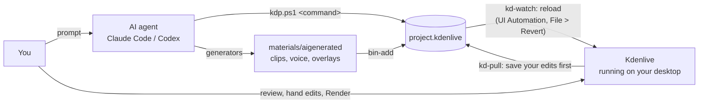

<div align="center">

# Movie Engine

**In agent d'IA taglia voss video en Kdenlive durant che vus guardais, e vus pudais surpigliar la lavur en mintga mument.**

Agents da programmaziun d'IA (Claude Code, Codex) construeschan e midan projects reals da Kdenlive: films, videos explicativs e shorts verticals. Las modificaziuns cumparan live en l'editur che vus avais avert. Portabel, Windows, nagins patches da l'editur.


[English](../../README.md) · [简体中文](README.zh-CN.md) · [繁體中文](README.zh-TW.md) · [हिन्दी](README.hi.md) · [Español](README.es.md) · [Français](README.fr.md) · [العربية](README.ar.md) · [বাংলা](README.bn.md) · [Português](README.pt.md) · [Русский](README.ru.md) · [اردو](README.ur.md) · [Bahasa Indonesia](README.id.md) · [Deutsch](README.de.md) · [日本語](README.ja.md) · [Türkçe](README.tr.md) · [한국어](README.ko.md) · [Українська](README.uk.md) · [Italiano](README.it.md) · [Polski](README.pl.md) · [Tiếng Việt](README.vi.md) · [فارسی](README.fa.md) · [ไทย](README.th.md) · [Kiswahili](README.sw.md) · [አማርኛ](README.am.md) · [Avañe'ẽ](README.gn.md) · [Setswana](README.tn.md) · [Shqip](README.sq.md) · [Беларуская](README.be.md) · [Български](README.bg.md) · [Bosanski](README.bs.md) · [Hrvatski](README.hr.md) · [Српски](README.sr.md) · [Crnogorski](README.cnr.md) · [Македонски](README.mk.md) · [Slovenščina](README.sl.md) · [Slovenčina](README.sk.md) · [Čeština](README.cs.md) · [Magyar](README.hu.md) · [Română](README.ro.md) · [Dansk](README.da.md) · [Norsk bokmål](README.nb.md) · [Norsk nynorsk](README.nn.md) · [Svenska](README.sv.md) · [Íslenska](README.is.md) · [Suomi](README.fi.md) · [Eesti](README.et.md) · [Latviešu](README.lv.md) · [Lietuvių](README.lt.md) · [Nederlands](README.nl.md) · [Lëtzebuergesch](README.lb.md) · **Rumantsch** · [Ελληνικά](README.el.md) · [Malti](README.mt.md) · [Gaeilge](README.ga.md) · [Català](README.ca.md) · [ქართული](README.ka.md) · [Հայերեն](README.hy.md) · [Azərbaycanca](README.az.md) · [Afrikaans](README.af.md) · [isiZulu](README.zu.md) · [isiXhosa](README.xh.md) · [Sesotho](README.st.md) · [Sepedi](README.nso.md) · [Xitsonga](README.ts.md) · [Tshivenḓa](README.ve.md) · [siSwati](README.ss.md) · [isiNdebele (South Africa)](README.nr.md) · [isiNdebele (Zimbabwe)](README.nd.md) · [chiShona](README.sn.md) · [Chichewa](README.ny.md) · [Ikinyarwanda](README.rw.md) · [Ikirundi](README.rn.md) · [Malagasy](README.mg.md) · [Soomaali](README.so.md) · [Afaan Oromoo](README.om.md) · [Qafar af](README.aa.md) · [ትግርኛ](README.ti.md) · [Sängö](README.sg.md) · [Kreol Seselwa](README.crs.md) · [TjiKalanga](README.kck.md) · [ChiNdau](README.ndc.md)

*Quai è ina translaziun; il README englais è la versiun da referenza.*

</div>

---

## Cuntegn

- [Pertge](#pertge)
- [Co che quai funcziuna](#co-che-quai-funcziuna)
- [Funcziuns](#funcziuns)
- [Premissas](#premissas)
- [Installaziun](#installaziun)
- [Cumenzar svelt](#cumenzar-svelt)
- [Lavurar cun l'agent](#lavurar-cun-lagent)
- [La lingia da cumond per tagliar (`kdp.ps1`)](#la-lingia-da-cumond-per-tagliar-kdpps1)
- [Sincronisaziun live cun l'editur avert](#sincronisaziun-live-cun-leditur-avert)
- [Generaturs: quai che Kdenlive na sa betg far](#generaturs-quai-che-kdenlive-na-sa-betg-far)
- [Vusch off e tun](#vusch-off-e-tun)
- [Lingua da l'interfatscha](#lingua-da-linterfatscha)
- [Structura dals ordinaturs](#structura-dals-ordinaturs)
- [Tests e cumprovas](#tests-e-cumprovas)
- [Restricziuns](#restricziuns)
- [Schliar problems](#schliar-problems)
- [Dumondas frequentas](#dumondas-frequentas)
- [Contribuir](#contribuir)
- [Engraziaments](#engraziaments)
- [Licenza](#licenza)

## Pertge

Ils programs per tagliar videos èn fatgs per in maun sin la mieur. Agents d'IA èn buns en structura, timing e repetiziun: plazzar 300 clips al ritem da la musica, sincronisar mintga suttitel cun la vusch, refar ina scena suenter in feedback. Els na pon dentant betg cliccar tras ina interfatscha grafica senza prender en possess voss desktop.

Kdenlive è in editur open source ferm, ma sin Windows n'ha el **nagina API d'automatisaziun**: la controlla via D-Bus exista mo en las versiuns per Linux, e las forks che agiuntan ina n'èn u betg pli mantegnidas u betg segiras. Movie Engine schlia quest problem senza modifitgar l'editur:

1. L'agent modifitgescha la datoteca da project `.kdenlive` cun agid d'ina lingia da cumond testada (`engine/kdp.ps1`).
2. Il Kdenlive che curra survegn via Windows UI Automation l'urden da chargiar da nov la datoteca, senza smatgar tastas, senza mieur e senza engular il focus.
3. Vossas atgnas modificaziuns betg memorisadas vegnan memorisadas l'emprim e mai surscrittas.

Uschia taglia l'agent e vus controllais, u vus modifitgais sez a maun. Omadus lavuran vi dal medem project, en il medem editur, al medem temp.

## Co che quai funcziuna



Mintga cumond da tagliar suonda il medem ciclus segir:

1. **Pull.** Sche Kdenlive ha modificaziuns betg memorisadas, survegn el l'urden da las memorisar (il buttun Save en la trav d'utensils via UI Automation), e la memorisaziun vegn confermada.
2. **Modifitgar.** Il cumond mida il XML sut ina bloccada, suenter ina controlla dal hash e cun in snapshot per pudair revocar. Sche la datoteca è sa midada en il fratemp, na vegn nagut scrit.
3. **Chargiar da nov.** Il watcher vesa il stempel da l'IA ed exequescha en l'editur avert File > Revert. Il success vala pir cura ch'il widget da la lingia dal temp è vegnì reconstruì effectivamain.
4. **Conflict.** Sche vus avais cumenzà a modifitgar en il fratemp, na vegn nagut chargià da nov e vossa lavur resta. La versiun da l'IA vegn messa da la vart, e l'agent applitgescha sia midada da nov sur la vossa.

## Funcziuns

- **Elavuraziun cumpletta dal project senza interfatscha grafica**: var 120 cumonds per bin, lingia dal temp, effects, cumposiziuns, pistas, lingias guida, marcaders, suttitels, sequenzas, sveltezza e time remap, preschentaziuns da slides, titels, proxies, render e revocar/repeter. Guardai la [referenza dals cumonds](#la-lingia-da-cumond-per-tagliar-kdpps1).
- **Sincronisaziun live cun l'editur avert.** Las modificaziuns da l'IA cumparan en il Kdenlive che vus guardais; vossas modificaziuns betg memorisadas vegnan memorisadas l'emprim e na van mai a perder.
- **Na disturba mai voss desktop.** Nagin engular dal focus, naginas tastas e nagina entrada cun la mieur. Ils editurs da test curran sin in desktop da Windows invisibel.
- **Portabel.** Editur, parameters, Node.js, scrittiras ed utensils sa chattan en in sulet ordinatur. Copiai el sin in auter computer e tut funcziuna; nagut na vegn scrit en Program Files u en voss profil da Windows.
- **Generaturs per quai che Kdenlive na sa betg far**: text cinetic bustab per bustab, annotaziuns dissegnadas a maun, scenas 3D d'interfatscha, animaziuns dal cursur e lungs films explicativs interactivs. Els vegnan renderads sin la GPU cun in vair motion blur e plazzads sin la lingia dal temp sco clips normals.
- **Vusch off cun temps dals pleds** (Microsoft Edge TTS, nagina clav d'API). Suttitels ed acziuns partan exactamain sin il pled correct.
- **Effects da tun sintetisads** (whoosh, click, pop, riser, impact e dapli), generads en code.
- **Cumprovà, betg supponì.** Mintga cumond ha ina controlla dal resultat, effects e cumposiziuns vegnan controllads in suenter l'auter, ed ils resultats bruts sa chattan en `docs/proof/`.
- **Instrucziuns per agents cuntegnidas.** `AGENTS.md` e las skills en `.claude/skills/` mussan a Claude Code ed a Codex il process da lavur, il format da la datoteca e las trappas.

## Premissas

| | |
|---|---|
| Sistem operativ | Windows 10 u 11, x64 |
| Editur | Kdenlive **26.08.3**, versiun portabla (standalone). Autras versiuns n'èn betg testadas. |
| Node.js | 18 u pli nov: il `.zip` Windows x64 da nodejs.org, decumprimà en `engine/node/` |
| Navigatur | Microsoft Edge (part da Windows); duvrà en modus headless dals renderers da scenas |
| Agent | [Claude Code](https://claude.com/claude-code) u Codex. Facultativ: mintga utensil funcziuna era a maun. |
| Disc | var 1 GB per l'editur e per ils utensils, plus vossas medias |
| GPU | mintga GPU cun codaziun H.264 da hardware accelerescha `film-render.mjs` (uschiglio duvra el software) |

## Installaziun

Tut vegn installà **entaifer l'ordinatur**. I na dovra nagins dretgs d'administratur.

```powershell
git clone https://github.com/vladtarrow/movie-engine.git
cd movie-engine
```

**1. Node.js.** Telechargiai il `.zip` Windows x64 da Node.js 18 u pli nov da <https://nodejs.org/en/download> e decumprimai ses cuntegn en `engine\node\`, uschia che `engine\node\node.exe` ed `engine\node\npm.cmd` sa chattan là. I na dovra nagin program d'installaziun e nagin Node dal sistem. Tut ils scripts curran via `engine\node.cmd`, mai via in Node dal sistem.

**2. Pachets da Node** per l'utensil da vusch e per ils renderers (las versiuns èn fixadas en `engine/voice/package.json`):

```powershell
engine\node\npm.cmd install --prefix engine\voice
```

**3. Kdenlive 26.08.3 portabel.** Telechargiai `kdenlive-26.08.3_standalone.exe` da <https://download.kde.org/stable/kdenlive/26.08/windows/> en `engine\installer\`, controllai la datoteca e decumprimai ella:

```powershell
(Get-FileHash engine\installer\kdenlive-26.08.3_standalone.exe -Algorithm SHA256).Hash
# expected: A25427B1DFF2C17E3B0386E991BB1A719382BB3176D1A90E441CDAEB6E0A967D
engine\installer\kdenlive-26.08.3_standalone.exe -o"engine\Kdenlive" -y
```

L'editur sa chatta lura en `engine\Kdenlive\kdenlive-26.08.3_standalone\bin\`. El cuntegna gia `melt.exe` ed `ffmpeg.exe`.

**4. Emprima aviada.**

```powershell
engine\kdenlive.cmd
```

Kdenlive memorisescha tut ses parameters en `engine\profile-kdenlive\`, betg en voss profil da Windows. Tar l'emprima aviada mussa el ina giada in assistent da configuraziun.

## Cumenzar svelt

### Cun in agent

Avri l'ordinatur en Claude Code (u Codex) e dumandai cun pleds simpels:

> Fa in nov project vertical "launch-teaser" cun 30 fps. Metta ils trais screenshots da `materials/designers/launch/` sin la lingia dal temp, mintgin 2,5 s cun ina curta transiziun, agiunta ina vusch off da `script.txt` e sincronisescha mintga lingia cun in suttitel cinetic.

> Avra el per mai en Kdenlive.

> Il segund plan è memia lung. Scurznescha el sin 1,8 s e metta il logo in pau pli ensi.

L'agent suonda `AGENTS.md`: el modifitgescha via `kdp.ps1`, renderescha mo ils clips ch'il tagl dovra e tegna l'editur avert sincronisà. Vus controllais en Kdenlive, modifitgais a maun cura che vus vulais e smatgais Render cura che vus essas cuntents.

### A maun

```powershell
# a new 1080x1920 30 fps project with 2 video and 2 audio tracks
powershell -NoProfile -ExecutionPolicy Bypass -File engine\kdp.ps1 new -Project projects\hello\hello.kdenlive -Profile vertical_hd_30

# a 3-second title and a colour background
powershell -NoProfile -ExecutionPolicy Bypass -File engine\kdp.ps1 bin-color -Project projects\hello\hello.kdenlive -Color '#203060' -Seconds 3 -Name bg
powershell -NoProfile -ExecutionPolicy Bypass -File engine\kdp.ps1 title -Project projects\hello\hello.kdenlive -Text "Hello" -Seconds 3 -Name hi

# place them: background on V1, title above it on V2
powershell -NoProfile -ExecutionPolicy Bypass -File engine\kdp.ps1 add -Project projects\hello\hello.kdenlive -Bin bg -Track V1 -At 0
powershell -NoProfile -ExecutionPolicy Bypass -File engine\kdp.ps1 add -Project projects\hello\hello.kdenlive -Bin hi -Track V2 -At 0

# a check frame, then open it in the editor
powershell -NoProfile -ExecutionPolicy Bypass -File engine\kdp.ps1 frame -Project projects\hello\hello.kdenlive -At 1.5 -Out out\hello\check.png
engine\kdenlive.cmd projects\hello\hello.kdenlive
```

Per avrir pli tard danovamain l'ultim project, cliccai dubel sin `open-last-project.cmd`.

## Lavurar cun l'agent

L'agent legia `AGENTS.md` (Codex) u `CLAUDE.md`, che l'importa (Claude Code), ed ultra da quai duas skills:

| Skill | Mussa |
|---|---|
| `.claude/skills/kdenlive-project-file` | il format `.kdenlive` / MLT XML, `kdp.ps1`, controllar cun `melt` |
| `.claude/skills/kdenlive-live` | manar a moda segira l'editur che curra: aviar, pull, chargiar da nov, fotografar sia atgna fanestra |

Reglas che l'agent suonda e sin las qualas vus pudais contar:

- El na prenda mai vossa mieur, vossa tastatura u voss focus e na fa mai screenshots da voss desktop (mo da la fanestra da l'editur sez).
- El fa sez ils pass en l'interfatscha (memorisar, avrir, chargiar da nov) empè da pretender che vus cliccais.
- El dumonda avant che telechargiar insatge ed avant che stizzar insatge.
- El renderescha mo quai che la lavur dovra (clips da scenas, maletgs da controlla). Il film final renderescha el mo sche vus dumandais quai.
- Cura che Kdenlive na sa betg far insatge bain, construescha l'agent quai ordaifer cun code e metta il resultat en sco clip. El na sminuescha betg l'effect.

## La lingia da cumond per tagliar (`kdp.ps1`)

```powershell
powershell -NoProfile -ExecutionPolicy Bypass -File engine\kdp.ps1 <command> -Project <file.kdenlive> [options]
```

Ils temps èn en secundas, cun in punct (`2.5`). Las pistas sa numnan `V1 V2 …` (V1 è la pli bassa) ed `A1 A2 …`. In clip vegn adressà cun `-Track` plus in temp arbitrar `-At` entaifer el. Ils parameters dals effects van en `-Params "name=value||name=value"`. La glista cumpletta cun tut las opziuns è en il chau da `engine/kdp.ps1`.

| Gruppa | Cumonds |
|---|---|
| Project | `new`, `profiles`, `info`, `validate`, `fonts`, `profile-set`, `profile-from-clip`, `zone`, `archive`, `backups`, `rebase`, `otio-export`, `otio-import` |
| Bin | `bin-add`, `bin-color`, `title`, `title-text`, `title-save`, `title-template`, `bin-rename`, `bin-remove`, `bin-info`, `bin-set`, `bin-duplicate`, `bin-replace-file`, `bin-reload`, `folder`, `bin-folder`, `relink`, `clean`, `generator`, `playlist-clip`, `extract-audio`, `transcode` |
| Lingia dal temp | `add`, `add-av`, `move`, `copy`, `trim`, `ripple-trim`, `slip`, `split`, `remove`, `speed`, `remap`, `disable`, `enable`, `group`, `ungroup`, `mix`, `unmix`, `space-insert`, `space-remove`, `spaces-remove-all`, `track-clear`, `replace-in-timeline` |
| Effects | `effects`, `effect-info`, `effect-add`, `effect-list`, `effect-set`, `effect-remove`, `effect-copy`, `effect-clear`, `effects-all`, `bin-effect`, `effect-templates`, `effect-template` |
| Cumposiziuns | `compositions`, `comp-info`, `comp-add`, `comp-list`, `comp-set`, `comp-remove` |
| Pistas | `track-add`, `track-remove`, `track-set` |
| Lingias guida e marcaders | `guide-add`, `guide-list`, `guide-remove`, `guide-set`, `guide-clear`, `guide-export`, `guide-category`, `marker`, `marker-list`, `marker-set`, `marker-remove` |
| Suttitels | `sub-add`, `sub-import`, `sub-export`, `sub-state` |
| Sequenzas | `sequence-add`, `sequences`, `copy-to-sequence`, `expand`; mintga cumond cun `-Sequence <name>` funcziuna entaifer quella sequenza |
| Spezial | `slideshow`, animaziuns Lottie / Glaxnimate via `bin-add`, `proxy`, `stabilize`, `scene-split`, `speed-job`, `subclip` |
| Sortida | `frame` (in PNG), `preview` (render svelt cun melt), `render` (il renderer agen da Kdenlive u in preset), `presets` |
| Istorgia | `undo`, `redo`, `clear-history` (snapshots en `projects/<name>/.kdp-history`) |

Cumportament ch'i vala la paina da savair:

- Las mesadads d'audio e da video colliadas vegnan spustadas, scurznidas, partidas ed allontanadas ensemen (`-Alone` per ina mesadad).
- In cumond che fallescha terminescha cun il code 1 e na scriva nagut.
- Effects che la versiun per Windows na po betg exequir vegnan refusads, betg ignorads en silenzi (glista: `docs/proof/assets.txt`).
- Mintga acziun dal menu da Kdenlive è attribuida en `engine/tools/data/kdenlive-actions.csv` ad in cumond, ad ina autra via u a "mo vista". Guardai `docs/kdenlive-coverage.md`.

## Sincronisaziun live cun l'editur avert

| Script | Tge ch'el fa | Codes da sortida |
|---|---|---|
| `engine\kd-pull.ps1 -Project <f>` | fa che Kdenlive memorisescha vossas modificaziuns e conferma quai | 0 datoteca actuala, 3 na curra betg, 4 betg confermà |
| `engine\kd-reload.ps1 -Project <f>` | File > Revert, confermà tras la lingia dal temp reconstruida | 0 confermà, 2 vus avais modificaziuns betg memorisadas (nagut n'è vegnì bittà davent), 3 na curra betg, 4 fallì |
| `engine\kd-watch.ps1 -Project <f>` | watcher en il fund: chargia da nov suenter mintga scriver da l'IA, protocollescha conflicts | protocol en `engine\kd-watch.log`; stizzai `engine\kd-watch.run` per al fermar |
| `engine\kdenlive-bg.ps1 [project]` | avia Kdenlive minimisà per in agent | 0 chargià, 4 betg confermà |
| `engine\kdenlive.cmd [project]` | avia Kdenlive per vus | |

Aviai il watcher ina giada per sessiun:

```powershell
Start-Process powershell -WindowStyle Hidden -ArgumentList '-NoProfile','-ExecutionPolicy','Bypass','-File','engine\kd-watch.ps1','-Project','projects\hello\hello.kdenlive'
```

Projects gronds: chargiar da nov in project cun 1000 clips dura minutas, ed ils utensils spetgan empè da rapportar memia baud. Ils projects vegnan averts via *File > Open Recent* en in editur vid, perquai che Qt percurra, sch'ins avra directamain ina datoteca, mintga element da la lingia dal temp per l'accessibladad, e quai era var 10 minutas pli plaun.

## Generaturs: quai che Kdenlive na sa betg far

Kdenlive/MLT n'ha nagina animaziun da text bustab per bustab, naginas expressiuns e pauc 3D, ed effects grevs franan la reproducziun. Movie Engine renderescha talas parts ordaifer e las metta sin la lingia dal temp sco clips normals, per il solit cun alfa, sin ina pista sur ils maletgs. Il script dal generatur e sias datas d'entrada restan en l'ordinatur dal project, uschia ch'in clip po vegnir generà da nov cura ch'il text, la scrittira u il timing sa midan.

| Utensil | Fa |
|---|---|
| `engine/tools/kinetic-text.ps1` | suttitels cinetics bustab per bustab, mintga pled sincronisà a basa da `voice.json`, chascha d'accentuaziun |
| `engine/tools/annotate.ps1` | tschertgels, chaschas, sutlingiaziuns e frizzas dissegnads a maun che sa dissegnan sur in screenshot |
| `engine/tools/card-entrance.ps1` | ina carta cun in screenshot che s'auza e s'engrondescha cun in'umbriva lomma |
| `engine/tools/pdf-to-png.ps1` | slides d'in export PDF |
| `engine/tools/html-render.mjs` | mintga scena HTML/CSS/canvas en video: animaziun d'interfatscha, cursurs, 3D, mascras |
| `engine/tools/film-render.mjs` + `film/` | lungs films explicativs interactivs sin in canvas: in clip per lingia da vusch off, acziuns partan sin pleds pronunziads, motion blur sin la GPU cun var 45 fps |

Omadus renderers manan il Microsoft Edge furnì cun Windows, en modus headless, cun in profil d'ina giada e senza access a la rait.

### Demos

```powershell
# a 3-second 3D title card with a cursor click
engine\node.cmd engine\tools\html-render.mjs examples\demo\scene\scene.html examples\demo\out --frames 0,30,60,89
engine\node.cmd engine\tools\html-render.mjs examples\demo\scene\scene.html examples\demo\out\scene.mp4

# a 4-shot interactive film timed to two voice lines
engine\node.cmd engine\tools\film-render.mjs examples\demo\film\film.html examples\demo\out --check
engine\node.cmd engine\tools\film-render.mjs examples\demo\film\film.html examples\demo\out --shots all --width 640
engine\node.cmd engine\tools\film-render.mjs examples\demo\film\film.html examples\demo\out\clips --suffix -v01
```

In film consista da trais pitschnas datotecas. `data.js` cuntegna ils plans ed ils temps dals pleds. `direction.js` ha ina lingia per plan:

```text
1 | hover 192 108 @brand | tag 300 60 Your brand @deserves | confetti 192 90 @film
2 say=A film that/*explains* it
3 | click 116 108 @before | click 268 108 @after | chips Before~After @after
4 scene=counter | count 0 120 % @count
```

`scenes.js` cuntegna ils plans che vegnan dissegnads cumplettamain da nov. `@word` lantscha in'acziun cura che la vusch di quel pled. Las acziuns cumpiglian click, hover, drag, zoom, lens, ring, arrow, chips, toggle, slider, toast, type, count e confetti; la sintaxa cumpletta stat al cumenzament da `engine/tools/film/film-kit.js`.

## Vusch off e tun

```powershell
engine\node.cmd engine\voice\voice.mjs lines.json materials\aigenerated\hello\voice en-US-AndrewMultilingualNeural +0%
```

`lines.json` è ina glista da lingias. L'utensil scriva in mp3 per lingia plus `voice.json`, cun la durada ed il cumenzament e la fin da mintga pled. Las lingias vegnan memorisadas en il cache, uschia che sche vus midais ina lingia, vegn mo quella generada da nov. I vegn duvrada la sintesa vocala online da Microsoft Edge via il pachet `msedge-tts`: i na dovra nagina clav, ma il servetsch n'è betg uffizial e dovra internet.

```powershell
engine\node.cmd engine\audio\sfx.mjs materials\aigenerated\sfx
```

Quai sintetisescha en code whoosh, whoosh-long, swipe, click, pop, tick, riser, impact, ding e reveal; ina collecziun pronta sa chatta en `materials/aigenerated/sfx/`. Cumplettai tuns pli curts ch'in maletg cun silenzi avant ch'als plazzar (`-af apad=whole_dur=0.0667`).

## Lingua da l'interfatscha

Ils lantschaders avian Kdenlive per standard en **englais**. Per duvrar in'autra lingua, fixai `MOVIE_ENGINE_UI_LANG` avant l'aviada:

```powershell
$env:MOVIE_ENGINE_UI_LANG = 'ru'; engine\kdenlive.cmd
```

UI Automation chatta ils elements dal menu tenor lur nums visibels. Ils nums per 31 linguas d'interfatscha èn integrads (`engine/tools/kd-ui.ps1`, `$KdNames`). Per mintga autra lingua agiuntai là ses nums e controllai cun:

```powershell
powershell -NoProfile -ExecutionPolicy Bypass -File engine\tools\kd-langcheck.ps1
```

## Structura dals ordinaturs

```text
movie-engine/
├─ AGENTS.md, CLAUDE.md          instructions for AI agents
├─ .claude/skills/               agent skills: project file format, live editor
├─ engine/
│  ├─ kdp.ps1                    the editing command line
│  ├─ kd-pull / kd-reload / kd-watch .ps1, kdenlive.cmd, kdenlive-bg.ps1
│  ├─ tools/                     internals, generators, tests, data (action map)
│  ├─ voice/  audio/  fonts/     TTS, synthesized SFX, Poppins (OFL)
│  ├─ Kdenlive/  node/           portable editor and Node.js (not in git)
│  └─ profile-kdenlive/          the editor's settings (not in git)
├─ projects/<name>/<name>.kdenlive
├─ materials/
│  ├─ download/                  stock and downloaded files (not in git)
│  ├─ aigenerated/               everything the AI made (sfx/ and test-kit/ ship with the engine)
│  ├─ designers/  brand/         files from your team, brand assets
├─ examples/demo/                demos of the scene and film renderers
├─ out/                          renders (not in git)
└─ docs/                         proofs, coverage, translations of this README
```

Ils percurs da las medias entaifer ils projects èn relativs. Sche vus spustais u copiais l'ordinatur, scriva `kdp.ps1 rebase` (exequì era automaticamain da `kdenlive.cmd`) il nov lieu en il project.

## Tests e cumprovas

Las affirmaziuns davart quai che funcziuna sa basan sin controllas dal resultat, betg sin "la funcziun è vegnida exequida". La resumaziun è en [`docs/kdenlive-proof.md`](../../docs/kdenlive-proof.md), e l'output brut en `docs/proof/`.

| Test | Controllescha |
|---|---|
| `engine\tools\kdp-clitest.ps1` | mintga cumond `kdp.ps1`, via la lingia da cumond, cumparegliond il project resultant |
| `engine\tools\kd-livetest.ps1` | pull, chargiar da nov, watcher, conflicts e race conditions cun in Kdenlive real sin in desktop invisibel |
| `engine\tools\kdp-assetsweep.ps1` | mintga effect e mintga cumposiziun: renderescha e cumpareglia maletgs |
| `engine\tools\kdp-portabletest.ps1` | copiescha l'ordinatur en in auter lieu e lavura cun la copia |
| `engine\tools\kd-langcheck.ps1` | la lingua da l'interfatscha e che UI Automation chatta il menu |
| `engine\tools\kdp-coverage-check.ps1` | che mintga acziun dal menu è attribuida e che nagina cumprova n'è pli veglia ch'il code |

```powershell
powershell -NoProfile -ExecutionPolicy Bypass -File engine\tools\kdp-clitest.ps1 -Report docs\proof\clitest.txt
powershell -NoProfile -ExecutionPolicy Bypass -File engine\tools\kd-livetest.ps1 -Report docs\proof\live-en.txt
```

Ils editurs da test curran mo sin in desktop zuppà cun in agen profil, uschia che las tests na tangheschan mai voss Kdenlive avert u voss focus.

## Restricziuns

- **Mo Windows**, mo Kdenlive **26.08.3**. Linux ha D-Bus e dovrass ina autra punt.
- Cura che l'editur vegn avià, prenda el il focus da la tastatura per var 3 secundas, durant che la fanestra vida cumpara. Ils agents dumondan avant che l'aviar durant che vus lavurais. Chargiar da nov e modificaziuns na prendan betg il focus.
- A la versiun per Windows mancan ils moduls MLT sox, ladspa e movit e tscherts effects frei0r/avfilter; `kdp.ps1` als refusa (`docs/proof/assets.txt`).
- Export ed import d'OpenTimelineIO transportan mo clips ed intervals vids. Multicam n'ha nagina midada live da l'angul da la camera (ils tagls vegnan fatgs cun split/remove/hide).
- "Save As…" via UI Automation sin ina fanestra minimisada n'avra nagin dialog; l'agent dovra empè `archive` u copias da datotecas.
- La renconuschientscha da la vusch (suttitels automatics) dovra Whisper u Vosk, che n'èn betg cuntegnids.
- Titels fatgs cun l'utensil da titels da Kdenlive duvran scrittiras installadas en Windows. Per ina tipografia garantida, renderai il text cun ils generaturs, che chargian las scrittiras da `engine/fonts/`.
- Edge TTS è in servetsch online betg uffizial e po sa midar u chalar da funcziunar.

## Schliar problems

| Sintom | Motiv e soluziun |
|---|---|
| Kdenlive curra, ma in clic sin el en la trav da las incumbensas na mussa nagut | Sia posiziun da fanestra memorisada è ordaifer il visur. Serrai el e stizzai las endataziuns `kdockLayout` en `engine\profile-kdenlive\AppData\Local\kdenliverc`, u spustai la fanestra cun `SetWindowPos` (guardai `AGENTS.md`). |
| `kd-reload.ps1` terminescha cun il code 2 | Vus avais modificaziuns betg memorisadas. Nagut n'è vegnì bittà davent. Lantschai `kd-pull.ps1` ed applitgai lura danovamain la midada (`kdp.ps1` fa quai sez). |
| `CONFLICT` en `engine\kd-watch.log` | Vus e l'agent avais modifitgà al medem mument. Vossa versiun resta en l'editur, e la versiun da l'IA è en `projects\<name>\.kdp-history\<name>\conflict\`. Dumandai l'agent d'applitgar danovamain sia midada. |
| In cumond terminescha cun il code 1 e "pull not confirmed" | Kdenlive è occupà u mussa in dialog. Serrai il dialog u spetgai fin ch'il chargiar è terminà, e repetai lura. |
| In script PowerShell na po betg vegnir analisà | Scripts cun text betg ASCII ston vegnir memorisads per Windows PowerShell 5.1 sco UTF-8 **cun BOM**. |
| `voice.mjs` sa ferma cun "Stream closed before the synthesis completed" | Per il solit in problem da rait, u SSML betg mascà en copias pli veglias. `voice.mjs` masca sez `& < >`. |
| Avrir in grond project dura bleras minutas | Avri el via `kdenlive.cmd` / `kdenlive-bg.ps1`, mai sco `kdenlive.exe project.kdenlive`. |

## Dumondas frequentas

**Hai jau basegn da Claude Code u Codex?**
Na. Mintga utensil è in script simpel che vus pudais exequir a maun. L'agent fa che tut va svelt: el planisescha il tagl, exequescha ils utensils e tegna l'editur sincronisà.

**Vegn l'agent a surscriver mias modificaziuns manualas?**
Na. Avant mintga operaziun da scriver vegnan vossas modificaziuns betg memorisadas memorisadas e confermadas. Sche vus modifitgais durant che l'agent scriva, vegn l'operaziun da scriver refusada u messa da la vart sco conflict, mai applitgada sur vossa lavur.

**Poss jau cuntinuar a duvrar Kdenlive normalmain?**
Gea. I sa tracta dal Kdenlive standard cun ses agen ordinatur da parameters. Modifitgai, guardai e renderai sco usità.

**Funcziuna quai cun in Kdenlive che jau hai gia installà?**
I vegn duvrada ina atgna copia portabla en `engine\Kdenlive\`, uschia ch'il Kdenlive installà e ses parameters restan intacts.

**Pertge betg ina fork da Kdenlive cun API u in auter editur?**
Per Windows n'exista nagina fork mantegnida e segira (enquista da november 2026). OpenShot, Blender VSE, DaVinci Resolve, Shotcut ed editurs web èn vegnids evaluads; Kdenlive ha porschì la pli gronda profunditad da tagl. Ina proposta d'ina REST API en il project principal (merge request !902) vegn observada.

**Po quai renderar il video final?**
Gea, cun `kdp.ps1 render` (il renderer agen da Kdenlive, zuppà), u vus smatgais sez Render en l'editur.

**Vegnan mias medias chargiadas si insanua?**
Na. Mo il text da la vusch off vegn tramess al servetsch Edge TTS cura che vus generais la vusch. Ils renderers da scenas curran cun la rait deactivada.

## Contribuir

Contribuziuns èn bainvegnidas. Guardai [CONTRIBUTING.md](../../CONTRIBUTING.md). En curt:

- Mintga operaziun `kdp.ps1` nova u midada dovra ina controlla dal resultat en `kdp-clitest.ps1`, in'endataziun en la charta da las acziuns ed ina nova execuziun da `kdp-coverage-check.ps1`.
- Mai aviar in Kdenlive da test sin il desktop visibel; duvrai `engine/tools/kd-hidden.ps1`.
- Tegnai tut portabel: naginas installaziuns ordaifer l'ordinatur, nagins percurs absoluts en ils projects.
- Notai las particularitads verifitgadas en `AGENTS.md` u en la skill correspundenta.

## Engraziaments

- [Kdenlive](https://kdenlive.org) ed [MLT](https://www.mltframework.org): l'editur ed il motor sutvart.
- [FFmpeg](https://ffmpeg.org), furnì cun Kdenlive.
- [msedge-tts](https://www.npmjs.com/package/msedge-tts) per la vusch off.
- [Poppins](https://fonts.google.com/specimen/Poppins) da Indian Type Foundry, SIL Open Font License (`engine/fonts/OFL.txt`).
- `engine/tools/data/kdenliveui-26.08.3.rc`: la datoteca dal menu da Kdenlive, prendida dal code da funtauna da Kdenlive 26.08.3; duvrada mo da la controlla da la cuvrida. Ella resta sut la licenza GPL da Kdenlive, betg sut la MIT License.

## Licenza

Il code agen da Movie Engine è publitgà sut la [licenza MIT](../../LICENSE). Kdenlive, MLT, FFmpeg, ils pachets da Node.js e la scrittira Poppins mantegnan lur atgnas licenzas.
