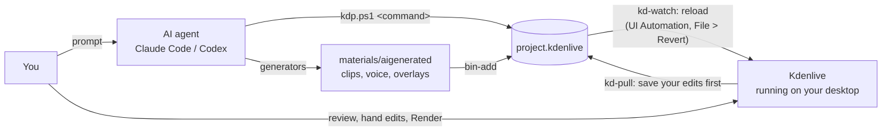

<div align="center">

# Movie Engine

**Umukozi wa AI atunganya videwo yawe muri Kdenlive uriko uraraba, kandi urashobora kwisubiza igikorwa igihe cose ushaka.**

Abakozi ba AI bandika code (AI agents: Claude Code, Codex) barema kandi bagahindura imigambi nyakuri ya Kdenlive: filime, videwo zisigura hamwe n'amasanamu magufi ahagaze (vertical shorts). Ivyahinduwe biboneka ubwo nyene muri editor (porogarama yo gutunganya amasanamu) wuguruye. Irashobora kwimurwa (portable), Windows, nta guhindura editor nyene.


[English](../../README.md) · [简体中文](README.zh-CN.md) · [繁體中文](README.zh-TW.md) · [हिन्दी](README.hi.md) · [Español](README.es.md) · [Français](README.fr.md) · [العربية](README.ar.md) · [বাংলা](README.bn.md) · [Português](README.pt.md) · [Русский](README.ru.md) · [اردو](README.ur.md) · [Bahasa Indonesia](README.id.md) · [Deutsch](README.de.md) · [日本語](README.ja.md) · [Türkçe](README.tr.md) · [한국어](README.ko.md) · [Українська](README.uk.md) · [Italiano](README.it.md) · [Polski](README.pl.md) · [Tiếng Việt](README.vi.md) · [فارسی](README.fa.md) · [ไทย](README.th.md) · [Kiswahili](README.sw.md) · [አማርኛ](README.am.md) · [Avañe'ẽ](README.gn.md) · [Setswana](README.tn.md) · [Shqip](README.sq.md) · [Беларуская](README.be.md) · [Български](README.bg.md) · [Bosanski](README.bs.md) · [Hrvatski](README.hr.md) · [Српски](README.sr.md) · [Crnogorski](README.cnr.md) · [Македонски](README.mk.md) · [Slovenščina](README.sl.md) · [Slovenčina](README.sk.md) · [Čeština](README.cs.md) · [Magyar](README.hu.md) · [Română](README.ro.md) · [Dansk](README.da.md) · [Norsk bokmål](README.nb.md) · [Norsk nynorsk](README.nn.md) · [Svenska](README.sv.md) · [Íslenska](README.is.md) · [Suomi](README.fi.md) · [Eesti](README.et.md) · [Latviešu](README.lv.md) · [Lietuvių](README.lt.md) · [Nederlands](README.nl.md) · [Lëtzebuergesch](README.lb.md) · [Rumantsch](README.rm.md) · [Ελληνικά](README.el.md) · [Malti](README.mt.md) · [Gaeilge](README.ga.md) · [Català](README.ca.md) · [ქართული](README.ka.md) · [Հայերեն](README.hy.md) · [Azərbaycanca](README.az.md) · [Afrikaans](README.af.md) · [isiZulu](README.zu.md) · [isiXhosa](README.xh.md) · [Sesotho](README.st.md) · [Sepedi](README.nso.md) · [Xitsonga](README.ts.md) · [Tshivenḓa](README.ve.md) · [siSwati](README.ss.md) · [isiNdebele (South Africa)](README.nr.md) · [isiNdebele (Zimbabwe)](README.nd.md) · [chiShona](README.sn.md) · [Chichewa](README.ny.md) · [Ikinyarwanda](README.rw.md) · **Ikirundi** · [Malagasy](README.mg.md) · [Soomaali](README.so.md) · [Afaan Oromoo](README.om.md) · [Qafar af](README.aa.md) · [ትግርኛ](README.ti.md) · [Sängö](README.sg.md) · [Kreol Seselwa](README.crs.md) · [TjiKalanga](README.kck.md) · [ChiNdau](README.ndc.md)

*Iyi ni ihindurwa mu rundi rurimi; README y'icongereza ni yo ishingirwako.*

</div>

---

## Ibirimwo

- [Igituma](#igituma)
- [Ingene bikora](#ingene-bikora)
- [Ivyo ishoboye](#ivyo-ishoboye)
- [Ivyangombwa](#ivyangombwa)
- [Gushiramwo](#gushiramwo)
- [Gutangura vuba](#gutangura-vuba)
- [Gukorana n'umukozi wa AI](#gukorana-numukozi-wa-ai)
- [Umurongo w'amabwirizwa wo gutunganya (`kdp.ps1`)](#umurongo-wamabwirizwa-wo-gutunganya-kdpps1)
- [Guhuza ubwo nyene na editor yuguruye](#guhuza-ubwo-nyene-na-editor-yuguruye)
- [Generators: ivyo Kdenlive idashobora gukora](#generators-ivyo-kdenlive-idashobora-gukora)
- [Ijwi risigura n'amajwi](#ijwi-risigura-namajwi)
- [Ururimi rwa interface](#ururimi-rwa-interface)
- [Ingene ububiko butunganijwe](#ingene-ububiko-butunganijwe)
- [Ibigeragezo n'ivyemezo](#ibigeragezo-nivyemezo)
- [Aho bigarukira](#aho-bigarukira)
- [Gutorera umuti ingorane](#gutorera-umuti-ingorane)
- [Ibibazo bikunda kubazwa](#ibibazo-bikunda-kubazwa)
- [Gutanga intererano](#gutanga-intererano)
- [Ugukenguruka](#ugukenguruka)
- [Uruhusha](#uruhusha)

## Igituma

Porogarama zo gutunganya amasanamu zakorewe ukuboko gufashe imbeba (mouse). Abakozi ba AI barashoboye cane ingene ibintu bitunganijwe, igihe n'ibikorwa bisubirwamwo: gushira clips 300 ku njyana, guhuza caption yose (insiguro yandikwa ku masanamu) n'ijwi, gusubiramwo scene inyuma yo kuronka ivyiyumviro. Ariko ntibashobora gukanda muri GUI (interface ishushanyije) batigaruriye desktop yawe.

Kdenlive ni editor ikomeye ifise code yuguruye (open-source), ariko kuri Windows **ntifise API yo kuyikoresha mu buryo bwikora (automation)**: kuyiyobora biciye kuri D-Bus biriho gusa ku nyubako (builds) za Linux, kandi forks ziyongerako ubwo buryo canke ntizikitwararikwa, canke ntizitekanye. Movie Engine itorera umuti iyi ngorane idahinduye editor:

1. Umukozi wa AI ahindura dosiye y'umugambi `.kdenlive` akoresheje umurongo w'amabwirizwa wageragejwe (`engine/kdp.ps1`).
2. Kdenlive iriko irakora ibwirwa gusubira gusoma dosiye biciye kuri Windows UI Automation, nta gukanda kuri clavier, nta mbeba, kandi nta kwambura focus.
3. Ivyo wahinduye utaremeza (utarabika) bibanza kubikwa kandi ntibizokwigera bisimburwa.

Ni co gituma umukozi wa AI atunganya wewe ukaraba, canke ugatunganya n'amaboko. Mwompi mukora ku mugambi umwe, muri editor imwe, icarimwe.

## Ingene bikora



Itegeko ryose ryo gutunganya rikurikiza urukurikirane rumwe rutekanye:

1. **Pull (gukwega).** Nimba Kdenlive ifise ivyahinduwe bitarabikwa, ibwirwa kubibika (buto Save yo ku murongo w'ibikoresho, biciye kuri UI Automation), kandi ukubika kukemezwa.
2. **Guhindura.** Itegeko rihindura XML rimaze kwugara dosiye (lock), inyuma yo kugenzura hash kandi hafashwe ifoto yo gusubiza inyuma (undo snapshot). Nimba dosiye yahindutse hagati aho, nta kintu canditswe.
3. **Gusubira kwugurura (reload).** Umugenzuzi (watcher) abona ikimenyetso ca AI maze agakora File > Revert muri editor yuguruye. Bifatwa ko vyagenze neza gusa igihe widget ya timeline yasubiye kwubakwa vy'ukuri.
4. **Ukunyuranya (conflict).** Nimba watanguye gutunganya hagati aho, nta gusubira kwugurura gukorwa kandi igikorwa cawe kiguma. Verisiyo ya AI ibikwa ukwayo, maze umukozi wa AI agasubira gushira ivyo yahinduye hejuru y'ivyawe.

## Ivyo ishoboye

- **Gutunganya umugambi wose ata GUI**: amategeko nka 120 arimwo bin (ububiko bw'ibikoresho vy'umugambi), timeline, effects, compositions, tracks, guides, markers, subtitles, sequences, umuvuduko no guhindura igihe (time remap), slideshows, titles, proxies, rendering na undo/redo. Raba [urutonde rw'amategeko](#umurongo-wamabwirizwa-wo-gutunganya-kdpps1).
- **Guhuza ubwo nyene na editor yuguruye.** Ivyahinduwe na AI biboneka muri Kdenlive uriko uraraba; ivyo wahinduye bitarabikwa bibanza kubikwa kandi ntibizokwigera bitakara.
- **Ntibangamira desktop yawe.** Nta kwambura focus, nta gukanda kuri clavier canke ku mbeba. Editors z'ikigeragezo zikora kuri desktop ya Windows itaboneka.
- **Irashobora kwimurwa.** Editor, amategeko y'imikoreshereze (settings), Node.js, fonts n'ibikoresho biri mu bubiko bumwe. Bukoporore ubushire kuri PC iyindi, birakora; nta kintu candikwa muri Program Files canke muri profile yawe ya Windows.
- **Generators z'ivyo Kdenlive idashobora gukora**: insiguro inyiganyiga inyuguti ku yindi (kinetic text), ibimenyetso bishushanyijwe n'amaboko, scenes za 3D za interface, animations za cursor na filime ndende zisigura ("explainer") zifise ukwitaba. Zikorwa (render) kuri GPU zifise motion blur y'ukuri kandi zishirwa kuri timeline nka clips zisanzwe.
- **Ijwi risigura (voice-over) rifise igihe c'ijambo ryose** (Microsoft Edge TTS, nta API key). Captions n'ibikorwa biba neza ku ijambo nyakuri.
- **Amajwi y'ingaruka (sound effects) akorwa na code** (whoosh, click, pop, riser, impact n'ayandi).
- **Vyerekanywe, ntivyakekejwe.** Itegeko ryose rifise igenzura ry'ivyavuyemwo, effects na compositions bigenzurwa kimwe kimwe, kandi ivyavuyemwo vy'umwimerere biri muri `docs/proof/`.
- **Amabwirizwa y'abakozi ba AI arimwo.** `AGENTS.md` na skills ziri muri `.claude/skills/` vyigisha Claude Code na Codex ingene bakora, ingene dosiye imeze n'imitego yo kwirinda.

## Ivyangombwa

| | |
|---|---|
| Sisitemu (OS) | Windows 10 canke 11, x64 |
| Editor | Kdenlive **26.08.3**, inyubako ishobora kwimurwa (standalone). Izindi verisiyo ntizageragejwe. |
| Node.js | 18 canke irenzeko: `.zip` ya Windows x64 ivuye kuri nodejs.org, yugururiwe muri `engine/node/` |
| Mushakisha (browser) | Microsoft Edge (iri muri Windows); ikoreshwa ata dirisha (headless) n'ibikoresho bikora scenes |
| Umukozi wa AI | [Claude Code](https://claude.com/claude-code) canke Codex. Si ngombwa: igikoresho cose kirashobora no gukoreshwa n'amaboko. |
| Disiki | nka 1 GB ya editor n'ibikoresho, wongeyeko amasanamu n'amajwi yawe |
| GPU | GPU iyo ari yo yose ifise H.264 encoding ya hardware yihutisha `film-render.mjs` (iyo idahari, hakoreshwa software) |

## Gushiramwo

Vyose bishirwa **imbere mu bubiko**. Nta burenganzira bwa admin bukenewe.

```powershell
git clone https://github.com/vladtarrow/movie-engine.git
cd movie-engine
```

**1. Node.js.** Manura `.zip` ya Windows x64 ya Node.js 18 canke irenzeko kuri <https://nodejs.org/en/download> maze wugururire ibiyirimwo muri `engine\node\`, kugira ngo `engine\node\node.exe` na `engine\node\npm.cmd` bibe ngaho. Nta installer canke Node ya sisitemu bikenewe. Scripts zose zikoreshwa biciye kuri `engine\node.cmd`, ntizigera zica kuri Node ya sisitemu.

**2. Packages za Node** z'igikoresho c'ijwi n'ibikoresho bikora amasanamu (renderers) (verisiyo zazo zashinzwe muri `engine/voice/package.json`):

```powershell
engine\node\npm.cmd install --prefix engine\voice
```

**3. Kdenlive 26.08.3 ishobora kwimurwa.** Manura `kdenlive-26.08.3_standalone.exe` kuri <https://download.kde.org/stable/kdenlive/26.08/windows/> uyishire muri `engine\installer\`, uyigenzure maze uyugurure:

```powershell
(Get-FileHash engine\installer\kdenlive-26.08.3_standalone.exe -Algorithm SHA256).Hash
# expected: A25427B1DFF2C17E3B0386E991BB1A719382BB3176D1A90E441CDAEB6E0A967D
engine\installer\kdenlive-26.08.3_standalone.exe -o"engine\Kdenlive" -y
```

Editor ishika muri `engine\Kdenlive\kdenlive-26.08.3_standalone\bin\`. Isanzwe irimwo `melt.exe` na `ffmpeg.exe`.

**4. Gutangura ubwa mbere.**

```powershell
engine\kdenlive.cmd
```

Kdenlive ibika amategeko yayo yose y'imikoreshereze muri `engine\profile-kdenlive\`, si muri profile yawe ya Windows. Igihe itanguwe ubwa mbere, yerekana rimwe gusa umufasha wo kuyitegura (setup wizard).

## Gutangura vuba

### Ukoresheje umukozi wa AI

Ugurura ububiko muri Claude Code (canke Codex) maze usabe mu majambo asanzwe:

> Kora umugambi musha uhagaze wa 30 fps witwa "launch-teaser". Shira kuri timeline amafoto atatu ya ecran (screenshots) ari muri `materials/designers/launch/`, imwe imwe amasegonda 2.5 ifise cross-fade ngufi, wongereko ijwi risigura rivuye muri `script.txt` kandi uhuze caption inyiganyiga n'umurongo wose.

> Nugururira umugambi muri Kdenlive.

> Shot ya kabiri ni ndende cane. Yigabanye ishike ku masegonda 1.8 kandi uduze logo gato.

Umukozi wa AI akurikiza `AGENTS.md`: atunganya biciye kuri `kdp.ps1`, akora (render) gusa clips montage ikeneye, kandi agahuza editor yuguruye. Uraraba muri Kdenlive, ugatunganya n'amaboko igihe cose ushaka, maze ugakanda Render igihe unezerewe.

### N'amaboko

```powershell
# a new 1080x1920 30 fps project with 2 video and 2 audio tracks
powershell -NoProfile -ExecutionPolicy Bypass -File engine\kdp.ps1 new -Project projects\hello\hello.kdenlive -Profile vertical_hd_30

# a 3-second title and a colour background
powershell -NoProfile -ExecutionPolicy Bypass -File engine\kdp.ps1 bin-color -Project projects\hello\hello.kdenlive -Color '#203060' -Seconds 3 -Name bg
powershell -NoProfile -ExecutionPolicy Bypass -File engine\kdp.ps1 title -Project projects\hello\hello.kdenlive -Text "Hello" -Seconds 3 -Name hi

# place them: background on V1, title above it on V2
powershell -NoProfile -ExecutionPolicy Bypass -File engine\kdp.ps1 add -Project projects\hello\hello.kdenlive -Bin bg -Track V1 -At 0
powershell -NoProfile -ExecutionPolicy Bypass -File engine\kdp.ps1 add -Project projects\hello\hello.kdenlive -Bin hi -Track V2 -At 0

# a check frame, then open it in the editor
powershell -NoProfile -ExecutionPolicy Bypass -File engine\kdp.ps1 frame -Project projects\hello\hello.kdenlive -At 1.5 -Out out\hello\check.png
engine\kdenlive.cmd projects\hello\hello.kdenlive
```

Kugira ngo mu nyuma usubire kwugurura umugambi uheruka, kanda kabiri kuri `open-last-project.cmd`.

## Gukorana n'umukozi wa AI

Umukozi wa AI asoma `AGENTS.md` (Codex) canke `CLAUDE.md`, iyinjiza (Claude Code), wongeyeko skills zibiri:

| Skill | Ico yigisha |
|---|---|
| `.claude/skills/kdenlive-project-file` | ingene `.kdenlive` / MLT XML imeze, `kdp.ps1`, kugenzura ukoresheje `melt` |
| `.claude/skills/kdenlive-live` | kuyobora mu mutekano editor iriko irakora: kuyitangura, pull, gusubira kwugurura, gufotora idirisha ryayo |

Amategeko umukozi wa AI akurikiza, ushobora kwizigira:

- Ntazokwigera afata imbeba yawe, clavier canke focus, kandi ntazokwigera afotora desktop yawe (afotora gusa idirisha rya editor nyene).
- Akora we nyene intambwe za GUI (kubika, kwugurura, gusubira kwugurura) aho kugusaba gukanda.
- Abaza imbere yo kumanura ikintu ico ari co cose n'imbere yo gufuta ikintu ico ari co cose.
- Akora (render) gusa ivyo igikorwa gikeneye (clips za scenes, amafoto y'igenzura). Akora filime ya nyuma gusa igihe ubimusavye.
- Igihe Kdenlive idashobora gukora ikintu neza, umukozi wa AI acubaka hanze akoresheje code maze agashiramwo ivyavuyemwo nka clip. Ntagabanya ubwiza bw'effect.

## Umurongo w'amabwirizwa wo gutunganya (`kdp.ps1`)

```powershell
powershell -NoProfile -ExecutionPolicy Bypass -File engine\kdp.ps1 <command> -Project <file.kdenlive> [options]
```

Igihe giharurwa mu masegonda, hakoreshejwe akadomo (`2.5`). Tracks ni `V1 V2 …` (V1 ni yo yo hasi) na `A1 A2 …`. Clip imenyekana na `-Track` hamwe n'igihe ico ari co cose `-At` kiri muri yo. Ibipimo (parameters) vya effects bishirwa muri `-Params "name=value||name=value"`. Urutonde rwuzuye n'amahitamwo yose biri mu ntango (header) ya `engine/kdp.ps1`.

| Umugwi | Amategeko |
|---|---|
| Umugambi | `new`, `profiles`, `info`, `validate`, `fonts`, `profile-set`, `profile-from-clip`, `zone`, `archive`, `backups`, `rebase`, `otio-export`, `otio-import` |
| Bin | `bin-add`, `bin-color`, `title`, `title-text`, `title-save`, `title-template`, `bin-rename`, `bin-remove`, `bin-info`, `bin-set`, `bin-duplicate`, `bin-replace-file`, `bin-reload`, `folder`, `bin-folder`, `relink`, `clean`, `generator`, `playlist-clip`, `extract-audio`, `transcode` |
| Timeline | `add`, `add-av`, `move`, `copy`, `trim`, `ripple-trim`, `slip`, `split`, `remove`, `speed`, `remap`, `disable`, `enable`, `group`, `ungroup`, `mix`, `unmix`, `space-insert`, `space-remove`, `spaces-remove-all`, `track-clear`, `replace-in-timeline` |
| Effects | `effects`, `effect-info`, `effect-add`, `effect-list`, `effect-set`, `effect-remove`, `effect-copy`, `effect-clear`, `effects-all`, `bin-effect`, `effect-templates`, `effect-template` |
| Compositions | `compositions`, `comp-info`, `comp-add`, `comp-list`, `comp-set`, `comp-remove` |
| Tracks | `track-add`, `track-remove`, `track-set` |
| Guides na markers | `guide-add`, `guide-list`, `guide-remove`, `guide-set`, `guide-clear`, `guide-export`, `guide-category`, `marker`, `marker-list`, `marker-set`, `marker-remove` |
| Subtitles | `sub-add`, `sub-import`, `sub-export`, `sub-state` |
| Sequences | `sequence-add`, `sequences`, `copy-to-sequence`, `expand`; itegeko iryo ari ryo ryose rifise `-Sequence <name>` rikora imbere muri iyo sequence |
| Ibidasanzwe | `slideshow`, animations za Lottie / Glaxnimate biciye kuri `bin-add`, `proxy`, `stabilize`, `scene-split`, `speed-job`, `subclip` |
| Ivyasohowe | `frame` (PNG imwe), `preview` (render yihuta ya melt), `render` (renderer ya Kdenlive nyene canke preset), `presets` |
| Kahise | `undo`, `redo`, `clear-history` (snapshots muri `projects/<name>/.kdp-history`) |

Ivyo bikwiye kumenyekana ku ngene ikora:

- Ibihimba bifatanye vy'amajwi n'amasanamu vyimurirwa hamwe, bigakatwa (trim) hamwe, bigacibwamwo kabiri (split) hamwe kandi bigafutwa hamwe (`-Alone` ku gihimba kimwe gusa).
- Itegeko ryananiwe risohoka rifise code 1 kandi nta kintu ryandika.
- Effects inyubako ya Windows idashobora gukoresha zirankwa, ntizirengagizwa bucece (urutonde: `docs/proof/assets.txt`).
- Igikorwa cose co muri menu ya Kdenlive gihujwe n'itegeko, n'iyindi nzira, canke na "kuraba gusa" muri `engine/tools/data/kdenlive-actions.csv`. Raba `docs/kdenlive-coverage.md`.

## Guhuza ubwo nyene na editor yuguruye

| Script | Ico ikora | Exit codes (kode zo gusohoka) |
|---|---|---|
| `engine\kd-pull.ps1 -Project <f>` | ituma Kdenlive ibika ivyo wahinduye kandi ikabyemeza | 0 dosiye iri ku gihe, 3 ntiriko irakora, 4 ntivyemejwe |
| `engine\kd-reload.ps1 -Project <f>` | File > Revert, vyemezwa na timeline yasubiye kwubakwa | 0 vyemejwe, 2 ufise ivyahinduwe bitarabikwa (nta kintu catawe), 3 ntiriko irakora, 4 vyananiye |
| `engine\kd-watch.ps1 -Project <f>` | umugenzuzi akorera inyuma: asubira kwugurura inyuma y'ivyanditswe na AI vyose, yandika conflicts muri log | log iri muri `engine\kd-watch.log`; futa `engine\kd-watch.run` kugira ngo umuhagarike |
| `engine\kdenlive-bg.ps1 [project]` | itangura Kdenlive igabanyijwe (minimized) ku bw'umukozi wa AI | 0 yuguruwe, 4 ntivyemejwe |
| `engine\kdenlive.cmd [project]` | igutangurira Kdenlive | |

Tangura umugenzuzi (watcher) rimwe muri session yose:

```powershell
Start-Process powershell -WindowStyle Hidden -ArgumentList '-NoProfile','-ExecutionPolicy','Bypass','-File','engine\kd-watch.ps1','-Project','projects\hello\hello.kdenlive'
```

Imigambi minini: gusubira kwugurura umugambi ufise clips 1000 bifata iminota, kandi ibikoresho birarindira aho gutanga raporo hakiri kare. Imigambi yugururwa biciye kuri *File > Open Recent* muri editor irimwo ubusa, kuko kwugurura dosiye ubwo nyene bituma Qt ica ku kintu cose co kuri timeline ku bwa accessibility, kandi vyatinda nk'iminota 10 kurusha.

## Generators: ivyo Kdenlive idashobora gukora

Kdenlive/MLT ntifise animation y'insiguro inyuguti ku yindi, nta expressions, 3D ni nkeya, kandi effects ziremereye zitebya playback (kuraba videwo). Movie Engine ikora (render) ivyo bihimba hanze maze ikabishira kuri timeline nka clips zisanzwe, kenshi zifise alpha (ibihimba bibonerana), kuri track iri hejuru y'amasanamu. Script ya generator n'ivyo yinjizwamwo biguma mu bubiko bw'umugambi, ni co gituma clip ishobora gusubira gukorwa igihe insiguro, font canke igihe bihindutse.

| Igikoresho | Ico gikora |
|---|---|
| `engine/tools/kinetic-text.ps1` | captions zinyiganyiga inyuguti ku yindi, ijambo ryose rihujwe n'igihe kiri muri `voice.json`, agasanduku ko kugaragaza (highlight) |
| `engine/tools/annotate.ps1` | inziga, udusanduku, imirongo yo munsi n'imyampi bishushanyijwe n'amaboko vyishushanya hejuru ya screenshot |
| `engine/tools/card-entrance.ps1` | ikarata ya screenshot iduga ikaguka, ifise igicucu coroshe |
| `engine/tools/pdf-to-png.ps1` | slides zivuye muri PDF yasohowe (export) |
| `engine/tools/html-render.mjs` | scene iyo ari yo yose ya HTML/CSS/canvas ihinduka videwo: animation ya interface, cursors, 3D, masks |
| `engine/tools/film-render.mjs` + `film/` | filime ndende zisigura zifise ukwitaba kuri canvas: clip imwe ku murongo wose w'ijwi, ibikorwa biba ku majambo avuzwe, motion blur kuri GPU ku muvuduko wa nka 45 fps |

Renderers zompi zikoresha Microsoft Edge izanwa na Windows, ata dirisha (headless), zifise profile ikoreshwa rimwe igaca itabwa kandi ata interneti.

### Uturorero

```powershell
# a 3-second 3D title card with a cursor click
engine\node.cmd engine\tools\html-render.mjs examples\demo\scene\scene.html examples\demo\out --frames 0,30,60,89
engine\node.cmd engine\tools\html-render.mjs examples\demo\scene\scene.html examples\demo\out\scene.mp4

# a 4-shot interactive film timed to two voice lines
engine\node.cmd engine\tools\film-render.mjs examples\demo\film\film.html examples\demo\out --check
engine\node.cmd engine\tools\film-render.mjs examples\demo\film\film.html examples\demo\out --shots all --width 640
engine\node.cmd engine\tools\film-render.mjs examples\demo\film\film.html examples\demo\out\clips --suffix -v01
```

Filime igizwe na dosiye zitatu ntoya. `data.js` ibika shots n'igihe c'amajambo. `direction.js` ifise umurongo umwe kuri shot yose:

```text
1 | hover 192 108 @brand | tag 300 60 Your brand @deserves | confetti 192 90 @film
2 say=A film that/*explains* it
3 | click 116 108 @before | click 268 108 @after | chips Before~After @after
4 scene=counter | count 0 120 % @count
```

`scenes.js` ibika shots zishushanywa uhereye ku busa. `@word` itangura igikorwa igihe ijwi rivuze iryo jambo. Ibikorwa birimwo click, hover, drag, zoom, lens, ring, arrow, chips, toggle, slider, toast, type, count na confetti; ingene vyandikwa vyose (syntax) biri hejuru muri `engine/tools/film/film-kit.js`.

## Ijwi risigura n'amajwi

```powershell
engine\node.cmd engine\voice\voice.mjs lines.json materials\aigenerated\hello\voice en-US-AndrewMultilingualNeural +0%
```

`lines.json` ni urutonde rw'imirongo. Igikoresho candika mp3 imwe ku murongo wose wongeyeko `voice.json`, irimwo igihe bimara n'aho ijambo ryose ritangurira n'aho riherera. Imirongo ibikwa (cache), ni co gituma guhindura umurongo umwe bituma hasubira gukorwa uwo murongo gusa. Gikoresha serivisi ya Microsoft Edge yo kuri interneti ihindura insiguro ijwi (text-to-speech) biciye kuri package `msedge-tts`: nta key ikenewe, ariko serivisi ntiyemewe ku mugaragaro kandi ikenera interneti.

```powershell
engine\node.cmd engine\audio\sfx.mjs materials\aigenerated\sfx
```

Ivyo bikora na code amajwi whoosh, whoosh-long, swipe, click, pop, tick, riser, impact, ding na reveal; urutonde rwiteguye ruri muri `materials/aigenerated/sfx/`. Amajwi magufi kurusha frame imwe uyongereko agacerere (silence) imbere yo kuyashira kuri timeline (`-af apad=whole_dur=0.0667`).

## Ururimi rwa interface

Launchers zitangura Kdenlive mu **congereza** mu buryo busanzwe. Kugira ngo ukoreshe urundi rurimi, shiraho `MOVIE_ENGINE_UI_LANG` imbere yo kuyitangura:

```powershell
$env:MOVIE_ENGINE_UI_LANG = 'ru'; engine\kdenlive.cmd
```

UI Automation iraronka ibintu vya menu ikoresheje amazina yavyo aboneka. Amazina y'indimi 31 za interface yamaze gushirwamwo (`engine/tools/kd-ui.ps1`, `$KdNames`). Ku rundi rurimi urwo ari rwo rwose, wongeremwo amazina yarwo ngaho maze ugenzure ukoresheje:

```powershell
powershell -NoProfile -ExecutionPolicy Bypass -File engine\tools\kd-langcheck.ps1
```

## Ingene ububiko butunganijwe

```text
movie-engine/
├─ AGENTS.md, CLAUDE.md          instructions for AI agents
├─ .claude/skills/               agent skills: project file format, live editor
├─ engine/
│  ├─ kdp.ps1                    the editing command line
│  ├─ kd-pull / kd-reload / kd-watch .ps1, kdenlive.cmd, kdenlive-bg.ps1
│  ├─ tools/                     internals, generators, tests, data (action map)
│  ├─ voice/  audio/  fonts/     TTS, synthesized SFX, Poppins (OFL)
│  ├─ Kdenlive/  node/           portable editor and Node.js (not in git)
│  └─ profile-kdenlive/          the editor's settings (not in git)
├─ projects/<name>/<name>.kdenlive
├─ materials/
│  ├─ download/                  stock and downloaded files (not in git)
│  ├─ aigenerated/               everything the AI made (sfx/ and test-kit/ ship with the engine)
│  ├─ designers/  brand/         files from your team, brand assets
├─ examples/demo/                demos of the scene and film renderers
├─ out/                          renders (not in git)
└─ docs/                         proofs, coverage, translations of this README
```

Inzira (paths) z'amasanamu n'amajwi mu migambi zishingiye ku bubiko bw'umugambi (relative). Nimba wimuye canke wakoporoye ububiko, `kdp.ps1 rebase` (ikoreshwa kandi mu buryo bwikora na `kdenlive.cmd`) yandika ahantu hashasha mu mugambi.

## Ibigeragezo n'ivyemezo

Ivyo bivugwa ku bikora bishingiye ku igenzura ry'ivyavuyemwo, si ku "function yarakoze". Incamake iri muri [`docs/kdenlive-proof.md`](../../docs/kdenlive-proof.md), kandi ivyasohowe vy'umwimerere biri muri `docs/proof/`.

| Ikigeragezo | Ico kigenzura |
|---|---|
| `engine\tools\kdp-clitest.ps1` | itegeko ryose rya `kdp.ps1`, biciye ku murongo w'amabwirizwa, kigereranya umugambi uvuyemwo |
| `engine\tools\kd-livetest.ps1` | pull, gusubira kwugurura, watcher, conflicts n'ukwirukanka (races) kuri Kdenlive nyakuri iri kuri desktop itaboneka |
| `engine\tools\kdp-assetsweep.ps1` | effect yose na composition yose: gikora render kikagereranya frames |
| `engine\tools\kdp-portabletest.ps1` | gikoporora ububiko ahandi maze kigakorera kuri kopi |
| `engine\tools\kd-langcheck.ps1` | ururimi rwa interface n'uko UI Automation iraronka menu |
| `engine\tools\kdp-coverage-check.ps1` | ko igikorwa cose ca menu gihujwe, kandi ko nta cemezo (proof) gishaje kurusha code |

```powershell
powershell -NoProfile -ExecutionPolicy Bypass -File engine\tools\kdp-clitest.ps1 -Report docs\proof\clitest.txt
powershell -NoProfile -ExecutionPolicy Bypass -File engine\tools\kd-livetest.ps1 -Report docs\proof\live-en.txt
```

Editors z'ikigeragezo zikora gusa kuri desktop inyegejwe zifise profile yazo, ni co gituma ibigeragezo ntibizokwigera bikora kuri Kdenlive yawe yuguruye canke kuri focus yawe.

## Aho bigarukira

- **Windows gusa**, Kdenlive **26.08.3** gusa. Linux ifise D-Bus kandi yokenera ikiraro gitandukanye.
- Gutangura editor bifata focus ya clavier mu masegonda nka 3 igihe idirisha ririmwo ubusa riboneka. Abakozi ba AI babaza imbere yo kuyitangura igihe uriko urakora. Gusubira kwugurura no gutunganya ntibifata focus.
- Inyubako ya Windows ibura modules za MLT sox, ladspa na movit be n'imwe muri effects za frei0r/avfilter; `kdp.ps1` irazanka (`docs/proof/assets.txt`).
- Gusohora (export) no kwinjiza (import) OpenTimelineIO bitwara clips n'ibibanza birimwo ubusa (gaps) gusa. Multicam ntifise guhindura inguni (angle) ubwo nyene (gukata bikorwa na split/remove/hide).
- "Save As…" biciye kuri UI Automation ku idirisha rigabanyijwe (minimized) ntirugurura dialog; umukozi wa AI akoresha `archive` canke gukoporora dosiye mu kibanza cavyo.
- Kumenya imvugo (speech recognition, ku subtitles zikorwa mu buryo bwikora) bikenera Whisper canke Vosk, bitazanwa na Movie Engine.
- Titles zakozwe n'igikoresho ca titles ca Kdenlive zikoresha fonts zashizwe muri Windows. Kugira ngo imyandikire ibe uko ubishaka ata kabuza, kora insiguro ukoresheje generators, zifata fonts muri `engine/fonts/`.
- Edge TTS ni serivisi yo kuri interneti itemewe ku mugaragaro kandi ishobora guhinduka canke guhagarara gukora.

## Gutorera umuti ingorane

| Ikimenyetso | Igituma n'umuti |
|---|---|
| Kdenlive iriko irakora, ariko kuyikandako kuri taskbar nta co vyerekana | Aho idirisha ryayo ryabitswe ni hanze ya ecran. Yugare maze ufute entries za `kdockLayout` muri `engine\profile-kdenlive\AppData\Local\kdenliverc`, canke wimure idirisha ukoresheje `SetWindowPos` (raba `AGENTS.md`). |
| `kd-reload.ps1` isohoka na 2 | Ufise ivyahinduwe bitarabikwa. Nta kintu catawe. Koresha `kd-pull.ps1`, hanyuma usubire gushiraho ihinduka (`kdp.ps1` ibikora nyene). |
| `CONFLICT` muri `engine\kd-watch.log` | Wewe n'umukozi wa AI mwatunganije icarimwe. Verisiyo yawe iguma muri editor, naho verisiyo ya AI iri muri `projects\<name>\.kdp-history\<name>\conflict\`. Saba umukozi wa AI gusubira gushiraho ivyo yahinduye. |
| Itegeko risohoka na 1 rivuga "pull not confirmed" | Kdenlive irahuze canke iriko irerekana dialog. Ugara dialog canke urindire ko kwugurura birangira, hanyuma usubiremwo. |
| Script ya PowerShell yanka gusomwa (parse) | Scripts zirimwo insiguro itari ASCII zitegerezwa kubikwa nka UTF-8 **ifise BOM** kuri Windows PowerShell 5.1. |
| `voice.mjs` ihagarara ivuga "Stream closed before the synthesis completed" | Kenshi ni ingorane ya interneti, canke SSML itarinzwe (unescaped) muri kopi za kera. `voice.mjs` irinda (escape) `& < >` nyene. |
| Kwugurura umugambi munini bifata iminota myinshi | Uwugurure ukoresheje `kdenlive.cmd` / `kdenlive-bg.ps1`, ntuzokwigere uwugurura nka `kdenlive.exe project.kdenlive`. |

## Ibibazo bikunda kubazwa

**Ndakeneye Claude Code canke Codex?**
Oya. Igikoresho cose ni script isanzwe ushobora gukoresha n'amaboko. Umukozi wa AI ni we atuma vyihuta: ategura montage, akoresha ibikoresho kandi agahuza editor.

**Umukozi wa AI azokwandika hejuru y'ivyo nahinduye n'amaboko?**
Oya. Imbere yo kwandika ikintu ico ari co cose, ivyo wahinduye bitarabikwa birabikwa kandi bikemezwa. Nimba utunganya igihe umukozi wa AI ariko arandika, ivyo yandika birankwa canke bikabikwa ukwavyo nka conflict, ntibizokwigera bishirwa hejuru y'igikorwa cawe.

**Ndashobora kubandanya nkoresha Kdenlive nk'uko bisanzwe?**
Ego. Ni Kdenlive isanzwe ifise ububiko bwayo bw'amategeko y'imikoreshereze. Tunganya, raba kandi ukore render nk'uko bisanzwe.

**Irakorana na Kdenlive nsanzwe mfise muri mudasobwa?**
Ikoresha kopi yayo ishobora kwimurwa iri muri `engine\Kdenlive\`, ni co gituma Kdenlive yawe yashizweho n'amategeko yayo y'imikoreshereze bitakorwako.

**Kubera iki atari fork ya Kdenlive ifise API, canke iyindi editor?**
Kuri Windows, nta fork yitwararikwa kandi itekanye iriho (isuzuma ryo mu kwezi kwa Munyonyo 2026). OpenShot, Blender VSE, DaVinci Resolve, Shotcut na editors zo kuri web vyarasuzumwe; Kdenlive ni yo yatanze ubushobozi bwimbitse bwo gutunganya. Icifuzo ca REST API mu mugambi w'umwimerere wa Kdenlive (merge request !902) kirakurikiranwa.

**Irashobora gukora (render) videwo ya nyuma?**
Ego, ukoresheje `kdp.ps1 render` (renderer ya Kdenlive nyene, inyegejwe), canke ugakanda Render muri editor wewe nyene.

**Amasanamu yanje yoherezwa ahandi?**
Oya. Insiguro y'ijwi risigura ni yo yonyene yoherezwa kuri serivisi ya Edge TTS igihe ukora ijwi. Renderers za scenes zikora interneti ihagaritswe.

## Gutanga intererano

Intererano zirakiriwe neza. Raba [CONTRIBUTING.md](../../CONTRIBUTING.md). Mu majambo makeyi:

- Igikorwa cose gishasha canke cahinduwe ca `kdp.ps1` gikeneye igenzura ry'ivyavuyemwo muri `kdp-clitest.ps1`, kwandikwa mu ikarata y'ibikorwa (action map), no gusubira gukoresha `kdp-coverage-check.ps1`.
- Ntuzokwigere utangura Kdenlive y'ikigeragezo kuri desktop iboneka; koresha `engine/tools/kd-hidden.ps1`.
- Gumana vyose bishobora kwimurwa: nta gushiramwo porogarama hanze y'ububiko, nta nzira zuzuye (absolute paths) mu migambi.
- Andika ibidasanzwe vyagenzuwe (quirks) muri `AGENTS.md` canke muri skill bijanye.

## Ugukenguruka

- [Kdenlive](https://kdenlive.org) na [MLT](https://www.mltframework.org): editor na moteri iri munsi yayo.
- [FFmpeg](https://ffmpeg.org), izanwa na Kdenlive.
- [msedge-tts](https://www.npmjs.com/package/msedge-tts) ku ijwi risigura.
- [Poppins](https://fonts.google.com/specimen/Poppins) ya Indian Type Foundry, SIL Open Font License (`engine/fonts/OFL.txt`).
- `engine/tools/data/kdenliveui-26.08.3.rc`: dosiye ya menu ya Kdenlive, yakuwe muri code y'isoko (source) ya Kdenlive 26.08.3; ikoreshwa gusa n'igenzura ry'ukwuzura (coverage check). Iguma munsi y'uruhusha rwa GPL rwa Kdenlive, si munsi ya MIT License.

## Uruhusha

Code ya Movie Engine nyene itangwa munsi ya [MIT License](../../LICENSE). Kdenlive, MLT, FFmpeg, packages za Node.js na font ya Poppins bigumana impusha zavyo.
