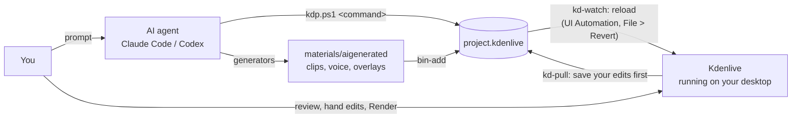

<div align="center">

# Movie Engine

**Un agent AI vă montează videoclipul în Kdenlive sub ochii dumneavoastră, iar dumneavoastră puteți prelua controlul în orice moment.**

Agenții AI de programare (Claude Code, Codex) creează și modifică proiecte Kdenlive reale: filme, videoclipuri explicative și shorts verticale. Modificările apar live în editorul pe care îl aveți deschis. Portabil, Windows, fără patch-uri pentru editor.


[English](../../README.md) · [简体中文](README.zh-CN.md) · [繁體中文](README.zh-TW.md) · [हिन्दी](README.hi.md) · [Español](README.es.md) · [Français](README.fr.md) · [العربية](README.ar.md) · [বাংলা](README.bn.md) · [Português](README.pt.md) · [Русский](README.ru.md) · [اردو](README.ur.md) · [Bahasa Indonesia](README.id.md) · [Deutsch](README.de.md) · [日本語](README.ja.md) · [Türkçe](README.tr.md) · [한국어](README.ko.md) · [Українська](README.uk.md) · [Italiano](README.it.md) · [Polski](README.pl.md) · [Tiếng Việt](README.vi.md) · [فارسی](README.fa.md) · [ไทย](README.th.md) · [Kiswahili](README.sw.md) · [አማርኛ](README.am.md) · [Avañe'ẽ](README.gn.md) · [Setswana](README.tn.md) · [Shqip](README.sq.md) · [Беларуская](README.be.md) · [Български](README.bg.md) · [Bosanski](README.bs.md) · [Hrvatski](README.hr.md) · [Српски](README.sr.md) · [Crnogorski](README.cnr.md) · [Македонски](README.mk.md) · [Slovenščina](README.sl.md) · [Slovenčina](README.sk.md) · [Čeština](README.cs.md) · [Magyar](README.hu.md) · **Română** · [Dansk](README.da.md) · [Norsk bokmål](README.nb.md) · [Norsk nynorsk](README.nn.md) · [Svenska](README.sv.md) · [Íslenska](README.is.md) · [Suomi](README.fi.md) · [Eesti](README.et.md) · [Latviešu](README.lv.md) · [Lietuvių](README.lt.md) · [Nederlands](README.nl.md) · [Lëtzebuergesch](README.lb.md) · [Rumantsch](README.rm.md) · [Ελληνικά](README.el.md) · [Malti](README.mt.md) · [Gaeilge](README.ga.md) · [Català](README.ca.md) · [ქართული](README.ka.md) · [Հայերեն](README.hy.md) · [Azərbaycanca](README.az.md) · [Afrikaans](README.af.md) · [isiZulu](README.zu.md) · [isiXhosa](README.xh.md) · [Sesotho](README.st.md) · [Sepedi](README.nso.md) · [Xitsonga](README.ts.md) · [Tshivenḓa](README.ve.md) · [siSwati](README.ss.md) · [isiNdebele (South Africa)](README.nr.md) · [isiNdebele (Zimbabwe)](README.nd.md) · [chiShona](README.sn.md) · [Chichewa](README.ny.md) · [Ikinyarwanda](README.rw.md) · [Ikirundi](README.rn.md) · [Malagasy](README.mg.md) · [Soomaali](README.so.md) · [Afaan Oromoo](README.om.md) · [Qafar af](README.aa.md) · [ትግርኛ](README.ti.md) · [Sängö](README.sg.md) · [Kreol Seselwa](README.crs.md) · [TjiKalanga](README.kck.md) · [ChiNdau](README.ndc.md)

*Aceasta este o traducere. Versiunea de referință este README-ul în engleză.*

</div>

---

## Cuprins

- [De ce](#de-ce)
- [Cum funcționează](#cum-funcționează)
- [Funcționalități](#funcționalități)
- [Cerințe](#cerințe)
- [Instalare](#instalare)
- [Pornire rapidă](#pornire-rapidă)
- [Lucrul cu agentul](#lucrul-cu-agentul)
- [Linia de comandă pentru montaj (`kdp.ps1`)](#linia-de-comandă-pentru-montaj-kdpps1)
- [Sincronizare live cu editorul deschis](#sincronizare-live-cu-editorul-deschis)
- [Generatoare: ce nu poate face Kdenlive](#generatoare-ce-nu-poate-face-kdenlive)
- [Voce din off și sunet](#voce-din-off-și-sunet)
- [Limba interfeței](#limba-interfeței)
- [Structura folderelor](#structura-folderelor)
- [Teste și dovezi](#teste-și-dovezi)
- [Limitări](#limitări)
- [Depanare](#depanare)
- [Întrebări frecvente](#întrebări-frecvente)
- [Contribuții](#contribuții)
- [Mulțumiri](#mulțumiri)
- [Licență](#licență)

## De ce

Editoarele video sunt construite pentru o mână pe mouse. Agenții AI se pricep la structură, sincronizare și repetiție: plasează 300 de clipuri pe ritm, sincronizează fiecare subtitrare cu vocea, refac o scenă după feedback. Nu pot însă să dea clic printr-o interfață grafică fără să vă preia desktopul.

Kdenlive este un editor open-source puternic, dar pe Windows **nu are niciun API de automatizare**: controlul prin D-Bus există doar în versiunile pentru Linux, iar fork-urile care îl adaugă sunt fie neîntreținute, fie nesigure. Movie Engine rezolvă problema fără a modifica editorul:

1. Agentul editează fișierul de proiect `.kdenlive` printr-o linie de comandă testată (`engine/kdp.ps1`).
2. Kdenlive-ul care rulează primește prin Windows UI Automation comanda de a reîncărca fișierul, fără apăsări de taste, fără mouse și fără a fura focusul.
3. Propriile dumneavoastră modificări nesalvate sunt salvate mai întâi și nu sunt niciodată suprascrise.

Așadar agentul montează, iar dumneavoastră verificați sau editați manual. Lucrați amândoi la același proiect, în același editor, în același timp.

## Cum funcționează



Fiecare comandă de editare urmează același ciclu sigur:

1. **Pull.** Dacă Kdenlive are modificări nesalvate, primește comanda de a le salva (butonul Save din bara de instrumente, prin UI Automation), iar salvarea este confirmată.
2. **Editare.** Comanda modifică XML-ul sub blocare, după o verificare a hash-ului și cu un instantaneu pentru anulare. Dacă fișierul s-a schimbat între timp, nu se scrie nimic.
3. **Reîncărcare.** Supraveghetorul (watcher) recunoaște marcajul lăsat de AI și rulează File > Revert în editorul deschis. Succesul contează doar atunci când widgetul cronologiei a fost efectiv reconstruit.
4. **Conflict.** Dacă ați început să editați între timp, nu se reîncarcă nimic și munca dumneavoastră rămâne. Versiunea AI este pusă deoparte, iar agentul își reaplică modificarea peste a dumneavoastră.

## Funcționalități

- **Editare completă a proiectului fără interfață grafică**: aproximativ 120 de comenzi care acoperă coșul de proiect, cronologia, efectele, compozițiile, pistele, ghidajele, markerii, subtitrările, secvențele, viteza și remaparea timpului, prezentările de imagini, clipurile de titlu, proxy-urile, randarea și anulare/refacere. Vedeți [referința comenzilor](#linia-de-comandă-pentru-montaj-kdpps1).
- **Sincronizare live cu editorul deschis.** Modificările AI apar în Kdenlive-ul la care vă uitați; modificările dumneavoastră nesalvate sunt salvate mai întâi și nu se pierd niciodată.
- **Nu vă deranjează niciodată desktopul.** Fără furt de focus, apăsări de taste sau mișcări de mouse. Editoarele de test rulează pe un desktop Windows invizibil.
- **Portabil.** Editorul, setările, Node.js, fonturile și instrumentele se află într-un singur folder. Copiați-l pe alt PC și funcționează; nu se scrie nimic în Program Files sau în profilul dumneavoastră Windows.
- **Generatoare pentru ce nu poate face Kdenlive**: text cinetic animat literă cu literă, adnotări desenate de mână, scene 3D de interfață, animații de cursor și filme explicative interactive lungi. Se randează pe GPU cu motion blur real și sunt plasate pe cronologie ca clipuri obișnuite.
- **Voce din off cu sincronizare pe cuvinte** (Microsoft Edge TTS, fără cheie API). Subtitrările și acțiunile se declanșează exact pe cuvântul potrivit.
- **Efecte sonore sintetizate** (whoosh, click, pop, riser, impact și altele), generate prin cod.
- **Dovedit, nu presupus.** Fiecare comandă are o verificare a rezultatului, efectele și compozițiile sunt testate una câte una, iar rezultatele brute se află în `docs/proof/`.
- **Instrucțiuni pentru agenți incluse.** `AGENTS.md` și abilitățile din `.claude/skills/` îi învață pe Claude Code și Codex fluxul de lucru, formatul fișierului și capcanele.

## Cerințe

| | |
|---|---|
| Sistem de operare | Windows 10 sau 11, x64 |
| Editor | Kdenlive **26.08.3**, versiunea portabilă (standalone). Alte versiuni nu sunt testate. |
| Node.js | 18 sau mai nou: arhiva `.zip` pentru Windows x64 de pe nodejs.org, dezarhivată în `engine/node/` |
| Browser | Microsoft Edge (parte din Windows); folosit în mod headless de randatoarele de scene |
| Agent | [Claude Code](https://claude.com/claude-code) sau Codex. Opțional: fiecare instrument rulează și manual. |
| Disc | aproximativ 1 GB pentru editor și instrumente, plus fișierele dumneavoastră media |
| GPU | orice GPU cu codare H.264 hardware accelerează `film-render.mjs` (altfel se folosește codarea software) |

## Instalare

Totul se instalează **în interiorul folderului**. Nimic nu necesită drepturi de administrator.

```powershell
git clone https://github.com/vladtarrow/movie-engine.git
cd movie-engine
```

**1. Node.js.** Descărcați arhiva `.zip` pentru Windows x64 a Node.js 18 sau mai nou de la <https://nodejs.org/en/download> și dezarhivați conținutul în `engine\node\`, astfel încât acolo să se afle `engine\node\node.exe` și `engine\node\npm.cmd`. Nu sunt necesare un program de instalare sau un Node de sistem. Toate scripturile rulează prin `engine\node.cmd`, niciodată printr-un Node de sistem.

**2. Pachetele Node** pentru instrumentul de voce și pentru randatoare (versiunile sunt fixate în `engine/voice/package.json`):

```powershell
engine\node\npm.cmd install --prefix engine\voice
```

**3. Kdenlive 26.08.3 portabil.** Descărcați `kdenlive-26.08.3_standalone.exe` de la <https://download.kde.org/stable/kdenlive/26.08/windows/> în `engine\installer\`, verificați-l și dezarhivați-l:

```powershell
(Get-FileHash engine\installer\kdenlive-26.08.3_standalone.exe -Algorithm SHA256).Hash
# expected: A25427B1DFF2C17E3B0386E991BB1A719382BB3176D1A90E441CDAEB6E0A967D
engine\installer\kdenlive-26.08.3_standalone.exe -o"engine\Kdenlive" -y
```

Editorul ajunge în `engine\Kdenlive\kdenlive-26.08.3_standalone\bin\`. Include deja `melt.exe` și `ffmpeg.exe`.

**4. Prima pornire.**

```powershell
engine\kdenlive.cmd
```

Kdenlive își păstrează toate setările în `engine\profile-kdenlive\`, nu în profilul dumneavoastră Windows. La prima pornire afișează o singură dată un asistent de configurare.

## Pornire rapidă

### Cu un agent

Deschideți folderul în Claude Code (sau Codex) și cereți în cuvinte simple:

> Fă un proiect nou vertical de 30 fps „launch-teaser”. Pune pe cronologie cele trei capturi de ecran din `materials/designers/launch/`, câte 2,5 s fiecare, cu o tranziție scurtă de tip cross-fade, adaugă o voce din off din `script.txt` și sincronizează câte o subtitrare cinetică pentru fiecare replică.

> Deschide-l pentru mine în Kdenlive.

> Al doilea cadru e prea lung. Scurtează-l la 1,8 s și mută logoul puțin mai sus.

Agentul urmează `AGENTS.md`: editează prin `kdp.ps1`, randează doar clipurile de care are nevoie montajul și ține editorul deschis sincronizat. Dumneavoastră verificați în Kdenlive, editați manual oricând doriți și apăsați Render când sunteți mulțumit.

### Manual

```powershell
# a new 1080x1920 30 fps project with 2 video and 2 audio tracks
powershell -NoProfile -ExecutionPolicy Bypass -File engine\kdp.ps1 new -Project projects\hello\hello.kdenlive -Profile vertical_hd_30

# a 3-second title and a colour background
powershell -NoProfile -ExecutionPolicy Bypass -File engine\kdp.ps1 bin-color -Project projects\hello\hello.kdenlive -Color '#203060' -Seconds 3 -Name bg
powershell -NoProfile -ExecutionPolicy Bypass -File engine\kdp.ps1 title -Project projects\hello\hello.kdenlive -Text "Hello" -Seconds 3 -Name hi

# place them: background on V1, title above it on V2
powershell -NoProfile -ExecutionPolicy Bypass -File engine\kdp.ps1 add -Project projects\hello\hello.kdenlive -Bin bg -Track V1 -At 0
powershell -NoProfile -ExecutionPolicy Bypass -File engine\kdp.ps1 add -Project projects\hello\hello.kdenlive -Bin hi -Track V2 -At 0

# a check frame, then open it in the editor
powershell -NoProfile -ExecutionPolicy Bypass -File engine\kdp.ps1 frame -Project projects\hello\hello.kdenlive -At 1.5 -Out out\hello\check.png
engine\kdenlive.cmd projects\hello\hello.kdenlive
```

Pentru a redeschide mai târziu ultimul proiect, faceți dublu clic pe `open-last-project.cmd`.

## Lucrul cu agentul

Agentul citește `AGENTS.md` (Codex) sau `CLAUDE.md`, care îl importă (Claude Code), plus două abilități:

| Abilitate | Ce predă |
|---|---|
| `.claude/skills/kdenlive-project-file` | formatul `.kdenlive` / MLT XML, `kdp.ps1`, verificarea cu `melt` |
| `.claude/skills/kdenlive-live` | controlul sigur al editorului care rulează: pornire, pull, reîncărcare, captura ferestrei sale |

Reguli pe care agentul le respectă și pe care vă puteți baza:

- Nu vă ia niciodată mouse-ul, tastatura sau focusul și nu face niciodată capturi ale desktopului dumneavoastră (doar ale ferestrei editorului).
- Face singur pașii din interfața grafică (salvare, deschidere, reîncărcare) în loc să vă ceară să dați clic.
- Întreabă înainte de a descărca orice și înainte de a șterge orice.
- Randează doar ce are nevoie lucrul (clipuri de scenă, cadre de verificare). Randează filmul final doar când cereți.
- Când Kdenlive nu poate face ceva bine, agentul construiește acel lucru în afara lui, prin cod, și pune rezultatul ca un clip. Nu diluează efectul.

## Linia de comandă pentru montaj (`kdp.ps1`)

```powershell
powershell -NoProfile -ExecutionPolicy Bypass -File engine\kdp.ps1 <command> -Project <file.kdenlive> [options]
```

Timpii sunt în secunde, cu punct (`2.5`). Pistele sunt `V1 V2 …` (V1 cea mai de jos) și `A1 A2 …`. Un clip este identificat prin `-Track` plus orice moment `-At` din interiorul lui. Parametrii efectelor se dau în `-Params "name=value||name=value"`. Lista completă, cu toate opțiunile, se află în antetul `engine/kdp.ps1`.

| Grup | Comenzi |
|---|---|
| Proiect | `new`, `profiles`, `info`, `validate`, `fonts`, `profile-set`, `profile-from-clip`, `zone`, `archive`, `backups`, `rebase`, `otio-export`, `otio-import` |
| Coș de proiect | `bin-add`, `bin-color`, `title`, `title-text`, `title-save`, `title-template`, `bin-rename`, `bin-remove`, `bin-info`, `bin-set`, `bin-duplicate`, `bin-replace-file`, `bin-reload`, `folder`, `bin-folder`, `relink`, `clean`, `generator`, `playlist-clip`, `extract-audio`, `transcode` |
| Cronologie | `add`, `add-av`, `move`, `copy`, `trim`, `ripple-trim`, `slip`, `split`, `remove`, `speed`, `remap`, `disable`, `enable`, `group`, `ungroup`, `mix`, `unmix`, `space-insert`, `space-remove`, `spaces-remove-all`, `track-clear`, `replace-in-timeline` |
| Efecte | `effects`, `effect-info`, `effect-add`, `effect-list`, `effect-set`, `effect-remove`, `effect-copy`, `effect-clear`, `effects-all`, `bin-effect`, `effect-templates`, `effect-template` |
| Compoziții | `compositions`, `comp-info`, `comp-add`, `comp-list`, `comp-set`, `comp-remove` |
| Piste | `track-add`, `track-remove`, `track-set` |
| Ghidaje și markeri | `guide-add`, `guide-list`, `guide-remove`, `guide-set`, `guide-clear`, `guide-export`, `guide-category`, `marker`, `marker-list`, `marker-set`, `marker-remove` |
| Subtitrări | `sub-add`, `sub-import`, `sub-export`, `sub-state` |
| Secvențe | `sequence-add`, `sequences`, `copy-to-sequence`, `expand`; orice comandă cu `-Sequence <name>` funcționează în interiorul secvenței respective |
| Speciale | `slideshow`, animații Lottie / Glaxnimate prin `bin-add`, `proxy`, `stabilize`, `scene-split`, `speed-job`, `subclip` |
| Ieșire | `frame` (un PNG), `preview` (randare rapidă cu melt), `render` (randatorul propriu al Kdenlive sau o presetare), `presets` |
| Istoric | `undo`, `redo`, `clear-history` (instantanee în `projects/<name>/.kdp-history`) |

Comportament bun de știut:

- Jumătățile audio și video legate se mută, se taie, se divizează și se elimină împreună (`-Alone` pentru o singură jumătate).
- O comandă eșuată iese cu codul 1 și nu scrie nimic.
- Efectele pe care versiunea pentru Windows nu le poate rula sunt refuzate, nu ignorate în tăcere (lista: `docs/proof/assets.txt`).
- Fiecare acțiune din meniurile Kdenlive este asociată în `engine/tools/data/kdenlive-actions.csv` cu o comandă, cu o altă cale sau cu marcajul „doar vizualizare”. Vedeți `docs/kdenlive-coverage.md`.

## Sincronizare live cu editorul deschis

| Script | Ce face | Coduri de ieșire |
|---|---|---|
| `engine\kd-pull.ps1 -Project <f>` | face ca Kdenlive să vă salveze modificările și confirmă acest lucru | 0 fișier actual, 3 nu rulează, 4 neconfirmat |
| `engine\kd-reload.ps1 -Project <f>` | File > Revert, confirmat prin cronologia reconstruită | 0 confirmat, 2 aveți modificări nesalvate (nimic nu a fost aruncat), 3 nu rulează, 4 eșuat |
| `engine\kd-watch.ps1 -Project <f>` | supraveghetor în fundal: reîncarcă după fiecare scriere a AI, înregistrează conflictele în jurnal | jurnal în `engine\kd-watch.log`; pentru oprire ștergeți `engine\kd-watch.run` |
| `engine\kdenlive-bg.ps1 [project]` | pornește Kdenlive minimizat pentru un agent | 0 încărcat, 4 neconfirmat |
| `engine\kdenlive.cmd [project]` | pornește Kdenlive pentru dumneavoastră | |

Porniți supraveghetorul o dată pe sesiune:

```powershell
Start-Process powershell -WindowStyle Hidden -ArgumentList '-NoProfile','-ExecutionPolicy','Bypass','-File','engine\kd-watch.ps1','-Project','projects\hello\hello.kdenlive'
```

Proiecte mari: reîncărcarea unui proiect cu 1000 de clipuri durează minute, iar instrumentele o așteaptă în loc să raporteze prea devreme. Proiectele se deschid prin *File > Open Recent* într-un editor gol, deoarece deschiderea directă a unui fișier face ca Qt să parcurgă fiecare element al cronologiei pentru accesibilitate, ceea ce era cu aproximativ 10 minute mai lent.

## Generatoare: ce nu poate face Kdenlive

Kdenlive/MLT nu are animație de text literă cu literă, nu are expresii (expressions) și are foarte puțin 3D, iar efectele grele încetinesc redarea. Movie Engine randează astfel de părți în afara editorului și le pune pe cronologie ca clipuri obișnuite, de obicei cu canal alfa, pe o pistă deasupra imaginilor. Scriptul generatorului și datele lui de intrare rămân în folderul proiectului, astfel încât un clip poate fi regenerat când se schimbă textul, fontul sau sincronizarea.

| Instrument | Ce produce |
|---|---|
| `engine/tools/kinetic-text.ps1` | subtitrări cinetice animate literă cu literă, fiecare cuvânt sincronizat din `voice.json`, casetă de evidențiere |
| `engine/tools/annotate.ps1` | cercuri, casete, sublinieri și săgeți desenate de mână, care se desenează treptat peste o captură de ecran |
| `engine/tools/card-entrance.ps1` | un card cu o captură de ecran care se ridică și se mărește, cu o umbră moale |
| `engine/tools/pdf-to-png.ps1` | slide-uri dintr-un export PDF |
| `engine/tools/html-render.mjs` | orice scenă HTML/CSS/canvas transformată în video: animație de interfață, cursoare, 3D, măști |
| `engine/tools/film-render.mjs` + `film/` | filme explicative interactive lungi pe un canvas: un clip pentru fiecare replică de voce, acțiunile se declanșează pe cuvintele rostite, motion blur pe GPU la aproximativ 45 fps |

Ambele randatoare controlează Microsoft Edge livrat cu Windows, în mod headless, cu un profil de unică folosință și fără acces la rețea.

### Demonstrații

```powershell
# a 3-second 3D title card with a cursor click
engine\node.cmd engine\tools\html-render.mjs examples\demo\scene\scene.html examples\demo\out --frames 0,30,60,89
engine\node.cmd engine\tools\html-render.mjs examples\demo\scene\scene.html examples\demo\out\scene.mp4

# a 4-shot interactive film timed to two voice lines
engine\node.cmd engine\tools\film-render.mjs examples\demo\film\film.html examples\demo\out --check
engine\node.cmd engine\tools\film-render.mjs examples\demo\film\film.html examples\demo\out --shots all --width 640
engine\node.cmd engine\tools\film-render.mjs examples\demo\film\film.html examples\demo\out\clips --suffix -v01
```

Un film înseamnă trei fișiere mici. `data.js` conține cadrele și timpii cuvintelor. `direction.js` are câte un rând pentru fiecare cadru:

```text
1 | hover 192 108 @brand | tag 300 60 Your brand @deserves | confetti 192 90 @film
2 say=A film that/*explains* it
3 | click 116 108 @before | click 268 108 @after | chips Before~After @after
4 scene=counter | count 0 120 % @count
```

`scenes.js` conține cadrele care sunt desenate de la zero. `@word` declanșează o acțiune când vocea rostește acel cuvânt. Acțiunile includ click, hover, drag, zoom, lens, ring, arrow, chips, toggle, slider, toast, type, count și confetti; sintaxa completă se află la începutul fișierului `engine/tools/film/film-kit.js`.

## Voce din off și sunet

```powershell
engine\node.cmd engine\voice\voice.mjs lines.json materials\aigenerated\hello\voice en-US-AndrewMultilingualNeural +0%
```

`lines.json` este o listă de replici. Instrumentul scrie câte un mp3 pentru fiecare replică plus `voice.json`, cu durata și cu începutul și sfârșitul fiecărui cuvânt. Replicile sunt păstrate în cache, astfel încât modificarea unei replici o regenerează doar pe aceasta. Instrumentul folosește sinteza vocală online a Microsoft Edge prin pachetul `msedge-tts`: nu este nevoie de cheie, dar serviciul este neoficial și necesită internet.

```powershell
engine\node.cmd engine\audio\sfx.mjs materials\aigenerated\sfx
```

Aceasta sintetizează prin cod whoosh, whoosh-long, swipe, click, pop, tick, riser, impact, ding și reveal; un set gata făcut se află în `materials/aigenerated/sfx/`. Completați cu liniște sunetele mai scurte de un cadru înainte de a le plasa (`-af apad=whole_dur=0.0667`).

## Limba interfeței

Lansatoarele pornesc Kdenlive implicit în **engleză**. Pentru a folosi altă limbă, setați `MOVIE_ENGINE_UI_LANG` înainte de pornire:

```powershell
$env:MOVIE_ENGINE_UI_LANG = 'ru'; engine\kdenlive.cmd
```

UI Automation găsește elementele de meniu după numele lor vizibile. Numele pentru 31 de limbi ale interfeței sunt incluse (`engine/tools/kd-ui.ps1`, `$KdNames`). Pentru orice altă limbă, adăugați acolo numele ei și verificați cu:

```powershell
powershell -NoProfile -ExecutionPolicy Bypass -File engine\tools\kd-langcheck.ps1
```

## Structura folderelor

```text
movie-engine/
├─ AGENTS.md, CLAUDE.md          instructions for AI agents
├─ .claude/skills/               agent skills: project file format, live editor
├─ engine/
│  ├─ kdp.ps1                    the editing command line
│  ├─ kd-pull / kd-reload / kd-watch .ps1, kdenlive.cmd, kdenlive-bg.ps1
│  ├─ tools/                     internals, generators, tests, data (action map)
│  ├─ voice/  audio/  fonts/     TTS, synthesized SFX, Poppins (OFL)
│  ├─ Kdenlive/  node/           portable editor and Node.js (not in git)
│  └─ profile-kdenlive/          the editor's settings (not in git)
├─ projects/<name>/<name>.kdenlive
├─ materials/
│  ├─ download/                  stock and downloaded files (not in git)
│  ├─ aigenerated/               everything the AI made (sfx/ and test-kit/ ship with the engine)
│  ├─ designers/  brand/         files from your team, brand assets
├─ examples/demo/                demos of the scene and film renderers
├─ out/                          renders (not in git)
└─ docs/                         proofs, coverage, translations of this README
```

Căile media din proiecte sunt relative. Dacă mutați sau copiați folderul, `kdp.ps1 rebase` (rulat și automat de `kdenlive.cmd`) scrie noua locație în proiect.

## Teste și dovezi

Afirmațiile despre ce funcționează sunt susținute de verificări ale rezultatului, nu de faptul că „funcția a rulat”. Rezumatul se află în [`docs/kdenlive-proof.md`](../../docs/kdenlive-proof.md), iar rezultatele brute în `docs/proof/`.

| Test | Ce verifică |
|---|---|
| `engine\tools\kdp-clitest.ps1` | fiecare comandă `kdp.ps1`, prin linia de comandă, comparând proiectul rezultat |
| `engine\tools\kd-livetest.ps1` | pull, reîncărcarea, supraveghetorul, conflictele și condițiile de concurență cu un Kdenlive real pe un desktop invizibil |
| `engine\tools\kdp-assetsweep.ps1` | fiecare efect și fiecare compoziție: randează și compară cadre |
| `engine\tools\kdp-portabletest.ps1` | copiază folderul în altă parte și lucrează din copie |
| `engine\tools\kd-langcheck.ps1` | limba interfeței și faptul că UI Automation găsește meniul |
| `engine\tools\kdp-coverage-check.ps1` | că fiecare acțiune din meniu este asociată și că nicio dovadă nu este mai veche decât codul |

```powershell
powershell -NoProfile -ExecutionPolicy Bypass -File engine\tools\kdp-clitest.ps1 -Report docs\proof\clitest.txt
powershell -NoProfile -ExecutionPolicy Bypass -File engine\tools\kd-livetest.ps1 -Report docs\proof\live-en.txt
```

Editoarele de test rulează doar pe un desktop ascuns, cu propriul profil, astfel încât testele nu ating niciodată Kdenlive-ul dumneavoastră deschis sau focusul.

## Limitări

- **Doar Windows**, doar Kdenlive **26.08.3**. Linux are D-Bus și ar avea nevoie de o altă punte.
- Pornirea editorului ia focusul tastaturii pentru aproximativ 3 secunde, cât timp apare fereastra goală. Agenții întreabă înainte de a-l porni în timp ce lucrați. Reîncărcările și editările nu iau focusul.
- Versiunii pentru Windows îi lipsesc modulele MLT sox, ladspa și movit și unele efecte frei0r/avfilter; `kdp.ps1` le refuză (`docs/proof/assets.txt`).
- Exportul și importul OpenTimelineIO transferă doar clipurile și spațiile goale. Multicam nu are comutare live a unghiurilor (tăieturile se fac cu split/remove/hide).
- „Save As…” prin UI Automation pe o fereastră minimizată nu deschide niciun dialog; agentul folosește în schimb `archive` sau copii ale fișierelor.
- Recunoașterea vorbirii (subtitrări automate) necesită Whisper sau Vosk, care nu sunt incluse.
- Titlurile făcute cu instrumentul de titluri din Kdenlive folosesc fonturile instalate în Windows. Pentru o tipografie garantată, randați textul cu generatoarele, care încarcă fonturile din `engine/fonts/`.
- Edge TTS este un serviciu online neoficial și se poate schimba sau poate înceta să funcționeze.

## Depanare

| Simptom | Cauză și soluție |
|---|---|
| Kdenlive rulează, dar un clic pe el în bara de activități nu arată nimic | Poziția salvată a ferestrei este în afara ecranului. Închideți-l și ștergeți intrările `kdockLayout` din `engine\profile-kdenlive\AppData\Local\kdenliverc` sau mutați fereastra cu `SetWindowPos` (vedeți `AGENTS.md`). |
| `kd-reload.ps1` iese cu codul 2 | Aveți modificări nesalvate. Nu s-a aruncat nimic. Rulați `kd-pull.ps1`, apoi aplicați din nou modificarea (`kdp.ps1` face asta singur). |
| `CONFLICT` în `engine\kd-watch.log` | Dumneavoastră și agentul ați editat în același moment. Versiunea dumneavoastră rămâne în editor, iar versiunea AI se află în `projects\<name>\.kdp-history\<name>\conflict\`. Cereți agentului să-și reaplice modificarea. |
| O comandă iese cu codul 1 și mesajul „pull not confirmed” | Kdenlive este ocupat sau afișează un dialog. Închideți dialogul sau așteptați să se termine încărcarea, apoi repetați. |
| Un script PowerShell nu poate fi analizat (eroare de parsare) | Scripturile cu text non-ASCII trebuie salvate ca UTF-8 **cu BOM** pentru Windows PowerShell 5.1. |
| `voice.mjs` se oprește cu „Stream closed before the synthesis completed” | De obicei este o problemă de rețea sau SSML neescapat în copii mai vechi. `voice.mjs` escapează singur `& < >`. |
| Deschiderea unui proiect mare durează multe minute | Deschideți-l prin `kdenlive.cmd` / `kdenlive-bg.ps1`, niciodată ca `kdenlive.exe project.kdenlive`. |

## Întrebări frecvente

**Am nevoie de Claude Code sau Codex?**
Nu. Fiecare instrument este un script simplu pe care îl puteți rula manual. Agentul este cel care face lucrul rapid: planifică montajul, rulează instrumentele și ține editorul sincronizat.

**Îmi va suprascrie agentul modificările manuale?**
Nu. Înainte de orice scriere, modificările dumneavoastră nesalvate sunt salvate și confirmate. Dacă editați în timp ce agentul scrie, scrierea este refuzată sau pusă deoparte ca un conflict, dar nu este niciodată aplicată peste munca dumneavoastră.

**Pot continua să folosesc Kdenlive normal?**
Da. Este Kdenlive-ul standard, cu propriul folder de setări. Editați, previzualizați și randați ca de obicei.

**Funcționează cu un Kdenlive pe care îl am deja instalat?**
Folosește propria copie portabilă din `engine\Kdenlive\`, așa că Kdenlive-ul instalat și setările lui rămân neatinse.

**De ce nu un fork Kdenlive cu API sau alt editor?**
Pe Windows nu există niciun fork întreținut și sigur (analiză din noiembrie 2026). Au fost evaluate OpenShot, Blender VSE, DaVinci Resolve, Shotcut și editoarele web; Kdenlive a oferit cea mai mare profunzime de editare. Urmărim o propunere de REST API în proiectul principal Kdenlive (merge request !902).

**Poate randa videoclipul final?**
Da, cu `kdp.ps1 render` (randatorul propriu al Kdenlive, ascuns), sau apăsați chiar dumneavoastră Render în editor.

**Sunt fișierele mele media încărcate undeva?**
Nu. Doar textul vocii din off este trimis serviciului Edge TTS atunci când generați vocea. Randatoarele de scene rulează cu rețeaua dezactivată.

## Contribuții

Contribuțiile sunt binevenite. Vedeți [CONTRIBUTING.md](../../CONTRIBUTING.md). Pe scurt:

- Fiecare operație `kdp.ps1` nouă sau modificată are nevoie de o verificare a rezultatului în `kdp-clitest.ps1`, de o intrare în harta acțiunilor și de o rulare nouă a `kdp-coverage-check.ps1`.
- Nu porniți niciodată un Kdenlive de test pe desktopul vizibil; folosiți `engine/tools/kd-hidden.ps1`.
- Păstrați totul portabil: fără instalări în afara folderului, fără căi absolute în proiecte.
- Notați particularitățile verificate în `AGENTS.md` sau în abilitatea corespunzătoare.

## Mulțumiri

- [Kdenlive](https://kdenlive.org) și [MLT](https://www.mltframework.org): editorul și motorul de dedesubt.
- [FFmpeg](https://ffmpeg.org), inclus în Kdenlive.
- [msedge-tts](https://www.npmjs.com/package/msedge-tts) pentru vocea din off.
- [Poppins](https://fonts.google.com/specimen/Poppins) de la Indian Type Foundry, SIL Open Font License (`engine/fonts/OFL.txt`).
- `engine/tools/data/kdenliveui-26.08.3.rc`: fișierul de meniuri al Kdenlive, preluat din codul sursă Kdenlive 26.08.3; folosit doar de verificarea acoperirii. Rămâne sub licența GPL a Kdenlive, nu sub MIT License.

## Licență

Codul propriu al Movie Engine este publicat sub [licența MIT](../../LICENSE). Kdenlive, MLT, FFmpeg, pachetele Node.js și fontul Poppins își păstrează propriile licențe.
