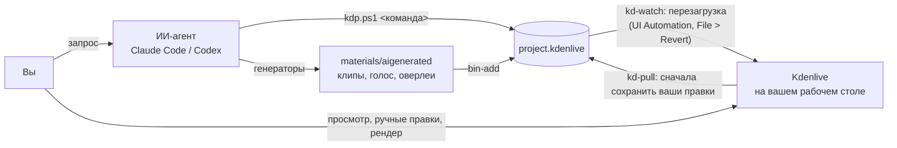

<div align="center">

# movie-engine

**ИИ-агент монтирует ваше видео в Kdenlive у вас на глазах, а вы можете перехватить работу в любой момент.**

ИИ-агенты для программирования (Claude Code, Codex) создают и меняют настоящие проекты Kdenlive: фильмы, объясняющие ролики и вертикальные шортсы. Правки сразу появляются в открытом у вас редакторе. Портативно, Windows, без патчей редактора.


[English](../../README.md) · [简体中文](README.zh-CN.md) · [हिन्दी](README.hi.md) · [Español](README.es.md) · [Français](README.fr.md) · [العربية](README.ar.md) · [বাংলা](README.bn.md) · [Português](README.pt.md) · **Русский** · [اردو](README.ur.md) · [Bahasa Indonesia](README.id.md) · [Deutsch](README.de.md) · [日本語](README.ja.md) · [Türkçe](README.tr.md) · [한국어](README.ko.md)

*Это перевод. Основной считается английская версия README.*

</div>

---

## Содержание

- [Зачем](#зачем)
- [Как это работает](#как-это-работает)
- [Возможности](#возможности)
- [Требования](#требования)
- [Установка](#установка)
- [Быстрый старт](#быстрый-старт)
- [Работа с агентом](#работа-с-агентом)
- [Командная строка для монтажа (`kdp.ps1`)](#командная-строка-для-монтажа-kdpps1)
- [Синхронизация с открытым редактором](#синхронизация-с-открытым-редактором)
- [Генераторы: то, чего не умеет Kdenlive](#генераторы-то-чего-не-умеет-kdenlive)
- [Озвучка и звук](#озвучка-и-звук)
- [Язык интерфейса](#язык-интерфейса)
- [Структура папок](#структура-папок)
- [Тесты и доказательства](#тесты-и-доказательства)
- [Ограничения](#ограничения)
- [Устранение неполадок](#устранение-неполадок)
- [Частые вопросы](#частые-вопросы)
- [Участие в разработке](#участие-в-разработке)
- [Благодарности](#благодарности)
- [Лицензия](#лицензия)

## Зачем

Видеоредакторы рассчитаны на руку с мышью. ИИ-агенты хорошо справляются со структурой, таймингом и повторяющейся работой: расставить 300 клипов в такт музыке, привязать каждый субтитр к голосу, переделать сцену по замечаниям. Но щёлкать по интерфейсу они не могут, не захватив ваш рабочий стол.

Kdenlive — сильный редактор с открытым кодом, но под Windows у него **нет API для автоматизации**: управление через D-Bus есть только в сборках для Linux, а форки, которые его добавляют, либо заброшены, либо небезопасны. movie-engine решает задачу без патчей редактора:

1. Агент меняет файл проекта `.kdenlive` через проверенную тестами командную строку (`engine/kdp.ps1`).
2. Запущенному Kdenlive через Windows UI Automation даётся команда перечитать файл — без нажатий клавиш, без мыши и без перехвата фокуса.
3. Ваши несохранённые правки сначала сохраняются и никогда не перезаписываются.

Получается так: агент монтирует, а вы смотрите — или правите сами. Вы оба работаете над одним проектом, в одном редакторе, одновременно.

## Как это работает



Каждая команда монтажа проходит один и тот же безопасный цикл:

1. **Pull.** Если в Kdenlive есть несохранённые изменения, ему дают команду их сохранить (кнопка «Сохранить» на панели инструментов через UI Automation), и сохранение подтверждается.
2. **Правка.** Команда меняет XML под блокировкой, после проверки хеша и со снимком для отмены. Если файл за это время изменился, ничего не записывается.
3. **Перезагрузка.** Наблюдатель видит метку ИИ и выполняет в открытом редакторе File > Revert. Успехом считается только реальная пересборка виджета таймлайна.
4. **Конфликт.** Если вы в это время начали править, перезагрузки не будет, и ваша работа останется. Версия ИИ откладывается в сторону, а агент заново применяет свою правку поверх вашей.

## Возможности

- **Полноценный монтаж проекта без интерфейса**: около 120 команд — корзина проекта, таймлайн, эффекты, композиции, дорожки, направляющие, маркеры, субтитры, секвенции, скорость и переназначение времени, слайд-шоу, титры, прокси, рендер и отмена/повтор. См. [справочник команд](#командная-строка-для-монтажа-kdpps1).
- **Синхронизация с открытым редактором.** Правки ИИ появляются в том Kdenlive, на который вы смотрите; ваши несохранённые правки сначала сохраняются и никогда не теряются.
- **Не мешает работать за компьютером.** Никакого перехвата фокуса, нажатий клавиш и движений мыши. Тестовые экземпляры редактора запускаются на невидимом рабочем столе Windows.
- **Портативность.** Редактор, настройки, Node.js, шрифты и инструменты лежат в одной папке. Скопируйте её на другой компьютер — и всё заработает; ничего не пишется в Program Files или в ваш профиль Windows.
- **Генераторы для того, чего не умеет Kdenlive**: кинетический текст с анимацией по буквам, нарисованные от руки пометки, 3D-сцены интерфейса, анимация курсора и длинные интерактивные объясняющие ролики. Они рендерятся на GPU с настоящим размытием движения и ставятся на таймлайн как обычные клипы.
- **Озвучка с таймингом слов** (Microsoft Edge TTS, без ключа API). Субтитры и действия срабатывают точно на нужном слове.
- **Синтезированные звуковые эффекты** (whoosh, click, pop, riser, impact и другие), созданные кодом.
- **Проверено, а не предположено.** У каждой команды есть проверка результата, эффекты и композиции проверяются по одному, а сырые результаты лежат в `docs/proof/`.
- **Инструкции для агентов в комплекте.** `AGENTS.md` и навыки в `.claude/skills/` объясняют Claude Code и Codex порядок работы, формат файла и подводные камни.

## Требования

| | |
|---|---|
| ОС | Windows 10 или 11, x64 |
| Редактор | Kdenlive **26.08.3**, портативная сборка (standalone). Другие версии не проверялись. |
| Node.js | 18 или новее: `.zip` для Windows x64 с nodejs.org, распакованный в `engine/node/` |
| Браузер | Microsoft Edge (входит в Windows); рендереры сцен используют его в headless-режиме |
| Агент | [Claude Code](https://claude.com/claude-code) или Codex. Не обязательно: каждый инструмент можно запустить и вручную. |
| Диск | около 1 ГБ на редактор и инструменты плюс ваши медиафайлы |
| GPU | любая видеокарта с аппаратным кодированием H.264 ускоряет `film-render.mjs` (без неё используется программное кодирование) |

## Установка

Всё устанавливается **внутрь папки**. Права администратора не нужны.

```powershell
git clone <repository-url> movie-engine
cd movie-engine
```

**1. Node.js.** Скачайте `.zip` для Windows x64 с Node.js 18 или новее с <https://nodejs.org/en/download> и распакуйте его содержимое в `engine\node\`, чтобы там оказались `engine\node\node.exe` и `engine\node\npm.cmd`. Ни установщик, ни системный Node не нужны. Все скрипты запускаются через `engine\node.cmd`, никогда не через системный Node.

**2. Пакеты Node** для инструмента озвучки и рендереров (версии зафиксированы в `engine/voice/package.json`):

```powershell
engine\node\npm.cmd install --prefix engine\voice
```

**3. Портативный Kdenlive 26.08.3.** Скачайте `kdenlive-26.08.3_standalone.exe` с <https://download.kde.org/stable/kdenlive/26.08/windows/> в `engine\installer\`, проверьте и распакуйте:

```powershell
(Get-FileHash engine\installer\kdenlive-26.08.3_standalone.exe -Algorithm SHA256).Hash
# ожидается: A25427B1DFF2C17E3B0386E991BB1A719382BB3176D1A90E441CDAEB6E0A967D
engine\installer\kdenlive-26.08.3_standalone.exe -o"engine\Kdenlive" -y
```

Редактор окажется в `engine\Kdenlive\kdenlive-26.08.3_standalone\bin\`. В нём уже есть `melt.exe` и `ffmpeg.exe`.

**4. Первый запуск.**

```powershell
engine\kdenlive.cmd
```

Kdenlive хранит все настройки в `engine\profile-kdenlive\`, а не в вашем профиле Windows. При первом запуске он один раз покажет мастер настройки.

## Быстрый старт

### С агентом

Откройте папку в Claude Code (или Codex) и попросите обычными словами:

> Сделай новый вертикальный проект «launch-teaser» на 30 fps. Поставь на таймлайн три скриншота из `materials/designers/launch/`, по 2,5 с каждый с короткими переходами, добавь озвучку из `script.txt` и привяжи к каждой строке кинетическую подпись.

> Открой его мне в Kdenlive.

> Второй план слишком длинный. Укороти его до 1,8 с и подними логотип чуть выше.

Агент следует `AGENTS.md`: правит через `kdp.ps1`, рендерит только те клипы, которые нужны монтажу, и держит открытый редактор в актуальном состоянии. Вы смотрите результат в Kdenlive, правите вручную когда захотите и нажимаете «Рендер», когда всё устраивает.

### Вручную

```powershell
# новый проект 1080x1920, 30 fps, 2 видео- и 2 аудиодорожки
powershell -NoProfile -ExecutionPolicy Bypass -File engine\kdp.ps1 new -Project projects\hello\hello.kdenlive -Profile vertical_hd_30

# титр на 3 секунды и цветной фон
powershell -NoProfile -ExecutionPolicy Bypass -File engine\kdp.ps1 bin-color -Project projects\hello\hello.kdenlive -Color '#203060' -Seconds 3 -Name bg
powershell -NoProfile -ExecutionPolicy Bypass -File engine\kdp.ps1 title -Project projects\hello\hello.kdenlive -Text "Hello" -Seconds 3 -Name hi

# расставляем: фон на V1, титр над ним на V2
powershell -NoProfile -ExecutionPolicy Bypass -File engine\kdp.ps1 add -Project projects\hello\hello.kdenlive -Bin bg -Track V1 -At 0
powershell -NoProfile -ExecutionPolicy Bypass -File engine\kdp.ps1 add -Project projects\hello\hello.kdenlive -Bin hi -Track V2 -At 0

# контрольный кадр, затем открыть в редакторе
powershell -NoProfile -ExecutionPolicy Bypass -File engine\kdp.ps1 frame -Project projects\hello\hello.kdenlive -At 1.5 -Out out\hello\check.png
engine\kdenlive.cmd projects\hello\hello.kdenlive
```

Чтобы потом снова открыть последний проект, дважды щёлкните `open-last-project.cmd`.

## Работа с агентом

Агент читает `AGENTS.md` (Codex) или `CLAUDE.md`, который его импортирует (Claude Code), а также два навыка:

| Навык | Чему учит |
|---|---|
| `.claude/skills/kdenlive-project-file` | формат `.kdenlive` / MLT XML, `kdp.ps1`, проверка через `melt` |
| `.claude/skills/kdenlive-live` | безопасное управление запущенным редактором: запуск, pull, перезагрузка, снимок его окна |

Правила, которым следует агент и на которые можно положиться:

- Он никогда не забирает мышь, клавиатуру или фокус и никогда не делает снимки вашего рабочего стола (только окна самого редактора).
- Шаги в интерфейсе (сохранить, открыть, перезагрузить) он делает сам, а не просит вас нажать.
- Он спрашивает, прежде чем что-то скачать или удалить.
- Он рендерит только то, что нужно для работы (клипы сцен, контрольные кадры). Готовый фильм он рендерит, только если вы попросите.
- Если Kdenlive что-то не умеет делать хорошо, агент собирает это снаружи кодом и вставляет результат как клип. Он не упрощает эффект.

## Командная строка для монтажа (`kdp.ps1`)

```powershell
powershell -NoProfile -ExecutionPolicy Bypass -File engine\kdp.ps1 <command> -Project <file.kdenlive> [options]
```

Время задаётся в секундах, через точку (`2.5`). Дорожки называются `V1 V2 …` (V1 — нижняя) и `A1 A2 …`. Клип задаётся через `-Track` плюс любой момент `-At` внутри него. Параметры эффектов передаются в `-Params "name=value||name=value"`. Полный список со всеми опциями — в заголовке `engine/kdp.ps1`.

| Группа | Команды |
|---|---|
| Проект | `new`, `profiles`, `info`, `validate`, `fonts`, `profile-set`, `profile-from-clip`, `zone`, `archive`, `backups`, `rebase`, `otio-export`, `otio-import` |
| Корзина проекта | `bin-add`, `bin-color`, `title`, `title-text`, `title-save`, `title-template`, `bin-rename`, `bin-remove`, `bin-info`, `bin-set`, `bin-duplicate`, `bin-replace-file`, `bin-reload`, `folder`, `bin-folder`, `relink`, `clean`, `generator`, `playlist-clip`, `extract-audio`, `transcode` |
| Таймлайн | `add`, `add-av`, `move`, `copy`, `trim`, `ripple-trim`, `slip`, `split`, `remove`, `speed`, `remap`, `disable`, `enable`, `group`, `ungroup`, `mix`, `unmix`, `space-insert`, `space-remove`, `spaces-remove-all`, `track-clear`, `replace-in-timeline` |
| Эффекты | `effects`, `effect-info`, `effect-add`, `effect-list`, `effect-set`, `effect-remove`, `effect-copy`, `effect-clear`, `effects-all`, `bin-effect`, `effect-templates`, `effect-template` |
| Композиции | `compositions`, `comp-info`, `comp-add`, `comp-list`, `comp-set`, `comp-remove` |
| Дорожки | `track-add`, `track-remove`, `track-set` |
| Направляющие и маркеры | `guide-add`, `guide-list`, `guide-remove`, `guide-set`, `guide-clear`, `guide-export`, `guide-category`, `marker`, `marker-list`, `marker-set`, `marker-remove` |
| Субтитры | `sub-add`, `sub-import`, `sub-export`, `sub-state` |
| Секвенции | `sequence-add`, `sequences`, `copy-to-sequence`, `expand`; любая команда с `-Sequence <name>` работает внутри этой секвенции |
| Особые | `slideshow`, анимации Lottie / Glaxnimate через `bin-add`, `proxy`, `stabilize`, `scene-split`, `speed-job`, `subclip` |
| Вывод | `frame` (один PNG), `preview` (быстрый рендер через melt), `render` (собственный рендерер Kdenlive или пресет), `presets` |
| История | `undo`, `redo`, `clear-history` (снимки в `projects/<name>/.kdp-history`) |

Что полезно знать о поведении:

- Связанные половины аудио и видео перемещаются, обрезаются, разрезаются и удаляются вместе (`-Alone` — только одна половина).
- Команда с ошибкой завершается с кодом 1 и ничего не записывает.
- Эффекты, которые сборка под Windows не может выполнить, отклоняются, а не молча пропускаются (список: `docs/proof/assets.txt`).
- Каждое действие из меню Kdenlive сопоставлено с командой, другим способом или пометкой «только просмотр» в `engine/tools/data/kdenlive-actions.csv`. См. `docs/kdenlive-coverage.md`.

## Синхронизация с открытым редактором

| Скрипт | Что делает | Коды выхода |
|---|---|---|
| `engine\kd-pull.ps1 -Project <f>` | заставляет Kdenlive сохранить ваши правки и подтверждает это | 0 файл актуален, 3 не запущен, 4 не подтверждено |
| `engine\kd-reload.ps1 -Project <f>` | File > Revert, подтверждается пересобранным таймлайном | 0 подтверждено, 2 у вас есть несохранённые правки (ничего не отброшено), 3 не запущен, 4 ошибка |
| `engine\kd-watch.ps1 -Project <f>` | фоновый наблюдатель: перезагружает после каждой записи ИИ, пишет конфликты в журнал | журнал в `engine\kd-watch.log`; чтобы остановить, удалите `engine\kd-watch.run` |
| `engine\kdenlive-bg.ps1 [project]` | запускает Kdenlive свёрнутым для агента | 0 загружен, 4 не подтверждено |
| `engine\kdenlive.cmd [project]` | запускает Kdenlive для вас | |

Запускайте наблюдатель один раз за сеанс:

```powershell
Start-Process powershell -WindowStyle Hidden -ArgumentList '-NoProfile','-ExecutionPolicy','Bypass','-File','engine\kd-watch.ps1','-Project','projects\hello\hello.kdenlive'
```

Большие проекты: перезагрузка проекта на 1000 клипов занимает минуты, и инструменты дожидаются её, а не рапортуют раньше времени. Проекты открываются через *File > Open Recent* в пустом редакторе, потому что при прямом открытии файла Qt обходит каждый элемент таймлайна для специальных возможностей, и это было примерно на 10 минут дольше.

## Генераторы: то, чего не умеет Kdenlive

В Kdenlive/MLT нет анимации текста по буквам, нет выражений (expressions) и почти нет 3D, а тяжёлые эффекты тормозят воспроизведение. movie-engine рендерит такие части снаружи и ставит их на таймлайн как обычные клипы, обычно с альфа-каналом, на дорожку над изображением. Скрипт генератора и его входные данные остаются в папке проекта, поэтому клип можно пересоздать, если поменялся текст, шрифт или тайминг.

| Инструмент | Что делает |
|---|---|
| `engine/tools/kinetic-text.ps1` | кинетические подписи с анимацией по буквам, каждое слово привязано к `voice.json`, плашка-выделение |
| `engine/tools/annotate.ps1` | нарисованные от руки круги, рамки, подчёркивания и стрелки, которые прорисовываются поверх скриншота |
| `engine/tools/card-entrance.ps1` | карточка со скриншотом, которая всплывает и увеличивается с мягкой тенью |
| `engine/tools/pdf-to-png.ps1` | слайды из экспорта в PDF |
| `engine/tools/html-render.mjs` | любая сцена на HTML/CSS/canvas в видео: анимация интерфейса, курсоры, 3D, маски |
| `engine/tools/film-render.mjs` + `film/` | длинные интерактивные объясняющие ролики на canvas: один клип на реплику озвучки, действия срабатывают на произнесённых словах, размытие движения на GPU примерно при 45 fps |

Оба рендерера управляют встроенным в Windows Microsoft Edge в headless-режиме, с одноразовым профилем и без доступа к сети.

### Демо

```powershell
# 3-секундная 3D-заставка с титром и щелчком курсора
engine\node.cmd engine\tools\html-render.mjs examples\demo\scene\scene.html examples\demo\out --frames 0,30,60,89
engine\node.cmd engine\tools\html-render.mjs examples\demo\scene\scene.html examples\demo\out\scene.mp4

# интерактивный ролик из 4 планов, привязанный к двум репликам озвучки
engine\node.cmd engine\tools\film-render.mjs examples\demo\film\film.html examples\demo\out --check
engine\node.cmd engine\tools\film-render.mjs examples\demo\film\film.html examples\demo\out --shots all --width 640
engine\node.cmd engine\tools\film-render.mjs examples\demo\film\film.html examples\demo\out\clips --suffix -v01
```

Ролик — это три небольших файла. В `data.js` лежат планы и время слов. В `direction.js` — по одной строке на план:

```text
1 | hover 192 108 @brand | tag 300 60 Your brand @deserves | confetti 192 90 @film
2 say=A film that/*explains* it
3 | click 116 108 @before | click 268 108 @after | chips Before~After @after
4 scene=counter | count 0 120 % @count
```

В `scenes.js` лежат планы, которые рисуются с нуля. `@word` запускает действие, когда голос произносит это слово. Среди действий: click, hover, drag, zoom, lens, ring, arrow, chips, toggle, slider, toast, type, count и confetti; полный синтаксис — в начале `engine/tools/film/film-kit.js`.

## Озвучка и звук

```powershell
engine\node.cmd engine\voice\voice.mjs lines.json materials\aigenerated\hello\voice en-US-AndrewMultilingualNeural +0%
```

`lines.json` — это список реплик. Инструмент пишет по одному mp3 на реплику и файл `voice.json` с длительностью и началом и концом каждого слова. Реплики кэшируются, поэтому при изменении одной реплики пересоздаётся только она. Используется онлайн-синтез речи Microsoft Edge через пакет `msedge-tts`: ключ не нужен, но сервис неофициальный и требует интернета.

```powershell
engine\node.cmd engine\audio\sfx.mjs materials\aigenerated\sfx
```

Эта команда синтезирует кодом whoosh, whoosh-long, swipe, click, pop, tick, riser, impact, ding и reveal; готовый набор лежит в `materials/aigenerated/sfx/`. Звуки короче одного кадра перед размещением дополните тишиной (`-af apad=whole_dur=0.0667`).

## Язык интерфейса

По умолчанию лаунчеры запускают Kdenlive на **английском**. Чтобы выбрать другой язык, перед запуском задайте `MOVIE_ENGINE_UI_LANG`:

```powershell
$env:MOVIE_ENGINE_UI_LANG = 'ru'; engine\kdenlive.cmd
```

UI Automation находит пункты меню по их видимым названиям. Английские и русские названия уже встроены (`engine/tools/kd-ui.ps1`, `$KdNames`). Для любого другого языка добавьте туда его названия и проверьте командой:

```powershell
powershell -NoProfile -ExecutionPolicy Bypass -File engine\tools\kd-langcheck.ps1
```

## Структура папок

```text
movie-engine/
├─ AGENTS.md, CLAUDE.md          instructions for AI agents
├─ .claude/skills/               agent skills: project file format, live editor
├─ engine/
│  ├─ kdp.ps1                    the editing command line
│  ├─ kd-pull / kd-reload / kd-watch .ps1, kdenlive.cmd, kdenlive-bg.ps1
│  ├─ tools/                     internals, generators, tests, data (action map)
│  ├─ voice/  audio/  fonts/     TTS, synthesized SFX, Poppins (OFL)
│  ├─ Kdenlive/  node/           portable editor and Node.js (not in git)
│  └─ profile-kdenlive/          the editor's settings (not in git)
├─ projects/<name>/<name>.kdenlive
├─ materials/
│  ├─ download/                  stock and downloaded files (not in git)
│  ├─ aigenerated/               everything the AI made (sfx/ and test-kit/ ship with the engine)
│  ├─ designers/  brand/         files from your team, brand assets
├─ examples/demo/                demos of the scene and film renderers
├─ out/                          renders (not in git)
└─ docs/                         proofs, coverage, translations of this README
```

Пути к медиафайлам внутри проектов относительные. Если вы переносите или копируете папку, `kdp.ps1 rebase` (его также автоматически запускает `kdenlive.cmd`) записывает в проект новое расположение.

## Тесты и доказательства

Утверждения о том, что работает, подкреплены проверками результата, а не тем, что «функция выполнилась». Сводка — в [`docs/kdenlive-proof.md`](../../docs/kdenlive-proof.md), сырой вывод — в `docs/proof/`.

| Тест | Что проверяет |
|---|---|
| `engine\tools\kdp-clitest.ps1` | каждую команду `kdp.ps1` через командную строку, сравнивая получившийся проект |
| `engine\tools\kd-livetest.ps1` | pull, перезагрузку, наблюдатель, конфликты и гонки на настоящем Kdenlive на невидимом рабочем столе |
| `engine\tools\kdp-assetsweep.ps1` | каждый эффект и каждую композицию: рендерит и сравнивает кадры |
| `engine\tools\kdp-portabletest.ps1` | копирует папку в другое место и работает из копии |
| `engine\tools\kd-langcheck.ps1` | язык интерфейса и то, что UI Automation находит меню |
| `engine\tools\kdp-coverage-check.ps1` | что каждое действие меню сопоставлено и ни одно доказательство не старше кода |

```powershell
powershell -NoProfile -ExecutionPolicy Bypass -File engine\tools\kdp-clitest.ps1 -Report docs\proof\clitest.txt
powershell -NoProfile -ExecutionPolicy Bypass -File engine\tools\kd-livetest.ps1 -Report docs\proof\live-en.txt
```

Тестовые экземпляры редактора запускаются только на скрытом рабочем столе со своим профилем, поэтому тесты никогда не трогают ваш открытый Kdenlive и ваш фокус.

## Ограничения

- **Только Windows** и только Kdenlive **26.08.3**. В Linux есть D-Bus, и там понадобился бы другой мост.
- При запуске редактор забирает фокус клавиатуры примерно на 3 секунды, пока появляется пустое окно. Агенты спрашивают, прежде чем запускать его, пока вы работаете. Перезагрузки и правки фокус не забирают.
- В сборке под Windows нет модулей MLT sox, ladspa и movit и части эффектов frei0r/avfilter; `kdp.ps1` их отклоняет (`docs/proof/assets.txt`).
- Экспорт и импорт OpenTimelineIO переносят только клипы и пропуски. В мультикамере нет переключения ракурсов вживую (склейки делаются через split/remove/hide).
- «Сохранить как…» через UI Automation в свёрнутом окне не открывает диалог; вместо этого агент использует `archive` или копирование файлов.
- Для распознавания речи (автоматических субтитров) нужен Whisper или Vosk, они не входят в комплект.
- Титры, сделанные в редакторе титров Kdenlive, используют шрифты, установленные в Windows. Для гарантированной типографики рендерите текст генераторами — они загружают шрифты из `engine/fonts/`.
- Edge TTS — неофициальный онлайн-сервис, он может измениться или перестать работать.

## Устранение неполадок

| Симптом | Причина и решение |
|---|---|
| Kdenlive запущен, но щелчок по нему на панели задач ничего не показывает | Сохранённое положение окна находится за пределами экрана. Закройте его и удалите записи `kdockLayout` в `engine\profile-kdenlive\AppData\Local\kdenliverc` или переместите окно через `SetWindowPos` (см. `AGENTS.md`). |
| `kd-reload.ps1` завершается с кодом 2 | У вас есть несохранённые правки. Ничего не отброшено. Запустите `kd-pull.ps1`, затем примените изменение заново (`kdp.ps1` делает это сам). |
| `CONFLICT` в `engine\kd-watch.log` | Вы и агент правили одновременно. Ваша версия остаётся в редакторе, а версия ИИ лежит в `projects\<name>\.kdp-history\<name>\conflict\`. Попросите агента применить свою правку заново. |
| Команда завершается с кодом 1 и сообщением «pull not confirmed» | Kdenlive занят или показывает диалог. Закройте диалог или дождитесь окончания загрузки, затем повторите. |
| Скрипт PowerShell не разбирается | Скрипты с текстом не в ASCII нужно сохранять в UTF-8 **с BOM** для Windows PowerShell 5.1. |
| `voice.mjs` останавливается с «Stream closed before the synthesis completed» | Обычно это проблема сети или неэкранированный SSML в старых копиях. `voice.mjs` сам экранирует `& < >`. |
| Большой проект открывается много минут | Открывайте его через `kdenlive.cmd` / `kdenlive-bg.ps1`, а не как `kdenlive.exe project.kdenlive`. |

## Частые вопросы

**Нужен ли мне Claude Code или Codex?**
Нет. Каждый инструмент — обычный скрипт, который можно запустить вручную. Агент делает работу быстрой: он планирует монтаж, запускает инструменты и держит редактор в актуальном состоянии.

**Перезапишет ли агент мои ручные правки?**
Нет. Перед любой записью ваши несохранённые правки сохраняются, и это подтверждается. Если вы правите, пока агент пишет, запись отклоняется или откладывается как конфликт, но никогда не применяется поверх вашей работы.

**Можно ли и дальше пользоваться Kdenlive как обычно?**
Да. Это стандартный Kdenlive со своей папкой настроек. Монтируйте, просматривайте и рендерите как обычно.

**Будет ли это работать с уже установленным у меня Kdenlive?**
Используется собственная портативная копия в `engine\Kdenlive\`, так что установленный Kdenlive и его настройки остаются нетронутыми.

**Почему не форк Kdenlive с API или другой редактор?**
Под Windows нет поддерживаемого и безопасного форка (обзор от ноября 2026 года). Были рассмотрены OpenShot, Blender VSE, DaVinci Resolve, Shotcut и веб-редакторы; Kdenlive дал наибольшие возможности монтажа. За предложением REST API в основном проекте (merge request !902) мы следим.

**Может ли он отрендерить готовое видео?**
Да, командой `kdp.ps1 render` (собственный рендерер Kdenlive, в скрытом режиме), или вы сами нажимаете «Рендер» в редакторе.

**Загружаются ли куда-нибудь мои медиафайлы?**
Нет. При создании озвучки в сервис Edge TTS отправляется только её текст. Рендереры сцен работают с отключённой сетью.

## Участие в разработке

Мы рады вкладу в проект. См. [CONTRIBUTING.md](../../CONTRIBUTING.md). Коротко:

- Каждой новой или изменённой операции `kdp.ps1` нужна проверка результата в `kdp-clitest.ps1`, запись в карте действий и свежий прогон `kdp-coverage-check.ps1`.
- Никогда не запускайте тестовый Kdenlive на видимом рабочем столе; используйте `engine/tools/kd-hidden.ps1`.
- Сохраняйте портативность: никаких установок за пределами папки, никаких абсолютных путей в проектах.
- Записывайте проверенные особенности в `AGENTS.md` или в подходящий навык.

## Благодарности

- [Kdenlive](https://kdenlive.org) и [MLT](https://www.mltframework.org): редактор и движок под ним.
- [FFmpeg](https://ffmpeg.org), поставляется вместе с Kdenlive.
- [msedge-tts](https://www.npmjs.com/package/msedge-tts) для озвучки.
- [Poppins](https://fonts.google.com/specimen/Poppins) от Indian Type Foundry, SIL Open Font License (`engine/fonts/OFL.txt`).
- `engine/tools/data/kdenliveui-26.08.3.rc`: файл меню Kdenlive, взят из исходного кода Kdenlive 26.08.3; используется только проверкой покрытия. Остаётся под лицензией GPL Kdenlive, а не под MIT.

## Лицензия

Собственный код movie-engine распространяется под [лицензией MIT](../../LICENSE). Kdenlive, MLT, FFmpeg, пакеты Node.js и шрифт Poppins распространяются под своими лицензиями.
