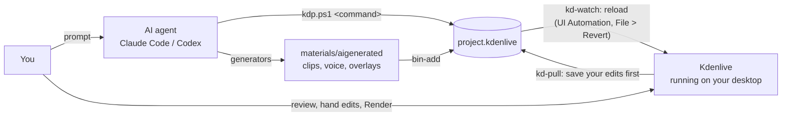

<div align="center">

# Movie Engine

**Umukozi wa AI atunganya videwo yawe muri Kdenlive ureba, kandi ushobora gufata akazi mu ntoki igihe icyo ari cyo cyose.**

Abakozi ba AI bandika code (AI agents: Claude Code, Codex) bubaka kandi bagahindura imishinga nyayo ya Kdenlive: filime, videwo zisobanura n'amashusho magufi ahagaze (vertical shorts). Impinduka zigaragara ako kanya muri editor (porogaramu yo gutunganya amashusho) ufunguye. Irimukanwa (portable), Windows, nta guhindura editor ubwayo.


[English](../../README.md) · [简体中文](README.zh-CN.md) · [繁體中文](README.zh-TW.md) · [हिन्दी](README.hi.md) · [Español](README.es.md) · [Français](README.fr.md) · [العربية](README.ar.md) · [বাংলা](README.bn.md) · [Português](README.pt.md) · [Русский](README.ru.md) · [اردو](README.ur.md) · [Bahasa Indonesia](README.id.md) · [Deutsch](README.de.md) · [日本語](README.ja.md) · [Türkçe](README.tr.md) · [한국어](README.ko.md) · [Українська](README.uk.md) · [Italiano](README.it.md) · [Polski](README.pl.md) · [Tiếng Việt](README.vi.md) · [فارسی](README.fa.md) · [ไทย](README.th.md) · [Kiswahili](README.sw.md) · [አማርኛ](README.am.md) · [Avañe'ẽ](README.gn.md) · [Setswana](README.tn.md) · [Shqip](README.sq.md) · [Беларуская](README.be.md) · [Български](README.bg.md) · [Bosanski](README.bs.md) · [Hrvatski](README.hr.md) · [Српски](README.sr.md) · [Crnogorski](README.cnr.md) · [Македонски](README.mk.md) · [Slovenščina](README.sl.md) · [Slovenčina](README.sk.md) · [Čeština](README.cs.md) · [Magyar](README.hu.md) · [Română](README.ro.md) · [Dansk](README.da.md) · [Norsk bokmål](README.nb.md) · [Norsk nynorsk](README.nn.md) · [Svenska](README.sv.md) · [Íslenska](README.is.md) · [Suomi](README.fi.md) · [Eesti](README.et.md) · [Latviešu](README.lv.md) · [Lietuvių](README.lt.md) · [Nederlands](README.nl.md) · [Lëtzebuergesch](README.lb.md) · [Rumantsch](README.rm.md) · [Ελληνικά](README.el.md) · [Malti](README.mt.md) · [Gaeilge](README.ga.md) · [Català](README.ca.md) · [ქართული](README.ka.md) · [Հայերեն](README.hy.md) · [Azərbaycanca](README.az.md) · [Afrikaans](README.af.md) · [isiZulu](README.zu.md) · [isiXhosa](README.xh.md) · [Sesotho](README.st.md) · [Sepedi](README.nso.md) · [Xitsonga](README.ts.md) · [Tshivenḓa](README.ve.md) · [siSwati](README.ss.md) · [isiNdebele (South Africa)](README.nr.md) · [isiNdebele (Zimbabwe)](README.nd.md) · [chiShona](README.sn.md) · [Chichewa](README.ny.md) · **Ikinyarwanda** · [Ikirundi](README.rn.md) · [Malagasy](README.mg.md) · [Soomaali](README.so.md) · [Afaan Oromoo](README.om.md) · [Qafar af](README.aa.md) · [ትግርኛ](README.ti.md) · [Sängö](README.sg.md) · [Kreol Seselwa](README.crs.md) · [TjiKalanga](README.kck.md) · [ChiNdau](README.ndc.md)

*Iyi ni inyandiko yahinduwe mu rundi rurimi; README y'Icyongereza ni yo ngenderwaho.*

</div>

---

## Ibirimo

- [Impamvu](#impamvu)
- [Uko bikora](#uko-bikora)
- [Ibiranga](#ibiranga)
- [Ibisabwa](#ibisabwa)
- [Kwinjiza](#kwinjiza)
- [Gutangira vuba](#gutangira-vuba)
- [Gukorana n'umukozi wa AI](#gukorana-numukozi-wa-ai)
- [Umurongo w'amabwiriza wo gutunganya (`kdp.ps1`)](#umurongo-wamabwiriza-wo-gutunganya-kdpps1)
- [Guhuza ako kanya na editor ifunguye](#guhuza-ako-kanya-na-editor-ifunguye)
- [Generators: ibyo Kdenlive idashobora gukora](#generators-ibyo-kdenlive-idashobora-gukora)
- [Ijwi risobanura n'amajwi](#ijwi-risobanura-namajwi)
- [Ururimi rwa interface](#ururimi-rwa-interface)
- [Imiterere y'ububiko](#imiterere-yububiko)
- [Ibizamini n'ibimenyetso](#ibizamini-nibimenyetso)
- [Aho bigarukira](#aho-bigarukira)
- [Gukemura ibibazo](#gukemura-ibibazo)
- [Ibibazo bikunze kubazwa](#ibibazo-bikunze-kubazwa)
- [Gutanga umusanzu](#gutanga-umusanzu)
- [Ishimwe](#ishimwe)
- [Uruhushya](#uruhushya)

## Impamvu

Porogaramu zo gutunganya amashusho zakorewe ukuboko gufashe imbeba (mouse). Abakozi ba AI bashoboye cyane imiterere, igihe n'imirimo isubirwamo: gushyira clips 300 ku njyana, guhuza buri caption (inyandiko yo ku mashusho) n'ijwi, gusubiramo scene nyuma yo guhabwa ibitekerezo. Ariko ntibashobora gukanda muri GUI (interface ishushanyije) batigaruriye desktop yawe.

Kdenlive ni editor ikomeye ifite code ifunguye (open-source), ariko kuri Windows **nta API yo gukoresha mu buryo bwikora (automation) igira**: kuyigenzura binyuze kuri D-Bus bibaho gusa ku nyubako (builds) za Linux, kandi forks ziyongeraho ubwo buryo ntizikitabwaho cyangwa ntizitekanye. Movie Engine ikemura iki kibazo idahinduye editor:

1. Umukozi wa AI ahindura dosiye y'umushinga `.kdenlive` akoresheje umurongo w'amabwiriza wageragejwe (`engine/kdp.ps1`).
2. Kdenlive irimo gukora ibwirwa kongera gusoma dosiye binyuze kuri Windows UI Automation, nta gukanda kuri clavier, nta mbeba, kandi nta kwambura focus.
3. Impinduka zawe utarabika zibanza kubikwa kandi ntizigera zandikwaho.

Bityo umukozi wa AI aratunganya nawe ukagenzura, cyangwa ugatunganya n'intoki. Mwembi mukora ku mushinga umwe, muri editor imwe, icyarimwe.

## Uko bikora



Buri tegeko ryo gutunganya rikurikiza uruziga rumwe rutekanye:

1. **Pull (gukurura).** Niba Kdenlive ifite impinduka zitarabikwa, ibwirwa kuzibika (buto Save yo ku murongo w'ibikoresho, binyuze kuri UI Automation), kandi kubika bikemezwa.
2. **Guhindura.** Itegeko rihindura XML rifunze dosiye (lock), nyuma yo kugenzura hash kandi hafashwe ifoto yo gusubiza inyuma (undo snapshot). Niba dosiye yahindutse hagati aho, nta kintu cyandikwa.
3. **Kongera gufungura (reload).** Ugenzura (watcher) abona ikimenyetso cya AI maze agakora File > Revert muri editor ifunguye. Bifatwa nk'ibyagenze neza gusa iyo widget ya timeline yongeye kubakwa koko.
4. **Kuvuguruzanya (conflict).** Niba watangiye gutunganya hagati aho, nta kongera gufungura bikorwa kandi akazi kawe kagumaho. Verisiyo ya AI ibikwa ukwayo, maze umukozi wa AI akongera gushyira impinduka ze hejuru y'izawe.

## Ibiranga

- **Gutunganya umushinga wose nta GUI**: amategeko agera ku 120 akubiyemo bin (ububiko bw'ibikoresho by'umushinga), timeline, effects, compositions, tracks, guides, markers, subtitles, sequences, umuvuduko no guhindura igihe (time remap), slideshows, titles, proxies, rendering na undo/redo. Reba [urutonde rw'amategeko](#umurongo-wamabwiriza-wo-gutunganya-kdpps1).
- **Guhuza ako kanya na editor ifunguye.** Impinduka za AI zigaragara muri Kdenlive urimo kureba; impinduka zawe zitarabikwa zibanza kubikwa kandi ntizigera zitakara.
- **Ntihungabanya desktop yawe.** Nta kwambura focus, nta gukanda kuri clavier cyangwa ku mbeba. Editors z'igerageza zikora kuri desktop ya Windows itagaragara.
- **Irimukanwa.** Editor, igenamiterere (settings), Node.js, fonts n'ibikoresho biri mu bubiko bumwe. Bwigane ubushyire kuri PC indi, birakora; nta kintu cyandikwa muri Program Files cyangwa muri profile yawe ya Windows.
- **Generators z'ibyo Kdenlive idashobora gukora**: inyandiko inyeganyega inyuguti ku yindi (kinetic text), ibimenyetso bishushanyije n'intoki, scenes za 3D za interface, animations za cursor na filime ndende zisobanura ("explainer") zifite imikoranire. Zikorwa (render) kuri GPU zifite motion blur nyayo kandi zishyirwa kuri timeline nka clips zisanzwe.
- **Ijwi risobanura (voice-over) rifite igihe cya buri jambo** (Microsoft Edge TTS, nta API key). Captions n'ibikorwa biba neza ku ijambo nyaryo.
- **Amajwi y'ingaruka (sound effects) akorwa na code** (whoosh, click, pop, riser, impact n'andi).
- **Byagaragajwe, ntibyakekwe.** Buri tegeko rifite igenzura ry'ibisubizo, effects na compositions bigenzurwa kimwe kimwe, kandi ibisubizo by'umwimerere biri muri `docs/proof/`.
- **Amabwiriza y'abakozi ba AI arimo.** `AGENTS.md` na skills ziri muri `.claude/skills/` byigisha Claude Code na Codex uburyo bwo gukora, imiterere ya dosiye n'imitego yo kwirinda.

## Ibisabwa

| | |
|---|---|
| Sisitemu (OS) | Windows 10 cyangwa 11, x64 |
| Editor | Kdenlive **26.08.3**, inyubako irimukanwa (standalone). Izindi verisiyo ntizageragejwe. |
| Node.js | 18 cyangwa irenga: `.zip` ya Windows x64 ivuye kuri nodejs.org, ifunguriwe muri `engine/node/` |
| Mushakisha (browser) | Microsoft Edge (iri muri Windows); ikoreshwa nta idirishya (headless) n'ibikoresho bikora scenes |
| Umukozi wa AI | [Claude Code](https://claude.com/claude-code) cyangwa Codex. Si ngombwa: buri gikoresho gishobora no gukoreshwa n'intoki. |
| Disiki | hafi 1 GB ya editor n'ibikoresho, wongeyeho amashusho n'amajwi yawe |
| GPU | GPU iyo ari yo yose ifite H.264 encoding ya hardware yihutisha `film-render.mjs` (iyo idahari, hakoreshwa software) |

## Kwinjiza

Byose byinjizwa **imbere mu bubiko**. Nta burenganzira bwa admin bukenewe.

```powershell
git clone https://github.com/vladtarrow/movie-engine.git
cd movie-engine
```

**1. Node.js.** Kuramo `.zip` ya Windows x64 ya Node.js 18 cyangwa irenga kuri <https://nodejs.org/en/download> maze ufungurire ibiyirimo muri `engine\node\`, kugira ngo `engine\node\node.exe` na `engine\node\npm.cmd` bibe bihari. Nta installer cyangwa Node ya sisitemu bikenewe. Scripts zose zikoreshwa binyuze kuri `engine\node.cmd`, ntizigera zinyura kuri Node ya sisitemu.

**2. Packages za Node** z'igikoresho cy'ijwi n'ibikoresho bikora amashusho (renderers) (verisiyo zazo zashyizwe muri `engine/voice/package.json`):

```powershell
engine\node\npm.cmd install --prefix engine\voice
```

**3. Kdenlive 26.08.3 irimukanwa.** Kuramo `kdenlive-26.08.3_standalone.exe` kuri <https://download.kde.org/stable/kdenlive/26.08/windows/> uyishyire muri `engine\installer\`, uyigenzure maze uyifungure:

```powershell
(Get-FileHash engine\installer\kdenlive-26.08.3_standalone.exe -Algorithm SHA256).Hash
# expected: A25427B1DFF2C17E3B0386E991BB1A719382BB3176D1A90E441CDAEB6E0A967D
engine\installer\kdenlive-26.08.3_standalone.exe -o"engine\Kdenlive" -y
```

Editor igera muri `engine\Kdenlive\kdenlive-26.08.3_standalone\bin\`. Isanzwe irimo `melt.exe` na `ffmpeg.exe`.

**4. Gutangiza bwa mbere.**

```powershell
engine\kdenlive.cmd
```

Kdenlive ibika igenamiterere ryayo ryose muri `engine\profile-kdenlive\`, si muri profile yawe ya Windows. Iyo itangijwe bwa mbere, yerekana rimwe gusa umufasha wo kuyitegura (setup wizard).

## Gutangira vuba

### Ukoresheje umukozi wa AI

Fungura ububiko muri Claude Code (cyangwa Codex) maze usabe mu magambo asanzwe:

> Kora umushinga mushya uhagaze wa 30 fps witwa "launch-teaser". Shyira kuri timeline amafoto atatu ya ecran (screenshots) ari muri `materials/designers/launch/`, buri imwe amasegonda 2.5 ifite cross-fade ngufi, ongeraho ijwi risobanura rivuye muri `script.txt` kandi uhuze caption inyeganyega na buri murongo.

> Mfungurira umushinga muri Kdenlive.

> Shot ya kabiri ni ndende cyane. Yigabanye igere ku masegonda 1.8 kandi uzamure logo gato.

Umukozi wa AI akurikiza `AGENTS.md`: atunganya binyuze kuri `kdp.ps1`, akora (render) gusa clips montage ikeneye, kandi agahuza editor ifunguye. Ugenzura muri Kdenlive, ugatunganya n'intoki igihe cyose ushaka, maze ugakanda Render iyo unyuzwe.

### Ukoresheje intoki

```powershell
# a new 1080x1920 30 fps project with 2 video and 2 audio tracks
powershell -NoProfile -ExecutionPolicy Bypass -File engine\kdp.ps1 new -Project projects\hello\hello.kdenlive -Profile vertical_hd_30

# a 3-second title and a colour background
powershell -NoProfile -ExecutionPolicy Bypass -File engine\kdp.ps1 bin-color -Project projects\hello\hello.kdenlive -Color '#203060' -Seconds 3 -Name bg
powershell -NoProfile -ExecutionPolicy Bypass -File engine\kdp.ps1 title -Project projects\hello\hello.kdenlive -Text "Hello" -Seconds 3 -Name hi

# place them: background on V1, title above it on V2
powershell -NoProfile -ExecutionPolicy Bypass -File engine\kdp.ps1 add -Project projects\hello\hello.kdenlive -Bin bg -Track V1 -At 0
powershell -NoProfile -ExecutionPolicy Bypass -File engine\kdp.ps1 add -Project projects\hello\hello.kdenlive -Bin hi -Track V2 -At 0

# a check frame, then open it in the editor
powershell -NoProfile -ExecutionPolicy Bypass -File engine\kdp.ps1 frame -Project projects\hello\hello.kdenlive -At 1.5 -Out out\hello\check.png
engine\kdenlive.cmd projects\hello\hello.kdenlive
```

Kugira ngo nyuma wongere ufungure umushinga uheruka, kanda kabiri kuri `open-last-project.cmd`.

## Gukorana n'umukozi wa AI

Umukozi wa AI asoma `AGENTS.md` (Codex) cyangwa `CLAUDE.md`, iyinjiza (Claude Code), wongeyeho skills ebyiri:

| Skill | Icyo yigisha |
|---|---|
| `.claude/skills/kdenlive-project-file` | imiterere ya `.kdenlive` / MLT XML, `kdp.ps1`, kugenzura ukoresheje `melt` |
| `.claude/skills/kdenlive-live` | kugenzura mu mutekano editor irimo gukora: kuyitangiza, pull, kongera gufungura, gufotora idirishya ryayo |

Amategeko umukozi wa AI akurikiza, ushobora kwiringira:

- Ntazigera afata imbeba yawe, clavier cyangwa focus, kandi ntazigera afotora desktop yawe (afotora gusa idirishya rya editor ubwayo).
- Akora ubwe intambwe za GUI (kubika, gufungura, kongera gufungura) aho kugusaba gukanda.
- Abaza mbere yo gukuramo ikintu icyo ari cyo cyose no mbere yo gusiba ikintu icyo ari cyo cyose.
- Akora (render) gusa ibyo akazi gakeneye (clips za scenes, amafoto y'igenzura). Akora filime ya nyuma gusa iyo ubimusabye.
- Iyo Kdenlive idashobora gukora ikintu neza, umukozi wa AI acyubaka hanze akoresheje code maze agashyiramo igisubizo nka clip. Ntagabanya ubwiza bw'effect.

## Umurongo w'amabwiriza wo gutunganya (`kdp.ps1`)

```powershell
powershell -NoProfile -ExecutionPolicy Bypass -File engine\kdp.ps1 <command> -Project <file.kdenlive> [options]
```

Igihe kibarwa mu masegonda, hakoreshejwe akadomo (`2.5`). Tracks ni `V1 V2 …` (V1 ni yo yo hasi) na `A1 A2 …`. Clip igaragazwa na `-Track` hamwe n'igihe icyo ari cyo cyose `-At` kiri muri yo. Ibipimo (parameters) bya effects bishyirwa muri `-Params "name=value||name=value"`. Urutonde rwuzuye n'amahitamo yose biri mu ntangiriro (header) ya `engine/kdp.ps1`.

| Itsinda | Amategeko |
|---|---|
| Umushinga | `new`, `profiles`, `info`, `validate`, `fonts`, `profile-set`, `profile-from-clip`, `zone`, `archive`, `backups`, `rebase`, `otio-export`, `otio-import` |
| Bin | `bin-add`, `bin-color`, `title`, `title-text`, `title-save`, `title-template`, `bin-rename`, `bin-remove`, `bin-info`, `bin-set`, `bin-duplicate`, `bin-replace-file`, `bin-reload`, `folder`, `bin-folder`, `relink`, `clean`, `generator`, `playlist-clip`, `extract-audio`, `transcode` |
| Timeline | `add`, `add-av`, `move`, `copy`, `trim`, `ripple-trim`, `slip`, `split`, `remove`, `speed`, `remap`, `disable`, `enable`, `group`, `ungroup`, `mix`, `unmix`, `space-insert`, `space-remove`, `spaces-remove-all`, `track-clear`, `replace-in-timeline` |
| Effects | `effects`, `effect-info`, `effect-add`, `effect-list`, `effect-set`, `effect-remove`, `effect-copy`, `effect-clear`, `effects-all`, `bin-effect`, `effect-templates`, `effect-template` |
| Compositions | `compositions`, `comp-info`, `comp-add`, `comp-list`, `comp-set`, `comp-remove` |
| Tracks | `track-add`, `track-remove`, `track-set` |
| Guides na markers | `guide-add`, `guide-list`, `guide-remove`, `guide-set`, `guide-clear`, `guide-export`, `guide-category`, `marker`, `marker-list`, `marker-set`, `marker-remove` |
| Subtitles | `sub-add`, `sub-import`, `sub-export`, `sub-state` |
| Sequences | `sequence-add`, `sequences`, `copy-to-sequence`, `expand`; itegeko iryo ari ryo ryose rifite `-Sequence <name>` rikora imbere muri iyo sequence |
| Ibidasanzwe | `slideshow`, animations za Lottie / Glaxnimate binyuze kuri `bin-add`, `proxy`, `stabilize`, `scene-split`, `speed-job`, `subclip` |
| Ibisohoka | `frame` (PNG imwe), `preview` (render yihuse ya melt), `render` (renderer ya Kdenlive ubwayo cyangwa preset), `presets` |
| Amateka | `undo`, `redo`, `clear-history` (snapshots muri `projects/<name>/.kdp-history`) |

Imyitwarire ikwiye kumenya:

- Ibice bihujwe by'amajwi n'amashusho byimurirwa hamwe, bigakatwa (trim) hamwe, bigacibwamo kabiri (split) hamwe kandi bigasibwa hamwe (`-Alone` ku gice kimwe gusa).
- Itegeko ryananiwe risohoka rifite code 1 kandi nta kintu ryandika.
- Effects inyubako ya Windows idashobora gukoresha zirangwa, ntizirengagizwa bucece (urutonde: `docs/proof/assets.txt`).
- Buri gikorwa cyo muri menu ya Kdenlive gihujwe n'itegeko, n'indi nzira, cyangwa na "kureba gusa" muri `engine/tools/data/kdenlive-actions.csv`. Reba `docs/kdenlive-coverage.md`.

## Guhuza ako kanya na editor ifunguye

| Script | Icyo ikora | Exit codes (kode zo gusohoka) |
|---|---|---|
| `engine\kd-pull.ps1 -Project <f>` | ituma Kdenlive ibika impinduka zawe kandi ikabyemeza | 0 dosiye iri ku gihe, 3 ntirimo gukora, 4 ntibyemejwe |
| `engine\kd-reload.ps1 -Project <f>` | File > Revert, byemezwa na timeline yongeye kubakwa | 0 byemejwe, 2 ufite impinduka zitarabikwa (nta kintu cyajugunywe), 3 ntirimo gukora, 4 byananiranye |
| `engine\kd-watch.ps1 -Project <f>` | ugenzura ukorera inyuma: yongera gufungura nyuma ya buri cyandikwa na AI, yandika conflicts muri log | log iri muri `engine\kd-watch.log`; siba `engine\kd-watch.run` kugira ngo uyihagarike |
| `engine\kdenlive-bg.ps1 [project]` | itangiza Kdenlive igabanyijwe (minimized) ku bw'umukozi wa AI | 0 yafunguwe, 4 ntibyemejwe |
| `engine\kdenlive.cmd [project]` | igutangiriza Kdenlive | |

Tangiza ugenzura (watcher) rimwe muri buri session:

```powershell
Start-Process powershell -WindowStyle Hidden -ArgumentList '-NoProfile','-ExecutionPolicy','Bypass','-File','engine\kd-watch.ps1','-Project','projects\hello\hello.kdenlive'
```

Imishinga minini: kongera gufungura umushinga ufite clips 1000 bitwara iminota, kandi ibikoresho birabitegereza aho gutanga raporo hakiri kare. Imishinga ifungurwa binyuze kuri *File > Open Recent* muri editor irimo ubusa, kuko gufungura dosiye mu buryo butaziguye bituma Qt inyura kuri buri kintu cyo kuri timeline ku bwa accessibility, kandi byatindaga iminota igera ku 10.

## Generators: ibyo Kdenlive idashobora gukora

Kdenlive/MLT nta animation y'inyandiko inyuguti ku yindi igira, nta expressions, 3D ni nkeya, kandi effects ziremereye zitinza playback (kureba videwo). Movie Engine ikora (render) ibyo bice hanze maze ikabishyira kuri timeline nka clips zisanzwe, akenshi zifite alpha (ibice bibonerana), kuri track iri hejuru y'amashusho. Script ya generator n'ibyo yinjizwamo biguma mu bubiko bw'umushinga, bityo clip ishobora kongera gukorwa iyo inyandiko, font cyangwa igihe bihindutse.

| Igikoresho | Icyo gikora |
|---|---|
| `engine/tools/kinetic-text.ps1` | captions zinyeganyega inyuguti ku yindi, buri jambo rihujwe n'igihe kiri muri `voice.json`, agasanduku ko kugaragaza (highlight) |
| `engine/tools/annotate.ps1` | uruziga, udusanduku, imirongo yo munsi n'imyambi bishushanyije n'intoki byishushanya hejuru ya screenshot |
| `engine/tools/card-entrance.ps1` | ikarita ya screenshot izamuka ikaguka, ifite igicucu cyoroshye |
| `engine/tools/pdf-to-png.ps1` | slides zivuye muri PDF yasohowe (export) |
| `engine/tools/html-render.mjs` | scene iyo ari yo yose ya HTML/CSS/canvas ihinduka videwo: animation ya interface, cursors, 3D, masks |
| `engine/tools/film-render.mjs` + `film/` | filime ndende zisobanura zifite imikoranire kuri canvas: clip imwe kuri buri murongo w'ijwi, ibikorwa biba ku magambo avuzwe, motion blur kuri GPU ku muvuduko wa hafi 45 fps |

Renderers zombi zikoresha Microsoft Edge izanwa na Windows, nta idirishya (headless), zifite profile ikoreshwa rimwe igahita ijugunywa kandi nta interineti.

### Ingero

```powershell
# a 3-second 3D title card with a cursor click
engine\node.cmd engine\tools\html-render.mjs examples\demo\scene\scene.html examples\demo\out --frames 0,30,60,89
engine\node.cmd engine\tools\html-render.mjs examples\demo\scene\scene.html examples\demo\out\scene.mp4

# a 4-shot interactive film timed to two voice lines
engine\node.cmd engine\tools\film-render.mjs examples\demo\film\film.html examples\demo\out --check
engine\node.cmd engine\tools\film-render.mjs examples\demo\film\film.html examples\demo\out --shots all --width 640
engine\node.cmd engine\tools\film-render.mjs examples\demo\film\film.html examples\demo\out\clips --suffix -v01
```

Filime igizwe na dosiye eshatu nto. `data.js` ibika shots n'igihe cy'amagambo. `direction.js` ifite umurongo umwe kuri buri shot:

```text
1 | hover 192 108 @brand | tag 300 60 Your brand @deserves | confetti 192 90 @film
2 say=A film that/*explains* it
3 | click 116 108 @before | click 268 108 @after | chips Before~After @after
4 scene=counter | count 0 120 % @count
```

`scenes.js` ibika shots zishushanywa uhereye ku busa. `@word` itangiza igikorwa iyo ijwi rivuze iryo jambo. Ibikorwa birimo click, hover, drag, zoom, lens, ring, arrow, chips, toggle, slider, toast, type, count na confetti; imyandikire yabyo yuzuye (syntax) iri hejuru muri `engine/tools/film/film-kit.js`.

## Ijwi risobanura n'amajwi

```powershell
engine\node.cmd engine\voice\voice.mjs lines.json materials\aigenerated\hello\voice en-US-AndrewMultilingualNeural +0%
```

`lines.json` ni urutonde rw'imirongo. Igikoresho cyandika mp3 imwe kuri buri murongo wongeyeho `voice.json`, irimo igihe bimara n'aho buri jambo ritangirira n'aho rirangirira. Imirongo ibikwa (cache), bityo guhindura umurongo umwe bituma hongera gukorwa uwo murongo gusa. Gikoresha serivisi ya Microsoft Edge yo kuri interineti ihindura inyandiko ijwi (text-to-speech) binyuze kuri package `msedge-tts`: nta key ikenewe, ariko serivisi ntiyemewe ku mugaragaro kandi ikenera interineti.

```powershell
engine\node.cmd engine\audio\sfx.mjs materials\aigenerated\sfx
```

Ibi bikora na code amajwi whoosh, whoosh-long, swipe, click, pop, tick, riser, impact, ding na reveal; urutonde rwiteguye ruri muri `materials/aigenerated/sfx/`. Amajwi magufi kurusha frame imwe uyongereho ituze (silence) mbere yo kuyashyira kuri timeline (`-af apad=whole_dur=0.0667`).

## Ururimi rwa interface

Launchers zitangiza Kdenlive mu **Cyongereza** mu buryo busanzwe. Kugira ngo ukoreshe urundi rurimi, shyiraho `MOVIE_ENGINE_UI_LANG` mbere yo kuyitangiza:

```powershell
$env:MOVIE_ENGINE_UI_LANG = 'ru'; engine\kdenlive.cmd
```

UI Automation ibona ibintu bya menu ikoresheje amazina yabyo agaragara. Amazina y'indimi 31 za interface yamaze gushyirwamo (`engine/tools/kd-ui.ps1`, `$KdNames`). Ku rundi rurimi urwo ari rwo rwose, ongeramo amazina yarwo aho maze ugenzure ukoresheje:

```powershell
powershell -NoProfile -ExecutionPolicy Bypass -File engine\tools\kd-langcheck.ps1
```

## Imiterere y'ububiko

```text
movie-engine/
├─ AGENTS.md, CLAUDE.md          instructions for AI agents
├─ .claude/skills/               agent skills: project file format, live editor
├─ engine/
│  ├─ kdp.ps1                    the editing command line
│  ├─ kd-pull / kd-reload / kd-watch .ps1, kdenlive.cmd, kdenlive-bg.ps1
│  ├─ tools/                     internals, generators, tests, data (action map)
│  ├─ voice/  audio/  fonts/     TTS, synthesized SFX, Poppins (OFL)
│  ├─ Kdenlive/  node/           portable editor and Node.js (not in git)
│  └─ profile-kdenlive/          the editor's settings (not in git)
├─ projects/<name>/<name>.kdenlive
├─ materials/
│  ├─ download/                  stock and downloaded files (not in git)
│  ├─ aigenerated/               everything the AI made (sfx/ and test-kit/ ship with the engine)
│  ├─ designers/  brand/         files from your team, brand assets
├─ examples/demo/                demos of the scene and film renderers
├─ out/                          renders (not in git)
└─ docs/                         proofs, coverage, translations of this README
```

Inzira (paths) z'amashusho n'amajwi mu mishinga zishingiye ku bubiko bw'umushinga (relative). Niba wimuye cyangwa wigannye ububiko, `kdp.ps1 rebase` (inakoreshwa mu buryo bwikora na `kdenlive.cmd`) yandika aho bushya buri mu mushinga.

## Ibizamini n'ibimenyetso

Ibivugwa ku bikora bishingiye ku igenzura ry'ibisubizo, si ku "function yarakoze". Incamake iri muri [`docs/kdenlive-proof.md`](../../docs/kdenlive-proof.md), kandi ibisohoka by'umwimerere biri muri `docs/proof/`.

| Ikizamini | Icyo kigenzura |
|---|---|
| `engine\tools\kdp-clitest.ps1` | buri tegeko rya `kdp.ps1`, binyuze ku murongo w'amabwiriza, kigereranya umushinga uvuyemo |
| `engine\tools\kd-livetest.ps1` | pull, kongera gufungura, watcher, conflicts n'amarushanwa (races) kuri Kdenlive nyayo iri kuri desktop itagaragara |
| `engine\tools\kdp-assetsweep.ps1` | buri effect na buri composition: gikora render kikagereranya frames |
| `engine\tools\kdp-portabletest.ps1` | cyigana ububiko ahandi maze kigakorera kuri kopi |
| `engine\tools\kd-langcheck.ps1` | ururimi rwa interface n'uko UI Automation ibona menu |
| `engine\tools\kdp-coverage-check.ps1` | ko buri gikorwa cya menu gihujwe, kandi ko nta kimenyetso (proof) gishaje kurusha code |

```powershell
powershell -NoProfile -ExecutionPolicy Bypass -File engine\tools\kdp-clitest.ps1 -Report docs\proof\clitest.txt
powershell -NoProfile -ExecutionPolicy Bypass -File engine\tools\kd-livetest.ps1 -Report docs\proof\live-en.txt
```

Editors z'igerageza zikora gusa kuri desktop ihishe zifite profile yazo, bityo ibizamini ntibizigera bikora kuri Kdenlive yawe ifunguye cyangwa kuri focus yawe.

## Aho bigarukira

- **Windows gusa**, Kdenlive **26.08.3** gusa. Linux ifite D-Bus kandi yakenera ikiraro gitandukanye.
- Gutangiza editor bifata focus ya clavier mu masegonda agera kuri 3 mu gihe idirishya ririmo ubusa rigaragara. Abakozi ba AI babaza mbere yo kuyitangiza mu gihe urimo gukora. Kongera gufungura no gutunganya ntibifata focus.
- Inyubako ya Windows ibura modules za MLT sox, ladspa na movit ndetse na zimwe muri effects za frei0r/avfilter; `kdp.ps1` irazanga (`docs/proof/assets.txt`).
- Gusohora (export) no kwinjiza (import) OpenTimelineIO bitwara clips n'imyanya irimo ubusa (gaps) gusa. Multicam ntigira guhindura inguni (angle) ako kanya (gukata bikorwa na split/remove/hide).
- "Save As…" binyuze kuri UI Automation ku idirishya rigabanyijwe (minimized) ntifungura dialog; umukozi wa AI akoresha `archive` cyangwa kwigana dosiye mu mwanya wabyo.
- Kumenya imvugo (speech recognition, kuri subtitles zikorwa mu buryo bwikora) bikenera Whisper cyangwa Vosk, bitazanwa na Movie Engine.
- Titles zakozwe n'igikoresho cya titles cya Kdenlive zikoresha fonts zashyizwe muri Windows. Kugira ngo imyandikire ibe uko ubishaka byanze bikunze, kora inyandiko ukoresheje generators, zifata fonts muri `engine/fonts/`.
- Edge TTS ni serivisi yo kuri interineti itemewe ku mugaragaro kandi ishobora guhinduka cyangwa kureka gukora.

## Gukemura ibibazo

| Ikimenyetso | Impamvu n'umuti |
|---|---|
| Kdenlive irimo gukora, ariko kuyikandaho kuri taskbar nta cyo byerekana | Aho idirishya ryayo ryabitswe ni hanze ya ecran. Yifunge maze usibe entries za `kdockLayout` muri `engine\profile-kdenlive\AppData\Local\kdenliverc`, cyangwa wimure idirishya ukoresheje `SetWindowPos` (reba `AGENTS.md`). |
| `kd-reload.ps1` isohoka na 2 | Ufite impinduka zitarabikwa. Nta kintu cyajugunywe. Koresha `kd-pull.ps1`, hanyuma wongere ushyireho impinduka (`kdp.ps1` ibikora ubwayo). |
| `CONFLICT` muri `engine\kd-watch.log` | Wowe n'umukozi wa AI mwatunganyije icyarimwe. Verisiyo yawe iguma muri editor, naho verisiyo ya AI iri muri `projects\<name>\.kdp-history\<name>\conflict\`. Saba umukozi wa AI kongera gushyiraho impinduka ze. |
| Itegeko risohoka na 1 rivuga "pull not confirmed" | Kdenlive irahuze cyangwa irerekana dialog. Funga dialog cyangwa utegereze ko gufungura birangira, hanyuma usubiremo. |
| Script ya PowerShell yanga gusomwa (parse) | Scripts zirimo inyandiko itari ASCII zigomba kubikwa nka UTF-8 **ifite BOM** kuri Windows PowerShell 5.1. |
| `voice.mjs` ihagarara ivuga "Stream closed before the synthesis completed" | Akenshi ni ikibazo cya interineti, cyangwa SSML itarinzwe (unescaped) muri kopi za kera. `voice.mjs` irinda (escape) `& < >` ubwayo. |
| Gufungura umushinga munini bitwara iminota myinshi | Uwufungure ukoresheje `kdenlive.cmd` / `kdenlive-bg.ps1`, ntuzigere uwufungura nka `kdenlive.exe project.kdenlive`. |

## Ibibazo bikunze kubazwa

**Ese nkeneye Claude Code cyangwa Codex?**
Oya. Buri gikoresho ni script isanzwe ushobora gukoresha n'intoki. Umukozi wa AI ni we utuma byihuta: ategura montage, akoresha ibikoresho kandi agahuza editor.

**Ese umukozi wa AI azandika hejuru y'impinduka nakoze n'intoki?**
Oya. Mbere yo kwandika ikintu icyo ari cyo cyose, impinduka zawe zitarabikwa zirabikwa kandi bikemezwa. Niba utunganya mu gihe umukozi wa AI arimo kwandika, ibyo yandika biranga cyangwa bikabikwa ukwabyo nka conflict, ntibizigera bishyirwa hejuru y'akazi kawe.

**Ese nshobora gukomeza gukoresha Kdenlive bisanzwe?**
Yego. Ni Kdenlive isanzwe ifite ububiko bwayo bw'igenamiterere. Tunganya, reba kandi ukore render nk'uko bisanzwe.

**Ese ikorana na Kdenlive nsanganywe muri mudasobwa?**
Ikoresha kopi yayo irimukanwa iri muri `engine\Kdenlive\`, bityo Kdenlive yawe yashyizweho n'igenamiterere ryayo ntibikorwaho.

**Kuki atari fork ya Kdenlive ifite API, cyangwa indi editor?**
Kuri Windows, nta fork yitaweho kandi itekanye ibaho (isuzuma ryo mu Ugushyingo 2026). OpenShot, Blender VSE, DaVinci Resolve, Shotcut na editors zo kuri web byarasuzumwe; Kdenlive ni yo yatanze ubushobozi bwimbitse bwo gutunganya. Icyifuzo cya REST API mu mushinga w'umwimerere wa Kdenlive (merge request !902) kirakurikiranwa.

**Ese ishobora gukora (render) videwo ya nyuma?**
Yego, ukoresheje `kdp.ps1 render` (renderer ya Kdenlive ubwayo, ihishe), cyangwa ugakanda Render muri editor ubwawe.

**Ese amashusho yanjye yoherezwa ahandi?**
Oya. Inyandiko y'ijwi risobanura ni yo yonyine yoherezwa kuri serivisi ya Edge TTS iyo ukora ijwi. Renderers za scenes zikora interineti ihagaritswe.

## Gutanga umusanzu

Imisanzu irakirwa neza. Reba [CONTRIBUTING.md](../../CONTRIBUTING.md). Mu magambo make:

- Buri gikorwa gishya cyangwa cyahinduwe cya `kdp.ps1` gikeneye igenzura ry'ibisubizo muri `kdp-clitest.ps1`, kwandikwa mu ikarita y'ibikorwa (action map), no kongera gukoresha `kdp-coverage-check.ps1`.
- Ntuzigere utangiza Kdenlive y'igerageza kuri desktop igaragara; koresha `engine/tools/kd-hidden.ps1`.
- Gumana byose birimukanwa: nta kwinjiza porogaramu hanze y'ububiko, nta nzira zuzuye (absolute paths) mu mishinga.
- Andika imiterere idasanzwe yagenzuwe (quirks) muri `AGENTS.md` cyangwa muri skill bijyanye.

## Ishimwe

- [Kdenlive](https://kdenlive.org) na [MLT](https://www.mltframework.org): editor na moteri iri munsi yayo.
- [FFmpeg](https://ffmpeg.org), izanwa na Kdenlive.
- [msedge-tts](https://www.npmjs.com/package/msedge-tts) ku ijwi risobanura.
- [Poppins](https://fonts.google.com/specimen/Poppins) ya Indian Type Foundry, SIL Open Font License (`engine/fonts/OFL.txt`).
- `engine/tools/data/kdenliveui-26.08.3.rc`: dosiye ya menu ya Kdenlive, yavanywe muri code y'isoko (source) ya Kdenlive 26.08.3; ikoreshwa gusa n'igenzura ry'ubwuzure (coverage check). Iguma munsi y'uruhushya rwa GPL rwa Kdenlive, si munsi ya MIT License.

## Uruhushya

Code ya Movie Engine ubwayo itangwa munsi ya [MIT License](../../LICENSE). Kdenlive, MLT, FFmpeg, packages za Node.js na font ya Poppins bigumana impushya zabyo.
