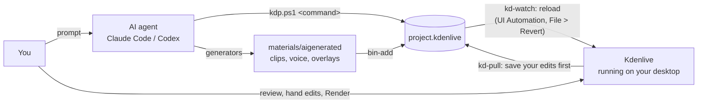

<div align="center">

# Movie Engine

**Mbênî agent ti AI (intelligence artificielle) ayeke sära montage ti vidéo ti mo na yâ ti Kdenlive na ngoi so mo yeke bâ, na mo lingbi ti mû kua ni na mabôko ti mo na ngoi kûê.**

Âagent ti AI so ayeke sû code (Claude Code, Codex) ayeke leke na ayeke changé tâ âprojet ti Kdenlive: âfilm, âvidéo ti fängö ye (explainers) na âkêtê vidéo so aluti (shorts). Âchangement ni ayeke sigîgî hîo na yâ ti éditeur so mo zî ni. Portable, Windows, sân ti changé code ti éditeur ni (patch).


[English](../../README.md) · [简体中文](README.zh-CN.md) · [繁體中文](README.zh-TW.md) · [हिन्दी](README.hi.md) · [Español](README.es.md) · [Français](README.fr.md) · [العربية](README.ar.md) · [বাংলা](README.bn.md) · [Português](README.pt.md) · [Русский](README.ru.md) · [اردو](README.ur.md) · [Bahasa Indonesia](README.id.md) · [Deutsch](README.de.md) · [日本語](README.ja.md) · [Türkçe](README.tr.md) · [한국어](README.ko.md) · [Українська](README.uk.md) · [Italiano](README.it.md) · [Polski](README.pl.md) · [Tiếng Việt](README.vi.md) · [فارسی](README.fa.md) · [ไทย](README.th.md) · [Kiswahili](README.sw.md) · [አማርኛ](README.am.md) · [Avañe'ẽ](README.gn.md) · [Setswana](README.tn.md) · [Shqip](README.sq.md) · [Беларуская](README.be.md) · [Български](README.bg.md) · [Bosanski](README.bs.md) · [Hrvatski](README.hr.md) · [Српски](README.sr.md) · [Crnogorski](README.cnr.md) · [Македонски](README.mk.md) · [Slovenščina](README.sl.md) · [Slovenčina](README.sk.md) · [Čeština](README.cs.md) · [Magyar](README.hu.md) · [Română](README.ro.md) · [Dansk](README.da.md) · [Norsk bokmål](README.nb.md) · [Norsk nynorsk](README.nn.md) · [Svenska](README.sv.md) · [Íslenska](README.is.md) · [Suomi](README.fi.md) · [Eesti](README.et.md) · [Latviešu](README.lv.md) · [Lietuvių](README.lt.md) · [Nederlands](README.nl.md) · [Lëtzebuergesch](README.lb.md) · [Rumantsch](README.rm.md) · [Ελληνικά](README.el.md) · [Malti](README.mt.md) · [Gaeilge](README.ga.md) · [Català](README.ca.md) · [ქართული](README.ka.md) · [Հայերեն](README.hy.md) · [Azərbaycanca](README.az.md) · [Afrikaans](README.af.md) · [isiZulu](README.zu.md) · [isiXhosa](README.xh.md) · [Sesotho](README.st.md) · [Sepedi](README.nso.md) · [Xitsonga](README.ts.md) · [Tshivenḓa](README.ve.md) · [siSwati](README.ss.md) · [isiNdebele (South Africa)](README.nr.md) · [isiNdebele (Zimbabwe)](README.nd.md) · [chiShona](README.sn.md) · [Chichewa](README.ny.md) · [Ikinyarwanda](README.rw.md) · [Ikirundi](README.rn.md) · [Malagasy](README.mg.md) · [Soomaali](README.so.md) · [Afaan Oromoo](README.om.md) · [Qafar af](README.aa.md) · [ትግርኛ](README.ti.md) · **Sängö** · [Kreol Seselwa](README.crs.md) · [TjiKalanga](README.kck.md) · [ChiNdau](README.ndc.md)

*Mbëtï so ayeke kîrîngö-tënë; README na yângâ ti Anglëe la ayeke mbëtï ti gbe ni (référence).*

</div>

---

## Yâ ti mbëtï ni

- [Ngbanga ti nyen](#ngbanga-ti-nyen)
- [Tongana nyen la lo yeke sära kua](#tongana-nyen-la-lo-yeke-sära-kua)
- [Âye so lo lingbi ti sära](#âye-so-lo-lingbi-ti-sära)
- [Âye so a hunda](#âye-so-a-hunda)
- [Zîangö na ordinatëre](#zîangö-na-ordinatëre)
- [Töngö nda hîo](#töngö-nda-hîo)
- [Sarängö kua na agent](#sarängö-kua-na-agent)
- [Ligne de commande ti montage (`kdp.ps1`)](#ligne-de-commande-ti-montage-kdpps1)
- [Synchronisation na éditeur so a zî ni](#synchronisation-na-éditeur-so-a-zî-ni)
- [Âgénérateur: ye so Kdenlive alingbi ti sära pëpe](#âgénérateur-ye-so-kdenlive-alingbi-ti-sära-pëpe)
- [Voix off na âson](#voix-off-na-âson)
- [Yângâ ti interface](#yângâ-ti-interface)
- [Lêgë so a leke âdossier na ni](#lêgë-so-a-leke-âdossier-na-ni)
- [Âtest na âpreuve](#âtest-na-âpreuve)
- [Âye so lo lingbi pëpe](#âye-so-lo-lingbi-pëpe)
- [Lekengö âkpale](#lekengö-âkpale)
- [Âhûhûndâ so azo ayeke hûnda mingi](#âhûhûndâ-so-azo-ayeke-hûnda-mingi)
- [Mûngö mabôko](#mûngö-mabôko)
- [Singîla](#singîla)
- [Licence](#licence)

## Ngbanga ti nyen

A leke âlogiciel ti montage vidéo teti mabôko so ayeke na ndö ti souris. Âagent ti AI ayeke nzönî mingi na structure, na ngoi (timing) na kua so a kîri a sära ni lâkûê: ti zîa 300 clip na ndö ti rythme ti mozoko, ti zîa ngoi ti sous-titre ôko ôko na gô, ti kîri ti sära mbênî scène na pekô ti wängö ti zo. Me ala lingbi ti pîka na ndö ti GUI pëpe tongana ala mû bureau (desktop) ti mo pëpe.

Kdenlive ayeke mbênî éditeur open-source so ayeke ngangü, me na ndö ti Windows lo yeke na **API ti automation pëpe**: commande na lêgë ti D-Bus ayeke gï na âbuild ti Linux, na âfork so azîa ni ayeke wala so zo ayeke bata ni encore pëpe, wala so ayeke na sûreté pëpe. Movie Engine ayeke leke kpale so sân ti changé éditeur ni:

1. Agent ayeke sära montage na ndö ti fichier ti projet `.kdenlive` na lêgë ti mbênî ligne de commande so a tara ni awe (`engine/kdp.ps1`).
2. A tene na Kdenlive so ayeke sära kua ti kîri ti diko fichier ni na lêgë ti Windows UI Automation, sân ti pîka touche ti clavier, sân ti souris na sân ti mû focus.
3. A bata kôzo âchangement ti mo so mo bata ni ade pëpe, na a sû ye na ndö ti ala lâ ôko pëpe.

Tongaso agent ayeke sära montage na mo yeke bâ ni, wala mo mveni mo sära ni na mabôko ti mo. Ala ûse kûê ala yeke sära kua na ndö ti projet ôko, na yâ ti éditeur ôko, na ngoi ôko.

## Tongana nyen la lo yeke sära kua



Commande ti montage kûê ayeke mû peko ti lêgë ôko so ayeke na sûreté:

1. **Pull.** Tongana Kdenlive ayeke na âchangement so a bata ni ade pëpe, a tene na lo ti bata ala (bouton Save ti barre d'outils na lêgë ti UI Automation), na a fa so a bata ala biani.
2. **Montage.** Commande ni ayeke changé XML na gbe ti mbênî lock, na pekô ti tarängö ti hash, na mbênî snapshot ti undo. Tongana fichier ni achangé na ngoi ni, a sû ye ôko pëpe.
3. **Rechargement (reload).** Watcher ni abâ stamp ti AI na lo sära File > Revert na yâ ti éditeur so a zî ni. A bâ ni tongana nzönî gï tongana a kîri a leke widget ti timeline biani.
4. **Conflit.** Tongana mo komanse ti sära montage na popo ni, a kîri a chargé ye ôko pëpe na kua ti mo angbâ. A bata version ti AI na mbâgë, na agent akîri azîa changement ti lo na ndö ti changement ti mo.

## Âye so lo lingbi ti sära

- **Montage ti projet kûê sân ti GUI**: ndurü na 120 commande teti bin, timeline, âeffet, âcomposition, âpiste (tracks), âguide, âmarqueur, âsous-titre, âséquence, vitesse na time remap, slideshow, âtitre, proxy, rendu na undo/redo. Bâ [référence ti âcommande](#ligne-de-commande-ti-montage-kdpps1).
- **Synchronisation hîo na éditeur so a zî ni.** Âchangement ti AI ayeke sigîgî na yâ ti Kdenlive so mo yeke bâ; a bata kôzo âchangement ti mo so a bata ni ade pëpe, na ala girisa lâ ôko pëpe.
- **Lo zîa kpale na bureau ti mo lâ ôko pëpe.** Lo mû focus pëpe, lo pîka touche pëpe, lo tö souris pëpe. Âéditeur ti test ayeke sära kua na ndö ti mbênî bureau ti Windows so lê alingbi ti bâ pëpe.
- **Portable.** Éditeur, âparamètre, Node.js, âpolice (fonts) na âoutil ayeke na yâ ti dossier ôko. Mo copier ni na mbênî ordinatëre, na lo yeke sära kua; a sû ye ôko na yâ ti Program Files wala na yâ ti profil ti Windows ti mo pëpe.
- **Âgénérateur teti âye so Kdenlive alingbi ti sära pëpe**: kinetic text so lettre ôko ôko ayeke tambela, âannotation so a dessiné na mabôko, âscène ti interface na 3D, âanimation ti curseur na âfilm ti fängö ye ("explainer") so ayo na so zo alingbi ti sära ye na yâ ni (interactive). A sära rendu ti ala na ndö ti GPU na tâ motion blur, na a zîa ala na ndö ti timeline tongana âclip ti lâkûê.
- **Voix off na ngoi ti âmot** (Microsoft Edge TTS, a hunda API key pëpe). Âsous-titre na âaction ayeke tö nda biani na ndö ti mot so a lingbi.
- **Âeffet ti son so a leke na code** (whoosh, click, pop, riser, impact na ambeni ndê).
- **A tara ni biani, a gbu ni gï na bê pëpe.** Commande kûê ayeke na tarängö ti résultat ni, a tara âeffet na âcomposition ôko ôko, na âkôzo résultat ayeke na yâ ti `docs/proof/`.
- **Âwängö teti agent ayeke dä.** `AGENTS.md` na âskill so ayeke na yâ ti `.claude/skills/` ayeke fa na Claude Code na Codex lêgë ti kua, format ti fichier na âkpale so a lingbi ti kpe ni.

## Âye so a hunda

| | |
|---|---|
| OS | Windows 10 wala 11, x64 |
| Éditeur | Kdenlive **26.08.3** portable (standalone). A tara âversion ndê pëpe. |
| Node.js | 18 wala so ayeke fini ahon ni: `.zip` ti Windows x64 so alondo na nodejs.org, so a décompresser ni na yâ ti `engine/node/` |
| Navigateur | Microsoft Edge (ayeke na yâ ti Windows); âlogiciel ti rendu ti scène ayeke sära kua na ni sân ti fenêtre (headless) |
| Agent | [Claude Code](https://claude.com/claude-code) wala Codex. A yeke ngangü pëpe: mo lingbi ti sära kua na outil kûê na mabôko. |
| Disque | ndurü na 1 GB teti éditeur na âoutil, na âmédia ti mo na ndö ni |
| GPU | GPU kûê so ayeke na encodage H.264 ti matériel ayeke sära si `film-render.mjs` ague hîo (tongana lo yeke dä pëpe, a sära kua na logiciel) |

## Zîangö na ordinatëre

A zîa ye kûê **na yâ ti dossier ni**. A hunda droit ti admin pëpe.

```powershell
git clone https://github.com/vladtarrow/movie-engine.git
cd movie-engine
```

**1. Node.js.** Télécharger `.zip` ti Windows x64 ti Node.js 18 wala so ayeke fini ahon ni na <https://nodejs.org/en/download> na mo décompresser ye so ayeke na yâ ni na yâ ti `engine\node\`, tongaso `engine\node\node.exe` na `engine\node\npm.cmd` ayeke dä. A hunda installateur pëpe na a hunda Node ti système pëpe. Âscript kûê ayeke sära kua na lêgë ti `engine\node.cmd`, lâ ôko pëpe na lêgë ti Node ti système.

**2. Âpaquet ti Node** teti outil ti gô na âlogiciel ti rendu (a kanga âversion ni na yâ ti `engine/voice/package.json`):

```powershell
engine\node\npm.cmd install --prefix engine\voice
```

**3. Kdenlive 26.08.3 portable.** Télécharger `kdenlive-26.08.3_standalone.exe` na <https://download.kde.org/stable/kdenlive/26.08/windows/> na yâ ti `engine\installer\`, tara ni na décompresser ni:

```powershell
(Get-FileHash engine\installer\kdenlive-26.08.3_standalone.exe -Algorithm SHA256).Hash
# expected: A25427B1DFF2C17E3B0386E991BB1A719382BB3176D1A90E441CDAEB6E0A967D
engine\installer\kdenlive-26.08.3_standalone.exe -o"engine\Kdenlive" -y
```

Éditeur ni ayeke ga na yâ ti `engine\Kdenlive\kdenlive-26.08.3_standalone\bin\`. `melt.exe` na `ffmpeg.exe` ayeke na yâ ni awe.

**4. Töngö nda ti kôzo.**

```powershell
engine\kdenlive.cmd
```

Kdenlive ayeke bata âparamètre ti lo kûê na yâ ti `engine\profile-kdenlive\`, na yâ ti profil ti Windows ti mo pëpe. Na töngö nda ti kôzo, lo fa mbênî assistant ti configuration (setup wizard) fani ôko gï.

## Töngö nda hîo

### Na lêgë ti agent

Zî dossier ni na yâ ti Claude Code (wala Codex) na mo hunda ye so mo ye na âmot so ayeke ngangü pëpe:

> Leke mbênî fini projet so aluti, 30 fps, "launch-teaser". Zîa âcapture d'écran otâ so ayeke na `materials/designers/launch/` na ndö ti timeline, 2.5 s teti ôko ôko na kêtê cross-fade, zîa voix off so alondo na `script.txt` na mo zîa kinetic caption na ngoi ti ligne ôko ôko.

> Zî ni teti mbi na yâ ti Kdenlive.

> Shot ti ûse ni ayo mingi. Sära si lo duti 1.8 s na mo yôro logo ni na nduzu kêtê.

Agent ayeke mû peko ti `AGENTS.md`: lo sära montage na lêgë ti `kdp.ps1`, lo sära rendu gï ti âclip so montage ni ahunda, na lo bata éditeur so a zî ni na ngoi ôko na fichier ni (sync). Mo bâ kua ni na yâ ti Kdenlive, mo sära montage na mabôko ti mo na ngoi kûê so mo ye, na mo pîka Render tongana bê ti mo anzere.

### Na mabôko

```powershell
# a new 1080x1920 30 fps project with 2 video and 2 audio tracks
powershell -NoProfile -ExecutionPolicy Bypass -File engine\kdp.ps1 new -Project projects\hello\hello.kdenlive -Profile vertical_hd_30

# a 3-second title and a colour background
powershell -NoProfile -ExecutionPolicy Bypass -File engine\kdp.ps1 bin-color -Project projects\hello\hello.kdenlive -Color '#203060' -Seconds 3 -Name bg
powershell -NoProfile -ExecutionPolicy Bypass -File engine\kdp.ps1 title -Project projects\hello\hello.kdenlive -Text "Hello" -Seconds 3 -Name hi

# place them: background on V1, title above it on V2
powershell -NoProfile -ExecutionPolicy Bypass -File engine\kdp.ps1 add -Project projects\hello\hello.kdenlive -Bin bg -Track V1 -At 0
powershell -NoProfile -ExecutionPolicy Bypass -File engine\kdp.ps1 add -Project projects\hello\hello.kdenlive -Bin hi -Track V2 -At 0

# a check frame, then open it in the editor
powershell -NoProfile -ExecutionPolicy Bypass -File engine\kdp.ps1 frame -Project projects\hello\hello.kdenlive -At 1.5 -Out out\hello\check.png
engine\kdenlive.cmd projects\hello\hello.kdenlive
```

Ti kîri ti zî projet ti nda ni na pekô, pîka `open-last-project.cmd` fani ûse (double-clic).

## Sarängö kua na agent

Agent ayeke diko `AGENTS.md` (Codex) wala `CLAUDE.md`, so ayeke yôro `AGENTS.md` na yâ ni (Claude Code), na âskill ûse:

| Skill | Ye so lo fa |
|---|---|
| `.claude/skills/kdenlive-project-file` | format ti `.kdenlive` / MLT XML, `kdp.ps1`, tarängö na `melt` |
| `.claude/skills/kdenlive-live` | gbû éditeur so ayeke sära kua na sûreté: töngö nda, pull, rechargement, capture ti fenêtre ti lo |

Ândïä so agent ayeke mû peko ni, so mo lingbi ti zîa bê ti mo dä:

- Lo mû souris, clavier wala focus ti mo lâ ôko pëpe, na lo gbû foto (screenshot) ti bureau ti mo lâ ôko pëpe (gï fenêtre ti éditeur ni mveni).
- Lo mveni lo sära âétape ti GUI (bata, zî, recharger); lo hunda mo ti pîka pëpe.
- Lo hunda kôzo si lo télécharger ye ôko, na kôzo si lo lungula ye ôko.
- Lo sära rendu gï ti ye so kua ni ahunda (âclip ti scène, âimage ti tarängö). Lo sära rendu ti film ti nda ni gï tongana mo hunda.
- Tongana Kdenlive alingbi ti sära mbênî ye nzönî pëpe, agent ayeke leke ni na gîgî na code na lo zîa résultat ni tongana clip. Lo sära si effet ni akîri na gbe pëpe.

## Ligne de commande ti montage (`kdp.ps1`)

```powershell
powershell -NoProfile -ExecutionPolicy Bypass -File engine\kdp.ps1 <command> -Project <file.kdenlive> [options]
```

Ângoi ayeke na âseconde, na point (`2.5`). Âpiste ayeke `V1 V2 …` (V1 ayeke na gbe kûê) na `A1 A2 …`. A gi clip na lêgë ti `-Track` na ngoi `-At` kûê so ayeke na yâ ti clip ni. Âparamètre ti effet ayeke lï na yâ ti `-Params "name=value||name=value"`. Liste kûê na âoption kûê ayeke na li ti `engine/kdp.ps1`.

| Groupe | Âcommande |
|---|---|
| Projet | `new`, `profiles`, `info`, `validate`, `fonts`, `profile-set`, `profile-from-clip`, `zone`, `archive`, `backups`, `rebase`, `otio-export`, `otio-import` |
| Bin | `bin-add`, `bin-color`, `title`, `title-text`, `title-save`, `title-template`, `bin-rename`, `bin-remove`, `bin-info`, `bin-set`, `bin-duplicate`, `bin-replace-file`, `bin-reload`, `folder`, `bin-folder`, `relink`, `clean`, `generator`, `playlist-clip`, `extract-audio`, `transcode` |
| Timeline | `add`, `add-av`, `move`, `copy`, `trim`, `ripple-trim`, `slip`, `split`, `remove`, `speed`, `remap`, `disable`, `enable`, `group`, `ungroup`, `mix`, `unmix`, `space-insert`, `space-remove`, `spaces-remove-all`, `track-clear`, `replace-in-timeline` |
| Âeffet | `effects`, `effect-info`, `effect-add`, `effect-list`, `effect-set`, `effect-remove`, `effect-copy`, `effect-clear`, `effects-all`, `bin-effect`, `effect-templates`, `effect-template` |
| Âcomposition | `compositions`, `comp-info`, `comp-add`, `comp-list`, `comp-set`, `comp-remove` |
| Âpiste | `track-add`, `track-remove`, `track-set` |
| Âguide na âmarqueur | `guide-add`, `guide-list`, `guide-remove`, `guide-set`, `guide-clear`, `guide-export`, `guide-category`, `marker`, `marker-list`, `marker-set`, `marker-remove` |
| Âsous-titre | `sub-add`, `sub-import`, `sub-export`, `sub-state` |
| Âséquence | `sequence-add`, `sequences`, `copy-to-sequence`, `expand`; commande kûê so ayeke na `-Sequence <name>` ayeke sära kua na yâ ti séquence ni |
| Âye ndê | `slideshow`, âanimation ti Lottie / Glaxnimate na lêgë ti `bin-add`, `proxy`, `stabilize`, `scene-split`, `speed-job`, `subclip` |
| Sortie | `frame` (PNG ôko), `preview` (rendu ti melt so ague hîo), `render` (renderer ti Kdenlive mveni wala mbênî preset), `presets` |
| Mbaï | `undo`, `redo`, `clear-history` (âsnapshot na yâ ti `projects/<name>/.kdp-history`) |

Âye so a lingbi mo hînga:

- Âmbâgë ti audio na vidéo so a kânga ala ôko ayeke gue, a trim ala, a split ala na a lungula ala ôko (`-Alone` teti mbâgë ôko gï).
- Commande so asära kua nzönî pëpe ayeke hûnzi na code 1 na lo sû ye ôko pëpe.
- A ke âeffet so build ti Windows alingbi ti sära pëpe; a zîa ala kpô pëpe (liste: `docs/proof/assets.txt`).
- Action ti menu ti Kdenlive kûê ayeke na commande ti lo, wala mbênî lêgë ndê, wala "ti bâ gï" na yâ ti `engine/tools/data/kdenlive-actions.csv`. Bâ `docs/kdenlive-coverage.md`.

## Synchronisation na éditeur so a zî ni

| Script | Ye so lo sära | Âcode ti sortie |
|---|---|---|
| `engine\kd-pull.ps1 -Project <f>` | lo sära si Kdenlive abata âchangement ti mo na lo fa so a bata ala | 0 fichier ayeke na ngoi ni, 3 ayeke sära kua pëpe, 4 a fa ni pëpe |
| `engine\kd-reload.ps1 -Project <f>` | File > Revert, so timeline so a kîri a leke ni afa | 0 a fa ni, 2 mo yeke na âchangement so a bata ni pëpe (a bi ye ôko pëpe), 3 ayeke sära kua pëpe, 4 asära kua nzönî pëpe |
| `engine\kd-watch.ps1 -Project <f>` | watcher so ayeke sära kua na gbe: lo recharger na pekô ti sûngö kûê ti AI, lo sû âconflit na yâ ti log | log na yâ ti `engine\kd-watch.log`; lungula `engine\kd-watch.run` ti kanga ni |
| `engine\kdenlive-bg.ps1 [project]` | lo tö nda ti Kdenlive so a minimiser ni teti agent | 0 a chargé ni, 4 a fa ni pëpe |
| `engine\kdenlive.cmd [project]` | lo tö nda ti Kdenlive teti mo | |

Tö nda ti watcher fani ôko teti session ôko ôko:

```powershell
Start-Process powershell -WindowStyle Hidden -ArgumentList '-NoProfile','-ExecutionPolicy','Bypass','-File','engine\kd-watch.ps1','-Project','projects\hello\hello.kdenlive'
```

Âkota projet: rechargement ti mbênî projet so ayeke na 1000 clip ayeke mû âminute, na âoutil ayeku ni; ala tene ye kôzo ti ngoi ni pëpe. A zî âprojet na lêgë ti *File > Open Recent* na ndö ti éditeur so ayeke senge, ngbanga ti so zîngö fichier hîo na lêgë ôko ayeke sära si Qt ague na ndö ti ye kûê ti timeline teti accessibilité, na a yeke ndurü na 10 minute ahon.

## Âgénérateur: ye so Kdenlive alingbi ti sära pëpe

Kdenlive/MLT ayeke na animation ti texte lettre ôko ôko pëpe, na expressions pëpe, na 3D kêtê gï, na âkota effet ayeke sära si lecture (playback) ague yeke yeke. Movie Engine ayeke sära rendu ti âmbâgë tongaso na gîgî na lo zîa ala na ndö ti timeline tongana âclip ti lâkûê, mingi ni na alpha, na ndö ti mbênî piste so ayeke na nduzu ti âimage. Script ti générateur na âye so lo mû ayeke ngbâ na yâ ti dossier ti projet, tongaso a lingbi ti kîri ti leke clip tongana texte, police wala ngoi achangé.

| Outil | Ye so lo leke |
|---|---|
| `engine/tools/kinetic-text.ps1` | âcaption so lettre ôko ôko ayeke tambela, ngoi ti mot ôko ôko alondo na `voice.json`, carré ti highlight |
| `engine/tools/annotate.ps1` | âcercle, âcarré, âligne na gbe ti mot na âflèche so a dessiné na mabôko, so ayeke sigîgî yeke yeke na ndö ti mbênî capture d'écran |
| `engine/tools/card-entrance.ps1` | mbênî carte ti capture d'écran so ayeke londo na ayeke kono, na mbênî ombre so ayeke nzêre |
| `engine/tools/pdf-to-png.ps1` | âslide so alondo na mbênî export ti PDF |
| `engine/tools/html-render.mjs` | scène kûê ti HTML/CSS/canvas na vidéo: animation ti interface, âcurseur, 3D, âmasque |
| `engine/tools/film-render.mjs` + `film/` | âfilm ti fängö ye so ayo, interactive, na ndö ti canvas: clip ôko teti ligne ti gô ôko ôko, âaction ayeke tö nda na ndö ti âmot so a tene, motion blur na GPU na ndurü 45 fps |

Âlogiciel ti rendu ûse kûê ayeke gbû Microsoft Edge so ayeke ga na Windows, headless (sân ti fenêtre), na mbênî profil so a yeke bi ni na pekô ni, na sân ti réseau.

### Âdémo

```powershell
# a 3-second 3D title card with a cursor click
engine\node.cmd engine\tools\html-render.mjs examples\demo\scene\scene.html examples\demo\out --frames 0,30,60,89
engine\node.cmd engine\tools\html-render.mjs examples\demo\scene\scene.html examples\demo\out\scene.mp4

# a 4-shot interactive film timed to two voice lines
engine\node.cmd engine\tools\film-render.mjs examples\demo\film\film.html examples\demo\out --check
engine\node.cmd engine\tools\film-render.mjs examples\demo\film\film.html examples\demo\out --shots all --width 640
engine\node.cmd engine\tools\film-render.mjs examples\demo\film\film.html examples\demo\out\clips --suffix -v01
```

Mbênî film ayeke âkêtê fichier otâ. `data.js` ayeke bata âshot na ngoi ti âmot. `direction.js` ayeke na ligne ôko teti shot ôko ôko:

```text
1 | hover 192 108 @brand | tag 300 60 Your brand @deserves | confetti 192 90 @film
2 say=A film that/*explains* it
3 | click 116 108 @before | click 268 108 @after | chips Before~After @after
4 scene=counter | count 0 120 % @count
```

`scenes.js` ayeke bata âshot so a dessiné ala kôzo ndâ ni. `@word` ayeke tö nda ti mbênî action na ngoi so gô ni atene mot ni. Âaction ni ayeke click, hover, drag, zoom, lens, ring, arrow, chips, toggle, slider, toast, type, count na confetti; syntaxe kûê ayeke na nduzu ti `engine/tools/film/film-kit.js`.

## Voix off na âson

```powershell
engine\node.cmd engine\voice\voice.mjs lines.json materials\aigenerated\hello\voice en-US-AndrewMultilingualNeural +0%
```

`lines.json` ayeke mbênî liste ti âligne. Outil ni ayeke sû mp3 ôko teti ligne ôko ôko na `voice.json`, so ayeke na ngoi ti ndurü ni na töngö nda na hûnzingö ti mot ôko ôko. A bata âligne na cache, tongaso tongana mo changé ligne ôko, a kîri a leke gï ligne ni. Lo sära kua na text-to-speech ti Microsoft Edge na ndö ti Internet na lêgë ti paquet `msedge-tts`: a hunda key pëpe, me service ni ayeke officiel pëpe na lo hunda Internet.

```powershell
engine\node.cmd engine\audio\sfx.mjs materials\aigenerated\sfx
```

So ayeke leke na code whoosh, whoosh-long, swipe, click, pop, tick, riser, impact, ding na reveal; mbênî groupe so ayeke ndulu awe ayeke na yâ ti `materials/aigenerated/sfx/`. Âson so ayo kêtê ahon image ôko (frame), zîa silence na pekô ni kôzo ti zîa ala (`-af apad=whole_dur=0.0667`).

## Yângâ ti interface

Âlanceur ayeke tö nda ti Kdenlive na **Anglëe** tongana mo changé ye ôko pëpe. Ti sära kua na mbênî yângâ ndê, zîa `MOVIE_ENGINE_UI_LANG` kôzo ti tö nda:

```powershell
$env:MOVIE_ENGINE_UI_LANG = 'ru'; engine\kdenlive.cmd
```

UI Automation ayeke wara âye ti menu na lêgë ti âiri ti ala so lê abâ. Âiri teti 31 yângâ ti interface ayeke na yâ awe (`engine/tools/kd-ui.ps1`, `$KdNames`). Teti mbênî yângâ ndê, zîa âiri ti lo kâ na mo tara ni na:

```powershell
powershell -NoProfile -ExecutionPolicy Bypass -File engine\tools\kd-langcheck.ps1
```

## Lêgë so a leke âdossier na ni

```text
movie-engine/
├─ AGENTS.md, CLAUDE.md          instructions for AI agents
├─ .claude/skills/               agent skills: project file format, live editor
├─ engine/
│  ├─ kdp.ps1                    the editing command line
│  ├─ kd-pull / kd-reload / kd-watch .ps1, kdenlive.cmd, kdenlive-bg.ps1
│  ├─ tools/                     internals, generators, tests, data (action map)
│  ├─ voice/  audio/  fonts/     TTS, synthesized SFX, Poppins (OFL)
│  ├─ Kdenlive/  node/           portable editor and Node.js (not in git)
│  └─ profile-kdenlive/          the editor's settings (not in git)
├─ projects/<name>/<name>.kdenlive
├─ materials/
│  ├─ download/                  stock and downloaded files (not in git)
│  ├─ aigenerated/               everything the AI made (sfx/ and test-kit/ ship with the engine)
│  ├─ designers/  brand/         files from your team, brand assets
├─ examples/demo/                demos of the scene and film renderers
├─ out/                          renders (not in git)
└─ docs/                         proofs, coverage, translations of this README
```

Âlêgë ti média na yâ ti âprojet ayeke relatif. Tongana mo gue na dossier ni na mbênî ndo wala mo copier ni, `kdp.ps1 rebase` (so `kdenlive.cmd` ayeke sära nga lo mveni) ayeke sû fini ndo ni na yâ ti projet.

## Âtest na âpreuve

Âtënë na ndö ti ye so ayeke sära kua ayeke na tarängö ti résultat na pekô ni, gï "fonction ni asära kua" pëpe. Résumé ayeke na yâ ti [`docs/kdenlive-proof.md`](../../docs/kdenlive-proof.md), na sortie so a changé ni pëpe ayeke na yâ ti `docs/proof/`.

| Test | Ye so lo tara |
|---|---|
| `engine\tools\kdp-clitest.ps1` | commande kûê ti `kdp.ps1`, na lêgë ti ligne de commande, na lo haka projet so asigîgî |
| `engine\tools\kd-livetest.ps1` | pull, rechargement, watcher, âconflit na âcourse (races) na ndö ti tâ Kdenlive na ndö ti bureau so lê alingbi ti bâ pëpe |
| `engine\tools\kdp-assetsweep.ps1` | effet kûê na composition kûê: lo sära rendu na lo haka âimage |
| `engine\tools\kdp-portabletest.ps1` | lo copier dossier ni na mbênî ndo na lo sära kua na copie ni |
| `engine\tools\kd-langcheck.ps1` | yângâ ti interface na so UI Automation awara menu |
| `engine\tools\kdp-coverage-check.ps1` | a zîa action ti menu kûê na ndo ti ni, na preuve ôko ayeke ngbêne ahon code pëpe |

```powershell
powershell -NoProfile -ExecutionPolicy Bypass -File engine\tools\kdp-clitest.ps1 -Report docs\proof\clitest.txt
powershell -NoProfile -ExecutionPolicy Bypass -File engine\tools\kd-livetest.ps1 -Report docs\proof\live-en.txt
```

Âéditeur ti test ayeke sära kua gï na ndö ti bureau so a honde ni, na profil ti ala mveni, tongaso âtest ayeke ndu Kdenlive ti mo so a zî ni wala focus ti mo lâ ôko pëpe.

## Âye so lo lingbi pëpe

- **Gï Windows**, gï Kdenlive **26.08.3**. Linux ayeke na D-Bus na lo yeke hunda mbênî pont ndê.
- Töngö nda ti éditeur ayeke mû focus ti clavier ndurü na 3 seconde na ngoi so fenêtre so ayeke senge ayeke sigîgî. Âagent ayeke hunda kôzo ti tö nda ti lo na ngoi so mo yeke sära kua. Rechargement na montage ayeke mû focus pëpe.
- Build ti Windows ayeke na âmodule ti MLT sox, ladspa na movit pëpe, na ambeni effet ti frei0r/avfilter pëpe; `kdp.ps1` ayeke ke ala (`docs/proof/assets.txt`).
- Export na import ti OpenTimelineIO ayô gï âclip na âespace (gaps). Multicam alingbi ti changé angle hîo hîo pëpe (a fâ âclip na split/remove/hide).
- "Save As…" na lêgë ti UI Automation na ndö ti fenêtre so a minimiser ni azî dialogue ôko pëpe; agent ayeke sära kua na `archive` wala copie ti âfichier na place ni.
- Hïngängö tënë so zo atene (sous-titre so ayeke ga lo mveni) ahunda Whisper wala Vosk, so ayeke na yâ ni pëpe.
- Âtitre so a leke na outil ti titre ti Kdenlive ayeke sära kua na âpolice so a zîa na Windows. Teti typographie so ayeke mbîrîmbîrî biani, sära rendu ti texte na âgénérateur, so ayeke chargé âpolice na `engine/fonts/`.
- Edge TTS ayeke mbênî service ti Internet so ayeke officiel pëpe, na lo lingbi ti changé wala ti kanga.

## Lekengö âkpale

| Ye so mo bâ | Ngbanga ni na lêgë ti leke ni |
|---|---|
| Kdenlive ayeke sära kua, me tongana mo pîka lo na ndö ti barre des tâches, ye ôko asigîgî pëpe | Ndo so a bata teti fenêtre ti lo ayeke na gîgî ti écran. Kanga lo na mo lungula âentrée `kdockLayout` na yâ ti `engine\profile-kdenlive\AppData\Local\kdenliverc`, wala mo gue na fenêtre ni na `SetWindowPos` (bâ `AGENTS.md`). |
| `kd-reload.ps1` ahûnzi na 2 | Mo yeke na âchangement so a bata ni pëpe. A bi ye ôko pëpe. Sära `kd-pull.ps1`, na pekô ni mo kîri mo zîa changement ni (`kdp.ps1` ayeke sära ni lo mveni). |
| `CONFLICT` na yâ ti `engine\kd-watch.log` | Mo na agent ala sära montage na ngoi ôko. Version ti mo angbâ na yâ ti éditeur, na version ti AI ayeke na yâ ti `projects\<name>\.kdp-history\<name>\conflict\`. Hunda agent ti kîri ti zîa changement ti lo. |
| Mbênî commande ahûnzi na 1 na "pull not confirmed" | Kdenlive ayeke na kua wala lo yeke fa mbênî dialogue. Kanga dialogue ni wala ku si chargement ahûnzi, na pekô ni kîri mo sära ni. |
| PowerShell alingbi ti diko mbênî script pëpe (parse) | Teti Windows PowerShell 5.1, a lingbi ti bata âscript so ayeke na texte so ayeke ASCII pëpe na UTF-8 **na BOM**. |
| `voice.mjs` ayeke kanga na "Stream closed before the synthesis completed" | Mingi ni kpale ti réseau, wala SSML so a escape ni pëpe na yâ ti âcopie ti giriri. `voice.mjs` mveni ayeke escape `& < >`. |
| Zîngö mbênî kota projet ayeke mû âminute mingi | Zî lo na lêgë ti `kdenlive.cmd` / `kdenlive-bg.ps1`, lâ ôko pëpe tongana `kdenlive.exe project.kdenlive`. |

## Âhûhûndâ so azo ayeke hûnda mingi

**A lingbi mbi yeke na Claude Code wala Codex?**
Pëpe. Outil kûê ayeke gï script so mo lingbi ti sära kua na ni na mabôko. Agent la ayeke sära si kua ni ague hîo: lo leke plan ti montage, lo sära kua na âoutil na lo bata éditeur na ngoi ôko na fichier ni.

**Agent ayeke sû ye na ndö ti âchangement so mbi sära na mabôko?**
Pëpe. Kôzo ti sûngö ye kûê, a bata âchangement ti mo so a bata ni ade pëpe na a fa so a bata ala. Tongana mo sära montage na ngoi so agent ayeke sû, a ke sûngö ni wala a bata ni na mbâgë tongana conflit; a zîa ni na ndö ti kua ti mo lâ ôko pëpe.

**Mbi lingbi ti ngbâ ti sära kua na Kdenlive tongana lâkûê?**
Ïi. Lo yeke Kdenlive ti lâkûê so ayeke na dossier ti âparamètre ti lo mveni. Sära montage, preview na rendu tongana lâkûê.

**Lo yeke sära kua na Kdenlive so mbi zîa awe na ordinatëre ti mbi?**
Lo sära kua na copie portable ti lo mveni na yâ ti `engine\Kdenlive\`, tongaso a ndu Kdenlive so mo zîa awe na âparamètre ti lo pëpe.

**Ngbanga ti nyen a soro mbênî fork ti Kdenlive so ayeke na API pëpe, wala mbênî éditeur ndê?**
Na ndö ti Windows, fork so zo ayeke bata ni na so ayeke na sûreté ayeke dä pëpe (tarängö ti nze 2026-11). A tara OpenShot, Blender VSE, DaVinci Resolve, Shotcut na âéditeur ti web; Kdenlive amû montage so ayeke ngangü ahon kûê. A yeke bâ lêgë ti mbênî proposition ti REST API na upstream (merge request !902).

**Lo lingbi ti sära rendu ti vidéo ti nda ni?**
Ïi, na `kdp.ps1 render` (renderer ti Kdenlive mveni, so a honde ni), wala mo mveni mo pîka Render na yâ ti éditeur.

**A tokua âmédia ti mbi na mbênî ndo?**
Pëpe. Gï texte ti voix off la a tokua na service ti Edge TTS tongana mo leke gô. Âlogiciel ti rendu ti scène ayeke sära kua na réseau so a kanga ni.

## Mûngö mabôko

A yeke nzönî tongana mo mû mabôko. Bâ [CONTRIBUTING.md](../../CONTRIBUTING.md). Na kêtê tënë:

- Opération kûê ti `kdp.ps1` so ayeke fini wala so a changé ni ahunda mbênî tarängö ti résultat na yâ ti `kdp-clitest.ps1`, mbênî ligne na yâ ti action map, na mbênî fini sarängö ti `kdp-coverage-check.ps1`.
- Tö nda ti Kdenlive ti test na ndö ti bureau so lê abâ lâ ôko pëpe; sära kua na `engine/tools/kd-hidden.ps1`.
- Bata ye kûê portable: installation na gîgî ti dossier pëpe, lêgë absolu na yâ ti âprojet pëpe.
- Sû âquirk so a tara ala awe na yâ ti `AGENTS.md` wala na yâ ti skill so ayeke ndulu na ni.

## Singîla

- [Kdenlive](https://kdenlive.org) na [MLT](https://www.mltframework.org): éditeur ni na moteur so ayeke na gbe ni.
- [FFmpeg](https://ffmpeg.org), so ayeke ga na Kdenlive.
- [msedge-tts](https://www.npmjs.com/package/msedge-tts) teti voix off.
- [Poppins](https://fonts.google.com/specimen/Poppins) ti Indian Type Foundry, SIL Open Font License (`engine/fonts/OFL.txt`).
- `engine/tools/data/kdenliveui-26.08.3.rc`: fichier ti menu ti Kdenlive, so a mû ni na code source ti Kdenlive 26.08.3; gï coverage check la ayeke sära kua na ni. Lo ngbâ na gbe ti licence GPL ti Kdenlive, na gbe ti MIT License pëpe.

## Licence

A zîa code ti Movie Engine mveni na gbe ti [MIT License](../../LICENSE). Kdenlive, MLT, FFmpeg, âpaquet ti Node.js na police Poppins ayeke bata âlicence ti ala mveni.
