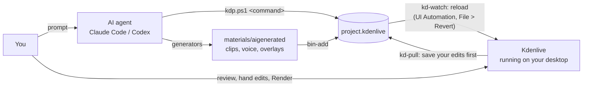

<div align="center">

# Movie Engine

**AI agent strihá vaše video v Kdenlive, kým sa pozeráte, a prácu môžete kedykoľvek prevziať.**

AI agenti na programovanie (Claude Code, Codex) vytvárajú a menia skutočné projekty Kdenlive: filmy, vysvetľujúce videá a vertikálne krátke videá. Úpravy sa hneď objavia v editore, ktorý máte otvorený. Prenosné, Windows, bez záplat editora.


[English](../../README.md) · [简体中文](README.zh-CN.md) · [繁體中文](README.zh-TW.md) · [हिन्दी](README.hi.md) · [Español](README.es.md) · [Français](README.fr.md) · [العربية](README.ar.md) · [বাংলা](README.bn.md) · [Português](README.pt.md) · [Русский](README.ru.md) · [اردو](README.ur.md) · [Bahasa Indonesia](README.id.md) · [Deutsch](README.de.md) · [日本語](README.ja.md) · [Türkçe](README.tr.md) · [한국어](README.ko.md) · [Українська](README.uk.md) · [Italiano](README.it.md) · [Polski](README.pl.md) · [Tiếng Việt](README.vi.md) · [فارسی](README.fa.md) · [ไทย](README.th.md) · [Kiswahili](README.sw.md) · [አማርኛ](README.am.md) · [Avañe'ẽ](README.gn.md) · [Setswana](README.tn.md) · [Shqip](README.sq.md) · [Беларуская](README.be.md) · [Български](README.bg.md) · [Bosanski](README.bs.md) · [Hrvatski](README.hr.md) · [Српски](README.sr.md) · [Crnogorski](README.cnr.md) · [Македонски](README.mk.md) · [Slovenščina](README.sl.md) · **Slovenčina** · [Čeština](README.cs.md) · [Magyar](README.hu.md) · [Română](README.ro.md) · [Dansk](README.da.md) · [Norsk bokmål](README.nb.md) · [Norsk nynorsk](README.nn.md) · [Svenska](README.sv.md) · [Íslenska](README.is.md) · [Suomi](README.fi.md) · [Eesti](README.et.md) · [Latviešu](README.lv.md) · [Lietuvių](README.lt.md) · [Nederlands](README.nl.md) · [Lëtzebuergesch](README.lb.md) · [Rumantsch](README.rm.md) · [Ελληνικά](README.el.md) · [Malti](README.mt.md) · [Gaeilge](README.ga.md) · [Català](README.ca.md) · [ქართული](README.ka.md) · [Հայերեն](README.hy.md) · [Azərbaycanca](README.az.md) · [Afrikaans](README.af.md) · [isiZulu](README.zu.md) · [isiXhosa](README.xh.md) · [Sesotho](README.st.md) · [Sepedi](README.nso.md) · [Xitsonga](README.ts.md) · [Tshivenḓa](README.ve.md) · [siSwati](README.ss.md) · [isiNdebele (South Africa)](README.nr.md) · [isiNdebele (Zimbabwe)](README.nd.md) · [chiShona](README.sn.md) · [Chichewa](README.ny.md) · [Ikinyarwanda](README.rw.md) · [Ikirundi](README.rn.md) · [Malagasy](README.mg.md) · [Soomaali](README.so.md) · [Afaan Oromoo](README.om.md) · [Qafar af](README.aa.md) · [ትግርኛ](README.ti.md) · [Sängö](README.sg.md) · [Kreol Seselwa](README.crs.md) · [TjiKalanga](README.kck.md) · [ChiNdau](README.ndc.md)

*Toto je preklad. Referenčnou verziou je README v angličtine.*

</div>

---

## Obsah

- [Prečo](#prečo)
- [Ako to funguje](#ako-to-funguje)
- [Funkcie](#funkcie)
- [Požiadavky](#požiadavky)
- [Inštalácia](#inštalácia)
- [Rýchly štart](#rýchly-štart)
- [Práca s agentom](#práca-s-agentom)
- [Príkazový riadok na strih (`kdp.ps1`)](#príkazový-riadok-na-strih-kdpps1)
- [Synchronizácia s otvoreným editorom](#synchronizácia-s-otvoreným-editorom)
- [Generátory: čo Kdenlive nedokáže](#generátory-čo-kdenlive-nedokáže)
- [Hlas a zvuk](#hlas-a-zvuk)
- [Jazyk rozhrania](#jazyk-rozhrania)
- [Štruktúra priečinkov](#štruktúra-priečinkov)
- [Testy a dôkazy](#testy-a-dôkazy)
- [Obmedzenia](#obmedzenia)
- [Riešenie problémov](#riešenie-problémov)
- [Časté otázky](#časté-otázky)
- [Prispievanie](#prispievanie)
- [Poďakovanie](#poďakovanie)
- [Licencia](#licencia)

## Prečo

Video editory sú stavané pre ruku na myši. AI agenti sú dobrí v štruktúre, časovaní a opakovaní: rozmiestniť 300 klipov do rytmu hudby, načasovať každý titulok podľa hlasu, prerobiť scénu po pripomienkach. Nedokážu však klikať po grafickom rozhraní bez toho, aby prevzali vašu pracovnú plochu.

Kdenlive je silný open-source editor, no vo Windows **nemá API na automatizáciu**: ovládanie cez D-Bus existuje len vo verziách pre Linux a forky, ktoré ho pridávajú, sa buď neudržiavajú, alebo nie sú bezpečné. Movie Engine to rieši bez záplat editora:

1. Agent upravuje projektový súbor `.kdenlive` cez otestovaný príkazový riadok (`engine/kdp.ps1`).
2. Spustenému Kdenlive sa cez Windows UI Automation zadá, aby súbor znova načítal, bez stláčania kláves, bez myši a bez kradnutia fokusu.
3. Vaše neuložené úpravy sa najprv uložia a nikdy sa neprepíšu.

Agent teda strihá a vy kontrolujete, alebo upravujete ručne. Obaja pracujete na tom istom projekte, v tom istom editore, v rovnakom čase.

## Ako to funguje



Každý príkaz na strih prechádza rovnakým bezpečným cyklom:

1. **Pull.** Ak má Kdenlive neuložené zmeny, dostane pokyn ich uložiť (tlačidlo Save na paneli nástrojov cez UI Automation) a uloženie sa potvrdí.
2. **Úprava.** Príkaz mení XML pod zámkom, po kontrole hashu a so snímkou stavu na vrátenie. Ak sa súbor medzitým zmenil, nezapíše sa nič.
3. **Opätovné načítanie.** Sledovač zbadá značku AI a v otvorenom editore spustí File > Revert. Za úspech sa považuje len to, keď bol widget časovej osi naozaj znova zostavený.
4. **Konflikt.** Ak ste medzitým začali upravovať, nič sa znova nenačíta a vaša práca zostane. Verzia AI sa odloží bokom a agent svoju zmenu znova aplikuje na tú vašu.

## Funkcie

- **Plnohodnotná úprava projektu bez grafického rozhrania**: asi 120 príkazov pre zásobník klipov, časovú os, efekty, kompozície, stopy, vodiace čiary, značky, titulky, sekvencie, rýchlosť a premapovanie času, prezentácie, titulkové klipy, proxy, renderovanie a späť/znova. Pozrite si [prehľad príkazov](#príkazový-riadok-na-strih-kdpps1).
- **Synchronizácia s otvoreným editorom.** Úpravy AI sa objavia v Kdenlive, na ktorý sa pozeráte; vaše neuložené úpravy sa najprv uložia a nikdy sa nestratia.
- **Nikdy neruší vašu pracovnú plochu.** Žiadne kradnutie fokusu, stláčanie kláves ani pohyby myši. Testovacie editory bežia na neviditeľnej pracovnej ploche Windows.
- **Prenosné.** Editor, nastavenia, Node.js, písma a nástroje sú v jednom priečinku. Skopírujte ho na iný počítač a funguje; nič sa nezapisuje do Program Files ani do vášho profilu Windows.
- **Generátory pre to, čo Kdenlive nedokáže**: kinetický text s animáciou po písmenách, ručne kreslené poznámky, 3D scény rozhrania, animácie kurzora a dlhé interaktívne vysvetľujúce filmy. Renderujú sa na GPU so skutočným rozmazaním pohybu a na časovú os sa vkladajú ako bežné klipy.
- **Hlasový komentár s časovaním slov** (Microsoft Edge TTS, bez kľúča API). Titulky a akcie sa spustia presne na správnom slove.
- **Syntetizované zvukové efekty** (whoosh, click, pop, riser, impact a ďalšie), generované kódom.
- **Overené, nie predpokladané.** Každý príkaz má kontrolu výsledku, efekty a kompozície sa preverujú jeden po druhom a surové výsledky sú v `docs/proof/`.
- **Pokyny pre agentov sú súčasťou.** `AGENTS.md` a zručnosti v `.claude/skills/` učia Claude Code a Codex pracovný postup, formát súboru a úskalia.

## Požiadavky

| | |
|---|---|
| OS | Windows 10 alebo 11, x64 |
| Editor | Kdenlive **26.08.3**, prenosná (standalone) verzia. Iné verzie nie sú otestované. |
| Node.js | 18 alebo novší: `.zip` pre Windows x64 z nodejs.org, rozbalený do `engine/node/` |
| Prehliadač | Microsoft Edge (súčasť Windows); renderery scén ho používajú v režime headless |
| Agent | [Claude Code](https://claude.com/claude-code) alebo Codex. Voliteľné: každý nástroj funguje aj ručne. |
| Disk | asi 1 GB pre editor a nástroje plus vaše médiá |
| GPU | akékoľvek GPU s hardvérovým kódovaním H.264 zrýchli `film-render.mjs` (inak sa použije softvérové kódovanie) |

## Inštalácia

Všetko sa inštaluje **do priečinka**. Nič nepotrebuje práva správcu.

```powershell
git clone https://github.com/vladtarrow/movie-engine.git
cd movie-engine
```

**1. Node.js.** Stiahnite `.zip` pre Windows x64 s Node.js 18 alebo novším z <https://nodejs.org/en/download> a jeho obsah rozbaľte do `engine\node\`, aby tam boli `engine\node\node.exe` a `engine\node\npm.cmd`. Inštalátor ani systémový Node nie sú potrebné. Všetky skripty sa spúšťajú cez `engine\node.cmd`, nikdy cez systémový Node.

**2. Balíky Node** pre hlasový nástroj a renderery (verzie sú pevne určené v `engine/voice/package.json`):

```powershell
engine\node\npm.cmd install --prefix engine\voice
```

**3. Prenosný Kdenlive 26.08.3.** Stiahnite `kdenlive-26.08.3_standalone.exe` z <https://download.kde.org/stable/kdenlive/26.08/windows/> do `engine\installer\`, overte ho a rozbaľte:

```powershell
(Get-FileHash engine\installer\kdenlive-26.08.3_standalone.exe -Algorithm SHA256).Hash
# expected: A25427B1DFF2C17E3B0386E991BB1A719382BB3176D1A90E441CDAEB6E0A967D
engine\installer\kdenlive-26.08.3_standalone.exe -o"engine\Kdenlive" -y
```

Editor skončí v `engine\Kdenlive\kdenlive-26.08.3_standalone\bin\`. Už obsahuje `melt.exe` a `ffmpeg.exe`.

**4. Prvé spustenie.**

```powershell
engine\kdenlive.cmd
```

Kdenlive uchováva všetky svoje nastavenia v `engine\profile-kdenlive\`, nie vo vašom profile Windows. Pri prvom spustení raz zobrazí sprievodcu nastavením.

## Rýchly štart

### S agentom

Otvorte priečinok v Claude Code (alebo Codex) a požiadajte obyčajnými slovami:

> Vytvor nový vertikálny projekt „launch-teaser“ s 30 fps. Daj na časovú os tri snímky obrazovky z `materials/designers/launch/`, každú na 2,5 s s krátkym prelínaním, pridaj hlasový komentár zo `script.txt` a ku každému riadku načasuj kinetický titulok.

> Otvor mi ho v Kdenlive.

> Druhý záber je pridlhý. Skráť ho na 1,8 s a logo trochu posuň nahor.

Agent sa riadi `AGENTS.md`: upravuje cez `kdp.ps1`, renderuje len klipy, ktoré strih potrebuje, a otvorený editor udržiava zosynchronizovaný. Vy kontrolujete v Kdenlive, kedykoľvek chcete, upravujete ručne a keď ste spokojní, stlačíte Render.

### Ručne

```powershell
# a new 1080x1920 30 fps project with 2 video and 2 audio tracks
powershell -NoProfile -ExecutionPolicy Bypass -File engine\kdp.ps1 new -Project projects\hello\hello.kdenlive -Profile vertical_hd_30

# a 3-second title and a colour background
powershell -NoProfile -ExecutionPolicy Bypass -File engine\kdp.ps1 bin-color -Project projects\hello\hello.kdenlive -Color '#203060' -Seconds 3 -Name bg
powershell -NoProfile -ExecutionPolicy Bypass -File engine\kdp.ps1 title -Project projects\hello\hello.kdenlive -Text "Hello" -Seconds 3 -Name hi

# place them: background on V1, title above it on V2
powershell -NoProfile -ExecutionPolicy Bypass -File engine\kdp.ps1 add -Project projects\hello\hello.kdenlive -Bin bg -Track V1 -At 0
powershell -NoProfile -ExecutionPolicy Bypass -File engine\kdp.ps1 add -Project projects\hello\hello.kdenlive -Bin hi -Track V2 -At 0

# a check frame, then open it in the editor
powershell -NoProfile -ExecutionPolicy Bypass -File engine\kdp.ps1 frame -Project projects\hello\hello.kdenlive -At 1.5 -Out out\hello\check.png
engine\kdenlive.cmd projects\hello\hello.kdenlive
```

Ak chcete neskôr znova otvoriť posledný projekt, dvakrát kliknite na `open-last-project.cmd`.

## Práca s agentom

Agent číta `AGENTS.md` (Codex) alebo `CLAUDE.md`, ktorý ho importuje (Claude Code), a k tomu dve zručnosti:

| Zručnosť | Čo učí |
|---|---|
| `.claude/skills/kdenlive-project-file` | formát `.kdenlive` / MLT XML, `kdp.ps1`, kontrolu pomocou `melt` |
| `.claude/skills/kdenlive-live` | bezpečné ovládanie spusteného editora: spustenie, pull, opätovné načítanie, zachytenie jeho okna |

Pravidlá, ktoré agent dodržiava a na ktoré sa môžete spoľahnúť:

- Nikdy vám nezoberie myš, klávesnicu ani fokus a nikdy nesníma vašu pracovnú plochu (len okno samotného editora).
- Kroky v grafickom rozhraní (uložiť, otvoriť, znova načítať) robí sám, namiesto toho, aby vás žiadal kliknúť.
- Pýta sa, skôr než niečo stiahne a skôr než niečo vymaže.
- Renderuje len to, čo práca potrebuje (klipy scén, kontrolné snímky). Finálny film renderuje, len keď o to požiadate.
- Keď Kdenlive niečo nedokáže urobiť dobre, agent to vytvorí mimo neho kódom a výsledok vloží ako klip. Efekt neoslabuje.

## Príkazový riadok na strih (`kdp.ps1`)

```powershell
powershell -NoProfile -ExecutionPolicy Bypass -File engine\kdp.ps1 <command> -Project <file.kdenlive> [options]
```

Časy sú v sekundách, s bodkou (`2.5`). Stopy sú `V1 V2 …` (V1 je najnižšia) a `A1 A2 …`. Klip sa určuje pomocou `-Track` a ľubovoľného času `-At` v jeho rámci. Parametre efektov idú do `-Params "name=value||name=value"`. Úplný zoznam so všetkými voľbami je v hlavičke `engine/kdp.ps1`.

| Skupina | Príkazy |
|---|---|
| Projekt | `new`, `profiles`, `info`, `validate`, `fonts`, `profile-set`, `profile-from-clip`, `zone`, `archive`, `backups`, `rebase`, `otio-export`, `otio-import` |
| Zásobník klipov | `bin-add`, `bin-color`, `title`, `title-text`, `title-save`, `title-template`, `bin-rename`, `bin-remove`, `bin-info`, `bin-set`, `bin-duplicate`, `bin-replace-file`, `bin-reload`, `folder`, `bin-folder`, `relink`, `clean`, `generator`, `playlist-clip`, `extract-audio`, `transcode` |
| Časová os | `add`, `add-av`, `move`, `copy`, `trim`, `ripple-trim`, `slip`, `split`, `remove`, `speed`, `remap`, `disable`, `enable`, `group`, `ungroup`, `mix`, `unmix`, `space-insert`, `space-remove`, `spaces-remove-all`, `track-clear`, `replace-in-timeline` |
| Efekty | `effects`, `effect-info`, `effect-add`, `effect-list`, `effect-set`, `effect-remove`, `effect-copy`, `effect-clear`, `effects-all`, `bin-effect`, `effect-templates`, `effect-template` |
| Kompozície | `compositions`, `comp-info`, `comp-add`, `comp-list`, `comp-set`, `comp-remove` |
| Stopy | `track-add`, `track-remove`, `track-set` |
| Vodiace čiary a značky | `guide-add`, `guide-list`, `guide-remove`, `guide-set`, `guide-clear`, `guide-export`, `guide-category`, `marker`, `marker-list`, `marker-set`, `marker-remove` |
| Titulky | `sub-add`, `sub-import`, `sub-export`, `sub-state` |
| Sekvencie | `sequence-add`, `sequences`, `copy-to-sequence`, `expand`; každý príkaz s `-Sequence <name>` funguje vnútri tej sekvencie |
| Špeciálne | `slideshow`, animácie Lottie / Glaxnimate cez `bin-add`, `proxy`, `stabilize`, `scene-split`, `speed-job`, `subclip` |
| Výstup | `frame` (jeden PNG), `preview` (rýchly render cez melt), `render` (vlastný renderer Kdenlive alebo predvoľba), `presets` |
| História | `undo`, `redo`, `clear-history` (snímky stavu v `projects/<name>/.kdp-history`) |

Správanie, ktoré sa oplatí poznať:

- Prepojené zvukové a obrazové polovice sa spolu presúvajú, orezávajú, rozdeľujú a odstraňujú (`-Alone` pre jednu polovicu).
- Príkaz, ktorý zlyhá, skončí s kódom 1 a nič nezapíše.
- Efekty, ktoré verzia pre Windows nedokáže spustiť, sa odmietnu, nie potichu ignorujú (zoznam: `docs/proof/assets.txt`).
- Každá akcia z ponuky Kdenlive je v `engine/tools/data/kdenlive-actions.csv` priradená k príkazu, inej ceste alebo označeniu „len zobrazenie“. Pozrite si `docs/kdenlive-coverage.md`.

## Synchronizácia s otvoreným editorom

| Skript | Čo robí | Návratové kódy |
|---|---|---|
| `engine\kd-pull.ps1 -Project <f>` | prinúti Kdenlive uložiť vaše úpravy a potvrdí to | 0 súbor je aktuálny, 3 nebeží, 4 nepotvrdené |
| `engine\kd-reload.ps1 -Project <f>` | File > Revert, potvrdené znova zostavenou časovou osou | 0 potvrdené, 2 máte neuložené úpravy (nič sa nezahodilo), 3 nebeží, 4 zlyhalo |
| `engine\kd-watch.ps1 -Project <f>` | sledovač na pozadí: znova načíta po každom zápise AI, zaznamenáva konflikty | záznam v `engine\kd-watch.log`; na zastavenie vymažte `engine\kd-watch.run` |
| `engine\kdenlive-bg.ps1 [project]` | spustí Kdenlive minimalizovaný pre agenta | 0 načítané, 4 nepotvrdené |
| `engine\kdenlive.cmd [project]` | spustí Kdenlive pre vás | |

Sledovač spustite raz za reláciu:

```powershell
Start-Process powershell -WindowStyle Hidden -ArgumentList '-NoProfile','-ExecutionPolicy','Bypass','-File','engine\kd-watch.ps1','-Project','projects\hello\hello.kdenlive'
```

Veľké projekty: opätovné načítanie projektu s 1000 klipmi trvá minúty a nástroje naň čakajú, namiesto toho, aby hlásili predčasne. Projekty sa otvárajú cez *File > Open Recent* v prázdnom editore, pretože pri priamom otvorení súboru Qt kvôli prístupnosti prechádza každú položku časovej osi, a to bolo asi o 10 minút pomalšie.

## Generátory: čo Kdenlive nedokáže

Kdenlive/MLT nemá animáciu textu po písmenách, nemá výrazy (expressions) a má málo 3D a ťažké efekty spomaľujú prehrávanie. Movie Engine takéto časti renderuje mimo neho a vkladá ich na časovú os ako bežné klipy, zvyčajne s alfa kanálom, na stopu nad obrazom. Skript generátora a jeho vstupy zostávajú v priečinku projektu, takže klip sa dá znova vygenerovať, keď sa zmení text, písmo alebo časovanie.

| Nástroj | Vytvára |
|---|---|
| `engine/tools/kinetic-text.ps1` | kinetické titulky s animáciou po písmenách, každé slovo načasované z `voice.json`, zvýrazňovací rámik |
| `engine/tools/annotate.ps1` | ručne kreslené kruhy, rámčeky, podčiarknutia a šípky, ktoré sa postupne nakreslia cez snímku obrazovky |
| `engine/tools/card-entrance.ps1` | kartu so snímkou obrazovky, ktorá sa vysunie a zväčší s jemným tieňom |
| `engine/tools/pdf-to-png.ps1` | snímky prezentácie z exportu do PDF |
| `engine/tools/html-render.mjs` | ľubovoľnú scénu HTML/CSS/canvas do videa: animácie rozhrania, kurzory, 3D, masky |
| `engine/tools/film-render.mjs` + `film/` | dlhé interaktívne vysvetľujúce filmy na plátne canvas: jeden klip na repliku hlasu, akcie sa spúšťajú na vyslovených slovách, rozmazanie pohybu na GPU pri asi 45 fps |

Oba renderery ovládajú Microsoft Edge, ktorý je súčasťou Windows, v režime headless, s jednorazovým profilom a bez prístupu k sieti.

### Ukážky

```powershell
# a 3-second 3D title card with a cursor click
engine\node.cmd engine\tools\html-render.mjs examples\demo\scene\scene.html examples\demo\out --frames 0,30,60,89
engine\node.cmd engine\tools\html-render.mjs examples\demo\scene\scene.html examples\demo\out\scene.mp4

# a 4-shot interactive film timed to two voice lines
engine\node.cmd engine\tools\film-render.mjs examples\demo\film\film.html examples\demo\out --check
engine\node.cmd engine\tools\film-render.mjs examples\demo\film\film.html examples\demo\out --shots all --width 640
engine\node.cmd engine\tools\film-render.mjs examples\demo\film\film.html examples\demo\out\clips --suffix -v01
```

Film tvoria tri malé súbory. `data.js` obsahuje zábery a časy slov. `direction.js` má jeden riadok na každý záber:

```text
1 | hover 192 108 @brand | tag 300 60 Your brand @deserves | confetti 192 90 @film
2 say=A film that/*explains* it
3 | click 116 108 @before | click 268 108 @after | chips Before~After @after
4 scene=counter | count 0 120 % @count
```

`scenes.js` obsahuje zábery, ktoré sa kreslia od nuly. `@word` spustí akciu, keď hlas vysloví dané slovo. Medzi akcie patria click, hover, drag, zoom, lens, ring, arrow, chips, toggle, slider, toast, type, count a confetti; úplná syntax je na začiatku `engine/tools/film/film-kit.js`.

## Hlas a zvuk

```powershell
engine\node.cmd engine\voice\voice.mjs lines.json materials\aigenerated\hello\voice en-US-AndrewMultilingualNeural +0%
```

`lines.json` je zoznam replík. Nástroj zapíše jeden mp3 na každú repliku a `voice.json` s dĺžkou a so začiatkom a koncom každého slova. Repliky sa ukladajú do vyrovnávacej pamäte, takže pri zmene jednej repliky sa znova vygeneruje len tá. Používa online prevod textu na reč Microsoft Edge cez balík `msedge-tts`: kľúč netreba, no služba je neoficiálna a potrebuje internet.

```powershell
engine\node.cmd engine\audio\sfx.mjs materials\aigenerated\sfx
```

Toto kódom syntetizuje whoosh, whoosh-long, swipe, click, pop, tick, riser, impact, ding a reveal; hotová sada je v `materials/aigenerated/sfx/`. Zvuky kratšie ako jedna snímka pred vložením doplňte tichom (`-af apad=whole_dur=0.0667`).

## Jazyk rozhrania

Spúšťače predvolene spúšťajú Kdenlive v **angličtine**. Ak chcete iný jazyk, pred spustením nastavte `MOVIE_ENGINE_UI_LANG`:

```powershell
$env:MOVIE_ENGINE_UI_LANG = 'ru'; engine\kdenlive.cmd
```

UI Automation nachádza položky ponuky podľa ich viditeľných názvov. Názvy pre 31 jazykov rozhrania sú už zabudované (`engine/tools/kd-ui.ps1`, `$KdNames`). Pre akýkoľvek iný jazyk tam pridajte jeho názvy a overte pomocou:

```powershell
powershell -NoProfile -ExecutionPolicy Bypass -File engine\tools\kd-langcheck.ps1
```

## Štruktúra priečinkov

```text
movie-engine/
├─ AGENTS.md, CLAUDE.md          instructions for AI agents
├─ .claude/skills/               agent skills: project file format, live editor
├─ engine/
│  ├─ kdp.ps1                    the editing command line
│  ├─ kd-pull / kd-reload / kd-watch .ps1, kdenlive.cmd, kdenlive-bg.ps1
│  ├─ tools/                     internals, generators, tests, data (action map)
│  ├─ voice/  audio/  fonts/     TTS, synthesized SFX, Poppins (OFL)
│  ├─ Kdenlive/  node/           portable editor and Node.js (not in git)
│  └─ profile-kdenlive/          the editor's settings (not in git)
├─ projects/<name>/<name>.kdenlive
├─ materials/
│  ├─ download/                  stock and downloaded files (not in git)
│  ├─ aigenerated/               everything the AI made (sfx/ and test-kit/ ship with the engine)
│  ├─ designers/  brand/         files from your team, brand assets
├─ examples/demo/                demos of the scene and film renderers
├─ out/                          renders (not in git)
└─ docs/                         proofs, coverage, translations of this README
```

Cesty k médiám v projektoch sú relatívne. Ak priečinok presuniete alebo skopírujete, `kdp.ps1 rebase` (ktorý automaticky spúšťa aj `kdenlive.cmd`) zapíše do projektu nové umiestnenie.

## Testy a dôkazy

Tvrdenia o tom, čo funguje, sú podložené kontrolami výsledku, nie tým, že „funkcia prebehla“. Zhrnutie je v [`docs/kdenlive-proof.md`](../../docs/kdenlive-proof.md) a surový výstup v `docs/proof/`.

| Test | Čo kontroluje |
|---|---|
| `engine\tools\kdp-clitest.ps1` | každý príkaz `kdp.ps1` cez príkazový riadok, s porovnaním výsledného projektu |
| `engine\tools\kd-livetest.ps1` | pull, opätovné načítanie, sledovač, konflikty a súbehy so skutočným Kdenlive na neviditeľnej pracovnej ploche |
| `engine\tools\kdp-assetsweep.ps1` | každý efekt a kompozíciu: renderuje a porovnáva snímky |
| `engine\tools\kdp-portabletest.ps1` | skopíruje priečinok inam a pracuje z kópie |
| `engine\tools\kd-langcheck.ps1` | jazyk rozhrania a to, že UI Automation nájde ponuku |
| `engine\tools\kdp-coverage-check.ps1` | že každá akcia ponuky je priradená a žiadny dôkaz nie je starší ako kód |

```powershell
powershell -NoProfile -ExecutionPolicy Bypass -File engine\tools\kdp-clitest.ps1 -Report docs\proof\clitest.txt
powershell -NoProfile -ExecutionPolicy Bypass -File engine\tools\kd-livetest.ps1 -Report docs\proof\live-en.txt
```

Testovacie editory bežia len na skrytej pracovnej ploche s vlastným profilom, takže testy sa nikdy nedotknú vášho otvoreného Kdenlive ani vášho fokusu.

## Obmedzenia

- **Len Windows**, len Kdenlive **26.08.3**. Linux má D-Bus a potreboval by iný most.
- Spustenie editora zoberie fokus klávesnice asi na 3 sekundy, kým sa objaví prázdne okno. Agenti sa pýtajú, skôr než ho spustia počas vašej práce. Opätovné načítania a úpravy fokus neberú.
- Verzii pre Windows chýbajú moduly MLT sox, ladspa a movit a niektoré efekty frei0r/avfilter; `kdp.ps1` ich odmieta (`docs/proof/assets.txt`).
- Export a import OpenTimelineIO prenášajú len klipy a medzery. Multicam nemá prepínanie uhlov naživo (strihy sa robia pomocou split/remove/hide).
- „Save As…“ cez UI Automation na minimalizovanom okne neotvorí dialóg; agent namiesto toho používa `archive` alebo kópie súborov.
- Rozpoznávanie reči (automatické titulky) potrebuje Whisper alebo Vosk, ktoré nie sú pribalené.
- Titulky vytvorené nástrojom na titulky v Kdenlive používajú písma nainštalované vo Windows. Pre zaručenú typografiu renderujte text generátormi, ktoré načítavajú písma z `engine/fonts/`.
- Edge TTS je neoficiálna online služba a môže sa zmeniť alebo prestať fungovať.

## Riešenie problémov

| Príznak | Príčina a riešenie |
|---|---|
| Kdenlive beží, ale kliknutie naň na paneli úloh nič nezobrazí | Jeho uložená poloha okna je mimo obrazovky. Zatvorte ho a vymažte položky `kdockLayout` v `engine\profile-kdenlive\AppData\Local\kdenliverc` alebo okno presuňte pomocou `SetWindowPos` (pozrite `AGENTS.md`). |
| `kd-reload.ps1` skončí s kódom 2 | Máte neuložené úpravy. Nič sa nezahodilo. Spustite `kd-pull.ps1` a potom zmenu aplikujte znova (`kdp.ps1` to robí sám). |
| `CONFLICT` v `engine\kd-watch.log` | Vy aj agent ste upravovali v tom istom okamihu. Vaša verzia zostáva v editore a verzia AI je v `projects\<name>\.kdp-history\<name>\conflict\`. Požiadajte agenta, aby svoju zmenu aplikoval znova. |
| Príkaz skončí s kódom 1 a hlásením „pull not confirmed“ | Kdenlive je zaneprázdnený alebo zobrazuje dialóg. Zatvorte dialóg alebo počkajte, kým sa načítanie dokončí, a zopakujte. |
| Skript PowerShell sa nedá analyzovať | Skripty s textom mimo ASCII musia byť pre Windows PowerShell 5.1 uložené ako UTF-8 **s BOM**. |
| `voice.mjs` sa zastaví s „Stream closed before the synthesis completed“ | Zvyčajne problém so sieťou alebo neošetrené SSML v starších kópiách. `voice.mjs` sám ošetruje `& < >`. |
| Otváranie veľkého projektu trvá mnoho minút | Otvárajte ho cez `kdenlive.cmd` / `kdenlive-bg.ps1`, nikdy ako `kdenlive.exe project.kdenlive`. |

## Časté otázky

**Potrebujem Claude Code alebo Codex?**
Nie. Každý nástroj je obyčajný skript, ktorý môžete spustiť ručne. Agent prácu zrýchľuje: plánuje strih, spúšťa nástroje a udržiava editor zosynchronizovaný.

**Prepíše agent moje ručné úpravy?**
Nie. Pred každým zápisom sa vaše neuložené úpravy uložia a potvrdia. Ak upravujete, kým agent zapisuje, zápis sa odmietne alebo odloží bokom ako konflikt, nikdy sa neaplikuje na vašu prácu.

**Môžem Kdenlive naďalej používať normálne?**
Áno. Je to štandardný Kdenlive s vlastným priečinkom nastavení. Upravujte, prezerajte a renderujte ako zvyčajne.

**Funguje to s Kdenlive, ktorý už mám nainštalovaný?**
Používa vlastnú prenosnú kópiu v `engine\Kdenlive\`, takže váš nainštalovaný Kdenlive a jeho nastavenia zostanú nedotknuté.

**Prečo nie fork Kdenlive s API alebo iný editor?**
Pre Windows neexistuje udržiavaný a bezpečný fork (prieskum z novembra 2026). Posudzovali sa OpenShot, Blender VSE, DaVinci Resolve, Shotcut a webové editory; Kdenlive ponúkol najväčšiu hĺbku strihu. Sledujeme návrh REST API v hlavnom projekte (merge request !902).

**Dokáže vyrenderovať finálne video?**
Áno, pomocou `kdp.ps1 render` (vlastný renderer Kdenlive, skryto), alebo sami stlačíte Render v editore.

**Nahrávajú sa moje médiá niekam?**
Nie. Keď generujete hlas, službe Edge TTS sa posiela len text hlasového komentára. Renderery scén bežia s vypnutou sieťou.

## Prispievanie

Príspevky sú vítané. Pozrite si [CONTRIBUTING.md](../../CONTRIBUTING.md). Stručne:

- Každá nová alebo zmenená operácia `kdp.ps1` potrebuje kontrolu výsledku v `kdp-clitest.ps1`, záznam v mape akcií a nové spustenie `kdp-coverage-check.ps1`.
- Nikdy nespúšťajte testovací Kdenlive na viditeľnej pracovnej ploche; použite `engine/tools/kd-hidden.ps1`.
- Udržujte všetko prenosné: žiadne inštalácie mimo priečinka, žiadne absolútne cesty v projektoch.
- Overené zvláštnosti zapíšte do `AGENTS.md` alebo do príslušnej zručnosti.

## Poďakovanie

- [Kdenlive](https://kdenlive.org) a [MLT](https://www.mltframework.org): editor a jadro pod ním.
- [FFmpeg](https://ffmpeg.org), dodávaný s Kdenlive.
- [msedge-tts](https://www.npmjs.com/package/msedge-tts) pre hlasový komentár.
- [Poppins](https://fonts.google.com/specimen/Poppins) od Indian Type Foundry, SIL Open Font License (`engine/fonts/OFL.txt`).
- `engine/tools/data/kdenliveui-26.08.3.rc`: súbor ponuky Kdenlive, prevzatý zo zdrojového kódu Kdenlive 26.08.3; používa ho len kontrola pokrytia. Zostáva pod licenciou GPL projektu Kdenlive, nie pod licenciou MIT.

## Licencia

Vlastný kód projektu Movie Engine je vydaný pod [licenciou MIT](../../LICENSE). Kdenlive, MLT, FFmpeg, balíky Node.js a písmo Poppins si ponechávajú svoje vlastné licencie.
