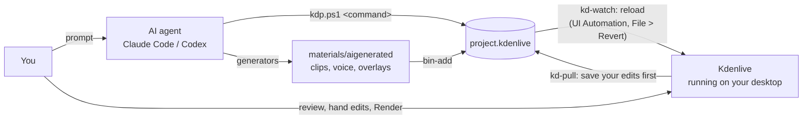

<div align="center">

# Movie Engine

**Agent umetne inteligence montira vaš video v Kdenlivu, medtem ko gledate, delo pa lahko kadar koli prevzamete sami.**

Agenti umetne inteligence za programiranje (Claude Code, Codex) ustvarjajo in spreminjajo prave projekte Kdenlive: filme, razlagalne posnetke in navpične kratke videe. Spremembe se sproti prikažejo v urejevalniku, ki ga imate odprtega. Prenosno, Windows, brez popravkov urejevalnika.


[English](../../README.md) · [简体中文](README.zh-CN.md) · [繁體中文](README.zh-TW.md) · [हिन्दी](README.hi.md) · [Español](README.es.md) · [Français](README.fr.md) · [العربية](README.ar.md) · [বাংলা](README.bn.md) · [Português](README.pt.md) · [Русский](README.ru.md) · [اردو](README.ur.md) · [Bahasa Indonesia](README.id.md) · [Deutsch](README.de.md) · [日本語](README.ja.md) · [Türkçe](README.tr.md) · [한국어](README.ko.md) · [Українська](README.uk.md) · [Italiano](README.it.md) · [Polski](README.pl.md) · [Tiếng Việt](README.vi.md) · [فارسی](README.fa.md) · [ไทย](README.th.md) · [Kiswahili](README.sw.md) · [አማርኛ](README.am.md) · [Avañe'ẽ](README.gn.md) · [Setswana](README.tn.md) · [Shqip](README.sq.md) · [Беларуская](README.be.md) · [Български](README.bg.md) · [Bosanski](README.bs.md) · [Hrvatski](README.hr.md) · [Српски](README.sr.md) · [Crnogorski](README.cnr.md) · [Македонски](README.mk.md) · **Slovenščina** · [Slovenčina](README.sk.md) · [Čeština](README.cs.md) · [Magyar](README.hu.md) · [Română](README.ro.md) · [Dansk](README.da.md) · [Norsk bokmål](README.nb.md) · [Norsk nynorsk](README.nn.md) · [Svenska](README.sv.md) · [Íslenska](README.is.md) · [Suomi](README.fi.md) · [Eesti](README.et.md) · [Latviešu](README.lv.md) · [Lietuvių](README.lt.md) · [Nederlands](README.nl.md) · [Lëtzebuergesch](README.lb.md) · [Rumantsch](README.rm.md) · [Ελληνικά](README.el.md) · [Malti](README.mt.md) · [Gaeilge](README.ga.md) · [Català](README.ca.md) · [ქართული](README.ka.md) · [Հայերեն](README.hy.md) · [Azərbaycanca](README.az.md) · [Afrikaans](README.af.md) · [isiZulu](README.zu.md) · [isiXhosa](README.xh.md) · [Sesotho](README.st.md) · [Sepedi](README.nso.md) · [Xitsonga](README.ts.md) · [Tshivenḓa](README.ve.md) · [siSwati](README.ss.md) · [isiNdebele (South Africa)](README.nr.md) · [isiNdebele (Zimbabwe)](README.nd.md) · [chiShona](README.sn.md) · [Chichewa](README.ny.md) · [Ikinyarwanda](README.rw.md) · [Ikirundi](README.rn.md) · [Malagasy](README.mg.md) · [Soomaali](README.so.md) · [Afaan Oromoo](README.om.md) · [Qafar af](README.aa.md) · [ትግርኛ](README.ti.md) · [Sängö](README.sg.md) · [Kreol Seselwa](README.crs.md) · [TjiKalanga](README.kck.md) · [ChiNdau](README.ndc.md)

*To je prevod. Referenčna različica je README v angleščini.*

</div>

---

## Vsebina

- [Zakaj](#zakaj)
- [Kako deluje](#kako-deluje)
- [Zmožnosti](#zmožnosti)
- [Zahteve](#zahteve)
- [Namestitev](#namestitev)
- [Hiter začetek](#hiter-začetek)
- [Delo z agentom](#delo-z-agentom)
- [Ukazna vrstica za montažo (`kdp.ps1`)](#ukazna-vrstica-za-montažo-kdpps1)
- [Sinhronizacija z odprtim urejevalnikom](#sinhronizacija-z-odprtim-urejevalnikom)
- [Generatorji: kar Kdenlive ne zmore](#generatorji-kar-kdenlive-ne-zmore)
- [Govor in zvok](#govor-in-zvok)
- [Jezik vmesnika](#jezik-vmesnika)
- [Struktura map](#struktura-map)
- [Testi in dokazi](#testi-in-dokazi)
- [Omejitve](#omejitve)
- [Odpravljanje težav](#odpravljanje-težav)
- [Pogosta vprašanja](#pogosta-vprašanja)
- [Prispevanje](#prispevanje)
- [Zahvale](#zahvale)
- [Licenca](#licenca)

## Zakaj

Video urejevalniki so narejeni za roko na miški. Agenti umetne inteligence so dobri v strukturi, časovnem usklajevanju in ponavljanju: postaviti 300 posnetkov v ritem glasbe, vsak podnapis uskladiti z glasom, predelati prizor po pripombah. Ne morejo pa klikati po grafičnem vmesniku, ne da bi prevzeli vaše namizje.

Kdenlive je zmogljiv odprtokodni urejevalnik, vendar v Windows **nima API-ja za avtomatizacijo**: upravljanje prek D-Bus obstaja le v različicah za Linux, razcepi (forki), ki ga dodajo, pa se ne vzdržujejo več ali niso varni. Movie Engine to reši brez popravkov urejevalnika:

1. Agent spreminja projektno datoteko `.kdenlive` prek preizkušene ukazne vrstice (`engine/kdp.ps1`).
2. Zagnanemu Kdenlivu se prek Windows UI Automation naroči, naj datoteko znova naloži, brez pritiskov tipk, brez miške in brez kraje fokusa.
3. Vaše neshranjene spremembe se najprej shranijo in se nikoli ne prepišejo.

Agent torej montira, vi pa pregledujete ali urejate ročno. Oba delata na istem projektu, v istem urejevalniku, ob istem času.

## Kako deluje



Vsak ukaz za montažo gre skozi isti varni cikel:

1. **Pull.** Če ima Kdenlive neshranjene spremembe, se mu naroči, naj jih shrani (gumb Save v orodni vrstici prek UI Automation), shranjevanje pa se potrdi.
2. **Urejanje.** Ukaz spremeni XML pod zaklepom, po preverjanju zgoščene vrednosti in s posnetkom stanja za razveljavitev. Če se je datoteka medtem spremenila, se ne zapiše nič.
3. **Ponovno nalaganje.** Opazovalec zazna oznako umetne inteligence in v odprtem urejevalniku zažene File > Revert. Za uspeh šteje le, če je bil gradnik časovnice res znova zgrajen.
4. **Konflikt.** Če ste vmes začeli urejati, se nič ne naloži znova in vaše delo ostane. Različica umetne inteligence se shrani na stran, agent pa svojo spremembo znova uveljavi na vaši.

## Zmožnosti

- **Popolno urejanje projekta brez grafičnega vmesnika**: približno 120 ukazov, ki pokrivajo zbirko posnetkov, časovnico, učinke, kompozicije, sledi, vodila, oznake, podnapise, sekvence, hitrost in prerazporeditev časa, diaprojekcije, napise, posredniške datoteke (proxy), upodabljanje ter razveljavitev/uveljavitev. Glejte [pregled ukazov](#ukazna-vrstica-za-montažo-kdpps1).
- **Sinhronizacija z odprtim urejevalnikom.** Spremembe umetne inteligence se prikažejo v Kdenlivu, ki ga gledate; vaše neshranjene spremembe se najprej shranijo in se nikoli ne izgubijo.
- **Nikoli ne moti vašega namizja.** Brez kraje fokusa, pritiskov tipk ali premikov miške. Testni urejevalniki tečejo na nevidnem namizju Windows.
- **Prenosno.** Urejevalnik, nastavitve, Node.js, pisave in orodja so v eni mapi. Kopirajte jo na drug računalnik in deluje; nič se ne zapiše v Program Files ali v vaš profil Windows.
- **Generatorji za to, česar Kdenlive ne zmore**: kinetično besedilo z animacijo po črkah, ročno risane oznake, 3D-prizori vmesnika, animacije kazalca in dolgi interaktivni razlagalni filmi. Upodabljajo se na grafičnem procesorju s pravo zameglitvijo gibanja in se na časovnico postavijo kot običajni posnetki.
- **Govor s časi besed** (Microsoft Edge TTS, brez ključa API). Podnapisi in dejanja se sprožijo natanko na pravi besedi.
- **Sintetizirani zvočni učinki** (whoosh, click, pop, riser, impact in drugi), ustvarjeni s kodo.
- **Dokazano, ne domnevano.** Vsak ukaz ima preverjanje rezultata, učinki in kompozicije se preverijo enega za drugim, surovi rezultati pa so v `docs/proof/`.
- **Navodila za agente so priložena.** `AGENTS.md` in veščine v `.claude/skills/` naučijo Claude Code in Codex potek dela, obliko datoteke in pasti.

## Zahteve

| | |
|---|---|
| OS | Windows 10 ali 11, x64 |
| Urejevalnik | Kdenlive **26.08.3**, prenosna (standalone) različica. Druge različice niso preizkušene. |
| Node.js | 18 ali novejši: `.zip` za Windows x64 z nodejs.org, razpakiran v `engine/node/` |
| Brskalnik | Microsoft Edge (del sistema Windows); upodabljalniki prizorov ga uporabljajo v načinu headless |
| Agent | [Claude Code](https://claude.com/claude-code) ali Codex. Neobvezno: vsako orodje deluje tudi ročno. |
| Disk | približno 1 GB za urejevalnik in orodja ter vaši mediji |
| GPU | vsak grafični procesor s strojnim kodiranjem H.264 pospeši `film-render.mjs` (sicer se uporabi programsko kodiranje) |

## Namestitev

Vse se namesti **znotraj mape**. Za nič niso potrebne skrbniške pravice.

```powershell
git clone https://github.com/vladtarrow/movie-engine.git
cd movie-engine
```

**1. Node.js.** Prenesite `.zip` za Windows x64 z Node.js 18 ali novejšim z <https://nodejs.org/en/download> in razpakirajte njegovo vsebino v `engine\node\`, tako da sta tam `engine\node\node.exe` in `engine\node\npm.cmd`. Namestitveni program in sistemski Node nista potrebna. Vsi skripti se zaganjajo prek `engine\node.cmd`, nikoli prek sistemskega Node.

**2. Paketi Node** za orodje za govor in upodabljalnike (različice so zaklenjene v `engine/voice/package.json`):

```powershell
engine\node\npm.cmd install --prefix engine\voice
```

**3. Prenosni Kdenlive 26.08.3.** Prenesite `kdenlive-26.08.3_standalone.exe` z <https://download.kde.org/stable/kdenlive/26.08/windows/> v `engine\installer\`, ga preverite in razpakirajte:

```powershell
(Get-FileHash engine\installer\kdenlive-26.08.3_standalone.exe -Algorithm SHA256).Hash
# expected: A25427B1DFF2C17E3B0386E991BB1A719382BB3176D1A90E441CDAEB6E0A967D
engine\installer\kdenlive-26.08.3_standalone.exe -o"engine\Kdenlive" -y
```

Urejevalnik se znajde v `engine\Kdenlive\kdenlive-26.08.3_standalone\bin\`. Že vsebuje `melt.exe` in `ffmpeg.exe`.

**4. Prvi zagon.**

```powershell
engine\kdenlive.cmd
```

Kdenlive hrani vse nastavitve v `engine\profile-kdenlive\`, ne v vašem profilu Windows. Ob prvem zagonu enkrat prikaže čarovnika za nastavitev.

## Hiter začetek

### Z agentom

Odprite mapo v Claude Code (ali Codex) in prosite z navadnimi besedami:

> Naredi nov navpični projekt »launch-teaser« s 30 fps. Postavi na časovnico tri posnetke zaslona iz `materials/designers/launch/`, vsakega po 2,5 s s kratkim prelivom, dodaj govor iz `script.txt` in vsaki vrstici časovno priredi kinetični napis.

> Odpri mi ga v Kdenlivu.

> Drugi kader je predolg. Skrajšaj ga na 1,8 s in logotip malo dvigni.

Agent sledi `AGENTS.md`: ureja prek `kdp.ps1`, upodablja le posnetke, ki jih montaža potrebuje, in odprti urejevalnik ohranja usklajen. Vi pregledujete v Kdenlivu, ročno urejate, kadar želite, in pritisnete Render, ko ste zadovoljni.

### Ročno

```powershell
# a new 1080x1920 30 fps project with 2 video and 2 audio tracks
powershell -NoProfile -ExecutionPolicy Bypass -File engine\kdp.ps1 new -Project projects\hello\hello.kdenlive -Profile vertical_hd_30

# a 3-second title and a colour background
powershell -NoProfile -ExecutionPolicy Bypass -File engine\kdp.ps1 bin-color -Project projects\hello\hello.kdenlive -Color '#203060' -Seconds 3 -Name bg
powershell -NoProfile -ExecutionPolicy Bypass -File engine\kdp.ps1 title -Project projects\hello\hello.kdenlive -Text "Hello" -Seconds 3 -Name hi

# place them: background on V1, title above it on V2
powershell -NoProfile -ExecutionPolicy Bypass -File engine\kdp.ps1 add -Project projects\hello\hello.kdenlive -Bin bg -Track V1 -At 0
powershell -NoProfile -ExecutionPolicy Bypass -File engine\kdp.ps1 add -Project projects\hello\hello.kdenlive -Bin hi -Track V2 -At 0

# a check frame, then open it in the editor
powershell -NoProfile -ExecutionPolicy Bypass -File engine\kdp.ps1 frame -Project projects\hello\hello.kdenlive -At 1.5 -Out out\hello\check.png
engine\kdenlive.cmd projects\hello\hello.kdenlive
```

Če želite pozneje znova odpreti zadnji projekt, dvokliknite `open-last-project.cmd`.

## Delo z agentom

Agent prebere `AGENTS.md` (Codex) ali `CLAUDE.md`, ki ga uvozi (Claude Code), ter dve veščini:

| Veščina | Česa nauči |
|---|---|
| `.claude/skills/kdenlive-project-file` | obliko `.kdenlive` / MLT XML, `kdp.ps1`, preverjanje z `melt` |
| `.claude/skills/kdenlive-live` | varno upravljanje zagnanega urejevalnika: zagon, pull, ponovno nalaganje, zajem njegovega okna |

Pravila, ki se jih agent drži in na katera se lahko zanesete:

- Nikoli ne prevzame vaše miške, tipkovnice ali fokusa in nikoli ne zajame slike vašega namizja (le okno samega urejevalnika).
- Korake v grafičnem vmesniku (shrani, odpri, znova naloži) opravi sam, namesto da bi vas prosil za klik.
- Preden kar koli prenese in preden kar koli izbriše, vpraša.
- Upodablja le, kar delo potrebuje (posnetke prizorov, kontrolne sličice). Končni film upodobi le, če to zahtevate.
- Kadar Kdenlive česa ne zmore dobro, agent to izdela zunaj s kodo in rezultat vstavi kot posnetek. Učinka ne razvodeni.

## Ukazna vrstica za montažo (`kdp.ps1`)

```powershell
powershell -NoProfile -ExecutionPolicy Bypass -File engine\kdp.ps1 <command> -Project <file.kdenlive> [options]
```

Časi so v sekundah, s piko (`2.5`). Sledi so `V1 V2 …` (V1 je najnižja) in `A1 A2 …`. Posnetek se določi z `-Track` in katerim koli časom `-At` znotraj njega. Parametri učinkov gredo v `-Params "name=value||name=value"`. Celoten seznam z vsemi možnostmi je v glavi `engine/kdp.ps1`.

| Skupina | Ukazi |
|---|---|
| Projekt | `new`, `profiles`, `info`, `validate`, `fonts`, `profile-set`, `profile-from-clip`, `zone`, `archive`, `backups`, `rebase`, `otio-export`, `otio-import` |
| Zbirka posnetkov | `bin-add`, `bin-color`, `title`, `title-text`, `title-save`, `title-template`, `bin-rename`, `bin-remove`, `bin-info`, `bin-set`, `bin-duplicate`, `bin-replace-file`, `bin-reload`, `folder`, `bin-folder`, `relink`, `clean`, `generator`, `playlist-clip`, `extract-audio`, `transcode` |
| Časovnica | `add`, `add-av`, `move`, `copy`, `trim`, `ripple-trim`, `slip`, `split`, `remove`, `speed`, `remap`, `disable`, `enable`, `group`, `ungroup`, `mix`, `unmix`, `space-insert`, `space-remove`, `spaces-remove-all`, `track-clear`, `replace-in-timeline` |
| Učinki | `effects`, `effect-info`, `effect-add`, `effect-list`, `effect-set`, `effect-remove`, `effect-copy`, `effect-clear`, `effects-all`, `bin-effect`, `effect-templates`, `effect-template` |
| Kompozicije | `compositions`, `comp-info`, `comp-add`, `comp-list`, `comp-set`, `comp-remove` |
| Sledi | `track-add`, `track-remove`, `track-set` |
| Vodila in oznake | `guide-add`, `guide-list`, `guide-remove`, `guide-set`, `guide-clear`, `guide-export`, `guide-category`, `marker`, `marker-list`, `marker-set`, `marker-remove` |
| Podnapisi | `sub-add`, `sub-import`, `sub-export`, `sub-state` |
| Sekvence | `sequence-add`, `sequences`, `copy-to-sequence`, `expand`; vsak ukaz z `-Sequence <name>` deluje znotraj te sekvence |
| Posebno | `slideshow`, animacije Lottie / Glaxnimate prek `bin-add`, `proxy`, `stabilize`, `scene-split`, `speed-job`, `subclip` |
| Izhod | `frame` (en PNG), `preview` (hitro upodabljanje z melt), `render` (Kdenlivov lastni upodabljalnik ali prednastavitev), `presets` |
| Zgodovina | `undo`, `redo`, `clear-history` (posnetki stanja v `projects/<name>/.kdp-history`) |

Vedenje, ki ga je dobro poznati:

- Povezani zvočna in video polovica se skupaj premikata, obrezujeta, razrežeta in odstranita (`-Alone` za le eno polovico).
- Ukaz, ki ne uspe, konča s kodo 1 in ne zapiše ničesar.
- Učinki, ki jih različica za Windows ne more izvesti, se zavrnejo, ne pa tiho prezrejo (seznam: `docs/proof/assets.txt`).
- Vsako dejanje iz menija Kdenlive je v `engine/tools/data/kdenlive-actions.csv` preslikano v ukaz, drugo pot ali oznako »samo ogled«. Glejte `docs/kdenlive-coverage.md`.

## Sinhronizacija z odprtim urejevalnikom

| Skript | Kaj naredi | Izhodne kode |
|---|---|---|
| `engine\kd-pull.ps1 -Project <f>` | Kdenlivu naroči, naj shrani vaše spremembe, in to potrdi | 0 datoteka je ažurna, 3 ni zagnan, 4 ni potrjeno |
| `engine\kd-reload.ps1 -Project <f>` | File > Revert, potrjeno z znova zgrajeno časovnico | 0 potrjeno, 2 imate neshranjene spremembe (nič ni zavrženo), 3 ni zagnan, 4 neuspeh |
| `engine\kd-watch.ps1 -Project <f>` | opazovalec v ozadju: znova naloži po vsakem zapisu umetne inteligence, beleži konflikte | dnevnik v `engine\kd-watch.log`; za ustavitev izbrišite `engine\kd-watch.run` |
| `engine\kdenlive-bg.ps1 [project]` | zažene Kdenlive pomanjšan za agenta | 0 naloženo, 4 ni potrjeno |
| `engine\kdenlive.cmd [project]` | zažene Kdenlive za vas | |

Opazovalca zaženite enkrat na sejo:

```powershell
Start-Process powershell -WindowStyle Hidden -ArgumentList '-NoProfile','-ExecutionPolicy','Bypass','-File','engine\kd-watch.ps1','-Project','projects\hello\hello.kdenlive'
```

Veliki projekti: ponovno nalaganje projekta s 1000 posnetki traja več minut, orodja pa nanj počakajo, namesto da bi prezgodaj poročala. Projekti se odpirajo prek *File > Open Recent* v praznem urejevalniku, ker pri neposrednem odpiranju datoteke Qt zaradi dostopnosti obide vsak element časovnice, kar je bilo približno 10 minut počasneje.

## Generatorji: kar Kdenlive ne zmore

Kdenlive/MLT nima animacije besedila po črkah, nima izrazov (expressions) in ima malo 3D, težki učinki pa upočasnijo predvajanje. Movie Engine take dele upodobi zunaj in jih postavi na časovnico kot običajne posnetke, navadno s kanalom alfa, na sled nad sliko. Skript generatorja in njegovi vhodni podatki ostanejo v mapi projekta, zato je posnetek mogoče znova ustvariti, ko se spremeni besedilo, pisava ali časovni potek.

| Orodje | Ustvari |
|---|---|
| `engine/tools/kinetic-text.ps1` | kinetične napise z animacijo po črkah, vsaka beseda časovno usklajena iz `voice.json`, okvir za poudarek |
| `engine/tools/annotate.ps1` | ročno risane kroge, okvirje, podčrtave in puščice, ki se izrišejo čez posnetek zaslona |
| `engine/tools/card-entrance.ps1` | kartico s posnetkom zaslona, ki se dvigne in poveča z mehko senco |
| `engine/tools/pdf-to-png.ps1` | diapozitive iz izvoza PDF |
| `engine/tools/html-render.mjs` | kateri koli prizor HTML/CSS/canvas v video: animacije vmesnika, kazalce, 3D, maske |
| `engine/tools/film-render.mjs` + `film/` | dolge interaktivne razlagalne filme na platnu canvas: en posnetek na vrstico govora, dejanja se sprožijo na izgovorjenih besedah, zameglitev gibanja na grafičnem procesorju pri približno 45 fps |

Oba upodabljalnika upravljata Microsoft Edge, ki je del sistema Windows, v načinu headless, z enkratnim profilom in brez dostopa do omrežja.

### Predstavitve

```powershell
# a 3-second 3D title card with a cursor click
engine\node.cmd engine\tools\html-render.mjs examples\demo\scene\scene.html examples\demo\out --frames 0,30,60,89
engine\node.cmd engine\tools\html-render.mjs examples\demo\scene\scene.html examples\demo\out\scene.mp4

# a 4-shot interactive film timed to two voice lines
engine\node.cmd engine\tools\film-render.mjs examples\demo\film\film.html examples\demo\out --check
engine\node.cmd engine\tools\film-render.mjs examples\demo\film\film.html examples\demo\out --shots all --width 640
engine\node.cmd engine\tools\film-render.mjs examples\demo\film\film.html examples\demo\out\clips --suffix -v01
```

Film sestavljajo tri majhne datoteke. `data.js` vsebuje kadre in čase besed. `direction.js` ima po eno vrstico za vsak kader:

```text
1 | hover 192 108 @brand | tag 300 60 Your brand @deserves | confetti 192 90 @film
2 say=A film that/*explains* it
3 | click 116 108 @before | click 268 108 @after | chips Before~After @after
4 scene=counter | count 0 120 % @count
```

`scenes.js` vsebuje kadre, ki se narišejo iz nič. `@word` sproži dejanje, ko glas izgovori to besedo. Med dejanji so click, hover, drag, zoom, lens, ring, arrow, chips, toggle, slider, toast, type, count in confetti; celotna skladnja je na začetku `engine/tools/film/film-kit.js`.

## Govor in zvok

```powershell
engine\node.cmd engine\voice\voice.mjs lines.json materials\aigenerated\hello\voice en-US-AndrewMultilingualNeural +0%
```

`lines.json` je seznam vrstic. Orodje zapiše po en mp3 za vsako vrstico ter `voice.json` s trajanjem ter začetkom in koncem vsake besede. Vrstice se shranijo v predpomnilnik, zato se ob spremembi ene vrstice znova ustvari le ta vrstica. Uporablja spletno pretvorbo besedila v govor Microsoft Edge prek paketa `msedge-tts`: ključ ni potreben, vendar je storitev neuradna in potrebuje internet.

```powershell
engine\node.cmd engine\audio\sfx.mjs materials\aigenerated\sfx
```

To s kodo sintetizira whoosh, whoosh-long, swipe, click, pop, tick, riser, impact, ding in reveal; pripravljen nabor je v `materials/aigenerated/sfx/`. Zvoke, krajše od ene sličice, pred postavitvijo dopolnite s tišino (`-af apad=whole_dur=0.0667`).

## Jezik vmesnika

Zaganjalniki privzeto zaženejo Kdenlive v **angleščini**. Za drug jezik pred zagonom nastavite `MOVIE_ENGINE_UI_LANG`:

```powershell
$env:MOVIE_ENGINE_UI_LANG = 'ru'; engine\kdenlive.cmd
```

UI Automation najde elemente menija po njihovih vidnih imenih. Imena za 31 jezikov vmesnika so že vgrajena (`engine/tools/kd-ui.ps1`, `$KdNames`). Za kateri koli drug jezik tja dodajte njegova imena in preverite z:

```powershell
powershell -NoProfile -ExecutionPolicy Bypass -File engine\tools\kd-langcheck.ps1
```

## Struktura map

```text
movie-engine/
├─ AGENTS.md, CLAUDE.md          instructions for AI agents
├─ .claude/skills/               agent skills: project file format, live editor
├─ engine/
│  ├─ kdp.ps1                    the editing command line
│  ├─ kd-pull / kd-reload / kd-watch .ps1, kdenlive.cmd, kdenlive-bg.ps1
│  ├─ tools/                     internals, generators, tests, data (action map)
│  ├─ voice/  audio/  fonts/     TTS, synthesized SFX, Poppins (OFL)
│  ├─ Kdenlive/  node/           portable editor and Node.js (not in git)
│  └─ profile-kdenlive/          the editor's settings (not in git)
├─ projects/<name>/<name>.kdenlive
├─ materials/
│  ├─ download/                  stock and downloaded files (not in git)
│  ├─ aigenerated/               everything the AI made (sfx/ and test-kit/ ship with the engine)
│  ├─ designers/  brand/         files from your team, brand assets
├─ examples/demo/                demos of the scene and film renderers
├─ out/                          renders (not in git)
└─ docs/                         proofs, coverage, translations of this README
```

Poti do medijev v projektih so relativne. Če mapo premaknete ali kopirate, `kdp.ps1 rebase` (ki ga samodejno zažene tudi `kdenlive.cmd`) v projekt zapiše novo lokacijo.

## Testi in dokazi

Trditve o tem, kaj deluje, so podprte s preverjanji rezultatov, ne s tem, da se je »funkcija izvedla«. Povzetek je v [`docs/kdenlive-proof.md`](../../docs/kdenlive-proof.md), surovi izpis pa v `docs/proof/`.

| Test | Kaj preverja |
|---|---|
| `engine\tools\kdp-clitest.ps1` | vsak ukaz `kdp.ps1` prek ukazne vrstice, s primerjavo nastalega projekta |
| `engine\tools\kd-livetest.ps1` | pull, ponovno nalaganje, opazovalca, konflikte in tekme (race) s pravim Kdenlivom na nevidnem namizju |
| `engine\tools\kdp-assetsweep.ps1` | vsak učinek in kompozicijo: upodobi in primerja sličice |
| `engine\tools\kdp-portabletest.ps1` | kopira mapo drugam in dela iz kopije |
| `engine\tools\kd-langcheck.ps1` | jezik vmesnika in to, da UI Automation najde meni |
| `engine\tools\kdp-coverage-check.ps1` | da je vsako dejanje menija preslikano in da noben dokaz ni starejši od kode |

```powershell
powershell -NoProfile -ExecutionPolicy Bypass -File engine\tools\kdp-clitest.ps1 -Report docs\proof\clitest.txt
powershell -NoProfile -ExecutionPolicy Bypass -File engine\tools\kd-livetest.ps1 -Report docs\proof\live-en.txt
```

Testni urejevalniki tečejo le na skritem namizju z lastnim profilom, zato testi nikoli ne posežejo v vaš odprti Kdenlive ali vaš fokus.

## Omejitve

- **Samo Windows**, samo Kdenlive **26.08.3**. Linux ima D-Bus in bi potreboval drugačen most.
- Zagon urejevalnika za približno 3 sekunde vzame fokus tipkovnice, medtem ko se prikaže prazno okno. Agenti vprašajo, preden ga zaženejo med vašim delom. Ponovna nalaganja in urejanja fokusa ne vzamejo.
- Različici za Windows manjkajo moduli MLT sox, ladspa in movit ter nekateri učinki frei0r/avfilter; `kdp.ps1` jih zavrne (`docs/proof/assets.txt`).
- Izvoz in uvoz OpenTimelineIO preneseta le posnetke in vrzeli. Multicam nima preklapljanja kotov v živo (rezi se naredijo s split/remove/hide).
- »Save As…« prek UI Automation na pomanjšanem oknu ne odpre pogovornega okna; agent namesto tega uporabi `archive` ali kopije datotek.
- Prepoznavanje govora (samodejni podnapisi) potrebuje Whisper ali Vosk, ki nista priložena.
- Napisi, narejeni z orodjem za napise v Kdenlivu, uporabljajo pisave, nameščene v sistemu Windows. Za zajamčeno tipografijo upodobite besedilo z generatorji, ki pisave naložijo iz `engine/fonts/`.
- Edge TTS je neuradna spletna storitev in se lahko spremeni ali preneha delovati.

## Odpravljanje težav

| Simptom | Vzrok in rešitev |
|---|---|
| Kdenlive teče, a klik nanj v opravilni vrstici ne prikaže ničesar | Njegov shranjeni položaj okna je zunaj zaslona. Zaprite ga in izbrišite vnose `kdockLayout` v `engine\profile-kdenlive\AppData\Local\kdenliverc` ali okno premaknite s `SetWindowPos` (glejte `AGENTS.md`). |
| `kd-reload.ps1` konča s kodo 2 | Imate neshranjene spremembe. Nič ni bilo zavrženo. Zaženite `kd-pull.ps1` in nato znova uveljavite spremembo (`kdp.ps1` to naredi sam). |
| `CONFLICT` v `engine\kd-watch.log` | Vi in agent ste urejali v istem trenutku. Vaša različica ostane v urejevalniku, različica umetne inteligence pa je v `projects\<name>\.kdp-history\<name>\conflict\`. Prosite agenta, naj znova uveljavi svojo spremembo. |
| Ukaz konča s kodo 1 in sporočilom »pull not confirmed« | Kdenlive je zaseden ali prikazuje pogovorno okno. Zaprite pogovorno okno ali počakajte, da se nalaganje konča, nato ponovite. |
| Skripta PowerShell ni mogoče razčleniti | Skripti z besedilom, ki ni ASCII, morajo biti za Windows PowerShell 5.1 shranjeni kot UTF-8 **z BOM**. |
| `voice.mjs` se ustavi s »Stream closed before the synthesis completed« | Navadno težava z omrežjem ali neubežani SSML v starejših kopijah. `voice.mjs` sam ubeži `& < >`. |
| Odpiranje velikega projekta traja veliko minut | Odprite ga prek `kdenlive.cmd` / `kdenlive-bg.ps1`, nikoli kot `kdenlive.exe project.kdenlive`. |

## Pogosta vprašanja

**Ali potrebujem Claude Code ali Codex?**
Ne. Vsako orodje je navaden skript, ki ga lahko zaženete ročno. Agent poskrbi za hitrost: načrtuje montažo, zaganja orodja in ohranja urejevalnik usklajen.

**Ali bo agent prepisal moja ročna urejanja?**
Ne. Pred vsakim zapisom se vaše neshranjene spremembe shranijo in potrdijo. Če urejate, medtem ko agent piše, se zapis zavrne ali shrani na stran kot konflikt in se nikoli ne uveljavi čez vaše delo.

**Ali lahko Kdenlive še naprej uporabljam normalno?**
Da. To je standardni Kdenlive z lastno mapo nastavitev. Urejajte, predogledujte in upodabljajte kot običajno.

**Ali deluje s Kdenlivom, ki ga že imam nameščenega?**
Uporablja lastno prenosno kopijo v `engine\Kdenlive\`, zato vaš nameščeni Kdenlive in njegove nastavitve ostanejo nedotaknjeni.

**Zakaj ne razcep Kdenliva z API-jem ali drug urejevalnik?**
Za Windows ne obstaja vzdrževan in varen razcep (pregled iz novembra 2026). Ocenjeni so bili OpenShot, Blender VSE, DaVinci Resolve, Shotcut in spletni urejevalniki; Kdenlive je ponudil največjo globino montaže. Predlog REST API-ja v izvornem projektu (merge request !902) spremljamo.

**Ali lahko upodobi končni video?**
Da, z `kdp.ps1 render` (Kdenlivov lastni upodabljalnik, skrito), ali pa sami pritisnete Render v urejevalniku.

**Ali se moji mediji kam nalagajo?**
Ne. Ko ustvarjate govor, se storitvi Edge TTS pošlje le besedilo za govor. Upodabljalniki prizorov delujejo z onemogočenim omrežjem.

## Prispevanje

Prispevki so dobrodošli. Glejte [CONTRIBUTING.md](../../CONTRIBUTING.md). Na kratko:

- Vsaka nova ali spremenjena operacija `kdp.ps1` potrebuje preverjanje rezultata v `kdp-clitest.ps1`, vnos v zemljevid dejanj in svež zagon `kdp-coverage-check.ps1`.
- Testnega Kdenliva nikoli ne zaženite na vidnem namizju; uporabite `engine/tools/kd-hidden.ps1`.
- Vse naj ostane prenosno: brez namestitev zunaj mape, brez absolutnih poti v projektih.
- Preverjene posebnosti zapišite v `AGENTS.md` ali v ustrezno veščino.

## Zahvale

- [Kdenlive](https://kdenlive.org) in [MLT](https://www.mltframework.org): urejevalnik in pogon pod njim.
- [FFmpeg](https://ffmpeg.org), priložen Kdenlivu.
- [msedge-tts](https://www.npmjs.com/package/msedge-tts) za govor.
- [Poppins](https://fonts.google.com/specimen/Poppins) avtorja Indian Type Foundry, SIL Open Font License (`engine/fonts/OFL.txt`).
- `engine/tools/data/kdenliveui-26.08.3.rc`: datoteka menija Kdenlive, vzeta iz izvorne kode Kdenlive 26.08.3; uporablja jo le preverjanje pokritosti. Ostaja pod Kdenlivovo licenco GPL, ne pod licenco MIT.

## Licenca

Lastna koda projekta Movie Engine je izdana pod [licenco MIT](../../LICENSE). Kdenlive, MLT, FFmpeg, paketi Node.js in pisava Poppins ohranijo svoje licence.
