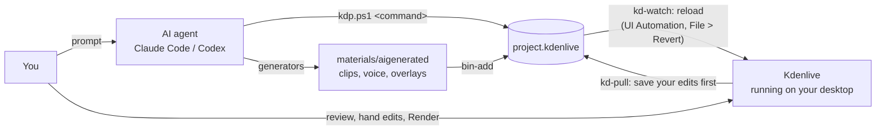

<div align="center">

# Movie Engine

**Agent yeAI inogadzirisa vhidhiyo yako muKdenlive iwe uchiona, uye unogona kutora basa racho chero nguva.**

Ma-agent eAI ekunyora kodhi (Claude Code, Codex) anogadzira nekuchinja mapurojekiti chaiwo eKdenlive: mafirimu, mavhidhiyo ekutsanangura uye mavhidhiyo mapfupi akamira (vertical shorts). Shanduko dzinobva dzaoneka mumupepeti (editor) wawakavhura. Inotakurika (portable), Windows, pasina kuchinjwa kwemupepeti.


[English](../../README.md) · [简体中文](README.zh-CN.md) · [繁體中文](README.zh-TW.md) · [हिन्दी](README.hi.md) · [Español](README.es.md) · [Français](README.fr.md) · [العربية](README.ar.md) · [বাংলা](README.bn.md) · [Português](README.pt.md) · [Русский](README.ru.md) · [اردو](README.ur.md) · [Bahasa Indonesia](README.id.md) · [Deutsch](README.de.md) · [日本語](README.ja.md) · [Türkçe](README.tr.md) · [한국어](README.ko.md) · [Українська](README.uk.md) · [Italiano](README.it.md) · [Polski](README.pl.md) · [Tiếng Việt](README.vi.md) · [فارسی](README.fa.md) · [ไทย](README.th.md) · [Kiswahili](README.sw.md) · [አማርኛ](README.am.md) · [Avañe'ẽ](README.gn.md) · [Setswana](README.tn.md) · [Shqip](README.sq.md) · [Беларуская](README.be.md) · [Български](README.bg.md) · [Bosanski](README.bs.md) · [Hrvatski](README.hr.md) · [Српски](README.sr.md) · [Crnogorski](README.cnr.md) · [Македонски](README.mk.md) · [Slovenščina](README.sl.md) · [Slovenčina](README.sk.md) · [Čeština](README.cs.md) · [Magyar](README.hu.md) · [Română](README.ro.md) · [Dansk](README.da.md) · [Norsk bokmål](README.nb.md) · [Norsk nynorsk](README.nn.md) · [Svenska](README.sv.md) · [Íslenska](README.is.md) · [Suomi](README.fi.md) · [Eesti](README.et.md) · [Latviešu](README.lv.md) · [Lietuvių](README.lt.md) · [Nederlands](README.nl.md) · [Lëtzebuergesch](README.lb.md) · [Rumantsch](README.rm.md) · [Ελληνικά](README.el.md) · [Malti](README.mt.md) · [Gaeilge](README.ga.md) · [Català](README.ca.md) · [ქართული](README.ka.md) · [Հայերեն](README.hy.md) · [Azərbaycanca](README.az.md) · [Afrikaans](README.af.md) · [isiZulu](README.zu.md) · [isiXhosa](README.xh.md) · [Sesotho](README.st.md) · [Sepedi](README.nso.md) · [Xitsonga](README.ts.md) · [Tshivenḓa](README.ve.md) · [siSwati](README.ss.md) · [isiNdebele (South Africa)](README.nr.md) · [isiNdebele (Zimbabwe)](README.nd.md) · **chiShona** · [Chichewa](README.ny.md) · [Ikinyarwanda](README.rw.md) · [Ikirundi](README.rn.md) · [Malagasy](README.mg.md) · [Soomaali](README.so.md) · [Afaan Oromoo](README.om.md) · [Qafar af](README.aa.md) · [ትግርኛ](README.ti.md) · [Sängö](README.sg.md) · [Kreol Seselwa](README.crs.md) · [TjiKalanga](README.kck.md) · [ChiNdau](README.ndc.md)

*Iyi ishanduro. README yechiRungu ndiyo shanduro huru inotarisirwa.*

</div>

---

## Zviri mukati

- [Nei](#nei)
- [Zvinoshanda sei](#zvinoshanda-sei)
- [Zvainogona kuita](#zvainogona-kuita)
- [Zvinodiwa](#zvinodiwa)
- [Kuisa](#kuisa)
- [Kutanga nekukurumidza](#kutanga-nekukurumidza)
- [Kushanda ne-agent](#kushanda-ne-agent)
- [Mutsara wemirairo wekugadzirisa (`kdp.ps1`)](#mutsara-wemirairo-wekugadzirisa-kdpps1)
- [Kuwirirana pakarepo nemupepeti wakavhurwa](#kuwirirana-pakarepo-nemupepeti-wakavhurwa)
- [Majeneretawa: zvisingagone kuitwa neKdenlive](#majeneretawa-zvisingagone-kuitwa-nekdenlive)
- [Izwi rekurondedzera neruzha](#izwi-rekurondedzera-neruzha)
- [Mutauro wechiratidziro](#mutauro-wechiratidziro)
- [Marongerwo emafolda](#marongerwo-emafolda)
- [Miedzo nehumbowo](#miedzo-nehumbowo)
- [Miganhu](#miganhu)
- [Kugadzirisa matambudziko](#kugadzirisa-matambudziko)
- [Mibvunzo inowanzobvunzwa](#mibvunzo-inowanzobvunzwa)
- [Kubatsira](#kubatsira)
- [Kutenda](#kutenda)
- [Rezinesi](#rezinesi)

## Nei

Mapurogiramu ekugadzirisa vhidhiyo akagadzirirwa maoko ari pambeva (mouse). Ma-agent eAI akanaka pakuronga, panguva uye pabasa rinodzokororwa: kuisa makiripu (clips) 300 pamutinhimira, kuenzanisa caption imwe neimwe neizwi, kugadzirisazve chiitiko (scene) mushure mekupiwa maonero. Asi havagone kudzvanya-dzvanya muchiratidziro (GUI) vasina kutora desktop yako.

Kdenlive mupepeti une simba wakavhurika (open-source), asi paWindows **haina API yekuzviitira basa (automation API)**: kudzora kuburikidza neD-Bus kunowanikwa chete paLinux builds, uye maforks anoiwedzera angave asisachengetwi kana kuti haana kuchengeteka. Movie Engine inogadzirisa izvi isina kuchinja mupepeti:

1. Agent inogadzirisa faira repurojekiti `.kdenlive` kuburikidza nemutsara wemirairo wakaedzwa (`engine/kdp.ps1`).
2. Kdenlive iri kushanda inoudzwa kuverengazve faira kuburikidza neWindows UI Automation, pasina kudzvanya makiyi, pasina mbeva uye pasina kutora focus.
3. Shanduko dzako dzisati dzachengetwa dzinotanga dzachengetwa uye hadzimbonyorwi pamusoro.

Saka agent inogadzirisa iwe uchiongorora, kana kuti iwe unogadzirisa nemaoko. Mose muri vaviri munoshanda papurojekiti imwe chete, mumupepeti mumwe chete, panguva imwe chete.

## Zvinoshanda sei



Murairo wega wega wekugadzirisa unotevera denderedzwa rimwe chete rakachengeteka:

1. **Pull.** Kana Kdenlive iine shanduko dzisati dzachengetwa, inoudzwa kudzichengeta (bhatani reSave pabhawa rezvishandiso kuburikidza neUI Automation), uye kuchengetwa kwacho kunosimbiswa.
2. **Kugadzirisa.** Murairo unochinja XML pasi pekiyi (lock), mushure mekuongorora hash uye nesnapshot yekudzosera (undo). Kana faira rachinja panguva iyoyo, hapana chinonyorwa.
3. **Kuverengazve.** Muoni (watcher) anoona chiratidzo cheAI omhanyisa File > Revert mumupepeti wakavhurwa. Zvinonzi zvabudirira chete kana widget yetimeline yavakwazve chaizvo.
4. **Kupesana.** Kana iwe watanga kugadzirisa pakati apo, hapana chinoverengwazve uye basa rako rinosara. Shanduro yeAI inochengetwa parutivi, uye agent inoisazve shanduko yayo pamusoro peyako.

## Zvainogona kuita

- **Kugadzirisa purojekiti yose pasina GUI**: mirairo inosvika 120 inobata bin, timeline, maeffects, macompositions, matracks, maguides, mamarkers, masubtitles, masequences, kumhanya uye kuchinjwa kwenguva (time remap), maslideshow, mazita (titles), maproxy, kurenda (rendering) uye undo/redo. Ona [rondedzero yemirairo](#mutsara-wemirairo-wekugadzirisa-kdpps1).
- **Kuwirirana pakarepo nemupepeti wakavhurwa.** Shanduko dzeAI dzinooneka muKdenlive yauri kutarisa; shanduko dzako dzisati dzachengetwa dzinotanga dzachengetwa uye hadzimborasika.
- **Haimbokanganisi desktop yako.** Hapana kutora focus, kudzvanya makiyi kana kufambisa mbeva. Mapepeti ekuedza anoshanda pa desktop yeWindows isingaoneki.
- **Inotakurika.** Mupepeti, zvirongwa (settings), Node.js, mafonti nezvishandiso zviri mufolda imwe chete. Ikopa kuenda kune imwe PC uye inoshanda; hapana chinonyorwa muProgram Files kana muprofile yako yeWindows.
- **Majeneretawa (generators) ezvinhu zvisingagone kuitwa neKdenlive**: mavara anofamba rimwe nerimwe (per-letter kinetic text), zviratidzo zvakadhirowewa nemaoko, zviitiko zve3D zvechiratidziro, kufambiswa kwecursor uye mafirimu marefu ekutsanangura ("explainer") anopindurana. Anorendwa paGPU ane motion blur chaiyo uye anoiswa patimeline semakiripu akajairika.
- **Izwi rekurondedzera (voice-over) rine nguva yeshoko rimwe nerimwe** (Microsoft Edge TTS, hapana API key). Macaptions nezviito zvinoitika pashoko chairo.
- **Ruzha rwakagadzirwa (synthesized sound effects)** (whoosh, click, pop, riser, impact nezvimwe), rwunogadzirwa nekodhi.
- **Zvakaratidzwa, kwete kufungidzirwa.** Murairo wega wega une kuongorora mhedzisiro yawo, maeffects nemacompositions anoedzwa rimwe nerimwe, uye mhedzisiro isina kugadziriswa iri mu`docs/proof/`.
- **Mirayiridzo ye-agent inosanganisirwa.** `AGENTS.md` nemaskills ari mu`.claude/skills/` zvinodzidzisa Claude Code neCodex nzira yekushanda, chimiro chefaira uye misungo yekunzvenga.

## Zvinodiwa

| | |
|---|---|
| OS | Windows 10 kana 11, x64 |
| Mupepeti | Kdenlive **26.08.3** inotakurika (standalone build). Mamwe mavhezheni haana kuedzwa. |
| Node.js | 18 kana mutsva: `.zip` yeWindows x64 kubva kunodejs.org, yakavhurwa mu`engine/node/` |
| Browser | Microsoft Edge (chikamu cheWindows); inoshandiswa isina hwindo (headless) nezvirongwa zvinorenda zviitiko |
| Agent | [Claude Code](https://claude.com/claude-code) kana Codex. Hazvimanikidzwi: chishandiso chimwe nechimwe chinogona kumhanyiswa nemaoko. |
| Disk | inenge 1 GB yemupepeti nezvishandiso, pamwe nemamedia ako |
| GPU | GPU ipi neipi ine hardware H.264 encoding inokurumidza `film-render.mjs` (kana isipo, inoshandisa software) |

## Kuisa

Zvese zvinoiswa **mukati mefolda**. Hapana chinoda kodzero dzeadmin.

```powershell
git clone https://github.com/vladtarrow/movie-engine.git
cd movie-engine
```

**1. Node.js.** Dhawunirodha `.zip` yeWindows x64 yeNode.js 18 kana mutsva kubva ku<https://nodejs.org/en/download> uye vhura zviri mukati mayo mu`engine\node\`, kuti `engine\node\node.exe` ne`engine\node\npm.cmd` zvivepo. Hapana installer kana Node yesystem inodiwa. Mascript ose anomhanya kuburikidza ne`engine\node.cmd`, kwete neNode yesystem.

**2. Mapakeji eNode** echishandiso chezwi nezvirongwa zvinorenda (mavhezheni akasungwa mu`engine/voice/package.json`):

```powershell
engine\node\npm.cmd install --prefix engine\voice
```

**3. Kdenlive 26.08.3 inotakurika.** Dhawunirodha `kdenlive-26.08.3_standalone.exe` kubva ku<https://download.kde.org/stable/kdenlive/26.08/windows/> uiise mu`engine\installer\`, riongorore uye urivhure:

```powershell
(Get-FileHash engine\installer\kdenlive-26.08.3_standalone.exe -Algorithm SHA256).Hash
# expected: A25427B1DFF2C17E3B0386E991BB1A719382BB3176D1A90E441CDAEB6E0A967D
engine\installer\kdenlive-26.08.3_standalone.exe -o"engine\Kdenlive" -y
```

Mupepeti unopedzisira wava mu`engine\Kdenlive\kdenlive-26.08.3_standalone\bin\`. Unotova ne`melt.exe` ne`ffmpeg.exe`.

**4. Kuvhura kwekutanga.**

```powershell
engine\kdenlive.cmd
```

Kdenlive inochengeta zvirongwa zvayo zvose mu`engine\profile-kdenlive\`, kwete muprofile yako yeWindows. Painotanga kekutanga inoratidza wizard yekugadzirira kamwe chete.

## Kutanga nekukurumidza

### Ne-agent

Vhura folda muClaude Code (kana Codex) ubvunze nemazwi akajairika:

> Gadzira purojekiti itsva yakamira ye30 fps inonzi "launch-teaser". Isa mascreenshot matatu ari mu`materials/designers/launch/` patimeline, rimwe nerimwe 2.5 s rine cross-fade pfupi, wedzera izwi rekurondedzera kubva mu`script.txt` uye uenzanise kinetic caption nemutsara wega wega.

> Ndivhurire muKdenlive.

> Shot yechipiri yakarebesa. Ipfupise kusvika 1.8 s uye usimudze logo zvishoma.

Agent inotevera `AGENTS.md`: inogadzirisa kuburikidza ne`kdp.ps1`, inorenda chete makiripu anodiwa necut, uye inochengeta mupepeti wakavhurwa uchienderana. Iwe unoongorora muKdenlive, unogadzirisa nemaoko chero paunoda, uye unodzvanya Render kana wagutsikana.

### Nemaoko

```powershell
# a new 1080x1920 30 fps project with 2 video and 2 audio tracks
powershell -NoProfile -ExecutionPolicy Bypass -File engine\kdp.ps1 new -Project projects\hello\hello.kdenlive -Profile vertical_hd_30

# a 3-second title and a colour background
powershell -NoProfile -ExecutionPolicy Bypass -File engine\kdp.ps1 bin-color -Project projects\hello\hello.kdenlive -Color '#203060' -Seconds 3 -Name bg
powershell -NoProfile -ExecutionPolicy Bypass -File engine\kdp.ps1 title -Project projects\hello\hello.kdenlive -Text "Hello" -Seconds 3 -Name hi

# place them: background on V1, title above it on V2
powershell -NoProfile -ExecutionPolicy Bypass -File engine\kdp.ps1 add -Project projects\hello\hello.kdenlive -Bin bg -Track V1 -At 0
powershell -NoProfile -ExecutionPolicy Bypass -File engine\kdp.ps1 add -Project projects\hello\hello.kdenlive -Bin hi -Track V2 -At 0

# a check frame, then open it in the editor
powershell -NoProfile -ExecutionPolicy Bypass -File engine\kdp.ps1 frame -Project projects\hello\hello.kdenlive -At 1.5 -Out out\hello\check.png
engine\kdenlive.cmd projects\hello\hello.kdenlive
```

Kuti uvhurezve purojekiti yekupedzisira gare gare, dzvanya kaviri `open-last-project.cmd`.

## Kushanda ne-agent

Agent inoverenga `AGENTS.md` (Codex) kana `CLAUDE.md`, inoipinza (Claude Code), pamwe nemaskills maviri:

| Skill | Zvainodzidzisa |
|---|---|
| `.claude/skills/kdenlive-project-file` | chimiro che`.kdenlive` / MLT XML, `kdp.ps1`, kuongorora ne`melt` |
| `.claude/skills/kdenlive-live` | kutyaira mupepeti uri kushanda zvakachengeteka: kuutanga, pull, kuverengazve, kutora mufananidzo wehwindo rawo |

Mitemo inoteverwa ne-agent, yaunogona kuvimba nayo:

- Haimbotori mbeva yako, keyboard kana focus, uye haimbotori screenshot yedesktop yako (chete hwindo remupepeti pacharo).
- Inoita matanho eGUI pachayo (kuchengeta, kuvhura, kuverengazve) pane kukukumbira kuti udzvanye.
- Inobvunza isati yadhawunirodha chero chinhu uye isati yadzima chero chinhu.
- Inorenda chete zvinodiwa nebasa (makiripu ezviitiko, mafuremu ekuongorora). Inorenda firimu rekupedzisira chete kana iwe wakumbira.
- Kana Kdenlive isingagone kuita chimwe chinhu zvakanaka, agent inochigadzira kunze nekodhi yoisa mhedzisiro seclip. Haiderediri simba reeffect.

## Mutsara wemirairo wekugadzirisa (`kdp.ps1`)

```powershell
powershell -NoProfile -ExecutionPolicy Bypass -File engine\kdp.ps1 <command> -Project <file.kdenlive> [options]
```

Nguva dziri mumasekondi, nedot (`2.5`). Matracks ndi`V1 V2 …` (V1 ndiyo iri pasi-pasi) ne`A1 A2 …`. Clip inotaurwa ne`-Track` pamwe nenguva ipi neipi `-At` iri mukati mayo. Maparameter eeffect anoenda mu`-Params "name=value||name=value"`. Rondedzero yakazara ine sarudzo dzose iri mumusoro we`engine/kdp.ps1`.

| Boka | Mirairo |
|---|---|
| Purojekiti | `new`, `profiles`, `info`, `validate`, `fonts`, `profile-set`, `profile-from-clip`, `zone`, `archive`, `backups`, `rebase`, `otio-export`, `otio-import` |
| Bin | `bin-add`, `bin-color`, `title`, `title-text`, `title-save`, `title-template`, `bin-rename`, `bin-remove`, `bin-info`, `bin-set`, `bin-duplicate`, `bin-replace-file`, `bin-reload`, `folder`, `bin-folder`, `relink`, `clean`, `generator`, `playlist-clip`, `extract-audio`, `transcode` |
| Timeline | `add`, `add-av`, `move`, `copy`, `trim`, `ripple-trim`, `slip`, `split`, `remove`, `speed`, `remap`, `disable`, `enable`, `group`, `ungroup`, `mix`, `unmix`, `space-insert`, `space-remove`, `spaces-remove-all`, `track-clear`, `replace-in-timeline` |
| Maeffects | `effects`, `effect-info`, `effect-add`, `effect-list`, `effect-set`, `effect-remove`, `effect-copy`, `effect-clear`, `effects-all`, `bin-effect`, `effect-templates`, `effect-template` |
| Macompositions | `compositions`, `comp-info`, `comp-add`, `comp-list`, `comp-set`, `comp-remove` |
| Matracks | `track-add`, `track-remove`, `track-set` |
| Maguides nemamarkers | `guide-add`, `guide-list`, `guide-remove`, `guide-set`, `guide-clear`, `guide-export`, `guide-category`, `marker`, `marker-list`, `marker-set`, `marker-remove` |
| Masubtitles | `sub-add`, `sub-import`, `sub-export`, `sub-state` |
| Masequences | `sequence-add`, `sequences`, `copy-to-sequence`, `expand`; murairo upi neupi une `-Sequence <name>` unoshanda mukati mesequence iyoyo |
| Zvakasiyana | `slideshow`, maanimation eLottie / Glaxnimate kuburikidza ne`bin-add`, `proxy`, `stabilize`, `scene-split`, `speed-job`, `subclip` |
| Zvinobuda | `frame` (PNG imwe), `preview` (kurenda kunokurumidza nemelt), `render` (murenda weKdenlive pachayo kana preset), `presets` |
| Nhoroondo | `undo`, `redo`, `clear-history` (masnapshot ari mu`projects/<name>/.kdp-history`) |

Maitiro akakosha kuziva:

- Hafu dzeaudio nevhidhiyo dzakabatana dzinofambiswa, dzinotemwa (trim), dzinopatsanurwa uye dzinobviswa pamwe chete (`-Alone` kuti ive hafu imwe chete).
- Murairo unokundikana unobuda nekodhi 1 uye haunyori chinhu.
- Maeffects asingagone kumhanyiswa neWindows build anorambwa, kwete kufuratirwa chinyararire (rondedzero: `docs/proof/assets.txt`).
- Chiito chimwe nechimwe chemenu yeKdenlive chakabatanidzwa nemurairo, neimwe nzira, kana kuti "kuona chete" mu`engine/tools/data/kdenlive-actions.csv`. Ona `docs/kdenlive-coverage.md`.

## Kuwirirana pakarepo nemupepeti wakavhurwa

| Script | Zvainoita | Makodhi ekubuda |
|---|---|---|
| `engine\kd-pull.ps1 -Project <f>` | inoita kuti Kdenlive ichengete shanduko dzako uye inozvisimbisa | 0 faira razvino, 3 haisi kushanda, 4 hazvina kusimbiswa |
| `engine\kd-reload.ps1 -Project <f>` | File > Revert, zvichisimbiswa netimeline yavakwazve | 0 zvasimbiswa, 2 une shanduko dzisati dzachengetwa (hapana chakaraswa), 3 haisi kushanda, 4 zvakundikana |
| `engine\kd-watch.ps1 -Project <f>` | muoni anoshanda kumashure: anoverengazve mushure mekunyora kwega kwega kweAI, anonyora kupesana mulog | log iri mu`engine\kd-watch.log`; dzima `engine\kd-watch.run` kuti umise |
| `engine\kdenlive-bg.ps1 [project]` | inotanga Kdenlive yakaderedzwa (minimized) ye-agent | 0 yapinda, 4 hazvina kusimbiswa |
| `engine\kdenlive.cmd [project]` | inotangira iwe Kdenlive | |

Tanga muoni kamwe chete pasession imwe neimwe:

```powershell
Start-Process powershell -WindowStyle Hidden -ArgumentList '-NoProfile','-ExecutionPolicy','Bypass','-File','engine\kd-watch.ps1','-Project','projects\hello\hello.kdenlive'
```

Mapurojekiti makuru: kuverengazve purojekiti ine makiripu 1000 kunotora maminitsi, uye zvishandiso zvinomirira pane kutaura mhedzisiro nguva isati yakwana. Mapurojekiti anovhurwa kuburikidza ne*File > Open Recent* mumupepeti usina chinhu, nekuti kuvhura faira zvakananga kunoita kuti Qt ipfuure nechinhu chimwe nechimwe chetimeline nekuda kweaccessibility, uye zvaitora maminitsi anenge 10 kupfuura.

## Majeneretawa: zvisingagone kuitwa neKdenlive

Kdenlive/MLT haina animation yemavara rimwe nerimwe, haina maexpressions uye ine 3D shoma, uye maeffects anorema anononotsa kutamba kwevhidhiyo. Movie Engine inorenda zvikamu zvakadaro kunze yozviisa patimeline semakiripu akajairika, kazhinji ane alpha, patrack iri pamusoro pemifananidzo. Script yejeneretawa nezvainoshandisa zvinosara mufolda yepurojekiti, saka clip inogona kugadzirwazve kana mavara, fonti kana nguva zvachinja.

| Chishandiso | Zvachinogadzira |
|---|---|
| `engine/tools/kinetic-text.ps1` | macaptions anofamba ane mavara rimwe nerimwe, shoko rega rega rakaenzaniswa ne`voice.json`, bhokisi rekuratidza (highlight box) |
| `engine/tools/annotate.ps1` | madenderedzwa, mabhokisi, mitsetse yepasi nemiseve zvakadhirowewa nemaoko zvinozvidhirowa pamusoro pescreenshot |
| `engine/tools/card-entrance.ps1` | kadhi rescreenshot rinokwira nekukura richipinda, rine mumvuri wakapfava |
| `engine/tools/pdf-to-png.ps1` | maslide kubva kuPDF export |
| `engine/tools/html-render.mjs` | chiitiko chipi nechipi cheHTML/CSS/canvas kuita vhidhiyo: animation yechiratidziro, macursor, 3D, mamask |
| `engine/tools/film-render.mjs` + `film/` | mafirimu marefu ekutsanangura anopindurana pacanvas: clip imwe pamutsara wega wega wezwi, zviito zvinoitika pamazwi anotaurwa, motion blur yeGPU painenge 45 fps |

Zvirongwa zviviri izvi zvinorenda zvinotyaira Microsoft Edge inouya neWindows, isina hwindo (headless), ine profile yekurasa uye isina network.

### Mienzaniso

```powershell
# a 3-second 3D title card with a cursor click
engine\node.cmd engine\tools\html-render.mjs examples\demo\scene\scene.html examples\demo\out --frames 0,30,60,89
engine\node.cmd engine\tools\html-render.mjs examples\demo\scene\scene.html examples\demo\out\scene.mp4

# a 4-shot interactive film timed to two voice lines
engine\node.cmd engine\tools\film-render.mjs examples\demo\film\film.html examples\demo\out --check
engine\node.cmd engine\tools\film-render.mjs examples\demo\film\film.html examples\demo\out --shots all --width 640
engine\node.cmd engine\tools\film-render.mjs examples\demo\film\film.html examples\demo\out\clips --suffix -v01
```

Firimu rinoumbwa nemafaira matatu madiki. `data.js` ine mashot nenguva dzemazwi. `direction.js` ine mutsara mumwe pashot imwe neimwe:

```text
1 | hover 192 108 @brand | tag 300 60 Your brand @deserves | confetti 192 90 @film
2 say=A film that/*explains* it
3 | click 116 108 @before | click 268 108 @after | chips Before~After @after
4 scene=counter | count 0 120 % @count
```

`scenes.js` ine mashot anodhirowewa kubva pakutanga. `@word` inoita chiito kana izwi rataura shoko iroro. Zviito zvinosanganisira click, hover, drag, zoom, lens, ring, arrow, chips, toggle, slider, toast, type, count ne confetti; syntax yakazara iri pamusoro pe`engine/tools/film/film-kit.js`.

## Izwi rekurondedzera neruzha

```powershell
engine\node.cmd engine\voice\voice.mjs lines.json materials\aigenerated\hello\voice en-US-AndrewMultilingualNeural +0%
```

`lines.json` rondedzero yemitsara. Chishandiso chinonyora mp3 imwe pamutsara wega wega pamwe ne`voice.json`, ine kureba uye kutanga nekupera kweshoko rega rega. Mitsara inochengetwa (cache), saka kuchinja mutsara mumwe kunogadzirazve mutsara iwoyo chete. Inoshandisa text-to-speech yepamhepo yeMicrosoft Edge kuburikidza nepakeji `msedge-tts`: hapana kiyi inodiwa, asi sevhisi iyi haisi yepamutemo uye inoda indaneti.

```powershell
engine\node.cmd engine\audio\sfx.mjs materials\aigenerated\sfx
```

Izvi zvinogadzira nekodhi whoosh, whoosh-long, swipe, click, pop, tick, riser, impact, ding ne reveal; seti yakagadzirira iri mu`materials/aigenerated/sfx/`. Ruzha rwupfupi pane furemu imwe chete ruwedzere kunyarara usati waruisa (`-af apad=whole_dur=0.0667`).

## Mutauro wechiratidziro

Zvinotangisa (launchers) zvinovhura Kdenlive **muChirungu** pasina chasarudzwa. Kuti ushandise mumwe mutauro, isa `MOVIE_ENGINE_UI_LANG` usati watanga:

```powershell
$env:MOVIE_ENGINE_UI_LANG = 'ru'; engine\kdenlive.cmd
```

UI Automation inowana zvinhu zvemenu nemazita azvo anooneka. Mazita emitauro yechiratidziro (interface) 31 akatoiswa mukati (`engine/tools/kd-ui.ps1`, `$KdNames`). Pane mumwe mutauro upi noupi, wedzera mazita awo ipapo woongorora ne:

```powershell
powershell -NoProfile -ExecutionPolicy Bypass -File engine\tools\kd-langcheck.ps1
```

## Marongerwo emafolda

```text
movie-engine/
├─ AGENTS.md, CLAUDE.md          instructions for AI agents
├─ .claude/skills/               agent skills: project file format, live editor
├─ engine/
│  ├─ kdp.ps1                    the editing command line
│  ├─ kd-pull / kd-reload / kd-watch .ps1, kdenlive.cmd, kdenlive-bg.ps1
│  ├─ tools/                     internals, generators, tests, data (action map)
│  ├─ voice/  audio/  fonts/     TTS, synthesized SFX, Poppins (OFL)
│  ├─ Kdenlive/  node/           portable editor and Node.js (not in git)
│  └─ profile-kdenlive/          the editor's settings (not in git)
├─ projects/<name>/<name>.kdenlive
├─ materials/
│  ├─ download/                  stock and downloaded files (not in git)
│  ├─ aigenerated/               everything the AI made (sfx/ and test-kit/ ship with the engine)
│  ├─ designers/  brand/         files from your team, brand assets
├─ examples/demo/                demos of the scene and film renderers
├─ out/                          renders (not in git)
└─ docs/                         proofs, coverage, translations of this README
```

Nzira dzemamedia mukati memapurojekiti dzakatarisana nefolda (relative). Kana ukafambisa kana kukopa folda, `kdp.ps1 rebase` (inomhanyiswawo yega ne`kdenlive.cmd`) inonyora nzvimbo itsva mupurojekiti.

## Miedzo nehumbowo

Zvinotaurwa pamusoro pezvinoshanda zvinotsigirwa nekuongorora mhedzisiro, kwete nekuti "function yakamhanya". Pfupiso iri mu[`docs/kdenlive-proof.md`](../../docs/kdenlive-proof.md), uye zvakabuda zvisina kugadziriswa zviri mu`docs/proof/`.

| Muedzo | Zvaunoongorora |
|---|---|
| `engine\tools\kdp-clitest.ps1` | murairo wega wega we`kdp.ps1`, kuburikidza nemutsara wemirairo, uchienzanisa purojekiti inobuda |
| `engine\tools\kd-livetest.ps1` | pull, kuverengazve, muoni, kupesana nemijaho (races) neKdenlive chaiyo pa desktop isingaoneki |
| `engine\tools\kdp-assetsweep.ps1` | effect yega yega necomposition yega yega: unorenda nekuenzanisa mafuremu |
| `engine\tools\kdp-portabletest.ps1` | unokopa folda kuenda kune imwe nzvimbo woshanda kubva pakopi |
| `engine\tools\kd-langcheck.ps1` | mutauro wechiratidziro uye kuti UI Automation inowana menu |
| `engine\tools\kdp-coverage-check.ps1` | kuti chiito chega chega chemenu chakabatanidzwa, uye kuti hapana humbowo hwakura kupfuura kodhi |

```powershell
powershell -NoProfile -ExecutionPolicy Bypass -File engine\tools\kdp-clitest.ps1 -Report docs\proof\clitest.txt
powershell -NoProfile -ExecutionPolicy Bypass -File engine\tools\kd-livetest.ps1 -Report docs\proof\live-en.txt
```

Mapepeti ekuedza anoshanda chete pa desktop yakavanzika ine profile yawo, saka miedzo haimbobati Kdenlive yako yakavhurwa kana focus yako.

## Miganhu

- **Windows chete**, Kdenlive **26.08.3** chete. Linux ine D-Bus uye yaizoda bhiriji rakasiyana.
- Kutanga mupepeti kunotora focus yekeyboard kwemasekondi anenge 3 hwindo risina chinhu richioneka. Ma-agent anobvunza asati autanga iwe uchishanda. Kuverengazve nekugadzirisa hazvitori focus.
- Windows build haina mamodule eMLT sox, ladspa ne movit uye mamwe maeffects efrei0r/avfilter; `kdp.ps1` inoaramba (`docs/proof/assets.txt`).
- OpenTimelineIO export ne import zvinotakura makiripu nemakomba (gaps) chete. Multicam haina kuchinja maangle pakarepo (macuts anoitwa ne split/remove/hide).
- "Save As…" kuburikidza neUI Automation pahwindo rakaderedzwa haivhuri dialog; agent inoshandisa `archive` kana kukopa mafaira panzvimbo yazvo.
- Kuziva kutaura (speech recognition, auto-subtitles) kunoda Whisper kana Vosk, zvisina kuiswa mukati.
- Mazita (titles) anogadzirwa nechishandiso chemazita cheKdenlive anoshandisa mafonti akaiswa muWindows. Kuti uve nechokwadi chetypography, renda mavara nemajeneretawa, anotora mafonti kubva mu`engine/fonts/`.
- Edge TTS isevhisi yepamhepo isiri yepamutemo uye inogona kuchinja kana kumira kushanda.

## Kugadzirisa matambudziko

| Chiratidzo | Chikonzero nekugadzirisa |
|---|---|
| Kdenlive iri kushanda, asi kuidzvanya patakbar hakuratidzi chinhu | Nzvimbo yayo yehwindo yakachengetwa iri kunze kwechiratidziro. Ivhare udzime zvinyorwa `kdockLayout` mu`engine\profile-kdenlive\AppData\Local\kdenliverc`, kana fambisa hwindo ne`SetWindowPos` (ona `AGENTS.md`). |
| `kd-reload.ps1` inobuda ne2 | Une shanduko dzisati dzachengetwa. Hapana chakaraswa. Mhanyisa `kd-pull.ps1`, wobva waisazve shanduko (`kdp.ps1` inozviita pachayo). |
| `CONFLICT` mu`engine\kd-watch.log` | Iwe ne-agent makagadzirisa panguva imwe chete. Shanduro yako inosara mumupepeti, uye shanduro yeAI iri mu`projects\<name>\.kdp-history\<name>\conflict\`. Kumbira agent kuti iisezve shanduko yayo. |
| Murairo unobuda ne1 uine "pull not confirmed" | Kdenlive yakabatikana kana kuti iri kuratidza dialog. Vhara dialog kana mirira kuti kuvhura kupere, wobva wadzokorora. |
| Script yePowerShell inokundikana kuverengwa (parse) | Mascript ane mavara asiri eASCII anofanira kuchengetwa seUTF-8 **ine BOM** kuitira Windows PowerShell 5.1. |
| `voice.mjs` inomira ne"Stream closed before the synthesis completed" | Kazhinji idambudziko renetwork, kana SSML isina kuchengetedzwa (unescaped) mumakopi ekare. `voice.mjs` inochengetedza `& < >` pachayo. |
| Kuvhura purojekiti hombe kunotora maminitsi mazhinji | Ivhure kuburikidza ne`kdenlive.cmd` / `kdenlive-bg.ps1`, kwete se`kdenlive.exe project.kdenlive`. |

## Mibvunzo inowanzobvunzwa

**Ndinoda Claude Code kana Codex here?**
Kwete. Chishandiso chimwe nechimwe iscript yakajairika yaunogona kumhanyisa nemaoko. Agent ndiyo inokurumidza basa: inoronga cut, inomhanyisa zvishandiso uye inochengeta mupepeti uchienderana.

**Agent ichanyora pamusoro peshanduko dzangu dzemaoko here?**
Kwete. Isati yanyora chero chinhu, shanduko dzako dzisati dzachengetwa dzinochengetwa uye zvinosimbiswa. Kana ukagadzirisa agent ichinyora, kunyora kunorambwa kana kuchengetwa parutivi sekupesana (conflict), hakumboiswi pamusoro pebasa rako.

**Ndingaramba ndichishandisa Kdenlive sezvandinowanzoita here?**
Hongu. IKdenlive yakajairika ine folda yayo yezvirongwa. Gadzirisa, tarisa (preview) uye renda sezvawakajaira.

**Inoshanda neKdenlive yandakatoisa here?**
Inoshandisa kopi yayo inotakurika iri mu`engine\Kdenlive\`, saka Kdenlive yako yakaiswa nezvirongwa zvayo hazvibatwi.

**Nei isiri fork yeKdenlive ine API, kana mumwe mupepeti?**
PaWindows, hapana fork inochengetwa uye yakachengeteka iripo (ongororo yaMbudzi 2026). OpenShot, Blender VSE, DaVinci Resolve, Shotcut nemapepeti epawebhu zvakaongororwa; Kdenlive yakapa kugadzirisa kwakadzama kupfuura zvose. Chikumbiro cheREST API kuKdenlive pachayo (merge request !902) chiri kutariswa.

**Inogona kurenda vhidhiyo yekupedzisira here?**
Hongu, ne`kdp.ps1 render` (murenda weKdenlive pachayo, wakavanzika), kana iwe pachako unodzvanya Render mumupepeti.

**Mamedia angu anotumirwa kumwe kunhu here?**
Kwete. Mavara ezwi rekurondedzera chete ndiwo anotumirwa kusevhisi yeEdge TTS paunogadzira izwi. Zvirongwa zvinorenda zviitiko zvinoshanda network yakadzimwa.

## Kubatsira

Rubatsiro runogamuchirwa. Ona [CONTRIBUTING.md](../../CONTRIBUTING.md). Muchidimbu:

- Operation itsva kana yakachinjwa ye`kdp.ps1` inoda kuongorora mhedzisiro mu`kdp-clitest.ps1`, chinyorwa mumepu yezviito (action map), uye kumhanyiswa patsva kwe`kdp-coverage-check.ps1`.
- Usambotanga Kdenlive yekuedza pa desktop inooneka; shandisa `engine/tools/kd-hidden.ps1`.
- Chengeta zvese zvichitakurika: hapana kuisa chinhu kunze kwefolda, hapana nzira dzakazara (absolute paths) mumapurojekiti.
- Nyora maitiro asinganzwisisike akasimbiswa (quirks) mu`AGENTS.md` kana muskill inoenderana nawo.

## Kutenda

- [Kdenlive](https://kdenlive.org) ne[MLT](https://www.mltframework.org): mupepeti neinjini iri pasi pawo.
- [FFmpeg](https://ffmpeg.org), inouya neKdenlive.
- [msedge-tts](https://www.npmjs.com/package/msedge-tts) yezwi rekurondedzera.
- [Poppins](https://fonts.google.com/specimen/Poppins) neIndian Type Foundry, SIL Open Font License (`engine/fonts/OFL.txt`).
- `engine/tools/data/kdenliveui-26.08.3.rc`: faira remenu reKdenlive, rakatorwa kubva kusource yeKdenlive 26.08.3; rinoshandiswa chete nekuongorora kufukidza (coverage check). Rinoramba riri pasi perezinesi reGPL reKdenlive, kwete MIT License.

## Rezinesi

Kodhi yeMovie Engine pachayo inoburitswa pasi pe[MIT License](../../LICENSE). Kdenlive, MLT, FFmpeg, mapakeji eNode.js nefonti yePoppins zvinochengeta marezinesi azvo.
