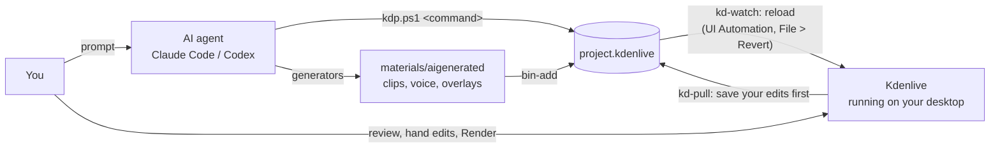

<div align="center">

# Movie Engine

**Wakiil AI ah ayaa muuqaalkaaga ku tafatira Kdenlive adiga oo daawanaya, waxaadna shaqada la wareegi kartaa xilli kasta.**

Wakiilada AI ee koodhka qora (Claude Code, Codex) waxay dhisaan oo beddelaan mashaariic Kdenlive oo dhab ah: filimo, muuqaallo sharraxaad ah iyo shorts toosan (vertical). Isbeddelladu si toos ah ayay uga muuqdaan tifaftiraha (editor-ka) aad furan tahay. La qaadi karo (portable), Windows, tifaftiraha lama beddelo (patch la'aan).


[English](../../README.md) · [简体中文](README.zh-CN.md) · [繁體中文](README.zh-TW.md) · [हिन्दी](README.hi.md) · [Español](README.es.md) · [Français](README.fr.md) · [العربية](README.ar.md) · [বাংলা](README.bn.md) · [Português](README.pt.md) · [Русский](README.ru.md) · [اردو](README.ur.md) · [Bahasa Indonesia](README.id.md) · [Deutsch](README.de.md) · [日本語](README.ja.md) · [Türkçe](README.tr.md) · [한국어](README.ko.md) · [Українська](README.uk.md) · [Italiano](README.it.md) · [Polski](README.pl.md) · [Tiếng Việt](README.vi.md) · [فارسی](README.fa.md) · [ไทย](README.th.md) · [Kiswahili](README.sw.md) · [አማርኛ](README.am.md) · [Avañe'ẽ](README.gn.md) · [Setswana](README.tn.md) · [Shqip](README.sq.md) · [Беларуская](README.be.md) · [Български](README.bg.md) · [Bosanski](README.bs.md) · [Hrvatski](README.hr.md) · [Српски](README.sr.md) · [Crnogorski](README.cnr.md) · [Македонски](README.mk.md) · [Slovenščina](README.sl.md) · [Slovenčina](README.sk.md) · [Čeština](README.cs.md) · [Magyar](README.hu.md) · [Română](README.ro.md) · [Dansk](README.da.md) · [Norsk bokmål](README.nb.md) · [Norsk nynorsk](README.nn.md) · [Svenska](README.sv.md) · [Íslenska](README.is.md) · [Suomi](README.fi.md) · [Eesti](README.et.md) · [Latviešu](README.lv.md) · [Lietuvių](README.lt.md) · [Nederlands](README.nl.md) · [Lëtzebuergesch](README.lb.md) · [Rumantsch](README.rm.md) · [Ελληνικά](README.el.md) · [Malti](README.mt.md) · [Gaeilge](README.ga.md) · [Català](README.ca.md) · [ქართული](README.ka.md) · [Հայերեն](README.hy.md) · [Azərbaycanca](README.az.md) · [Afrikaans](README.af.md) · [isiZulu](README.zu.md) · [isiXhosa](README.xh.md) · [Sesotho](README.st.md) · [Sepedi](README.nso.md) · [Xitsonga](README.ts.md) · [Tshivenḓa](README.ve.md) · [siSwati](README.ss.md) · [isiNdebele (South Africa)](README.nr.md) · [isiNdebele (Zimbabwe)](README.nd.md) · [chiShona](README.sn.md) · [Chichewa](README.ny.md) · [Ikinyarwanda](README.rw.md) · [Ikirundi](README.rn.md) · [Malagasy](README.mg.md) · **Soomaali** · [Afaan Oromoo](README.om.md) · [Qafar af](README.aa.md) · [ትግርኛ](README.ti.md) · [Sängö](README.sg.md) · [Kreol Seselwa](README.crs.md) · [TjiKalanga](README.kck.md) · [ChiNdau](README.ndc.md)

*Kani waa turjumaad. README-ga Ingiriisiga ah ayaa ah nuqulka tixraaca.*

</div>

---

## Tusmo

- [Sababta](#sababta)
- [Sida uu u shaqeeyo](#sida-uu-u-shaqeeyo)
- [Astaamaha](#astaamaha)
- [Shuruudaha](#shuruudaha)
- [Rakibidda](#rakibidda)
- [Bilow degdeg ah](#bilow-degdeg-ah)
- [La shaqaynta wakiilka](#la-shaqaynta-wakiilka)
- [Khadka amarrada tafatirka (`kdp.ps1`)](#khadka-amarrada-tafatirka-kdpps1)
- [Isku-xidhka tooska ah ee tifaftiraha furan](#isku-xidhka-tooska-ah-ee-tifaftiraha-furan)
- [Soosaarayaal: waxa Kdenlive aanu samayn karin](#soosaarayaal-waxa-kdenlive-aanu-samayn-karin)
- [Cod-sharraxaad iyo dhawaaq](#cod-sharraxaad-iyo-dhawaaq)
- [Luqadda interface-ka](#luqadda-interface-ka)
- [Habaynta galalka](#habaynta-galalka)
- [Tijaabooyin iyo caddeymo](#tijaabooyin-iyo-caddeymo)
- [Xaddidaadyo](#xaddidaadyo)
- [Xallinta dhibaatooyinka](#xallinta-dhibaatooyinka)
- [Su'aalaha inta badan la is weydiiyo](#suaalaha-inta-badan-la-is-weydiiyo)
- [Ka qaybqaadasho](#ka-qaybqaadasho)
- [Mahadnaq](#mahadnaq)
- [Shatiga](#shatiga)

## Sababta

Tifaftirayaasha muuqaalka waxaa loo sameeyay gacan jiirka (mouse-ka) haysa. Wakiilada AI waxay ku fiican yihiin qaab-dhismeedka, waqtiyeynta iyo shaqada soo noqnoqota: dhigidda 300 clip oo la jaanqaadaya garaaca, ku waqtiyeynta qoraal-hoosaad (caption) kasta codka, dib u samaynta muuqaal (scene) kadib faallo. Ma gujin karaan GUI-ga (interface-ka garaafka) iyagoon kula wareegin desktop-kaaga.

Kdenlive waa tifaftire xoog leh oo il-furan (open-source), laakiin Windows-ka **ma laha API otomaatig ah (automation API)**: xakamaynta D-Bus waxay ku jirtaa oo keliya dhismayaasha (builds) Linux, fork-yada ku darana ama lama dayactiro ama ammaan ma aha. Movie Engine wuxuu tan xalliyaa isagoon tifaftiraha beddelin:

1. Wakiilku wuxuu tafatiraa faylka mashruuca `.kdenlive` isagoo adeegsanaya khad amar (command line) oo la tijaabiyay (`engine/kdp.ps1`).
2. Kdenlive-ka socda waxaa lagu amraa inuu faylka dib u akhriyo iyadoo loo marayo Windows UI Automation, iyadoo aan furayaal la riixin, jiir la isticmaalin, focus-kana la xadin.
3. Isbeddelladaada aan weli la kaydin marka hore ayaa la kaydiyaa, waligoodna lagama dul qoro.

Sidaas darteed wakiilku wuu tafatiraa adiguna waad dib u eegtaa, ama adigu gacanta ayaad ku tafatirtaa. Labadiinuba waxaad ka shaqaysaan isla mashruuca, isla tifaftiraha, isla waqtiga.

## Sida uu u shaqeeyo



Amar kasta oo tafatir ah wuxuu raacaa isla wareeg ammaan ah:

1. **Pull (soo jiidid).** Haddii Kdenlive leeyahay isbeddello aan la kaydin, waxaa lagu amraa inuu kaydiyo (badhanka Save ee toolbar-ka iyadoo loo marayo UI Automation), kaydintana waa la xaqiijiyaa.
2. **Tafatir.** Amarku wuxuu beddelaa XML-ka isagoo quful (lock) haysta, kadib hubinta hash-ka, isagoo sameeya sawir-xaaladeed (snapshot) loogu talagalay undo. Haddii faylku isbeddelay inta u dhaxaysa, waxba lama qoro.
3. **Dib u rarid (reload).** Ilaaliyuhu (watcher-ku) wuxuu arkaa calaamadda AI-ga, wuxuuna tifaftiraha furan ku fuliyaa File > Revert. Guul waxaa la tiriyaa oo keliya marka widget-ka timeline-ka si dhab ah dib loo dhisay.
4. **Isku dhac (conflict).** Haddii aad tafatir bilowday inta u dhaxaysa, waxba dib looma raro, shaqadaaduna way hadhaysaa. Nuqulka AI-ga dhinac ayaa la dhigaa, wakiilkuna isbeddelkiisa ayuu dib ugu dabaqaa kuwaaga dushooda.

## Astaamaha

- **Tafatir buuxa oo mashruuca ah iyadoo aan GUI la isticmaalin**: ku dhawaad 120 amar oo daboolaya bin-ka (kaydka clip-yada), timeline-ka, saamaynta (effects), isku-darka (compositions), track-yada, hagayaasha (guides), calaamadaha (markers), qoraal-hoosaadyada, taxanayaasha (sequences), xawaaraha iyo dib u qaybinta waqtiga (time remap), slideshow-yada, cinwaannada (titles), proxy-yada, render-ka iyo undo/redo. Eeg [tixraaca amarrada](#khadka-amarrada-tafatirka-kdpps1).
- **Isku-xidh toos ah oo lala yeesho tifaftiraha furan.** Isbeddellada AI-gu waxay ka muuqdaan Kdenlive-ka aad eegayso; isbeddelladaada aan la kaydin marka hore ayaa la kaydiyaa, waligoodna ma lumaan.
- **Waligiis desktop-kaaga ma carqaladeeyo.** Ma jiro xadid focus, riixid furayaal ama gelin jiir. Tifaftirayaasha tijaabada waxay ku shaqeeyaan desktop Windows ah oo aan muuqan.
- **La qaadi karo.** Tifaftiraha, dejimaha, Node.js, farta (fonts) iyo qalabka waxay ku jiraan hal gal (folder). U koobiyee kombiyuutar kale wuuna shaqaynayaa; waxba laguma qoro Program Files ama profile-kaaga Windows.
- **Soosaarayaal (generators) loogu talagalay waxa Kdenlive aanu samayn karin**: qoraal dhaqdhaqaaq leh oo xaraf-xaraf ah (kinetic text), sharraxaad gacan lagu sawiray, muuqaallo UI ah oo 3D ah, dhaqdhaqaaqa cursor-ka iyo filimo "sharraxaad" (explainer) ah oo dhaadheer oo is-dhexgal leh. Waxay ku render-gareeyaan GPU-ga iyagoo leh motion blur dhab ah, waxaana timeline-ka loo dhigaa sidii clip-yo caadi ah.
- **Cod-sharraxaad (voice-over) leh waqtiyada erayada** (Microsoft Edge TTS, furo API la'aan). Qoraal-hoosaadyada iyo ficillada waxay ku dhacaan erayga saxda ah.
- **Saamayn dhawaaq oo la sameeyay** (whoosh, click, pop, riser, impact iyo kuwo kale), oo koodh lagu soo saaray.
- **La caddeeyay, lama malayn.** Amar kasta wuxuu leeyahay hubin natiijo, saamaynta iyo isku-darka mid-mid ayaa loo baadhay, natiijooyinka ceeriinka ahna waxay ku jiraan `docs/proof/`.
- **Tilmaamaha wakiilka waa ku jiraan.** `AGENTS.md` iyo xirfadaha (skills) ku jira `.claude/skills/` waxay Claude Code iyo Codex baraan habka shaqada, qaabka faylka iyo dabinnada laga digtoonaado.

## Shuruudaha

| | |
|---|---|
| Nidaamka (OS) | Windows 10 ama 11, x64 |
| Tifaftiraha | Kdenlive **26.08.3**, dhismaha la qaadi karo (standalone). Noocyada kale lama tijaabin. |
| Node.js | 18 ama ka cusub: `.zip`-ka Windows x64 ee nodejs.org, lagu furay `engine/node/` |
| Browser | Microsoft Edge (qayb ka mid ah Windows); render-gareeyayaasha muuqaalladu waxay u isticmaalaan si headless ah (daaqad la'aan) |
| Wakiil | [Claude Code](https://claude.com/claude-code) ama Codex. Ikhtiyaari: qalab kasta gacanta ayaa sidoo kale lagu socodsiin karaa. |
| Disk | ku dhawaad 1 GB tifaftiraha iyo qalabka, oo lagu daray warbaahintaada (media) |
| GPU | GPU kasta oo leh encoding H.264 oo qalab (hardware) ah wuxuu dedejiyaa `film-render.mjs` (haddii kale wuxuu u gudbaa software) |

## Rakibidda

Wax walba waxaa lagu rakibaa **gudaha galka**. Waxba uma baahna xuquuqda maamulaha (admin).

```powershell
git clone https://github.com/vladtarrow/movie-engine.git
cd movie-engine
```

**1. Node.js.** Ka soo deji `.zip`-ka Windows x64 ee Node.js 18 ama ka cusub <https://nodejs.org/en/download> oo waxa ku jira ku fur `engine\node\`, si ay `engine\node\node.exe` iyo `engine\node\npm.cmd` halkaas u joogaan. Looma baahna rakibe (installer) iyo Node nidaamka midkoodna. Dhammaan qoraallada (scripts) waxay ku socdaan `engine\node.cmd`, waligoodna kuma socdaan Node nidaamka.

**2. Xidhmooyinka Node** ee qalabka codka iyo render-gareeyayaasha (noocyada waxaa lagu go'aamiyay `engine/voice/package.json`):

```powershell
engine\node\npm.cmd install --prefix engine\voice
```

**3. Kdenlive 26.08.3 la qaadi karo.** Ka soo deji `kdenlive-26.08.3_standalone.exe` <https://download.kde.org/stable/kdenlive/26.08/windows/> oo dhig `engine\installer\`, hubi oo fur:

```powershell
(Get-FileHash engine\installer\kdenlive-26.08.3_standalone.exe -Algorithm SHA256).Hash
# expected: A25427B1DFF2C17E3B0386E991BB1A719382BB3176D1A90E441CDAEB6E0A967D
engine\installer\kdenlive-26.08.3_standalone.exe -o"engine\Kdenlive" -y
```

Tifaftiruhu wuxuu ku dhammaadaa `engine\Kdenlive\kdenlive-26.08.3_standalone\bin\`. Horey ayay ugu jiraan `melt.exe` iyo `ffmpeg.exe`.

**4. Bilowga koowaad.**

```powershell
engine\kdenlive.cmd
```

Kdenlive wuxuu dhammaan dejimihiisa ku hayaa `engine\profile-kdenlive\`, ee kuma hayo profile-kaaga Windows. Bilowga koowaad wuxuu hal mar muujiyaa saaxir dejin (setup wizard).

## Bilow degdeg ah

### Adoo adeegsanaya wakiil

Galka ku fur Claude Code (ama Codex) oo ku weydii erayo caadi ah:

> Samee mashruuc cusub oo toosan (vertical) oo 30 fps ah, magiciisuna yahay "launch-teaser". Saddexda sawir-shaashadeed ee `materials/designers/launch/` dhig timeline-ka, mid kasta 2.5 s oo leh isku-gudub (cross-fade) gaaban, ku dar cod-sharraxaad laga sameeyay `script.txt`, oo caption kinetic ah ku waqtiyee sadar kasta.

> Ii fur Kdenlive.

> Muuqaalka labaad aad buu u dheer yahay. Ka dhig 1.8 s, astaantana (logo-ga) xoogaa kor u qaad.

Wakiilku wuxuu raacaa `AGENTS.md`: wuxuu ku tafatiraa `kdp.ps1`, wuxuu render-gareeyaa oo keliya clip-yada uu jarku (cut-ku) u baahan yahay, tifaftiraha furanna wuu la jaanqaadiyaa (sync). Adigu Kdenlive ayaad dib ugu eegtaa, gacanta ayaad ku tafatirtaa mar kasta oo aad rabto, waxaadna riixdaa Render marka aad ku qanacdo.

### Gacan ahaan

```powershell
# a new 1080x1920 30 fps project with 2 video and 2 audio tracks
powershell -NoProfile -ExecutionPolicy Bypass -File engine\kdp.ps1 new -Project projects\hello\hello.kdenlive -Profile vertical_hd_30

# a 3-second title and a colour background
powershell -NoProfile -ExecutionPolicy Bypass -File engine\kdp.ps1 bin-color -Project projects\hello\hello.kdenlive -Color '#203060' -Seconds 3 -Name bg
powershell -NoProfile -ExecutionPolicy Bypass -File engine\kdp.ps1 title -Project projects\hello\hello.kdenlive -Text "Hello" -Seconds 3 -Name hi

# place them: background on V1, title above it on V2
powershell -NoProfile -ExecutionPolicy Bypass -File engine\kdp.ps1 add -Project projects\hello\hello.kdenlive -Bin bg -Track V1 -At 0
powershell -NoProfile -ExecutionPolicy Bypass -File engine\kdp.ps1 add -Project projects\hello\hello.kdenlive -Bin hi -Track V2 -At 0

# a check frame, then open it in the editor
powershell -NoProfile -ExecutionPolicy Bypass -File engine\kdp.ps1 frame -Project projects\hello\hello.kdenlive -At 1.5 -Out out\hello\check.png
engine\kdenlive.cmd projects\hello\hello.kdenlive
```

Si aad mar dambe u furto mashruucii ugu dambeeyay, laba-guji `open-last-project.cmd`.

## La shaqaynta wakiilka

Wakiilku wuxuu akhriyaa `AGENTS.md` (Codex) ama `CLAUDE.md`, oo isaga soo dhoofiya (Claude Code), iyo laba xirfadood (skills):

| Xirfadda | Waxay baraysaa |
|---|---|
| `.claude/skills/kdenlive-project-file` | qaabka `.kdenlive` / MLT XML, `kdp.ps1`, hubinta lagu sameeyo `melt` |
| `.claude/skills/kdenlive-live` | si ammaan ah u wadidda tifaftiraha socda: bilaabid, pull, dib u rarid, sawir ka qaadidda daaqaddiisa |

Xeerarka wakiilku raaco, oo aad isku hallayn karto:

- Waligiis ma qaato jiirkaaga, kiiboodhkaaga ama focus-kaaga, waligiisna sawir kama qaado desktop-kaaga (oo keliya daaqadda tifaftiraha laftiisa).
- Tallaabooyinka GUI-ga (kaydin, furid, dib u rarid) isaga ayaa sameeya, halkii uu kaa codsan lahaa inaad gujiso.
- Wuu ku weydiiyaa ka hor inta uusan wax soo dejin iyo ka hor inta uusan wax tirtirin.
- Wuxuu render-gareeyaa oo keliya waxa shaqadu u baahan tahay (clip-yada muuqaallada, frame-yada hubinta). Filimka kama dambaysta ah wuxuu render-gareeyaa oo keliya marka aad codsato.
- Marka Kdenlive aanu wax si fiican u samayn karin, wakiilku dibadda ayuu ku dhisaa isagoo koodh adeegsanaya, natiijadana wuxuu u geliyaa sidii clip. Saamaynta ma daciifiyo.

## Khadka amarrada tafatirka (`kdp.ps1`)

```powershell
powershell -NoProfile -ExecutionPolicy Bypass -File engine\kdp.ps1 <command> -Project <file.kdenlive> [options]
```

Waqtiyadu waa ilbiriqsiyo, dhibic la adeegsanayo (`2.5`). Track-yadu waa `V1 V2 …` (V1 waa ka ugu hooseeya) iyo `A1 A2 …`. Clip waxaa lagu tilmaamaa `-Track` iyo waqti kasta oo `-At` ah oo gudihiisa ku jira. Halbeegyada (parameters-ka) saamaynta waxay galaan `-Params "name=value||name=value"`. Liiska buuxa ee leh ikhtiyaar kasta wuxuu ku jiraa madaxa (header-ka) `engine/kdp.ps1`.

| Koox | Amarrada |
|---|---|
| Mashruuc | `new`, `profiles`, `info`, `validate`, `fonts`, `profile-set`, `profile-from-clip`, `zone`, `archive`, `backups`, `rebase`, `otio-export`, `otio-import` |
| Bin | `bin-add`, `bin-color`, `title`, `title-text`, `title-save`, `title-template`, `bin-rename`, `bin-remove`, `bin-info`, `bin-set`, `bin-duplicate`, `bin-replace-file`, `bin-reload`, `folder`, `bin-folder`, `relink`, `clean`, `generator`, `playlist-clip`, `extract-audio`, `transcode` |
| Timeline | `add`, `add-av`, `move`, `copy`, `trim`, `ripple-trim`, `slip`, `split`, `remove`, `speed`, `remap`, `disable`, `enable`, `group`, `ungroup`, `mix`, `unmix`, `space-insert`, `space-remove`, `spaces-remove-all`, `track-clear`, `replace-in-timeline` |
| Saamaynta (effects) | `effects`, `effect-info`, `effect-add`, `effect-list`, `effect-set`, `effect-remove`, `effect-copy`, `effect-clear`, `effects-all`, `bin-effect`, `effect-templates`, `effect-template` |
| Isku-darka (compositions) | `compositions`, `comp-info`, `comp-add`, `comp-list`, `comp-set`, `comp-remove` |
| Track-yada | `track-add`, `track-remove`, `track-set` |
| Hagayaasha iyo calaamadaha | `guide-add`, `guide-list`, `guide-remove`, `guide-set`, `guide-clear`, `guide-export`, `guide-category`, `marker`, `marker-list`, `marker-set`, `marker-remove` |
| Qoraal-hoosaadyada | `sub-add`, `sub-import`, `sub-export`, `sub-state` |
| Taxanayaasha (sequences) | `sequence-add`, `sequences`, `copy-to-sequence`, `expand`; amar kasta oo leh `-Sequence <name>` wuxuu ka shaqeeyaa gudaha taxanahaas |
| Gaar ah | `slideshow`, animation-yada Lottie / Glaxnimate iyadoo loo marayo `bin-add`, `proxy`, `stabilize`, `scene-split`, `speed-job`, `subclip` |
| Wax-soo-saar | `frame` (hal PNG), `preview` (render melt degdeg ah), `render` (render-gareeyaha Kdenlive laftiisa ama preset), `presets` |
| Taariikh | `undo`, `redo`, `clear-history` (sawir-xaaladeedyo ku jira `projects/<name>/.kdp-history`) |

Dabeecado mudan in la ogaado:

- Qaybaha isku xidhan ee codka iyo muuqaalka waa wada dhaqaaqaan, wada gooyaan (trim), wada kala jarmaan (split), waana wada tirtirmaan (`-Alone` hal qayb oo keliya).
- Amar fashilma wuxuu ku baxaa koodh 1, waxna ma qoro.
- Saamaynta dhismaha Windows aanu socodsiin karin waa la diidaa, si aamusnaan ahna looma dhaafo (liiska: `docs/proof/assets.txt`).
- Ficil kasta oo ku jira menu-ga Kdenlive waxaa lagu xidhay amar, waddo kale, ama "daawasho oo keliya" gudaha `engine/tools/data/kdenlive-actions.csv`. Eeg `docs/kdenlive-coverage.md`.

## Isku-xidhka tooska ah ee tifaftiraha furan

| Qoraalka (script) | Waxa uu qabto | Koodhadhka ka bixidda |
|---|---|---|
| `engine\kd-pull.ps1 -Project <f>` | wuxuu Kdenlive ku kallifaa inuu kaydiyo isbeddelladaada, wuuna xaqiijiyaa | 0 faylku waa casri, 3 ma socdo, 4 lama xaqiijin |
| `engine\kd-reload.ps1 -Project <f>` | File > Revert, oo lagu xaqiijiyay timeline-ka dib loo dhisay | 0 waa la xaqiijiyay, 2 waxaad haysaa isbeddello aan la kaydin (waxba lama tuurin), 3 ma socdo, 4 wuu fashilmay |
| `engine\kd-watch.ps1 -Project <f>` | ilaaliye gadaal ka shaqeeya: dib u rara qoris kasta oo AI ah kadib, isku dhacyadana wuu diiwaangeliyaa | log-ku wuxuu ku jiraa `engine\kd-watch.log`; si aad u joojiso tirtir `engine\kd-watch.run` |
| `engine\kdenlive-bg.ps1 [project]` | wuxuu Kdenlive u bilaabaa isagoo yaraysan (minimized) wakiilka darteed | 0 waa la raray, 4 lama xaqiijin |
| `engine\kdenlive.cmd [project]` | wuxuu Kdenlive kuu bilaabaa adiga | |

Ilaaliyaha hal mar ku bilow fadhi (session) kasta:

```powershell
Start-Process powershell -WindowStyle Hidden -ArgumentList '-NoProfile','-ExecutionPolicy','Bypass','-File','engine\kd-watch.ps1','-Project','projects\hello\hello.kdenlive'
```

Mashaariicda waaweyn: dib u raridda mashruuc 1000 clip ah waxay qaadataa daqiiqado, qalabkuna wuu sugaa halkii uu goor hore warbixin ka bixin lahaa. Mashaariicda waxaa lagu furaa *File > Open Recent* tifaftire madhan, sababtoo ah furidda faylka si toos ah waxay Qt ku kalliftaa inuu maro shay kasta oo timeline-ka ah si loogu diyaariyo accessibility (gelitaanka), taasina waxay ahayd ku dhawaad 10 daqiiqo ka gaabis badan.

## Soosaarayaal: waxa Kdenlive aanu samayn karin

Kdenlive/MLT ma laha animation qoraal oo xaraf-xaraf ah, ma laha expressions, 3D-guna waa yar yahay, saamaynta culculusna waxay gaabiyaan ciyaarsiinta (playback). Movie Engine qaybahaas dibadda ayuu ku render-gareeyaa oo timeline-ka u dhigaa sidii clip-yo caadi ah, badanaa leh alpha (hufnaan), track ka sarreeya sawirrada. Qoraalka soosaaraha iyo xogta la geliyo waxay ku hadhaan galka mashruuca, sidaas darteed clip dib ayaa loo soo saari karaa marka qoraalka, farta ama waqtiyeyntu isbeddelaan.

| Qalabka | Waxa uu sameeyo |
|---|---|
| `engine/tools/kinetic-text.ps1` | caption-yo kinetic ah oo xaraf-xaraf ah, eray kasta waxaa laga waqtiyeeyay `voice.json`, sanduuq iftiimin (highlight) |
| `engine/tools/annotate.ps1` | goobooyin, sanduuqyo, xariiq-hoosaadyo iyo fallaadho gacan lagu sawiray oo is-sawira sawir-shaashadeed (screenshot) dushiisa |
| `engine/tools/card-entrance.ps1` | kaadh sawir-shaashadeed ah oo kor u kaca oo weynaada, leh hoos jilicsan |
| `engine/tools/pdf-to-png.ps1` | slide-yo laga soo saaray PDF la dhoofiyay (export) |
| `engine/tools/html-render.mjs` | muuqaal kasta oo HTML/CSS/canvas ah oo loo beddelo video: animation interface, cursor-yo, 3D, maaskaro (masks) |
| `engine/tools/film-render.mjs` + `film/` | filimo sharraxaad ah oo dhaadheer oo is-dhexgal leh oo canvas ku sawiran: hal clip sadar cod kasta, ficilladu waxay ku dhacaan erayada lagu hadlo, GPU motion blur ku dhawaad 45 fps |

Labada render-gareeye waxay wadaan Microsoft Edge-ka la socda Windows, si headless ah, profile la tuuro iyo gelitaan shabakad la'aan.

### Bandhigyo

```powershell
# a 3-second 3D title card with a cursor click
engine\node.cmd engine\tools\html-render.mjs examples\demo\scene\scene.html examples\demo\out --frames 0,30,60,89
engine\node.cmd engine\tools\html-render.mjs examples\demo\scene\scene.html examples\demo\out\scene.mp4

# a 4-shot interactive film timed to two voice lines
engine\node.cmd engine\tools\film-render.mjs examples\demo\film\film.html examples\demo\out --check
engine\node.cmd engine\tools\film-render.mjs examples\demo\film\film.html examples\demo\out --shots all --width 640
engine\node.cmd engine\tools\film-render.mjs examples\demo\film\film.html examples\demo\out\clips --suffix -v01
```

Filim waa saddex fayl oo yaryar. `data.js` wuxuu hayaa muuqaallada (shots) iyo waqtiyada erayada. `direction.js` wuxuu leeyahay hal sadar muuqaal kasta:

```text
1 | hover 192 108 @brand | tag 300 60 Your brand @deserves | confetti 192 90 @film
2 say=A film that/*explains* it
3 | click 116 108 @before | click 268 108 @after | chips Before~After @after
4 scene=counter | count 0 120 % @count
```

`scenes.js` wuxuu hayaa muuqaallada eber laga sawiro. `@word` wuxuu kiciyaa ficil marka codku yidhaahdo eraygaas. Ficillada waxaa ka mid ah click, hover, drag, zoom, lens, ring, arrow, chips, toggle, slider, toast, type, count iyo confetti; qaab-qoraalka (syntax-ka) buuxa wuxuu ku yaal bilowga `engine/tools/film/film-kit.js`.

## Cod-sharraxaad iyo dhawaaq

```powershell
engine\node.cmd engine\voice\voice.mjs lines.json materials\aigenerated\hello\voice en-US-AndrewMultilingualNeural +0%
```

`lines.json` waa liis sadarro ah. Qalabku wuxuu qoraa hal mp3 sadar kasta iyo `voice.json`, oo leh muddada iyo bilowga iyo dhammaadka eray kasta. Sadarrada waa la kaydiyaa (cache), sidaas darteed beddelidda hal sadar waxay dib u soo saartaa oo keliya sadarkaas. Wuxuu adeegsadaa qoraal-ilaa-cod (text-to-speech) online ah oo Microsoft Edge ah iyadoo loo marayo xidhmada `msedge-tts`: looma baahna furo, laakiin adeeggu ma aha mid rasmi ah wuxuuna u baahan yahay internet.

```powershell
engine\node.cmd engine\audio\sfx.mjs materials\aigenerated\sfx
```

Tani waxay koodh ku samaysaa whoosh, whoosh-long, swipe, click, pop, tick, riser, impact, ding iyo reveal; qayb diyaar ah waxay ku jirtaa `materials/aigenerated/sfx/`. Dhawaaqyada ka gaaban hal frame ku buuxi aamusnaan ka hor intaadan dhigin (`-af apad=whole_dur=0.0667`).

## Luqadda interface-ka

Bilaabayaashu (launchers-ku) waxay si caadi ah Kdenlive ugu bilaabaan **Ingiriis**. Si aad luqad kale u isticmaasho, dhig `MOVIE_ENGINE_UI_LANG` ka hor bilowga:

```powershell
$env:MOVIE_ENGINE_UI_LANG = 'ru'; engine\kdenlive.cmd
```

UI Automation wuxuu shayada menu-ga ku helaa magacyadooda muuqda. Magacyada 31 luqadood oo interface ah waa ku dhex jiraan (`engine/tools/kd-ui.ps1`, `$KdNames`). Luqad kasta oo kale, halkaas ku dar magacyadeeda oo ku hubi:

```powershell
powershell -NoProfile -ExecutionPolicy Bypass -File engine\tools\kd-langcheck.ps1
```

## Habaynta galalka

```text
movie-engine/
├─ AGENTS.md, CLAUDE.md          instructions for AI agents
├─ .claude/skills/               agent skills: project file format, live editor
├─ engine/
│  ├─ kdp.ps1                    the editing command line
│  ├─ kd-pull / kd-reload / kd-watch .ps1, kdenlive.cmd, kdenlive-bg.ps1
│  ├─ tools/                     internals, generators, tests, data (action map)
│  ├─ voice/  audio/  fonts/     TTS, synthesized SFX, Poppins (OFL)
│  ├─ Kdenlive/  node/           portable editor and Node.js (not in git)
│  └─ profile-kdenlive/          the editor's settings (not in git)
├─ projects/<name>/<name>.kdenlive
├─ materials/
│  ├─ download/                  stock and downloaded files (not in git)
│  ├─ aigenerated/               everything the AI made (sfx/ and test-kit/ ship with the engine)
│  ├─ designers/  brand/         files from your team, brand assets
├─ examples/demo/                demos of the scene and film renderers
├─ out/                          renders (not in git)
└─ docs/                         proofs, coverage, translations of this README
```

Waddooyinka (paths-ka) warbaahinta ee gudaha mashaariicda waa qaraabo (relative). Haddii aad galka guuriso ama koobiyeyso, `kdp.ps1 rebase` (oo sidoo kale si otomaatig ah u socodsiiyo `kdenlive.cmd`) wuxuu mashruuca ku qoraa goobta cusub.

## Tijaabooyin iyo caddeymo

Sheegashooyinka ku saabsan waxa shaqeeya waxaa taageera hubinta natiijooyinka, ee ma aha "function-ku wuu socday". Soo koobiddu waxay ku jirtaa [`docs/kdenlive-proof.md`](../../docs/kdenlive-proof.md), wax-soo-saarka ceeriinka ahna wuxuu ku jiraa `docs/proof/`.

| Tijaabada | Waxay hubisaa |
|---|---|
| `engine\tools\kdp-clitest.ps1` | amar kasta oo `kdp.ps1` ah, iyadoo loo marayo khadka amarrada, iyadoo la barbardhigayo mashruuca ka dhasha |
| `engine\tools\kd-livetest.ps1` | pull, dib u rarid, ilaaliyaha, isku dhacyada iyo tartamada (race conditions) iyadoo lagu tijaabinayo Kdenlive dhab ah oo ku jira desktop aan muuqan |
| `engine\tools\kdp-assetsweep.ps1` | saamayn kasta iyo isku-dar kasta: wuu render-gareeyaa oo frame-yada isbarbardhigaa |
| `engine\tools\kdp-portabletest.ps1` | galka meel kale ayuu u koobiyeeyaa, koobigana ka shaqeeyaa |
| `engine\tools\kd-langcheck.ps1` | luqadda interface-ka iyo in UI Automation helo menu-ga |
| `engine\tools\kdp-coverage-check.ps1` | in ficil kasta oo menu ah la xidhay, iyo in caddeyn kasta aanay ka duugoobin koodhka |

```powershell
powershell -NoProfile -ExecutionPolicy Bypass -File engine\tools\kdp-clitest.ps1 -Report docs\proof\clitest.txt
powershell -NoProfile -ExecutionPolicy Bypass -File engine\tools\kd-livetest.ps1 -Report docs\proof\live-en.txt
```

Tifaftirayaasha tijaabada waxay ku socdaan oo keliya desktop qarsoon oo leh profile u gaar ah, sidaas darteed tijaabooyinku waligood ma taabtaan Kdenlive-kaaga furan ama focus-kaaga.

## Xaddidaadyo

- **Windows oo keliya**, Kdenlive **26.08.3** oo keliya. Linux wuxuu leeyahay D-Bus, wuxuuna u baahan lahaa buundo (bridge) kale.
- Bilaabidda tifaftiraha waxay qaadataa focus-ka kiiboodhka ku dhawaad 3 ilbiriqsi inta daaqadda madhan soo baxayso. Wakiiladu way ku weydiiyaan ka hor intaanay bilaabin inta aad shaqaynayso. Dib u raridda iyo tafatirka focus ma qaataan.
- Dhismaha Windows waxaa ka maqan qaybaha (modules) MLT ee sox, ladspa iyo movit iyo qaar ka mid ah saamaynta frei0r/avfilter; `kdp.ps1` wuu diidaa (`docs/proof/assets.txt`).
- Dhoofinta iyo soo dejinta OpenTimelineIO waxay qaadaan oo keliya clip-yada iyo meelaha bannaan (gaps). Multicam ma laha beddelid xagal (angle) oo toos ah (jarista waxaa lagu sameeyaa split/remove/hide).
- "Save As…" iyadoo loo marayo UI Automation daaqad yaraysan kuma furo wada-hadal (dialog); wakiilku halkii wuxuu isticmaalaa `archive` ama koobiyeynta faylasha.
- Aqoonsiga hadalka (qoraal-hoosaad otomaatig ah) wuxuu u baahan yahay Whisper ama Vosk, kuwaas oo aan lagu darin.
- Cinwaannada lagu sameeyo qalabka cinwaanka ee Kdenlive waxay isticmaalaan farta ku rakiban Windows. Si qaab-qoraalku (typography) u noqdo mid la hubo, qoraalka ku render-garee soosaarayaasha, kuwaas oo farta ka soo rara `engine/fonts/`.
- Edge TTS waa adeeg online ah oo aan rasmi ahayn, wuuna isbeddeli karaa ama shaqayn waayi karaa.

## Xallinta dhibaatooyinka

| Calaamadda | Sababta iyo xalka |
|---|---|
| Kdenlive wuu socdaa, laakiin gujintiisa taskbar-ka waxba ma muujiso | Goobta daaqaddiisa ee la kaydiyay waa shaashadda ka baxsan. Xidh oo tirtir gelinnada `kdockLayout` ee ku jira `engine\profile-kdenlive\AppData\Local\kdenliverc`, ama daaqadda ku guuri `SetWindowPos` (eeg `AGENTS.md`). |
| `kd-reload.ps1` wuxuu ku baxaa 2 | Waxaad haysaa isbeddello aan la kaydin. Waxba lama tuurin. Socodsii `kd-pull.ps1`, kadibna isbeddelka mar kale dabaq (`kdp.ps1` isaga ayaa tan sameeya). |
| `CONFLICT` gudaha `engine\kd-watch.log` | Adiga iyo wakiilku isku mar ayaad tafatirteen. Nuqulkaagu wuxuu ku hadhaa tifaftiraha, nuqulka AI-guna wuxuu ku jiraa `projects\<name>\.kdp-history\<name>\conflict\`. Wakiilka ka codso inuu isbeddelkiisa dib u dabaqo. |
| Amar ayaa ku baxa 1 isagoo leh "pull not confirmed" | Kdenlive wuu mashquulsan yahay ama wuxuu muujinayaa dialog. Xidh dialog-ga ama sug inta raridda dhammaanayso, kadib ku celi. |
| Qoraal PowerShell ah ayaa ku fashila falanqaynta (parse) | Qoraallada leh qoraal aan ASCII ahayn waa in lagu kaydiyaa UTF-8 **leh BOM** si Windows PowerShell 5.1 u akhriyo. |
| `voice.mjs` wuxuu ku istaagaa "Stream closed before the synthesis completed" | Badanaa waa dhibaato shabakadeed, ama SSML aan la baxsan (unescaped) oo ku jira koobiyo duug ah. `voice.mjs` laftiisa ayaa baxsada `& < >`. |
| Furidda mashruuc weyn waxay qaadataa daqiiqado badan | Ku fur `kdenlive.cmd` / `kdenlive-bg.ps1`, waligaa ha u furin sidii `kdenlive.exe project.kdenlive`. |

## Su'aalaha inta badan la is weydiiyo

**Ma u baahanahay Claude Code ama Codex?**
Maya. Qalab kasta waa qoraal (script) caadi ah oo aad gacanta ku socodsiin karto. Wakiilku waa waxa ka dhiga mid degdeg ah: wuxuu qorsheeyaa jarka, wuxuu socodsiiyaa qalabka, tifaftirahana wuu la jaanqaadiyaa.

**Wakiilku ma dul qori doonaa tafatirkayga gacanta?**
Maya. Qoris kasta ka hor, isbeddelladaada aan la kaydin waa la kaydiyaa waana la xaqiijiyaa. Haddii aad tafatirto inta wakiilku qorayo, qoristu waa la diidaa ama dhinac ayaa loo dhigaa sidii isku dhac, waligeedna laguma dabaqo shaqadaada dusheeda.

**Ma sii wadi karaa inaan Kdenlive si caadi ah u isticmaalo?**
Haa. Waa Kdenlive-ka caadiga ah oo leh gal dejimeed u gaar ah. U tafatir, u daawo (preview) oo u render-garee sidii caadiga ahayd.

**Ma la shaqeeyaa Kdenlive aan horey u rakibay?**
Wuxuu isticmaalaa koobi u gaar ah oo la qaadi karo oo ku jira `engine\Kdenlive\`, sidaas darteed Kdenlive-kaaga la rakibay iyo dejimihiisa lama taabto.

**Maxaa loo dooran waayay fork Kdenlive ah oo API leh, ama tifaftire kale?**
Windows-ka ma jiro fork la dayactiro oo ammaan ah (sahan 2026-11). OpenShot, Blender VSE, DaVinci Resolve, Shotcut iyo tifaftirayaasha web-ka waa la qiimeeyay; Kdenlive ayaa bixiyay qoto-dheerida tafatir ee ugu fiican. Soo-jeedin REST API ah oo ku jirta mashruuca asalka ah (upstream, merge request !902) ayaa la la socdaa.

**Ma render-gareyn karaa video-ga kama dambaysta ah?**
Haa, `kdp.ps1 render` (render-gareeyaha Kdenlive laftiisa, si qarsoon), ama adiga ayaa tifaftiraha ku riixaya Render.

**Warbaahintayda meel ma loo diraa?**
Maya. Oo keliya qoraalka cod-sharraxaadda ayaa loo diraa adeegga Edge TTS marka aad cod soo saarayso. Render-gareeyayaasha muuqaalladu waxay ku shaqeeyaan iyadoo shabakadda la damiyay.

## Ka qaybqaadasho

Ka qaybqaadashada waa la soo dhaweynayaa. Eeg [CONTRIBUTING.md](../../CONTRIBUTING.md). Si kooban:

- Hawl kasta oo `kdp.ps1` ah oo cusub ama la beddelay waxay u baahan tahay hubin natiijo oo ku jirta `kdp-clitest.ps1`, gelin ku jirta khariidadda ficillada (action map), iyo socodsiin cusub oo `kdp-coverage-check.ps1` ah.
- Waligaa ha ku bilaabin Kdenlive tijaabo ah desktop-ka muuqda; isticmaal `engine/tools/kd-hidden.ps1`.
- Wax walba ka dhig kuwo la qaadi karo: rakibid galka dibaddiisa ah ma jirto, waddooyin buuxa (absolute paths) oo mashaariicda ku jira ma jiraan.
- Qor dabeecadaha gaarka ah ee la xaqiijiyay (quirks) gudaha `AGENTS.md` ama xirfadda ku habboon.

## Mahadnaq

- [Kdenlive](https://kdenlive.org) iyo [MLT](https://www.mltframework.org): tifaftiraha iyo matoorka (engine-ka) ka hooseeya.
- [FFmpeg](https://ffmpeg.org), oo la socda Kdenlive.
- [msedge-tts](https://www.npmjs.com/package/msedge-tts) cod-sharraxaadda.
- [Poppins](https://fonts.google.com/specimen/Poppins) oo ay samaysay Indian Type Foundry, SIL Open Font License (`engine/fonts/OFL.txt`).
- `engine/tools/data/kdenliveui-26.08.3.rc`: faylka menu-ga Kdenlive, oo laga qaaday koodhka isha (source code) ee Kdenlive 26.08.3; waxaa isticmaala oo keliya hubinta daboolka (coverage check). Wuxuu ku hadhayaa shatiga GPL ee Kdenlive, ee kuma jiro MIT License.

## Shatiga

Koodhka Movie Engine laftiisa waxaa lagu sii daayay [MIT License](../../LICENSE). Kdenlive, MLT, FFmpeg, xidhmooyinka Node.js iyo farta Poppins waxay haystaan shatiyadooda u gaarka ah.
