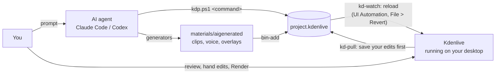

<div align="center">

# Movie Engine

**Një agjent IA monton videon tuaj në Kdenlive ndërsa ju shikoni, dhe ju mund ta merrni punën në dorë në çdo moment.**

Agjentët IA për programim (Claude Code, Codex) ndërtojnë dhe ndryshojnë projekte të vërteta Kdenlive: filma, video shpjeguese dhe video të shkurtra vertikale. Ndryshimet shfaqen drejtpërdrejt në redaktorin që keni të hapur. Portativ, Windows, pa modifikime të redaktorit.


[English](../../README.md) · [简体中文](README.zh-CN.md) · [繁體中文](README.zh-TW.md) · [हिन्दी](README.hi.md) · [Español](README.es.md) · [Français](README.fr.md) · [العربية](README.ar.md) · [বাংলা](README.bn.md) · [Português](README.pt.md) · [Русский](README.ru.md) · [اردو](README.ur.md) · [Bahasa Indonesia](README.id.md) · [Deutsch](README.de.md) · [日本語](README.ja.md) · [Türkçe](README.tr.md) · [한국어](README.ko.md) · [Українська](README.uk.md) · [Italiano](README.it.md) · [Polski](README.pl.md) · [Tiếng Việt](README.vi.md) · [فارسی](README.fa.md) · [ไทย](README.th.md) · [Kiswahili](README.sw.md) · [አማርኛ](README.am.md) · [Avañe'ẽ](README.gn.md) · [Setswana](README.tn.md) · **Shqip** · [Беларуская](README.be.md) · [Български](README.bg.md) · [Bosanski](README.bs.md) · [Hrvatski](README.hr.md) · [Српски](README.sr.md) · [Crnogorski](README.cnr.md) · [Македонски](README.mk.md) · [Slovenščina](README.sl.md) · [Slovenčina](README.sk.md) · [Čeština](README.cs.md) · [Magyar](README.hu.md) · [Română](README.ro.md) · [Dansk](README.da.md) · [Norsk bokmål](README.nb.md) · [Norsk nynorsk](README.nn.md) · [Svenska](README.sv.md) · [Íslenska](README.is.md) · [Suomi](README.fi.md) · [Eesti](README.et.md) · [Latviešu](README.lv.md) · [Lietuvių](README.lt.md) · [Nederlands](README.nl.md) · [Lëtzebuergesch](README.lb.md) · [Rumantsch](README.rm.md) · [Ελληνικά](README.el.md) · [Malti](README.mt.md) · [Gaeilge](README.ga.md) · [Català](README.ca.md) · [ქართული](README.ka.md) · [Հայերեն](README.hy.md) · [Azərbaycanca](README.az.md) · [Afrikaans](README.af.md) · [isiZulu](README.zu.md) · [isiXhosa](README.xh.md) · [Sesotho](README.st.md) · [Sepedi](README.nso.md) · [Xitsonga](README.ts.md) · [Tshivenḓa](README.ve.md) · [siSwati](README.ss.md) · [isiNdebele (South Africa)](README.nr.md) · [isiNdebele (Zimbabwe)](README.nd.md) · [chiShona](README.sn.md) · [Chichewa](README.ny.md) · [Ikinyarwanda](README.rw.md) · [Ikirundi](README.rn.md) · [Malagasy](README.mg.md) · [Soomaali](README.so.md) · [Afaan Oromoo](README.om.md) · [Qafar af](README.aa.md) · [ትግርኛ](README.ti.md) · [Sängö](README.sg.md) · [Kreol Seselwa](README.crs.md) · [TjiKalanga](README.kck.md) · [ChiNdau](README.ndc.md)

*Ky është një përkthim. Versioni referues është README në anglisht.*

</div>

---

## Përmbajtja

- [Pse](#pse)
- [Si funksionon](#si-funksionon)
- [Veçoritë](#veçoritë)
- [Kërkesat](#kërkesat)
- [Instalimi](#instalimi)
- [Fillim i shpejtë](#fillim-i-shpejtë)
- [Puna me agjentin](#puna-me-agjentin)
- [Rreshti i komandave për montazh (`kdp.ps1`)](#rreshti-i-komandave-për-montazh-kdpps1)
- [Sinkronizimi i drejtpërdrejtë me redaktorin e hapur](#sinkronizimi-i-drejtpërdrejtë-me-redaktorin-e-hapur)
- [Gjeneruesit: ajo që Kdenlive nuk e bën dot](#gjeneruesit-ajo-që-kdenlive-nuk-e-bën-dot)
- [Zëri i rrëfimit dhe tingulli](#zëri-i-rrëfimit-dhe-tingulli)
- [Gjuha e ndërfaqes](#gjuha-e-ndërfaqes)
- [Struktura e dosjeve](#struktura-e-dosjeve)
- [Testet dhe provat](#testet-dhe-provat)
- [Kufizimet](#kufizimet)
- [Zgjidhja e problemeve](#zgjidhja-e-problemeve)
- [Pyetje të shpeshta](#pyetje-të-shpeshta)
- [Kontributi](#kontributi)
- [Falënderime](#falënderime)
- [Licenca](#licenca)

## Pse

Redaktorët e videos janë ndërtuar për një dorë mbi mi. Agjentët IA janë të mirë në strukturë, kohëzim dhe përsëritje: të vendosin 300 klipe në ritmin e muzikës, të kohëzojnë çdo titër me zërin, të ribëjnë një skenë pas komenteve. Por ata nuk mund të klikojnë nëpër një ndërfaqe grafike pa marrë nën kontroll desktopin tuaj.

Kdenlive është një redaktor i fuqishëm me burim të hapur, por në Windows **nuk ka API për automatizim**: kontrolli përmes D-Bus ekziston vetëm në versionet për Linux, dhe forket që e shtojnë janë ose të pambajtura ose të pasigurta. Movie Engine e zgjidh këtë pa modifikuar redaktorin:

1. Agjenti ndryshon skedarin e projektit `.kdenlive` përmes një rreshti komandash të testuar (`engine/kdp.ps1`).
2. Kdenlive-it që po punon i thuhet ta rilexojë skedarin përmes Windows UI Automation, pa shtypje tastesh, pa mi dhe pa rrëmbyer fokusin.
3. Ndryshimet tuaja të paruajtura ruhen së pari dhe nuk mbishkruhen kurrë.

Kështu agjenti monton dhe ju shqyrtoni, ose montoni vetë me dorë. Të dy punoni në të njëjtin projekt, në të njëjtin redaktor, në të njëjtën kohë.

## Si funksionon



Çdo komandë montazhi ndjek të njëjtin cikël të sigurt:

1. **Pull.** Nëse Kdenlive ka ndryshime të paruajtura, i thuhet t'i ruajë (butoni Save në shiritin e veglave përmes UI Automation), dhe ruajtja konfirmohet.
2. **Ndryshimi.** Komanda ndryshon XML-në nën një bllokim, pas një kontrolli të hash-it dhe me një fotografi gjendjeje (snapshot) për zhbërje. Nëse skedari ka ndryshuar ndërkohë, nuk shkruhet asgjë.
3. **Rileximi.** Vëzhguesi sheh vulën e IA-së dhe ekzekuton File > Revert në redaktorin e hapur. Suksesi llogaritet vetëm kur widget-i i vijës kohore është rindërtuar vërtet.
4. **Konflikti.** Nëse ndërkohë keni filluar të ndryshoni, nuk rilexohet asgjë dhe puna juaj mbetet. Versioni i IA-së ruhet mënjanë, dhe agjenti e zbaton përsëri ndryshimin e vet mbi tuajin.

## Veçoritë

- **Montazh i plotë i projektit pa ndërfaqe grafike**: rreth 120 komanda që mbulojnë koshin e projektit, vijën kohore, efektet, kompozimet, pistat, udhëzuesit, shënuesit, titrat, sekuencat, shpejtësinë dhe rishpërndarjen e kohës (time remap), shfaqjet e diapozitivave, titujt, proxy-t, renderimin dhe zhbërjen/ribërjen. Shihni [referencën e komandave](#rreshti-i-komandave-për-montazh-kdpps1).
- **Sinkronizim i drejtpërdrejtë me redaktorin e hapur.** Ndryshimet e IA-së shfaqen në Kdenlive-in që po shikoni; ndryshimet tuaja të paruajtura ruhen së pari dhe nuk humbasin kurrë.
- **Nuk e shqetëson kurrë desktopin tuaj.** Asnjë rrëmbim fokusi, shtypje tastesh apo lëvizje miu. Redaktorët e testimit punojnë në një desktop të padukshëm të Windows.
- **Portativ.** Redaktori, cilësimet, Node.js, shkronjat dhe veglat ndodhen në një dosje. Kopjojeni në një kompjuter tjetër dhe funksionon; asgjë nuk shkruhet në Program Files apo në profilin tuaj të Windows.
- **Gjenerues për atë që Kdenlive nuk e bën dot**: tekst kinetik i animuar shkronjë për shkronjë, shënime të vizatuara me dorë, skena 3D të ndërfaqes, animacione kursori dhe filma të gjatë interaktivë "shpjegues". Ato renderohen në GPU me turbullim të vërtetë lëvizjeje (motion blur) dhe vendosen në vijën kohore si klipe të zakonshme.
- **Zë rrëfimi me kohëzim të fjalëve** (Microsoft Edge TTS, pa çelës API). Titrat dhe veprimet aktivizohen saktësisht në fjalën e duhur.
- **Efekte zanore të sintetizuara** (whoosh, click, pop, riser, impact e të tjera), të gjeneruara me kod.
- **E provuar, jo e supozuar.** Çdo komandë ka një kontroll të rezultatit, efektet dhe kompozimet kontrollohen një nga një, dhe rezultatet e papërpunuara janë në `docs/proof/`.
- **Udhëzimet për agjentët janë të përfshira.** `AGENTS.md` dhe aftësitë në `.claude/skills/` u mësojnë Claude Code dhe Codex rrjedhën e punës, formatin e skedarit dhe kurthet.

## Kërkesat

| | |
|---|---|
| OS | Windows 10 ose 11, x64 |
| Redaktori | Kdenlive **26.08.3**, version portativ (standalone). Versionet e tjera nuk janë testuar. |
| Node.js | 18 ose më i ri: `.zip` për Windows x64 nga nodejs.org, i shpaketuar në `engine/node/` |
| Shfletuesi | Microsoft Edge (pjesë e Windows); përdoret pa ndërfaqe (headless) nga renderuesit e skenave |
| Agjenti | [Claude Code](https://claude.com/claude-code) ose Codex. Opsional: çdo vegël mund të ekzekutohet edhe me dorë. |
| Disku | rreth 1 GB për redaktorin dhe veglat, plus mediat tuaja |
| GPU | çdo GPU me kodim harduerik H.264 e përshpejton `film-render.mjs` (përndryshe përdoret kodimi softuerik) |

## Instalimi

Gjithçka instalohet **brenda dosjes**. Nuk nevojiten të drejta administratori.

```powershell
git clone https://github.com/vladtarrow/movie-engine.git
cd movie-engine
```

**1. Node.js.** Shkarkoni `.zip` për Windows x64 të Node.js 18 ose më të ri nga <https://nodejs.org/en/download> dhe shpaketoni përmbajtjen e tij në `engine\node\`, në mënyrë që `engine\node\node.exe` dhe `engine\node\npm.cmd` të ndodhen aty. Nuk nevojitet as instalues, as Node i sistemit. Të gjithë skriptet ekzekutohen përmes `engine\node.cmd`, kurrë përmes një Node të sistemit.

**2. Paketat e Node** për veglën e zërit dhe renderuesit (versionet janë fiksuar në `engine/voice/package.json`):

```powershell
engine\node\npm.cmd install --prefix engine\voice
```

**3. Kdenlive 26.08.3 portativ.** Shkarkoni `kdenlive-26.08.3_standalone.exe` nga <https://download.kde.org/stable/kdenlive/26.08/windows/> në `engine\installer\`, kontrollojeni dhe shpaketojeni:

```powershell
(Get-FileHash engine\installer\kdenlive-26.08.3_standalone.exe -Algorithm SHA256).Hash
# expected: A25427B1DFF2C17E3B0386E991BB1A719382BB3176D1A90E441CDAEB6E0A967D
engine\installer\kdenlive-26.08.3_standalone.exe -o"engine\Kdenlive" -y
```

Redaktori përfundon në `engine\Kdenlive\kdenlive-26.08.3_standalone\bin\`. Ai përfshin tashmë `melt.exe` dhe `ffmpeg.exe`.

**4. Nisja e parë.**

```powershell
engine\kdenlive.cmd
```

Kdenlive i mban të gjitha cilësimet e veta në `engine\profile-kdenlive\`, jo në profilin tuaj të Windows. Në nisjen e parë shfaq një herë të vetme një magjistar konfigurimi.

## Fillim i shpejtë

### Me një agjent

Hapni dosjen në Claude Code (ose Codex) dhe kërkoni me fjalë të thjeshta:

> Krijo një projekt të ri vertikal 30 fps "launch-teaser". Vendos në vijën kohore tri pamjet e ekranit nga `materials/designers/launch/`, 2,5 s secila me një kalim të shkurtër (cross-fade), shto një zë rrëfimi nga `script.txt` dhe kohëzo një titër kinetik për çdo rresht.

> Hape për mua në Kdenlive.

> Plani i dytë është shumë i gjatë. Shkurtoje në 1,8 s dhe ngrije pak logon lart.

Agjenti ndjek `AGENTS.md`: ndryshon përmes `kdp.ps1`, renderon vetëm klipet që i nevojiten montazhit dhe e mban redaktorin e hapur të sinkronizuar. Ju shqyrtoni në Kdenlive, ndryshoni me dorë kur të doni dhe shtypni Render kur jeni të kënaqur.

### Me dorë

```powershell
# a new 1080x1920 30 fps project with 2 video and 2 audio tracks
powershell -NoProfile -ExecutionPolicy Bypass -File engine\kdp.ps1 new -Project projects\hello\hello.kdenlive -Profile vertical_hd_30

# a 3-second title and a colour background
powershell -NoProfile -ExecutionPolicy Bypass -File engine\kdp.ps1 bin-color -Project projects\hello\hello.kdenlive -Color '#203060' -Seconds 3 -Name bg
powershell -NoProfile -ExecutionPolicy Bypass -File engine\kdp.ps1 title -Project projects\hello\hello.kdenlive -Text "Hello" -Seconds 3 -Name hi

# place them: background on V1, title above it on V2
powershell -NoProfile -ExecutionPolicy Bypass -File engine\kdp.ps1 add -Project projects\hello\hello.kdenlive -Bin bg -Track V1 -At 0
powershell -NoProfile -ExecutionPolicy Bypass -File engine\kdp.ps1 add -Project projects\hello\hello.kdenlive -Bin hi -Track V2 -At 0

# a check frame, then open it in the editor
powershell -NoProfile -ExecutionPolicy Bypass -File engine\kdp.ps1 frame -Project projects\hello\hello.kdenlive -At 1.5 -Out out\hello\check.png
engine\kdenlive.cmd projects\hello\hello.kdenlive
```

Për ta rihapur më vonë projektin e fundit, klikoni dy herë `open-last-project.cmd`.

## Puna me agjentin

Agjenti lexon `AGENTS.md` (Codex) ose `CLAUDE.md`, i cili e importon atë (Claude Code), plus dy aftësi:

| Aftësia | Çfarë mëson |
|---|---|
| `.claude/skills/kdenlive-project-file` | formatin `.kdenlive` / MLT XML, `kdp.ps1`, kontrollin me `melt` |
| `.claude/skills/kdenlive-live` | drejtimin e sigurt të redaktorit që po punon: nisjen, pull, rileximin, kapjen e dritares së tij |

Rregullat që ndjek agjenti, mbi të cilat mund të mbështeteni:

- Nuk ju merr kurrë miun, tastierën apo fokusin dhe nuk bën kurrë pamje ekrani të desktopit tuaj (vetëm të dritares së vetë redaktorit).
- Hapat në ndërfaqe (ruaj, hap, rilexo) i kryen vetë, në vend që t'ju kërkojë juve të klikoni.
- Pyet përpara se të shkarkojë çfarëdo dhe përpara se të fshijë çfarëdo.
- Renderon vetëm atë që i duhet punës (klipe skenash, korniza kontrolli). Filmin përfundimtar e renderon vetëm kur ju e kërkoni.
- Kur Kdenlive nuk e bën dot mirë diçka, agjenti e ndërton jashtë me kod dhe e fut rezultatin si klip. Ai nuk e dobëson efektin.

## Rreshti i komandave për montazh (`kdp.ps1`)

```powershell
powershell -NoProfile -ExecutionPolicy Bypass -File engine\kdp.ps1 <command> -Project <file.kdenlive> [options]
```

Kohët jepen në sekonda, me pikë (`2.5`). Pistat janë `V1 V2 …` (V1 më e ulëta) dhe `A1 A2 …`. Një klip përcaktohet me `-Track` plus çdo moment `-At` brenda tij. Parametrat e efekteve jepen në `-Params "name=value||name=value"`. Lista e plotë me çdo opsion është në kokën e `engine/kdp.ps1`.

| Grupi | Komandat |
|---|---|
| Projekti | `new`, `profiles`, `info`, `validate`, `fonts`, `profile-set`, `profile-from-clip`, `zone`, `archive`, `backups`, `rebase`, `otio-export`, `otio-import` |
| Koshi i projektit | `bin-add`, `bin-color`, `title`, `title-text`, `title-save`, `title-template`, `bin-rename`, `bin-remove`, `bin-info`, `bin-set`, `bin-duplicate`, `bin-replace-file`, `bin-reload`, `folder`, `bin-folder`, `relink`, `clean`, `generator`, `playlist-clip`, `extract-audio`, `transcode` |
| Vija kohore | `add`, `add-av`, `move`, `copy`, `trim`, `ripple-trim`, `slip`, `split`, `remove`, `speed`, `remap`, `disable`, `enable`, `group`, `ungroup`, `mix`, `unmix`, `space-insert`, `space-remove`, `spaces-remove-all`, `track-clear`, `replace-in-timeline` |
| Efektet | `effects`, `effect-info`, `effect-add`, `effect-list`, `effect-set`, `effect-remove`, `effect-copy`, `effect-clear`, `effects-all`, `bin-effect`, `effect-templates`, `effect-template` |
| Kompozimet | `compositions`, `comp-info`, `comp-add`, `comp-list`, `comp-set`, `comp-remove` |
| Pistat | `track-add`, `track-remove`, `track-set` |
| Udhëzuesit dhe shënuesit | `guide-add`, `guide-list`, `guide-remove`, `guide-set`, `guide-clear`, `guide-export`, `guide-category`, `marker`, `marker-list`, `marker-set`, `marker-remove` |
| Titrat | `sub-add`, `sub-import`, `sub-export`, `sub-state` |
| Sekuencat | `sequence-add`, `sequences`, `copy-to-sequence`, `expand`; çdo komandë me `-Sequence <name>` punon brenda asaj sekuence |
| Të veçanta | `slideshow`, animacione Lottie / Glaxnimate përmes `bin-add`, `proxy`, `stabilize`, `scene-split`, `speed-job`, `subclip` |
| Dalja | `frame` (një PNG), `preview` (renderim i shpejtë me melt), `render` (renderuesi i vetë Kdenlive ose një paracaktim), `presets` |
| Historiku | `undo`, `redo`, `clear-history` (fotografitë e gjendjes në `projects/<name>/.kdp-history`) |

Sjellje që vlen ta dini:

- Gjysmat e lidhura audio dhe video lëvizin, shkurtohen, ndahen dhe hiqen së bashku (`-Alone` për njërën gjysmë).
- Një komandë që dështon del me kodin 1 dhe nuk shkruan asgjë.
- Efektet që versioni për Windows nuk mund t'i ekzekutojë refuzohen, nuk injorohen në heshtje (lista: `docs/proof/assets.txt`).
- Çdo veprim i menysë së Kdenlive është lidhur me një komandë, me një rrugë tjetër ose me "vetëm shikim" në `engine/tools/data/kdenlive-actions.csv`. Shihni `docs/kdenlive-coverage.md`.

## Sinkronizimi i drejtpërdrejtë me redaktorin e hapur

| Skripti | Çfarë bën | Kodet e daljes |
|---|---|---|
| `engine\kd-pull.ps1 -Project <f>` | e bën Kdenlive të ruajë ndryshimet tuaja dhe e konfirmon këtë | 0 skedari i përditësuar, 3 nuk po punon, 4 i pakonfirmuar |
| `engine\kd-reload.ps1 -Project <f>` | File > Revert, i konfirmuar nga vija kohore e rindërtuar | 0 i konfirmuar, 2 keni ndryshime të paruajtura (asgjë nuk u hodh poshtë), 3 nuk po punon, 4 dështoi |
| `engine\kd-watch.ps1 -Project <f>` | vëzhgues në sfond: rilexon pas çdo shkrimi të IA-së, regjistron konfliktet | regjistri në `engine\kd-watch.log`; fshini `engine\kd-watch.run` për ta ndalur |
| `engine\kdenlive-bg.ps1 [project]` | nis Kdenlive të minimizuar për një agjent | 0 i ngarkuar, 4 i pakonfirmuar |
| `engine\kdenlive.cmd [project]` | nis Kdenlive për ju | |

Nisni vëzhguesin një herë për çdo seancë:

```powershell
Start-Process powershell -WindowStyle Hidden -ArgumentList '-NoProfile','-ExecutionPolicy','Bypass','-File','engine\kd-watch.ps1','-Project','projects\hello\hello.kdenlive'
```

Projektet e mëdha: rileximi i një projekti me 1000 klipe zgjat disa minuta, dhe veglat e presin atë në vend që të raportojnë para kohe. Projektet hapen përmes *File > Open Recent* në një redaktor bosh, sepse hapja e drejtpërdrejtë e një skedari e bën Qt të kalojë çdo element të vijës kohore për aksesueshmërinë dhe ishte rreth 10 minuta më e ngadaltë.

## Gjeneruesit: ajo që Kdenlive nuk e bën dot

Kdenlive/MLT nuk ka animacion teksti shkronjë për shkronjë, nuk ka shprehje (expressions) dhe ka pak 3D, ndërsa efektet e rënda e ngadalësojnë riprodhimin. Movie Engine i renderon pjesë të tilla jashtë dhe i vendos në vijën kohore si klipe të zakonshme, zakonisht me kanal alfa, në një pistë mbi pamjet. Skripti i gjeneruesit dhe të dhënat e tij hyrëse mbeten në dosjen e projektit, kështu që një klip mund të rigjenerohet kur ndryshon teksti, shkronja ose kohëzimi.

| Vegla | Çfarë krijon |
|---|---|
| `engine/tools/kinetic-text.ps1` | titra kinetike shkronjë për shkronjë, çdo fjalë e kohëzuar nga `voice.json`, kuti theksimi |
| `engine/tools/annotate.ps1` | rrathë, kuti, nënvizime dhe shigjeta të vizatuara me dorë që vizatohen gradualisht mbi një pamje ekrani |
| `engine/tools/card-entrance.ps1` | një kartë me pamje ekrani që ngrihet dhe zmadhohet me një hije të butë |
| `engine/tools/pdf-to-png.ps1` | diapozitivë nga një eksport PDF |
| `engine/tools/html-render.mjs` | çdo skenë HTML/CSS/canvas në video: animacion ndërfaqeje, kursorë, 3D, maska |
| `engine/tools/film-render.mjs` + `film/` | filma të gjatë interaktivë shpjegues në canvas: një klip për çdo replikë të zërit, veprimet aktivizohen në fjalët e thëna, turbullim lëvizjeje në GPU me rreth 45 fps |

Të dy renderuesit drejtojnë Microsoft Edge që vjen me Windows, pa ndërfaqe (headless), me një profil të përkohshëm dhe pa qasje në rrjet.

### Demonstrime

```powershell
# a 3-second 3D title card with a cursor click
engine\node.cmd engine\tools\html-render.mjs examples\demo\scene\scene.html examples\demo\out --frames 0,30,60,89
engine\node.cmd engine\tools\html-render.mjs examples\demo\scene\scene.html examples\demo\out\scene.mp4

# a 4-shot interactive film timed to two voice lines
engine\node.cmd engine\tools\film-render.mjs examples\demo\film\film.html examples\demo\out --check
engine\node.cmd engine\tools\film-render.mjs examples\demo\film\film.html examples\demo\out --shots all --width 640
engine\node.cmd engine\tools\film-render.mjs examples\demo\film\film.html examples\demo\out\clips --suffix -v01
```

Një film përbëhet nga tre skedarë të vegjël. `data.js` mban planet dhe kohët e fjalëve. `direction.js` ka një rresht për çdo plan:

```text
1 | hover 192 108 @brand | tag 300 60 Your brand @deserves | confetti 192 90 @film
2 say=A film that/*explains* it
3 | click 116 108 @before | click 268 108 @after | chips Before~After @after
4 scene=counter | count 0 120 % @count
```

`scenes.js` mban planet që vizatohen nga e para. `@word` aktivizon një veprim kur zëri e thotë atë fjalë. Veprimet përfshijnë click, hover, drag, zoom, lens, ring, arrow, chips, toggle, slider, toast, type, count dhe confetti; sintaksa e plotë është në fillim të `engine/tools/film/film-kit.js`.

## Zëri i rrëfimit dhe tingulli

```powershell
engine\node.cmd engine\voice\voice.mjs lines.json materials\aigenerated\hello\voice en-US-AndrewMultilingualNeural +0%
```

`lines.json` është një listë replikash. Vegla shkruan një mp3 për çdo replikë plus `voice.json`, me kohëzgjatjen dhe fillimin e fundin e çdo fjale. Replikat ruhen në cache, kështu që ndryshimi i një replike rigjeneron vetëm atë. Përdor shndërrimin online të tekstit në të folur të Microsoft Edge përmes paketës `msedge-tts`: nuk nevojitet çelës, por shërbimi është jozyrtar dhe kërkon internet.

```powershell
engine\node.cmd engine\audio\sfx.mjs materials\aigenerated\sfx
```

Kjo sintetizon me kod whoosh, whoosh-long, swipe, click, pop, tick, riser, impact, ding dhe reveal; një grup i gatshëm ndodhet në `materials/aigenerated/sfx/`. Tingujt më të shkurtër se një kornizë plotësojini me heshtje përpara se t'i vendosni (`-af apad=whole_dur=0.0667`).

## Gjuha e ndërfaqes

Si parazgjedhje, nisësit e hapin Kdenlive në **anglisht**. Për të përdorur një gjuhë tjetër, vendosni `MOVIE_ENGINE_UI_LANG` përpara nisjes:

```powershell
$env:MOVIE_ENGINE_UI_LANG = 'ru'; engine\kdenlive.cmd
```

UI Automation i gjen elementet e menysë sipas emrave të tyre të dukshëm. Emrat për 31 gjuhë ndërfaqeje janë të përfshirë (`engine/tools/kd-ui.ps1`, `$KdNames`). Për çdo gjuhë tjetër, shtoni emrat e saj aty dhe kontrolloni me:

```powershell
powershell -NoProfile -ExecutionPolicy Bypass -File engine\tools\kd-langcheck.ps1
```

## Struktura e dosjeve

```text
movie-engine/
├─ AGENTS.md, CLAUDE.md          instructions for AI agents
├─ .claude/skills/               agent skills: project file format, live editor
├─ engine/
│  ├─ kdp.ps1                    the editing command line
│  ├─ kd-pull / kd-reload / kd-watch .ps1, kdenlive.cmd, kdenlive-bg.ps1
│  ├─ tools/                     internals, generators, tests, data (action map)
│  ├─ voice/  audio/  fonts/     TTS, synthesized SFX, Poppins (OFL)
│  ├─ Kdenlive/  node/           portable editor and Node.js (not in git)
│  └─ profile-kdenlive/          the editor's settings (not in git)
├─ projects/<name>/<name>.kdenlive
├─ materials/
│  ├─ download/                  stock and downloaded files (not in git)
│  ├─ aigenerated/               everything the AI made (sfx/ and test-kit/ ship with the engine)
│  ├─ designers/  brand/         files from your team, brand assets
├─ examples/demo/                demos of the scene and film renderers
├─ out/                          renders (not in git)
└─ docs/                         proofs, coverage, translations of this README
```

Shtigjet e mediave brenda projekteve janë relative. Nëse e zhvendosni ose e kopjoni dosjen, `kdp.ps1 rebase` (që ekzekutohet edhe automatikisht nga `kdenlive.cmd`) shkruan vendndodhjen e re në projekt.

## Testet dhe provat

Pohimet për atë që funksionon mbështeten nga kontrolle të rezultatit, jo nga "funksioni u ekzekutua". Përmbledhja është në [`docs/kdenlive-proof.md`](../../docs/kdenlive-proof.md), dhe dalja e papërpunuar është në `docs/proof/`.

| Testi | Çfarë kontrollon |
|---|---|
| `engine\tools\kdp-clitest.ps1` | çdo komandë të `kdp.ps1`, përmes rreshtit të komandave, duke krahasuar projektin që rezulton |
| `engine\tools\kd-livetest.ps1` | pull, rileximin, vëzhguesin, konfliktet dhe garat (race conditions) me një Kdenlive të vërtetë në një desktop të padukshëm |
| `engine\tools\kdp-assetsweep.ps1` | çdo efekt dhe kompozim: renderon dhe krahason korniza |
| `engine\tools\kdp-portabletest.ps1` | kopjon dosjen diku tjetër dhe punon nga kopja |
| `engine\tools\kd-langcheck.ps1` | gjuhën e ndërfaqes dhe që UI Automation e gjen menynë |
| `engine\tools\kdp-coverage-check.ps1` | që çdo veprim i menysë është lidhur dhe asnjë provë nuk është më e vjetër se kodi |

```powershell
powershell -NoProfile -ExecutionPolicy Bypass -File engine\tools\kdp-clitest.ps1 -Report docs\proof\clitest.txt
powershell -NoProfile -ExecutionPolicy Bypass -File engine\tools\kd-livetest.ps1 -Report docs\proof\live-en.txt
```

Redaktorët e testimit punojnë vetëm në një desktop të fshehur me profilin e tyre, kështu që testet nuk prekin kurrë Kdenlive-in tuaj të hapur apo fokusin tuaj.

## Kufizimet

- **Vetëm Windows**, vetëm Kdenlive **26.08.3**. Linux ka D-Bus dhe do të kërkonte një urë tjetër.
- Nisja e redaktorit merr fokusin e tastierës për rreth 3 sekonda, ndërsa shfaqet dritarja bosh. Agjentët pyesin përpara se ta nisin ndërsa ju punoni. Rileximet dhe ndryshimet nuk e marrin fokusin.
- Versionit për Windows i mungojnë modulet MLT sox, ladspa dhe movit dhe disa efekte frei0r/avfilter; `kdp.ps1` i refuzon ato (`docs/proof/assets.txt`).
- Eksporti dhe importi OpenTimelineIO bartin vetëm klipe dhe boshllëqe. Multicam nuk ka ndërrim të drejtpërdrejtë të këndeve (prerjet bëhen me split/remove/hide).
- "Save As…" përmes UI Automation në një dritare të minimizuar nuk hap asnjë dialog; në vend të kësaj agjenti përdor `archive` ose kopje skedarësh.
- Njohja e të folurit (titra automatike) kërkon Whisper ose Vosk, të cilët nuk janë të përfshirë.
- Titujt e bërë me veglën e titujve të Kdenlive përdorin shkronjat e instaluara në Windows. Për tipografi të garantuar, renderojeni tekstin me gjeneruesit, të cilët i ngarkojnë shkronjat nga `engine/fonts/`.
- Edge TTS është një shërbim online jozyrtar dhe mund të ndryshojë ose të ndalojë së punuari.

## Zgjidhja e problemeve

| Simptoma | Shkaku dhe zgjidhja |
|---|---|
| Kdenlive po punon, por klikimi mbi të në shiritin e detyrave nuk shfaq asgjë | Pozicioni i ruajtur i dritares së tij është jashtë ekranit. Mbylleni dhe fshini hyrjet `kdockLayout` në `engine\profile-kdenlive\AppData\Local\kdenliverc`, ose zhvendoseni dritaren me `SetWindowPos` (shihni `AGENTS.md`). |
| `kd-reload.ps1` del me kodin 2 | Keni ndryshime të paruajtura. Asgjë nuk u hodh poshtë. Ekzekutoni `kd-pull.ps1`, pastaj zbatojeni ndryshimin përsëri (`kdp.ps1` e bën këtë vetë). |
| `CONFLICT` në `engine\kd-watch.log` | Ju dhe agjenti ndryshuat në të njëjtin moment. Versioni juaj mbetet në redaktor, dhe versioni i IA-së është në `projects\<name>\.kdp-history\<name>\conflict\`. Kërkojini agjentit ta zbatojë përsëri ndryshimin e vet. |
| Një komandë del me kodin 1 dhe mesazhin "pull not confirmed" | Kdenlive është i zënë ose po shfaq një dialog. Mbylleni dialogun ose prisni të përfundojë ngarkimi, pastaj përsëriteni. |
| Një skript PowerShell nuk mund të analizohet | Skriptet me tekst jo-ASCII duhet të ruhen si UTF-8 **me BOM** për Windows PowerShell 5.1. |
| `voice.mjs` ndalon me "Stream closed before the synthesis completed" | Zakonisht një problem rrjeti, ose SSML i paeskapuar në kopje më të vjetra. `voice.mjs` i eskapon vetë `& < >`. |
| Hapja e një projekti të madh zgjat shumë minuta | Hapeni përmes `kdenlive.cmd` / `kdenlive-bg.ps1`, kurrë si `kdenlive.exe project.kdenlive`. |

## Pyetje të shpeshta

**A më duhet Claude Code apo Codex?**
Jo. Çdo vegël është një skript i thjeshtë që mund ta ekzekutoni me dorë. Agjenti është ai që e bën punën të shpejtë: planifikon montazhin, ekzekuton veglat dhe e mban redaktorin të sinkronizuar.

**A do t'i mbishkruajë agjenti ndryshimet e mia manuale?**
Jo. Përpara çdo shkrimi, ndryshimet tuaja të paruajtura ruhen dhe konfirmohen. Nëse ndryshoni ndërsa agjenti po shkruan, shkrimi refuzohet ose ruhet mënjanë si konflikt, por nuk zbatohet kurrë mbi punën tuaj.

**A mund ta përdor Kdenlive normalisht si më parë?**
Po. Është Kdenlive standard me dosjen e vet të cilësimeve. Montoni, shikoni paraprakisht dhe renderoni si zakonisht.

**A funksionon me një Kdenlive që e kam tashmë të instaluar?**
Përdor kopjen e vet portative në `engine\Kdenlive\`, kështu që Kdenlive juaj i instaluar dhe cilësimet e tij mbeten të paprekura.

**Pse jo një fork i Kdenlive me API, apo një redaktor tjetër?**
Në Windows nuk ekziston asnjë fork i mirëmbajtur dhe i sigurt (shqyrtim i nëntorit 2026). U vlerësuan OpenShot, Blender VSE, DaVinci Resolve, Shotcut dhe redaktorët në web; Kdenlive ofroi thellësinë më të madhe të montazhit. Po ndiqet një propozim për REST API në projektin kryesor (merge request !902).

**A mund ta renderojë videon përfundimtare?**
Po, me `kdp.ps1 render` (renderuesi i vetë Kdenlive, i fshehur), ose e shtypni vetë Render në redaktor.

**A ngarkohen mediat e mia diku?**
Jo. Vetëm teksti i zërit të rrëfimit dërgohet te shërbimi Edge TTS kur gjeneroni zë. Renderuesit e skenave punojnë me rrjetin të çaktivizuar.

## Kontributi

Kontributet janë të mirëpritura. Shihni [CONTRIBUTING.md](../../CONTRIBUTING.md). Shkurtimisht:

- Çdo operacion i ri ose i ndryshuar i `kdp.ps1` ka nevojë për një kontroll të rezultatit në `kdp-clitest.ps1`, një hyrje në hartën e veprimeve dhe një ekzekutim të ri të `kdp-coverage-check.ps1`.
- Mos e nisni kurrë një Kdenlive testimi në desktopin e dukshëm; përdorni `engine/tools/kd-hidden.ps1`.
- Mbajeni gjithçka portative: asnjë instalim jashtë dosjes, asnjë shteg absolut në projekte.
- Shënoni veçoritë e verifikuara në `AGENTS.md` ose në aftësinë përkatëse.

## Falënderime

- [Kdenlive](https://kdenlive.org) dhe [MLT](https://www.mltframework.org): redaktori dhe motori poshtë tij.
- [FFmpeg](https://ffmpeg.org), i përfshirë me Kdenlive.
- [msedge-tts](https://www.npmjs.com/package/msedge-tts) për zërin e rrëfimit.
- [Poppins](https://fonts.google.com/specimen/Poppins) nga Indian Type Foundry, SIL Open Font License (`engine/fonts/OFL.txt`).
- `engine/tools/data/kdenliveui-26.08.3.rc`: skedari i menysë së Kdenlive, marrë nga kodi burimor i Kdenlive 26.08.3; përdoret vetëm nga kontrolli i mbulimit. Ai mbetet nën licencën GPL të Kdenlive, jo nën MIT License.

## Licenca

Kodi i vetë Movie Engine publikohet nën [Licencën MIT](../../LICENSE). Kdenlive, MLT, FFmpeg, paketat e Node.js dhe shkronja Poppins ruajnë licencat e tyre.
