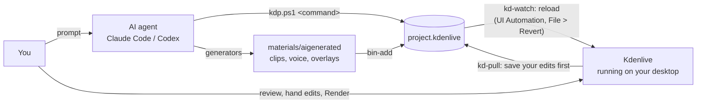

<div align="center">

# Movie Engine

**ВИ агент монтира ваш видео у Kdenlive-у док гледате, а ви у сваком тренутку можете да преузмете посао.**

ВИ агенти за програмирање (Claude Code, Codex) праве и мењају праве Kdenlive пројекте: филмове, видео-снимке са објашњењима и вертикалне кратке видео-снимке. Измене се одмах појављују у уређивачу који имате отворен. Преносиво, Windows, без закрпа уређивача.


[English](../../README.md) · [简体中文](README.zh-CN.md) · [繁體中文](README.zh-TW.md) · [हिन्दी](README.hi.md) · [Español](README.es.md) · [Français](README.fr.md) · [العربية](README.ar.md) · [বাংলা](README.bn.md) · [Português](README.pt.md) · [Русский](README.ru.md) · [اردو](README.ur.md) · [Bahasa Indonesia](README.id.md) · [Deutsch](README.de.md) · [日本語](README.ja.md) · [Türkçe](README.tr.md) · [한국어](README.ko.md) · [Українська](README.uk.md) · [Italiano](README.it.md) · [Polski](README.pl.md) · [Tiếng Việt](README.vi.md) · [فارسی](README.fa.md) · [ไทย](README.th.md) · [Kiswahili](README.sw.md) · [አማርኛ](README.am.md) · [Avañe'ẽ](README.gn.md) · [Setswana](README.tn.md) · [Shqip](README.sq.md) · [Беларуская](README.be.md) · [Български](README.bg.md) · [Bosanski](README.bs.md) · [Hrvatski](README.hr.md) · **Српски** · [Crnogorski](README.cnr.md) · [Македонски](README.mk.md) · [Slovenščina](README.sl.md) · [Slovenčina](README.sk.md) · [Čeština](README.cs.md) · [Magyar](README.hu.md) · [Română](README.ro.md) · [Dansk](README.da.md) · [Norsk bokmål](README.nb.md) · [Norsk nynorsk](README.nn.md) · [Svenska](README.sv.md) · [Íslenska](README.is.md) · [Suomi](README.fi.md) · [Eesti](README.et.md) · [Latviešu](README.lv.md) · [Lietuvių](README.lt.md) · [Nederlands](README.nl.md) · [Lëtzebuergesch](README.lb.md) · [Rumantsch](README.rm.md) · [Ελληνικά](README.el.md) · [Malti](README.mt.md) · [Gaeilge](README.ga.md) · [Català](README.ca.md) · [ქართული](README.ka.md) · [Հայերեն](README.hy.md) · [Azərbaycanca](README.az.md) · [Afrikaans](README.af.md) · [isiZulu](README.zu.md) · [isiXhosa](README.xh.md) · [Sesotho](README.st.md) · [Sepedi](README.nso.md) · [Xitsonga](README.ts.md) · [Tshivenḓa](README.ve.md) · [siSwati](README.ss.md) · [isiNdebele (South Africa)](README.nr.md) · [isiNdebele (Zimbabwe)](README.nd.md) · [chiShona](README.sn.md) · [Chichewa](README.ny.md) · [Ikinyarwanda](README.rw.md) · [Ikirundi](README.rn.md) · [Malagasy](README.mg.md) · [Soomaali](README.so.md) · [Afaan Oromoo](README.om.md) · [Qafar af](README.aa.md) · [ትግርኛ](README.ti.md) · [Sängö](README.sg.md) · [Kreol Seselwa](README.crs.md) · [TjiKalanga](README.kck.md) · [ChiNdau](README.ndc.md)

*Ово је превод; референтна верзија је README на енглеском језику.*

</div>

---

## Садржај

- [Зашто](#зашто)
- [Како ради](#како-ради)
- [Могућности](#могућности)
- [Захтеви](#захтеви)
- [Инсталација](#инсталација)
- [Брзи почетак](#брзи-почетак)
- [Рад са агентом](#рад-са-агентом)
- [Командна линија за монтажу (`kdp.ps1`)](#командна-линија-за-монтажу-kdpps1)
- [Синхронизација уживо са отвореним уређивачем](#синхронизација-уживо-са-отвореним-уређивачем)
- [Генератори: оно што Kdenlive не може](#генератори-оно-што-kdenlive-не-може)
- [Нарација и звук](#нарација-и-звук)
- [Језик интерфејса](#језик-интерфејса)
- [Распоред фасцикли](#распоред-фасцикли)
- [Тестови и докази](#тестови-и-докази)
- [Ограничења](#ограничења)
- [Решавање проблема](#решавање-проблема)
- [Честа питања](#честа-питања)
- [Допринос пројекту](#допринос-пројекту)
- [Захвалнице](#захвалнице)
- [Лиценца](#лиценца)

## Зашто

Програми за монтажу видеа направљени су за руку на мишу. ВИ агенти су добри у структури, тајмингу и понављању: да поставе 300 клипова у ритам музике, да временски ускладе сваки натпис са гласом, да поново направе сцену после примедби. Али не могу да кликћу по графичком интерфејсу, а да не преузму вашу радну површину.

Kdenlive је моћан уређивач отвореног кода, али на Windows-у **нема API за аутоматизацију**: управљање преко D-Bus-а постоји само у верзијама за Linux, а форкови који га додају или се више не одржавају или нису безбедни. Movie Engine то решава без крпљења уређивача:

1. Агент мења датотеку пројекта `.kdenlive` помоћу тестиране командне линије (`engine/kdp.ps1`).
2. Покренутом Kdenlive-у се преко Windows UI Automation-а поручује да поново учита датотеку, без притискања тастера, без миша и без отимања фокуса.
3. Ваше несачуване измене се прво сачувају и никада се не преписују.

Дакле, агент монтира, а ви прегледате, или сами монтирате ручно. Обоје радите на истом пројекту, у истом уређивачу, у исто време.

## Како ради



Свака команда за монтажу пролази кроз исти безбедни циклус:

1. **Pull.** Ако Kdenlive има несачуване промене, добија налог да их сачува (дугме Save на траци са алаткама преко UI Automation-а), а чување се потврђује.
2. **Измена.** Команда мења XML под закључавањем, после провере хеша и са снимком стања за опозив. Ако се датотека у међувремену променила, ништа се не уписује.
3. **Поновно учитавање.** Посматрач препознаје ознаку коју оставља ВИ и у отвореном уређивачу покреће File > Revert. Успехом се сматра само када је виџет временске линије заиста поново изграђен.
4. **Конфликт.** Ако сте у међувремену почели да мењате пројекат, ништа се не учитава поново и ваш рад остаје. ВИ верзија се оставља по страни, а агент поново примењује своју измену преко ваше.

## Могућности

- **Потпуна монтажа пројекта без графичког интерфејса**: око 120 команди које покривају корпу пројекта, временску линију, ефекте, композиције, траке, вођице, маркере, титлове, секвенце, брзину и ремапирање времена (time remap), слајд-шоу, наслове, прокси клипове, рендеровање и опозив и понављање. Погледајте [преглед команди](#командна-линија-за-монтажу-kdpps1).
- **Синхронизација уживо са отвореним уређивачем.** ВИ измене се појављују у Kdenlive-у у који гледате; ваше несачуване измене се прво сачувају и никада се не губе.
- **Никада не омета вашу радну површину.** Без отимања фокуса, притискања тастера и уноса мишем. Тестни уређивачи раде на невидљивој радној површини Windows-а.
- **Преносиво.** Уређивач, подешавања, Node.js, фонтови и алатке налазе се у једној фасцикли. Копирајте је на други рачунар и радиће; ништа се не уписује у Program Files нити у ваш Windows профил.
- **Генератори за оно што Kdenlive не може**: кинетички текст анимиран слово по слово, ручно цртане анотације, 3D сцене интерфејса, анимације курсора и дуги интерактивни филмови са објашњењима. Рендерују се на GPU-у са стварним замућењем покрета и постављају на временску линију као обични клипови.
- **Нарација са временским ознакама речи** (Microsoft Edge TTS, без API кључа). Натписи и радње се активирају тачно на задатој речи.
- **Синтетизовани звучни ефекти** (whoosh, click, pop, riser, impact и други), генерисани кодом.
- **Доказано, не претпостављено.** Свака команда има проверу резултата, ефекти и композиције се проверавају један по један, а сирови резултати су у `docs/proof/`.
- **Упутства за агенте су укључена.** `AGENTS.md` и вештине у `.claude/skills/` уче Claude Code и Codex току рада, формату датотеке и замкама.

## Захтеви

| | |
|---|---|
| Оперативни систем | Windows 10 или 11, x64 |
| Уређивач | Kdenlive **26.08.3**, преносива (standalone) верзија. Остале верзије нису тестиране. |
| Node.js | 18 или новији: Windows x64 `.zip` са nodejs.org, распакован у `engine/node/` |
| Прегледач | Microsoft Edge (део Windows-а); рендерери сцена га користе у headless режиму |
| Агент | [Claude Code](https://claude.com/claude-code) или Codex. Није обавезно: свака алатка може да се покрене и ручно. |
| Диск | око 1 GB за уређивач и алатке, плус ваши медији |
| GPU | било који GPU са хардверским кодирањем H.264 убрзава `film-render.mjs` (без њега се користи софтверско кодирање) |

## Инсталација

Све се инсталира **унутар фасцикле**. Администраторска права нису потребна.

```powershell
git clone https://github.com/vladtarrow/movie-engine.git
cd movie-engine
```

**1. Node.js.** Преузмите Windows x64 `.zip` Node.js-а 18 или новијег са <https://nodejs.org/en/download> и распакујте његов садржај у `engine\node\`, тако да се тамо налазе `engine\node\node.exe` и `engine\node\npm.cmd`. Нису потребни ни инсталациони програм ни Node инсталиран на систему. Све скрипте се покрећу преко `engine\node.cmd`, никада преко системског Node-а.

**2. Node пакети** за алатку за нарацију и рендерере (верзије су фиксиране у `engine/voice/package.json`):

```powershell
engine\node\npm.cmd install --prefix engine\voice
```

**3. Преносиви Kdenlive 26.08.3.** Преузмите `kdenlive-26.08.3_standalone.exe` са <https://download.kde.org/stable/kdenlive/26.08/windows/> у `engine\installer\`, проверите га и распакујте:

```powershell
(Get-FileHash engine\installer\kdenlive-26.08.3_standalone.exe -Algorithm SHA256).Hash
# expected: A25427B1DFF2C17E3B0386E991BB1A719382BB3176D1A90E441CDAEB6E0A967D
engine\installer\kdenlive-26.08.3_standalone.exe -o"engine\Kdenlive" -y
```

Уређивач се после тога налази у `engine\Kdenlive\kdenlive-26.08.3_standalone\bin\`. Већ садржи `melt.exe` и `ffmpeg.exe`.

**4. Прво покретање.**

```powershell
engine\kdenlive.cmd
```

Kdenlive сва своја подешавања чува у `engine\profile-kdenlive\`, а не у вашем Windows профилу. При првом покретању једном приказује чаробњак за подешавање.

## Брзи почетак

### Са агентом

Отворите фасциклу у Claude Code-у (или Codex-у) и затражите обичним речима:

> Направи нови вертикални пројекат „launch-teaser” са 30 fps. Стави на временску линију три снимка екрана из `materials/designers/launch/`, сваки по 2,5 s са кратким претапањем, додај нарацију из `script.txt` и временски усклади кинетички натпис са сваким редом.

> Отвори ми га у Kdenlive-у.

> Други кадар је предуг. Скрати га на 1,8 s и помери лого мало нагоре.

Агент прати `AGENTS.md`: мења пројекат преко `kdp.ps1`, рендерује само клипове који су потребни монтажи и држи отворени уређивач синхронизованим. Ви прегледате у Kdenlive-у, ручно мењате кад год желите и притиснете Render када сте задовољни.

### Ручно

```powershell
# a new 1080x1920 30 fps project with 2 video and 2 audio tracks
powershell -NoProfile -ExecutionPolicy Bypass -File engine\kdp.ps1 new -Project projects\hello\hello.kdenlive -Profile vertical_hd_30

# a 3-second title and a colour background
powershell -NoProfile -ExecutionPolicy Bypass -File engine\kdp.ps1 bin-color -Project projects\hello\hello.kdenlive -Color '#203060' -Seconds 3 -Name bg
powershell -NoProfile -ExecutionPolicy Bypass -File engine\kdp.ps1 title -Project projects\hello\hello.kdenlive -Text "Hello" -Seconds 3 -Name hi

# place them: background on V1, title above it on V2
powershell -NoProfile -ExecutionPolicy Bypass -File engine\kdp.ps1 add -Project projects\hello\hello.kdenlive -Bin bg -Track V1 -At 0
powershell -NoProfile -ExecutionPolicy Bypass -File engine\kdp.ps1 add -Project projects\hello\hello.kdenlive -Bin hi -Track V2 -At 0

# a check frame, then open it in the editor
powershell -NoProfile -ExecutionPolicy Bypass -File engine\kdp.ps1 frame -Project projects\hello\hello.kdenlive -At 1.5 -Out out\hello\check.png
engine\kdenlive.cmd projects\hello\hello.kdenlive
```

Да бисте касније поново отворили последњи пројекат, двапут кликните на `open-last-project.cmd`.

## Рад са агентом

Агент чита `AGENTS.md` (Codex) или `CLAUDE.md`, који га увози (Claude Code), као и две вештине:

| Вештина | Шта учи |
|---|---|
| `.claude/skills/kdenlive-project-file` | формат `.kdenlive` / MLT XML, `kdp.ps1`, проверу помоћу `melt` |
| `.claude/skills/kdenlive-live` | безбедно управљање покренутим уређивачем: покретање, pull, поновно учитавање, снимање његовог прозора |

Правила којих се агент држи и на која можете да се ослоните:

- Никада не преузима ваш миш, тастатуру или фокус и никада не снима вашу радну површину (само сопствени прозор уређивача).
- Кораке у графичком интерфејсу (чување, отварање, поновно учитавање) обавља сам, уместо да од вас тражи да кликнете.
- Пита пре него што било шта преузме и пре него што било шта обрише.
- Рендерује само оно што је потребно за посао (клипове сцена, контролне фрејмове). Коначни филм рендерује само када ви то затражите.
- Када Kdenlive нешто не може добро да уради, агент то прави ван њега помоћу кода и убацује резултат као клип. Не разводњава ефекат.

## Командна линија за монтажу (`kdp.ps1`)

```powershell
powershell -NoProfile -ExecutionPolicy Bypass -File engine\kdp.ps1 <command> -Project <file.kdenlive> [options]
```

Време се задаје у секундама, са тачком (`2.5`). Траке су `V1 V2 …` (V1 је најнижа) и `A1 A2 …`. Клип се одређује помоћу `-Track` и било ког тренутка `-At` унутар њега. Параметри ефеката наводе се у `-Params "name=value||name=value"`. Комплетна листа са свим опцијама налази се у заглављу датотеке `engine/kdp.ps1`.

| Група | Команде |
|---|---|
| Пројекат | `new`, `profiles`, `info`, `validate`, `fonts`, `profile-set`, `profile-from-clip`, `zone`, `archive`, `backups`, `rebase`, `otio-export`, `otio-import` |
| Корпа пројекта | `bin-add`, `bin-color`, `title`, `title-text`, `title-save`, `title-template`, `bin-rename`, `bin-remove`, `bin-info`, `bin-set`, `bin-duplicate`, `bin-replace-file`, `bin-reload`, `folder`, `bin-folder`, `relink`, `clean`, `generator`, `playlist-clip`, `extract-audio`, `transcode` |
| Временска линија | `add`, `add-av`, `move`, `copy`, `trim`, `ripple-trim`, `slip`, `split`, `remove`, `speed`, `remap`, `disable`, `enable`, `group`, `ungroup`, `mix`, `unmix`, `space-insert`, `space-remove`, `spaces-remove-all`, `track-clear`, `replace-in-timeline` |
| Ефекти | `effects`, `effect-info`, `effect-add`, `effect-list`, `effect-set`, `effect-remove`, `effect-copy`, `effect-clear`, `effects-all`, `bin-effect`, `effect-templates`, `effect-template` |
| Композиције | `compositions`, `comp-info`, `comp-add`, `comp-list`, `comp-set`, `comp-remove` |
| Траке | `track-add`, `track-remove`, `track-set` |
| Вођице и маркери | `guide-add`, `guide-list`, `guide-remove`, `guide-set`, `guide-clear`, `guide-export`, `guide-category`, `marker`, `marker-list`, `marker-set`, `marker-remove` |
| Титлови | `sub-add`, `sub-import`, `sub-export`, `sub-state` |
| Секвенце | `sequence-add`, `sequences`, `copy-to-sequence`, `expand`; свака команда са `-Sequence <name>` ради унутар те секвенце |
| Посебно | `slideshow`, Lottie / Glaxnimate анимације преко `bin-add`, `proxy`, `stabilize`, `scene-split`, `speed-job`, `subclip` |
| Излаз | `frame` (један PNG), `preview` (брзо рендеровање melt-ом), `render` (сопствени рендерер Kdenlive-а или шаблон), `presets` |
| Историја | `undo`, `redo`, `clear-history` (снимци стања у `projects/<name>/.kdp-history`) |

Понашање које је добро знати:

- Повезане аудио и видео половине се заједно померају, скраћују, деле и уклањају (`-Alone` за само једну половину).
- Команда која не успе завршава се кодом 1 и ништа не уписује.
- Ефекти које Windows верзија не може да изврши се одбијају, а не прећутно игноришу (листа: `docs/proof/assets.txt`).
- Свака радња из менија Kdenlive-а повезана је са командом, другим путем или ознаком „само приказ” у `engine/tools/data/kdenlive-actions.csv`. Погледајте `docs/kdenlive-coverage.md`.

## Синхронизација уживо са отвореним уређивачем

| Скрипта | Шта ради | Излазни кодови |
|---|---|---|
| `engine\kd-pull.ps1 -Project <f>` | наводи Kdenlive да сачува ваше измене и то потврђује | 0 датотека је ажурна, 3 није покренут, 4 није потврђено |
| `engine\kd-reload.ps1 -Project <f>` | File > Revert, потврђено поново изграђеном временском линијом | 0 потврђено, 2 имате несачуване измене (ништа није одбачено), 3 није покренут, 4 неуспех |
| `engine\kd-watch.ps1 -Project <f>` | посматрач у позадини: поново учитава после сваког ВИ уписа, бележи конфликте | дневник у `engine\kd-watch.log`; за заустављање обришите `engine\kd-watch.run` |
| `engine\kdenlive-bg.ps1 [project]` | покреће Kdenlive минимизован, за агента | 0 учитано, 4 није потврђено |
| `engine\kdenlive.cmd [project]` | покреће Kdenlive за вас | |

Покрените посматрача једном по сесији:

```powershell
Start-Process powershell -WindowStyle Hidden -ArgumentList '-NoProfile','-ExecutionPolicy','Bypass','-File','engine\kd-watch.ps1','-Project','projects\hello\hello.kdenlive'
```

Велики пројекти: поновно учитавање пројекта са 1000 клипова траје неколико минута, а алатке чекају на њега уместо да прерано пријаве резултат. Пројекти се отварају преко *File > Open Recent* у празном уређивачу, јер при директном отварању датотеке Qt због приступачности пролази кроз сваки елемент временске линије, што је било око 10 минута спорије.

## Генератори: оно што Kdenlive не може

Kdenlive/MLT нема анимацију текста слово по слово, нема изразе (expressions) и има мало 3D-а, а захтевни ефекти успоравају репродукцију. Movie Engine такве делове рендерује ван уређивача и ставља их на временску линију као обичне клипове, обично са алфа-каналом, на траку изнад слике. Скрипта генератора и њени улазни подаци остају у фасцикли пројекта, тако да клип може поново да се генерише када се промени текст, фонт или тајминг.

| Алатка | Шта прави |
|---|---|
| `engine/tools/kinetic-text.ps1` | кинетичке натписе анимиране слово по слово, свака реч временски усклађена према `voice.json`, оквир за истицање |
| `engine/tools/annotate.ps1` | ручно цртане кругове, оквире, подвлаке и стрелице које се исцртавају преко снимка екрана |
| `engine/tools/card-entrance.ps1` | картицу са снимком екрана која се подиже и увећава уз меку сенку |
| `engine/tools/pdf-to-png.ps1` | слајдове из PDF извоза |
| `engine/tools/html-render.mjs` | видео из било које HTML/CSS/canvas сцене: анимација интерфејса, курсори, 3D, маске |
| `engine/tools/film-render.mjs` + `film/` | дуге интерактивне филмове са објашњењима на canvas-у: један клип по реченици нарације, радње се активирају на изговореним речима, замућење покрета на GPU-у при око 45 fps |

Оба рендерера управљају Microsoft Edge-ом који долази уз Windows, у headless режиму, са једнократним профилом и без приступа мрежи.

### Демонстрације

```powershell
# a 3-second 3D title card with a cursor click
engine\node.cmd engine\tools\html-render.mjs examples\demo\scene\scene.html examples\demo\out --frames 0,30,60,89
engine\node.cmd engine\tools\html-render.mjs examples\demo\scene\scene.html examples\demo\out\scene.mp4

# a 4-shot interactive film timed to two voice lines
engine\node.cmd engine\tools\film-render.mjs examples\demo\film\film.html examples\demo\out --check
engine\node.cmd engine\tools\film-render.mjs examples\demo\film\film.html examples\demo\out --shots all --width 640
engine\node.cmd engine\tools\film-render.mjs examples\demo\film\film.html examples\demo\out\clips --suffix -v01
```

Филм чине три мале датотеке. `data.js` садржи кадрове и времена речи. `direction.js` има један ред по кадру:

```text
1 | hover 192 108 @brand | tag 300 60 Your brand @deserves | confetti 192 90 @film
2 say=A film that/*explains* it
3 | click 116 108 @before | click 268 108 @after | chips Before~After @after
4 scene=counter | count 0 120 % @count
```

`scenes.js` садржи кадрове који се цртају од нуле. `@word` покреће радњу када глас изговори ту реч. Међу радњама су click, hover, drag, zoom, lens, ring, arrow, chips, toggle, slider, toast, type, count и confetti; комплетна синтакса налази се на почетку датотеке `engine/tools/film/film-kit.js`.

## Нарација и звук

```powershell
engine\node.cmd engine\voice\voice.mjs lines.json materials\aigenerated\hello\voice en-US-AndrewMultilingualNeural +0%
```

`lines.json` је листа реченица. Алатка уписује по један mp3 за сваку реченицу, плус `voice.json` са трајањем и почетком и крајем сваке речи. Реченице се кеширају, па промена једне реченице поново генерише само њу. Алатка користи онлајн синтезу говора Microsoft Edge-а преко пакета `msedge-tts`: кључ није потребан, али сервис је незваничан и захтева интернет.

```powershell
engine\node.cmd engine\audio\sfx.mjs materials\aigenerated\sfx
```

Ово помоћу кода синтетизује whoosh, whoosh-long, swipe, click, pop, tick, riser, impact, ding и reveal; готов скуп се налази у `materials/aigenerated/sfx/`. Звуке краће од једног фрејма пре постављања допуните тишином (`-af apad=whole_dur=0.0667`).

## Језик интерфејса

Покретачи подразумевано покрећу Kdenlive на **енглеском**. За други језик подесите `MOVIE_ENGINE_UI_LANG` пре покретања:

```powershell
$env:MOVIE_ENGINE_UI_LANG = 'ru'; engine\kdenlive.cmd
```

UI Automation проналази ставке менија по њиховим видљивим називима. Називи за 31 језик интерфејса су већ уграђени (`engine/tools/kd-ui.ps1`, `$KdNames`). За било који други језик додајте тамо његове називе и проверите командом:

```powershell
powershell -NoProfile -ExecutionPolicy Bypass -File engine\tools\kd-langcheck.ps1
```

## Распоред фасцикли

```text
movie-engine/
├─ AGENTS.md, CLAUDE.md          instructions for AI agents
├─ .claude/skills/               agent skills: project file format, live editor
├─ engine/
│  ├─ kdp.ps1                    the editing command line
│  ├─ kd-pull / kd-reload / kd-watch .ps1, kdenlive.cmd, kdenlive-bg.ps1
│  ├─ tools/                     internals, generators, tests, data (action map)
│  ├─ voice/  audio/  fonts/     TTS, synthesized SFX, Poppins (OFL)
│  ├─ Kdenlive/  node/           portable editor and Node.js (not in git)
│  └─ profile-kdenlive/          the editor's settings (not in git)
├─ projects/<name>/<name>.kdenlive
├─ materials/
│  ├─ download/                  stock and downloaded files (not in git)
│  ├─ aigenerated/               everything the AI made (sfx/ and test-kit/ ship with the engine)
│  ├─ designers/  brand/         files from your team, brand assets
├─ examples/demo/                demos of the scene and film renderers
├─ out/                          renders (not in git)
└─ docs/                         proofs, coverage, translations of this README
```

Путање до медија унутар пројеката су релативне. Ако преместите или копирате фасциклу, `kdp.ps1 rebase` (који `kdenlive.cmd` такође покреће аутоматски) уписује нову локацију у пројекат.

## Тестови и докази

Тврдње о томе шта ради поткрепљене су проверама резултата, а не тиме што се „функција извршила”. Сажетак је у [`docs/kdenlive-proof.md`](../../docs/kdenlive-proof.md), а сирови излаз у `docs/proof/`.

| Тест | Шта проверава |
|---|---|
| `engine\tools\kdp-clitest.ps1` | сваку команду `kdp.ps1`, преко командне линије, поредећи добијени пројекат |
| `engine\tools\kd-livetest.ps1` | pull, поновно учитавање, посматрача, конфликте и надметања (race conditions) са стварним Kdenlive-ом на невидљивој радној површини |
| `engine\tools\kdp-assetsweep.ps1` | сваки ефекат и сваку композицију: рендерује и пореди фрејмове |
| `engine\tools\kdp-portabletest.ps1` | копира фасциклу на друго место и ради из копије |
| `engine\tools\kd-langcheck.ps1` | језик интерфејса и то да UI Automation проналази мени |
| `engine\tools\kdp-coverage-check.ps1` | да је свака радња из менија повезана и да ниједан доказ није старији од кода |

```powershell
powershell -NoProfile -ExecutionPolicy Bypass -File engine\tools\kdp-clitest.ps1 -Report docs\proof\clitest.txt
powershell -NoProfile -ExecutionPolicy Bypass -File engine\tools\kd-livetest.ps1 -Report docs\proof\live-en.txt
```

Тестни уређивачи раде само на скривеној радној површини са сопственим профилом, тако да тестови никада не дирају ваш отворени Kdenlive нити ваш фокус.

## Ограничења

- **Само Windows**, само Kdenlive **26.08.3**. Linux има D-Bus и за њега би био потребан другачији мост.
- Покретање уређивача преузима фокус тастатуре на око 3 секунде док се појављује празан прозор. Агенти питају пре него што га покрену док ви радите. Поновна учитавања и измене не преузимају фокус.
- Windows верзији недостају MLT модули sox, ladspa и movit и неки frei0r/avfilter ефекти; `kdp.ps1` их одбија (`docs/proof/assets.txt`).
- Извоз и увоз OpenTimelineIO преносе само клипове и празнине. Multicam нема пребацивање углова камере уживо (резови се праве помоћу split/remove/hide).
- „Save As…” преко UI Automation-а на минимизованом прозору не отвара дијалог; агент уместо тога користи `archive` или копије датотека.
- Препознавање говора (аутоматски титлови) захтева Whisper или Vosk, који нису укључени.
- Наслови направљени алатком за наслове у Kdenlive-у користе фонтове инсталиране у Windows-у. За загарантовану типографију рендерујте текст генераторима, који учитавају фонтове из `engine/fonts/`.
- Edge TTS је незванични онлајн сервис и може да се промени или престане да ради.

## Решавање проблема

| Симптом | Узрок и решење |
|---|---|
| Kdenlive је покренут, али клик на њега на траци задатака ништа не приказује | Његов сачувани положај прозора је ван екрана. Затворите га и обришите уносе `kdockLayout` у `engine\profile-kdenlive\AppData\Local\kdenliverc` или померите прозор помоћу `SetWindowPos` (погледајте `AGENTS.md`). |
| `kd-reload.ps1` се завршава кодом 2 | Имате несачуване измене. Ништа није одбачено. Покрените `kd-pull.ps1`, а затим поново примените промену (`kdp.ps1` то ради сам). |
| `CONFLICT` у `engine\kd-watch.log` | Ви и агент сте мењали пројекат у истом тренутку. Ваша верзија остаје у уређивачу, а ВИ верзија је у `projects\<name>\.kdp-history\<name>\conflict\`. Замолите агента да поново примени своју измену. |
| Команда се завршава кодом 1 и поруком „pull not confirmed” | Kdenlive је заузет или приказује дијалог. Затворите дијалог или сачекајте да се учитавање заврши, па поновите. |
| PowerShell скрипта не може да се парсира | Скрипте са текстом који није ASCII морају за Windows PowerShell 5.1 да буду сачуване као UTF-8 **са BOM-ом**. |
| `voice.mjs` се зауставља поруком „Stream closed before the synthesis completed” | Обично проблем са мрежом или неескејпован SSML у старијим копијама. `voice.mjs` сам ескејпује `& < >`. |
| Отварање великог пројекта траје много минута | Отворите га преко `kdenlive.cmd` / `kdenlive-bg.ps1`, никада као `kdenlive.exe project.kdenlive`. |

## Честа питања

**Да ли ми треба Claude Code или Codex?**
Не. Свака алатка је обична скрипта коју можете да покренете ручно. Агент је оно што посао чини брзим: планира монтажу, покреће алатке и држи уређивач синхронизованим.

**Да ли ће агент преписати моје ручне измене?**
Не. Пре сваког уписа ваше несачуване измене се сачувају и то се потврди. Ако мењате пројекат док агент уписује, упис се одбија или оставља по страни као конфликт, а никада се не примењује преко вашег рада.

**Могу ли и даље нормално да користим Kdenlive?**
Да. То је стандардни Kdenlive са сопственом фасциклом подешавања. Монтирајте, прегледајте и рендерујте као и обично.

**Да ли ради са Kdenlive-ом који већ имам инсталиран?**
Користи сопствену преносиву копију у `engine\Kdenlive\`, тако да ваш инсталирани Kdenlive и његова подешавања остају нетакнути.

**Зашто не форк Kdenlive-а са API-јем или неки други уређивач?**
За Windows не постоји одржаван и безбедан форк (преглед из новембра 2026). Размотрени су OpenShot, Blender VSE, DaVinci Resolve, Shotcut и веб-уређивачи; Kdenlive је пружио највећу дубину монтаже. Пратимо предлог REST API-ја у главном пројекту (merge request !902).

**Да ли може да рендерује коначни видео?**
Да, помоћу `kdp.ps1 render` (сопствени рендерер Kdenlive-а, скривено), или сами притиснете Render у уређивачу.

**Да ли се моји медији негде шаљу?**
Не. Када генеришете глас, сервису Edge TTS шаље се само текст нарације. Рендерери сцена раде са искљученом мрежом.

## Допринос пројекту

Доприноси су добродошли. Погледајте [CONTRIBUTING.md](../../CONTRIBUTING.md). Укратко:

- Свака нова или измењена операција `kdp.ps1` захтева проверу резултата у `kdp-clitest.ps1`, унос у мапи радњи и ново покретање `kdp-coverage-check.ps1`.
- Никада не покрећите тестни Kdenlive на видљивој радној површини; користите `engine/tools/kd-hidden.ps1`.
- Нека све остане преносиво: без инсталација ван фасцикле, без апсолутних путања у пројектима.
- Проверене посебности запишите у `AGENTS.md` или у одговарајућу вештину.

## Захвалнице

- [Kdenlive](https://kdenlive.org) и [MLT](https://www.mltframework.org): уређивач и погон испод њега.
- [FFmpeg](https://ffmpeg.org), испоручује се уз Kdenlive.
- [msedge-tts](https://www.npmjs.com/package/msedge-tts) за нарацију.
- [Poppins](https://fonts.google.com/specimen/Poppins) компаније Indian Type Foundry, SIL Open Font License (`engine/fonts/OFL.txt`).
- `engine/tools/data/kdenliveui-26.08.3.rc`: датотека менија Kdenlive-а, преузета из изворног кода Kdenlive-а 26.08.3; користи је само провера покривености. Она и даље подлеже GPL лиценци Kdenlive-а, а не MIT лиценци.

## Лиценца

Сопствени код Movie Engine-а објављен је под [MIT лиценцом](../../LICENSE). Kdenlive, MLT, FFmpeg, Node.js пакети и фонт Poppins задржавају сопствене лиценце.
