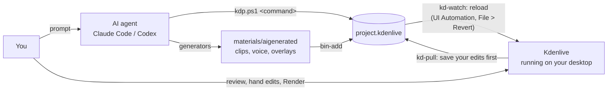

<div align="center">

# Movie Engine

**I-agent ye-AI ihlela ividiyo yakho ku-Kdenlive ubukile, futsi ungatsatsa umsebenti noma ngunini.**

Ema-agent e-AI (bukhalibani lobentiwe) labhala ikhodi (Claude Code, Codex) akha futsi agucule emaphrojekthi langempela e-Kdenlive: emafilimu, emavidiyo lachazako nemavidiyo lamafishane lame ngebude (vertical shorts). Lokuhlelwako kubonakala khona manjalo ku-editor lolivulile. Iyaphatseka (portable), ye-Windows, futsi ayitsintsi i-editor uyiguculele.


[English](../../README.md) · [简体中文](README.zh-CN.md) · [繁體中文](README.zh-TW.md) · [हिन्दी](README.hi.md) · [Español](README.es.md) · [Français](README.fr.md) · [العربية](README.ar.md) · [বাংলা](README.bn.md) · [Português](README.pt.md) · [Русский](README.ru.md) · [اردو](README.ur.md) · [Bahasa Indonesia](README.id.md) · [Deutsch](README.de.md) · [日本語](README.ja.md) · [Türkçe](README.tr.md) · [한국어](README.ko.md) · [Українська](README.uk.md) · [Italiano](README.it.md) · [Polski](README.pl.md) · [Tiếng Việt](README.vi.md) · [فارسی](README.fa.md) · [ไทย](README.th.md) · [Kiswahili](README.sw.md) · [አማርኛ](README.am.md) · [Avañe'ẽ](README.gn.md) · [Setswana](README.tn.md) · [Shqip](README.sq.md) · [Беларуская](README.be.md) · [Български](README.bg.md) · [Bosanski](README.bs.md) · [Hrvatski](README.hr.md) · [Српски](README.sr.md) · [Crnogorski](README.cnr.md) · [Македонски](README.mk.md) · [Slovenščina](README.sl.md) · [Slovenčina](README.sk.md) · [Čeština](README.cs.md) · [Magyar](README.hu.md) · [Română](README.ro.md) · [Dansk](README.da.md) · [Norsk bokmål](README.nb.md) · [Norsk nynorsk](README.nn.md) · [Svenska](README.sv.md) · [Íslenska](README.is.md) · [Suomi](README.fi.md) · [Eesti](README.et.md) · [Latviešu](README.lv.md) · [Lietuvių](README.lt.md) · [Nederlands](README.nl.md) · [Lëtzebuergesch](README.lb.md) · [Rumantsch](README.rm.md) · [Ελληνικά](README.el.md) · [Malti](README.mt.md) · [Gaeilge](README.ga.md) · [Català](README.ca.md) · [ქართული](README.ka.md) · [Հայերեն](README.hy.md) · [Azərbaycanca](README.az.md) · [Afrikaans](README.af.md) · [isiZulu](README.zu.md) · [isiXhosa](README.xh.md) · [Sesotho](README.st.md) · [Sepedi](README.nso.md) · [Xitsonga](README.ts.md) · [Tshivenḓa](README.ve.md) · **siSwati** · [isiNdebele (South Africa)](README.nr.md) · [isiNdebele (Zimbabwe)](README.nd.md) · [chiShona](README.sn.md) · [Chichewa](README.ny.md) · [Ikinyarwanda](README.rw.md) · [Ikirundi](README.rn.md) · [Malagasy](README.mg.md) · [Soomaali](README.so.md) · [Afaan Oromoo](README.om.md) · [Qafar af](README.aa.md) · [ትግርኛ](README.ti.md) · [Sängö](README.sg.md) · [Kreol Seselwa](README.crs.md) · [TjiKalanga](README.kck.md) · [ChiNdau](README.ndc.md)

*Lena kuhumusha. I-README yesiNgisi ngiyo lesetulu.*

</div>

---

## Lokucuketfwe

- [Kungani](#kungani)
- [Kusebenta kanjani](#kusebenta-kanjani)
- [Lokungentiwa](#lokungentiwa)
- [Tidzingo](#tidzingo)
- [Kufaka](#kufaka)
- [Kucala ngekushesha](#kucala-ngekushesha)
- [Kusebenta ne-agent](#kusebenta-ne-agent)
- [Umugca wemiyalo wekuhlela (`kdp.ps1`)](#umugca-wemiyalo-wekuhlela-kdpps1)
- [Kuvumelanisa khona manjalo ne-editor levulekile](#kuvumelanisa-khona-manjalo-ne-editor-levulekile)
- [Ema-generator: loko Kdenlive lengakwati kukwenta](#ema-generator-loko-kdenlive-lengakwati-kukwenta)
- [Livi lelikhulumako nemsindvo](#livi-lelikhulumako-nemsindvo)
- [Lulwimi lwe-interface](#lulwimi-lwe-interface)
- [Kuhleleka kwemafolda](#kuhleleka-kwemafolda)
- [Tivivinyo nebufakazi](#tivivinyo-nebufakazi)
- [Imincele](#imincele)
- [Kulungisa tinkinga](#kulungisa-tinkinga)
- [Imibuto levame kubutwa](#imibuto-levame-kubutwa)
- [Kufaka sandla](#kufaka-sandla)
- [Kubonga](#kubonga)
- [Lilayisensi](#lilayisensi)

## Kungani

Ema-editor emavidiyo akhelwe tandla letiku-mouse. Ema-agent e-AI akahle ekuhleleni, esikhatsini nasemsebentini lophindvwako: kubeka ema-clip langu-300 ngekwesigci semculo, kuvumelanisa yonkhe i-caption nelivi, kuphindza sigaba ngemuva kwemibono yebantfu. Kodvwa awakwati kuchofotela ku-GUI (i-interface yetitfombe) ngaphandle kwekutsatsa i-desktop yakho.

Kdenlive yi-editor lenemandla ye-open-source (ikhodi levulekile), kodvwa ku-Windows **ayinayo i-API yekwenta tintfo ngekutentela (automation)**: kulawula nge-D-Bus kukhona kuphela kuma-build e-Linux, futsi ema-fork lafaka loko ayanakwa noma awaphephile. Movie Engine ilungisa loku ngaphandle kwekugucula i-editor:

1. I-agent ihlela lifayela lephrojekthi le-`.kdenlive` ngemugca wemiyalo lovivinyiwe (`engine/kdp.ps1`).
2. Kdenlive lesebentako itjelwa kutsi iphindze ilifundze lifayela nge-Windows UI Automation, ngaphandle kwekucindzetela ikhibhodi, ngaphandle kwe-mouse futsi ngaphandle kwekutsatsa i-focus.
3. Tingucuko takho longakatilondvolozi tiyacala tilondvolotwe, futsi atibhalelwa ngetulu.

Ngako-ke i-agent iyahlela wena ubuke, noma uhlele ngesandla. Nobabili nisebenta ephrojekthini yinye, ku-editor yinye, ngesikhatsi sinye.

## Kusebenta kanjani



Wonkhe umyalo wekuhlela ulandzela umjikeleto lofanako lophephile:

1. **Pull (kudvonsa).** Nangabe Kdenlive inetingucuko letingakalondvolotwa, iyatjelwa kutsi itilondvoloze (Save ku-toolbar nge-UI Automation), futsi kulondvolota kuyacinisekiswa.
2. **Kuhlela.** Umyalo ugucula i-XML ivalekile (lock), ngemuva kwekuhlola i-hash futsi kune-snapshot yekubuyisela (undo). Nangabe lifayela ligucukile ngaleso sikhatsi, akukho lokubhalwako.
3. **Kuphindza kuvula.** Umbukeli (watcher) ubona luphawu lwe-AI bese wenta File > Revert ku-editor levulekile. Kuphumelela kubalwa kuphela nangabe i-widget ye-timeline yakhiwe kabusha ngempela.
4. **Kungavumelani.** Nangabe ucale kuhlela phakatsi, akukho lokuvulwa kabusha futsi umsebenti wakho uyasala. Inguculo ye-AI igcinwa eceleni, bese i-agent iphindza yenta lushintjo lwayo ngetulu kwelwakho.

## Lokungentiwa

- **Kuhlela lokuphelele kwephrojekthi ngaphandle kwe-GUI**: cishe imiyalo lengu-120 lehlanganisa i-bin, i-timeline, ema-effect, ema-composition, ema-track, ema-guide, ema-marker, ema-subtitle, ema-sequence, lijubane ne-time remap, ema-slideshow, ema-title, ema-proxy, ku-render (rendering) ne-undo/redo. Buka [incwadzi yemiyalo](#umugca-wemiyalo-wekuhlela-kdpps1).
- **Kuvumelanisa khona manjalo ne-editor levulekile.** Tingucuko te-AI tivela ku-Kdenlive loyibukile; tingucuko takho letingakalondvolotwa tiyacala tilondvolotwe futsi atilahleki.
- **Ayikuphatamisi ku-desktop yakho.** Akukho kutsatsa i-focus, kucindzetela ikhibhodi noma kusebentisa i-mouse. Ema-editor ekuvivinya asebenta ku-desktop ye-Windows lengabonakali.
- **Iyaphatseka.** I-editor, ema-setting, Node.js, ema-font nemathulusi kuhlala kufolda yinye. Yikopishele ku-PC lenye futsi iyasebenta; akukho lokubhalwa ku-Program Files noma ku-profile yakho ye-Windows.
- **Ema-generator aloko Kdenlive lengakwati kukwenta**: umbhalo lonyakatako ngelibhali ngalinye (kinetic text), timphawu letidvwetjwe ngesandla, titfombe te-interface te-3D, kunyakata kwe-cursor nemafilimu lamadze lachazako lasebentisanako nemuntfu (interactive "explainer"). Ama-render ku-GPU nge-motion blur yangempela futsi abekwa ku-timeline njengema-clip lajwayelekile.
- **Livi lelikhulumako (voice-over) lelinesikhatsi saleli ngalinye ligama** (Microsoft Edge TTS, ayidzingi i-API key). Ema-caption netento kwenteka ngalo kanye ligama.
- **Imisindvo yema-effect lehlanganiswe ngekhodi** (whoosh, click, pop, riser, impact nalokunye), lentiwe ngekhodi.
- **Kufakazelwe, akucatsangwa.** Wonkhe umyalo unekuhlola kwemphumela, ema-effect nema-composition avivinywa ngamunye ngamunye, futsi imiphumela yangempela iku-`docs/proof/`.
- **Imiyalelo ye-agent ifakiwe.** `AGENTS.md` nema-skill la-`.claude/skills/` afundzisa Claude Code ne-Codex indlela yekusebenta, i-format yelifayela netingibe.

## Tidzingo

| | |
|---|---|
| OS | Windows 10 noma 11, x64 |
| I-editor | Kdenlive **26.08.3**, i-build lephatsekako (standalone). Letinye tinguculo atikavivinywa. |
| Node.js | 18 noma lensha: i-`.zip` ye-Windows x64 levela ku-nodejs.org, levulwe ku-`engine/node/` |
| I-browser | Microsoft Edge (ingcenye ye-Windows); isetjentiswa ingabonakali (headless) ngema-renderer etigcawu |
| I-agent | [Claude Code](https://claude.com/claude-code) noma Codex. Akusiko kuphoceleleka: lonkhe lithulusi liyasebenta nangesandla. |
| I-disk | cishe 1 GB ye-editor nemathulusi, kanye nemidiya yakho |
| GPU | noma nguyiphi i-GPU lekwati ku-encode H.264 nge-hardware ishesha i-`film-render.mjs` (nangabe ingekho, isebentisa i-software) |

## Kufaka

Konkhe kufakwa **ngekhatsi kwefolda**. Akukho lokudzinga emalungelo e-admin.

```powershell
git clone https://github.com/vladtarrow/movie-engine.git
cd movie-engine
```

**1. Node.js.** Dawuniloda i-`.zip` ye-Windows x64 ye-Node.js 18 noma lensha ku-<https://nodejs.org/en/download> bese uvula lokusekhatsi kwayo ku-`engine\node\`, kuze `engine\node\node.exe` ne-`engine\node\npm.cmd` kube khona lapho. Akudzingeki i-installer noma i-Node yesistimu. Wonkhe ema-script asebenta nge-`engine\node.cmd`, hhayi nge-Node yesistimu.

**2. Emaphakheji e-Node** elithulusi lelivi nema-renderer (tinguculo tibekwe ku-`engine/voice/package.json`):

```powershell
engine\node\npm.cmd install --prefix engine\voice
```

**3. Kdenlive 26.08.3 lephatsekako.** Dawuniloda i-`kdenlive-26.08.3_standalone.exe` ku-<https://download.kde.org/stable/kdenlive/26.08/windows/> uyifake ku-`engine\installer\`, uyihlole bese uyivula:

```powershell
(Get-FileHash engine\installer\kdenlive-26.08.3_standalone.exe -Algorithm SHA256).Hash
# expected: A25427B1DFF2C17E3B0386E991BB1A719382BB3176D1A90E441CDAEB6E0A967D
engine\installer\kdenlive-26.08.3_standalone.exe -o"engine\Kdenlive" -y
```

I-editor igcina iku-`engine\Kdenlive\kdenlive-26.08.3_standalone\bin\`. Seyivele ine-`melt.exe` ne-`ffmpeg.exe`.

**4. Kucala kwekucala.**

```powershell
engine\kdenlive.cmd
```

Kdenlive igcina onkhe ema-setting ayo ku-`engine\profile-kdenlive\`, hhayi ku-profile yakho ye-Windows. Ekucaleni kwekucala ikhombisa i-wizard yekuhlela kanye kuphela.

## Kucala ngekushesha

### Nge-agent

Vula lifolda ku-Claude Code (noma Codex) bese ucela ngemagama lajwayelekile:

> Yenta iphrojekthi lensha leme ngebude ye-30 fps lebitwa ngekutsi "launch-teaser". Beka titfombe temshini letintsatfu letivela ku-`materials/designers/launch/` ku-timeline, ngasinye 2.5 s ne-cross-fade lefishane, ungete i-voice-over levela ku-`script.txt` bese uvumelanisa i-caption lenyakatako nawo wonkhe umugca.

> Ngivulele yona ku-Kdenlive.

> Sitfombe sesibili side kakhulu. Sifinyete sibe ngu-1.8 s bese uphakamisa i-logo kancane.

I-agent ilandzela `AGENTS.md`: ihlela nge-`kdp.ps1`, i-render kuphela ema-clip ladzingwa kuhlela, futsi igcina i-editor levulekile ivumelana. Wena ubuka ku-Kdenlive, uhlela ngesandla noma nini nawutsandza, bese ucindzetela Render nawenetisekile.

### Ngesandla

```powershell
# a new 1080x1920 30 fps project with 2 video and 2 audio tracks
powershell -NoProfile -ExecutionPolicy Bypass -File engine\kdp.ps1 new -Project projects\hello\hello.kdenlive -Profile vertical_hd_30

# a 3-second title and a colour background
powershell -NoProfile -ExecutionPolicy Bypass -File engine\kdp.ps1 bin-color -Project projects\hello\hello.kdenlive -Color '#203060' -Seconds 3 -Name bg
powershell -NoProfile -ExecutionPolicy Bypass -File engine\kdp.ps1 title -Project projects\hello\hello.kdenlive -Text "Hello" -Seconds 3 -Name hi

# place them: background on V1, title above it on V2
powershell -NoProfile -ExecutionPolicy Bypass -File engine\kdp.ps1 add -Project projects\hello\hello.kdenlive -Bin bg -Track V1 -At 0
powershell -NoProfile -ExecutionPolicy Bypass -File engine\kdp.ps1 add -Project projects\hello\hello.kdenlive -Bin hi -Track V2 -At 0

# a check frame, then open it in the editor
powershell -NoProfile -ExecutionPolicy Bypass -File engine\kdp.ps1 frame -Project projects\hello\hello.kdenlive -At 1.5 -Out out\hello\check.png
engine\kdenlive.cmd projects\hello\hello.kdenlive
```

Kuze uphindze uvule iphrojekthi yekugcina ngemuva kwesikhashana, chofotela kabili ku-`open-last-project.cmd`.

## Kusebenta ne-agent

I-agent ifundza `AGENTS.md` (Codex) noma `CLAUDE.md`, leyingenisako (Claude Code), kanye nema-skill lamabili:

| I-skill | Ifundzisa |
|---|---|
| `.claude/skills/kdenlive-project-file` | i-format ye-`.kdenlive` / MLT XML, `kdp.ps1`, kuhlola nge-`melt` |
| `.claude/skills/kdenlive-live` | kulawula i-editor lesebentako ngekuphepha: kuyicala, pull, kuphindza kuvula, kutsatsa sitfombe selifasitelo layo |

Imitsetfo lelandzelwa yi-agent, longayetsemba:

- Ayikaze itsatse i-mouse, ikhibhodi noma i-focus yakho, futsi ayikaze itsatse sitfombe se-desktop yakho (kuphela lifasitelo le-editor uyacobo).
- Yenta yona ngekwayo tinyatselo te-GUI (kulondvolota, kuvula, kuphindza kuvula) esikhundleni sekukucela kutsi uchofotele.
- Iyabuta ingakadawunilodi lutfo nangaphambi kwekususa lutfo.
- I-render kuphela loko lokudzingwa ngumsebenti (ema-clip etigcawu, ema-frame ekuhlola). I-render ifilimu lecedziwe kuphela nawuyicela.
- Nangabe Kdenlive ingakwati kwenta lokutsite kahle, i-agent iyakwakha ngaphandle ngekhodi bese ifaka umphumela njenge-clip. Ayilenti libe butsakatsaka i-effect.

## Umugca wemiyalo wekuhlela (`kdp.ps1`)

```powershell
powershell -NoProfile -ExecutionPolicy Bypass -File engine\kdp.ps1 <command> -Project <file.kdenlive> [options]
```

Sikhatsi singemasekhondi, ngelichashazi (`2.5`). Ema-track ngu-`V1 V2 …` (V1 ngulophansi) ne-`A1 A2 …`. I-clip ikhonjwa nge-`-Track` kanye nanoma ngusiphi sikhatsi `-At` ngekhatsi kwayo. Ema-parameter e-effect angena ku-`-Params "name=value||name=value"`. Luhla loluphelele lune-option ngayinye lusetulu ku-`engine/kdp.ps1`.

| Licembu | Imiyalo |
|---|---|
| Iphrojekthi | `new`, `profiles`, `info`, `validate`, `fonts`, `profile-set`, `profile-from-clip`, `zone`, `archive`, `backups`, `rebase`, `otio-export`, `otio-import` |
| Bin | `bin-add`, `bin-color`, `title`, `title-text`, `title-save`, `title-template`, `bin-rename`, `bin-remove`, `bin-info`, `bin-set`, `bin-duplicate`, `bin-replace-file`, `bin-reload`, `folder`, `bin-folder`, `relink`, `clean`, `generator`, `playlist-clip`, `extract-audio`, `transcode` |
| Timeline | `add`, `add-av`, `move`, `copy`, `trim`, `ripple-trim`, `slip`, `split`, `remove`, `speed`, `remap`, `disable`, `enable`, `group`, `ungroup`, `mix`, `unmix`, `space-insert`, `space-remove`, `spaces-remove-all`, `track-clear`, `replace-in-timeline` |
| Ema-effect | `effects`, `effect-info`, `effect-add`, `effect-list`, `effect-set`, `effect-remove`, `effect-copy`, `effect-clear`, `effects-all`, `bin-effect`, `effect-templates`, `effect-template` |
| Ema-composition | `compositions`, `comp-info`, `comp-add`, `comp-list`, `comp-set`, `comp-remove` |
| Ema-track | `track-add`, `track-remove`, `track-set` |
| Ema-guide nema-marker | `guide-add`, `guide-list`, `guide-remove`, `guide-set`, `guide-clear`, `guide-export`, `guide-category`, `marker`, `marker-list`, `marker-set`, `marker-remove` |
| Ema-subtitle | `sub-add`, `sub-import`, `sub-export`, `sub-state` |
| Ema-sequence | `sequence-add`, `sequences`, `copy-to-sequence`, `expand`; noma ngumuphi umyalo lone-`-Sequence <name>` usebenta ngekhatsi kwaleyo sequence |
| Lokukhetsekile | `slideshow`, ema-animation e-Lottie / Glaxnimate nge-`bin-add`, `proxy`, `stabilize`, `scene-split`, `speed-job`, `subclip` |
| Lokuphumako | `frame` (PNG yinye), `preview` (ku-render ngekushesha nge-melt), `render` (i-renderer ya-Kdenlive uyacobo noma i-preset), `presets` |
| Umlandvo | `undo`, `redo`, `clear-history` (ema-snapshot ku-`projects/<name>/.kdp-history`) |

Lokufanele ukwati ngendlela lesebenta ngayo:

- Tingcenye te-audio nevidiyo letihlanganisiwe tiyanyakata, tiyafinyetwa, tiyahlukaniswa futsi tisuswa kanyekanye (`-Alone` kuyinye ingcenye kuphela).
- Umyalo lohlulekako uphuma nekhodi 1 futsi awubhali lutfo.
- Ema-effect i-build ye-Windows lengakwati kuwasebentisa ayaliwa, awayekwa ngekuthula (luhla: `docs/proof/assets.txt`).
- Sento ngasinye se-menu ya-Kdenlive sihlanganiswe nemyalo, nendlela lenye, noma "kubuka kuphela" ku-`engine/tools/data/kdenlive-actions.csv`. Buka `docs/kdenlive-coverage.md`.

## Kuvumelanisa khona manjalo ne-editor levulekile

| I-script | Lekwentako | Emakhodi ekuphuma |
|---|---|---|
| `engine\kd-pull.ps1 -Project <f>` | yenta Kdenlive ilondvoloze tingucuko takho futsi ikucinisekise | 0 lifayela lisha, 3 ayisebenti, 4 akukacinisekiswa |
| `engine\kd-reload.ps1 -Project <f>` | File > Revert, kucinisekiswa yi-timeline leyakhiwe kabusha | 0 kucinisekisiwe, 2 unetingucuko letingakalondvolotwa (akukho lokulahliwe), 3 ayisebenti, 4 kuhlulekile |
| `engine\kd-watch.ps1 -Project <f>` | umbukeli wangemuva: uphindza uvule ngemuva kwako konkhe kubhala kwe-AI, ubhala kungavumelani ku-log | i-log iku-`engine\kd-watch.log`; susa `engine\kd-watch.run` kuze uyimise |
| `engine\kdenlive-bg.ps1 [project]` | icala Kdenlive incishisiwe (minimized) ye-agent | 0 ivulekile, 4 akukacinisekiswa |
| `engine\kdenlive.cmd [project]` | icala Kdenlive yakho | |

Cala umbukeli kanye nge-session ngayinye:

```powershell
Start-Process powershell -WindowStyle Hidden -ArgumentList '-NoProfile','-ExecutionPolicy','Bypass','-File','engine\kd-watch.ps1','-Project','projects\hello\hello.kdenlive'
```

Emaphrojekthi lamakhulu: kuphindza kuvula iphrojekthi lenema-clip langu-1000 kutsatsa imizuzu, futsi emathulusi ayalindza esikhundleni sekubika ngekushesha. Emaphrojekthi avulwa nge-*File > Open Recent* ku-editor lengenalutfo, ngoba kuvula lifayela ngco kwenta Qt ihambe kuyo yonkhe into ye-timeline ngenca ye-accessibility, futsi bekutsatsa cishe imizuzu lengu-10 lengetiwe.

## Ema-generator: loko Kdenlive lengakwati kukwenta

Kdenlive/MLT ayinayo i-animation yembhalo ngelibhali ngalinye, ayinato ema-expression futsi ine-3D lencane, futsi ema-effect lasindzako enta kudlala kuhambe kancane. Movie Engine i-render letingcenye ngaphandle bese itibeka ku-timeline njengema-clip lajwayelekile, kanyenti ne-alpha, ku-track lengetulu kwetitfombe. I-script ye-generator naloko lekusebentisako kuhlala kufolda yephrojekthi, kuze i-clip iphindze yentiwe nangabe umbhalo, i-font noma sikhatsi kugucuka.

| Lithulusi | Lenta |
|---|---|
| `engine/tools/kinetic-text.ps1` | ema-caption lanyakatako ngelibhali ngalinye, ligama ngalinye livumelaniswe ne-`voice.json`, libhokisi lekugcamisa |
| `engine/tools/annotate.ps1` | tindingilizi, emabhokisi, imigca ngaphansi nemicibisholo lekudvwetjwe ngesandla lokutidvweba ngetulu kwesitfombe semshini |
| `engine/tools/card-entrance.ps1` | likhadi lesitfombe semshini lelikhuphukako likhule nesitfunti lesitsambile |
| `engine/tools/pdf-to-png.ps1` | ema-slide lavela ku-PDF lekhishiwe |
| `engine/tools/html-render.mjs` | noma ngusiphi sigcawu se-HTML/CSS/canvas sibe yividiyo: i-animation ye-interface, ema-cursor, 3D, ema-mask |
| `engine/tools/film-render.mjs` + `film/` | emafilimu lamadze lachazako lasebentisanako nemuntfu ku-canvas: i-clip yinye ngemugca ngamunye welivi, tento tenteka emagameni lakhulunywako, i-motion blur ye-GPU ngelijubane lelingaba ngu-45 fps |

Womabili ema-renderer alawula Microsoft Edge letsa ne-Windows, ingabonakali (headless), ne-profile lelahlwako futsi ngaphandle kwe-network.

### Ema-demo

```powershell
# a 3-second 3D title card with a cursor click
engine\node.cmd engine\tools\html-render.mjs examples\demo\scene\scene.html examples\demo\out --frames 0,30,60,89
engine\node.cmd engine\tools\html-render.mjs examples\demo\scene\scene.html examples\demo\out\scene.mp4

# a 4-shot interactive film timed to two voice lines
engine\node.cmd engine\tools\film-render.mjs examples\demo\film\film.html examples\demo\out --check
engine\node.cmd engine\tools\film-render.mjs examples\demo\film\film.html examples\demo\out --shots all --width 640
engine\node.cmd engine\tools\film-render.mjs examples\demo\film\film.html examples\demo\out\clips --suffix -v01
```

Ifilimu ngemafayela lamancane lamatsatfu. `data.js` igcina ema-shot nesikhatsi semagama. `direction.js` inemugca munye nge-shot ngayinye:

```text
1 | hover 192 108 @brand | tag 300 60 Your brand @deserves | confetti 192 90 @film
2 say=A film that/*explains* it
3 | click 116 108 @before | click 268 108 @after | chips Before~After @after
4 scene=counter | count 0 120 % @count
```

`scenes.js` igcina ema-shot ladvwetjwa kusukela ekucaleni. `@word` icala sento nangabe livi lisho lelo gama. Tento tifaka ekhatsi click, hover, drag, zoom, lens, ring, arrow, chips, toggle, slider, toast, type, count ne-confetti; indlela lephelele yekubhala iku-`engine/tools/film/film-kit.js` etulu.

## Livi lelikhulumako nemsindvo

```powershell
engine\node.cmd engine\voice\voice.mjs lines.json materials\aigenerated\hello\voice en-US-AndrewMultilingualNeural +0%
```

`lines.json` luhla lwemigca. Lithulusi libhala i-mp3 yinye ngemugca ngamunye kanye ne-`voice.json`, nesikhatsi sonkhe kanye nekucala nekuphela kwalo lonkhe ligama. Imigca iyagcinwa (cache), ngako kugucula umugca munye kwenta kabusha lowo mugca kuphela. Isebentisa i-text-to-speech ye-Microsoft Edge leku-inthanethi ngephakheji ye-`msedge-tts`: akudzingeki i-key, kodvwa lensita ayisiyo yasemtsetfweni futsi idzinga i-inthanethi.

```powershell
engine\node.cmd engine\audio\sfx.mjs materials\aigenerated\sfx
```

Loku kwenta whoosh, whoosh-long, swipe, click, pop, tick, riser, impact, ding ne-reveal ngekhodi; licoco lelilungile liku-`materials/aigenerated/sfx/`. Imisindvo lemifishane kune-frame yinye yengete ngekuthula ngaphambi kwekuyibeka (`-af apad=whole_dur=0.0667`).

## Lulwimi lwe-interface

Ema-launcher acala Kdenlive **ngesiNgisi** ngekwesimo lesijwayelekile. Kuze usebentise lolunye lulwimi, setha `MOVIE_ENGINE_UI_LANG` ngaphambi kwekucala:

```powershell
$env:MOVIE_ENGINE_UI_LANG = 'ru'; engine\kdenlive.cmd
```

UI Automation itfola tintfo te-menu ngemabito ato labonakalako. Emabito etilwimi te-interface letingu-31 asevele akhona (`engine/tools/kd-ui.ps1`, `$KdNames`). Kulolunye lulwimi, engeta emabito alo lapho bese uhlola nga:

```powershell
powershell -NoProfile -ExecutionPolicy Bypass -File engine\tools\kd-langcheck.ps1
```

## Kuhleleka kwemafolda

```text
movie-engine/
├─ AGENTS.md, CLAUDE.md          instructions for AI agents
├─ .claude/skills/               agent skills: project file format, live editor
├─ engine/
│  ├─ kdp.ps1                    the editing command line
│  ├─ kd-pull / kd-reload / kd-watch .ps1, kdenlive.cmd, kdenlive-bg.ps1
│  ├─ tools/                     internals, generators, tests, data (action map)
│  ├─ voice/  audio/  fonts/     TTS, synthesized SFX, Poppins (OFL)
│  ├─ Kdenlive/  node/           portable editor and Node.js (not in git)
│  └─ profile-kdenlive/          the editor's settings (not in git)
├─ projects/<name>/<name>.kdenlive
├─ materials/
│  ├─ download/                  stock and downloaded files (not in git)
│  ├─ aigenerated/               everything the AI made (sfx/ and test-kit/ ship with the engine)
│  ├─ designers/  brand/         files from your team, brand assets
├─ examples/demo/                demos of the scene and film renderers
├─ out/                          renders (not in git)
└─ docs/                         proofs, coverage, translations of this README
```

Tindlela temidiya ngekhatsi kwemaphrojekthi ti-relative (tihlobene nefolda). Nawuhambisa noma ukopisha lifolda, `kdp.ps1 rebase` (lephindze isebente ngekutentela nge-`kdenlive.cmd`) ibhala indzawo lensha ephrojekthini.

## Tivivinyo nebufakazi

Lokushiwo ngaloko lokusebentako kusekelwa kuhlola kwemphumela, hhayi ngekutsi "i-function isebentile". Sifinyeto siku-[`docs/kdenlive-proof.md`](../../docs/kdenlive-proof.md), futsi lokuphume ngempela kuku-`docs/proof/`.

| Kuvivinya | Kuhlola |
|---|---|
| `engine\tools\kdp-clitest.ps1` | wonkhe umyalo we-`kdp.ps1`, ngemugca wemiyalo, icatsanisa iphrojekthi lephumako |
| `engine\tools\kd-livetest.ps1` | pull, kuphindza kuvula, umbukeli, kungavumelani nemijaho (races) ku-Kdenlive yangempela ku-desktop lengabonakali |
| `engine\tools\kdp-assetsweep.ps1` | yonkhe i-effect nayo yonkhe i-composition: i-render futsi icatsanise ema-frame |
| `engine\tools\kdp-portabletest.ps1` | ikopisha lifolda kulenye indzawo bese isebenta kusuka kulekhophi |
| `engine\tools\kd-langcheck.ps1` | lulwimi lwe-interface nekutsi UI Automation iyayitfola i-menu |
| `engine\tools\kdp-coverage-check.ps1` | sonkhe sento se-menu sihlanganisiwe, futsi abukho bufakazi lobudzala kunekhodi |

```powershell
powershell -NoProfile -ExecutionPolicy Bypass -File engine\tools\kdp-clitest.ps1 -Report docs\proof\clitest.txt
powershell -NoProfile -ExecutionPolicy Bypass -File engine\tools\kd-livetest.ps1 -Report docs\proof\live-en.txt
```

Ema-editor ekuvivinya asebenta kuphela ku-desktop lefihlekile ane-profile yawo, ngako tivivinyo atikaze titsintse Kdenlive yakho levulekile noma i-focus yakho.

## Imincele

- **Windows kuphela**, Kdenlive **26.08.3** kuphela. Linux ine-D-Bus futsi bekungadzinga libhuloho lelehlukile.
- Kucala i-editor kutsatsa i-focus yekhibhodi cishe imizuzwana lemitsatfu ngesikhatsi lifasitelo lelingenalutfo livela. Ema-agent ayabuta angakayicali ngesikhatsi usebenta. Kuphindza kuvula nekuhlela akuyitsatsi i-focus.
- I-build ye-Windows ayinawo ema-module e-MLT e-sox, ladspa ne-movit kanye nalamanye ema-effect e-frei0r/avfilter; `kdp.ps1` iyawala (`docs/proof/assets.txt`).
- Ku-export nekungenisa (import) kwe-OpenTimelineIO kutfwala ema-clip nemikhawu kuphela. I-multicam ayinako kushintja ema-angle khona manjalo (kusika kwentiwa nge-split/remove/hide).
- "Save As…" nge-UI Automation efasitelweni lelincishisiwe ayivuli i-dialog; i-agent isebentisa `archive` noma kukopisha emafayela esikhundleni saloko.
- Kubona inkhulumo (auto-subtitles) kudzinga Whisper noma Vosk, lokungakafakwa.
- Ema-title lentiwe ngelithulusi le-title la-Kdenlive asebentisa ema-font lafakwe ku-Windows. Kute uciniseke ngekubhalwa kwemabhali (typography), render umbhalo ngema-generator, lalayisha ema-font avela ku-`engine/fonts/`.
- Edge TTS yinsita leku-inthanethi lengasiyo yasemtsetfweni futsi ingagucuka noma iyekele kusebenta.

## Kulungisa tinkinga

| Luphawu | Imbangela nekulungisa |
|---|---|
| Kdenlive iyasebenta, kodvwa kuyichofotela ku-taskbar akukhombisi lutfo | Indzawo yelifasitelo layo lelondvolotiwe ingaphandle kwesikrini. Yivale bese ususa lokubhaliwe kwe-`kdockLayout` ku-`engine\profile-kdenlive\AppData\Local\kdenliverc`, noma uhambise lifasitelo nge-`SetWindowPos` (buka `AGENTS.md`). |
| `kd-reload.ps1` iphuma nge-2 | Unetingucuko letingakalondvolotwa. Akukho lokulahliwe. Sebentisa `kd-pull.ps1`, bese uphindza wenta lushintjo (`kdp.ps1` ikwenta loku ngekwayo). |
| `CONFLICT` ku-`engine\kd-watch.log` | Wena ne-agent nihlele ngesikhatsi sinye. Inguculo yakho isala ku-editor, futsi inguculo ye-AI iku-`projects\<name>\.kdp-history\<name>\conflict\`. Cela i-agent kutsi iphindze yente lushintjo lwayo. |
| Umyalo uphuma nge-1 kanye na "pull not confirmed" | Kdenlive imatasatasa noma ikhombisa i-dialog. Vala i-dialog noma ulindze kuvula kuphele, bese uphindza. |
| I-script ye-PowerShell ayikhoni kufundvwa (parse) | Ema-script lanembhalo longesiwo we-ASCII kufanele alondvolotwe njenge-UTF-8 **ne-BOM** ku-Windows PowerShell 5.1. |
| `voice.mjs` iyema ne-"Stream closed before the synthesis completed" | Kanyenti yinkinga ye-network, noma i-SSML lengakavikelwa (unescaped) kumakhophi lamadzala. `voice.mjs` ivikela `& < >` ngekwayo. |
| Kuvula iphrojekthi lenkhulu kutsatsa imizuzu leminyenti | Yivule nge-`kdenlive.cmd` / `kdenlive-bg.ps1`, ungayivuli njenge-`kdenlive.exe project.kdenlive`. |

## Imibuto levame kubutwa

**Ngiyayidzinga yini Claude Code noma Codex?**
Cha. Lonkhe lithulusi yi-script lejwayelekile longayisebentisa ngesandla. I-agent ngiyo lekwenta kushesha: ihlela kusika, isebentisa emathulusi futsi igcina i-editor ivumelana.

**I-agent itawubhala ngetulu kwetingucuko tami tesandla yini?**
Cha. Ngaphambi kwanoma nguku kubhala, tingucuko takho letingakalondvolotwa tiyalondvolotwa futsi kucinisekiswe. Nangabe uhlela i-agent ibhala, kubhala kuyaliwa noma kugcinwa eceleni njengekungavumelani, akukaze kwentiwe ngetulu kwemsebenti wakho.

**Ngingachubeka ngisebentisa Kdenlive njengekujwayelekile yini?**
Yebo. Yi-Kdenlive lejwayelekile lenefolda yayo yema-setting. Hlela, buka (preview) futsi u-render njengekujwayelekile.

**Iyasebenta yini ne-Kdenlive lengivele ngayifaka?**
Isebentisa ikhophi yayo lephatsekako ku-`engine\Kdenlive\`, ngako Kdenlive yakho lefakiwe nema-setting ayo akutsintswa.

**Kungani kungasiyo i-fork ya-Kdenlive lene-API, noma lenye i-editor?**
Ku-Windows, ayikho i-fork lenakekelwako futsi lephephile (luhlolo lwa-2026-11). OpenShot, Blender VSE, DaVinci Resolve, Shotcut nema-editor e-web ahlolwa; Kdenlive inikete kujula lokukhulu kwekuhlela. Siphakamiso se-REST API kuphrojekthi lenkhulu (merge request !902) siyabukwa.

**Ingayi-render ividiyo lecedziwe yini?**
Yebo, nge-`kdp.ps1 render` (i-renderer ya-Kdenlive uyacobo, lefihlekile), noma wena ngekwakho ucindzetela Render ku-editor.

**Imidiya yami ilayishwa kuphi yini?**
Cha. Kutfunyelwa kuphela umbhalo we-voice-over ensizeni ye-Edge TTS nawenta livi. Ema-renderer etigcawu asebenta i-network icinyiwe.

## Kufaka sandla

Kufaka sandla kuyemukelwa. Buka [CONTRIBUTING.md](../../CONTRIBUTING.md). Ngamafishane:

- Wonkhe umsebenti lomusha noma loguculiwe we-`kdp.ps1` udzinga kuhlola kwemphumela ku-`kdp-clitest.ps1`, lokubhalwa kumephu yetento, nekuphindza usebentise `kdp-coverage-check.ps1`.
- Ungalokotsi ucale Kdenlive yekuvivinya ku-desktop lebonakalako; sebentisa `engine/tools/kd-hidden.ps1`.
- Gcina konkhe kuphatseka: akukho kufaka ngaphandle kwefolda, akukho tindlela leti-absolute ephrojekthini.
- Bhala phansi tindzaba letingajwayelekile letifakazelwe ku-`AGENTS.md` noma ku-skill lefanele.

## Kubonga

- [Kdenlive](https://kdenlive.org) ne-[MLT](https://www.mltframework.org): i-editor ne-injini lengaphansi kwayo.
- [FFmpeg](https://ffmpeg.org), letsa ne-Kdenlive.
- [msedge-tts](https://www.npmjs.com/package/msedge-tts) ye-voice-over.
- [Poppins](https://fonts.google.com/specimen/Poppins) ngu-Indian Type Foundry, SIL Open Font License (`engine/fonts/OFL.txt`).
- `engine/tools/data/kdenliveui-26.08.3.rc`: lifayela le-menu la-Kdenlive, letsetfwe kukhodi yemtfombo ya-Kdenlive 26.08.3; lisetjentiswa kuphela kuhlola kwe-coverage. Lihlala ngaphansi kwelilayisensi le-GPL la-Kdenlive, hhayi ngaphansi kwe-MIT License.

## Lilayisensi

Ikhodi ya-Movie Engine uyacobo ikhishwa ngaphansi kwe-[MIT License](../../LICENSE). Kdenlive, MLT, FFmpeg, emaphakheji e-Node.js ne-font ye-Poppins kugcina emalayisensi akho.
