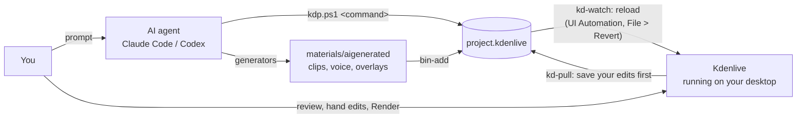

<div align="center">

# Movie Engine

**Moemedi wa AI o hlophisa video ya hao ho Kdenlive o ntse o shebile, mme o ka nka taolo neng kapa neng.**

Baemedi ba AI ba ngolang khoutu (Claude Code, Codex) ba aha le ho fetola diprojeke tsa sebele tsa Kdenlive: difilimi, divideo tsa tlhaloso le divideo tse kgutshwane tse emeng (vertical shorts). Diphetoho di hlaha hang-hang sehlophising seo o se butseng. E a jareha (portable), ke ya Windows, ha ho diphetoho khoutung ya sehlophisi.


[English](../../README.md) · [简体中文](README.zh-CN.md) · [繁體中文](README.zh-TW.md) · [हिन्दी](README.hi.md) · [Español](README.es.md) · [Français](README.fr.md) · [العربية](README.ar.md) · [বাংলা](README.bn.md) · [Português](README.pt.md) · [Русский](README.ru.md) · [اردو](README.ur.md) · [Bahasa Indonesia](README.id.md) · [Deutsch](README.de.md) · [日本語](README.ja.md) · [Türkçe](README.tr.md) · [한국어](README.ko.md) · [Українська](README.uk.md) · [Italiano](README.it.md) · [Polski](README.pl.md) · [Tiếng Việt](README.vi.md) · [فارسی](README.fa.md) · [ไทย](README.th.md) · [Kiswahili](README.sw.md) · [አማርኛ](README.am.md) · [Avañe'ẽ](README.gn.md) · [Setswana](README.tn.md) · [Shqip](README.sq.md) · [Беларуская](README.be.md) · [Български](README.bg.md) · [Bosanski](README.bs.md) · [Hrvatski](README.hr.md) · [Српски](README.sr.md) · [Crnogorski](README.cnr.md) · [Македонски](README.mk.md) · [Slovenščina](README.sl.md) · [Slovenčina](README.sk.md) · [Čeština](README.cs.md) · [Magyar](README.hu.md) · [Română](README.ro.md) · [Dansk](README.da.md) · [Norsk bokmål](README.nb.md) · [Norsk nynorsk](README.nn.md) · [Svenska](README.sv.md) · [Íslenska](README.is.md) · [Suomi](README.fi.md) · [Eesti](README.et.md) · [Latviešu](README.lv.md) · [Lietuvių](README.lt.md) · [Nederlands](README.nl.md) · [Lëtzebuergesch](README.lb.md) · [Rumantsch](README.rm.md) · [Ελληνικά](README.el.md) · [Malti](README.mt.md) · [Gaeilge](README.ga.md) · [Català](README.ca.md) · [ქართული](README.ka.md) · [Հայերեն](README.hy.md) · [Azərbaycanca](README.az.md) · [Afrikaans](README.af.md) · [isiZulu](README.zu.md) · [isiXhosa](README.xh.md) · **Sesotho** · [Sepedi](README.nso.md) · [Xitsonga](README.ts.md) · [Tshivenḓa](README.ve.md) · [siSwati](README.ss.md) · [isiNdebele (South Africa)](README.nr.md) · [isiNdebele (Zimbabwe)](README.nd.md) · [chiShona](README.sn.md) · [Chichewa](README.ny.md) · [Ikinyarwanda](README.rw.md) · [Ikirundi](README.rn.md) · [Malagasy](README.mg.md) · [Soomaali](README.so.md) · [Afaan Oromoo](README.om.md) · [Qafar af](README.aa.md) · [ትግርኛ](README.ti.md) · [Sängö](README.sg.md) · [Kreol Seselwa](README.crs.md) · [TjiKalanga](README.kck.md) · [ChiNdau](README.ndc.md)

*Ena ke phetolelo; README ya Senyesemane ke yona ya semmuso eo ho shebwang ho yona.*

</div>

---

## Diteng

- [Hobaneng](#hobaneng)
- [Se sebetsa jwang](#se-sebetsa-jwang)
- [Bokgoni](#bokgoni)
- [Ditlhoko](#ditlhoko)
- [Ho kenya](#ho-kenya)
- [Ho qala kapele](#ho-qala-kapele)
- [Ho sebetsa le moemedi](#ho-sebetsa-le-moemedi)
- [Mola wa ditaelo wa ho hlophisa (`kdp.ps1`)](#mola-wa-ditaelo-wa-ho-hlophisa-kdpps1)
- [Ho tsamaisana hang-hang le sehlophisi se butsweng](#ho-tsamaisana-hang-hang-le-sehlophisi-se-butsweng)
- [Dijenereitara: seo Kdenlive e sa kgoneng ho se etsa](#dijenereitara-seo-kdenlive-e-sa-kgoneng-ho-se-etsa)
- [Phetelo ka lentswe le modumo](#phetelo-ka-lentswe-le-modumo)
- [Puo ya interface](#puo-ya-interface)
- [Sebopeho sa difoldara](#sebopeho-sa-difoldara)
- [Diteko le bopaki](#diteko-le-bopaki)
- [Meedi](#meedi)
- [Ho rarolla mathata](#ho-rarolla-mathata)
- [Dipotso tse botswang hangata](#dipotso-tse-botswang-hangata)
- [Ho kenya letsoho](#ho-kenya-letsoho)
- [Diteboho](#diteboho)
- [Laesense](#laesense)

## Hobaneng

Disehlophisi tsa video di etseditswe letsoho le tshwereng mouse. Baemedi ba AI (bohlale ba maiketsetso) ba tseba hantle sebopeho, ho lekanya nako le mosebetsi o iphetang: ho beha dikliphi tse 300 ho latela morethetho, ho lekanya mongolo o mong le o mong o ka tlase (caption) le lentswe la mopheti, ho etsa thala (scene) botjha kamora maikutlo. Empa ha ba kgone ho tobetsa ho GUI (sebopeho sa ditshwantsho) ntle le ho nka desktop ya hao.

Kdenlive ke sehlophisi se matla sa open-source (khoutu e bulehileng), empa ho Windows **ha e na API ya boiketsetso (automation)**: taolo ka D-Bus e teng feela diphetolelong tsa Linux, mme di-fork (dikopi tse arohaneng tsa projeke) tse e kenyang kapa ha di sa hlokomelwa kapa ha di bolokehe. Movie Engine e rarolla bothata bona ntle le ho fetola sehlophisi:

1. Moemedi o fetola faele ya projeke ya `.kdenlive` ka mola wa ditaelo o lekilweng (`engine/kdp.ps1`).
2. Kdenlive e ntseng e sebetsa e bolellwa ho bala faele hape ka Windows UI Automation, ntle le ho tobetsa dinotlolo, ntle le mouse mme ntle le ho utswa focus (tlhokomelo ya fensetere).
3. Diphetoho tsa hao tse so kang di bolokwa di bolokwa pele mme ha ho mohla di ngolwang hodima tsona.

Kahoo moemedi o a hlophisa mme wena o a hlahloba, kapa o hlophisa ka letsoho. Bobedi ba lona le sebetsa projekeng e le nngwe, sehlophising se le seng, ka nako e le nngwe.

## Se sebetsa jwang



Taelo e nngwe le e nngwe ya ho hlophisa e latela potoloho e le nngwe e bolokehileng:

1. **Pull (ho hula).** Haeba Kdenlive e na le diphetoho tse so kang di bolokwa, e bolellwa ho di boloka (konopo ya Save ho toolbar ka UI Automation), mme polokelo eo e a netefatswa.
2. **Ho hlophisa.** Taelo e fetola XML e notletswe (lock), kamora tlhahlobo ya hash le ka snapshot ya undo (ho kgutlisa). Haeba faele e fetohile nakong eo, ha ho letho le ngolwang.
3. **Ho bala hape (reload).** Molebedi (watcher) o bona letshwao la AI mme o etsa File > Revert sehlophising se butsweng. Katleho e balwa feela ha widget ya timeline e hlile e hahilwe botjha.
4. **Kgohlano.** Haeba o qadile ho hlophisa nakong eo, ha ho letho le balwang hape mme mosebetsi wa hao o a sala. Kopi ya AI e behwa ka thoko, mme moemedi o boela a kenya phetoho ya hae hodima ya hao.

## Bokgoni

- **Ho hlophisa projeke ka botlalo ntle le GUI**: ditaelo tse ka bang 120 tse akaretsang bin, timeline, di-effect, di-composition, di-track, di-guide, di-marker, dihlooho tse ka tlase (subtitles), di-sequence, lebelo le time remap, di-slideshow, dihlooho (titles), di-proxy, ho render le undo/redo. Bona [ditshupiso tsa ditaelo](#mola-wa-ditaelo-wa-ho-hlophisa-kdpps1).
- **Ho tsamaisana hang-hang le sehlophisi se butsweng.** Diphetoho tsa AI di hlaha ho Kdenlive eo o e shebileng; diphetoho tsa hao tse so kang di bolokwa di bolokwa pele mme ha ho mohla di lahlehang.
- **Ha e tshwenye desktop ya hao.** Ha ho focus e utswuwang, ha ho dinotlolo tse tobetswang kapa mouse e sebediswang. Disehlophisi tsa diteko di sebetsa desktop ya Windows e sa bonahaleng.
- **E a jareha.** Sehlophisi, disetting, Node.js, difonte le disebediswa di foldareng e le nngwe. E kopitse ho PC e nngwe mme e a sebetsa; ha ho letho le ngolwang ho Program Files kapa profaeleng ya hao ya Windows.
- **Dijenereitara bakeng sa seo Kdenlive e sa kgoneng ho se etsa**: mongolo o sisinyehang tlhaku ka tlhaku (kinetic text), matshwao a takilweng ka letsoho, dithala tsa UI tsa 3D, motsamao wa cursor le difilimi tse telele tsa "tlhaloso" tse sebedisanang le mosebedisi (interactive). Di render ho GPU ka motion blur ya sebele mme di behwa ho timeline jwalo ka dikliphi tse tlwaelehileng.
- **Phetelo ka lentswe e nang le dinako tsa mantswe** (Microsoft Edge TTS, ha ho hlokehe API key). Dihlooho tse ka tlase le diketso di etsahala hantle lentsweng le nepahetseng.
- **Medumo e entsweng ka khoutu** (whoosh, click, pop, riser, impact le e meng).
- **E netefaditswe, ha e a nahanwa feela.** Taelo e nngwe le e nngwe e na le tlhahlobo ya sephetho, di-effect le di-composition di lekwa e nngwe ka e nngwe, mme diphetho tse tala di ho `docs/proof/`.
- **Ditaelo tsa moemedi di kenyelleditswe.** `AGENTS.md` le di-skill tse ho `.claude/skills/` di ruta Claude Code le Codex tsela ya ho sebetsa, sebopeho sa faele le mathata a ka hlahang.

## Ditlhoko

| | |
|---|---|
| OS | Windows 10 kapa 11, x64 |
| Sehlophisi | Kdenlive **26.08.3** ya portable (standalone). Diphetolelo tse ding ha di a lekwa. |
| Node.js | 18 kapa e ntjha ho feta: `.zip` ya Windows x64 ho tswa nodejs.org, e phuthollotsweng ho `engine/node/` |
| Sebadi (browser) | Microsoft Edge (karolo ya Windows); e sebediswa ntle le fensetere (headless) ke di-renderer tsa dithala |
| Moemedi | [Claude Code](https://claude.com/claude-code) kapa Codex. Ha se tlamo: sesebediswa se seng le se seng se ka boela sa sebediswa ka letsoho. |
| Disiki | hoo e ka bang 1 GB bakeng sa sehlophisi le disebediswa, hammoho le media ya hao |
| GPU | GPU efe kapa efe e nang le hardware H.264 encoding e potlakisa `film-render.mjs` (ha e le siyo e sebedisa software) |

## Ho kenya

Ntho e nngwe le e nngwe e kengwa **ka hare ho foldara**. Ha ho letho le hlokang ditokelo tsa admin.

```powershell
git clone https://github.com/vladtarrow/movie-engine.git
cd movie-engine
```

**1. Node.js.** Jarolla `.zip` ya Windows x64 ya Node.js 18 kapa e ntjha ho tswa <https://nodejs.org/en/download> mme o phuthollele dikahare tsa yona ho `engine\node\`, e le hore `engine\node\node.exe` le `engine\node\npm.cmd` di be teng moo. Ha ho hlokehe installer kapa Node ya sistimi. Diskripte tsohle di sebetsa ka `engine\node.cmd`, ha ho mohla ka Node ya sistimi.

**2. Diphakeje tsa Node** bakeng sa sesebediswa sa lentswe le di-renderer (diphetolelo di tsitsitswe ho `engine/voice/package.json`):

```powershell
engine\node\npm.cmd install --prefix engine\voice
```

**3. Kdenlive 26.08.3 portable.** Jarolla `kdenlive-26.08.3_standalone.exe` ho tswa <https://download.kde.org/stable/kdenlive/26.08/windows/> o e kenye ho `engine\installer\`, e hlahlobe mme o e phuthollole:

```powershell
(Get-FileHash engine\installer\kdenlive-26.08.3_standalone.exe -Algorithm SHA256).Hash
# expected: A25427B1DFF2C17E3B0386E991BB1A719382BB3176D1A90E441CDAEB6E0A967D
engine\installer\kdenlive-26.08.3_standalone.exe -o"engine\Kdenlive" -y
```

Sehlophisi se qetella se le ho `engine\Kdenlive\kdenlive-26.08.3_standalone\bin\`. Se se se ntse se kenyelletsa `melt.exe` le `ffmpeg.exe`.

**4. Qalo ya pele.**

```powershell
engine\kdenlive.cmd
```

Kdenlive e boloka disetting tsohle tsa yona ho `engine\profile-kdenlive\`, eseng profaeleng ya hao ya Windows. Qalong ya pele e bontsha wizard ya ho seta (thuso ya ho lokisa) hang feela.

## Ho qala kapele

### Le moemedi

Bula foldara ho Claude Code (kapa Codex) mme o kope ka mantswe a tlwaelehileng:

> Etsa projeke e ntjha e emeng ya 30 fps e bitswang "launch-teaser". Beha di-screenshot tse tharo tse ho `materials/designers/launch/` ho timeline, e nngwe le e nngwe metsotswana e 2.5 ka cross-fade e kgutshwane, kenya phetelo ka lentswe ho tswa ho `script.txt` mme o lekanye sehlooho se sisinyehang (kinetic caption) le mola o mong le o mong.

> Mpulele yona ho Kdenlive.

> Shot ya bobedi e telele haholo. E kgutsufatse ho 1.8 s mme o phahamise logo hanyane.

Moemedi o latela `AGENTS.md`: o hlophisa ka `kdp.ps1`, o render feela dikliphi tseo ho seha (cut) ho di hlokang, mme o boloka sehlophisi se butsweng se tsamaisana. O hlahloba ho Kdenlive, o hlophisa ka letsoho neng kapa neng ha o batla, mme o tobetsa Render ha o kgotsofetse.

### Ka letsoho

```powershell
# a new 1080x1920 30 fps project with 2 video and 2 audio tracks
powershell -NoProfile -ExecutionPolicy Bypass -File engine\kdp.ps1 new -Project projects\hello\hello.kdenlive -Profile vertical_hd_30

# a 3-second title and a colour background
powershell -NoProfile -ExecutionPolicy Bypass -File engine\kdp.ps1 bin-color -Project projects\hello\hello.kdenlive -Color '#203060' -Seconds 3 -Name bg
powershell -NoProfile -ExecutionPolicy Bypass -File engine\kdp.ps1 title -Project projects\hello\hello.kdenlive -Text "Hello" -Seconds 3 -Name hi

# place them: background on V1, title above it on V2
powershell -NoProfile -ExecutionPolicy Bypass -File engine\kdp.ps1 add -Project projects\hello\hello.kdenlive -Bin bg -Track V1 -At 0
powershell -NoProfile -ExecutionPolicy Bypass -File engine\kdp.ps1 add -Project projects\hello\hello.kdenlive -Bin hi -Track V2 -At 0

# a check frame, then open it in the editor
powershell -NoProfile -ExecutionPolicy Bypass -File engine\kdp.ps1 frame -Project projects\hello\hello.kdenlive -At 1.5 -Out out\hello\check.png
engine\kdenlive.cmd projects\hello\hello.kdenlive
```

Ho bula projeke ya ho qetela hape hamorao, tobetsa `open-last-project.cmd` habedi.

## Ho sebetsa le moemedi

Moemedi o bala `AGENTS.md` (Codex) kapa `CLAUDE.md`, e e kenyang (Claude Code), hammoho le di-skill tse pedi:

| Skill | E ruta |
|---|---|
| `.claude/skills/kdenlive-project-file` | sebopeho sa `.kdenlive` / MLT XML, `kdp.ps1`, ho hlahloba ka `melt` |
| `.claude/skills/kdenlive-live` | ho tsamaisa sehlophisi se ntseng se sebetsa ka polokeho: ho se qala, pull, reload, ho nka setshwantsho sa fensetere ya sona |

Melao eo moemedi a e latelang, eo o ka itshetlehang ka yona:

- Ha ho mohla a nkang mouse, keyboard kapa focus ya hao, mme ha ho mohla a nkang setshwantsho sa skrine sa desktop ya hao (feela sa fensetere ya sehlophisi ka sebele).
- O etsa mehato ya GUI ka boyena (save, open, reload) ho ena le ho o kopa hore o tobetse.
- O a botsa pele a jarolla ntho efe kapa efe le pele a hlakola ntho efe kapa efe.
- O render feela se hlokwang ke mosebetsi (dikliphi tsa dithala, diforeimi tsa tlhahlobo). O render filimi ya ho qetela feela ha o kopa.
- Ha Kdenlive e sa kgone ho etsa ntho hantle, moemedi o e aha kantle ka khoutu mme o kenya sephetho jwalo ka kliphi. Ha a fokotse boleng ba effect.

## Mola wa ditaelo wa ho hlophisa (`kdp.ps1`)

```powershell
powershell -NoProfile -ExecutionPolicy Bypass -File engine\kdp.ps1 <command> -Project <file.kdenlive> [options]
```

Dinako di ka metsotswana, ka ntlha (`2.5`). Di-track ke `V1 V2 …` (V1 ke e ka tlase ka ho fetisisa) le `A1 A2 …`. Kliphi e supuwa ka `-Track` hammoho le nako efe kapa efe `-At` ka hare ho yona. Diparamethara tsa effect di kena ho `-Params "name=value||name=value"`. Lenane le feletseng le kgetho e nngwe le e nngwe le hloohong ya `engine/kdp.ps1`.

| Sehlopha | Ditaelo |
|---|---|
| Projeke | `new`, `profiles`, `info`, `validate`, `fonts`, `profile-set`, `profile-from-clip`, `zone`, `archive`, `backups`, `rebase`, `otio-export`, `otio-import` |
| Bin | `bin-add`, `bin-color`, `title`, `title-text`, `title-save`, `title-template`, `bin-rename`, `bin-remove`, `bin-info`, `bin-set`, `bin-duplicate`, `bin-replace-file`, `bin-reload`, `folder`, `bin-folder`, `relink`, `clean`, `generator`, `playlist-clip`, `extract-audio`, `transcode` |
| Timeline | `add`, `add-av`, `move`, `copy`, `trim`, `ripple-trim`, `slip`, `split`, `remove`, `speed`, `remap`, `disable`, `enable`, `group`, `ungroup`, `mix`, `unmix`, `space-insert`, `space-remove`, `spaces-remove-all`, `track-clear`, `replace-in-timeline` |
| Di-effect | `effects`, `effect-info`, `effect-add`, `effect-list`, `effect-set`, `effect-remove`, `effect-copy`, `effect-clear`, `effects-all`, `bin-effect`, `effect-templates`, `effect-template` |
| Di-composition | `compositions`, `comp-info`, `comp-add`, `comp-list`, `comp-set`, `comp-remove` |
| Di-track | `track-add`, `track-remove`, `track-set` |
| Di-guide le di-marker | `guide-add`, `guide-list`, `guide-remove`, `guide-set`, `guide-clear`, `guide-export`, `guide-category`, `marker`, `marker-list`, `marker-set`, `marker-remove` |
| Dihlooho tse ka tlase (subtitles) | `sub-add`, `sub-import`, `sub-export`, `sub-state` |
| Di-sequence | `sequence-add`, `sequences`, `copy-to-sequence`, `expand`; taelo efe kapa efe e nang le `-Sequence <name>` e sebetsa ka hare ho sequence eo |
| Tse ikgethang | `slideshow`, di-animation tsa Lottie / Glaxnimate ka `bin-add`, `proxy`, `stabilize`, `scene-split`, `speed-job`, `subclip` |
| Sephetho (output) | `frame` (PNG e le nngwe), `preview` (render e potlakileng ya melt), `render` (renderer ya Kdenlive ka boyona kapa preset), `presets` |
| Nalane | `undo`, `redo`, `clear-history` (di-snapshot ho `projects/<name>/.kdp-history`) |

Boitshwaro boo ho leng molemo ho bo tseba:

- Dihalofo tsa audio le video tse hokahantsweng di tsamaiswa, di kgaolwa (trim), di arolwa (split) mme di tloswa hammoho (`-Alone` bakeng sa halofo e le nngwe).
- Taelo e hlolehang e tswa ka khoutu 1 mme ha e ngole letho.
- Di-effect tseo build ya Windows e sa kgoneng ho di sebedisa di a hanwa, ha di hlokomolohuwe ntle le temoso (lenane: `docs/proof/assets.txt`).
- Ketso e nngwe le e nngwe ya menu ya Kdenlive e hokahantswe le taelo, tsela e nngwe, kapa "ho sheba feela" ho `engine/tools/data/kdenlive-actions.csv`. Bona `docs/kdenlive-coverage.md`.

## Ho tsamaisana hang-hang le sehlophisi se butsweng

| Skripte | Seo e se etsang | Dikhoutu tsa ho tswa |
|---|---|---|
| `engine\kd-pull.ps1 -Project <f>` | e etsa hore Kdenlive e boloke diphetoho tsa hao mme e a netefatsa | 0 faele e ntjhafetse, 3 ha e sebetse, 4 ha ho a netefatswa |
| `engine\kd-reload.ps1 -Project <f>` | File > Revert, e netefatswa ke timeline e hahilweng botjha | 0 ho netefaditswe, 2 o na le diphetoho tse so kang di bolokwa (ha ho letho le lahlilweng), 3 ha e sebetse, 4 e hlolehile |
| `engine\kd-watch.ps1 -Project <f>` | molebedi wa ka morao (background): o bala hape kamora ho ngola ho hong le ho hong ha AI, o ngola dikgohlano ho log | log e ho `engine\kd-watch.log`; hlakola `engine\kd-watch.run` ho e emisa |
| `engine\kdenlive-bg.ps1 [project]` | e qala Kdenlive e fokoditswe (minimized) bakeng sa moemedi | 0 e badilwe (loaded), 4 ha ho a netefatswa |
| `engine\kdenlive.cmd [project]` | e o qalela Kdenlive | |

Qala molebedi hang ka seshene (session):

```powershell
Start-Process powershell -WindowStyle Hidden -ArgumentList '-NoProfile','-ExecutionPolicy','Bypass','-File','engine\kd-watch.ps1','-Project','projects\hello\hello.kdenlive'
```

Diprojeke tse kgolo: ho bala hape projeke ya dikliphi tse 1000 ho nka metsotso, mme disebediswa di a e emela ho ena le ho tlaleha kapele. Diprojeke di bulwa ka *File > Open Recent* sehlophising se se nang letho, hobane ho bula faele ka kotloloho ho etsa hore Qt e fete ho ntho e nngwe le e nngwe ya timeline bakeng sa accessibility (phihlello), mme ho ne ho dieha ka metsotso e ka bang 10.

## Dijenereitara: seo Kdenlive e sa kgoneng ho se etsa

Kdenlive/MLT ha e na animation ya mongolo tlhaku ka tlhaku, ha e na expressions mme e na le 3D e nyenyane, mme di-effect tse boima di diehisa ho bapala. Movie Engine e render dikarolo tse jwalo kantle mme e di beha ho timeline jwalo ka dikliphi tse tlwaelehileng, hangata di na le alpha (ponaletso), ho track e ka hodima ditshwantsho. Skripte ya jenereitara le dintho tseo e di kenyang di sala foldareng ya projeke, kahoo kliphi e ka etswa botjha ha mongolo, fonte kapa nako di fetoha.

| Sesebediswa | Se etsa |
|---|---|
| `engine/tools/kinetic-text.ps1` | dihlooho tse sisinyehang tlhaku ka tlhaku, lentswe ka leng le lekantswe ho tswa ho `voice.json`, lebokose la ho totobatsa |
| `engine/tools/annotate.ps1` | didikadikwe, mabokose, mela e ka tlasa mongolo le metsu tse takilweng ka letsoho tse itakang hodima screenshot |
| `engine/tools/card-entrance.ps1` | karete ya screenshot e nyolohang mme e hola ka moriti o bonolo |
| `engine/tools/pdf-to-png.ps1` | di-slide ho tswa ho export ya PDF |
| `engine/tools/html-render.mjs` | thala efe kapa efe ya HTML/CSS/canvas ho ba video: animation ya interface, di-cursor, 3D, di-mask |
| `engine/tools/film-render.mjs` + `film/` | difilimi tse telele tsa tlhaloso tse sebedisanang le mosebedisi hodima canvas: kliphi e le nngwe bakeng sa mola ka mong wa phetelo, diketso di etsahala ha mantswe a bolelwa, motion blur ya GPU ka hoo e ka bang 45 fps |

Di-renderer tsena ka bobedi di tsamaisa Microsoft Edge e tlang le Windows, ntle le fensetere (headless), ka profaele ya nakwana mme ntle le phihlello ya netweke.

### Dipontsho

```powershell
# a 3-second 3D title card with a cursor click
engine\node.cmd engine\tools\html-render.mjs examples\demo\scene\scene.html examples\demo\out --frames 0,30,60,89
engine\node.cmd engine\tools\html-render.mjs examples\demo\scene\scene.html examples\demo\out\scene.mp4

# a 4-shot interactive film timed to two voice lines
engine\node.cmd engine\tools\film-render.mjs examples\demo\film\film.html examples\demo\out --check
engine\node.cmd engine\tools\film-render.mjs examples\demo\film\film.html examples\demo\out --shots all --width 640
engine\node.cmd engine\tools\film-render.mjs examples\demo\film\film.html examples\demo\out\clips --suffix -v01
```

Filimi ke difaele tse tharo tse nyenyane. `data.js` e na le di-shot le dinako tsa mantswe. `direction.js` e na le mola o le mong bakeng sa shot ka nngwe:

```text
1 | hover 192 108 @brand | tag 300 60 Your brand @deserves | confetti 192 90 @film
2 say=A film that/*explains* it
3 | click 116 108 @before | click 268 108 @after | chips Before~After @after
4 scene=counter | count 0 120 % @count
```

`scenes.js` e na le di-shot tse takwang ho tloha qalong. `@word` e qala ketso ha mopheti a bua lentswe leo. Diketso di kenyelletsa click, hover, drag, zoom, lens, ring, arrow, chips, toggle, slider, toast, type, count le confetti; syntax e feletseng e qalong ya `engine/tools/film/film-kit.js`.

## Phetelo ka lentswe le modumo

```powershell
engine\node.cmd engine\voice\voice.mjs lines.json materials\aigenerated\hello\voice en-US-AndrewMultilingualNeural +0%
```

`lines.json` ke lenane la mela. Sesebediswa se ngola mp3 e le nngwe bakeng sa mola ka mong hammoho le `voice.json`, e nang le bolelele ba nako le qalo le qetello ya lentswe ka leng. Mela e bolokwa ho cache, kahoo ho fetola mola o le mong ho etsa botjha mola oo feela. E sebedisa text-to-speech ya inthanete ya Microsoft Edge ka sephutheloana sa `msedge-tts`: ha ho hlokehe key, empa tshebeletso ena ha se ya semmuso mme e hloka inthanete.

```powershell
engine\node.cmd engine\audio\sfx.mjs materials\aigenerated\sfx
```

Sena se etsa ka khoutu whoosh, whoosh-long, swipe, click, pop, tick, riser, impact, ding le reveal; sete e seng e loketse e ho `materials/aigenerated/sfx/`. Medumo e kgutshwane ho feta foreimi e le nngwe e tlatse ka kgutso pele o e beha (`-af apad=whole_dur=0.0667`).

## Puo ya interface

Di-launcher di qala Kdenlive ka **Senyesemane** ka tlwaelo. Ho sebedisa puo e nngwe, seta `MOVIE_ENGINE_UI_LANG` pele o qala:

```powershell
$env:MOVIE_ENGINE_UI_LANG = 'ru'; engine\kdenlive.cmd
```

UI Automation e fumana dintho tsa menu ka mabitso a tsona a bonahalang. Mabitso a dipuo tse 31 tsa interface a se a kentswe (`engine/tools/kd-ui.ps1`, `$KdNames`). Bakeng sa puo efe kapa efe e nngwe, kenya mabitso a yona moo mme o hlahlobe ka:

```powershell
powershell -NoProfile -ExecutionPolicy Bypass -File engine\tools\kd-langcheck.ps1
```

## Sebopeho sa difoldara

```text
movie-engine/
├─ AGENTS.md, CLAUDE.md          instructions for AI agents
├─ .claude/skills/               agent skills: project file format, live editor
├─ engine/
│  ├─ kdp.ps1                    the editing command line
│  ├─ kd-pull / kd-reload / kd-watch .ps1, kdenlive.cmd, kdenlive-bg.ps1
│  ├─ tools/                     internals, generators, tests, data (action map)
│  ├─ voice/  audio/  fonts/     TTS, synthesized SFX, Poppins (OFL)
│  ├─ Kdenlive/  node/           portable editor and Node.js (not in git)
│  └─ profile-kdenlive/          the editor's settings (not in git)
├─ projects/<name>/<name>.kdenlive
├─ materials/
│  ├─ download/                  stock and downloaded files (not in git)
│  ├─ aigenerated/               everything the AI made (sfx/ and test-kit/ ship with the engine)
│  ├─ designers/  brand/         files from your team, brand assets
├─ examples/demo/                demos of the scene and film renderers
├─ out/                          renders (not in git)
└─ docs/                         proofs, coverage, translations of this README
```

Ditsela tsa media ka hare ho diprojeke ke tse amanang (relative). Ha o tsamaisa kapa o kopitsa foldara, `kdp.ps1 rebase` (e boetse e tsamaiswa ka boiketsetso ke `kdenlive.cmd`) e ngola sebaka se setjha ka hare ho projeke.

## Diteko le bopaki

Dipolelo mabapi le se sebetsang di tshehetswa ke ditlhahlobo tsa sephetho, eseng ke hore "function e sebeditse". Kakaretso e ho [`docs/kdenlive-proof.md`](../../docs/kdenlive-proof.md), mme sephetho se tala se ho `docs/proof/`.

| Teko | E hlahloba |
|---|---|
| `engine\tools\kdp-clitest.ps1` | taelo e nngwe le e nngwe ya `kdp.ps1`, ka mola wa ditaelo, e bapisa projeke e hlahang |
| `engine\tools\kd-livetest.ps1` | pull, reload, molebedi, dikgohlano le mabelo (races) kgahlano le Kdenlive ya sebele desktop e sa bonahaleng |
| `engine\tools\kdp-assetsweep.ps1` | effect e nngwe le e nngwe le composition e nngwe le e nngwe: e a render mme e bapisa diforeimi |
| `engine\tools\kdp-portabletest.ps1` | e kopitsa foldara sebakeng se seng mme e sebetsa ho tswa koping |
| `engine\tools\kd-langcheck.ps1` | puo ya interface le hore UI Automation e fumana menu |
| `engine\tools\kdp-coverage-check.ps1` | ketso e nngwe le e nngwe ya menu e hokahantswe, mme ha ho bopaki bo bodala ho feta khoutu |

```powershell
powershell -NoProfile -ExecutionPolicy Bypass -File engine\tools\kdp-clitest.ps1 -Report docs\proof\clitest.txt
powershell -NoProfile -ExecutionPolicy Bypass -File engine\tools\kd-livetest.ps1 -Report docs\proof\live-en.txt
```

Disehlophisi tsa diteko di sebetsa feela desktop e patilweng e nang le profaele ya tsona, kahoo diteko ha ho mohla di amang Kdenlive ya hao e butsweng kapa focus ya hao.

## Meedi

- **Windows feela**, Kdenlive **26.08.3** feela. Linux e na le D-Bus mme e ka hloka borokgo bo bong.
- Ho qala sehlophisi ho nka focus ya keyboard metsotswana e ka bang 3 ha fensetere e se nang letho e hlaha. Baemedi ba botsa pele ba se qala ha o ntse o sebetsa. Ho bala hape le ho hlophisa ha ho nke focus.
- Build ya Windows ha e na di-module tsa MLT sox, ladspa le movit le di-effect tse ding tsa frei0r/avfilter; `kdp.ps1` e a di hana (`docs/proof/assets.txt`).
- Export le import ya OpenTimelineIO di jara dikliphi le dikgeo feela. Multicam ha e na ho fetola di-angle hang-hang (ho seha ho etswa ka split/remove/hide).
- "Save As…" ka UI Automation fensetereng e fokoditsweng ha e bule dialog; moemedi o sebedisa `archive` kapa dikopi tsa difaele ho ena le hoo.
- Ho tseba puo (speech recognition, di-subtitle tse iketsetsang) ho hloka Whisper kapa Vosk, tse sa kenyelletswang.
- Dihlooho tse entsweng ka sesebediswa sa dihlooho sa Kdenlive di sebedisa difonte tse kentsweng ho Windows. Bakeng sa typography e tiisitsweng, render mongolo ka dijenereitara, tse sebedisang difonte tsa `engine/fonts/`.
- Edge TTS ke tshebeletso ya inthanete e seng ya semmuso mme e ka fetoha kapa ya emisa ho sebetsa.

## Ho rarolla mathata

| Letshwao | Sesosa le tharollo |
|---|---|
| Kdenlive e a sebetsa, empa ho e tobetsa ho taskbar ha ho bontshe letho | Sebaka se bolokilweng sa fensetere ya yona se kantle ho skrine. E kwale mme o hlakole dikeno tsa `kdockLayout` ho `engine\profile-kdenlive\AppData\Local\kdenliverc`, kapa o tsamaise fensetere ka `SetWindowPos` (bona `AGENTS.md`). |
| `kd-reload.ps1` e tswa ka 2 | O na le diphetoho tse so kang di bolokwa. Ha ho letho le lahlilweng. Tsamaisa `kd-pull.ps1`, ebe o kenya phetoho hape (`kdp.ps1` e etsa sena ka boyona). |
| `CONFLICT` ho `engine\kd-watch.log` | Wena le moemedi le hlophisitse ka nako e le nngwe. Kopi ya hao e sala sehlophising, mme kopi ya AI e ho `projects\<name>\.kdp-history\<name>\conflict\`. Kopa moemedi hore a kenye phetoho ya hae hape. |
| Taelo e tswa ka 1 ka "pull not confirmed" | Kdenlive e phathahane kapa e bontsha dialog. Kwala dialog kapa o emele hore ho bula ho fele, ebe o pheta. |
| Skripte ya PowerShell e hloleha ho parse (ho balwa) | Diskripte tse nang le mongolo o seng ASCII di tlameha ho bolokwa e le UTF-8 **le BOM** bakeng sa Windows PowerShell 5.1. |
| `voice.mjs` e emisa ka "Stream closed before the synthesis completed" | Hangata ke bothata ba netweke, kapa SSML e sa escape-wang dikoping tsa kgale. `voice.mjs` e escape `& < >` ka boyona. |
| Ho bula projeke e kgolo ho nka metsotso e mengata | E bule ka `kdenlive.cmd` / `kdenlive-bg.ps1`, ha ho mohla e le `kdenlive.exe project.kdenlive`. |

## Dipotso tse botswang hangata

**Na ke hloka Claude Code kapa Codex?**
Tjhe. Sesebediswa se seng le se seng ke skripte e tlwaelehileng eo o ka e tsamaisang ka letsoho. Moemedi ke yena ya etsang hore ho potlake: o rera ho seha, o tsamaisa disebediswa mme o boloka sehlophisi se tsamaisana.

**Na moemedi o tla ngola hodima diphetoho tseo ke di entseng ka letsoho?**
Tjhe. Pele ho ngolwa letho, diphetoho tsa hao tse so kang di bolokwa di a bolokwa mme di a netefatswa. Haeba o hlophisa ha moemedi a ntse a ngola, ho ngola hoo ho a hanwa kapa ho behwa ka thoko jwalo ka kgohlano, ha ho mohla ho kengwang hodima mosebetsi wa hao.

**Na nka tswela pele ho sebedisa Kdenlive ka tlwaelo?**
E. Ke Kdenlive e tlwaelehileng e nang le foldara ya yona ya disetting. Hlophisa, sheba pele (preview) mme o render jwalo ka tlwaelo.

**Na e sebetsa le Kdenlive eo ke seng ke e kentse?**
E sebedisa kopi ya yona e jarehang ho `engine\Kdenlive\`, kahoo Kdenlive ya hao e kentsweng le disetting tsa yona ha di amehe.

**Hobaneng e se fork ya Kdenlive e nang le API, kapa sehlophisi se seng?**
Ho Windows, ha ho fork e hlokomelwang le e bolokehileng (patlisiso ya 2026-11). OpenShot, Blender VSE, DaVinci Resolve, Shotcut le disehlophisi tsa web di ile tsa hlahlojwa; Kdenlive e fane ka botebo bo botle ka ho fetisisa ba ho hlophisa. Tlhahiso ya REST API projekeng ya mantlha (merge request !902) e ntse e shebilwe.

**Na e ka render video ya ho qetela?**
E, ka `kdp.ps1 render` (renderer ya Kdenlive ka boyona, e patilwe), kapa o tobetsa Render sehlophising ka bowena.

**Na media ya ka e romelwa kae kapa kae?**
Tjhe. Ke mongolo wa phetelo feela o romelwang tshebeletsong ya Edge TTS ha o etsa lentswe. Di-renderer tsa dithala di sebetsa netweke e thibetswe.

## Ho kenya letsoho

Menehelo e a amohelwa. Bona [CONTRIBUTING.md](../../CONTRIBUTING.md). Ka bokgutshwane:

- Tshebetso e nngwe le e nngwe e ntjha kapa e fetotsweng ya `kdp.ps1` e hloka tlhahlobo ya sephetho ho `kdp-clitest.ps1`, keno mmapeng wa diketso, le ho tsamaisa `kdp-coverage-check.ps1` botjha.
- Ha ho mohla o qalang Kdenlive ya teko desktop e bonahalang; sebedisa `engine/tools/kd-hidden.ps1`.
- Boloka ntho e nngwe le e nngwe e jareha: ha ho ho kenya kantle ho foldara, ha ho ditsela tse feletseng (absolute) ka hare ho diprojeke.
- Ngola mekgwa e ikgethang e netefaditsweng ho `AGENTS.md` kapa ho skill e tsamaellanang.

## Diteboho

- [Kdenlive](https://kdenlive.org) le [MLT](https://www.mltframework.org): sehlophisi le enjene e ka tlasa sona.
- [FFmpeg](https://ffmpeg.org), e tlang le Kdenlive.
- [msedge-tts](https://www.npmjs.com/package/msedge-tts) bakeng sa phetelo ka lentswe.
- [Poppins](https://fonts.google.com/specimen/Poppins) ya Indian Type Foundry, SIL Open Font License (`engine/fonts/OFL.txt`).
- `engine/tools/data/kdenliveui-26.08.3.rc`: faele ya menu ya Kdenlive, e nkuweng khoutung ya mohlodi ya Kdenlive 26.08.3; e sebediswa feela ke tlhahlobo ya coverage (ho akaretsa). E sala tlasa laesense ya GPL ya Kdenlive, eseng MIT License.

## Laesense

Khoutu ya Movie Engine ka boyona e lokollotswe tlasa [MIT License](../../LICENSE). Kdenlive, MLT, FFmpeg, diphakeje tsa Node.js le fonte ya Poppins di boloka dilaesense tsa tsona.
