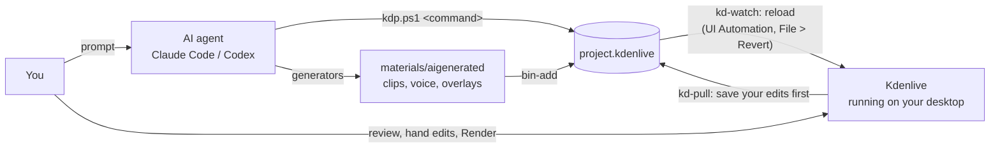

<div align="center">

# Movie Engine

**En AI-agent klipper din video i Kdenlive medan du tittar på, och du kan ta över när som helst.**

AI-agenter för programmering (Claude Code, Codex) bygger och ändrar riktiga Kdenlive-projekt: filmer, förklaringsvideor och vertikala kortvideor. Ändringarna syns direkt i redigeraren du har öppen. Portabelt, Windows, inga patchar av redigeraren.


[English](../../README.md) · [简体中文](README.zh-CN.md) · [繁體中文](README.zh-TW.md) · [हिन्दी](README.hi.md) · [Español](README.es.md) · [Français](README.fr.md) · [العربية](README.ar.md) · [বাংলা](README.bn.md) · [Português](README.pt.md) · [Русский](README.ru.md) · [اردو](README.ur.md) · [Bahasa Indonesia](README.id.md) · [Deutsch](README.de.md) · [日本語](README.ja.md) · [Türkçe](README.tr.md) · [한국어](README.ko.md) · [Українська](README.uk.md) · [Italiano](README.it.md) · [Polski](README.pl.md) · [Tiếng Việt](README.vi.md) · [فارسی](README.fa.md) · [ไทย](README.th.md) · [Kiswahili](README.sw.md) · [አማርኛ](README.am.md) · [Avañe'ẽ](README.gn.md) · [Setswana](README.tn.md) · [Shqip](README.sq.md) · [Беларуская](README.be.md) · [Български](README.bg.md) · [Bosanski](README.bs.md) · [Hrvatski](README.hr.md) · [Српски](README.sr.md) · [Crnogorski](README.cnr.md) · [Македонски](README.mk.md) · [Slovenščina](README.sl.md) · [Slovenčina](README.sk.md) · [Čeština](README.cs.md) · [Magyar](README.hu.md) · [Română](README.ro.md) · [Dansk](README.da.md) · [Norsk bokmål](README.nb.md) · [Norsk nynorsk](README.nn.md) · **Svenska** · [Íslenska](README.is.md) · [Suomi](README.fi.md) · [Eesti](README.et.md) · [Latviešu](README.lv.md) · [Lietuvių](README.lt.md) · [Nederlands](README.nl.md) · [Lëtzebuergesch](README.lb.md) · [Rumantsch](README.rm.md) · [Ελληνικά](README.el.md) · [Malti](README.mt.md) · [Gaeilge](README.ga.md) · [Català](README.ca.md) · [ქართული](README.ka.md) · [Հայերեն](README.hy.md) · [Azərbaycanca](README.az.md) · [Afrikaans](README.af.md) · [isiZulu](README.zu.md) · [isiXhosa](README.xh.md) · [Sesotho](README.st.md) · [Sepedi](README.nso.md) · [Xitsonga](README.ts.md) · [Tshivenḓa](README.ve.md) · [siSwati](README.ss.md) · [isiNdebele (South Africa)](README.nr.md) · [isiNdebele (Zimbabwe)](README.nd.md) · [chiShona](README.sn.md) · [Chichewa](README.ny.md) · [Ikinyarwanda](README.rw.md) · [Ikirundi](README.rn.md) · [Malagasy](README.mg.md) · [Soomaali](README.so.md) · [Afaan Oromoo](README.om.md) · [Qafar af](README.aa.md) · [ትግርኛ](README.ti.md) · [Sängö](README.sg.md) · [Kreol Seselwa](README.crs.md) · [TjiKalanga](README.kck.md) · [ChiNdau](README.ndc.md)

*Detta är en översättning. Den engelska README-filen är referensversionen.*

</div>

---

## Innehåll

- [Varför](#varför)
- [Hur det fungerar](#hur-det-fungerar)
- [Funktioner](#funktioner)
- [Krav](#krav)
- [Installation](#installation)
- [Snabbstart](#snabbstart)
- [Att arbeta med agenten](#att-arbeta-med-agenten)
- [Redigeringskommandoraden (`kdp.ps1`)](#redigeringskommandoraden-kdpps1)
- [Livesynkronisering med den öppna redigeraren](#livesynkronisering-med-den-öppna-redigeraren)
- [Generatorer: det Kdenlive inte klarar](#generatorer-det-kdenlive-inte-klarar)
- [Speakerröst och ljud](#speakerröst-och-ljud)
- [Gränssnittsspråk](#gränssnittsspråk)
- [Mappstruktur](#mappstruktur)
- [Tester och bevis](#tester-och-bevis)
- [Begränsningar](#begränsningar)
- [Felsökning](#felsökning)
- [Vanliga frågor](#vanliga-frågor)
- [Bidra](#bidra)
- [Tack](#tack)
- [Licens](#licens)

## Varför

Videoredigerare är byggda för en hand på musen. AI-agenter är bra på struktur, timing och upprepning: att lägga 300 klipp i takt med musiken, tajma varje textremsa mot rösten, göra om en scen efter feedback. Men de kan inte klicka sig igenom ett grafiskt gränssnitt utan att ta över ditt skrivbord.

Kdenlive är en kraftfull redigerare med öppen källkod, men på Windows har den **inget API för automatisering**: styrning via D-Bus finns bara i Linux-byggen, och de forkar som lägger till ett sådant är antingen övergivna eller osäkra. Movie Engine löser detta utan att patcha redigeraren:

1. Agenten ändrar projektfilen `.kdenlive` via en testad kommandorad (`engine/kdp.ps1`).
2. Det körande Kdenlive får besked att läsa om filen via Windows UI Automation, utan tangenttryckningar, utan mus och utan att stjäla fokus.
3. Dina egna osparade ändringar sparas först och skrivs aldrig över.

Så agenten klipper och du granskar, eller så redigerar du själv. Ni arbetar båda i samma projekt, i samma redigerare, samtidigt.

## Hur det fungerar



Varje redigeringskommando följer samma säkra cykel:

1. **Pull.** Om Kdenlive har osparade ändringar får det besked att spara dem (knappen Spara i verktygsfältet via UI Automation), och sparandet bekräftas.
2. **Redigering.** Kommandot ändrar XML-filen under ett lås, efter en hashkontroll och med en ögonblicksbild för ångra. Om filen har ändrats under tiden skrivs ingenting.
3. **Omladdning.** Bevakaren ser AI:ns stämpel och kör File > Revert i den öppna redigeraren. Det räknas som lyckat först när tidslinjewidgeten faktiskt har byggts om.
4. **Konflikt.** Om du har börjat redigera under tiden laddas ingenting om och ditt arbete finns kvar. AI-versionen läggs undan, och agenten tillämpar sin ändring på nytt ovanpå din.

## Funktioner

- **Fullständig projektredigering utan grafiskt gränssnitt**: ungefär 120 kommandon som täcker projektkorgen (bin), tidslinjen, effekter, kompositioner, spår, guider, markörer, undertexter, sekvenser, hastighet och tidsomkartläggning, bildspel, titlar, proxyfiler, rendering samt ångra/gör om. Se [kommandoreferensen](#redigeringskommandoraden-kdpps1).
- **Livesynkronisering med den öppna redigeraren.** AI:ns ändringar dyker upp i det Kdenlive du tittar på; dina osparade ändringar sparas först och går aldrig förlorade.
- **Stör aldrig ditt skrivbord.** Ingen fokusstöld, inga tangenttryckningar och ingen musinmatning. Testredigerare körs på ett osynligt Windows-skrivbord.
- **Portabelt.** Redigerare, inställningar, Node.js, typsnitt och verktyg ligger i en enda mapp. Kopiera den till en annan dator så fungerar det; ingenting skrivs till Program Files eller till din Windows-profil.
- **Generatorer för det Kdenlive inte klarar**: kinetisk text animerad bokstav för bokstav, handritade markeringar, 3D-scener av gränssnitt, marköranimationer och långa interaktiva förklaringsfilmer. De renderas på GPU:n med äkta rörelseoskärpa och placeras på tidslinjen som vanliga klipp.
- **Speakerröst med ordtidpunkter** (Microsoft Edge TTS, ingen API-nyckel). Textremsor och händelser utlöses exakt på rätt ord.
- **Syntetiserade ljudeffekter** (whoosh, click, pop, riser, impact med flera), genererade i kod.
- **Bevisat, inte antaget.** Varje kommando har en kontroll av resultatet, effekter och kompositioner testas en i taget, och de råa resultaten finns i `docs/proof/`.
- **Instruktioner för agenter ingår.** `AGENTS.md` och färdigheterna (skills) i `.claude/skills/` lär Claude Code och Codex arbetsflödet, filformatet och fallgroparna.

## Krav

| | |
|---|---|
| OS | Windows 10 eller 11, x64 |
| Redigerare | Kdenlive **26.08.3**, portabelt bygge (standalone). Andra versioner är inte testade. |
| Node.js | 18 eller nyare: `.zip`-filen för Windows x64 från nodejs.org, uppackad i `engine/node/` |
| Webbläsare | Microsoft Edge (ingår i Windows); används headless av scenrenderarna |
| Agent | [Claude Code](https://claude.com/claude-code) eller Codex. Valfritt: varje verktyg går också att köra för hand. |
| Disk | ungefär 1 GB för redigeraren och verktygen, plus ditt mediematerial |
| GPU | vilken GPU som helst med hårdvarukodning av H.264 snabbar upp `film-render.mjs` (annars används mjukvarukodning) |

## Installation

Allt installeras **inuti mappen**. Inget kräver administratörsrättigheter.

```powershell
git clone https://github.com/vladtarrow/movie-engine.git
cd movie-engine
```

**1. Node.js.** Ladda ner `.zip`-filen för Windows x64 av Node.js 18 eller nyare från <https://nodejs.org/en/download> och packa upp innehållet i `engine\node\`, så att `engine\node\node.exe` och `engine\node\npm.cmd` ligger där. Varken installationsprogram eller systemets Node behövs. Alla skript körs via `engine\node.cmd`, aldrig via systemets Node.

**2. Node-paket** för röstverktyget och renderarna (versionerna är låsta i `engine/voice/package.json`):

```powershell
engine\node\npm.cmd install --prefix engine\voice
```

**3. Portabelt Kdenlive 26.08.3.** Ladda ner `kdenlive-26.08.3_standalone.exe` från <https://download.kde.org/stable/kdenlive/26.08/windows/> till `engine\installer\`, kontrollera den och packa upp den:

```powershell
(Get-FileHash engine\installer\kdenlive-26.08.3_standalone.exe -Algorithm SHA256).Hash
# expected: A25427B1DFF2C17E3B0386E991BB1A719382BB3176D1A90E441CDAEB6E0A967D
engine\installer\kdenlive-26.08.3_standalone.exe -o"engine\Kdenlive" -y
```

Redigeraren hamnar i `engine\Kdenlive\kdenlive-26.08.3_standalone\bin\`. Den innehåller redan `melt.exe` och `ffmpeg.exe`.

**4. Första start.**

```powershell
engine\kdenlive.cmd
```

Kdenlive sparar alla sina inställningar i `engine\profile-kdenlive\`, inte i din Windows-profil. Vid första starten visar den en installationsguide en enda gång.

## Snabbstart

### Med en agent

Öppna mappen i Claude Code (eller Codex) och be om det med vanliga ord:

> Skapa ett nytt vertikalt projekt "launch-teaser" i 30 fps. Lägg de tre skärmbilderna från `materials/designers/launch/` på tidslinjen, 2,5 s var med en kort övertoning, lägg till en speakerröst från `script.txt` och tajma en kinetisk textremsa till varje replik.

> Öppna det i Kdenlive åt mig.

> Den andra bilden är för lång. Korta den till 1,8 s och flytta upp logotypen en bit.

Agenten följer `AGENTS.md`: den redigerar via `kdp.ps1`, renderar bara de klipp som klippningen behöver och håller den öppna redigeraren synkroniserad. Du granskar i Kdenlive, redigerar för hand när du vill och trycker på Render när du är nöjd.

### För hand

```powershell
# a new 1080x1920 30 fps project with 2 video and 2 audio tracks
powershell -NoProfile -ExecutionPolicy Bypass -File engine\kdp.ps1 new -Project projects\hello\hello.kdenlive -Profile vertical_hd_30

# a 3-second title and a colour background
powershell -NoProfile -ExecutionPolicy Bypass -File engine\kdp.ps1 bin-color -Project projects\hello\hello.kdenlive -Color '#203060' -Seconds 3 -Name bg
powershell -NoProfile -ExecutionPolicy Bypass -File engine\kdp.ps1 title -Project projects\hello\hello.kdenlive -Text "Hello" -Seconds 3 -Name hi

# place them: background on V1, title above it on V2
powershell -NoProfile -ExecutionPolicy Bypass -File engine\kdp.ps1 add -Project projects\hello\hello.kdenlive -Bin bg -Track V1 -At 0
powershell -NoProfile -ExecutionPolicy Bypass -File engine\kdp.ps1 add -Project projects\hello\hello.kdenlive -Bin hi -Track V2 -At 0

# a check frame, then open it in the editor
powershell -NoProfile -ExecutionPolicy Bypass -File engine\kdp.ps1 frame -Project projects\hello\hello.kdenlive -At 1.5 -Out out\hello\check.png
engine\kdenlive.cmd projects\hello\hello.kdenlive
```

För att senare öppna det senaste projektet igen dubbelklickar du på `open-last-project.cmd`.

## Att arbeta med agenten

Agenten läser `AGENTS.md` (Codex) eller `CLAUDE.md`, som importerar den (Claude Code), plus två färdigheter:

| Färdighet | Lär ut |
|---|---|
| `.claude/skills/kdenlive-project-file` | formatet `.kdenlive` / MLT XML, `kdp.ps1`, kontroll med `melt` |
| `.claude/skills/kdenlive-live` | att styra den körande redigeraren säkert: start, pull, omladdning, skärmbild av dess fönster |

Regler som agenten följer och som du kan lita på:

- Den tar aldrig över din mus, ditt tangentbord eller ditt fokus, och tar aldrig skärmbilder av ditt skrivbord (bara av redigerarens eget fönster).
- Den utför stegen i gränssnittet själv (spara, öppna, ladda om) i stället för att be dig klicka.
- Den frågar innan den laddar ner något och innan den tar bort något.
- Den renderar bara det som arbetet kräver (scenklipp, kontrollbilder). Den färdiga filmen renderar den bara när du ber om det.
- När Kdenlive inte klarar något bra bygger agenten det utanför med kod och lägger in resultatet som ett klipp. Den urvattnar inte effekten.

## Redigeringskommandoraden (`kdp.ps1`)

```powershell
powershell -NoProfile -ExecutionPolicy Bypass -File engine\kdp.ps1 <command> -Project <file.kdenlive> [options]
```

Tider anges i sekunder med punkt (`2.5`). Spåren heter `V1 V2 …` (V1 längst ner) och `A1 A2 …`. Ett klipp anges med `-Track` plus valfri tidpunkt `-At` inom klippet. Effektparametrar anges i `-Params "name=value||name=value"`. Den fullständiga listan med alla alternativ finns i huvudet av `engine/kdp.ps1`.

| Grupp | Kommandon |
|---|---|
| Projekt | `new`, `profiles`, `info`, `validate`, `fonts`, `profile-set`, `profile-from-clip`, `zone`, `archive`, `backups`, `rebase`, `otio-export`, `otio-import` |
| Projektkorg (bin) | `bin-add`, `bin-color`, `title`, `title-text`, `title-save`, `title-template`, `bin-rename`, `bin-remove`, `bin-info`, `bin-set`, `bin-duplicate`, `bin-replace-file`, `bin-reload`, `folder`, `bin-folder`, `relink`, `clean`, `generator`, `playlist-clip`, `extract-audio`, `transcode` |
| Tidslinje | `add`, `add-av`, `move`, `copy`, `trim`, `ripple-trim`, `slip`, `split`, `remove`, `speed`, `remap`, `disable`, `enable`, `group`, `ungroup`, `mix`, `unmix`, `space-insert`, `space-remove`, `spaces-remove-all`, `track-clear`, `replace-in-timeline` |
| Effekter | `effects`, `effect-info`, `effect-add`, `effect-list`, `effect-set`, `effect-remove`, `effect-copy`, `effect-clear`, `effects-all`, `bin-effect`, `effect-templates`, `effect-template` |
| Kompositioner | `compositions`, `comp-info`, `comp-add`, `comp-list`, `comp-set`, `comp-remove` |
| Spår | `track-add`, `track-remove`, `track-set` |
| Guider och markörer | `guide-add`, `guide-list`, `guide-remove`, `guide-set`, `guide-clear`, `guide-export`, `guide-category`, `marker`, `marker-list`, `marker-set`, `marker-remove` |
| Undertexter | `sub-add`, `sub-import`, `sub-export`, `sub-state` |
| Sekvenser | `sequence-add`, `sequences`, `copy-to-sequence`, `expand`; varje kommando med `-Sequence <name>` fungerar inuti den sekvensen |
| Särskilda | `slideshow`, Lottie- / Glaxnimate-animationer via `bin-add`, `proxy`, `stabilize`, `scene-split`, `speed-job`, `subclip` |
| Utdata | `frame` (en PNG), `preview` (snabb rendering med melt), `render` (Kdenlives egen renderare eller en förinställning), `presets` |
| Historik | `undo`, `redo`, `clear-history` (ögonblicksbilder i `projects/<name>/.kdp-history`) |

Beteenden som är bra att känna till:

- Länkade ljud- och videohalvor flyttas, trimmas, delas och tas bort tillsammans (`-Alone` för bara den ena halvan).
- Ett kommando som misslyckas avslutas med kod 1 och skriver ingenting.
- Effekter som Windows-bygget inte kan köra avvisas i stället för att tyst ignoreras (lista: `docs/proof/assets.txt`).
- Varje menyåtgärd i Kdenlive är kopplad till ett kommando, en annan väg eller "endast visning" i `engine/tools/data/kdenlive-actions.csv`. Se `docs/kdenlive-coverage.md`.

## Livesynkronisering med den öppna redigeraren

| Skript | Vad det gör | Slutkoder |
|---|---|---|
| `engine\kd-pull.ps1 -Project <f>` | får Kdenlive att spara dina ändringar och bekräftar det | 0 filen är aktuell, 3 körs inte, 4 inte bekräftat |
| `engine\kd-reload.ps1 -Project <f>` | File > Revert, bekräftat genom den ombyggda tidslinjen | 0 bekräftat, 2 du har osparade ändringar (ingenting kastat), 3 körs inte, 4 misslyckades |
| `engine\kd-watch.ps1 -Project <f>` | bevakare i bakgrunden: laddar om efter varje skrivning av AI:n, loggar konflikter | logg i `engine\kd-watch.log`; ta bort `engine\kd-watch.run` för att stoppa |
| `engine\kdenlive-bg.ps1 [project]` | startar Kdenlive minimerat åt en agent | 0 inläst, 4 inte bekräftat |
| `engine\kdenlive.cmd [project]` | startar Kdenlive åt dig | |

Starta bevakaren en gång per session:

```powershell
Start-Process powershell -WindowStyle Hidden -ArgumentList '-NoProfile','-ExecutionPolicy','Bypass','-File','engine\kd-watch.ps1','-Project','projects\hello\hello.kdenlive'
```

Stora projekt: en omladdning av ett projekt med 1000 klipp tar flera minuter, och verktygen väntar på den i stället för att rapportera i förtid. Projekt öppnas via *File > Open Recent* i en tom redigerare, eftersom Qt går igenom varje objekt på tidslinjen för tillgänglighet när en fil öppnas direkt, och det var ungefär 10 minuter långsammare.

## Generatorer: det Kdenlive inte klarar

Kdenlive/MLT har ingen textanimation bokstav för bokstav, inga uttryck (expressions) och nästan ingen 3D, och tunga effekter gör uppspelningen långsam. Movie Engine renderar sådana delar utanför och lägger dem på tidslinjen som vanliga klipp, oftast med alfakanal, på ett spår ovanför bilderna. Generatorskriptet och dess indata stannar i projektmappen, så ett klipp kan genereras på nytt när text, typsnitt eller timing ändras.

| Verktyg | Skapar |
|---|---|
| `engine/tools/kinetic-text.ps1` | kinetiska textremsor animerade bokstav för bokstav, varje ord tajmat från `voice.json`, markeringsruta |
| `engine/tools/annotate.ps1` | handritade cirklar, rutor, understrykningar och pilar som ritas fram över en skärmbild |
| `engine/tools/card-entrance.ps1` | ett kort med en skärmbild som stiger upp och skalas in med en mjuk skugga |
| `engine/tools/pdf-to-png.ps1` | bilder (slides) från en PDF-export |
| `engine/tools/html-render.mjs` | vilken HTML/CSS/canvas-scen som helst till video: gränssnittsanimation, markörer, 3D, masker |
| `engine/tools/film-render.mjs` + `film/` | långa, interaktiva förklaringsfilmer på en canvas: ett klipp per röstreplik, händelser utlöses på uttalade ord, rörelseoskärpa på GPU:n i ungefär 45 fps |

Båda renderarna styr det Microsoft Edge som följer med Windows, headless, med en tillfällig profil och utan nätverksåtkomst.

### Demor

```powershell
# a 3-second 3D title card with a cursor click
engine\node.cmd engine\tools\html-render.mjs examples\demo\scene\scene.html examples\demo\out --frames 0,30,60,89
engine\node.cmd engine\tools\html-render.mjs examples\demo\scene\scene.html examples\demo\out\scene.mp4

# a 4-shot interactive film timed to two voice lines
engine\node.cmd engine\tools\film-render.mjs examples\demo\film\film.html examples\demo\out --check
engine\node.cmd engine\tools\film-render.mjs examples\demo\film\film.html examples\demo\out --shots all --width 640
engine\node.cmd engine\tools\film-render.mjs examples\demo\film\film.html examples\demo\out\clips --suffix -v01
```

En film består av tre små filer. `data.js` innehåller tagningarna och ordens tidpunkter. `direction.js` har en rad per tagning:

```text
1 | hover 192 108 @brand | tag 300 60 Your brand @deserves | confetti 192 90 @film
2 say=A film that/*explains* it
3 | click 116 108 @before | click 268 108 @after | chips Before~After @after
4 scene=counter | count 0 120 % @count
```

`scenes.js` innehåller de tagningar som ritas från grunden. `@word` utlöser en händelse när rösten säger just det ordet. Bland händelserna finns click, hover, drag, zoom, lens, ring, arrow, chips, toggle, slider, toast, type, count och confetti; den fullständiga syntaxen står överst i `engine/tools/film/film-kit.js`.

## Speakerröst och ljud

```powershell
engine\node.cmd engine\voice\voice.mjs lines.json materials\aigenerated\hello\voice en-US-AndrewMultilingualNeural +0%
```

`lines.json` är en lista med repliker. Verktyget skriver en mp3 per replik plus `voice.json`, med längden och början och slutet på varje ord. Replikerna cachas, så om du ändrar en replik genereras bara den på nytt. Verktyget använder Microsoft Edges text-till-tal online via paketet `msedge-tts`: ingen nyckel behövs, men tjänsten är inofficiell och kräver internet.

```powershell
engine\node.cmd engine\audio\sfx.mjs materials\aigenerated\sfx
```

Detta syntetiserar whoosh, whoosh-long, swipe, click, pop, tick, riser, impact, ding och reveal i kod; en färdig uppsättning finns i `materials/aigenerated/sfx/`. Fyll ut ljud som är kortare än en bildruta med tystnad innan du placerar dem (`-af apad=whole_dur=0.0667`).

## Gränssnittsspråk

Startskripten startar Kdenlive på **engelska** som standard. För att använda ett annat språk anger du `MOVIE_ENGINE_UI_LANG` före starten:

```powershell
$env:MOVIE_ENGINE_UI_LANG = 'ru'; engine\kdenlive.cmd
```

UI Automation hittar menyobjekt via deras synliga namn. Namn för 31 gränssnittsspråk är inbyggda (`engine/tools/kd-ui.ps1`, `$KdNames`). För andra språk lägger du till deras namn där och kontrollerar med:

```powershell
powershell -NoProfile -ExecutionPolicy Bypass -File engine\tools\kd-langcheck.ps1
```

## Mappstruktur

```text
movie-engine/
├─ AGENTS.md, CLAUDE.md          instructions for AI agents
├─ .claude/skills/               agent skills: project file format, live editor
├─ engine/
│  ├─ kdp.ps1                    the editing command line
│  ├─ kd-pull / kd-reload / kd-watch .ps1, kdenlive.cmd, kdenlive-bg.ps1
│  ├─ tools/                     internals, generators, tests, data (action map)
│  ├─ voice/  audio/  fonts/     TTS, synthesized SFX, Poppins (OFL)
│  ├─ Kdenlive/  node/           portable editor and Node.js (not in git)
│  └─ profile-kdenlive/          the editor's settings (not in git)
├─ projects/<name>/<name>.kdenlive
├─ materials/
│  ├─ download/                  stock and downloaded files (not in git)
│  ├─ aigenerated/               everything the AI made (sfx/ and test-kit/ ship with the engine)
│  ├─ designers/  brand/         files from your team, brand assets
├─ examples/demo/                demos of the scene and film renderers
├─ out/                          renders (not in git)
└─ docs/                         proofs, coverage, translations of this README
```

Sökvägar till media inuti projekten är relativa. Om du flyttar eller kopierar mappen skriver `kdp.ps1 rebase` (som också körs automatiskt av `kdenlive.cmd`) in den nya platsen i projektet.

## Tester och bevis

Påståenden om vad som fungerar stöds av kontroller av resultatet, inte av att "funktionen kördes". Sammanfattningen finns i [`docs/kdenlive-proof.md`](../../docs/kdenlive-proof.md), och de råa utdata finns i `docs/proof/`.

| Test | Kontrollerar |
|---|---|
| `engine\tools\kdp-clitest.ps1` | varje kommando i `kdp.ps1`, via kommandoraden, genom att jämföra det resulterande projektet |
| `engine\tools\kd-livetest.ps1` | pull, omladdning, bevakare, konflikter och kapplöpningar mot ett riktigt Kdenlive på ett osynligt skrivbord |
| `engine\tools\kdp-assetsweep.ps1` | varje effekt och komposition: renderar och jämför bildrutor |
| `engine\tools\kdp-portabletest.ps1` | kopierar mappen till en annan plats och arbetar från kopian |
| `engine\tools\kd-langcheck.ps1` | gränssnittsspråket och att UI Automation hittar menyn |
| `engine\tools\kdp-coverage-check.ps1` | att varje menyåtgärd är kopplad och att inget bevis är äldre än koden |

```powershell
powershell -NoProfile -ExecutionPolicy Bypass -File engine\tools\kdp-clitest.ps1 -Report docs\proof\clitest.txt
powershell -NoProfile -ExecutionPolicy Bypass -File engine\tools\kd-livetest.ps1 -Report docs\proof\live-en.txt
```

Testredigerare körs bara på ett dolt skrivbord med en egen profil, så testerna rör aldrig ditt öppna Kdenlive eller ditt fokus.

## Begränsningar

- **Endast Windows**, endast Kdenlive **26.08.3**. Linux har D-Bus och skulle behöva en annan brygga.
- När redigeraren startar tar den tangentbordsfokus i ungefär 3 sekunder medan det tomma fönstret visas. Agenter frågar innan de startar den medan du arbetar. Omladdningar och ändringar tar inte fokus.
- Windows-bygget saknar MLT-modulerna sox, ladspa och movit samt vissa frei0r/avfilter-effekter; `kdp.ps1` avvisar dem (`docs/proof/assets.txt`).
- Export och import av OpenTimelineIO för bara över klipp och luckor. Multikamera har ingen växling mellan vinklar i realtid (klipp görs med split/remove/hide).
- "Save As…" via UI Automation i ett minimerat fönster öppnar ingen dialogruta; agenten använder `archive` eller filkopior i stället.
- Taligenkänning (automatiska undertexter) kräver Whisper eller Vosk, som inte medföljer.
- Titlar som görs med Kdenlives titelverktyg använder typsnitt som är installerade i Windows. För garanterad typografi renderar du text med generatorerna, som läser in typsnitt från `engine/fonts/`.
- Edge TTS är en inofficiell onlinetjänst och kan ändras eller sluta fungera.

## Felsökning

| Symptom | Orsak och åtgärd |
|---|---|
| Kdenlive körs, men inget visas när du klickar på det i aktivitetsfältet | Den sparade fönsterpositionen ligger utanför skärmen. Stäng programmet och ta bort posterna `kdockLayout` i `engine\profile-kdenlive\AppData\Local\kdenliverc`, eller flytta fönstret med `SetWindowPos` (se `AGENTS.md`). |
| `kd-reload.ps1` avslutas med 2 | Du har osparade ändringar. Ingenting har kastats. Kör `kd-pull.ps1` och tillämpa sedan ändringen igen (`kdp.ps1` gör detta själv). |
| `CONFLICT` i `engine\kd-watch.log` | Du och agenten redigerade i samma ögonblick. Din version finns kvar i redigeraren, och AI-versionen ligger i `projects\<name>\.kdp-history\<name>\conflict\`. Be agenten att tillämpa sin ändring igen. |
| Ett kommando avslutas med 1 och "pull not confirmed" | Kdenlive är upptaget eller visar en dialogruta. Stäng dialogrutan eller vänta tills inläsningen är klar och försök sedan igen. |
| Ett PowerShell-skript går inte att tolka | Skript med text utanför ASCII måste sparas som UTF-8 **med BOM** för Windows PowerShell 5.1. |
| `voice.mjs` stannar med "Stream closed before the synthesis completed" | Oftast ett nätverksproblem, eller SSML utan escape-tecken i äldre kopior. `voice.mjs` hanterar själv `& < >`. |
| Det tar många minuter att öppna ett stort projekt | Öppna det via `kdenlive.cmd` / `kdenlive-bg.ps1`, aldrig som `kdenlive.exe project.kdenlive`. |

## Vanliga frågor

**Behöver jag Claude Code eller Codex?**
Nej. Varje verktyg är ett vanligt skript som du kan köra för hand. Det är agenten som gör det snabbt: den planerar klippningen, kör verktygen och håller redigeraren synkroniserad.

**Kommer agenten att skriva över mina manuella ändringar?**
Nej. Före varje skrivning sparas och bekräftas dina osparade ändringar. Om du redigerar medan agenten skriver avvisas skrivningen eller läggs undan som en konflikt, men den tillämpas aldrig ovanpå ditt arbete.

**Kan jag fortsätta använda Kdenlive som vanligt?**
Ja. Det är standardversionen av Kdenlive med en egen inställningsmapp. Redigera, förhandsgranska och rendera som vanligt.

**Fungerar det med ett Kdenlive som jag redan har installerat?**
Det använder sin egen portabla kopia i `engine\Kdenlive\`, så ditt installerade Kdenlive och dess inställningar lämnas orörda.

**Varför inte en fork av Kdenlive med ett API, eller en annan redigerare?**
På Windows finns ingen underhållen och säker fork (undersökning från 2026-11). OpenShot, Blender VSE, DaVinci Resolve, Shotcut och webbaserade redigerare utvärderades; Kdenlive gav det mest omfattande redigeringsdjupet. Ett förslag om ett REST API i huvudprojektet (merge request !902) bevakas.

**Kan den rendera den färdiga videon?**
Ja, med `kdp.ps1 render` (Kdenlives egen renderare, dold), eller så trycker du själv på Render i redigeraren.

**Laddas mitt mediematerial upp någonstans?**
Nej. Bara texten till speakerrösten skickas till tjänsten Edge TTS när du genererar röst. Scenrenderarna körs med nätverket avstängt.

## Bidra

Bidrag är välkomna. Se [CONTRIBUTING.md](../../CONTRIBUTING.md). I korthet:

- Varje ny eller ändrad operation i `kdp.ps1` behöver en kontroll av resultatet i `kdp-clitest.ps1`, en post i åtgärdskartan och en ny körning av `kdp-coverage-check.ps1`.
- Starta aldrig ett test-Kdenlive på det synliga skrivbordet; använd `engine/tools/kd-hidden.ps1`.
- Håll allt portabelt: inga installationer utanför mappen, inga absoluta sökvägar i projekten.
- Skriv ner verifierade egenheter i `AGENTS.md` eller i motsvarande färdighet.

## Tack

- [Kdenlive](https://kdenlive.org) och [MLT](https://www.mltframework.org): redigeraren och motorn under den.
- [FFmpeg](https://ffmpeg.org), som följer med Kdenlive.
- [msedge-tts](https://www.npmjs.com/package/msedge-tts) för speakerrösten.
- [Poppins](https://fonts.google.com/specimen/Poppins) av Indian Type Foundry, SIL Open Font License (`engine/fonts/OFL.txt`).
- `engine/tools/data/kdenliveui-26.08.3.rc`: Kdenlives menyfil, hämtad från källkoden till Kdenlive 26.08.3; används bara av täckningskontrollen. Den omfattas fortfarande av Kdenlives GPL-licens, inte av MIT License.

## Licens

Movie Engines egen kod släpps under [MIT-licensen](../../LICENSE). Kdenlive, MLT, FFmpeg, Node.js-paketen och typsnittet Poppins behåller sina egna licenser.
