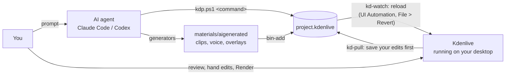

<div align="center">

# Movie Engine

**Wakala wa AI anahariri video yako ndani ya Kdenlive huku ukitazama, na unaweza kuchukua usukani wakati wowote.**

Mawakala wa AI wa kuandika programu (Claude Code, Codex) hujenga na kubadilisha miradi halisi ya Kdenlive: filamu, video za maelezo na video fupi za wima. Mabadiliko yanaonekana papo hapo katika kihariri ulichofungua. Ni portable (inabebeka), kwa Windows, bila kubadilisha msimbo wa kihariri.


[English](../../README.md) · [简体中文](README.zh-CN.md) · [繁體中文](README.zh-TW.md) · [हिन्दी](README.hi.md) · [Español](README.es.md) · [Français](README.fr.md) · [العربية](README.ar.md) · [বাংলা](README.bn.md) · [Português](README.pt.md) · [Русский](README.ru.md) · [اردو](README.ur.md) · [Bahasa Indonesia](README.id.md) · [Deutsch](README.de.md) · [日本語](README.ja.md) · [Türkçe](README.tr.md) · [한국어](README.ko.md) · [Українська](README.uk.md) · [Italiano](README.it.md) · [Polski](README.pl.md) · [Tiếng Việt](README.vi.md) · [فارسی](README.fa.md) · [ไทย](README.th.md) · **Kiswahili** · [አማርኛ](README.am.md) · [Avañe'ẽ](README.gn.md) · [Setswana](README.tn.md)

*Hii ni tafsiri; README ya Kiingereza ndiyo toleo la marejeleo.*

</div>

---

## Yaliyomo

- [Kwa nini](#kwa-nini)
- [Jinsi inavyofanya kazi](#jinsi-inavyofanya-kazi)
- [Vipengele](#vipengele)
- [Mahitaji](#mahitaji)
- [Usakinishaji](#usakinishaji)
- [Kuanza haraka](#kuanza-haraka)
- [Kufanya kazi na wakala](#kufanya-kazi-na-wakala)
- [Mstari wa amri wa kuhariri (`kdp.ps1`)](#mstari-wa-amri-wa-kuhariri-kdpps1)
- [Kusawazisha moja kwa moja na kihariri kilichofunguliwa](#kusawazisha-moja-kwa-moja-na-kihariri-kilichofunguliwa)
- [Jenereta: yale ambayo Kdenlive haiwezi kufanya](#jenereta-yale-ambayo-kdenlive-haiwezi-kufanya)
- [Sauti ya usimulizi na athari za sauti](#sauti-ya-usimulizi-na-athari-za-sauti)
- [Lugha ya kiolesura](#lugha-ya-kiolesura)
- [Mpangilio wa folda](#mpangilio-wa-folda)
- [Majaribio na uthibitisho](#majaribio-na-uthibitisho)
- [Mapungufu](#mapungufu)
- [Utatuzi wa matatizo](#utatuzi-wa-matatizo)
- [Maswali ya mara kwa mara](#maswali-ya-mara-kwa-mara)
- [Kuchangia](#kuchangia)
- [Shukrani](#shukrani)
- [Leseni](#leseni)

## Kwa nini

Vihariri vya video vimeundwa kwa ajili ya mkono ulioshika kipanya (mouse). Mawakala wa AI (akili bandia) ni hodari katika muundo, upangaji wa muda na kazi zinazojirudia: kuweka klipu 300 kwenye mdundo, kulinganisha kila maandishi ya manukuu na sauti, kufanya upya onyesho baada ya maoni. Lakini hawawezi kubofya kwenye GUI (kiolesura cha picha) bila kuitwaa desktop yako.

Kdenlive ni kihariri imara cha open-source (chanzo huria), lakini kwenye Windows **hakina API ya uendeshaji otomatiki**: udhibiti kupitia D-Bus upo tu kwenye matoleo ya Linux, na fork (matawi) zinazoiongeza ama hazitunzwi tena ama si salama. Movie Engine inatatua tatizo hili bila kubadilisha kihariri:

1. Wakala anahariri faili la mradi la `.kdenlive` kupitia mstari wa amri uliojaribiwa (`engine/kdp.ps1`).
2. Kdenlive inayoendeshwa inaambiwa ipakie faili upya kupitia Windows UI Automation, bila kubonyeza vitufe, bila kipanya na bila kunyakua focus (umakini wa dirisha).
3. Mabadiliko yako ambayo bado hayajahifadhiwa huhifadhiwa kwanza na hayafutwi kamwe.

Kwa hiyo wakala anahariri na wewe unakagua, au unahariri mwenyewe kwa mkono. Nyote wawili mnafanya kazi kwenye mradi uleule, katika kihariri kilekile, kwa wakati mmoja.

## Jinsi inavyofanya kazi



Kila amri ya kuhariri hufuata mzunguko uleule salama:

1. **Pull (kuvuta).** Ikiwa Kdenlive ina mabadiliko ambayo hayajahifadhiwa, inaambiwa iyahifadhi (kitufe cha Save kwenye toolbar kupitia UI Automation), na uhifadhi huo unathibitishwa.
2. **Kuhariri.** Amri inabadilisha XML chini ya lock (kufuli), baada ya ukaguzi wa hash na pamoja na snapshot ya kutendua (undo). Ikiwa faili lilibadilika katikati, hakuna kinachoandikwa.
3. **Kupakia upya.** Mlinzi (watcher) anaona alama ya AI na kuendesha File > Revert katika kihariri kilichofunguliwa. Mafanikio yanahesabiwa tu pale widget ya timeline imejengwa upya kweli.
4. **Mgongano.** Ikiwa ulianza kuhariri katikati, hakuna kinachopakiwa upya na kazi yako inabaki. Toleo la AI linawekwa kando, na wakala anaweka upya badiliko lake juu ya lako.

## Vipengele

- **Kuhariri mradi kikamilifu bila GUI**: takriban amri 120 zinazohusu bin, timeline, athari (effects), compositions, tracks, guides, markers, manukuu, sequences, kasi na time remap, slideshows, mada (titles), proxies, kurender na undo/redo. Tazama [marejeleo ya amri](#mstari-wa-amri-wa-kuhariri-kdpps1).
- **Kusawazisha moja kwa moja na kihariri kilichofunguliwa.** Mabadiliko ya AI yanaonekana katika Kdenlive unayoitazama; mabadiliko yako ambayo hayajahifadhiwa huhifadhiwa kwanza na hayapotei kamwe.
- **Haisumbui desktop yako kamwe.** Hakuna kunyakua focus, kubonyeza vitufe wala ingizo la kipanya. Vihariri vya majaribio huendeshwa kwenye desktop ya Windows isiyoonekana.
- **Inabebeka.** Kihariri, mipangilio, Node.js, fonti na zana vyote viko katika folda moja. Inakili kwenye PC nyingine na inafanya kazi; hakuna kinachoandikwa kwenye Program Files au kwenye wasifu wako wa Windows.
- **Jenereta kwa yale ambayo Kdenlive haiwezi kufanya**: maandishi yanayosonga herufi kwa herufi (kinetic text), alama zilizochorwa kwa mkono, maonyesho ya UI ya 3D, uhuishaji wa kishale (cursor) na filamu ndefu shirikishi za "maelezo". Zinarenderiwa kwenye GPU zikiwa na motion blur halisi na kuwekwa kwenye timeline kama klipu za kawaida.
- **Sauti ya usimulizi yenye muda wa kila neno** (Microsoft Edge TTS, bila API key). Manukuu na vitendo hutokea hasa kwenye neno husika.
- **Athari za sauti zilizotengenezwa kwa msimbo** (whoosh, click, pop, riser, impact na nyinginezo).
- **Imethibitishwa, haikudhaniwa tu.** Kila amri ina ukaguzi wa matokeo, athari na compositions zinajaribiwa moja baada ya nyingine, na matokeo ghafi yako katika `docs/proof/`.
- **Maelekezo ya wakala yamejumuishwa.** `AGENTS.md` na skills zilizo katika `.claude/skills/` zinafundisha Claude Code na Codex mtiririko wa kazi, muundo wa faili na mitego yake.

## Mahitaji

| | |
|---|---|
| Mfumo wa uendeshaji | Windows 10 au 11, x64 |
| Kihariri | Toleo la portable (standalone) la Kdenlive **26.08.3**. Matoleo mengine hayajajaribiwa. |
| Node.js | 18 au mpya zaidi: `.zip` ya Windows x64 kutoka nodejs.org, imefunguliwa ndani ya `engine/node/` |
| Kivinjari | Microsoft Edge (sehemu ya Windows); hutumiwa bila dirisha (headless) na vi-renderer vya maonyesho |
| Wakala | [Claude Code](https://claude.com/claude-code) au Codex. Si lazima: kila zana pia inaendeshwa kwa mkono. |
| Diski | takriban GB 1 kwa kihariri na zana, pamoja na media yako |
| GPU | GPU yoyote yenye usimbaji wa H.264 wa vifaa (hardware) huongeza kasi ya `film-render.mjs` (bila hiyo hutumia software) |

## Usakinishaji

Kila kitu kinasakinishwa **ndani ya folda**. Hakuna kinachohitaji haki za admin.

```powershell
git clone https://github.com/vladtarrow/movie-engine.git
cd movie-engine
```

**1. Node.js.** Pakua `.zip` ya Windows x64 ya Node.js 18 au mpya zaidi kutoka <https://nodejs.org/en/download> na ufungue yaliyomo ndani ya `engine\node\`, ili `engine\node\node.exe` na `engine\node\npm.cmd` viwepo hapo. Hakuna installer wala Node ya mfumo inayohitajika. Skripti zote huendeshwa kupitia `engine\node.cmd`, kamwe si kupitia Node ya mfumo.

**2. Vifurushi vya Node** kwa zana ya sauti na vi-renderer (matoleo yamefungwa katika `engine/voice/package.json`):

```powershell
engine\node\npm.cmd install --prefix engine\voice
```

**3. Kdenlive 26.08.3 portable.** Pakua `kdenlive-26.08.3_standalone.exe` kutoka <https://download.kde.org/stable/kdenlive/26.08/windows/> ndani ya `engine\installer\`, likague na ulifungue:

```powershell
(Get-FileHash engine\installer\kdenlive-26.08.3_standalone.exe -Algorithm SHA256).Hash
# expected: A25427B1DFF2C17E3B0386E991BB1A719382BB3176D1A90E441CDAEB6E0A967D
engine\installer\kdenlive-26.08.3_standalone.exe -o"engine\Kdenlive" -y
```

Kihariri kinakaa katika `engine\Kdenlive\kdenlive-26.08.3_standalone\bin\`. Tayari kina `melt.exe` na `ffmpeg.exe`.

**4. Kuanzisha mara ya kwanza.**

```powershell
engine\kdenlive.cmd
```

Kdenlive inahifadhi mipangilio yake yote katika `engine\profile-kdenlive\`, si katika wasifu wako wa Windows. Inapoanzishwa mara ya kwanza huonyesha wizard ya usanidi mara moja tu.

## Kuanza haraka

### Ukiwa na wakala

Fungua folda hii katika Claude Code (au Codex) na uombe kwa maneno ya kawaida:

> Tengeneza mradi mpya wa wima wa 30 fps unaoitwa "launch-teaser". Weka picha za skrini tatu kutoka `materials/designers/launch/` kwenye timeline, sekunde 2.5 kila moja na cross-fade fupi, ongeza sauti ya usimulizi kutoka `script.txt` na ulinganishe manukuu yanayosonga na kila mstari.

> Nifungulie katika Kdenlive.

> Shot ya pili ni ndefu mno. Ifupishe hadi sekunde 1.8 na usogeze nembo juu kidogo.

Wakala anafuata `AGENTS.md`: anahariri kupitia `kdp.ps1`, anarender klipu zile tu ambazo uhariri unazihitaji, na anaweka kihariri kilichofunguliwa kikiwa kimesawazishwa. Wewe unakagua katika Kdenlive, unahariri kwa mkono wakati wowote unapotaka, na unabonyeza Render ukiridhika.

### Kwa mkono

```powershell
# a new 1080x1920 30 fps project with 2 video and 2 audio tracks
powershell -NoProfile -ExecutionPolicy Bypass -File engine\kdp.ps1 new -Project projects\hello\hello.kdenlive -Profile vertical_hd_30

# a 3-second title and a colour background
powershell -NoProfile -ExecutionPolicy Bypass -File engine\kdp.ps1 bin-color -Project projects\hello\hello.kdenlive -Color '#203060' -Seconds 3 -Name bg
powershell -NoProfile -ExecutionPolicy Bypass -File engine\kdp.ps1 title -Project projects\hello\hello.kdenlive -Text "Hello" -Seconds 3 -Name hi

# place them: background on V1, title above it on V2
powershell -NoProfile -ExecutionPolicy Bypass -File engine\kdp.ps1 add -Project projects\hello\hello.kdenlive -Bin bg -Track V1 -At 0
powershell -NoProfile -ExecutionPolicy Bypass -File engine\kdp.ps1 add -Project projects\hello\hello.kdenlive -Bin hi -Track V2 -At 0

# a check frame, then open it in the editor
powershell -NoProfile -ExecutionPolicy Bypass -File engine\kdp.ps1 frame -Project projects\hello\hello.kdenlive -At 1.5 -Out out\hello\check.png
engine\kdenlive.cmd projects\hello\hello.kdenlive
```

Ili kufungua tena mradi wa mwisho baadaye, bofya mara mbili `open-last-project.cmd`.

## Kufanya kazi na wakala

Wakala anasoma `AGENTS.md` (Codex) au `CLAUDE.md`, ambayo inaiingiza (Claude Code), pamoja na skills mbili:

| Skill | Inafundisha |
|---|---|
| `.claude/skills/kdenlive-project-file` | muundo wa `.kdenlive` / MLT XML, `kdp.ps1`, kukagua kwa `melt` |
| `.claude/skills/kdenlive-live` | kuendesha kihariri kinachofanya kazi kwa usalama: kuanzisha, pull, kupakia upya, kunasa dirisha lake |

Kanuni ambazo wakala hufuata, ambazo unaweza kuzitegemea:

- Hachukui kamwe kipanya chako, kibodi au focus, na hapigi kamwe picha ya skrini ya desktop yako (ni dirisha la kihariri pekee).
- Anafanya hatua za GUI mwenyewe (kuhifadhi, kufungua, kupakia upya) badala ya kukuomba ubofye.
- Anauliza kabla ya kupakua chochote na kabla ya kufuta chochote.
- Anarender tu kile ambacho kazi inahitaji (klipu za maonyesho, fremu za ukaguzi). Anarender filamu ya mwisho pale tu unapoomba.
- Kdenlive isipoweza kufanya jambo vizuri, wakala analijenga nje kwa msimbo na kuweka matokeo kama klipu. Hapunguzi ubora wa athari.

## Mstari wa amri wa kuhariri (`kdp.ps1`)

```powershell
powershell -NoProfile -ExecutionPolicy Bypass -File engine\kdp.ps1 <command> -Project <file.kdenlive> [options]
```

Muda ni kwa sekunde, kwa nukta (`2.5`). Tracks ni `V1 V2 …` (V1 ndiyo ya chini kabisa) na `A1 A2 …`. Klipu inatambuliwa kwa `-Track` pamoja na muda wowote `-At` ulio ndani yake. Vigezo vya athari huandikwa katika `-Params "name=value||name=value"`. Orodha kamili pamoja na kila chaguo iko kwenye kichwa (header) cha `engine/kdp.ps1`.

| Kundi | Amri |
|---|---|
| Mradi | `new`, `profiles`, `info`, `validate`, `fonts`, `profile-set`, `profile-from-clip`, `zone`, `archive`, `backups`, `rebase`, `otio-export`, `otio-import` |
| Bin | `bin-add`, `bin-color`, `title`, `title-text`, `title-save`, `title-template`, `bin-rename`, `bin-remove`, `bin-info`, `bin-set`, `bin-duplicate`, `bin-replace-file`, `bin-reload`, `folder`, `bin-folder`, `relink`, `clean`, `generator`, `playlist-clip`, `extract-audio`, `transcode` |
| Timeline | `add`, `add-av`, `move`, `copy`, `trim`, `ripple-trim`, `slip`, `split`, `remove`, `speed`, `remap`, `disable`, `enable`, `group`, `ungroup`, `mix`, `unmix`, `space-insert`, `space-remove`, `spaces-remove-all`, `track-clear`, `replace-in-timeline` |
| Athari | `effects`, `effect-info`, `effect-add`, `effect-list`, `effect-set`, `effect-remove`, `effect-copy`, `effect-clear`, `effects-all`, `bin-effect`, `effect-templates`, `effect-template` |
| Compositions | `compositions`, `comp-info`, `comp-add`, `comp-list`, `comp-set`, `comp-remove` |
| Tracks | `track-add`, `track-remove`, `track-set` |
| Guides na markers | `guide-add`, `guide-list`, `guide-remove`, `guide-set`, `guide-clear`, `guide-export`, `guide-category`, `marker`, `marker-list`, `marker-set`, `marker-remove` |
| Manukuu | `sub-add`, `sub-import`, `sub-export`, `sub-state` |
| Sequences | `sequence-add`, `sequences`, `copy-to-sequence`, `expand`; amri yoyote yenye `-Sequence <name>` inafanya kazi ndani ya sequence hiyo |
| Maalum | `slideshow`, uhuishaji wa Lottie / Glaxnimate kupitia `bin-add`, `proxy`, `stabilize`, `scene-split`, `speed-job`, `subclip` |
| Matokeo | `frame` (PNG moja), `preview` (render ya haraka kwa melt), `render` (renderer ya Kdenlive yenyewe au preset), `presets` |
| Historia | `undo`, `redo`, `clear-history` (snapshots katika `projects/<name>/.kdp-history`) |

Tabia zinazofaa kujulikana:

- Nusu za sauti na video zilizounganishwa husogezwa, hupunguzwa (trim), hukatwa na huondolewa pamoja (`-Alone` kwa nusu moja).
- Amri inayoshindwa hutoka na msimbo 1 na haiandiki chochote.
- Athari ambazo toleo la Windows haliwezi kuendesha hukataliwa, hazipuuzwi kimyakimya (orodha: `docs/proof/assets.txt`).
- Kila kitendo cha menyu ya Kdenlive kimeoanishwa na amri, njia nyingine, au "kutazama tu" katika `engine/tools/data/kdenlive-actions.csv`. Tazama `docs/kdenlive-coverage.md`.

## Kusawazisha moja kwa moja na kihariri kilichofunguliwa

| Skripti | Inachofanya | Misimbo ya kutoka |
|---|---|---|
| `engine\kd-pull.ps1 -Project <f>` | inaifanya Kdenlive ihifadhi mabadiliko yako na kuthibitisha | 0 faili ni la sasa, 3 haiendeshwi, 4 haijathibitishwa |
| `engine\kd-reload.ps1 -Project <f>` | File > Revert, inathibitishwa na timeline iliyojengwa upya | 0 imethibitishwa, 2 una mabadiliko ambayo hayajahifadhiwa (hakuna kilichotupwa), 3 haiendeshwi, 4 imeshindwa |
| `engine\kd-watch.ps1 -Project <f>` | mlinzi wa chinichini: anapakia upya baada ya kila uandishi wa AI, anarekodi migongano | kumbukumbu katika `engine\kd-watch.log`; futa `engine\kd-watch.run` ili kusimamisha |
| `engine\kdenlive-bg.ps1 [project]` | inaanzisha Kdenlive ikiwa imepunguzwa (minimized) kwa ajili ya wakala | 0 imepakiwa, 4 haijathibitishwa |
| `engine\kdenlive.cmd [project]` | inaanzisha Kdenlive kwa ajili yako | |

Anzisha mlinzi mara moja kwa kila kipindi cha kazi:

```powershell
Start-Process powershell -WindowStyle Hidden -ArgumentList '-NoProfile','-ExecutionPolicy','Bypass','-File','engine\kd-watch.ps1','-Project','projects\hello\hello.kdenlive'
```

Miradi mikubwa: kupakia upya mradi wenye klipu 1000 huchukua dakika kadhaa, na zana husubiri hadi ikamilike badala ya kuripoti mapema. Miradi hufunguliwa kupitia *File > Open Recent* kwenye kihariri kitupu, kwa sababu kufungua faili moja kwa moja kunaifanya Qt ipitie kila kipengele cha timeline kwa ajili ya ufikivu (accessibility), na ilikuwa polepole kwa takriban dakika 10.

## Jenereta: yale ambayo Kdenlive haiwezi kufanya

Kdenlive/MLT haina uhuishaji wa maandishi herufi kwa herufi, haina expressions na ina 3D kidogo sana, na athari nzito hupunguza kasi ya uchezaji. Movie Engine inarender sehemu kama hizo nje na kuziweka kwenye timeline kama klipu za kawaida, kwa kawaida zikiwa na alpha (uwazi), kwenye track iliyo juu ya picha. Skripti ya jenereta na ingizo zake hubaki katika folda ya mradi, ili klipu iweze kutengenezwa upya maandishi, fonti au muda vinapobadilika.

| Zana | Inatengeneza |
|---|---|
| `engine/tools/kinetic-text.ps1` | manukuu yanayosonga herufi kwa herufi, kila neno likiwekwa muda kutoka `voice.json`, kisanduku cha kuangazia |
| `engine/tools/annotate.ps1` | duara, visanduku, mistari ya chini na mishale iliyochorwa kwa mkono ambayo hujichora juu ya picha ya skrini |
| `engine/tools/card-entrance.ps1` | kadi ya picha ya skrini inayoinuka na kukua ikiingia, ikiwa na kivuli laini |
| `engine/tools/pdf-to-png.ps1` | slaidi kutoka kwa PDF iliyohamishwa (export) |
| `engine/tools/html-render.mjs` | onyesho lolote la HTML/CSS/canvas kuwa video: uhuishaji wa kiolesura, vishale, 3D, masks |
| `engine/tools/film-render.mjs` + `film/` | filamu ndefu shirikishi za maelezo kwenye canvas: klipu moja kwa kila mstari wa sauti, vitendo hutokea kwenye maneno yanayotamkwa, motion blur kwenye GPU kwa takriban 45 fps |

Vi-renderer vyote viwili huendesha Microsoft Edge inayokuja na Windows, bila dirisha (headless), kwa wasifu wa kutupwa baada ya matumizi na bila ufikiaji wa mtandao.

### Maonyesho

```powershell
# a 3-second 3D title card with a cursor click
engine\node.cmd engine\tools\html-render.mjs examples\demo\scene\scene.html examples\demo\out --frames 0,30,60,89
engine\node.cmd engine\tools\html-render.mjs examples\demo\scene\scene.html examples\demo\out\scene.mp4

# a 4-shot interactive film timed to two voice lines
engine\node.cmd engine\tools\film-render.mjs examples\demo\film\film.html examples\demo\out --check
engine\node.cmd engine\tools\film-render.mjs examples\demo\film\film.html examples\demo\out --shots all --width 640
engine\node.cmd engine\tools\film-render.mjs examples\demo\film\film.html examples\demo\out\clips --suffix -v01
```

Filamu ni mafaili matatu madogo. `data.js` ina shots na nyakati za maneno. `direction.js` ina mstari mmoja kwa kila shot:

```text
1 | hover 192 108 @brand | tag 300 60 Your brand @deserves | confetti 192 90 @film
2 say=A film that/*explains* it
3 | click 116 108 @before | click 268 108 @after | chips Before~After @after
4 scene=counter | count 0 120 % @count
```

`scenes.js` ina shots zinazochorwa kuanzia mwanzo. `@word` huanzisha kitendo sauti inapotamka neno hilo. Vitendo ni pamoja na click, hover, drag, zoom, lens, ring, arrow, chips, toggle, slider, toast, type, count na confetti; sintaksia kamili iko juu kabisa ya `engine/tools/film/film-kit.js`.

## Sauti ya usimulizi na athari za sauti

```powershell
engine\node.cmd engine\voice\voice.mjs lines.json materials\aigenerated\hello\voice en-US-AndrewMultilingualNeural +0%
```

`lines.json` ni orodha ya mistari. Zana inaandika mp3 moja kwa kila mstari pamoja na `voice.json`, yenye muda wa jumla na mwanzo na mwisho wa kila neno. Mistari huhifadhiwa kwenye cache, kwa hiyo kubadilisha mstari mmoja hutengeneza upya mstari huo tu. Inatumia huduma ya mtandaoni ya Microsoft Edge ya kubadilisha maandishi kuwa sauti (text-to-speech) kupitia kifurushi cha `msedge-tts`: hakuna key inayohitajika, lakini huduma hii si rasmi na inahitaji intaneti.

```powershell
engine\node.cmd engine\audio\sfx.mjs materials\aigenerated\sfx
```

Hii inatengeneza kwa msimbo sauti za whoosh, whoosh-long, swipe, click, pop, tick, riser, impact, ding na reveal; seti iliyo tayari iko katika `materials/aigenerated/sfx/`. Ongeza ukimya kwenye sauti fupi kuliko fremu moja kabla ya kuziweka (`-af apad=whole_dur=0.0667`).

## Lugha ya kiolesura

Vizinduzi (launchers) huanzisha Kdenlive kwa **Kiingereza** kwa chaguo-msingi. Ili kutumia lugha nyingine, weka `MOVIE_ENGINE_UI_LANG` kabla ya kuanzisha:

```powershell
$env:MOVIE_ENGINE_UI_LANG = 'ru'; engine\kdenlive.cmd
```

UI Automation hupata vipengele vya menyu kwa majina yao yanayoonekana. Majina ya lugha 31 za kiolesura yamejengwa ndani (`engine/tools/kd-ui.ps1`, `$KdNames`). Kwa lugha nyingine yoyote, ongeza majina yake hapo na ukague kwa:

```powershell
powershell -NoProfile -ExecutionPolicy Bypass -File engine\tools\kd-langcheck.ps1
```

## Mpangilio wa folda

```text
movie-engine/
├─ AGENTS.md, CLAUDE.md          instructions for AI agents
├─ .claude/skills/               agent skills: project file format, live editor
├─ engine/
│  ├─ kdp.ps1                    the editing command line
│  ├─ kd-pull / kd-reload / kd-watch .ps1, kdenlive.cmd, kdenlive-bg.ps1
│  ├─ tools/                     internals, generators, tests, data (action map)
│  ├─ voice/  audio/  fonts/     TTS, synthesized SFX, Poppins (OFL)
│  ├─ Kdenlive/  node/           portable editor and Node.js (not in git)
│  └─ profile-kdenlive/          the editor's settings (not in git)
├─ projects/<name>/<name>.kdenlive
├─ materials/
│  ├─ download/                  stock and downloaded files (not in git)
│  ├─ aigenerated/               everything the AI made (sfx/ and test-kit/ ship with the engine)
│  ├─ designers/  brand/         files from your team, brand assets
├─ examples/demo/                demos of the scene and film renderers
├─ out/                          renders (not in git)
└─ docs/                         proofs, coverage, translations of this README
```

Njia (paths) za media ndani ya miradi ni za kiuhusiano (relative). Ukihamisha au kunakili folda, `kdp.ps1 rebase` (ambayo pia huendeshwa yenyewe na `kdenlive.cmd`) huandika eneo jipya ndani ya mradi.

## Majaribio na uthibitisho

Madai kuhusu kinachofanya kazi yanaungwa mkono na ukaguzi wa matokeo, si kwa "function ilifanya kazi". Muhtasari uko katika [`docs/kdenlive-proof.md`](../../docs/kdenlive-proof.md), na matokeo ghafi yako katika `docs/proof/`.

| Jaribio | Inakagua |
|---|---|
| `engine\tools\kdp-clitest.ps1` | kila amri ya `kdp.ps1`, kupitia mstari wa amri, ikilinganisha mradi unaotokana |
| `engine\tools\kd-livetest.ps1` | pull, kupakia upya, mlinzi, migongano na race conditions dhidi ya Kdenlive halisi kwenye desktop isiyoonekana |
| `engine\tools\kdp-assetsweep.ps1` | kila athari na composition: inarender na kulinganisha fremu |
| `engine\tools\kdp-portabletest.ps1` | inakili folda mahali pengine na kufanya kazi kutoka kwenye nakala |
| `engine\tools\kd-langcheck.ps1` | lugha ya kiolesura na kwamba UI Automation inapata menyu |
| `engine\tools\kdp-coverage-check.ps1` | kila kitendo cha menyu kimeoanishwa, na hakuna uthibitisho ulio wa zamani kuliko msimbo |

```powershell
powershell -NoProfile -ExecutionPolicy Bypass -File engine\tools\kdp-clitest.ps1 -Report docs\proof\clitest.txt
powershell -NoProfile -ExecutionPolicy Bypass -File engine\tools\kd-livetest.ps1 -Report docs\proof\live-en.txt
```

Vihariri vya majaribio huendeshwa tu kwenye desktop iliyofichwa vikiwa na wasifu wao wenyewe, kwa hiyo majaribio hayagusi kamwe Kdenlive yako iliyofunguliwa wala focus yako.

## Mapungufu

- **Windows pekee**, Kdenlive **26.08.3** pekee. Linux ina D-Bus na ingehitaji daraja tofauti.
- Kuanzisha kihariri huchukua focus ya kibodi kwa takriban sekunde 3 wakati dirisha tupu linapoonekana. Mawakala huuliza kabla ya kukianzisha wakati unafanya kazi. Kupakia upya na kuhariri hakuchukui focus.
- Toleo la Windows halina moduli za MLT za sox, ladspa na movit na baadhi ya athari za frei0r/avfilter; `kdp.ps1` inazikataa (`docs/proof/assets.txt`).
- Kuhamisha na kuingiza OpenTimelineIO hubeba klipu na mapengo tu. Multicam haina kubadilisha pembe za kamera moja kwa moja (mikato hufanywa kwa split/remove/hide).
- "Save As…" kupitia UI Automation kwenye dirisha lililopunguzwa haifungui kidirisha chochote; wakala hutumia `archive` au kunakili mafaili badala yake.
- Utambuzi wa usemi (manukuu ya kiotomatiki) unahitaji Whisper au Vosk, ambazo hazijajumuishwa.
- Mada zinazotengenezwa kwa zana ya mada ya Kdenlive hutumia fonti zilizosakinishwa kwenye Windows. Kwa uchapaji (typography) uliohakikishwa, render maandishi kwa jenereta, ambazo hupakia fonti kutoka `engine/fonts/`.
- Edge TTS ni huduma ya mtandaoni isiyo rasmi na inaweza kubadilika au kuacha kufanya kazi.

## Utatuzi wa matatizo

| Dalili | Chanzo na suluhisho |
|---|---|
| Kdenlive inaendeshwa, lakini kuibofya kwenye taskbar hakuonyeshi chochote | Nafasi yake ya dirisha iliyohifadhiwa iko nje ya skrini. Ifunge na ufute maingizo ya `kdockLayout` katika `engine\profile-kdenlive\AppData\Local\kdenliverc`, au sogeza dirisha kwa `SetWindowPos` (tazama `AGENTS.md`). |
| `kd-reload.ps1` inatoka na 2 | Una mabadiliko ambayo hayajahifadhiwa. Hakuna kilichotupwa. Endesha `kd-pull.ps1`, kisha weka badiliko tena (`kdp.ps1` hufanya hivi yenyewe). |
| `CONFLICT` katika `engine\kd-watch.log` | Wewe na wakala mlihariri wakati mmoja. Toleo lako linabaki katika kihariri, na toleo la AI liko katika `projects\<name>\.kdp-history\<name>\conflict\`. Mwombe wakala aweke upya badiliko lake. |
| Amri inatoka na 1 ikiwa na "pull not confirmed" | Kdenlive ina shughuli au inaonyesha kidirisha. Funga kidirisha au subiri upakiaji ukamilike, kisha rudia. |
| Skripti ya PowerShell inashindwa kuchanganuliwa (parse) | Skripti zenye maandishi yasiyo ya ASCII lazima zihifadhiwe kama UTF-8 **yenye BOM** kwa Windows PowerShell 5.1. |
| `voice.mjs` inasimama na "Stream closed before the synthesis completed" | Kwa kawaida ni tatizo la mtandao, au SSML isiyo-escape katika nakala za zamani. `voice.mjs` hu-escape `& < >` yenyewe. |
| Kufungua mradi mkubwa huchukua dakika nyingi | Ufungue kupitia `kdenlive.cmd` / `kdenlive-bg.ps1`, kamwe si kama `kdenlive.exe project.kdenlive`. |

## Maswali ya mara kwa mara

**Je, ninahitaji Claude Code au Codex?**
Hapana. Kila zana ni skripti ya kawaida unayoweza kuiendesha kwa mkono. Wakala ndiye anayefanya kazi iende haraka: anapanga uhariri, anaendesha zana na anaweka kihariri kikiwa kimesawazishwa.

**Je, wakala ataandika juu ya mabadiliko yangu ya mkono?**
Hapana. Kabla ya uandishi wowote, mabadiliko yako ambayo hayajahifadhiwa huhifadhiwa na kuthibitishwa. Ukihariri wakati wakala anaandika, uandishi huo hukataliwa au huwekwa kando kama mgongano, kamwe hautumiwi juu ya kazi yako.

**Je, ninaweza kuendelea kutumia Kdenlive kama kawaida?**
Ndiyo. Ni Kdenlive ya kawaida yenye folda yake ya mipangilio. Hariri, hakiki na render kama kawaida.

**Je, inafanya kazi na Kdenlive ambayo tayari nimeisakinisha?**
Inatumia nakala yake ya portable katika `engine\Kdenlive\`, kwa hiyo Kdenlive uliyosakinisha na mipangilio yake havigusiwi.

**Kwa nini si fork ya Kdenlive yenye API, au kihariri kingine?**
Kwenye Windows, hakuna fork inayotunzwa na iliyo salama (uchunguzi wa 2026-11). OpenShot, Blender VSE, DaVinci Resolve, Shotcut na vihariri vya mtandaoni vilitathminiwa; Kdenlive ilitoa kina bora zaidi cha uhariri. Pendekezo la REST API katika upstream (merge request !902) linafuatiliwa.

**Je, inaweza kurender video ya mwisho?**
Ndiyo, kwa `kdp.ps1 render` (renderer ya Kdenlive yenyewe, iliyofichwa), au wewe mwenyewe unabonyeza Render katika kihariri.

**Je, media yangu inapakiwa mahali popote?**
Hapana. Ni maandishi ya sauti ya usimulizi pekee yanayotumwa kwenye huduma ya Edge TTS unapotengeneza sauti. Vi-renderer vya maonyesho huendeshwa mtandao ukiwa umezimwa.

## Kuchangia

Michango inakaribishwa. Tazama [CONTRIBUTING.md](../../CONTRIBUTING.md). Kwa ufupi:

- Kila operesheni mpya au iliyobadilishwa ya `kdp.ps1` inahitaji ukaguzi wa matokeo katika `kdp-clitest.ps1`, ingizo katika ramani ya vitendo, na kuendesha upya `kdp-coverage-check.ps1`.
- Usianzishe kamwe Kdenlive ya majaribio kwenye desktop inayoonekana; tumia `engine/tools/kd-hidden.ps1`.
- Weka kila kitu kiwe kinabebeka: hakuna usakinishaji nje ya folda, hakuna njia kamili (absolute paths) ndani ya miradi.
- Andika hitilafu ndogo (quirks) zilizothibitishwa katika `AGENTS.md` au katika skill inayohusika.

## Shukrani

- [Kdenlive](https://kdenlive.org) na [MLT](https://www.mltframework.org): kihariri na injini iliyo chini yake.
- [FFmpeg](https://ffmpeg.org), inayokuja pamoja na Kdenlive.
- [msedge-tts](https://www.npmjs.com/package/msedge-tts) kwa sauti ya usimulizi.
- [Poppins](https://fonts.google.com/specimen/Poppins) ya Indian Type Foundry, SIL Open Font License (`engine/fonts/OFL.txt`).
- `engine/tools/data/kdenliveui-26.08.3.rc`: faili la menyu la Kdenlive, lililochukuliwa kutoka msimbo chanzo wa Kdenlive 26.08.3; linatumiwa tu na ukaguzi wa ufunikaji (coverage check). Linabaki chini ya leseni ya GPL ya Kdenlive, si MIT License.

## Leseni

Msimbo wa Movie Engine wenyewe umetolewa chini ya [MIT License](../../LICENSE). Kdenlive, MLT, FFmpeg, vifurushi vya Node.js na fonti ya Poppins vinabaki na leseni zao wenyewe.
