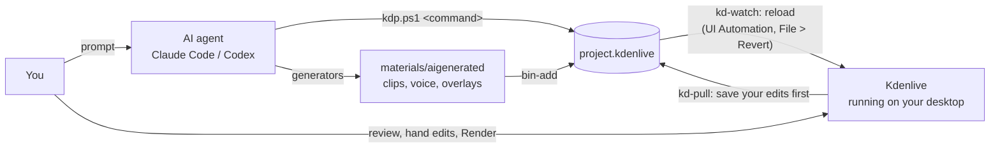

<div align="center">

# Movie Engine

**เอเจนต์ AI ตัดต่อวิดีโอของคุณใน Kdenlive ให้คุณดูได้สด ๆ และคุณรับช่วงต่อได้ทุกเมื่อ**

เอเจนต์ AI สำหรับเขียนโค้ด (Claude Code, Codex) สร้างและแก้ไขโปรเจกต์ Kdenlive ของจริงได้ ทั้งภาพยนตร์ วิดีโออธิบาย และคลิปสั้นแนวตั้ง ทุกการแก้ไขจะปรากฏทันทีในโปรแกรมตัดต่อที่คุณเปิดอยู่ พกพาได้ ใช้บน Windows และไม่ต้องแพตช์โปรแกรมตัดต่อ


[English](../../README.md) · [简体中文](README.zh-CN.md) · [繁體中文](README.zh-TW.md) · [हिन्दी](README.hi.md) · [Español](README.es.md) · [Français](README.fr.md) · [العربية](README.ar.md) · [বাংলা](README.bn.md) · [Português](README.pt.md) · [Русский](README.ru.md) · [اردو](README.ur.md) · [Bahasa Indonesia](README.id.md) · [Deutsch](README.de.md) · [日本語](README.ja.md) · [Türkçe](README.tr.md) · [한국어](README.ko.md) · [Українська](README.uk.md) · [Italiano](README.it.md) · [Polski](README.pl.md) · [Tiếng Việt](README.vi.md) · [فارسی](README.fa.md) · **ไทย** · [Kiswahili](README.sw.md) · [አማርኛ](README.am.md) · [Avañe'ẽ](README.gn.md) · [Setswana](README.tn.md) · [Shqip](README.sq.md) · [Беларуская](README.be.md) · [Български](README.bg.md) · [Bosanski](README.bs.md) · [Hrvatski](README.hr.md) · [Српски](README.sr.md) · [Crnogorski](README.cnr.md) · [Македонски](README.mk.md) · [Slovenščina](README.sl.md) · [Slovenčina](README.sk.md) · [Čeština](README.cs.md) · [Magyar](README.hu.md) · [Română](README.ro.md) · [Dansk](README.da.md) · [Norsk bokmål](README.nb.md) · [Norsk nynorsk](README.nn.md) · [Svenska](README.sv.md) · [Íslenska](README.is.md) · [Suomi](README.fi.md) · [Eesti](README.et.md) · [Latviešu](README.lv.md) · [Lietuvių](README.lt.md) · [Nederlands](README.nl.md) · [Lëtzebuergesch](README.lb.md) · [Rumantsch](README.rm.md) · [Ελληνικά](README.el.md) · [Malti](README.mt.md) · [Gaeilge](README.ga.md) · [Català](README.ca.md) · [ქართული](README.ka.md) · [Հայերեն](README.hy.md) · [Azərbaycanca](README.az.md) · [Afrikaans](README.af.md) · [isiZulu](README.zu.md) · [isiXhosa](README.xh.md) · [Sesotho](README.st.md) · [Sepedi](README.nso.md) · [Xitsonga](README.ts.md) · [Tshivenḓa](README.ve.md) · [siSwati](README.ss.md) · [isiNdebele (South Africa)](README.nr.md) · [isiNdebele (Zimbabwe)](README.nd.md) · [chiShona](README.sn.md) · [Chichewa](README.ny.md) · [Ikinyarwanda](README.rw.md) · [Ikirundi](README.rn.md) · [Malagasy](README.mg.md) · [Soomaali](README.so.md) · [Afaan Oromoo](README.om.md) · [Qafar af](README.aa.md) · [ትግርኛ](README.ti.md) · [Sängö](README.sg.md) · [Kreol Seselwa](README.crs.md) · [TjiKalanga](README.kck.md) · [ChiNdau](README.ndc.md)

*นี่คือฉบับแปล ให้ถือ README ภาษาอังกฤษเป็นฉบับอ้างอิง*

</div>

---

## สารบัญ

- [เหตุผลที่สร้าง](#เหตุผลที่สร้าง)
- [หลักการทำงาน](#หลักการทำงาน)
- [ความสามารถ](#ความสามารถ)
- [ความต้องการของระบบ](#ความต้องการของระบบ)
- [การติดตั้ง](#การติดตั้ง)
- [เริ่มต้นใช้งานอย่างรวดเร็ว](#เริ่มต้นใช้งานอย่างรวดเร็ว)
- [การทำงานร่วมกับเอเจนต์](#การทำงานร่วมกับเอเจนต์)
- [บรรทัดคำสั่งสำหรับตัดต่อ (`kdp.ps1`)](#บรรทัดคำสั่งสำหรับตัดต่อ-kdpps1)
- [ซิงก์สดกับโปรแกรมตัดต่อที่เปิดอยู่](#ซิงก์สดกับโปรแกรมตัดต่อที่เปิดอยู่)
- [ตัวสร้างคลิป: สิ่งที่ Kdenlive ทำไม่ได้](#ตัวสร้างคลิป-สิ่งที่-kdenlive-ทำไม่ได้)
- [เสียงพากย์และเสียงประกอบ](#เสียงพากย์และเสียงประกอบ)
- [ภาษาของอินเทอร์เฟซ](#ภาษาของอินเทอร์เฟซ)
- [โครงสร้างโฟลเดอร์](#โครงสร้างโฟลเดอร์)
- [การทดสอบและหลักฐาน](#การทดสอบและหลักฐาน)
- [ข้อจำกัด](#ข้อจำกัด)
- [การแก้ไขปัญหา](#การแก้ไขปัญหา)
- [คำถามที่พบบ่อย](#คำถามที่พบบ่อย)
- [การร่วมพัฒนา](#การร่วมพัฒนา)
- [กิตติกรรมประกาศ](#กิตติกรรมประกาศ)
- [สัญญาอนุญาต](#สัญญาอนุญาต)

## เหตุผลที่สร้าง

โปรแกรมตัดต่อวิดีโอถูกออกแบบมาให้คนใช้มือจับเมาส์ ส่วนเอเจนต์ AI ถนัดงานด้านโครงสร้าง จังหวะเวลา และงานซ้ำ ๆ เช่น วางคลิป 300 คลิปให้ตรงจังหวะเพลง ตั้งเวลาคำบรรยายทุกบรรทัดให้ตรงกับเสียงพากย์ หรือทำฉากใหม่ตามคำติชม แต่เอเจนต์ไม่สามารถคลิกผ่าน GUI ได้โดยไม่ยึดหน้าจอเดสก์ท็อปของคุณไป

Kdenlive เป็นโปรแกรมตัดต่อโอเพนซอร์สที่แข็งแกร่ง แต่บน Windows กลับ**ไม่มี API สำหรับการทำงานอัตโนมัติ** การควบคุมผ่าน D-Bus มีเฉพาะในบิลด์สำหรับ Linux และฟอร์กที่เพิ่ม API เข้าไปก็ไม่มีคนดูแลต่อหรือไม่ปลอดภัย Movie Engine แก้ปัญหานี้ได้โดยไม่ต้องแพตช์โปรแกรมตัดต่อ:

1. เอเจนต์แก้ไขไฟล์โปรเจกต์ `.kdenlive` ผ่านบรรทัดคำสั่งที่ผ่านการทดสอบแล้ว (`engine/kdp.ps1`)
2. Kdenlive ที่กำลังทำงานอยู่จะได้รับคำสั่งให้โหลดไฟล์ใหม่ผ่าน Windows UI Automation โดยไม่ส่งการกดแป้นพิมพ์ ไม่ขยับเมาส์ และไม่แย่งโฟกัส
3. การแก้ไขที่คุณยังไม่ได้บันทึกจะถูกบันทึกก่อนเสมอ และจะไม่ถูกเขียนทับ

ดังนั้นเอเจนต์ตัดต่อแล้วคุณตรวจดู หรือคุณจะลงมือแก้เองก็ได้ ทั้งสองฝ่ายทำงานกับโปรเจกต์เดียวกัน ในโปรแกรมตัดต่อตัวเดียวกัน ในเวลาเดียวกัน

## หลักการทำงาน



ทุกคำสั่งตัดต่อทำงานตามวงจรที่ปลอดภัยแบบเดียวกัน:

1. **ดึง (Pull)** ถ้า Kdenlive มีการเปลี่ยนแปลงที่ยังไม่ได้บันทึก จะสั่งให้บันทึก (กดปุ่ม Save บนแถบเครื่องมือผ่าน UI Automation) และยืนยันว่าบันทึกเสร็จแล้ว
2. **แก้ไข (Edit)** คำสั่งจะแก้ XML ภายใต้การล็อก หลังจากตรวจค่าแฮช และสร้างสแนปช็อตสำหรับย้อนกลับไว้ ถ้าไฟล์ถูกเปลี่ยนในระหว่างนั้น จะไม่มีการเขียนอะไรลงไปเลย
3. **โหลดใหม่ (Reload)** ตัวเฝ้าดูเห็นเครื่องหมายที่ AI ทิ้งไว้ แล้วสั่ง File > Revert ในโปรแกรมตัดต่อที่เปิดอยู่ จะนับว่าสำเร็จก็ต่อเมื่อวิดเจ็ตไทม์ไลน์ถูกสร้างใหม่จริง ๆ เท่านั้น
4. **ข้อขัดแย้ง (Conflict)** ถ้าคุณเริ่มแก้ไขในระหว่างนั้น จะไม่มีการโหลดใหม่ และงานของคุณยังอยู่ครบ เวอร์ชันของ AI จะถูกเก็บแยกไว้ แล้วเอเจนต์จะนำการเปลี่ยนแปลงของตนไปใช้ซ้ำบนงานของคุณ

## ความสามารถ

- **แก้ไขโปรเจกต์ได้ครบโดยไม่ต้องใช้ GUI**: มีราว 120 คำสั่ง ครอบคลุม bin ไทม์ไลน์ เอฟเฟกต์ คอมโพสิชัน แทร็ก ไกด์ มาร์กเกอร์ คำบรรยาย ซีเควนซ์ การปรับความเร็วและ time remap สไลด์โชว์ ไตเติล พร็อกซี การเรนเดอร์ และ undo/redo ดู[รายการคำสั่ง](#บรรทัดคำสั่งสำหรับตัดต่อ-kdpps1)
- **ซิงก์สดกับโปรแกรมตัดต่อที่เปิดอยู่** การแก้ไขของ AI จะปรากฏใน Kdenlive ที่คุณกำลังดูอยู่ ส่วนการแก้ไขที่คุณยังไม่ได้บันทึกจะถูกบันทึกก่อนและไม่มีวันหาย
- **ไม่รบกวนเดสก์ท็อปของคุณเลย** ไม่แย่งโฟกัส ไม่ส่งการกดแป้นพิมพ์ ไม่ขยับเมาส์ โปรแกรมตัดต่อที่ใช้ทดสอบจะทำงานบนเดสก์ท็อป Windows ที่มองไม่เห็น
- **พกพาได้** โปรแกรมตัดต่อ การตั้งค่า Node.js ฟอนต์ และเครื่องมือทั้งหมดอยู่ในโฟลเดอร์เดียว คัดลอกไปเครื่องอื่นก็ใช้ได้ทันที ไม่มีอะไรถูกเขียนลงใน Program Files หรือโปรไฟล์ Windows ของคุณ
- **ตัวสร้างคลิปสำหรับสิ่งที่ Kdenlive ทำไม่ได้**: ข้อความเคลื่อนไหวทีละตัวอักษร การวาดเน้นด้วยมือ ฉาก UI แบบ 3D แอนิเมชันเคอร์เซอร์ และภาพยนตร์ "อธิบาย" แบบอินเทอร์แอกทีฟที่ยาว ทั้งหมดเรนเดอร์บน GPU พร้อม motion blur จริง แล้ววางลงบนไทม์ไลน์เป็นคลิปธรรมดา
- **เสียงพากย์พร้อมเวลาของแต่ละคำ** (Microsoft Edge TTS ไม่ต้องใช้คีย์ API) คำบรรยายและแอ็กชันจะเกิดขึ้นตรงกับคำที่พูดพอดี
- **เสียงประกอบที่สังเคราะห์ขึ้น** (whoosh, click, pop, riser, impact และอื่น ๆ) สร้างด้วยโค้ดทั้งหมด
- **พิสูจน์แล้ว ไม่ได้แค่คาดเดา** ทุกคำสั่งมีการตรวจผลลัพธ์ เอฟเฟกต์และคอมโพสิชันถูกทดสอบทีละตัว และผลลัพธ์ดิบอยู่ใน `docs/proof/`
- **มีคำแนะนำสำหรับเอเจนต์มาให้** `AGENTS.md` และสกิลใน `.claude/skills/` สอน Claude Code และ Codex เรื่องขั้นตอนการทำงาน รูปแบบไฟล์ และข้อผิดพลาดที่พบบ่อย

## ความต้องการของระบบ

| | |
|---|---|
| ระบบปฏิบัติการ | Windows 10 หรือ 11, x64 |
| โปรแกรมตัดต่อ | Kdenlive **26.08.3** บิลด์แบบพกพา (standalone) เวอร์ชันอื่นยังไม่ได้ทดสอบ |
| Node.js | 18 ขึ้นไป: ไฟล์ `.zip` สำหรับ Windows x64 จาก nodejs.org แตกไฟล์ไว้ใน `engine/node/` |
| เบราว์เซอร์ | Microsoft Edge (มาพร้อม Windows) ตัวเรนเดอร์ฉากใช้งานแบบ headless |
| เอเจนต์ | [Claude Code](https://claude.com/claude-code) หรือ Codex ไม่บังคับ: เครื่องมือทุกตัวรันด้วยมือได้เช่นกัน |
| ดิสก์ | ราว 1 GB สำหรับโปรแกรมตัดต่อและเครื่องมือ บวกกับไฟล์สื่อของคุณ |
| GPU | GPU ใดก็ได้ที่เข้ารหัส H.264 ด้วยฮาร์ดแวร์จะช่วยให้ `film-render.mjs` เร็วขึ้น (ถ้าไม่มีจะใช้การเข้ารหัสด้วยซอฟต์แวร์แทน) |

## การติดตั้ง

ทุกอย่างติดตั้ง**ไว้ภายในโฟลเดอร์นี้** ไม่ต้องใช้สิทธิ์ผู้ดูแลระบบเลย

```powershell
git clone https://github.com/vladtarrow/movie-engine.git
cd movie-engine
```

**1. Node.js** ดาวน์โหลดไฟล์ `.zip` สำหรับ Windows x64 ของ Node.js 18 ขึ้นไปจาก <https://nodejs.org/en/download> แล้วแตกเนื้อหาไว้ใน `engine\node\` ให้มี `engine\node\node.exe` และ `engine\node\npm.cmd` อยู่ในนั้น ไม่ต้องใช้ตัวติดตั้งและไม่ต้องมี Node ของระบบ สคริปต์ทั้งหมดรันผ่าน `engine\node.cmd` ไม่ใช้ Node ของระบบเลย

**2. แพ็กเกจ Node** สำหรับเครื่องมือเสียงพากย์และตัวเรนเดอร์ (เวอร์ชันถูกล็อกไว้ใน `engine/voice/package.json`):

```powershell
engine\node\npm.cmd install --prefix engine\voice
```

**3. Kdenlive 26.08.3 แบบพกพา** ดาวน์โหลด `kdenlive-26.08.3_standalone.exe` จาก <https://download.kde.org/stable/kdenlive/26.08/windows/> ไว้ใน `engine\installer\` ตรวจสอบไฟล์แล้วแตกไฟล์:

```powershell
(Get-FileHash engine\installer\kdenlive-26.08.3_standalone.exe -Algorithm SHA256).Hash
# expected: A25427B1DFF2C17E3B0386E991BB1A719382BB3176D1A90E441CDAEB6E0A967D
engine\installer\kdenlive-26.08.3_standalone.exe -o"engine\Kdenlive" -y
```

โปรแกรมตัดต่อจะอยู่ที่ `engine\Kdenlive\kdenlive-26.08.3_standalone\bin\` ซึ่งมี `melt.exe` และ `ffmpeg.exe` มาให้แล้ว

**4. เปิดใช้งานครั้งแรก**

```powershell
engine\kdenlive.cmd
```

Kdenlive เก็บการตั้งค่าทั้งหมดไว้ใน `engine\profile-kdenlive\` ไม่ใช่ในโปรไฟล์ Windows ของคุณ เมื่อเปิดครั้งแรกจะมีตัวช่วยตั้งค่าที่แสดงเพียงครั้งเดียว

## เริ่มต้นใช้งานอย่างรวดเร็ว

### ใช้เอเจนต์

เปิดโฟลเดอร์นี้ใน Claude Code (หรือ Codex) แล้วขอด้วยภาษาธรรมดา:

> สร้างโปรเจกต์ใหม่แนวตั้ง 30 fps ชื่อ "launch-teaser" นำภาพหน้าจอสามภาพจาก `materials/designers/launch/` วางบนไทม์ไลน์ ภาพละ 2.5 วินาที พร้อม cross-fade สั้น ๆ ใส่เสียงพากย์จาก `script.txt` และตั้งเวลาคำบรรยายแบบเคลื่อนไหวให้ตรงกับทุกบรรทัด

> เปิดใน Kdenlive ให้หน่อย

> ช็อตที่สองยาวไป ตัดเหลือ 1.8 วินาที แล้วขยับโลโก้ขึ้นอีกนิด

เอเจนต์ทำตาม `AGENTS.md`: แก้ไขผ่าน `kdp.ps1` เรนเดอร์เฉพาะคลิปที่การตัดต่อต้องใช้ และทำให้โปรแกรมตัดต่อที่เปิดอยู่ซิงก์กันเสมอ คุณตรวจดูใน Kdenlive แก้ด้วยมือได้ทุกเมื่อที่ต้องการ และกด Render เมื่อพอใจ

### ทำด้วยมือ

```powershell
# a new 1080x1920 30 fps project with 2 video and 2 audio tracks
powershell -NoProfile -ExecutionPolicy Bypass -File engine\kdp.ps1 new -Project projects\hello\hello.kdenlive -Profile vertical_hd_30

# a 3-second title and a colour background
powershell -NoProfile -ExecutionPolicy Bypass -File engine\kdp.ps1 bin-color -Project projects\hello\hello.kdenlive -Color '#203060' -Seconds 3 -Name bg
powershell -NoProfile -ExecutionPolicy Bypass -File engine\kdp.ps1 title -Project projects\hello\hello.kdenlive -Text "Hello" -Seconds 3 -Name hi

# place them: background on V1, title above it on V2
powershell -NoProfile -ExecutionPolicy Bypass -File engine\kdp.ps1 add -Project projects\hello\hello.kdenlive -Bin bg -Track V1 -At 0
powershell -NoProfile -ExecutionPolicy Bypass -File engine\kdp.ps1 add -Project projects\hello\hello.kdenlive -Bin hi -Track V2 -At 0

# a check frame, then open it in the editor
powershell -NoProfile -ExecutionPolicy Bypass -File engine\kdp.ps1 frame -Project projects\hello\hello.kdenlive -At 1.5 -Out out\hello\check.png
engine\kdenlive.cmd projects\hello\hello.kdenlive
```

ถ้าภายหลังต้องการเปิดโปรเจกต์ล่าสุดอีกครั้ง ให้ดับเบิลคลิก `open-last-project.cmd`

## การทำงานร่วมกับเอเจนต์

เอเจนต์จะอ่าน `AGENTS.md` (Codex) หรือ `CLAUDE.md` ซึ่งนำเข้าไฟล์นั้นอีกที (Claude Code) รวมถึงสกิลอีกสองตัว:

| สกิล | สอนเรื่อง |
|---|---|
| `.claude/skills/kdenlive-project-file` | รูปแบบ `.kdenlive` / MLT XML, `kdp.ps1`, การตรวจสอบด้วย `melt` |
| `.claude/skills/kdenlive-live` | การควบคุมโปรแกรมตัดต่อที่กำลังทำงานอย่างปลอดภัย: เปิด ดึง โหลดใหม่ และจับภาพหน้าต่าง |

กฎที่เอเจนต์ปฏิบัติตาม ซึ่งคุณวางใจได้:

- ไม่แย่งเมาส์ แป้นพิมพ์ หรือโฟกัสของคุณ และไม่จับภาพหน้าจอเดสก์ท็อปของคุณเด็ดขาด (จับเฉพาะหน้าต่างของโปรแกรมตัดต่อเท่านั้น)
- ทำขั้นตอนใน GUI เอง (บันทึก เปิด โหลดใหม่) แทนที่จะขอให้คุณคลิก
- ถามก่อนจะดาวน์โหลดอะไรก็ตาม และก่อนจะลบอะไรก็ตาม
- เรนเดอร์เฉพาะสิ่งที่งานต้องใช้ (คลิปฉาก เฟรมสำหรับตรวจ) จะเรนเดอร์ภาพยนตร์ฉบับสมบูรณ์ก็ต่อเมื่อคุณขอเท่านั้น
- เมื่อ Kdenlive ทำอะไรได้ไม่ดีพอ เอเจนต์จะสร้างสิ่งนั้นจากภายนอกด้วยโค้ด แล้วนำผลลัพธ์ใส่เข้ามาเป็นคลิป โดยไม่ลดทอนเอฟเฟกต์ลง

## บรรทัดคำสั่งสำหรับตัดต่อ (`kdp.ps1`)

```powershell
powershell -NoProfile -ExecutionPolicy Bypass -File engine\kdp.ps1 <command> -Project <file.kdenlive> [options]
```

เวลาระบุเป็นวินาที ใช้จุดทศนิยม (`2.5`) แทร็กคือ `V1 V2 …` (V1 อยู่ล่างสุด) และ `A1 A2 …` การระบุคลิปทำได้ด้วย `-Track` ร่วมกับเวลาใดก็ได้ที่อยู่ในช่วงคลิปนั้นผ่าน `-At` พารามิเตอร์ของเอฟเฟกต์ใส่ใน `-Params "name=value||name=value"` รายการทั้งหมดพร้อมตัวเลือกทุกตัวอยู่ในส่วนหัวของ `engine/kdp.ps1`

| กลุ่ม | คำสั่ง |
|---|---|
| โปรเจกต์ | `new`, `profiles`, `info`, `validate`, `fonts`, `profile-set`, `profile-from-clip`, `zone`, `archive`, `backups`, `rebase`, `otio-export`, `otio-import` |
| Bin | `bin-add`, `bin-color`, `title`, `title-text`, `title-save`, `title-template`, `bin-rename`, `bin-remove`, `bin-info`, `bin-set`, `bin-duplicate`, `bin-replace-file`, `bin-reload`, `folder`, `bin-folder`, `relink`, `clean`, `generator`, `playlist-clip`, `extract-audio`, `transcode` |
| ไทม์ไลน์ | `add`, `add-av`, `move`, `copy`, `trim`, `ripple-trim`, `slip`, `split`, `remove`, `speed`, `remap`, `disable`, `enable`, `group`, `ungroup`, `mix`, `unmix`, `space-insert`, `space-remove`, `spaces-remove-all`, `track-clear`, `replace-in-timeline` |
| เอฟเฟกต์ | `effects`, `effect-info`, `effect-add`, `effect-list`, `effect-set`, `effect-remove`, `effect-copy`, `effect-clear`, `effects-all`, `bin-effect`, `effect-templates`, `effect-template` |
| คอมโพสิชัน | `compositions`, `comp-info`, `comp-add`, `comp-list`, `comp-set`, `comp-remove` |
| แทร็ก | `track-add`, `track-remove`, `track-set` |
| ไกด์และมาร์กเกอร์ | `guide-add`, `guide-list`, `guide-remove`, `guide-set`, `guide-clear`, `guide-export`, `guide-category`, `marker`, `marker-list`, `marker-set`, `marker-remove` |
| คำบรรยาย | `sub-add`, `sub-import`, `sub-export`, `sub-state` |
| ซีเควนซ์ | `sequence-add`, `sequences`, `copy-to-sequence`, `expand`; คำสั่งใดก็ตามที่ใส่ `-Sequence <name>` จะทำงานภายในซีเควนซ์นั้น |
| พิเศษ | `slideshow`, แอนิเมชัน Lottie / Glaxnimate ผ่าน `bin-add`, `proxy`, `stabilize`, `scene-split`, `speed-job`, `subclip` |
| เอาต์พุต | `frame` (PNG หนึ่งภาพ), `preview` (เรนเดอร์ด้วย melt แบบเร็ว), `render` (ตัวเรนเดอร์ของ Kdenlive เองหรือพรีเซ็ต), `presets` |
| ประวัติ | `undo`, `redo`, `clear-history` (สแนปช็อตอยู่ใน `projects/<name>/.kdp-history`) |

พฤติกรรมที่ควรรู้:

- ครึ่งเสียงและครึ่งภาพที่ลิงก์กันอยู่จะถูกย้าย ตัด แยก และลบไปพร้อมกัน (ใช้ `-Alone` เพื่อทำกับครึ่งเดียว)
- คำสั่งที่ล้มเหลวจะจบด้วยรหัส 1 และไม่เขียนอะไรลงไปเลย
- เอฟเฟกต์ที่บิลด์ Windows รันไม่ได้จะถูกปฏิเสธอย่างชัดเจน ไม่ใช่ถูกข้ามไปเงียบ ๆ (รายการ: `docs/proof/assets.txt`)
- ทุกแอ็กชันในเมนูของ Kdenlive ถูกจับคู่ไว้กับคำสั่ง วิธีอื่น หรือ "ดูได้อย่างเดียว" ใน `engine/tools/data/kdenlive-actions.csv` ดู `docs/kdenlive-coverage.md`

## ซิงก์สดกับโปรแกรมตัดต่อที่เปิดอยู่

| สคริปต์ | หน้าที่ | รหัสการจบ |
|---|---|---|
| `engine\kd-pull.ps1 -Project <f>` | สั่งให้ Kdenlive บันทึกการแก้ไขของคุณและยืนยันผล | 0 ไฟล์เป็นปัจจุบัน, 3 ไม่ได้ทำงานอยู่, 4 ยืนยันไม่ได้ |
| `engine\kd-reload.ps1 -Project <f>` | File > Revert ยืนยันด้วยไทม์ไลน์ที่ถูกสร้างใหม่ | 0 ยืนยันแล้ว, 2 คุณมีการแก้ไขที่ยังไม่ได้บันทึก (ไม่มีอะไรถูกทิ้ง), 3 ไม่ได้ทำงานอยู่, 4 ล้มเหลว |
| `engine\kd-watch.ps1 -Project <f>` | ตัวเฝ้าดูเบื้องหลัง: โหลดใหม่หลัง AI เขียนทุกครั้ง และบันทึกข้อขัดแย้ง | ล็อกอยู่ใน `engine\kd-watch.log`; ลบ `engine\kd-watch.run` เพื่อหยุด |
| `engine\kdenlive-bg.ps1 [project]` | เปิด Kdenlive แบบย่อหน้าต่างให้เอเจนต์ | 0 โหลดแล้ว, 4 ยืนยันไม่ได้ |
| `engine\kdenlive.cmd [project]` | เปิด Kdenlive ให้คุณ | |

เปิดตัวเฝ้าดูหนึ่งครั้งต่อหนึ่งเซสชัน:

```powershell
Start-Process powershell -WindowStyle Hidden -ArgumentList '-NoProfile','-ExecutionPolicy','Bypass','-File','engine\kd-watch.ps1','-Project','projects\hello\hello.kdenlive'
```

โปรเจกต์ขนาดใหญ่: การโหลดโปรเจกต์ที่มี 1000 คลิปใหม่ใช้เวลาหลายนาที และเครื่องมือจะรอจนเสร็จแทนที่จะรายงานก่อนเวลา โปรเจกต์จะถูกเปิดผ่าน *File > Open Recent* บนโปรแกรมตัดต่อที่ว่างเปล่า เพราะการเปิดไฟล์โดยตรงทำให้ Qt ไล่ตรวจทุกรายการบนไทม์ไลน์เพื่อการช่วยการเข้าถึง ซึ่งช้ากว่าราว 10 นาที

## ตัวสร้างคลิป: สิ่งที่ Kdenlive ทำไม่ได้

Kdenlive/MLT ไม่มีแอนิเมชันข้อความทีละตัวอักษร ไม่มี expression และมีความสามารถด้าน 3D น้อย อีกทั้งเอฟเฟกต์หนัก ๆ ยังทำให้การเล่นช้าลง Movie Engine จึงเรนเดอร์ส่วนเหล่านี้จากภายนอก แล้ววางลงบนไทม์ไลน์เป็นคลิปธรรมดา ซึ่งมักมีช่องอัลฟา บนแทร็กที่อยู่เหนือภาพ สคริปต์ตัวสร้างและอินพุตของมันอยู่ในโฟลเดอร์โปรเจกต์ จึงสร้างคลิปใหม่ได้เมื่อข้อความ ฟอนต์ หรือจังหวะเวลาเปลี่ยน

| เครื่องมือ | สร้าง |
|---|---|
| `engine/tools/kinetic-text.ps1` | คำบรรยายเคลื่อนไหวทีละตัวอักษร ทุกคำตั้งเวลาจาก `voice.json` พร้อมกรอบไฮไลต์ |
| `engine/tools/annotate.ps1` | วงกลม กรอบ เส้นใต้ และลูกศรแบบวาดมือที่ค่อย ๆ วาดขึ้นบนภาพหน้าจอ |
| `engine/tools/card-entrance.ps1` | การ์ดภาพหน้าจอที่ลอยขึ้นและขยายเข้ามาพร้อมเงานุ่ม ๆ |
| `engine/tools/pdf-to-png.ps1` | สไลด์จากไฟล์ PDF ที่ส่งออกมา |
| `engine/tools/html-render.mjs` | ฉาก HTML/CSS/canvas ใดก็ได้เป็นวิดีโอ: แอนิเมชันอินเทอร์เฟซ เคอร์เซอร์ 3D มาสก์ |
| `engine/tools/film-render.mjs` + `film/` | ภาพยนตร์อธิบายแบบอินเทอร์แอกทีฟที่ยาวบน canvas: หนึ่งคลิปต่อเสียงพากย์หนึ่งบรรทัด แอ็กชันเกิดขึ้นตามคำที่พูด มี motion blur บน GPU ที่ราว 45 fps |

ตัวเรนเดอร์ทั้งสองตัวควบคุม Microsoft Edge ที่มากับ Windows แบบ headless โดยใช้โปรไฟล์ใช้แล้วทิ้งและไม่มีการเข้าถึงเครือข่าย

### ตัวอย่าง

```powershell
# a 3-second 3D title card with a cursor click
engine\node.cmd engine\tools\html-render.mjs examples\demo\scene\scene.html examples\demo\out --frames 0,30,60,89
engine\node.cmd engine\tools\html-render.mjs examples\demo\scene\scene.html examples\demo\out\scene.mp4

# a 4-shot interactive film timed to two voice lines
engine\node.cmd engine\tools\film-render.mjs examples\demo\film\film.html examples\demo\out --check
engine\node.cmd engine\tools\film-render.mjs examples\demo\film\film.html examples\demo\out --shots all --width 640
engine\node.cmd engine\tools\film-render.mjs examples\demo\film\film.html examples\demo\out\clips --suffix -v01
```

ภาพยนตร์หนึ่งเรื่องประกอบด้วยไฟล์เล็ก ๆ สามไฟล์ `data.js` เก็บช็อตและเวลาของแต่ละคำ `direction.js` มีหนึ่งบรรทัดต่อหนึ่งช็อต:

```text
1 | hover 192 108 @brand | tag 300 60 Your brand @deserves | confetti 192 90 @film
2 say=A film that/*explains* it
3 | click 116 108 @before | click 268 108 @after | chips Before~After @after
4 scene=counter | count 0 120 % @count
```

`scenes.js` เก็บช็อตที่วาดขึ้นใหม่ตั้งแต่ต้น `@word` จะสั่งให้แอ็กชันเกิดขึ้นเมื่อเสียงพากย์พูดคำนั้น แอ็กชันที่มีได้แก่ click, hover, drag, zoom, lens, ring, arrow, chips, toggle, slider, toast, type, count และ confetti ไวยากรณ์ทั้งหมดอยู่ที่ส่วนต้นของ `engine/tools/film/film-kit.js`

## เสียงพากย์และเสียงประกอบ

```powershell
engine\node.cmd engine\voice\voice.mjs lines.json materials\aigenerated\hello\voice en-US-AndrewMultilingualNeural +0%
```

`lines.json` คือรายการบรรทัดบทพูด เครื่องมือนี้จะเขียน mp3 หนึ่งไฟล์ต่อหนึ่งบรรทัด พร้อม `voice.json` ที่มีความยาว และเวลาเริ่มกับเวลาจบของทุกคำ บรรทัดต่าง ๆ ถูกแคชไว้ ดังนั้นเมื่อแก้บรรทัดเดียว ก็จะสร้างใหม่เฉพาะบรรทัดนั้น เครื่องมือใช้บริการแปลงข้อความเป็นเสียงออนไลน์ของ Microsoft Edge ผ่านแพ็กเกจ `msedge-tts` ไม่ต้องใช้คีย์ แต่บริการนี้ไม่ใช่ของทางการและต้องต่ออินเทอร์เน็ต

```powershell
engine\node.cmd engine\audio\sfx.mjs materials\aigenerated\sfx
```

คำสั่งนี้สังเคราะห์ whoosh, whoosh-long, swipe, click, pop, tick, riser, impact, ding และ reveal ด้วยโค้ด ชุดที่พร้อมใช้อยู่ใน `materials/aigenerated/sfx/` เสียงที่สั้นกว่าหนึ่งเฟรมต้องเติมความเงียบให้ยาวขึ้นก่อนนำไปวาง (`-af apad=whole_dur=0.0667`)

## ภาษาของอินเทอร์เฟซ

ตัวเปิดโปรแกรมจะเปิด Kdenlive เป็น**ภาษาอังกฤษ**โดยค่าเริ่มต้น หากต้องการใช้ภาษาอื่น ให้ตั้งค่า `MOVIE_ENGINE_UI_LANG` ก่อนเปิด:

```powershell
$env:MOVIE_ENGINE_UI_LANG = 'ru'; engine\kdenlive.cmd
```

UI Automation หารายการเมนูจากชื่อที่แสดงอยู่ ชื่อสำหรับภาษาอินเทอร์เฟซ 31 ภาษามีมาให้ในตัวแล้ว (`engine/tools/kd-ui.ps1`, `$KdNames`) สำหรับภาษาอื่น ให้เพิ่มชื่อของภาษานั้นลงไปที่นั่น แล้วตรวจสอบด้วย:

```powershell
powershell -NoProfile -ExecutionPolicy Bypass -File engine\tools\kd-langcheck.ps1
```

## โครงสร้างโฟลเดอร์

```text
movie-engine/
├─ AGENTS.md, CLAUDE.md          instructions for AI agents
├─ .claude/skills/               agent skills: project file format, live editor
├─ engine/
│  ├─ kdp.ps1                    the editing command line
│  ├─ kd-pull / kd-reload / kd-watch .ps1, kdenlive.cmd, kdenlive-bg.ps1
│  ├─ tools/                     internals, generators, tests, data (action map)
│  ├─ voice/  audio/  fonts/     TTS, synthesized SFX, Poppins (OFL)
│  ├─ Kdenlive/  node/           portable editor and Node.js (not in git)
│  └─ profile-kdenlive/          the editor's settings (not in git)
├─ projects/<name>/<name>.kdenlive
├─ materials/
│  ├─ download/                  stock and downloaded files (not in git)
│  ├─ aigenerated/               everything the AI made (sfx/ and test-kit/ ship with the engine)
│  ├─ designers/  brand/         files from your team, brand assets
├─ examples/demo/                demos of the scene and film renderers
├─ out/                          renders (not in git)
└─ docs/                         proofs, coverage, translations of this README
```

พาธของสื่อภายในโปรเจกต์เป็นพาธแบบสัมพัทธ์ ถ้าคุณย้ายหรือคัดลอกโฟลเดอร์ `kdp.ps1 rebase` (ซึ่ง `kdenlive.cmd` ก็รันให้โดยอัตโนมัติด้วย) จะเขียนตำแหน่งใหม่ลงในโปรเจกต์

## การทดสอบและหลักฐาน

ข้อกล่าวอ้างว่าอะไรใช้งานได้ล้วนมีการตรวจผลลัพธ์รองรับ ไม่ใช่แค่ "ฟังก์ชันรันผ่าน" สรุปอยู่ใน [`docs/kdenlive-proof.md`](../../docs/kdenlive-proof.md) และผลลัพธ์ดิบอยู่ใน `docs/proof/`

| การทดสอบ | ตรวจสอบ |
|---|---|
| `engine\tools\kdp-clitest.ps1` | ทุกคำสั่งของ `kdp.ps1` ผ่านบรรทัดคำสั่ง โดยเปรียบเทียบโปรเจกต์ที่ได้ |
| `engine\tools\kd-livetest.ps1` | การดึง การโหลดใหม่ ตัวเฝ้าดู ข้อขัดแย้ง และ race condition กับ Kdenlive ตัวจริงบนเดสก์ท็อปที่มองไม่เห็น |
| `engine\tools\kdp-assetsweep.ps1` | ทุกเอฟเฟกต์และคอมโพสิชัน: เรนเดอร์และเปรียบเทียบเฟรม |
| `engine\tools\kdp-portabletest.ps1` | คัดลอกโฟลเดอร์ไปที่อื่นและทำงานจากสำเนานั้น |
| `engine\tools\kd-langcheck.ps1` | ภาษาของอินเทอร์เฟซ และการที่ UI Automation หาเมนูเจอ |
| `engine\tools\kdp-coverage-check.ps1` | ทุกแอ็กชันในเมนูถูกจับคู่แล้ว และไม่มีหลักฐานใดเก่ากว่าโค้ด |

```powershell
powershell -NoProfile -ExecutionPolicy Bypass -File engine\tools\kdp-clitest.ps1 -Report docs\proof\clitest.txt
powershell -NoProfile -ExecutionPolicy Bypass -File engine\tools\kd-livetest.ps1 -Report docs\proof\live-en.txt
```

โปรแกรมตัดต่อที่ใช้ทดสอบจะทำงานเฉพาะบนเดสก์ท็อปที่ซ่อนอยู่และใช้โปรไฟล์ของตัวเอง การทดสอบจึงไม่แตะต้อง Kdenlive ที่คุณเปิดอยู่หรือโฟกัสของคุณเลย

## ข้อจำกัด

- **ใช้ได้เฉพาะ Windows** และเฉพาะ Kdenlive **26.08.3** เท่านั้น Linux มี D-Bus และจะต้องใช้สะพานเชื่อมแบบอื่น
- การเปิดโปรแกรมตัดต่อจะดึงโฟกัสแป้นพิมพ์ไปราว 3 วินาทีระหว่างที่หน้าต่างว่างปรากฏขึ้น เอเจนต์จะถามก่อนเปิดโปรแกรมขณะที่คุณกำลังทำงาน การโหลดใหม่และการแก้ไขไม่แย่งโฟกัส
- บิลด์ Windows ไม่มีโมดูล MLT อย่าง sox, ladspa และ movit รวมถึงเอฟเฟกต์ frei0r/avfilter บางตัว `kdp.ps1` จะปฏิเสธสิ่งเหล่านี้ (`docs/proof/assets.txt`)
- การส่งออกและนำเข้า OpenTimelineIO รองรับเฉพาะคลิปและช่องว่าง ส่วน multicam ไม่มีการสลับมุมกล้องแบบสด (การตัดทำด้วย split/remove/hide)
- การเรียก "Save As…" ผ่าน UI Automation บนหน้าต่างที่ย่ออยู่จะไม่เปิดกล่องโต้ตอบใด ๆ เอเจนต์จึงใช้ `archive` หรือการคัดลอกไฟล์แทน
- การรู้จำเสียงพูด (คำบรรยายอัตโนมัติ) ต้องใช้ Whisper หรือ Vosk ซึ่งไม่ได้รวมมาให้
- ไตเติลที่ทำด้วยเครื่องมือไตเติลของ Kdenlive ใช้ฟอนต์ที่ติดตั้งใน Windows หากต้องการรับประกันการจัดตัวอักษร ให้เรนเดอร์ข้อความด้วยตัวสร้างคลิป ซึ่งโหลดฟอนต์จาก `engine/fonts/`
- Edge TTS เป็นบริการออนไลน์ที่ไม่ใช่ของทางการ และอาจเปลี่ยนแปลงหรือหยุดทำงานได้

## การแก้ไขปัญหา

| อาการ | สาเหตุและวิธีแก้ |
|---|---|
| Kdenlive ทำงานอยู่ แต่คลิกที่แถบงานแล้วไม่มีอะไรปรากฏ | ตำแหน่งหน้าต่างที่บันทึกไว้อยู่นอกจอ ปิดโปรแกรมแล้วลบรายการ `kdockLayout` ใน `engine\profile-kdenlive\AppData\Local\kdenliverc` หรือย้ายหน้าต่างด้วย `SetWindowPos` (ดู `AGENTS.md`) |
| `kd-reload.ps1` จบด้วยรหัส 2 | คุณมีการแก้ไขที่ยังไม่ได้บันทึก ไม่มีอะไรถูกทิ้ง รัน `kd-pull.ps1` แล้วนำการเปลี่ยนแปลงไปใช้อีกครั้ง (`kdp.ps1` ทำขั้นตอนนี้ให้เอง) |
| มี `CONFLICT` ใน `engine\kd-watch.log` | คุณกับเอเจนต์แก้ไขในเวลาเดียวกัน เวอร์ชันของคุณยังอยู่ในโปรแกรมตัดต่อ ส่วนเวอร์ชันของ AI อยู่ใน `projects\<name>\.kdp-history\<name>\conflict\` ขอให้เอเจนต์นำการเปลี่ยนแปลงของตนไปใช้ซ้ำ |
| คำสั่งจบด้วยรหัส 1 พร้อมข้อความ "pull not confirmed" | Kdenlive กำลังยุ่งหรือแสดงกล่องโต้ตอบอยู่ ปิดกล่องโต้ตอบหรือรอให้โหลดเสร็จ แล้วลองอีกครั้ง |
| สคริปต์ PowerShell แยกวิเคราะห์ไม่ผ่าน | สคริปต์ที่มีข้อความที่ไม่ใช่ ASCII ต้องบันทึกเป็น UTF-8 **แบบมี BOM** สำหรับ Windows PowerShell 5.1 |
| `voice.mjs` หยุดพร้อมข้อความ "Stream closed before the synthesis completed" | มักเป็นปัญหาเครือข่าย หรือ SSML ที่ไม่ได้ escape ในสำเนารุ่นเก่า `voice.mjs` escape `& < >` ให้เองแล้ว |
| การเปิดโปรเจกต์ขนาดใหญ่ใช้เวลาหลายนาที | เปิดผ่าน `kdenlive.cmd` / `kdenlive-bg.ps1` อย่าเปิดด้วย `kdenlive.exe project.kdenlive` เด็ดขาด |

## คำถามที่พบบ่อย

**ต้องใช้ Claude Code หรือ Codex ไหม**
ไม่จำเป็น เครื่องมือทุกตัวเป็นสคริปต์ธรรมดาที่รันด้วยมือได้ เอเจนต์เป็นสิ่งที่ทำให้ทุกอย่างเร็วขึ้น: มันวางแผนการตัดต่อ รันเครื่องมือ และทำให้โปรแกรมตัดต่อซิงก์อยู่เสมอ

**เอเจนต์จะเขียนทับการแก้ไขที่ฉันทำเองไหม**
ไม่ ก่อนการเขียนทุกครั้ง การแก้ไขที่คุณยังไม่ได้บันทึกจะถูกบันทึกและยืนยันก่อน ถ้าคุณแก้ไขขณะที่เอเจนต์กำลังเขียน การเขียนนั้นจะถูกปฏิเสธหรือเก็บแยกไว้เป็นข้อขัดแย้ง ไม่มีวันถูกนำไปทับงานของคุณ

**ยังใช้ Kdenlive ตามปกติได้ไหม**
ได้ นี่คือ Kdenlive ตัวมาตรฐานที่มีโฟลเดอร์การตั้งค่าของตัวเอง ตัดต่อ ดูตัวอย่าง และเรนเดอร์ได้ตามปกติ

**ใช้ร่วมกับ Kdenlive ที่ติดตั้งไว้อยู่แล้วได้ไหม**
ระบบใช้สำเนาแบบพกพาของตัวเองใน `engine\Kdenlive\` ดังนั้น Kdenlive ที่คุณติดตั้งไว้และการตั้งค่าของมันจะไม่ถูกแตะต้อง

**ทำไมไม่ใช้ฟอร์กของ Kdenlive ที่มี API หรือใช้โปรแกรมตัดต่ออื่น**
บน Windows ไม่มีฟอร์กที่ทั้งมีคนดูแลอยู่และปลอดภัย (จากการสำรวจเมื่อ 2026-11) เราได้ประเมิน OpenShot, Blender VSE, DaVinci Resolve, Shotcut และโปรแกรมตัดต่อบนเว็บแล้ว Kdenlive ให้ความสามารถในการตัดต่อที่ลึกที่สุด และเรากำลังติดตามข้อเสนอ REST API ของต้นน้ำ (merge request !902) อยู่

**เรนเดอร์วิดีโอฉบับสมบูรณ์ได้ไหม**
ได้ ด้วย `kdp.ps1 render` (ตัวเรนเดอร์ของ Kdenlive เอง ทำงานแบบซ่อน) หรือคุณกด Render ในโปรแกรมตัดต่อเองก็ได้

**สื่อของฉันถูกอัปโหลดไปที่ไหนหรือเปล่า**
ไม่ มีเพียงข้อความของเสียงพากย์เท่านั้นที่ถูกส่งไปยังบริการ Edge TTS เมื่อคุณสร้างเสียงพากย์ ตัวเรนเดอร์ฉากทำงานโดยปิดการเชื่อมต่อเครือข่าย

## การร่วมพัฒนา

ยินดีต้อนรับทุกการมีส่วนร่วม ดู [CONTRIBUTING.md](../../CONTRIBUTING.md) โดยสรุป:

- ทุกการดำเนินการของ `kdp.ps1` ที่เพิ่มใหม่หรือเปลี่ยนแปลง ต้องมีการตรวจผลลัพธ์ใน `kdp-clitest.ps1` มีรายการในแผนผังแอ็กชัน และรัน `kdp-coverage-check.ps1` ใหม่
- อย่าเปิด Kdenlive สำหรับทดสอบบนเดสก์ท็อปที่มองเห็นได้ ให้ใช้ `engine/tools/kd-hidden.ps1`
- รักษาทุกอย่างให้พกพาได้: ไม่ติดตั้งอะไรนอกโฟลเดอร์ และไม่ใช้พาธแบบสัมบูรณ์ในโปรเจกต์
- จดพฤติกรรมแปลก ๆ ที่ยืนยันแล้วไว้ใน `AGENTS.md` หรือในสกิลที่เกี่ยวข้อง

## กิตติกรรมประกาศ

- [Kdenlive](https://kdenlive.org) และ [MLT](https://www.mltframework.org): โปรแกรมตัดต่อและเอนจินที่อยู่เบื้องหลัง
- [FFmpeg](https://ffmpeg.org) ซึ่งมาพร้อมกับ Kdenlive
- [msedge-tts](https://www.npmjs.com/package/msedge-tts) สำหรับเสียงพากย์
- [Poppins](https://fonts.google.com/specimen/Poppins) โดย Indian Type Foundry ภายใต้ SIL Open Font License (`engine/fonts/OFL.txt`)
- `engine/tools/data/kdenliveui-26.08.3.rc`: ไฟล์เมนูของ Kdenlive ที่นำมาจากซอร์สโค้ด Kdenlive 26.08.3 ใช้เฉพาะในการตรวจความครอบคลุม ไฟล์นี้ยังคงอยู่ภายใต้สัญญาอนุญาต GPL ของ Kdenlive ไม่ใช่ MIT License

## สัญญาอนุญาต

โค้ดของ Movie Engine เองเผยแพร่ภายใต้ [MIT License](../../LICENSE) ส่วน Kdenlive, MLT, FFmpeg, แพ็กเกจ Node.js และฟอนต์ Poppins ยังคงใช้สัญญาอนุญาตของตนเอง
