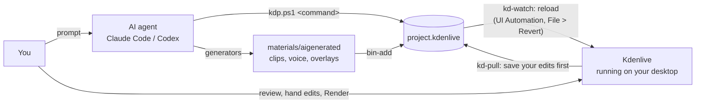

<div align="center">

# Movie Engine

**ኤጀንት ሰብ-ሰራሕ ብልሒ (AI) ቪድዮኹም ኣብ Kdenlive ክትዕዘቡ ከለኹም የሰናድኦ፣ ንስኹም ድማ ኣብ ዝኾነ ይኹን እዋን ነቲ ስራሕ ክትቆጻጸርዎ ትኽእሉ ኢኹም።**

ናይ ኮድ ኤጀንታት AI (Claude Code, Codex) ሓቀኛታት ፕሮጀክትታት Kdenlive ይሃንጹን ይቕይሩን፦ ፊልምታት፣ ገለጽቲ ቪድዮታት (explainers) ከምኡ'ውን ቀጥ ዝበሉ ሓጸርቲ ቪድዮታት (shorts)። እቶም ለውጥታት ኣብቲ ዝኸፈትኩሞ ኣሰናዳኢ (editor) ብቐጥታ ይርኣዩ። ተንቀሳቓሲ (portable)፣ Windows፣ ኣብ ኣሰናዳኢ ዝኾነ ጥገና (patch) ዘይብሉ።


[English](../../README.md) · [简体中文](README.zh-CN.md) · [繁體中文](README.zh-TW.md) · [हिन्दी](README.hi.md) · [Español](README.es.md) · [Français](README.fr.md) · [العربية](README.ar.md) · [বাংলা](README.bn.md) · [Português](README.pt.md) · [Русский](README.ru.md) · [اردو](README.ur.md) · [Bahasa Indonesia](README.id.md) · [Deutsch](README.de.md) · [日本語](README.ja.md) · [Türkçe](README.tr.md) · [한국어](README.ko.md) · [Українська](README.uk.md) · [Italiano](README.it.md) · [Polski](README.pl.md) · [Tiếng Việt](README.vi.md) · [فارسی](README.fa.md) · [ไทย](README.th.md) · [Kiswahili](README.sw.md) · [አማርኛ](README.am.md) · [Avañe'ẽ](README.gn.md) · [Setswana](README.tn.md) · [Shqip](README.sq.md) · [Беларуская](README.be.md) · [Български](README.bg.md) · [Bosanski](README.bs.md) · [Hrvatski](README.hr.md) · [Српски](README.sr.md) · [Crnogorski](README.cnr.md) · [Македонски](README.mk.md) · [Slovenščina](README.sl.md) · [Slovenčina](README.sk.md) · [Čeština](README.cs.md) · [Magyar](README.hu.md) · [Română](README.ro.md) · [Dansk](README.da.md) · [Norsk bokmål](README.nb.md) · [Norsk nynorsk](README.nn.md) · [Svenska](README.sv.md) · [Íslenska](README.is.md) · [Suomi](README.fi.md) · [Eesti](README.et.md) · [Latviešu](README.lv.md) · [Lietuvių](README.lt.md) · [Nederlands](README.nl.md) · [Lëtzebuergesch](README.lb.md) · [Rumantsch](README.rm.md) · [Ελληνικά](README.el.md) · [Malti](README.mt.md) · [Gaeilge](README.ga.md) · [Català](README.ca.md) · [ქართული](README.ka.md) · [Հայերեն](README.hy.md) · [Azərbaycanca](README.az.md) · [Afrikaans](README.af.md) · [isiZulu](README.zu.md) · [isiXhosa](README.xh.md) · [Sesotho](README.st.md) · [Sepedi](README.nso.md) · [Xitsonga](README.ts.md) · [Tshivenḓa](README.ve.md) · [siSwati](README.ss.md) · [isiNdebele (South Africa)](README.nr.md) · [isiNdebele (Zimbabwe)](README.nd.md) · [chiShona](README.sn.md) · [Chichewa](README.ny.md) · [Ikinyarwanda](README.rw.md) · [Ikirundi](README.rn.md) · [Malagasy](README.mg.md) · [Soomaali](README.so.md) · [Afaan Oromoo](README.om.md) · [Qafar af](README.aa.md) · **ትግርኛ** · [Sängö](README.sg.md) · [Kreol Seselwa](README.crs.md) · [TjiKalanga](README.kck.md) · [ChiNdau](README.ndc.md)

*እዚ ትርጉም እዩ፤ እቲ መወከሲ ቅዳሕ እቲ ብእንግሊዝኛ ዘሎ README እዩ።*

</div>

---

## ትሕዝቶ

- [ስለምንታይ](#ስለምንታይ)
- [ብኸመይ ይሰርሕ](#ብኸመይ-ይሰርሕ)
- [ባህርያት](#ባህርያት)
- [ዘድልዩ ነገራት](#ዘድልዩ-ነገራት)
- [ምትካል](#ምትካል)
- [ቅልጡፍ መጀመሪ](#ቅልጡፍ-መጀመሪ)
- [ምስ ኤጀንት ምስራሕ](#ምስ-ኤጀንት-ምስራሕ)
- [መስመር ትእዛዝ ምስናዳእ (`kdp.ps1`)](#መስመር-ትእዛዝ-ምስናዳእ-kdpps1)
- [ቀጥታዊ ምስምማዕ ምስ ክፉት ኣሰናዳኢ](#ቀጥታዊ-ምስምማዕ-ምስ-ክፉት-ኣሰናዳኢ)
- [ጀነሬተራት: Kdenlive ዘይክእሎ](#ጀነሬተራት-kdenlive-ዘይክእሎ)
- [ድምጺ ተራኺን ድምጽን](#ድምጺ-ተራኺን-ድምጽን)
- [ቋንቋ ኢንተርፈስ](#ቋንቋ-ኢንተርፈስ)
- [ኣቀማምጣ ፎልደራት](#ኣቀማምጣ-ፎልደራት)
- [ፈተናታትን መረጋገጺታትን](#ፈተናታትን-መረጋገጺታትን)
- [ደረታት](#ደረታት)
- [ጸገማት ምፍታሕ](#ጸገማት-ምፍታሕ)
- [ተደጋገምቲ ሕቶታት](#ተደጋገምቲ-ሕቶታት)
- [ኣበርክቶ](#ኣበርክቶ)
- [ምስጋና](#ምስጋና)
- [ፍቓድ](#ፍቓድ)

## ስለምንታይ

ኣሰናዳእቲ ቪድዮ ንኢድ ኣብ ልዕሊ ማውዝ ተባሂሎም እዮም ዝተሰርሑ። ኤጀንታት AI ግን ኣብ ቅርጺ፣ ግዜን ድግግምን ብሉጻት እዮም፦ 300 ክሊፕታት ምስ ምት ሙዚቃ (beat) ምቕማጥ፣ ነፍሲ ወከፍ ጽሑፍ (caption) ምስ ድምጺ ምስማር፣ ድሕሪ ርእይቶ ንሓንቲ ትዕይንቲ ደጊምካ ምስራሕ። ንዴስክቶፕኹም ከይወሰዱ ግን ብ GUI ክጥውቑ ኣይክእሉን።

Kdenlive ሓያል ናይ ክፉት ምንጪ (open-source) ኣሰናዳኢ እዩ፣ ኣብ Windows ግን **ናይ ኣውቶሜሽን API የብሉን**፦ ብ D-Bus ምቁጽጻር ኣብ ናይ Linux ህንጻታት (builds) ጥራይ እዩ ዘሎ፣ እቶም ከምኡ ዝውስኹ ፎርካት (forks) ድማ ወይ ዝተገደፉ ወይ ውሑሳት ዘይኮኑ እዮም። Movie Engine ነዚ ንኣሰናዳኢ ከይጠገነ ይፈትሖ፦

1. ኤጀንት ነቲ ፋይል ፕሮጀክት `.kdenlive` ብዝተፈተነ መስመር ትእዛዝ (`engine/kdp.ps1`) የሰናድኦ።
2. እቲ ዝሰርሕ ዘሎ Kdenlive ነቲ ፋይል ደጊሙ ክጽዕኖ ብ Windows UI Automation ይንገሮ፣ ብዘይ ምጽቃጥ መፍትሕ (keystrokes)፣ ብዘይ ማውዝን ብዘይ ምውሳድ ትኹረት (focus)ን።
3. ናይ ባዕልኹም ዘይተዓቀቡ ለውጥታት ቅድም ይዕቀቡ፣ ፈጺሞም ድማ ኣይድምሰሱን።

ስለዚ ኤጀንት የሰናድእ ንስኹም ድማ ትግምግሙ፣ ወይ ንስኹም ብኢድኩም ተሰናድኡ። ክልቴኹም ኣብ ሓደ ፕሮጀክት፣ ኣብ ሓደ ኣሰናዳኢ፣ ብሓደ ግዜ ትሰርሑ።

## ብኸመይ ይሰርሕ



ነፍሲ ወከፍ ትእዛዝ ምስናዳእ ነቲ ሓደ ውሑስ ዑደት ይስዕብ፦

1. **Pull.** Kdenlive ዘይተዓቀቡ ለውጥታት እንተሃልዉዎ፣ ክዕቅቦም ይንገሮ (ኣብ toolbar ዘሎ Save ብ UI Automation)፣ እቲ ምዕቃብ ድማ ይረጋገጽ።
2. **ምስናዳእ።** እቲ ትእዛዝ ነቲ XML ኣብ ትሕቲ መዕጸዊ (lock)፣ ድሕሪ ምርመራ hash ከምኡ'ውን ምስ ስእሊ መመለሲ (undo snapshot) ይቕይሮ። እቲ ፋይል ኣብቲ ማእከል እንተተቐይሩ፣ ዋላ ሓንቲ ኣይጽሓፍን።
3. **ዳግመ-ምጽዓን (reload)።** እቲ ተዓዛቢ (watcher) ነቲ ማሕተም AI ርእዩ ኣብቲ ክፉት ኣሰናዳኢ File > Revert የካይድ። ዓወት ዝቑጸር እቲ widget ናይ timeline ብሓቂ ዳግማይ ምስ ተሃንጸ ጥራይ እዩ።
4. **ግጭት (conflict)።** ኣብቲ ማእከል ምስናዳእ እንተጀሚርኩም፣ ዋላ ሓንቲ ዳግማይ ኣይጽዓንን፣ ስራሕኩም ድማ ከም ዘለዎ ይጸንሕ። ቅዳሕ AI በይኑ ይቕመጥ፣ ኤጀንት ድማ ለውጡ ኣብ ልዕሊ ናትኩም ደጊሙ የተግብሮ።

## ባህርያት

- **ብዘይ GUI ምሉእ ምስናዳእ ፕሮጀክት**፦ ኣስታት 120 ትእዛዛት፣ bin፣ timeline፣ ኢፈክትታት (effects)፣ ቅንብራት (compositions)፣ ትራካት (tracks)፣ መምርሒ መስመራት (guides)፣ ምልክታት (markers)፣ ንኡስ ጽሑፋት (subtitles)፣ ተኸታታሊታት (sequences)፣ ፍጥነትን ዳግመ-ምድልዳል ግዜ (time remap)ን፣ slideshow፣ ኣርእስታት (titles)፣ proxy፣ ረንደር (rendering) ከምኡ'ውን undo/redo ዝሽፍኑ። [መወከሲ ትእዛዛት](#መስመር-ትእዛዝ-ምስናዳእ-kdpps1) ርኣዩ።
- **ቀጥታዊ ምስምማዕ ምስ ክፉት ኣሰናዳኢ።** ለውጥታት AI ኣብቲ እትርእይዎ ዘለኹም Kdenlive ይርኣዩ፤ ዘይተዓቀቡ ለውጥታትኩም ቅድም ይዕቀቡ፣ ፈጺሞም ድማ ኣይጠፍኡን።
- **ንዴስክቶፕኹም ፈጺሙ ኣይርብሽን።** ምውሳድ ትኹረት፣ ምጽቃጥ መፍትሕ ወይ ምንቅስቓስ ማውዝ የለን። ናይ ፈተና ኣሰናዳእቲ ኣብ ዘይርአ ዴስክቶፕ Windows ይሰርሑ።
- **ተንቀሳቓሲ።** ኣሰናዳኢ፣ ቅጥዕታት (settings)፣ Node.js፣ ፊደላት (fonts)ን መሳርሒታትን ኣብ ሓደ ፎልደር ይርከቡ። ናብ ካልእ ኮምፒተር ቅድሕዎ፣ ክሰርሕ እዩ፤ ኣብ Program Files ወይ ኣብ ፕሮፋይል Windows ኩም ዋላ ሓንቲ ኣይጽሓፍን።
- **ጀነሬተራት (generators) ን Kdenlive ዘይክእሎ**፦ ፊደል ብፊደል ዝንቀሳቐስ ጽሑፍ (kinetic text)፣ ብኢድ ዝተሳእሉ መብርሂታት (annotations)፣ ናይ ኢንተርፈስ 3D ትዕይንትታት፣ ምንቅስቓስ ኩርሶር ከምኡ'ውን ነዋሕቲ ተዋሳእቲ (interactive) ገለጽቲ ("explainer") ፊልምታት። ኣብ GPU ብሓቀኛ ምድብዛዝ ምንቅስቓስ (motion blur) ይረንደሩ፣ ኣብ timeline ድማ ከም ንቡራት ክሊፕታት ይቕመጡ።
- **ድምጺ ተራኺ (voice-over) ምስ ግዜ ነፍሲ ወከፍ ቃል** (Microsoft Edge TTS፣ API key ኣየድልን)። ጽሑፋትን ተግባራትን ኣብታ ልክዕ ቃል ይጅምሩ።
- **ብኮድ ዝተሰርሑ ናይ ድምጺ ኢፈክትታት** (whoosh, click, pop, riser, impact ከምኡ'ውን ካልኦት)።
- **ዝተረጋገጸ እምበር ግምት ኣይኮነን።** ነፍሲ ወከፍ ትእዛዝ ምርመራ ውጽኢት ኣለዎ፣ ኢፈክትታትን ቅንብራትን ሓደ ብሓደ ይፍተኑ፣ እቲ ጥረ ውጽኢት ድማ ኣብ `docs/proof/` ይርከብ።
- **መምርሒታት ኤጀንት ተኻቲቶም ኣለዉ።** `AGENTS.md` ከምኡ'ውን ኣብ `.claude/skills/` ዘለዉ ክእለታት (skills) ን Claude Code ን Codex ን ኣገባብ ስራሕ፣ ቅርጺ ፋይልን ክጥንቀቕሎም ዘለዎ ሓደጋታትን ይምህሩ።

## ዘድልዩ ነገራት

| | |
|---|---|
| ስርዓተ ክዋኔ (OS) | Windows 10 ወይ 11፣ x64 |
| ኣሰናዳኢ | ተንቀሳቓሲ (standalone) ህንጻ Kdenlive **26.08.3**። ካልኦት ቨርሽናት ኣይተፈተኑን። |
| Node.js | 18 ወይ ዝሓደሰ፦ ናይ Windows x64 `.zip` ካብ nodejs.org፣ ናብ `engine/node/` ዝተፈትሐ |
| ብራውዘር | Microsoft Edge (ክፋል Windows እዩ)፤ ረንደረራት ትዕይንቲ ብዘይ መስኮት (headless) ይጥቀሙሉ |
| ኤጀንት | [Claude Code](https://claude.com/claude-code) ወይ Codex። ግዴታ ኣይኮነን፦ ነፍሲ ወከፍ መሳርሒ ብኢድ'ውን ይሰርሕ። |
| ዲስክ | ን ኣሰናዳእን መሳርሒታትን ኣስታት 1 GB፣ ተወሳኺ ድማ ሚድያኹም |
| GPU | ናይ ሃርድዌር H.264 encoding ዘለዎ ዝኾነ GPU ን `film-render.mjs` የቀላጥፎ (እንተዘየለ ብሶፍትዌር ይሰርሕ) |

## ምትካል

ኩሉ ነገር **ኣብ ውሽጢ እቲ ፎልደር** እዩ ዝትከል። ዋላ ሓንቲ መሰል ኣመሓዳሪ (admin) ኣየድልን።

```powershell
git clone https://github.com/vladtarrow/movie-engine.git
cd movie-engine
```

**1. Node.js.** ናይ Windows x64 `.zip` ናይ Node.js 18 ወይ ዝሓደሰ ካብ <https://nodejs.org/en/download> ኣውርዱ፣ ትሕዝቶኡ ድማ ናብ `engine\node\` ፍትሑ፣ `engine\node\node.exe` ን `engine\node\npm.cmd` ን ኣብኡ ምእንቲ ክህልዉ። መትከሊ (installer) ይኹን ናይ ስርዓት Node ኣየድልን። ኩሎም ስክሪፕታት ብ `engine\node.cmd` እዮም ዝሰርሑ፣ ፈጺሞም ብናይ ስርዓት Node ኣይኮኑን።

**2. ፓኬጃት Node** ን መሳርሒ ድምጽን ን ረንደረራትን (ቨርሽናት ኣብ `engine/voice/package.json` ተወሲኖም ኣለዉ)፦

```powershell
engine\node\npm.cmd install --prefix engine\voice
```

**3. ተንቀሳቓሲ Kdenlive 26.08.3።** `kdenlive-26.08.3_standalone.exe` ካብ <https://download.kde.org/stable/kdenlive/26.08/windows/> ናብ `engine\installer\` ኣውርዱ፣ ኣረጋግጽዎን ፍትሕዎን፦

```powershell
(Get-FileHash engine\installer\kdenlive-26.08.3_standalone.exe -Algorithm SHA256).Hash
# expected: A25427B1DFF2C17E3B0386E991BB1A719382BB3176D1A90E441CDAEB6E0A967D
engine\installer\kdenlive-26.08.3_standalone.exe -o"engine\Kdenlive" -y
```

እቲ ኣሰናዳኢ ኣብ `engine\Kdenlive\kdenlive-26.08.3_standalone\bin\` ይኣቱ። ድሮ `melt.exe` ን `ffmpeg.exe` ን ሒዙ ኣሎ።

**4. ቀዳማይ ምጅማር።**

```powershell
engine\kdenlive.cmd
```

Kdenlive ኩሉ ቅጥዕታቱ ኣብ `engine\profile-kdenlive\` እዩ ዝዕቅቦ፣ ኣብ ፕሮፋይል Windows ኩም ኣይኮነን። ኣብ ቀዳማይ ምጅማር ሓደ ግዜ ጥራይ ዝርአ መራሒ ምድላው (setup wizard) የርኢ።

## ቅልጡፍ መጀመሪ

### ምስ ኤጀንት

ነቲ ፎልደር ኣብ Claude Code (ወይ Codex) ክፈትዎ እሞ ብቐሊል ቃላት ሕተቱ፦

> ሓድሽ ቀጥ ዝበለ 30 fps ፕሮጀክት "launch-teaser" ስራሕ። ነቶም ኣብ `materials/designers/launch/` ዘለዉ ሰለስተ screenshots ኣብ timeline ኣቐምጦም፣ ነፍሲ ወከፎም 2.5 s ምስ ሓጺር cross-fade፣ ካብ `script.txt` ድምጺ ተራኺ ወስኽ፣ ንነፍሲ ወከፍ መስመር ድማ ምስ ግዜኡ ዝሰማማዕ kinetic caption ግበር።

> ኣብ Kdenlive ክፈተለይ።

> እቲ ካልኣይ ሾት ነዊሑ። ናብ 1.8 s ኣሕጽሮ፣ ነቲ ሎጎ ድማ ቁሩብ ናብ ላዕሊ ኣልዕሎ።

ኤጀንት ን `AGENTS.md` ይስዕብ፦ ብ `kdp.ps1` የሰናድእ፣ እቲ ምስናዳእ ዘድልዮ ክሊፕታት ጥራይ ይረንደር፣ ነቲ ክፉት ኣሰናዳኢ ድማ ምስምዒ ይገብሮ። ንስኹም ኣብ Kdenlive ትግምግሙ፣ ዝደለኹምዎ ግዜ ብኢድ ተሰናድኡ፣ ምስ ዓገብኩም ድማ Render ትጥውቑ።

### ብኢድ

```powershell
# a new 1080x1920 30 fps project with 2 video and 2 audio tracks
powershell -NoProfile -ExecutionPolicy Bypass -File engine\kdp.ps1 new -Project projects\hello\hello.kdenlive -Profile vertical_hd_30

# a 3-second title and a colour background
powershell -NoProfile -ExecutionPolicy Bypass -File engine\kdp.ps1 bin-color -Project projects\hello\hello.kdenlive -Color '#203060' -Seconds 3 -Name bg
powershell -NoProfile -ExecutionPolicy Bypass -File engine\kdp.ps1 title -Project projects\hello\hello.kdenlive -Text "Hello" -Seconds 3 -Name hi

# place them: background on V1, title above it on V2
powershell -NoProfile -ExecutionPolicy Bypass -File engine\kdp.ps1 add -Project projects\hello\hello.kdenlive -Bin bg -Track V1 -At 0
powershell -NoProfile -ExecutionPolicy Bypass -File engine\kdp.ps1 add -Project projects\hello\hello.kdenlive -Bin hi -Track V2 -At 0

# a check frame, then open it in the editor
powershell -NoProfile -ExecutionPolicy Bypass -File engine\kdp.ps1 frame -Project projects\hello\hello.kdenlive -At 1.5 -Out out\hello\check.png
engine\kdenlive.cmd projects\hello\hello.kdenlive
```

ነቲ ናይ መወዳእታ ፕሮጀክት ደሓር ደጊምኩም ክትከፍትዎ፣ ን `open-last-project.cmd` ክልተ ግዜ ጠውቕዎ።

## ምስ ኤጀንት ምስራሕ

ኤጀንት `AGENTS.md` (Codex) ወይ ንዕኡ ዘእቱ `CLAUDE.md` (Claude Code) ከምኡ'ውን ክልተ ክእለታት ይንበብ፦

| ክእለት | ዝምህሮ |
|---|---|
| `.claude/skills/kdenlive-project-file` | ቅርጺ `.kdenlive` / MLT XML፣ `kdp.ps1`፣ ብ `melt` ምርመራ |
| `.claude/skills/kdenlive-live` | ነቲ ዝሰርሕ ዘሎ ኣሰናዳኢ ብውሕስና ምምራሕ፦ ምጅማር፣ pull፣ ዳግመ-ምጽዓን፣ ስእሊ መስኮቱ ምውሳድ |

ኤጀንት ዝስዕቦም፣ ክትኣምንዎም እትኽእሉ ሕግታት፦

- ፈጺሙ ማውዝኩም፣ ኪቦርድኩም ወይ ትኹረትኩም ኣይወስድን፣ ፈጺሙ ድማ ስእሊ ዴስክቶፕኹም ኣይወስድን (ናይቲ ኣሰናዳኢ ባዕሉ መስኮት ጥራይ)።
- ስጉምትታት GUI (ምዕቃብ፣ ምኽፋት፣ ዳግመ-ምጽዓን) ክትጥውቑ ኣብ ክንዲ ዝሓትት ባዕሉ ይገብሮም።
- ዝኾነ ነገር ቅድሚ ምውራድን ቅድሚ ምድምሳስን ይሓትት።
- ስራሕ ዘድልዮ ጥራይ ይረንደር (ክሊፕታት ትዕይንቲ፣ ናይ ምርመራ ፍሬማት)። እቲ ናይ መወዳእታ ፊልም ክትሓትዎ ከለኹም ጥራይ ይረንደሮ።
- Kdenlive ሓደ ነገር ብጽቡቕ ክገብሮ ምስ ዘይክእል፣ ኤጀንት ብኮድ ኣብ ደገ ሰሪሑ ነቲ ውጽኢት ከም ክሊፕ የእትዎ። ነቲ ኢፈክት ኣየዳኽሞን።

## መስመር ትእዛዝ ምስናዳእ (`kdp.ps1`)

```powershell
powershell -NoProfile -ExecutionPolicy Bypass -File engine\kdp.ps1 <command> -Project <file.kdenlive> [options]
```

ግዜታት ብሰከንድ እዮም፣ ብነጥቢ (`2.5`)። ትራካት `V1 V2 …` (V1 እቲ ዝተሓተ) ከምኡ'ውን `A1 A2 …` እዮም። ሓደ ክሊፕ ብ `-Track` ምስ ኣብ ውሽጡ ዘሎ ዝኾነ ግዜ `-At` ይለለ። መለክዒታት ኢፈክት (parameters) ኣብ `-Params "name=value||name=value"` ይኣትዉ። ምሉእ ዝርዝር ምስ ኩሉ ኣማራጺታት ኣብ ርእሲ `engine/kdp.ps1` ይርከብ።

| ጉጅለ | ትእዛዛት |
|---|---|
| ፕሮጀክት | `new`, `profiles`, `info`, `validate`, `fonts`, `profile-set`, `profile-from-clip`, `zone`, `archive`, `backups`, `rebase`, `otio-export`, `otio-import` |
| Bin | `bin-add`, `bin-color`, `title`, `title-text`, `title-save`, `title-template`, `bin-rename`, `bin-remove`, `bin-info`, `bin-set`, `bin-duplicate`, `bin-replace-file`, `bin-reload`, `folder`, `bin-folder`, `relink`, `clean`, `generator`, `playlist-clip`, `extract-audio`, `transcode` |
| Timeline | `add`, `add-av`, `move`, `copy`, `trim`, `ripple-trim`, `slip`, `split`, `remove`, `speed`, `remap`, `disable`, `enable`, `group`, `ungroup`, `mix`, `unmix`, `space-insert`, `space-remove`, `spaces-remove-all`, `track-clear`, `replace-in-timeline` |
| ኢፈክትታት | `effects`, `effect-info`, `effect-add`, `effect-list`, `effect-set`, `effect-remove`, `effect-copy`, `effect-clear`, `effects-all`, `bin-effect`, `effect-templates`, `effect-template` |
| ቅንብራት | `compositions`, `comp-info`, `comp-add`, `comp-list`, `comp-set`, `comp-remove` |
| ትራካት | `track-add`, `track-remove`, `track-set` |
| መምርሒ መስመራትን ምልክታትን | `guide-add`, `guide-list`, `guide-remove`, `guide-set`, `guide-clear`, `guide-export`, `guide-category`, `marker`, `marker-list`, `marker-set`, `marker-remove` |
| ንኡስ ጽሑፋት | `sub-add`, `sub-import`, `sub-export`, `sub-state` |
| ተኸታታሊታት (sequences) | `sequence-add`, `sequences`, `copy-to-sequence`, `expand`፤ ምስ `-Sequence <name>` ዝኾነ ትእዛዝ ኣብ ውሽጢ እቲ sequence ይሰርሕ |
| ፍሉያት | `slideshow`, ኣኒሜሽናት Lottie / Glaxnimate ብ `bin-add`, `proxy`, `stabilize`, `scene-split`, `speed-job`, `subclip` |
| ውጽኢት | `frame` (ሓደ PNG), `preview` (ቅልጡፍ ረንደር ብ melt), `render` (ናይ Kdenlive ባዕሉ ረንደረር ወይ preset), `presets` |
| ታሪኽ | `undo`, `redo`, `clear-history` (snapshots ኣብ `projects/<name>/.kdp-history`) |

ክፍለጡ ዝግብኦም ጠባያት፦

- ዝተኣሳሰሩ ፍርቂ ኦድዮን ቪድዮን ብሓባር ይንቀሳቐሱ፣ ይቑረጹ (trim)፣ ይምቀሉ (split)፣ ይእለዩ (`-Alone` ንሓደ ፍርቂ ጥራይ)።
- ዝፈሸለ ትእዛዝ ብኮድ 1 ይወጽእ፣ ዋላ ሓንቲ ድማ ኣይጽሕፍን።
- እቲ ናይ Windows ህንጻ ከካይዶም ዘይክእል ኢፈክትታት ይንጸጉ እምበር ብስቕታ ሸለል ኣይበሃሉን (ዝርዝር፦ `docs/proof/assets.txt`)።
- ነፍሲ ወከፍ ተግባር ሜኑ Kdenlive ምስ ትእዛዝ፣ ምስ ካልእ መገዲ፣ ወይ ምስ "ንምርኣይ ጥራይ" ኣብ `engine/tools/data/kdenlive-actions.csv` ተዛሚዱ ኣሎ። `docs/kdenlive-coverage.md` ርኣዩ።

## ቀጥታዊ ምስምማዕ ምስ ክፉት ኣሰናዳኢ

| ስክሪፕት | እንታይ ይገብር | ኮዳት ምውጻእ (exit codes) |
|---|---|---|
| `engine\kd-pull.ps1 -Project <f>` | Kdenlive ለውጥታትኩም ክዕቅብ ይገብሮ እሞ የረጋግጾ | 0 ፋይል ዘመናዊ እዩ፣ 3 ኣይሰርሕን ዘሎ፣ 4 ኣይተረጋገጸን |
| `engine\kd-reload.ps1 -Project <f>` | File > Revert፣ ብዳግማይ ዝተሃንጸ timeline ዝረጋገጽ | 0 ተረጋጊጹ፣ 2 ዘይተዓቀቡ ለውጥታት ኣለዉኹም (ዋላ ሓንቲ ኣይተደርበየን)፣ 3 ኣይሰርሕን ዘሎ፣ 4 ፈሺሉ |
| `engine\kd-watch.ps1 -Project <f>` | ኣብ ድሕሪት ዝሰርሕ ተዓዛቢ፦ ድሕሪ ነፍሲ ወከፍ ጽሕፈት AI ዳግማይ ይጽዕን፣ ግጭታት ይምዝግብ | መዝገብ (log) ኣብ `engine\kd-watch.log`፤ ንምቁራጹ `engine\kd-watch.run` ደምስሱ |
| `engine\kdenlive-bg.ps1 [project]` | ን ኤጀንት Kdenlive ተነኢሱ (minimized) ይጅምሮ | 0 ተጻዒኑ፣ 4 ኣይተረጋገጸን |
| `engine\kdenlive.cmd [project]` | ንኣኹም Kdenlive ይጅምረልኩም | |

ነቲ ተዓዛቢ ኣብ ነፍሲ ወከፍ ክፍለ-ግዜ (session) ሓደ ግዜ ጀምርዎ፦

```powershell
Start-Process powershell -WindowStyle Hidden -ArgumentList '-NoProfile','-ExecutionPolicy','Bypass','-File','engine\kd-watch.ps1','-Project','projects\hello\hello.kdenlive'
```

ዓበይቲ ፕሮጀክትታት፦ ዳግመ-ምጽዓን ናይ 1000 ክሊፕ ዘለዎ ፕሮጀክት ደቓይቕ ይወስድ፣ እቶም መሳርሒታት ድማ ኣቐዲሞም ኣብ ክንዲ ዝሕብሩ ይጽበይዎ። ፕሮጀክትታት ኣብ ባዶ ኣሰናዳኢ ብ *File > Open Recent* እዮም ዝኽፈቱ፣ ምኽንያቱ ፋይል ብቐጥታ ምኽፋት ን Qt ንተበጻሕነት (accessibility) ኣብ ነፍሲ ወከፍ ኣቕሓ timeline ክዘውር ስለ ዝገብሮ ኣስታት 10 ደቒቕ ዝያዳ ይደንጒ ነበረ።

## ጀነሬተራት: Kdenlive ዘይክእሎ

Kdenlive/MLT ፊደል ብፊደል ኣኒሜሽን ጽሑፍ የብሉን፣ expressions የብሉን፣ 3D ድማ ውሑድ እዩ፣ ከበድቲ ኢፈክትታት ድማ ምርኣይ (playback) የዝሕልዉ። Movie Engine ከምዚኦም ዝኣመሰሉ ክፋላት ኣብ ደገ ይረንደሮም እሞ ከም ንቡራት ክሊፕታት ኣብ timeline የቐምጦም፣ መብዛሕትኡ ግዜ ምስ alpha (ግሉጽነት)፣ ኣብ ልዕሊ ስእልታት ኣብ ዘሎ ትራክ። ስክሪፕት ጀነሬተርን እታዊታቱን (inputs) ኣብ ፎልደር ፕሮጀክት ይጸንሑ፣ ስለዚ ጽሑፍ፣ ፊደል ወይ ግዜ ምስ ዝቕየር ክሊፕ ደጊሙ ክፍጠር ይኽእል።

| መሳርሒ | ዝሰርሖ |
|---|---|
| `engine/tools/kinetic-text.ps1` | ፊደል ብፊደል ዝንቀሳቐሱ captions፣ ግዜ ነፍሲ ወከፍ ቃል ካብ `voice.json`፣ ሳጹን ምጉላሕ (highlight box) |
| `engine/tools/annotate.ps1` | ብኢድ ዝተሳእሉ ክቢታት፣ ሳጹናት፣ ትሕቲ መስመራትን ምልክታት ኣንፈትን (arrows)፣ ኣብ ልዕሊ screenshot እናተሳእሉ ዝርኣዩ |
| `engine/tools/card-entrance.ps1` | ብልስሉስ ጽላሎት ዝለዓልን እናዓበየ ዝኣቱን ካርድ screenshot |
| `engine/tools/pdf-to-png.ps1` | ስላይድታት ካብ ናብ PDF ዝተወጽአ (export) |
| `engine/tools/html-render.mjs` | ዝኾነ ትዕይንቲ HTML/CSS/canvas ናብ ቪድዮ፦ ኣኒሜሽን ኢንተርፈስ፣ ኩርሶራት፣ 3D፣ ማስክታት |
| `engine/tools/film-render.mjs` + `film/` | ኣብ canvas ዝስራሕ ነዋሕቲ፣ ተዋሳእቲ ገለጽቲ ፊልምታት፦ ንነፍሲ ወከፍ መስመር ድምጺ ሓደ ክሊፕ፣ ተግባራት ኣብ ዝተባህሉ ቃላት ይጅምሩ፣ GPU motion blur ብኣስታት 45 fps |

ክልቲኦም ረንደረራት ነቲ ምስ Windows ዝመጽእ Microsoft Edge ብዘይ መስኮት (headless)፣ ምስ ሓደ ግዜ ተጠቒምካ ዝድርበ ፕሮፋይልን ብዘይ ናይ ኔትዎርክ መራኸቢን ይመርሕዎ።

### ኣርኣያታት

```powershell
# a 3-second 3D title card with a cursor click
engine\node.cmd engine\tools\html-render.mjs examples\demo\scene\scene.html examples\demo\out --frames 0,30,60,89
engine\node.cmd engine\tools\html-render.mjs examples\demo\scene\scene.html examples\demo\out\scene.mp4

# a 4-shot interactive film timed to two voice lines
engine\node.cmd engine\tools\film-render.mjs examples\demo\film\film.html examples\demo\out --check
engine\node.cmd engine\tools\film-render.mjs examples\demo\film\film.html examples\demo\out --shots all --width 640
engine\node.cmd engine\tools\film-render.mjs examples\demo\film\film.html examples\demo\out\clips --suffix -v01
```

ሓደ ፊልም ሰለስተ ንኣሽቱ ፋይላት እዩ። `data.js` ሾታትን ግዜታት ቃላትን ይሕዝ። `direction.js` ንነፍሲ ወከፍ ሾት ሓንቲ መስመር ኣለዎ፦

```text
1 | hover 192 108 @brand | tag 300 60 Your brand @deserves | confetti 192 90 @film
2 say=A film that/*explains* it
3 | click 116 108 @before | click 268 108 @after | chips Before~After @after
4 scene=counter | count 0 120 % @count
```

`scenes.js` እቶም ካብ ባዶ ዝሳኣሉ ሾታት ይሕዝ። `@word` እቲ ድምጺ ነታ ቃል ክብላ ከሎ ሓደ ተግባር ይጅምር። እቶም ተግባራት click, hover, drag, zoom, lens, ring, arrow, chips, toggle, slider, toast, type, count ከምኡ'ውን confetti የጠቓልሉ፤ ምሉእ ሰዋስው (syntax) ኣብ ላዕሊ `engine/tools/film/film-kit.js` ይርከብ።

## ድምጺ ተራኺን ድምጽን

```powershell
engine\node.cmd engine\voice\voice.mjs lines.json materials\aigenerated\hello\voice en-US-AndrewMultilingualNeural +0%
```

`lines.json` ዝርዝር መስመራት እዩ። እቲ መሳርሒ ንነፍሲ ወከፍ መስመር ሓደ mp3 ከምኡ'ውን `voice.json` ይጽሕፍ፣ ምስ ንውሓትን መጀመርታን መወዳእታን ነፍሲ ወከፍ ቃልን። መስመራት ይዕቀቡ (cache)፣ ስለዚ ሓንቲ መስመር ምቕያር ነታ መስመር ጥራይ ደጊሙ ይፈጥራ። ብፓኬጅ `msedge-tts` ናይ Microsoft Edge ናይ መርበብ ጽሑፍ-ናብ-ዘረባ (text-to-speech) ይጥቀም፦ key ኣየድልን፣ እቲ ኣገልግሎት ግን ወግዓዊ ኣይኮነን እሞ ኢንተርነት የድልዮ።

```powershell
engine\node.cmd engine\audio\sfx.mjs materials\aigenerated\sfx
```

እዚ whoosh, whoosh-long, swipe, click, pop, tick, riser, impact, ding ከምኡ'ውን reveal ብኮድ ይሰርሖም፤ ድሉው ስብስብ ኣብ `materials/aigenerated/sfx/` ኣሎ። ካብ ሓደ ፍሬም ዝሓጸሩ ድምጽታት ቅድሚ ምቕማጦም ብጸጥታ ኣንውሕዎም (`-af apad=whole_dur=0.0667`)።

## ቋንቋ ኢንተርፈስ

እቶም መጀመሪታት (launchers) ብንቡር Kdenlive ብ**እንግሊዝኛ** ይጅምርዎ። ካልእ ቋንቋ ንምጥቃም፣ ቅድሚ ምጅማር `MOVIE_ENGINE_UI_LANG` ኣቐምጡ፦

```powershell
$env:MOVIE_ENGINE_UI_LANG = 'ru'; engine\kdenlive.cmd
```

UI Automation ኣቕሑ ሜኑ ብዝርኣዩ ኣስማቶም ይረኽቦም። ኣስማት ን 31 ቋንቋታት ኢንተርፈስ ድሮ ኣትዮም ኣለዉ (`engine/tools/kd-ui.ps1`, `$KdNames`)። ንዝኾነ ካልእ ቋንቋ፣ ኣስማቱ ኣብኡ ወስኹ እሞ በዚ ኣረጋግጹ፦

```powershell
powershell -NoProfile -ExecutionPolicy Bypass -File engine\tools\kd-langcheck.ps1
```

## ኣቀማምጣ ፎልደራት

```text
movie-engine/
├─ AGENTS.md, CLAUDE.md          instructions for AI agents
├─ .claude/skills/               agent skills: project file format, live editor
├─ engine/
│  ├─ kdp.ps1                    the editing command line
│  ├─ kd-pull / kd-reload / kd-watch .ps1, kdenlive.cmd, kdenlive-bg.ps1
│  ├─ tools/                     internals, generators, tests, data (action map)
│  ├─ voice/  audio/  fonts/     TTS, synthesized SFX, Poppins (OFL)
│  ├─ Kdenlive/  node/           portable editor and Node.js (not in git)
│  └─ profile-kdenlive/          the editor's settings (not in git)
├─ projects/<name>/<name>.kdenlive
├─ materials/
│  ├─ download/                  stock and downloaded files (not in git)
│  ├─ aigenerated/               everything the AI made (sfx/ and test-kit/ ship with the engine)
│  ├─ designers/  brand/         files from your team, brand assets
├─ examples/demo/                demos of the scene and film renderers
├─ out/                          renders (not in git)
└─ docs/                         proofs, coverage, translations of this README
```

ኣብ ውሽጢ ፕሮጀክትታት ዘለዉ መንገድታት ሚድያ ዝምድናዊ (relative) እዮም። ነቲ ፎልደር እንተኣግዒዝኩም ወይ እንተቐዲሕኩም፣ `kdp.ps1 rebase` (ብ `kdenlive.cmd` ድማ ብኣውቶማቲክ ዝካየድ) ነቲ ሓድሽ ቦታ ናብቲ ፕሮጀክት ይጽሕፎ።

## ፈተናታትን መረጋገጺታትን

ብዛዕባ እንታይ ይሰርሕ ዝበሃሉ ዘረባታት ብምርመራታት ውጽኢት እዮም ዝድገፉ፣ "እቲ function ሰሪሑ" ብምባል ኣይኮነን። ጽማቕ ኣብ [`docs/kdenlive-proof.md`](../../docs/kdenlive-proof.md) ኣሎ፣ ጥረ ውጽኢት ድማ ኣብ `docs/proof/`።

| ፈተና | ዝምርምሮ |
|---|---|
| `engine\tools\kdp-clitest.ps1` | ነፍሲ ወከፍ ትእዛዝ `kdp.ps1`፣ ብመስመር ትእዛዝ፣ ነቲ ዝተረኽበ ፕሮጀክት ብምንጽጻር |
| `engine\tools\kd-livetest.ps1` | pull፣ ዳግመ-ምጽዓን፣ ተዓዛቢ፣ ግጭታትን ናይ ግዜ ውድድራትን (races) ምስ ሓቀኛ Kdenlive ኣብ ዘይርአ ዴስክቶፕ |
| `engine\tools\kdp-assetsweep.ps1` | ነፍሲ ወከፍ ኢፈክትን ቅንብርን፦ ይረንደርን ፍሬማት የነጻጽርን |
| `engine\tools\kdp-portabletest.ps1` | ነቲ ፎልደር ናብ ካልእ ቦታ ይቐድሖ እሞ ካብቲ ቅዳሕ ይሰርሕ |
| `engine\tools\kd-langcheck.ps1` | ቋንቋ ኢንተርፈስን UI Automation ነቲ ሜኑ ከም ዝረኽቦን |
| `engine\tools\kdp-coverage-check.ps1` | ነፍሲ ወከፍ ተግባር ሜኑ ከም ዝተዛመደ፣ ዋላ ሓደ መረጋገጺ ካብቲ ኮድ ከም ዘይኣረገ |

```powershell
powershell -NoProfile -ExecutionPolicy Bypass -File engine\tools\kdp-clitest.ps1 -Report docs\proof\clitest.txt
powershell -NoProfile -ExecutionPolicy Bypass -File engine\tools\kd-livetest.ps1 -Report docs\proof\live-en.txt
```

ናይ ፈተና ኣሰናዳእቲ ምስ ናይ ባዕሎም ፕሮፋይል ኣብ ዝተሓብአ ዴስክቶፕ ጥራይ ይሰርሑ፣ ስለዚ ፈተናታት ንክፉት Kdenlive ኩም ወይ ንትኹረትኩም ፈጺሞም ኣይትንክፍዎን።

## ደረታት

- **Windows ጥራይ**፣ Kdenlive **26.08.3** ጥራይ። Linux D-Bus ኣለዎ፣ ካልእ ድልድል ድማ ምደለየ።
- ኣሰናዳኢ ምጅማር፣ ባዶ መስኮት ክርአ ከሎ፣ ንኣስታት 3 ሰከንድ ትኹረት ኪቦርድ ይወስድ። ክትሰርሑ ከለኹም ኤጀንታት ቅድሚ ምጅማሩ ይሓቱ። ዳግመ-ምጽዓንን ምስናዳእን ትኹረት ኣይወስዱን።
- እቲ ናይ Windows ህንጻ ሞጁላት MLT sox፣ ladspa ን movit ን ገለ ኢፈክትታት frei0r/avfilter ን የብሉን፤ `kdp.ps1` ይነጽጎም (`docs/proof/assets.txt`)።
- ምውጻእን ምእታውን OpenTimelineIO ክሊፕታትን ክፍተታትን (gaps) ጥራይ ይሓዙ። Multicam ቀጥታዊ ምቕያር ኣንግል የብሉን (ቁራጻት ብ split/remove/hide ይግበሩ)።
- "Save As…" ብ UI Automation ኣብ ዝተነኣሰ መስኮት ዋላ ሓንቲ dialog ኣይከፍትን፤ ኤጀንት ኣብ ክንዱ `archive` ወይ ምቕዳሕ ፋይላት ይጥቀም።
- ምልላይ ዘረባ (ኣውቶማቲክ ንኡስ ጽሑፍ) Whisper ወይ Vosk የድልዮ፣ ንሳቶም ድማ ኣይተኻተቱን።
- ብመሳርሒ ኣርእስቲ Kdenlive ዝተሰርሑ ኣርእስታት ኣብ Windows ዝተተኸሉ ፊደላት ይጥቀሙ። ንውሑስ ኣጻሕፋ (typography)፣ ጽሑፍ ብጀነሬተራት ረንደርዎ፤ ንሳቶም ካብ `engine/fonts/` ፊደላት ይጽዕኑ።
- Edge TTS ወግዓዊ ዘይኮነ ናይ መርበብ ኣገልግሎት እዩ፣ ክቕየር ወይ ምስራሕ ከቋርጽ ይኽእል።

## ጸገማት ምፍታሕ

| ምልክት | ምኽንያትን መፍትሕን |
|---|---|
| Kdenlive ይሰርሕ ኣሎ፣ ኣብ taskbar ምጥዋቑ ግን ዋላ ሓንቲ ኣየርእን | ዝተዓቀበ ቦታ መስኮቱ ካብ ስክሪን ወጻኢ እዩ። ዕጸውዎ እሞ ኣብ `engine\profile-kdenlive\AppData\Local\kdenliverc` ዘለዉ ኣእታውታት `kdockLayout` ደምስሱ፣ ወይ ነቲ መስኮት ብ `SetWindowPos` ኣግዕዝዎ (`AGENTS.md` ርኣዩ)። |
| `kd-reload.ps1` ብ 2 ይወጽእ | ዘይተዓቀቡ ለውጥታት ኣለዉኹም። ዋላ ሓንቲ ኣይተደርበየን። `kd-pull.ps1` ኣካይዱ፣ ድሕሪኡ ነቲ ለውጢ ደጊምኩም ኣተግብርዎ (`kdp.ps1` ባዕሉ እዚ ይገብሮ)። |
| `CONFLICT` ኣብ `engine\kd-watch.log` | ንስኹምን ኤጀንትን ብሓደ ህሞት ኣሰናዲእኩም። ቅዳሕኩም ኣብ ኣሰናዳኢ ይጸንሕ፣ ቅዳሕ AI ድማ ኣብ `projects\<name>\.kdp-history\<name>\conflict\` ኣሎ። ኤጀንት ለውጡ ደጊሙ ከተግብር ሕተትዎ። |
| ትእዛዝ ብ 1 ምስ "pull not confirmed" ይወጽእ | Kdenlive ተሓዚ እዩ ወይ dialog የርኢ ኣሎ። ነቲ dialog ዕጸውዎ ወይ ምጽዓን ክውዳእ ተጸበዩ፣ ድሕሪኡ ደግምዎ። |
| ስክሪፕት PowerShell ኣይንበብን (parse ኣይግበርን) | ን Windows PowerShell 5.1፣ ዘይ-ASCII ጽሑፍ ዘለዎም ስክሪፕታት ብ UTF-8 **ምስ BOM** ክዕቀቡ ኣለዎም። |
| `voice.mjs` ብ "Stream closed before the synthesis completed" ይቋረጽ | መብዛሕትኡ ግዜ ጸገም ኔትዎርክ፣ ወይ ኣብ ኣረግቲ ቅዳሓት escape ዘይተገብረሉ SSML። `voice.mjs` ባዕሉ `& < >` escape ይገብር። |
| ዓቢ ፕሮጀክት ምኽፋቱ ብዙሕ ደቓይቕ ይወስድ | ብ `kdenlive.cmd` / `kdenlive-bg.ps1` ክፈትዎ፣ ፈጺሙ ከም `kdenlive.exe project.kdenlive` ኣይትኽፈትዎ። |

## ተደጋገምቲ ሕቶታት

**Claude Code ወይ Codex የድልየኒ ድዩ?**
ኣይፋልን። ነፍሲ ወከፍ መሳርሒ ብኢድ ከተካይድዎ እትኽእሉ ቀሊል ስክሪፕት እዩ። ኤጀንት እዩ ቅልጡፍ ዝገብሮ፦ ምስናዳእ ይውጥን፣ መሳርሒታት የካይድ፣ ኣሰናዳኢ ድማ ምስምዒ ይገብሮ።

**ኤጀንት ነቲ ብኢደይ ዝገበርክዎ ለውጥታት ክድምስሶ ድዩ?**
ኣይፋልን። ቅድሚ ዝኾነ ጽሕፈት፣ ዘይተዓቀቡ ለውጥታትኩም ይዕቀቡን ይረጋገጹን። ኤጀንት ኣብ ዝጽሕፈሉ ግዜ እንተኣሰናዲእኩም፣ እቲ ጽሕፈት ይንጸግ ወይ ከም ግጭት በይኑ ይቕመጥ፣ ፈጺሙ ኣብ ልዕሊ ስራሕኩም ኣይትግበርን።

**Kdenlive ከም ልሙድ ምጥቃም ክቕጽል ይኽእል ድየ?**
እወ። ምስ ናይ ባዕሉ ፎልደር ቅጥዕታት ዘሎ ንቡር Kdenlive እዩ። ከም ልሙድ ኣሰናድኡ፣ ኣቐዲምኩም ርኣዩ (preview)፣ ረንደሩ።

**ምስ ድሮ ዝተተኸለ Kdenlive ይሰርሕ ድዩ?**
ኣብ `engine\Kdenlive\` ዘሎ ናይ ባዕሉ ተንቀሳቓሲ ቅዳሕ ይጥቀም፣ ስለዚ ዝተተኸለ Kdenlive ኩምን ቅጥዕታቱን ኣይትንከፉን።

**ስለምንታይ API ዘለዎ ፎርክ Kdenlive ወይ ካልእ ኣሰናዳኢ ዘይተመርጸ?**
ኣብ Windows፣ ዝእለን ውሑስን ፎርክ የለን (መጽናዕቲ 2026-11)። OpenShot፣ Blender VSE፣ DaVinci Resolve፣ Shotcut ከምኡ'ውን ናይ መርበብ ኣሰናዳእቲ ተገምጊሞም፤ Kdenlive እቲ ዝዓሞቐ ክእለት ምስናዳእ ሂቡ። ኣብ ቀንዲ ፕሮጀክት (upstream) ዝቐረበ ሓሳብ REST API (merge request !902) ይከታተል ኣሎ።

**እቲ ናይ መወዳእታ ቪድዮ ክረንደር ይኽእል ድዩ?**
እወ፣ ብ `kdp.ps1 render` (ናይ Kdenlive ባዕሉ ረንደረር፣ ተሓቢኡ)፣ ወይ ንስኹም ባዕልኹም ኣብ ኣሰናዳኢ Render ትጥውቑ።

**ሚድያይ ናብ ዝኾነ ቦታ ይሰቐል ድዩ?**
ኣይፋልን። ድምጺ ክትፈጥሩ ከለኹም ጽሑፍ ድምጺ ተራኺ ጥራይ ናብ ኣገልግሎት Edge TTS ይለኣኽ። ረንደረራት ትዕይንቲ ኔትዎርክ ተዓጽዩ እዮም ዝሰርሑ።

## ኣበርክቶ

ኣበርክቶታት ብሓጎስ ይቕበሉ። [CONTRIBUTING.md](../../CONTRIBUTING.md) ርኣዩ። ብሓጺሩ፦

- ነፍሲ ወከፍ ሓድሽ ወይ ዝተቐየረ ስርሓት `kdp.ps1` ኣብ `kdp-clitest.ps1` ምርመራ ውጽኢት፣ ኣብ ካርታ ተግባራት (action map) ኣእታዊ፣ ከምኡ'ውን ሓድሽ ምክያድ `kdp-coverage-check.ps1` የድልዮ።
- ፈጺምኩም ናይ ፈተና Kdenlive ኣብ ዝርአ ዴስክቶፕ ኣይትጀምሩ፤ `engine/tools/kd-hidden.ps1` ተጠቐሙ።
- ኩሉ ተንቀሳቓሲ ኣጽንሑ፦ ካብ ፎልደር ወጻኢ ምትካል የለን፣ ኣብ ፕሮጀክትታት ፍጹማት መንገድታት (absolute paths) የለን።
- ዝተረጋገጹ ፍሉያት ጠባያት (quirks) ኣብ `AGENTS.md` ወይ ኣብቲ ዝሰማማዕ ክእለት ጽሓፍዎም።

## ምስጋና

- [Kdenlive](https://kdenlive.org) ን [MLT](https://www.mltframework.org) ን፦ እቲ ኣሰናዳእን ኣብ ትሕቲኡ ዘሎ ሞተርን።
- [FFmpeg](https://ffmpeg.org)፣ ምስ Kdenlive ዝመጽእ።
- [msedge-tts](https://www.npmjs.com/package/msedge-tts) ን ድምጺ ተራኺ።
- [Poppins](https://fonts.google.com/specimen/Poppins) ብ Indian Type Foundry፣ SIL Open Font License (`engine/fonts/OFL.txt`)።
- `engine/tools/data/kdenliveui-26.08.3.rc`፦ ፋይል ሜኑ Kdenlive፣ ካብ ምንጪ ኮድ Kdenlive 26.08.3 ዝተወስደ፤ ብምርመራ ሽፋን (coverage check) ጥራይ ዝጥቀመሉ። ኣብ ትሕቲ ፍቓድ GPL ናይ Kdenlive እዩ ዝጸንሕ፣ ኣብ ትሕቲ MIT License ኣይኮነን።

## ፍቓድ

ናይ Movie Engine ባዕሉ ኮድ ኣብ ትሕቲ [MIT License](../../LICENSE) ተዘርጊሑ ኣሎ። Kdenlive፣ MLT፣ FFmpeg፣ ፓኬጃት Node.js ከምኡ'ውን ፊደል Poppins ናይ ባዕሎም ፍቓዳት ሒዞም ይጸንሑ።
