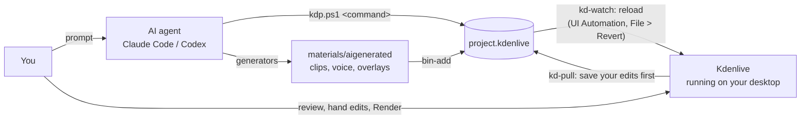

<div align="center">

# Movie Engine

**Moemedi wa AI o baakanya bidio ya gago mo Kdenlive o ntse o lebeletse, mme o ka tsaya taolo nako nngwe le nngwe.**

Baemedi ba AI ba go kwala dikhoutu (Claude Code, Codex) ba aga le go fetola diporojeke tsa nnete tsa Kdenlive: difilimi, dibidio tsa tlhaloso le dibidio tse dikhutshwane tse di emeng. Diphetogo di bonala ka yone nako eo mo sebaakanying se o se butseng. E a rwalega (portable), ke ya Windows, ga go na diphetogo mo khoutung ya sebaakanyi.


[English](../../README.md) · [简体中文](README.zh-CN.md) · [繁體中文](README.zh-TW.md) · [हिन्दी](README.hi.md) · [Español](README.es.md) · [Français](README.fr.md) · [العربية](README.ar.md) · [বাংলা](README.bn.md) · [Português](README.pt.md) · [Русский](README.ru.md) · [اردو](README.ur.md) · [Bahasa Indonesia](README.id.md) · [Deutsch](README.de.md) · [日本語](README.ja.md) · [Türkçe](README.tr.md) · [한국어](README.ko.md) · [Українська](README.uk.md) · [Italiano](README.it.md) · [Polski](README.pl.md) · [Tiếng Việt](README.vi.md) · [فارسی](README.fa.md) · [ไทย](README.th.md) · [Kiswahili](README.sw.md) · [አማርኛ](README.am.md) · [Avañe'ẽ](README.gn.md) · **Setswana** · [Shqip](README.sq.md) · [Беларуская](README.be.md) · [Български](README.bg.md) · [Bosanski](README.bs.md) · [Hrvatski](README.hr.md) · [Српски](README.sr.md) · [Crnogorski](README.cnr.md) · [Македонски](README.mk.md) · [Slovenščina](README.sl.md) · [Slovenčina](README.sk.md) · [Čeština](README.cs.md) · [Magyar](README.hu.md) · [Română](README.ro.md) · [Dansk](README.da.md) · [Norsk bokmål](README.nb.md) · [Norsk nynorsk](README.nn.md) · [Svenska](README.sv.md) · [Íslenska](README.is.md) · [Suomi](README.fi.md) · [Eesti](README.et.md) · [Latviešu](README.lv.md) · [Lietuvių](README.lt.md) · [Nederlands](README.nl.md) · [Lëtzebuergesch](README.lb.md) · [Rumantsch](README.rm.md) · [Ελληνικά](README.el.md) · [Malti](README.mt.md) · [Gaeilge](README.ga.md) · [Català](README.ca.md) · [ქართული](README.ka.md) · [Հայերեն](README.hy.md) · [Azərbaycanca](README.az.md) · [Afrikaans](README.af.md) · [isiZulu](README.zu.md) · [isiXhosa](README.xh.md) · [Sesotho](README.st.md) · [Sepedi](README.nso.md) · [Xitsonga](README.ts.md) · [Tshivenḓa](README.ve.md) · [siSwati](README.ss.md) · [isiNdebele (South Africa)](README.nr.md) · [isiNdebele (Zimbabwe)](README.nd.md) · [chiShona](README.sn.md) · [Chichewa](README.ny.md) · [Ikinyarwanda](README.rw.md) · [Ikirundi](README.rn.md) · [Malagasy](README.mg.md) · [Soomaali](README.so.md) · [Afaan Oromoo](README.om.md) · [Qafar af](README.aa.md) · [ትግርኛ](README.ti.md) · [Sängö](README.sg.md) · [Kreol Seselwa](README.crs.md) · [TjiKalanga](README.kck.md) · [ChiNdau](README.ndc.md)

*Se ke thanolo; README ya Seesemane ke yone tshupetso.*

</div>

---

## Diteng

- [Goreng](#goreng)
- [Se dira jang](#se-dira-jang)
- [Bokgoni](#bokgoni)
- [Ditlhokego](#ditlhokego)
- [Go tsenya](#go-tsenya)
- [Go simolola ka bonako](#go-simolola-ka-bonako)
- [Go dira le moemedi](#go-dira-le-moemedi)
- [Mola wa ditaelo wa go baakanya (`kdp.ps1`)](#mola-wa-ditaelo-wa-go-baakanya-kdpps1)
- [Go tsamaisana ka bonako le sebaakanyi se se butsweng](#go-tsamaisana-ka-bonako-le-sebaakanyi-se-se-butsweng)
- [Dijenereita: se Kdenlive e sa kgoneng go se dira](#dijenereita-se-kdenlive-e-sa-kgoneng-go-se-dira)
- [Lentswe la kanelo le medumo](#lentswe-la-kanelo-le-medumo)
- [Puo ya segokagano](#puo-ya-segokagano)
- [Thulaganyo ya difoltara](#thulaganyo-ya-difoltara)
- [Diteko le bopaki](#diteko-le-bopaki)
- [Ditlhaelo](#ditlhaelo)
- [Go rarabolola mathata](#go-rarabolola-mathata)
- [Dipotso tse di botswang gantsi](#dipotso-tse-di-botswang-gantsi)
- [Go tsaya karolo](#go-tsaya-karolo)
- [Ditebogo](#ditebogo)
- [Laesense](#laesense)

## Goreng

Dibaakanyi tsa bidio di diretswe seatla se se tshwereng mouse. Baemedi ba AI (botlhale jwa maitirelo) ba siame mo thulaganyong, mo go lekanyetseng nako le mo tirong e e ipoeletsang: go baya dikliphi di le 300 mo morethong, go lekanya mafoko otlhe a dithaetlele le lentswe, go dira sekgala gape morago ga maikutlo. Mme ga ba kgone go tobetsa mo GUI (segokagano sa ditshwantsho) ba sa tsee desktop ya gago.

Kdenlive ke sebaakanyi se se nonofileng sa open-source (khoutu e e bulegileng), mme mo Windows **ga e na API ya go dira dilo ka boiketsetso**: taolo ka D-Bus e teng fela mo dithulaganyong tsa Linux, mme di-fork (dikarolo tse di kgaogantsweng) tse di e okeletsang ga di tlhokomelwe gape kgotsa ga di babalesega. Movie Engine e rarabolola bothata jo e sa fetole sebaakanyi:

1. Moemedi o baakanya faele ya porojeke ya `.kdenlive` ka mola wa ditaelo o o lekilweng (`engine/kdp.ps1`).
2. Kdenlive e e dirang e bolelelwa go laisa faele gape ka Windows UI Automation, go sa tobetswe dinotlelo, go sa dirisiwe mouse e bile go sa utswiwe focus (tlhokomelo ya fensetere).
3. Diphetogo tsa gago tse di iseng di bolokwe di bolokwa pele mme ga di ke di kwalelwa godimo.

Ka jalo moemedi o a baakanya mme wena o a sekaseka, kgotsa o baakanya ka seatla. Lo babedi lo dira mo porojekeng e le nngwe, mo sebaakanying se le sengwe, ka nako e le nngwe.

## Se dira jang



Taelo nngwe le nngwe ya go baakanya e latela modikologo o le mongwe o o babalesegileng:

1. **Pull (go goga).** Fa Kdenlive e na le diphetogo tse di iseng di bolokwe, e bolelelwa go di boloka (konopo ya Save mo toolbar ka UI Automation), mme poloko eo e a netefadiwa.
2. **Go baakanya.** Taelo e fetola XML ka fa tlase ga lock (selotlelo), morago ga tlhatlhobo ya hash le ka snapshot ya go busetsa (undo). Fa faele e fetogile fa gare, ga go kwalwe sepe.
3. **Go laisa gape.** Molebedi (watcher) o bona letshwao la AI mme o tsamaisa File > Revert mo sebaakanying se se butsweng. Katlego e balwa fela fa widget ya timeline e agilwe gape ka nnete.
4. **Kgotlhang.** Fa o simolotse go baakanya fa gare, ga go laisiwe sepe gape mme tiro ya gago e a sala. Thanolo ya AI e bewa ka thoko, mme moemedi o baya phetogo ya gagwe gape godimo ga ya gago.

## Bokgoni

- **Go baakanya porojeke ka botlalo kwa ntle ga GUI**: ditaelo di ka nna 120 tse di akaretsang bin, timeline, di-effect, di-composition, di-track, di-guide, di-marker, dithaetlele (subtitles), di-sequence, lebelo le time remap, di-slideshow, ditlhogo (titles), di-proxy, go render le undo/redo. Bona [tshupetso ya ditaelo](#mola-wa-ditaelo-wa-go-baakanya-kdpps1).
- **Go tsamaisana ka bonako le sebaakanyi se se butsweng.** Diphetogo tsa AI di bonala mo Kdenlive e o e lebeletseng; diphetogo tsa gago tse di iseng di bolokwe di bolokwa pele mme ga di ke di latlhega.
- **Ga e ke e tshwenya desktop ya gago.** Ga go utswiwe focus, ga go tobetswe dinotlelo e bile ga go dirisiwe mouse. Dibaakanyi tsa diteko di dira mo desktop ya Windows e e sa bonaleng.
- **E a rwalega.** Sebaakanyi, ditlhophiso, Node.js, difonte le didirisiwa di mo foltareng e le nngwe. E kopolole mo PC e nngwe mme e a dira; ga go kwalwe sepe mo Program Files kgotsa mo porofaeleng ya gago ya Windows.
- **Dijenereita tsa se Kdenlive e sa kgoneng go se dira**: mokwalo o o tshikinyegang tlhaka ka tlhaka (kinetic text), matshwao a a tshwantshitsweng ka seatla, dikgala tsa UI tsa 3D, motsamao wa cursor le difilimi tse di telele tsa "tlhaloso" tse o ka tsenelelang mo go tsone. Di render mo GPU ka motion blur ya nnete mme di bewa mo timeline jaaka dikliphi tse di tlwaelegileng.
- **Lentswe la kanelo le nako ya lefoko lengwe le lengwe** (Microsoft Edge TTS, ga go tlhokege API key). Dithaetlele le ditiro di direga fela mo lefokong le le tshwanetseng.
- **Medumo e e dirilweng ka khoutu** (whoosh, click, pop, riser, impact le e mengwe).
- **E netefaditswe, ga e a akanngwa fela.** Taelo nngwe le nngwe e na le tlhatlhobo ya dipholo, di-effect le di-composition di lekwa nngwe ka nngwe, mme dipholo tse di tala di mo `docs/proof/`.
- **Ditaelo tsa moemedi di akareditswe.** `AGENTS.md` le di-skill tse di mo `.claude/skills/` di ruta Claude Code le Codex tsamaiso ya tiro, sebopego sa faele le dirai tsa yone.

## Ditlhokego

| | |
|---|---|
| Thulaganyo ya tiriso (OS) | Windows 10 kgotsa 11, x64 |
| Sebaakanyi | Kdenlive **26.08.3** ya portable (standalone). Dithanolo tse dingwe ga di a lekwa. |
| Node.js | 18 kgotsa e ntšhwa go feta: `.zip` ya Windows x64 go tswa kwa nodejs.org, e bulwa mo `engine/node/` |
| Sebatli | Microsoft Edge (karolo ya Windows); e dirisiwa kwa ntle ga fensetere (headless) ke di-renderer tsa dikgala |
| Moemedi | [Claude Code](https://claude.com/claude-code) kgotsa Codex. Ga se tlamego: sedirisiwa sengwe le sengwe se ka dirisiwa ka seatla gape. |
| Disiki | e ka nna 1 GB ya sebaakanyi le didirisiwa, mmogo le media ya gago |
| GPU | GPU nngwe le nngwe e e nang le H.264 encoding ya hardware e akofisa `film-render.mjs` (fa e seyo e dirisa software) |

## Go tsenya

Sengwe le sengwe se tsenngwa **mo teng ga foltara**. Ga go na sepe se se tlhokang ditshwanelo tsa admin.

```powershell
git clone https://github.com/vladtarrow/movie-engine.git
cd movie-engine
```

**1. Node.js.** Laolola (download) `.zip` ya Windows x64 ya Node.js 18 kgotsa e ntšhwa go feta go tswa kwa <https://nodejs.org/en/download> mme o bule diteng tsa yone mo `engine\node\`, gore `engine\node\node.exe` le `engine\node\npm.cmd` di nne teng koo. Ga go tlhokege installer kgotsa Node ya thulaganyo. Di-script tsotlhe di tsamaisiwa ka `engine\node.cmd`, ga di ke di tsamaisiwa ka Node ya thulaganyo.

**2. Diphuthelwana tsa Node** tsa sedirisiwa sa lentswe le di-renderer (dithanolo di tlhomamisitswe mo `engine/voice/package.json`):

```powershell
engine\node\npm.cmd install --prefix engine\voice
```

**3. Kdenlive 26.08.3 portable.** Laolola `kdenlive-26.08.3_standalone.exe` go tswa kwa <https://download.kde.org/stable/kdenlive/26.08/windows/> mo `engine\installer\`, e tlhatlhobe mme o e bule:

```powershell
(Get-FileHash engine\installer\kdenlive-26.08.3_standalone.exe -Algorithm SHA256).Hash
# expected: A25427B1DFF2C17E3B0386E991BB1A719382BB3176D1A90E441CDAEB6E0A967D
engine\installer\kdenlive-26.08.3_standalone.exe -o"engine\Kdenlive" -y
```

Sebaakanyi se nna mo `engine\Kdenlive\kdenlive-26.08.3_standalone\bin\`. Se setse se na le `melt.exe` le `ffmpeg.exe`.

**4. Go simolola la ntlha.**

```powershell
engine\kdenlive.cmd
```

Kdenlive e boloka ditlhophiso tsa yone tsotlhe mo `engine\profile-kdenlive\`, e seng mo porofaeleng ya gago ya Windows. Fa e simolola la ntlha e bontsha wizard ya go baakanyetsa ga le lengwe fela.

## Go simolola ka bonako

### Ka moemedi

Bula foltara e mo Claude Code (kgotsa Codex) mme o kope ka mafoko a a tlwaelegileng:

> Dira porojeke e ntšhwa e e emeng ya 30 fps e e bidiwang "launch-teaser". Baya ditshwantsho tse tharo tsa sekirini go tswa mo `materials/designers/launch/` mo timeline, nngwe le nngwe metsotswana e le 2.5 ka cross-fade e khutshwane, oketsa lentswe la kanelo go tswa mo `script.txt` mme o lekanye thaetlele e e tshikinyegang le mola mongwe le mongwe.

> Mpulele yone mo Kdenlive.

> Shot ya bobedi e telele thata. E khutshwafatse go nna metsotswana e le 1.8 mme o tsholetse logo go se kae.

Moemedi o latela `AGENTS.md`: o baakanya ka `kdp.ps1`, o render fela dikliphi tse tsamaiso ya bidio e di tlhokang, mme o tshola sebaakanyi se se butsweng se tsamaisana. Wena o sekaseka mo Kdenlive, o baakanya ka seatla nako nngwe le nngwe fa o batla, mme o tobetsa Render fa o kgotsofetse.

### Ka seatla

```powershell
# a new 1080x1920 30 fps project with 2 video and 2 audio tracks
powershell -NoProfile -ExecutionPolicy Bypass -File engine\kdp.ps1 new -Project projects\hello\hello.kdenlive -Profile vertical_hd_30

# a 3-second title and a colour background
powershell -NoProfile -ExecutionPolicy Bypass -File engine\kdp.ps1 bin-color -Project projects\hello\hello.kdenlive -Color '#203060' -Seconds 3 -Name bg
powershell -NoProfile -ExecutionPolicy Bypass -File engine\kdp.ps1 title -Project projects\hello\hello.kdenlive -Text "Hello" -Seconds 3 -Name hi

# place them: background on V1, title above it on V2
powershell -NoProfile -ExecutionPolicy Bypass -File engine\kdp.ps1 add -Project projects\hello\hello.kdenlive -Bin bg -Track V1 -At 0
powershell -NoProfile -ExecutionPolicy Bypass -File engine\kdp.ps1 add -Project projects\hello\hello.kdenlive -Bin hi -Track V2 -At 0

# a check frame, then open it in the editor
powershell -NoProfile -ExecutionPolicy Bypass -File engine\kdp.ps1 frame -Project projects\hello\hello.kdenlive -At 1.5 -Out out\hello\check.png
engine\kdenlive.cmd projects\hello\hello.kdenlive
```

Go bula gape porojeke ya bofelo moragonyana, tobetsa gabedi mo `open-last-project.cmd`.

## Go dira le moemedi

Moemedi o bala `AGENTS.md` (Codex) kgotsa `CLAUDE.md`, e e e tsenyang (Claude Code), mmogo le di-skill di le pedi:

| Skill | E ruta |
|---|---|
| `.claude/skills/kdenlive-project-file` | sebopego sa `.kdenlive` / MLT XML, `kdp.ps1`, go tlhatlhoba ka `melt` |
| `.claude/skills/kdenlive-live` | go laola sebaakanyi se se dirang ka polokesego: go se simolola, pull, go laisa gape, go tshwara fensetere ya sone |

Melao e moemedi a e latelang, e o ka e ikanyang:

- Ga a ke a tsaya mouse ya gago, keyboard kgotsa focus, e bile ga a ke a tsaya setshwantsho sa sekirini sa desktop ya gago (fela fensetere ya sebaakanyi ka bosone).
- O dira dikgato tsa GUI ka boene (go boloka, go bula, go laisa gape) go na le go go kopa gore o tobetse.
- O botsa pele a laolola sengwe le sengwe e bile pele a phimola sengwe le sengwe.
- O render fela se tiro e se tlhokang (dikliphi tsa dikgala, difreime tsa tlhatlhobo). O render filimi ya bofelo fela fa o mo kopile.
- Fa Kdenlive e sa kgone go dira sengwe sentle, moemedi o se aga kwa ntle ka khoutu mme a tsenya dipholo jaaka kliphi. Ga a fokotse boleng jwa effect.

## Mola wa ditaelo wa go baakanya (`kdp.ps1`)

```powershell
powershell -NoProfile -ExecutionPolicy Bypass -File engine\kdp.ps1 <command> -Project <file.kdenlive> [options]
```

Dinako di mo metsotswaneng, ka ntlha (`2.5`). Di-track ke `V1 V2 …` (V1 ke ya tlase thata) le `A1 A2 …`. Kliphi e supiwa ka `-Track` mmogo le nako nngwe le nngwe `-At` e e mo teng ga yone. Dipharamitara tsa effect di kwalwa mo `-Params "name=value||name=value"`. Lenaane le le feletseng le kgetho nngwe le nngwe le mo tlhogong (header) ya `engine/kdp.ps1`.

| Setlhopha | Ditaelo |
|---|---|
| Porojeke | `new`, `profiles`, `info`, `validate`, `fonts`, `profile-set`, `profile-from-clip`, `zone`, `archive`, `backups`, `rebase`, `otio-export`, `otio-import` |
| Bin | `bin-add`, `bin-color`, `title`, `title-text`, `title-save`, `title-template`, `bin-rename`, `bin-remove`, `bin-info`, `bin-set`, `bin-duplicate`, `bin-replace-file`, `bin-reload`, `folder`, `bin-folder`, `relink`, `clean`, `generator`, `playlist-clip`, `extract-audio`, `transcode` |
| Timeline | `add`, `add-av`, `move`, `copy`, `trim`, `ripple-trim`, `slip`, `split`, `remove`, `speed`, `remap`, `disable`, `enable`, `group`, `ungroup`, `mix`, `unmix`, `space-insert`, `space-remove`, `spaces-remove-all`, `track-clear`, `replace-in-timeline` |
| Di-effect | `effects`, `effect-info`, `effect-add`, `effect-list`, `effect-set`, `effect-remove`, `effect-copy`, `effect-clear`, `effects-all`, `bin-effect`, `effect-templates`, `effect-template` |
| Di-composition | `compositions`, `comp-info`, `comp-add`, `comp-list`, `comp-set`, `comp-remove` |
| Di-track | `track-add`, `track-remove`, `track-set` |
| Di-guide le di-marker | `guide-add`, `guide-list`, `guide-remove`, `guide-set`, `guide-clear`, `guide-export`, `guide-category`, `marker`, `marker-list`, `marker-set`, `marker-remove` |
| Dithaetlele | `sub-add`, `sub-import`, `sub-export`, `sub-state` |
| Di-sequence | `sequence-add`, `sequences`, `copy-to-sequence`, `expand`; taelo nngwe le nngwe e e nang le `-Sequence <name>` e dira mo teng ga sequence eo |
| Tse di kgethegileng | `slideshow`, motsamao wa Lottie / Glaxnimate ka `bin-add`, `proxy`, `stabilize`, `scene-split`, `speed-job`, `subclip` |
| Dipholo | `frame` (PNG e le nngwe), `preview` (render ya bonako ka melt), `render` (renderer ya Kdenlive ka boyone kgotsa preset), `presets` |
| Hisetori | `undo`, `redo`, `clear-history` (di-snapshot mo `projects/<name>/.kdp-history`) |

Maitsholo a a tshwanetseng go itsiwe:

- Dikarolo tsa modumo le bidio tse di golaganeng di tsamaisiwa, di khutshwafadiwa (trim), di kgaolwa e bile di tlosiwa mmogo (`-Alone` ya karolo e le nngwe).
- Taelo e e palelwang e tswa ka khoutu 1 mme ga e kwale sepe.
- Di-effect tse thulaganyo ya Windows e sa kgoneng go di tsamaisa di a ganwa, ga di tlhokomologiwe ka tidimalo (lenaane: `docs/proof/assets.txt`).
- Tiro nngwe le nngwe ya menu ya Kdenlive e amanngwa le taelo, tsela e nngwe, kgotsa "go bona fela" mo `engine/tools/data/kdenlive-actions.csv`. Bona `docs/kdenlive-coverage.md`.

## Go tsamaisana ka bonako le sebaakanyi se se butsweng

| Script | Se e se dirang | Dikhoutu tsa go tswa |
|---|---|---|
| `engine\kd-pull.ps1 -Project <f>` | e dira gore Kdenlive e boloke diphetogo tsa gago mme e netefatse | 0 faele e ntšhwa, 3 ga e dire, 4 ga e a netefadiwa |
| `engine\kd-reload.ps1 -Project <f>` | File > Revert, e netefadiwa ke timeline e e agilweng gape | 0 e netefaditswe, 2 o na le diphetogo tse di iseng di bolokwe (ga go a latlhiwa sepe), 3 ga e dire, 4 e paletswe |
| `engine\kd-watch.ps1 -Project <f>` | molebedi wa kwa morago: o laisa gape morago ga go kwala gongwe le gongwe ga AI, o kwala dikgotlhang | log mo `engine\kd-watch.log`; phimola `engine\kd-watch.run` go e emisa |
| `engine\kdenlive-bg.ps1 [project]` | e simolola Kdenlive e fokoditswe (minimized) ya moemedi | 0 e laisitswe, 4 ga e a netefadiwa |
| `engine\kdenlive.cmd [project]` | e go simololela Kdenlive | |

Simolola molebedi ga le lengwe mo nakong nngwe le nngwe ya tiro (session):

```powershell
Start-Process powershell -WindowStyle Hidden -ArgumentList '-NoProfile','-ExecutionPolicy','Bypass','-File','engine\kd-watch.ps1','-Project','projects\hello\hello.kdenlive'
```

Diporojeke tse dikgolo: go laisa gape porojeke e e nang le dikliphi di le 1000 go tsaya metsotso, mme didirisiwa di e emela go na le go bega ka bonako. Diporojeke di bulwa ka *File > Open Recent* mo sebaakanying se se se nang sepe, ka gonne go bula faele ka tlhamalalo go dira gore Qt e tsamaye mo seleng sengwe le sengwe sa timeline ka ntlha ya phitlhelelo (accessibility), mme go ne go nna bonya ka metsotso e ka nna 10.

## Dijenereita: se Kdenlive e sa kgoneng go se dira

Kdenlive/MLT ga e na motsamao wa mokwalo tlhaka ka tlhaka, ga e na di-expression e bile 3D ya yone e potlana, mme di-effect tse di boima di bonyafatsa tshameko. Movie Engine e render dikarolo tse di ntseng jalo kwa ntle mme e di baya mo timeline jaaka dikliphi tse di tlwaelegileng, gantsi di na le alpha (tlhagafalo), mo track e e fa godimo ga ditshwantsho. Script ya jenereita le se se tsenngwang mo go yone di sala mo foltareng ya porojeke, gore kliphi e kgone go dirwa gape fa mokwalo, fonte kgotsa nako di fetoga.

| Sedirisiwa | Se se dirang |
|---|---|
| `engine/tools/kinetic-text.ps1` | dithaetlele tse di tshikinyegang tlhaka ka tlhaka, lefoko lengwe le lengwe le lekanyeditswe nako go tswa mo `voice.json`, lebokoso la go gatelela |
| `engine/tools/annotate.ps1` | didikologo, mabokoso, mela ya ka fa tlase le metsu e e tshwantshitsweng ka seatla, e e ithalang godimo ga setshwantsho sa sekirini |
| `engine/tools/card-entrance.ps1` | karata ya setshwantsho sa sekirini e e tlhatlogang e bo e gola fa e tsena, e na le moriti o o bonolo |
| `engine/tools/pdf-to-png.ps1` | di-slide go tswa mo PDF e e romeletsweng kwa ntle (export) |
| `engine/tools/html-render.mjs` | sekgala sengwe le sengwe sa HTML/CSS/canvas go nna bidio: motsamao wa segokagano, di-cursor, 3D, di-mask |
| `engine/tools/film-render.mjs` + `film/` | difilimi tse di telele tsa tlhaloso tse o ka tsenelelang mo go tsone mo canvas: kliphi e le nngwe ka mola mongwe le mongwe wa lentswe, ditiro di direga mo mafokong a a buiwang, motion blur mo GPU ka 45 fps kgotsa go le gaufi |

Di-renderer tsoopedi di laola Microsoft Edge e e tlang le Windows, kwa ntle ga fensetere (headless), ka porofaele e e latlhiwang morago ga tiriso e bile go se na phitlhelelo ya neteweke.

### Dipontsho

```powershell
# a 3-second 3D title card with a cursor click
engine\node.cmd engine\tools\html-render.mjs examples\demo\scene\scene.html examples\demo\out --frames 0,30,60,89
engine\node.cmd engine\tools\html-render.mjs examples\demo\scene\scene.html examples\demo\out\scene.mp4

# a 4-shot interactive film timed to two voice lines
engine\node.cmd engine\tools\film-render.mjs examples\demo\film\film.html examples\demo\out --check
engine\node.cmd engine\tools\film-render.mjs examples\demo\film\film.html examples\demo\out --shots all --width 640
engine\node.cmd engine\tools\film-render.mjs examples\demo\film\film.html examples\demo\out\clips --suffix -v01
```

Filimi ke difaele tse tharo tse dinnye. `data.js` e na le di-shot le dinako tsa mafoko. `direction.js` e na le mola o le mongwe ka shot nngwe le nngwe:

```text
1 | hover 192 108 @brand | tag 300 60 Your brand @deserves | confetti 192 90 @film
2 say=A film that/*explains* it
3 | click 116 108 @before | click 268 108 @after | chips Before~After @after
4 scene=counter | count 0 120 % @count
```

`scenes.js` e na le di-shot tse di tshwantshiwang go simolola kwa tshimologong. `@word` e simolola tiro fa lentswe le bua lefoko leo. Ditiro di akaretsa click, hover, drag, zoom, lens, ring, arrow, chips, toggle, slider, toast, type, count le confetti; popego e e feletseng ya ditaelo (syntax) e kwa godimo ga `engine/tools/film/film-kit.js`.

## Lentswe la kanelo le medumo

```powershell
engine\node.cmd engine\voice\voice.mjs lines.json materials\aigenerated\hello\voice en-US-AndrewMultilingualNeural +0%
```

`lines.json` ke lenaane la mela. Sedirisiwa se kwala mp3 e le nngwe ka mola mongwe le mongwe mmogo le `voice.json`, e e nang le boleele jwa nako le tshimologo le bokhutlo jwa lefoko lengwe le lengwe. Mela e bolokwa mo cache, ka jalo go fetola mola o le mongwe go dira gape mola oo fela. Se dirisa tirelo ya inthanete ya Microsoft Edge ya go fetola mokwalo go nna puo (text-to-speech) ka phuthelwana ya `msedge-tts`: ga go tlhokege key, mme tirelo e ga se ya semmuso e bile e tlhoka inthanete.

```powershell
engine\node.cmd engine\audio\sfx.mjs materials\aigenerated\sfx
```

Se se dira ka khoutu medumo ya whoosh, whoosh-long, swipe, click, pop, tick, riser, impact, ding le reveal; sete e e setseng e siametse e mo `materials/aigenerated/sfx/`. Oketsa tidimalo mo medumong e e khutshwane go feta freime e le nngwe pele o e baya (`-af apad=whole_dur=0.0667`).

## Puo ya segokagano

Di-launcher di simolola Kdenlive ka **Seesemane** ka tlwaelo. Go dirisa puo e nngwe, baya `MOVIE_ENGINE_UI_LANG` pele o simolola:

```powershell
$env:MOVIE_ENGINE_UI_LANG = 'ru'; engine\kdenlive.cmd
```

UI Automation e bona dilo tsa menu ka maina a tsone a a bonalang. Maina a dipuo di le 31 tsa segokagano a agilwe mo teng (`engine/tools/kd-ui.ps1`, `$KdNames`). Ya puo nngwe le nngwe e sele, oketsa maina a yone foo mme o tlhatlhobe ka:

```powershell
powershell -NoProfile -ExecutionPolicy Bypass -File engine\tools\kd-langcheck.ps1
```

## Thulaganyo ya difoltara

```text
movie-engine/
├─ AGENTS.md, CLAUDE.md          instructions for AI agents
├─ .claude/skills/               agent skills: project file format, live editor
├─ engine/
│  ├─ kdp.ps1                    the editing command line
│  ├─ kd-pull / kd-reload / kd-watch .ps1, kdenlive.cmd, kdenlive-bg.ps1
│  ├─ tools/                     internals, generators, tests, data (action map)
│  ├─ voice/  audio/  fonts/     TTS, synthesized SFX, Poppins (OFL)
│  ├─ Kdenlive/  node/           portable editor and Node.js (not in git)
│  └─ profile-kdenlive/          the editor's settings (not in git)
├─ projects/<name>/<name>.kdenlive
├─ materials/
│  ├─ download/                  stock and downloaded files (not in git)
│  ├─ aigenerated/               everything the AI made (sfx/ and test-kit/ ship with the engine)
│  ├─ designers/  brand/         files from your team, brand assets
├─ examples/demo/                demos of the scene and film renderers
├─ out/                          renders (not in git)
└─ docs/                         proofs, coverage, translations of this README
```

Ditsela (paths) tsa media mo teng ga diporojeke di a amana (relative). Fa o tsamaisa kgotsa o kopolola foltara, `kdp.ps1 rebase` (e gape e tsamaisiwang ka boyone ke `kdenlive.cmd`) e kwala lefelo le lesha mo porojekeng.

## Diteko le bopaki

Dipolelo ka se se dirang di tshegediwa ke ditlhatlhobo tsa dipholo, e seng ke "function e dirile". Kakaretso e mo [`docs/kdenlive-proof.md`](../../docs/kdenlive-proof.md), mme dipholo tse di tala di mo `docs/proof/`.

| Teko | E tlhatlhoba |
|---|---|
| `engine\tools\kdp-clitest.ps1` | taelo nngwe le nngwe ya `kdp.ps1`, ka mola wa ditaelo, e bapisa porojeke e e tswang |
| `engine\tools\kd-livetest.ps1` | pull, go laisa gape, molebedi, dikgotlhang le race conditions kgatlhanong le Kdenlive ya nnete mo desktop e e sa bonaleng |
| `engine\tools\kdp-assetsweep.ps1` | effect nngwe le nngwe le composition nngwe le nngwe: e a render mme e bapisa difreime |
| `engine\tools\kdp-portabletest.ps1` | e kopolola foltara kwa lefelong le lengwe mme e dira go tswa mo khopining |
| `engine\tools\kd-langcheck.ps1` | puo ya segokagano le gore UI Automation e bona menu |
| `engine\tools\kdp-coverage-check.ps1` | tiro nngwe le nngwe ya menu e amanngwa, mme ga go na bopaki bope jo bo leng bogologolo go feta khoutu |

```powershell
powershell -NoProfile -ExecutionPolicy Bypass -File engine\tools\kdp-clitest.ps1 -Report docs\proof\clitest.txt
powershell -NoProfile -ExecutionPolicy Bypass -File engine\tools\kd-livetest.ps1 -Report docs\proof\live-en.txt
```

Dibaakanyi tsa diteko di dira fela mo desktop e e fitlhilweng di na le porofaele ya tsone, ka jalo diteko ga di ke di ama Kdenlive ya gago e e butsweng kgotsa focus ya gago.

## Ditlhaelo

- **Windows fela**, Kdenlive **26.08.3** fela. Linux e na le D-Bus mme e ka tlhoka borokgo jo bo farologaneng.
- Go simolola sebaakanyi go tsaya focus ya keyboard metsotswana e ka nna 3 fa fensetere e e se nang sepe e tlhaga. Baemedi ba botsa pele ba se simolola o ntse o dira. Go laisa gape le go baakanya ga go tsee focus.
- Thulaganyo ya Windows ga e na di-module tsa MLT tsa sox, ladspa le movit le di-effect dingwe tsa frei0r/avfilter; `kdp.ps1` e a di gana (`docs/proof/assets.txt`).
- Go romela kwa ntle le go tsenya OpenTimelineIO go tsamaisa dikliphi le dikgala tse di se nang sepe (gaps) fela. Multicam ga e na go fetola dikhamera ka bonako (dikgaolo di dirwa ka split/remove/hide).
- "Save As…" ka UI Automation mo fenstereng e e fokoditsweng ga e bule poledisano (dialog) epe; moemedi o dirisa `archive` kgotsa dikhopi tsa difaele boemong jwa yone.
- Go lemoga puo (dithaetlele tsa boiketsetso) go tlhoka Whisper kgotsa Vosk, tse di sa akarediwang.
- Ditlhogo tse di dirilweng ka sedirisiwa sa ditlhogo sa Kdenlive di dirisa difonte tse di tsentsweng mo Windows. Go netefatsa popego ya mokwalo (typography), render mokwalo ka dijenereita, tse di laisang difonte go tswa mo `engine/fonts/`.
- Edge TTS ke tirelo ya inthanete e e seng ya semmuso mme e ka fetoga kgotsa ya emisa go dira.

## Go rarabolola mathata

| Sesupo | Lebaka le tharabololo |
|---|---|
| Kdenlive e a dira, mme go e tobetsa mo taskbar ga go bontshe sepe | Lefelo la yone la fensetere le le bolokilweng le kwa ntle ga sekirini. E tswale mme o phimole dikwalo tsa `kdockLayout` mo `engine\profile-kdenlive\AppData\Local\kdenliverc`, kgotsa o sutise fensetere ka `SetWindowPos` (bona `AGENTS.md`). |
| `kd-reload.ps1` e tswa ka 2 | O na le diphetogo tse di iseng di bolokwe. Ga go a latlhiwa sepe. Tsamaisa `kd-pull.ps1`, morago o dire phetogo gape (`kdp.ps1` e dira se ka boyone). |
| `CONFLICT` mo `engine\kd-watch.log` | Wena le moemedi lo baakantse ka nako e le nngwe. Thanolo ya gago e sala mo sebaakanying, mme thanolo ya AI e mo `projects\<name>\.kdp-history\<name>\conflict\`. Kopa moemedi go dira phetogo ya gagwe gape. |
| Taelo e tswa ka 1 ka "pull not confirmed" | Kdenlive e tshwaregile kgotsa e bontsha poledisano (dialog). Tswala poledisano kgotsa o emele go laisiwa go fela, morago o boeletse. |
| Script ya PowerShell e palelwa ke go balwa (parse) | Di-script tse di nang le mokwalo o e seng wa ASCII di tshwanetse go bolokwa jaaka UTF-8 **le BOM** ya Windows PowerShell 5.1. |
| `voice.mjs` e ema ka "Stream closed before the synthesis completed" | Gantsi ke bothata jwa neteweke, kgotsa SSML e e sa tshabisiwang (unescaped) mo dikhoping tsa bogologolo. `voice.mjs` e tshabisa `& < >` ka boyone. |
| Go bula porojeke e kgolo go tsaya metsotso e mentsi | E bule ka `kdenlive.cmd` / `kdenlive-bg.ps1`, ga o ke o e bula jaaka `kdenlive.exe project.kdenlive`. |

## Dipotso tse di botswang gantsi

**A ke tlhoka Claude Code kgotsa Codex?**
Nnyaa. Sedirisiwa sengwe le sengwe ke script e e tlwaelegileng e o ka e tsamaisang ka seatla. Moemedi ke ene yo o dirang gore tiro e nne bonako: o rulaganya tsamaiso ya bidio, o tsamaisa didirisiwa mme o tshola sebaakanyi se tsamaisana.

**A moemedi o tla kwala godimo ga diphetogo tsa me tsa seatla?**
Nnyaa. Pele ga go kwala gope, diphetogo tsa gago tse di iseng di bolokwe di a bolokwa mme di netefadiwe. Fa o baakanya fa moemedi a ntse a kwala, go kwala goo go a ganwa kgotsa go bewa ka thoko jaaka kgotlhang, ga go ke go dirwa godimo ga tiro ya gago.

**A nka tswelela go dirisa Kdenlive ka tlwaelo?**
Ee. Ke Kdenlive e e tlwaelegileng e e nang le foltara ya yone ya ditlhophiso. Baakanya, leba pele (preview) mme o render jaaka gale.

**A e dira le Kdenlive e ke setseng ke e tsentse?**
E dirisa khopi ya yone ya portable mo `engine\Kdenlive\`, ka jalo Kdenlive e o e tsentseng le ditlhophiso tsa yone ga di amiwe.

**Goreng e se fork ya Kdenlive e e nang le API, kgotsa sebaakanyi se sengwe?**
Mo Windows, ga go na fork e e tlhokomelwang e bile e babalesegile (patlisiso ya 2026-11). OpenShot, Blender VSE, DaVinci Resolve, Shotcut le dibaakanyi tsa mo inthaneteng di sekasekilwe; Kdenlive e neile boteng jo bo gaisang jwa go baakanya. Kopo ya REST API kwa upstream (merge request !902) e a lebelelwa.

**A e ka render bidio ya bofelo?**
Ee, ka `kdp.ps1 render` (renderer ya Kdenlive ka boyone, e e fitlhilweng), kgotsa wena ka bowena o tobetsa Render mo sebaakanying.

**A media ya me e romelwa gongwe?**
Nnyaa. Ke mokwalo wa lentswe la kanelo fela o o romelwang kwa tirelong ya Edge TTS fa o dira lentswe. Di-renderer tsa dikgala di dira neteweke e timilwe.

## Go tsaya karolo

Dikabelo di a amogelwa. Bona [CONTRIBUTING.md](../../CONTRIBUTING.md). Ka bokhutshwane:

- Tiro nngwe le nngwe e ntšhwa kgotsa e e fetotsweng ya `kdp.ps1` e tlhoka tlhatlhobo ya dipholo mo `kdp-clitest.ps1`, kwalo mo mmapeng wa ditiro, le go tsamaisa gape `kdp-coverage-check.ps1`.
- O se ka wa simolola Kdenlive ya diteko mo desktop e e bonalang; dirisa `engine/tools/kd-hidden.ps1`.
- Tshola sengwe le sengwe se rwalega: ga go tsenngwe sepe kwa ntle ga foltara, ga go na ditsela tse di feletseng (absolute paths) mo diporojekeng.
- Kwala dikgakgamatso (quirks) tse di netefaditsweng mo `AGENTS.md` kgotsa mo skill e e maleba.

## Ditebogo

- [Kdenlive](https://kdenlive.org) le [MLT](https://www.mltframework.org): sebaakanyi le enjene e e ka fa tlase ga sone.
- [FFmpeg](https://ffmpeg.org), e e tlang mmogo le Kdenlive.
- [msedge-tts](https://www.npmjs.com/package/msedge-tts) ya lentswe la kanelo.
- [Poppins](https://fonts.google.com/specimen/Poppins) ya Indian Type Foundry, SIL Open Font License (`engine/fonts/OFL.txt`).
- `engine/tools/data/kdenliveui-26.08.3.rc`: faele ya menu ya Kdenlive, e e tserweng mo khoutung ya motswedi ya Kdenlive 26.08.3; e dirisiwa fela ke tlhatlhobo ya kakaretso (coverage check). E sala ka fa tlase ga laesense ya GPL ya Kdenlive, e seng MIT License.

## Laesense

Khoutu ya Movie Engine ka boyone e gatisitswe ka fa tlase ga [MIT License](../../LICENSE). Kdenlive, MLT, FFmpeg, diphuthelwana tsa Node.js le fonte ya Poppins di tshola dilaesense tsa tsone.
