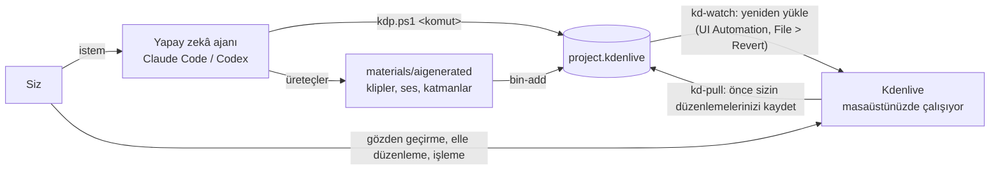

<div align="center">

# movie-engine

**Bir yapay zekâ ajanı siz izlerken videonuzu Kdenlive'da kurgular ve siz istediğiniz an kontrolü devralabilirsiniz.**

Yapay zekâ kodlama ajanları (Claude Code, Codex) gerçek Kdenlive projeleri oluşturur ve değiştirir: filmler, anlatım videoları ve dikey kısa videolar. Düzenlemeler açık olan düzenleyicinizde anında görünür. Taşınabilir, Windows, düzenleyiciye yama yok.


[English](../../README.md) · [简体中文](README.zh-CN.md) · [हिन्दी](README.hi.md) · [Español](README.es.md) · [Français](README.fr.md) · [العربية](README.ar.md) · [বাংলা](README.bn.md) · [Português](README.pt.md) · [Русский](README.ru.md) · [اردو](README.ur.md) · [Bahasa Indonesia](README.id.md) · [Deutsch](README.de.md) · [日本語](README.ja.md) · **Türkçe** · [한국어](README.ko.md)

*Bu bir çeviridir. Esas alınan sürüm İngilizce README'dir.*

</div>

---

## İçindekiler

- [Neden](#neden)
- [Nasıl çalışır](#nasıl-çalışır)
- [Özellikler](#özellikler)
- [Gereksinimler](#gereksinimler)
- [Kurulum](#kurulum)
- [Hızlı başlangıç](#hızlı-başlangıç)
- [Ajanla çalışmak](#ajanla-çalışmak)
- [Düzenleme komut satırı (`kdp.ps1`)](#düzenleme-komut-satırı-kdpps1)
- [Açık düzenleyiciyle canlı eşitleme](#açık-düzenleyiciyle-canlı-eşitleme)
- [Üreteçler: Kdenlive'ın yapamadıkları](#üreteçler-kdenliveın-yapamadıkları)
- [Seslendirme ve ses](#seslendirme-ve-ses)
- [Arayüz dili](#arayüz-dili)
- [Klasör yapısı](#klasör-yapısı)
- [Testler ve kanıtlar](#testler-ve-kanıtlar)
- [Sınırlamalar](#sınırlamalar)
- [Sorun giderme](#sorun-giderme)
- [SSS](#sss)
- [Katkıda bulunma](#katkıda-bulunma)
- [Teşekkürler](#teşekkürler)
- [Lisans](#lisans)

## Neden

Video düzenleyiciler fareyi tutan bir el için tasarlanmıştır. Yapay zekâ ajanları ise yapı, zamanlama ve tekrar gerektiren işlerde iyidir: 300 klibi ritme oturtmak, her alt yazıyı sese göre zamanlamak, geri bildirimden sonra bir sahneyi yeniden kurgulamak. Ancak masaüstünüzü ele geçirmeden bir arayüzde tıklayarak ilerleyemezler.

Kdenlive güçlü bir açık kaynak düzenleyicidir, ancak Windows'ta **otomasyon API'si yoktur**: D-Bus ile kontrol yalnızca Linux sürümlerinde bulunur ve bunu ekleyen çatallar ya bakımsızdır ya da güvensizdir. movie-engine bu sorunu düzenleyiciye yama yapmadan çözer:

1. Ajan, `.kdenlive` proje dosyasını test edilmiş bir komut satırıyla (`engine/kdp.ps1`) düzenler.
2. Çalışan Kdenlive'a, Windows UI Automation aracılığıyla dosyayı yeniden yüklemesi söylenir; tuş vuruşu yok, fare yok, odak çalma yok.
3. Sizin kaydedilmemiş düzenlemeleriniz önce kaydedilir ve asla üzerine yazılmaz.

Yani ajan kurgular, siz gözden geçirirsiniz ya da elle düzenlersiniz. İkiniz aynı projede, aynı düzenleyicide, aynı anda çalışırsınız.

## Nasıl çalışır



Her düzenleme komutu aynı güvenli döngüyü izler:

1. **Pull.** Kdenlive'da kaydedilmemiş değişiklikler varsa bunları kaydetmesi söylenir (UI Automation ile araç çubuğundaki Kaydet) ve kaydın gerçekleştiği doğrulanır.
2. **Düzenleme.** Komut XML'i bir kilit altında, karma (hash) denetiminden sonra ve bir geri alma anlık görüntüsüyle değiştirir. Dosya bu arada değiştiyse hiçbir şey yazılmaz.
3. **Yeniden yükleme.** İzleyici, yapay zekânın bıraktığı damgayı görür ve açık düzenleyicide File > Revert'i çalıştırır. Yalnızca zaman çizelgesi bileşeni gerçekten yeniden oluşturulduğunda başarılı sayılır.
4. **Çakışma.** Bu arada siz düzenlemeye başladıysanız hiçbir şey yeniden yüklenmez ve çalışmanız korunur. Yapay zekâ sürümü kenara ayrılır ve ajan kendi değişikliğini sizinkinin üzerine yeniden uygular.

## Özellikler

- **Arayüz olmadan tam proje düzenleme**: proje kutusu, zaman çizelgesi, efektler, kompozisyonlar, izler, kılavuzlar, işaretçiler, alt yazılar, sekanslar, hız ve zaman yeniden eşleme, slayt gösterileri, başlıklar, proxy'ler, işleme ve geri al/yinele için yaklaşık 120 komut. [Komut başvurusuna](#düzenleme-komut-satırı-kdpps1) bakın.
- **Açık düzenleyiciyle canlı eşitleme.** Yapay zekâ düzenlemeleri baktığınız Kdenlive'da görünür; kaydedilmemiş düzenlemeleriniz önce kaydedilir ve asla kaybolmaz.
- **Masaüstünüzü asla rahatsız etmez.** Odak çalma, tuş vuruşu veya fare girdisi yok. Test düzenleyicileri görünmez bir Windows masaüstünde çalışır.
- **Taşınabilir.** Düzenleyici, ayarlar, Node.js, yazı tipleri ve araçlar tek bir klasörde durur. Klasörü başka bir bilgisayara kopyalayın, çalışır; Program Files'a veya Windows profilinize hiçbir şey yazılmaz.
- **Kdenlive'ın yapamadıkları için üreteçler**: harf harf hareketli kinetik metin, elle çizilmiş açıklamalar, 3B arayüz sahneleri, imleç animasyonları ve uzun etkileşimli "anlatım" filmleri. GPU'da gerçek hareket bulanıklığıyla işlenir ve zaman çizelgesine sıradan klipler olarak yerleştirilir.
- **Kelime zamanlamalı seslendirme** (Microsoft Edge TTS, API anahtarı gerekmez). Alt yazılar ve eylemler tam olarak ilgili kelimede tetiklenir.
- **Sentezlenmiş ses efektleri** (whoosh, click, pop, riser, impact ve daha fazlası), kodla üretilir.
- **Varsayılmış değil, kanıtlanmış.** Her komutun bir sonuç denetimi vardır, efektler ve kompozisyonlar tek tek taranır ve ham sonuçlar `docs/proof/` içindedir.
- **Ajan talimatları dahil.** `AGENTS.md` ve `.claude/skills/` içindeki beceriler Claude Code ile Codex'e iş akışını, dosya biçimini ve tuzakları öğretir.

## Gereksinimler

| | |
|---|---|
| İşletim sistemi | Windows 10 veya 11, x64 |
| Düzenleyici | Kdenlive **26.08.3** taşınabilir (standalone) sürüm. Diğer sürümler test edilmedi. |
| Node.js | 18 veya üzeri, `engine/node/` içine kopyalanmış düz bir `node.exe` olarak |
| Tarayıcı | Microsoft Edge (Windows'un parçası); sahne işleyicileri tarafından headless (arayüzsüz) kullanılır |
| Ajan | [Claude Code](https://claude.com/claude-code) veya Codex. İsteğe bağlı: her araç elle de çalıştırılabilir. |
| Disk | düzenleyici ve araçlar için yaklaşık 1 GB, artı medya dosyalarınız |
| GPU | donanımsal H.264 kodlaması olan her GPU `film-render.mjs`'i hızlandırır (yoksa yazılımsal kodlamaya geçer) |

## Kurulum

Her şey **klasörün içine** kurulur. Hiçbir adım yönetici hakkı gerektirmez.

```powershell
git clone <repository-url> movie-engine
cd movie-engine
```

**1. Node.js.** `node.exe`'yi (18 veya üzeri) `engine\node\` içine kopyalayın. Yükleyiciye gerek yoktur: exe dosyası tek başına yeterlidir. Tüm betikler sistemdeki Node ile değil, her zaman `engine\node.cmd` üzerinden çalışır.

**2. Node paketleri**, ses aracı ve işleyiciler için (sürümler `engine/voice/package.json` içinde sabitlenmiştir):

```powershell
npm install --prefix engine/voice
```

**3. Kdenlive 26.08.3 taşınabilir.** `kdenlive-26.08.3_standalone.exe` dosyasını <https://download.kde.org/stable/kdenlive/26.08/windows/> adresinden `engine\installer\` içine indirin, doğrulayın ve açın:

```powershell
(Get-FileHash engine\installer\kdenlive-26.08.3_standalone.exe -Algorithm SHA256).Hash
# beklenen: A25427B1DFF2C17E3B0386E991BB1A719382BB3176D1A90E441CDAEB6E0A967D
engine\installer\kdenlive-26.08.3_standalone.exe -o"engine\Kdenlive" -y
```

Düzenleyici `engine\Kdenlive\kdenlive-26.08.3_standalone\bin\` içine yerleşir. `melt.exe` ve `ffmpeg.exe` zaten dahildir.

**4. İlk başlatma.**

```powershell
engine\kdenlive.cmd
```

Kdenlive tüm ayarlarını Windows profilinizde değil, `engine\profile-kdenlive\` içinde tutar. İlk başlatmada bir kereye mahsus kurulum sihirbazı gösterir.

## Hızlı başlangıç

### Bir ajanla

Klasörü Claude Code'da (veya Codex'te) açın ve isteğinizi sade bir dille yazın:

> 30 fps'lik yeni bir dikey proje oluştur: "launch-teaser". `materials/designers/launch/` içindeki üç ekran görüntüsünü zaman çizelgesine koy, her biri 2,5 sn olsun ve aralarında kısa bir çapraz geçiş olsun, `script.txt` dosyasından seslendirme ekle ve her satıra zamanlanmış kinetik bir alt yazı yerleştir.

> Bunu benim için Kdenlive'da aç.

> İkinci çekim çok uzun. 1,8 sn'ye kısalt ve logoyu biraz yukarı taşı.

Ajan `AGENTS.md`'yi izler: `kdp.ps1` ile düzenler, yalnızca kurgunun ihtiyaç duyduğu klipleri işler ve açık düzenleyiciyi eşitli tutar. Siz Kdenlive'da gözden geçirir, istediğiniz zaman elle düzenler ve memnun kaldığınızda İşle (Render) düğmesine basarsınız.

### Elle

```powershell
# 2 video ve 2 ses izli, 1080x1920, 30 fps yeni bir proje
powershell -NoProfile -ExecutionPolicy Bypass -File engine\kdp.ps1 new -Project projects\hello\hello.kdenlive -Profile vertical_hd_30

# 3 saniyelik bir başlık ve renkli bir arka plan
powershell -NoProfile -ExecutionPolicy Bypass -File engine\kdp.ps1 bin-color -Project projects\hello\hello.kdenlive -Color '#203060' -Seconds 3 -Name bg
powershell -NoProfile -ExecutionPolicy Bypass -File engine\kdp.ps1 title -Project projects\hello\hello.kdenlive -Text "Hello" -Seconds 3 -Name hi

# yerleştir: arka plan V1'e, başlık onun üstünde V2'ye
powershell -NoProfile -ExecutionPolicy Bypass -File engine\kdp.ps1 add -Project projects\hello\hello.kdenlive -Bin bg -Track V1 -At 0
powershell -NoProfile -ExecutionPolicy Bypass -File engine\kdp.ps1 add -Project projects\hello\hello.kdenlive -Bin hi -Track V2 -At 0

# bir kontrol karesi, ardından düzenleyicide aç
powershell -NoProfile -ExecutionPolicy Bypass -File engine\kdp.ps1 frame -Project projects\hello\hello.kdenlive -At 1.5 -Out out\hello\check.png
engine\kdenlive.cmd projects\hello\hello.kdenlive
```

Son projeyi daha sonra yeniden açmak için `open-last-project.cmd` dosyasına çift tıklayın.

## Ajanla çalışmak

Ajan `AGENTS.md`'yi (Codex) ya da onu içe aktaran `CLAUDE.md`'yi (Claude Code) ve iki beceriyi okur:

| Beceri | Öğrettiği |
|---|---|
| `.claude/skills/kdenlive-project-file` | `.kdenlive` / MLT XML biçimi, `kdp.ps1`, `melt` ile denetleme |
| `.claude/skills/kdenlive-live` | çalışan düzenleyiciyi güvenle yönetmek: başlatma, pull, yeniden yükleme, penceresinin görüntüsünü alma |

Ajanın uyduğu ve güvenebileceğiniz kurallar:

- Farenizi, klavyenizi veya odağınızı asla almaz ve masaüstünüzün asla ekran görüntüsünü almaz (yalnızca düzenleyicinin kendi penceresinin).
- Arayüz adımlarını (kaydetme, açma, yeniden yükleme) sizden tıklamanızı istemek yerine kendisi yapar.
- Bir şey indirmeden ve bir şey silmeden önce sorar.
- Yalnızca işin gerektirdiğini işler (sahne klipleri, kontrol kareleri). Son filmi yalnızca siz istediğinizde işler.
- Kdenlive bir şeyi iyi yapamıyorsa, ajan bunu dışarıda kodla oluşturur ve sonucu klip olarak ekler. Efekti sulandırmaz.

## Düzenleme komut satırı (`kdp.ps1`)

```powershell
powershell -NoProfile -ExecutionPolicy Bypass -File engine\kdp.ps1 <command> -Project <file.kdenlive> [options]
```

Süreler saniye cinsindendir ve ondalık ayırıcı noktadır (`2.5`). İzler `V1 V2 …` (V1 en alttaki) ve `A1 A2 …` şeklindedir. Bir klip, `-Track` ile birlikte klibin içindeki herhangi bir `-At` zamanıyla belirtilir. Efekt parametreleri `-Params "name=value||name=value"` içine yazılır. Tüm seçenekleriyle tam liste `engine/kdp.ps1` dosyasının başlığındadır.

| Grup | Komutlar |
|---|---|
| Proje | `new`, `profiles`, `info`, `validate`, `fonts`, `profile-set`, `profile-from-clip`, `zone`, `archive`, `backups`, `rebase`, `otio-export`, `otio-import` |
| Proje kutusu | `bin-add`, `bin-color`, `title`, `title-text`, `title-save`, `title-template`, `bin-rename`, `bin-remove`, `bin-info`, `bin-set`, `bin-duplicate`, `bin-replace-file`, `bin-reload`, `folder`, `bin-folder`, `relink`, `clean`, `generator`, `playlist-clip`, `extract-audio`, `transcode` |
| Zaman çizelgesi | `add`, `add-av`, `move`, `copy`, `trim`, `ripple-trim`, `slip`, `split`, `remove`, `speed`, `remap`, `disable`, `enable`, `group`, `ungroup`, `mix`, `unmix`, `space-insert`, `space-remove`, `spaces-remove-all`, `track-clear`, `replace-in-timeline` |
| Efektler | `effects`, `effect-info`, `effect-add`, `effect-list`, `effect-set`, `effect-remove`, `effect-copy`, `effect-clear`, `effects-all`, `bin-effect`, `effect-templates`, `effect-template` |
| Kompozisyonlar | `compositions`, `comp-info`, `comp-add`, `comp-list`, `comp-set`, `comp-remove` |
| İzler | `track-add`, `track-remove`, `track-set` |
| Kılavuzlar ve işaretçiler | `guide-add`, `guide-list`, `guide-remove`, `guide-set`, `guide-clear`, `guide-export`, `guide-category`, `marker`, `marker-list`, `marker-set`, `marker-remove` |
| Alt yazılar | `sub-add`, `sub-import`, `sub-export`, `sub-state` |
| Sekanslar | `sequence-add`, `sequences`, `copy-to-sequence`, `expand`; `-Sequence <name>` verilen her komut o sekansın içinde çalışır |
| Özel | `slideshow`, `bin-add` ile Lottie / Glaxnimate animasyonları, `proxy`, `stabilize`, `scene-split`, `speed-job`, `subclip` |
| Çıktı | `frame` (tek bir PNG), `preview` (hızlı melt işlemesi), `render` (Kdenlive'ın kendi işleyicisi veya bir ön ayar), `presets` |
| Geçmiş | `undo`, `redo`, `clear-history` (anlık görüntüler `projects/<name>/.kdp-history` içinde) |

Bilinmesi gereken davranışlar:

- Bağlı ses ve video yarıları birlikte taşınır, kırpılır, bölünür ve kaldırılır (tek yarı için `-Alone`).
- Başarısız olan bir komut 1 koduyla çıkar ve hiçbir şey yazmaz.
- Windows sürümünün çalıştıramadığı efektler sessizce yok sayılmaz, reddedilir (liste: `docs/proof/assets.txt`).
- Kdenlive'daki her menü eylemi, `engine/tools/data/kdenlive-actions.csv` içinde bir komutla, başka bir yolla veya "yalnızca görüntüleme" olarak eşlenmiştir. Bkz. `docs/kdenlive-coverage.md`.

## Açık düzenleyiciyle canlı eşitleme

| Betik | Ne yapar | Çıkış kodları |
|---|---|---|
| `engine\kd-pull.ps1 -Project <f>` | Kdenlive'ın düzenlemelerinizi kaydetmesini sağlar ve bunu doğrular | 0 dosya güncel, 3 çalışmıyor, 4 doğrulanmadı |
| `engine\kd-reload.ps1 -Project <f>` | File > Revert, yeniden oluşturulan zaman çizelgesiyle doğrulanır | 0 doğrulandı, 2 kaydedilmemiş düzenlemeleriniz var (hiçbir şey atılmadı), 3 çalışmıyor, 4 başarısız |
| `engine\kd-watch.ps1 -Project <f>` | arka plan izleyicisi: yapay zekânın her yazmasından sonra yeniden yükler, çakışmaları günlüğe yazar | günlük `engine\kd-watch.log` içinde; durdurmak için `engine\kd-watch.run` dosyasını silin |
| `engine\kdenlive-bg.ps1 [project]` | Kdenlive'ı bir ajan için simge durumunda başlatır | 0 yüklendi, 4 doğrulanmadı |
| `engine\kdenlive.cmd [project]` | Kdenlive'ı sizin için başlatır | |

İzleyiciyi her oturumda bir kez başlatın:

```powershell
Start-Process powershell -WindowStyle Hidden -ArgumentList '-NoProfile','-ExecutionPolicy','Bypass','-File','engine\kd-watch.ps1','-Project','projects\hello\hello.kdenlive'
```

Büyük projeler: 1000 klipli bir projenin yeniden yüklenmesi dakikalar sürer ve araçlar erkenden sonuç bildirmek yerine bunu bekler. Projeler boş bir düzenleyicide *File > Open Recent* üzerinden açılır, çünkü bir dosyayı doğrudan açmak Qt'nin erişilebilirlik için her zaman çizelgesi öğesini tek tek dolaşmasına yol açar ve yaklaşık 10 dakika daha yavaştı.

## Üreteçler: Kdenlive'ın yapamadıkları

Kdenlive/MLT'de harf harf metin animasyonu ve ifadeler (expressions) yoktur, 3B desteği de azdır; ağır efektler ise oynatmayı yavaşlatır. movie-engine bu tür parçaları dışarıda işler ve zaman çizelgesine sıradan klipler olarak, genellikle alfa kanalıyla, görüntülerin üstündeki bir ize koyar. Üreteç betiği ve girdileri proje klasöründe kalır; böylece metin, yazı tipi veya zamanlama değiştiğinde klip yeniden üretilebilir.

| Araç | Ürettiği |
|---|---|
| `engine/tools/kinetic-text.ps1` | harf harf hareketli kinetik alt yazılar, her kelime `voice.json`'dan zamanlanır, vurgu kutusu |
| `engine/tools/annotate.ps1` | bir ekran görüntüsünün üzerine çizilerek beliren, elle çizilmiş daireler, kutular, alt çizgiler ve oklar |
| `engine/tools/card-entrance.ps1` | yumuşak bir gölgeyle yükselip büyüyerek giren bir ekran görüntüsü kartı |
| `engine/tools/pdf-to-png.ps1` | bir PDF dışa aktarımından slaytlar |
| `engine/tools/html-render.mjs` | herhangi bir HTML/CSS/canvas sahnesinden video: arayüz animasyonu, imleçler, 3B, maskeler |
| `engine/tools/film-render.mjs` + `film/` | canvas üzerinde uzun, etkileşimli anlatım filmleri: her seslendirme satırı için bir klip, eylemler söylenen kelimelerde tetiklenir, yaklaşık 45 fps'de GPU hareket bulanıklığı |

Her iki işleyici de Windows ile gelen Microsoft Edge'i headless olarak, tek kullanımlık bir profille ve ağ erişimi olmadan kullanır.

### Demolar

```powershell
# imleç tıklamalı, 3 saniyelik 3B başlık kartı
engine\node.cmd engine\tools\html-render.mjs examples\demo\scene\scene.html examples\demo\out --frames 0,30,60,89
engine\node.cmd engine\tools\html-render.mjs examples\demo\scene\scene.html examples\demo\out\scene.mp4

# iki seslendirme satırına göre zamanlanmış, 4 çekimlik etkileşimli film
engine\node.cmd engine\tools\film-render.mjs examples\demo\film\film.html examples\demo\out --check
engine\node.cmd engine\tools\film-render.mjs examples\demo\film\film.html examples\demo\out --shots all --width 640
engine\node.cmd engine\tools\film-render.mjs examples\demo\film\film.html examples\demo\out\clips --suffix -v01
```

Bir film üç küçük dosyadan oluşur. `data.js` çekimleri ve kelime zamanlarını tutar. `direction.js` her çekim için bir satır içerir:

```text
1 | hover 192 108 @brand | tag 300 60 Your brand @deserves | confetti 192 90 @film
2 say=A film that/*explains* it
3 | click 116 108 @before | click 268 108 @after | chips Before~After @after
4 scene=counter | count 0 120 % @count
```

`scenes.js` sıfırdan çizilen çekimleri tutar. `@word`, ses o kelimeyi söylediğinde bir eylemi tetikler. Eylemler arasında click, hover, drag, zoom, lens, ring, arrow, chips, toggle, slider, toast, type, count ve confetti bulunur; tam sözdizimi `engine/tools/film/film-kit.js` dosyasının başındadır.

## Seslendirme ve ses

```powershell
engine\node.cmd engine\voice\voice.mjs lines.json materials\aigenerated\hello\voice en-US-AndrewMultilingualNeural +0%
```

`lines.json` bir satır listesidir. Araç her satır için bir mp3 ve süreyi, her kelimenin başlangıç ve bitişini içeren `voice.json` dosyasını yazar. Satırlar önbelleğe alınır, bu yüzden bir satırı değiştirmek yalnızca o satırı yeniden üretir. `msedge-tts` paketi aracılığıyla Microsoft Edge'in çevrimiçi metin okuma hizmetini kullanır: anahtar gerekmez, ancak hizmet resmî değildir ve internet gerektirir.

```powershell
engine\node.cmd engine\audio\sfx.mjs materials\aigenerated\sfx
```

Bu komut whoosh, whoosh-long, swipe, click, pop, tick, riser, impact, ding ve reveal seslerini kodla sentezler; hazır bir set `materials/aigenerated/sfx/` içindedir. Bir kareden kısa sesleri yerleştirmeden önce sessizlikle doldurun (`-af apad=whole_dur=0.0667`).

## Arayüz dili

Başlatıcılar Kdenlive'ı varsayılan olarak **İngilizce** açar. Başka bir dil kullanmak için başlatmadan önce `MOVIE_ENGINE_UI_LANG` değişkenini ayarlayın:

```powershell
$env:MOVIE_ENGINE_UI_LANG = 'ru'; engine\kdenlive.cmd
```

UI Automation menü öğelerini görünen adlarıyla bulur. İngilizce ve Rusça adlar yerleşiktir (`engine/tools/kd-ui.ps1`, `$KdNames`). Başka bir dil için adlarını oraya ekleyin ve şununla denetleyin:

```powershell
powershell -NoProfile -ExecutionPolicy Bypass -File engine\tools\kd-langcheck.ps1
```

## Klasör yapısı

```text
movie-engine/
├─ AGENTS.md, CLAUDE.md          instructions for AI agents
├─ .claude/skills/               agent skills: project file format, live editor
├─ engine/
│  ├─ kdp.ps1                    the editing command line
│  ├─ kd-pull / kd-reload / kd-watch .ps1, kdenlive.cmd, kdenlive-bg.ps1
│  ├─ tools/                     internals, generators, tests, data (action map)
│  ├─ voice/  audio/  fonts/     TTS, synthesized SFX, Poppins (OFL)
│  ├─ Kdenlive/  node/           portable editor and Node.js (not in git)
│  └─ profile-kdenlive/          the editor's settings (not in git)
├─ projects/<name>/<name>.kdenlive
├─ materials/
│  ├─ download/                  stock and downloaded files (not in git)
│  ├─ aigenerated/               everything the AI made (sfx/ and test-kit/ ship with the engine)
│  ├─ designers/  brand/         files from your team, brand assets
├─ examples/demo/                demos of the scene and film renderers
├─ out/                          renders (not in git)
└─ docs/                         proofs, coverage, translations of this README
```

Projelerin içindeki medya yolları görelidir. Klasörü taşır veya kopyalarsanız `kdp.ps1 rebase` (bunu `kdenlive.cmd` da otomatik çalıştırır) yeni konumu projeye yazar.

## Testler ve kanıtlar

Neyin çalıştığına dair iddialar "fonksiyon çalıştı" ile değil, sonuç denetimleriyle desteklenir. Özet [`docs/kdenlive-proof.md`](../../docs/kdenlive-proof.md) içinde, ham çıktı ise `docs/proof/` içindedir.

| Test | Denetlediği |
|---|---|
| `engine\tools\kdp-clitest.ps1` | her `kdp.ps1` komutunu komut satırı üzerinden, ortaya çıkan projeyi karşılaştırarak |
| `engine\tools\kd-livetest.ps1` | görünmez bir masaüstündeki gerçek bir Kdenlive'a karşı pull, yeniden yükleme, izleyici, çakışmalar ve yarış durumları |
| `engine\tools\kdp-assetsweep.ps1` | her efekt ve kompozisyon: kareleri işler ve karşılaştırır |
| `engine\tools\kdp-portabletest.ps1` | klasörü başka bir yere kopyalar ve kopyadan çalışır |
| `engine\tools\kd-langcheck.ps1` | arayüz dilini ve UI Automation'ın menüyü bulduğunu |
| `engine\tools\kdp-coverage-check.ps1` | her menü eyleminin eşlendiğini ve hiçbir kanıtın koddan eski olmadığını |

```powershell
powershell -NoProfile -ExecutionPolicy Bypass -File engine\tools\kdp-clitest.ps1 -Report docs\proof\clitest.txt
powershell -NoProfile -ExecutionPolicy Bypass -File engine\tools\kd-livetest.ps1 -Report docs\proof\live-en.txt
```

Test düzenleyicileri yalnızca kendi profilleriyle gizli bir masaüstünde çalışır; bu yüzden testler açık Kdenlive'ınıza veya odağınıza asla dokunmaz.

## Sınırlamalar

- **Yalnızca Windows**, yalnızca Kdenlive **26.08.3**. Linux'ta D-Bus vardır ve farklı bir köprü gerekir.
- Düzenleyiciyi başlatmak, boş pencere belirirken klavye odağını yaklaşık 3 saniyeliğine alır. Siz çalışırken ajanlar onu başlatmadan önce sorar. Yeniden yüklemeler ve düzenlemeler odağı almaz.
- Windows sürümünde sox, ladspa ve movit MLT modülleri ile bazı frei0r/avfilter efektleri yoktur; `kdp.ps1` bunları reddeder (`docs/proof/assets.txt`).
- OpenTimelineIO dışa ve içe aktarımı yalnızca klipleri ve boşlukları taşır. Çoklu kamerada canlı açı değiştirme yoktur (kesmeler split/remove/hide ile yapılır).
- Simge durumundaki bir pencerede UI Automation ile "Farklı Kaydet…" hiçbir iletişim kutusu açmaz; ajan bunun yerine `archive` veya dosya kopyalarını kullanır.
- Konuşma tanıma (otomatik alt yazı) Whisper veya Vosk gerektirir; bunlar pakete dahil değildir.
- Kdenlive'ın başlık aracıyla yapılan başlıklar Windows'ta yüklü yazı tiplerini kullanır. Tipografinin garanti olması için metni, yazı tiplerini `engine/fonts/` içinden yükleyen üreteçlerle işleyin.
- Edge TTS resmî olmayan bir çevrimiçi hizmettir ve değişebilir veya çalışmayı durdurabilir.

## Sorun giderme

| Belirti | Neden ve çözüm |
|---|---|
| Kdenlive çalışıyor ama görev çubuğunda tıklayınca hiçbir şey görünmüyor | Kaydedilmiş pencere konumu ekranın dışında. Kdenlive'ı kapatın ve `engine\profile-kdenlive\AppData\Local\kdenliverc` içindeki `kdockLayout` girdilerini silin ya da pencereyi `SetWindowPos` ile taşıyın (bkz. `AGENTS.md`). |
| `kd-reload.ps1` 2 koduyla çıkıyor | Kaydedilmemiş düzenlemeleriniz var. Hiçbir şey atılmadı. `kd-pull.ps1`'i çalıştırın, sonra değişikliği yeniden uygulayın (`kdp.ps1` bunu kendisi yapar). |
| `engine\kd-watch.log` içinde `CONFLICT` | Siz ve ajan aynı anda düzenleme yaptınız. Sizin sürümünüz düzenleyicide kalır, yapay zekâ sürümü `projects\<name>\.kdp-history\<name>\conflict\` içindedir. Ajandan değişikliğini yeniden uygulamasını isteyin. |
| Bir komut "pull not confirmed" ile 1 koduyla çıkıyor | Kdenlive meşgul ya da bir iletişim kutusu gösteriyor. İletişim kutusunu kapatın veya yüklemenin bitmesini bekleyin, ardından tekrarlayın. |
| Bir PowerShell betiği ayrıştırılamıyor | ASCII dışı metin içeren betikler, Windows PowerShell 5.1 için UTF-8 **BOM'lu** olarak kaydedilmelidir. |
| `voice.mjs` "Stream closed before the synthesis completed" hatasıyla duruyor | Genellikle bir ağ sorunudur ya da eski kopyalarda kaçışlanmamış SSML'dir. `voice.mjs`, `& < >` karakterlerini kendisi kaçışlar. |
| Büyük bir projeyi açmak dakikalarca sürüyor | Projeyi `kdenlive.cmd` / `kdenlive-bg.ps1` ile açın, asla `kdenlive.exe project.kdenlive` şeklinde değil. |

## SSS

**Claude Code veya Codex'e ihtiyacım var mı?**
Hayır. Her araç elle çalıştırabileceğiniz düz bir betiktir. İşi hızlandıran ajandır: kurguyu planlar, araçları çalıştırır ve düzenleyiciyi eşitli tutar.

**Ajan elle yaptığım düzenlemelerin üzerine yazar mı?**
Hayır. Her yazmadan önce kaydedilmemiş düzenlemeleriniz kaydedilir ve doğrulanır. Ajan yazarken siz düzenleme yaparsanız, yazma reddedilir ya da çakışma olarak kenara ayrılır; asla çalışmanızın üzerine uygulanmaz.

**Kdenlive'ı normal şekilde kullanmaya devam edebilir miyim?**
Evet. Kendi ayar klasörüne sahip, değiştirilmemiş Kdenlive'dır. Her zamanki gibi düzenleyin, önizleyin ve işleyin.

**Zaten kurulu olan bir Kdenlive ile çalışır mı?**
`engine\Kdenlive\` içindeki kendi taşınabilir kopyasını kullanır, bu yüzden kurulu Kdenlive'ınız ve ayarları olduğu gibi kalır.

**Neden API'li bir Kdenlive çatalı ya da başka bir düzenleyici değil?**
Windows'ta bakımı süren ve güvenli bir çatal yok (Kasım 2026 incelemesi). OpenShot, Blender VSE, DaVinci Resolve, Shotcut ve web tabanlı düzenleyiciler değerlendirildi; en derin kurgu olanaklarını Kdenlive sundu. Ana projedeki bir REST API önerisi (merge request !902) takip ediliyor.

**Son videoyu işleyebilir mi?**
Evet, `kdp.ps1 render` ile (Kdenlive'ın kendi işleyicisi, gizli olarak) ya da düzenleyicide İşle (Render) düğmesine kendiniz basarsınız.

**Medyam herhangi bir yere yükleniyor mu?**
Hayır. Ses ürettiğinizde Edge TTS hizmetine yalnızca seslendirme metni gönderilir. Sahne işleyicileri ağ devre dışı bırakılmış olarak çalışır.

## Katkıda bulunma

Katkılarınızı bekliyoruz. Bkz. [CONTRIBUTING.md](../../CONTRIBUTING.md). Kısaca:

- Her yeni veya değiştirilmiş `kdp.ps1` işlemi için `kdp-clitest.ps1` içinde bir sonuç denetimi, eylem haritasında bir girdi ve `kdp-coverage-check.ps1`'in yeni bir çalıştırması gerekir.
- Test amaçlı bir Kdenlive'ı asla görünen masaüstünde başlatmayın; `engine/tools/kd-hidden.ps1` kullanın.
- Her şeyi taşınabilir tutun: klasör dışına kurulum yok, projelerde mutlak yol yok.
- Doğrulanmış tuhaflıkları `AGENTS.md` dosyasına veya ilgili beceriye yazın.

## Teşekkürler

- [Kdenlive](https://kdenlive.org) ve [MLT](https://www.mltframework.org): düzenleyici ve altındaki motor.
- [FFmpeg](https://ffmpeg.org), Kdenlive ile birlikte gelir.
- [msedge-tts](https://www.npmjs.com/package/msedge-tts), seslendirme için.
- Indian Type Foundry'nin [Poppins](https://fonts.google.com/specimen/Poppins) yazı tipi, SIL Open Font License (`engine/fonts/OFL.txt`).

## Lisans

movie-engine'in kendi kodu [MIT Lisansı](../../LICENSE) ile yayımlanmaktadır. Kdenlive, MLT, FFmpeg, Node.js paketleri ve Poppins yazı tipi kendi lisanslarını korur.
