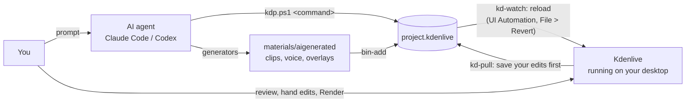

<div align="center">

# Movie Engine

**Muyimeri wa AI u lulamisa vhidiyo ya wena eka Kdenlive u ri karhi u languta, naswona u nga teka vulawuri hi nkarhi wun'wana ni wun'wana.**

Vayimeri va AI va ku tsala khodi (Claude Code, Codex) va aka no cinca tiphurojeke ta xiviri ta Kdenlive: tifilimi, tivhidiyo to hlamusela ni tivhidiyo letitsongo leti yimeke (vertical shorts). Ku cinca ku humelela hi nkarhi wolowo eka xilulamisi lexi u xi pfuleke. Yi rhwaleka (portable), i ya Windows, a ku na ku cinca eka khodi ya xilulamisi.


[English](../../README.md) · [简体中文](README.zh-CN.md) · [繁體中文](README.zh-TW.md) · [हिन्दी](README.hi.md) · [Español](README.es.md) · [Français](README.fr.md) · [العربية](README.ar.md) · [বাংলা](README.bn.md) · [Português](README.pt.md) · [Русский](README.ru.md) · [اردو](README.ur.md) · [Bahasa Indonesia](README.id.md) · [Deutsch](README.de.md) · [日本語](README.ja.md) · [Türkçe](README.tr.md) · [한국어](README.ko.md) · [Українська](README.uk.md) · [Italiano](README.it.md) · [Polski](README.pl.md) · [Tiếng Việt](README.vi.md) · [فارسی](README.fa.md) · [ไทย](README.th.md) · [Kiswahili](README.sw.md) · [አማርኛ](README.am.md) · [Avañe'ẽ](README.gn.md) · [Setswana](README.tn.md) · [Shqip](README.sq.md) · [Беларуская](README.be.md) · [Български](README.bg.md) · [Bosanski](README.bs.md) · [Hrvatski](README.hr.md) · [Српски](README.sr.md) · [Crnogorski](README.cnr.md) · [Македонски](README.mk.md) · [Slovenščina](README.sl.md) · [Slovenčina](README.sk.md) · [Čeština](README.cs.md) · [Magyar](README.hu.md) · [Română](README.ro.md) · [Dansk](README.da.md) · [Norsk bokmål](README.nb.md) · [Norsk nynorsk](README.nn.md) · [Svenska](README.sv.md) · [Íslenska](README.is.md) · [Suomi](README.fi.md) · [Eesti](README.et.md) · [Latviešu](README.lv.md) · [Lietuvių](README.lt.md) · [Nederlands](README.nl.md) · [Lëtzebuergesch](README.lb.md) · [Rumantsch](README.rm.md) · [Ελληνικά](README.el.md) · [Malti](README.mt.md) · [Gaeilge](README.ga.md) · [Català](README.ca.md) · [ქართული](README.ka.md) · [Հայերեն](README.hy.md) · [Azərbaycanca](README.az.md) · [Afrikaans](README.af.md) · [isiZulu](README.zu.md) · [isiXhosa](README.xh.md) · [Sesotho](README.st.md) · [Sepedi](README.nso.md) · **Xitsonga** · [Tshivenḓa](README.ve.md) · [siSwati](README.ss.md) · [isiNdebele (South Africa)](README.nr.md) · [isiNdebele (Zimbabwe)](README.nd.md) · [chiShona](README.sn.md) · [Chichewa](README.ny.md) · [Ikinyarwanda](README.rw.md) · [Ikirundi](README.rn.md) · [Malagasy](README.mg.md) · [Soomaali](README.so.md) · [Afaan Oromoo](README.om.md) · [Qafar af](README.aa.md) · [ትግርኛ](README.ti.md) · [Sängö](README.sg.md) · [Kreol Seselwa](README.crs.md) · [TjiKalanga](README.kck.md) · [ChiNdau](README.ndc.md)

*Lebyi i vuhundzuluxi; README ya Xinghezi hi yona ya xiviri leyi ku langutiwaka eka yona.*

</div>

---

## Leswi nga endzeni

- [Hikwalaho ka yini](#hikwalaho-ka-yini)
- [Ndlela leyi swi tirhaka ha yona](#ndlela-leyi-swi-tirhaka-ha-yona)
- [Vuswikoti](#vuswikoti)
- [Swilaveko](#swilaveko)
- [Ku nghenisa](#ku-nghenisa)
- [Ku sungula hi ku hatlisa](#ku-sungula-hi-ku-hatlisa)
- [Ku tirha na muyimeri](#ku-tirha-na-muyimeri)
- [Layini ya swileriso swa ku lulamisa (`kdp.ps1`)](#layini-ya-swileriso-swa-ku-lulamisa-kdpps1)
- [Ku fambisana na xilulamisi lexi pfuriweke](#ku-fambisana-na-xilulamisi-lexi-pfuriweke)
- [Tijenereta: leswi Kdenlive yi nga swi kotiki](#tijenereta-leswi-kdenlive-yi-nga-swi-kotiki)
- [Rito ro hlamusela na mpfumawulo](#rito-ro-hlamusela-na-mpfumawulo)
- [Ririmi ra interface](#ririmi-ra-interface)
- [Ku hleriwa ka tifolda](#ku-hleriwa-ka-tifolda)
- [Swikambelo na vumbhoni](#swikambelo-na-vumbhoni)
- [Swipimelo](#swipimelo)
- [Ku tlhantlha swiphiqo](#ku-tlhantlha-swiphiqo)
- [Swivutiso leswi vutisiwaka ngopfu](#swivutiso-leswi-vutisiwaka-ngopfu)
- [Ku hoxa xandla](#ku-hoxa-xandla)
- [Ku nkhensa](#ku-nkhensa)
- [Layisense](#layisense)

## Hikwalaho ka yini

Swilulamisi swa vhidiyo swi endleriwe voko leri khomeke mouse. Vayimeri va AI (vutlhari bya xiendliwa) va tiva kahle xivumbeko, ku pima nkarhi ni ntirho lowu tiphindhaka: ku veka tikliphi ta 300 hi ku landza bitlo, ku pima tsalwa rin'wana ni rin'wana ra le hansi (caption) hi rito ra muhlamuseri, ku endla xiyenge (scene) nakambe endzhaku ka mavonelo. Kambe a va swi koti ku tsindzisa eka GUI (xihlanganisi xa swifaniso) handle ko teka desktop ya wena.

Kdenlive i xilulamisi xa matimba xa open-source (khodi leyi pfulekeke), kambe eka Windows **a yi na API ya ku tiendlekela (automation)**: vulawuri hi D-Bus byi kona ntsena eka tiversion ta Linux, naswona ti-fork (tikopi leti hambanisiweke ta phurojeke) leti yi engetelaka ti nga ha khathaleriwi kumbe a ti hlayisekanga. Movie Engine yi tlhantlha leswi handle ko cinca xilulamisi:

1. Muyimeri u cinca fayili ya phurojeke ya `.kdenlive` hi layini ya swileriso leyi kamberiweke (`engine/kdp.ps1`).
2. Kdenlive leyi tirhaka yi byeriwa ku hlaya fayili nakambe hi Windows UI Automation, handle ko tsindzisa tikhii, handle ka mouse naswona handle ko yiva focus (vuxiyaxiya bya fasitere).
3. Ku cinca ka wena loku nga si hlayisiwaka ku hlayisiwa ku sungula naswona a ku tsaleriwi ehenhla nikatsongo.

Hikwalaho muyimeri wa lulamisa kutani wena u kambela, kumbe u lulamisa hi voko. Mi tirha mimbirhi eka phurojeke yin'we, eka xilulamisi xin'we, hi nkarhi wun'we.

## Ndlela leyi swi tirhaka ha yona



Xileriso xin'wana ni xin'wana xa ku lulamisa xi landza xirhendzevutani xin'we lexi hlayisekeke:

1. **Pull (ku koka).** Loko Kdenlive yi ri na ku cinca loku nga si hlayisiwaka, yi byeriwa ku ku hlayisa (buto ra Save eka toolbar hi UI Automation), naswona ku hlayisa koloko ku tiyisisiwa.
2. **Ku lulamisa.** Xileriso xi cinca XML yi lokiwile (lock), endzhaku ka ku kambela hash ni hi snapshot ya undo (ku tlherisela endzhaku). Loko fayili yi cincile hi nkarhi wolowo, a ku na nchumu lowu tsariwaka.
3. **Ku hlaya nakambe (reload).** Mulanguteri (watcher) u vona mfungho wa AI kutani a tirhisa File > Revert eka xilulamisi lexi pfuriweke. Ku humelela ku hlayiwa ntsena loko widget ya timeline yi akiwile nakambe hakunene.
4. **Ku nga twanani (conflict).** Loko u sungurile ku lulamisa hi nkarhi wolowo, a ku na nchumu lowu hlayiwaka nakambe naswona ntirho wa wena wa sala. Kopi ya AI yi vekiwa etlhelo, kutani muyimeri u tlhela a nghenisa ku cinca ka yena ehenhla ka ka wena.

## Vuswikoti

- **Ku lulamisa phurojeke hi ku helela handle ka GUI**: swileriso swa kwalomu ka 120 leswi katsaka bin, timeline, ti-effect, ti-composition, ti-track, ti-guide, ti-marker, marito ya le hansi (subtitles), ti-sequence, rivilo ni time remap, ti-slideshow, tinhlokomhaka (titles), ti-proxy, ku render ni undo/redo. Vona [nkombeto wa swileriso](#layini-ya-swileriso-swa-ku-lulamisa-kdpps1).
- **Ku fambisana hi nkarhi wolowo na xilulamisi lexi pfuriweke.** Ku cinca ka AI ku humelela eka Kdenlive leyi u yi langutaka; ku cinca ka wena loku nga si hlayisiwaka ku hlayisiwa ku sungula naswona a ku lahleki nikatsongo.
- **A yi ku kavanyeti eka desktop ya wena.** A ku na focus leyi yiviwaka, a ku na tikhii leti tsindzisiwaka kumbe mouse leyi tirhisiwaka. Swilulamisi swa swikambelo swi tirha eka desktop ya Windows leyi nga voniwiki.
- **Yi rhwaleka.** Xilulamisi, swiveko (settings), Node.js, tifonti ni switirhisiwa swi le ka folda yin'we. Yi kopa u yi yisa eka PC yin'wana kutani ya tirha; a ku na nchumu lowu tsariwaka eka Program Files kumbe eka phurofayili ya wena ya Windows.
- **Tijenereta ta leswi Kdenlive yi nga swi kotiki**: matsalwa lama tsekatsekaka letere hi letere (kinetic text), mimfungho leyi dirowiweke hi voko, swiyenge swa UI swa 3D, ku famba ka cursor ni tifilimi to leha to "hlamusela" leti tirhisanaka na mutirhisi (interactive). Ti render eka GPU hi motion blur ya xiviri naswona ti vekiwa eka timeline tanihi tikliphi to tolovelekeke.
- **Rito ro hlamusela leri nga ni minkarhi ya marito** (Microsoft Edge TTS, a ku laveki API key). Marito ya le hansi ni swiendlo swi humelela hi ku kongoma eka rito leri faneleke.
- **Mimpfumawulo leyi endliweke hi khodi** (whoosh, click, pop, riser, impact ni yin'wana).
- **Swi tiyisisiwile, a swi ehleketiwi ntsena.** Xileriso xin'wana ni xin'wana xi na ku kamberiwa ka mbuyelo, ti-effect ni ti-composition ti kamberiwa yin'we hi yin'we, naswona mimbuyelo ya masungulo (raw) yi le ka `docs/proof/`.
- **Swiletelo swa muyimeri swi katsiwile.** `AGENTS.md` ni ti-skill leti nga eka `.claude/skills/` ti dyondzisa Claude Code ni Codex ndlela yo tirha, xivumbeko xa fayili ni swiphiqo leswi nga humelelaka.

## Swilaveko

| | |
|---|---|
| OS | Windows 10 kumbe 11, x64 |
| Xilulamisi | Kdenlive **26.08.3** ya portable (standalone). Tiversion tin'wana a ti kamberiwanga. |
| Node.js | 18 kumbe leyintshwa ku tlula: `.zip` ya Windows x64 ku suka eka nodejs.org, leyi pfuleriweke eka `engine/node/` |
| Burawuza (browser) | Microsoft Edge (xiphemu xa Windows); yi tirhisiwa handle ka fasitere (headless) hi ti-renderer ta swiyenge |
| Muyimeri | [Claude Code](https://claude.com/claude-code) kumbe Codex. A swi bohi: xitirhisiwa xin'wana ni xin'wana xi nga tlhela xi tirhisiwa hi voko. |
| Disiki | kwalomu ka 1 GB ya xilulamisi ni switirhisiwa, swin'we ni media ya wena |
| GPU | GPU yihi na yihi leyi nga ni hardware H.264 encoding yi hatlisisa `film-render.mjs` (loko yi nga ri kona yi tirhisa software) |

## Ku nghenisa

Hinkwaswo swi nghenisiwa **endzeni ka folda**. A ku na nchumu lowu lavaka timfanelo ta admin.

```powershell
git clone https://github.com/vladtarrow/movie-engine.git
cd movie-engine
```

**1. Node.js.** Dawuniloda `.zip` ya Windows x64 ya Node.js 18 kumbe leyintshwa ku suka eka <https://nodejs.org/en/download> kutani u pfulela leswi nga endzeni ka yona eka `engine\node\`, leswaku `engine\node\node.exe` ni `engine\node\npm.cmd` swi va kona. A ku laveki installer kumbe Node ya sisiteme. Swikiripti hinkwaswo swi tirha hi `engine\node.cmd`, ku nga ri hi Node ya sisiteme nikatsongo.

**2. Maphakeji ya Node** ya xitirhisiwa xa rito ni ti-renderer (tiversion ti tiyisiwile eka `engine/voice/package.json`):

```powershell
engine\node\npm.cmd install --prefix engine\voice
```

**3. Kdenlive 26.08.3 portable.** Dawuniloda `kdenlive-26.08.3_standalone.exe` ku suka eka <https://download.kde.org/stable/kdenlive/26.08/windows/> u yi yisa eka `engine\installer\`, yi kambela kutani u yi pfulela:

```powershell
(Get-FileHash engine\installer\kdenlive-26.08.3_standalone.exe -Algorithm SHA256).Hash
# expected: A25427B1DFF2C17E3B0386E991BB1A719382BB3176D1A90E441CDAEB6E0A967D
engine\installer\kdenlive-26.08.3_standalone.exe -o"engine\Kdenlive" -y
```

Xilulamisi xi gimeta xi ri eka `engine\Kdenlive\kdenlive-26.08.3_standalone\bin\`. Xi se xi katsa `melt.exe` ni `ffmpeg.exe`.

**4. Ku pfula ko sungula.**

```powershell
engine\kdenlive.cmd
```

Kdenlive yi hlayisa swiveko swa yona hinkwaswo eka `engine\profile-kdenlive\`, ku nga ri eka phurofayili ya wena ya Windows. Loko yi pfuriwa ro sungula yi komba wizard ya ku lulamisela (mpfuno wo veka) kan'we ntsena.

## Ku sungula hi ku hatlisa

### Hi muyimeri

Pfula folda eka Claude Code (kumbe Codex) kutani u kombela hi marito yo olova:

> Endla phurojeke leyintshwa leyi yimeke ya 30 fps leyi vuriwaka "launch-teaser". Veka ti-screenshot tinharhu leti nga eka `materials/designers/launch/` eka timeline, yin'wana ni yin'wana tisekoni ta 2.5 hi cross-fade yo koma, engetela rito ro hlamusela ku suka eka `script.txt` kutani u pima nhlokomhaka leyi tsekatsekaka (kinetic caption) eka layini yin'wana ni yin'wana.

> Ndzi pfulele yona eka Kdenlive.

> Shot ya vumbirhi yi lehile ngopfu. Yi komisa yi va 1.8 s kutani u tlakusa logo katsongo.

Muyimeri u landzelela `AGENTS.md`: u lulamisa hi `kdp.ps1`, u render ntsena tikliphi leti ku tsema (cut) ku ti lavaka, naswona u hlayisa xilulamisi lexi pfuriweke xi fambisana. U kambela eka Kdenlive, u lulamisa hi voko nkarhi wun'wana ni wun'wana loko u lava, kutani u tsindzisa Render loko u enerisekile.

### Hi voko

```powershell
# a new 1080x1920 30 fps project with 2 video and 2 audio tracks
powershell -NoProfile -ExecutionPolicy Bypass -File engine\kdp.ps1 new -Project projects\hello\hello.kdenlive -Profile vertical_hd_30

# a 3-second title and a colour background
powershell -NoProfile -ExecutionPolicy Bypass -File engine\kdp.ps1 bin-color -Project projects\hello\hello.kdenlive -Color '#203060' -Seconds 3 -Name bg
powershell -NoProfile -ExecutionPolicy Bypass -File engine\kdp.ps1 title -Project projects\hello\hello.kdenlive -Text "Hello" -Seconds 3 -Name hi

# place them: background on V1, title above it on V2
powershell -NoProfile -ExecutionPolicy Bypass -File engine\kdp.ps1 add -Project projects\hello\hello.kdenlive -Bin bg -Track V1 -At 0
powershell -NoProfile -ExecutionPolicy Bypass -File engine\kdp.ps1 add -Project projects\hello\hello.kdenlive -Bin hi -Track V2 -At 0

# a check frame, then open it in the editor
powershell -NoProfile -ExecutionPolicy Bypass -File engine\kdp.ps1 frame -Project projects\hello\hello.kdenlive -At 1.5 -Out out\hello\check.png
engine\kdenlive.cmd projects\hello\hello.kdenlive
```

Ku pfula phurojeke yo hetelela nakambe endzhaku, tsindzisa `open-last-project.cmd` kambirhi.

## Ku tirha na muyimeri

Muyimeri u hlaya `AGENTS.md` (Codex) kumbe `CLAUDE.md`, leyi yi nghenisaka (Claude Code), swin'we ni ti-skill timbirhi:

| Skill | Yi dyondzisa |
|---|---|
| `.claude/skills/kdenlive-project-file` | xivumbeko xa `.kdenlive` / MLT XML, `kdp.ps1`, ku kambela hi `melt` |
| `.claude/skills/kdenlive-live` | ku fambisa xilulamisi lexi tirhaka hi ku hlayiseka: ku xi sungula, pull, reload, ku teka xifaniso xa fasitere ra xona |

Milawu leyi muyimeri a yi landzelaka, leyi u nga titshegaka ha yona:

- A teki mouse, keyboard kumbe focus ya wena nikatsongo, naswona a nge teki xifaniso xa xikirini xa desktop ya wena (ntsena xa fasitere ra xilulamisi hi xoxe).
- U endla magoza ya GUI hi yexe (save, open, reload) ematshan'weni yo ku kombela leswaku u tsindzisa.
- U vutisa a nga si dawuniloda nchumu wihi na wihi ni loko a nga si susa nchumu wihi na wihi.
- U render ntsena leswi ntirho wu swi lavaka (tikliphi ta swiyenge, tifureme to kambela). U render filimi yo hetelela ntsena loko u kombela.
- Loko Kdenlive yi nga koti ku endla nchumu kahle, muyimeri u wu aka ehandle hi khodi kutani a nghenisa mbuyelo tanihi kliphi. A nga hunguti nkoka wa effect.

## Layini ya swileriso swa ku lulamisa (`kdp.ps1`)

```powershell
powershell -NoProfile -ExecutionPolicy Bypass -File engine\kdp.ps1 <command> -Project <file.kdenlive> [options]
```

Minkarhi yi le ka tisekoni, hi thonsi (`2.5`). Ti-track i `V1 V2 …` (V1 i ya le hansi ngopfu) ni `A1 A2 …`. Kliphi yi kombetiwa hi `-Track` swin'we ni nkarhi wun'wana ni wun'wana `-At` endzeni ka yona. Tipharamitha ta effect ti nghena eka `-Params "name=value||name=value"`. Nxaxamelo hinkwawo ni ku hlawula kun'wana ni kun'wana swi le ka nhloko ya `engine/kdp.ps1`.

| Ntlawa | Swileriso |
|---|---|
| Phurojeke | `new`, `profiles`, `info`, `validate`, `fonts`, `profile-set`, `profile-from-clip`, `zone`, `archive`, `backups`, `rebase`, `otio-export`, `otio-import` |
| Bin | `bin-add`, `bin-color`, `title`, `title-text`, `title-save`, `title-template`, `bin-rename`, `bin-remove`, `bin-info`, `bin-set`, `bin-duplicate`, `bin-replace-file`, `bin-reload`, `folder`, `bin-folder`, `relink`, `clean`, `generator`, `playlist-clip`, `extract-audio`, `transcode` |
| Timeline | `add`, `add-av`, `move`, `copy`, `trim`, `ripple-trim`, `slip`, `split`, `remove`, `speed`, `remap`, `disable`, `enable`, `group`, `ungroup`, `mix`, `unmix`, `space-insert`, `space-remove`, `spaces-remove-all`, `track-clear`, `replace-in-timeline` |
| Ti-effect | `effects`, `effect-info`, `effect-add`, `effect-list`, `effect-set`, `effect-remove`, `effect-copy`, `effect-clear`, `effects-all`, `bin-effect`, `effect-templates`, `effect-template` |
| Ti-composition | `compositions`, `comp-info`, `comp-add`, `comp-list`, `comp-set`, `comp-remove` |
| Ti-track | `track-add`, `track-remove`, `track-set` |
| Ti-guide ni ti-marker | `guide-add`, `guide-list`, `guide-remove`, `guide-set`, `guide-clear`, `guide-export`, `guide-category`, `marker`, `marker-list`, `marker-set`, `marker-remove` |
| Marito ya le hansi (subtitles) | `sub-add`, `sub-import`, `sub-export`, `sub-state` |
| Ti-sequence | `sequence-add`, `sequences`, `copy-to-sequence`, `expand`; xileriso xin'wana ni xin'wana lexi nga ni `-Sequence <name>` xi tirha endzeni ka sequence yoleyo |
| Swo hlawuleka | `slideshow`, ti-animation ta Lottie / Glaxnimate hi `bin-add`, `proxy`, `stabilize`, `scene-split`, `speed-job`, `subclip` |
| Mbuyelo (output) | `frame` (PNG yin'we), `preview` (render yo hatlisa ya melt), `render` (renderer ya Kdenlive hi yoxe kumbe preset), `presets` |
| Matimu | `undo`, `redo`, `clear-history` (ti-snapshot eka `projects/<name>/.kdp-history`) |

Mahanyelo lama nga ni nkoka ku ma tiva:

- Swiphemu swa audio ni vhidiyo leswi hlanganisiweke swi fambisiwa, swi tsemiwa (trim), swi avanyisiwa (split) naswona swi susiwa swin'we (`-Alone` eka xiphemu xin'we).
- Xileriso lexi tsandzekaka xi huma hi khodi 1 naswona a xi tsali nchumu.
- Ti-effect leti build ya Windows yi nga ti kotiki ku ti tirhisa ta aleriwa, a ti honisiwi hi ku miyela (nxaxamelo: `docs/proof/assets.txt`).
- Xiendlo xin'wana ni xin'wana xa menu ya Kdenlive xi hlanganisiwile ni xileriso, ndlela yin'wana, kumbe "ku languta ntsena" eka `engine/tools/data/kdenlive-actions.csv`. Vona `docs/kdenlive-coverage.md`.

## Ku fambisana na xilulamisi lexi pfuriweke

| Xikiripti | Leswi xi swi endlaka | Tikhodi to huma |
|---|---|---|
| `engine\kd-pull.ps1 -Project <f>` | xi endla leswaku Kdenlive yi hlayisa ku cinca ka wena naswona xa swi tiyisisa | 0 fayili yi le ka xiyimo xa sweswi, 3 a yi tirhi, 4 a swi tiyisisiwanga |
| `engine\kd-reload.ps1 -Project <f>` | File > Revert, swi tiyisisiwa hi timeline leyi akiweke nakambe | 0 swi tiyisisiwile, 2 u na ku cinca loku nga si hlayisiwaka (a ku na nchumu lowu lahliweke), 3 a yi tirhi, 4 swi tsandzekile |
| `engine\kd-watch.ps1 -Project <f>` | mulanguteri wa le ndzhaku (background): u hlaya nakambe endzhaku ka ku tsala kun'wana ni kun'wana ka AI, u tsala ku nga twanani eka log | log yi le ka `engine\kd-watch.log`; susa `engine\kd-watch.run` ku yi yimisa |
| `engine\kdenlive-bg.ps1 [project]` | xi sungula Kdenlive yi tsongahatiwile (minimized) ya muyimeri | 0 yi layichiwile (loaded), 4 a swi tiyisisiwanga |
| `engine\kdenlive.cmd [project]` | xi ku sungulela Kdenlive | |

Sungula mulanguteri kan'we eka sesheni (session) yin'wana ni yin'wana:

```powershell
Start-Process powershell -WindowStyle Hidden -ArgumentList '-NoProfile','-ExecutionPolicy','Bypass','-File','engine\kd-watch.ps1','-Project','projects\hello\hello.kdenlive'
```

Tiphurojeke letikulu: ku hlaya nakambe phurojeke ya tikliphi ta 1000 swi teka timinete, naswona switirhisiwa swa swi rindza ematshan'weni yo vika ka ha ri ni nkarhi. Tiphurojeke ti pfuriwa hi *File > Open Recent* eka xilulamisi lexi nga riki na nchumu, hikuva ku pfula fayili hi ku kongoma swi endla leswaku Qt yi hundza eka xilo xin'wana ni xin'wana xa timeline eka accessibility (mfikelelo), naswona a swi hlwela hi kwalomu ka timinete ta 10.

## Tijenereta: leswi Kdenlive yi nga swi kotiki

Kdenlive/MLT a yi na animation ya matsalwa letere hi letere, a yi na expressions naswona yi na 3D yitsongo, naswona ti-effect to tika ti hlwerisa ku tlanga. Movie Engine yi render swiphemu swo tano ehandle kutani yi swi veka eka timeline tanihi tikliphi to tolovelekeke, hakanyingi ti ri na alpha (ku vonikela), eka track leyi nga ehenhla ka swifaniso. Xikiripti xa jenereta ni leswi xi swi nghenisaka swi sala eka folda ya phurojeke, hikwalaho kliphi yi nga endliwa nakambe loko matsalwa, fonti kumbe nkarhi swi cinca.

| Xitirhisiwa | Xi endla |
|---|---|
| `engine/tools/kinetic-text.ps1` | tinhlokomhaka leti tsekatsekaka letere hi letere, rito rin'wana ni rin'wana ri pimiwile ku suka eka `voice.json`, bokisi ro kandziyisa |
| `engine/tools/annotate.ps1` | swirhendzevutana, mabokisi, milayini ya le hansi ka matsalwa ni miseve leyi dirowiweke hi voko leyi tidirowaka ehenhla ka screenshot |
| `engine/tools/card-entrance.ps1` | khadi ra screenshot leri tlakukaka ri kula hi ndzhuti wo olova |
| `engine/tools/pdf-to-png.ps1` | ti-slide ku suka eka export ya PDF |
| `engine/tools/html-render.mjs` | xiyenge xihi na xihi xa HTML/CSS/canvas ku va vhidiyo: animation ya interface, ti-cursor, 3D, ti-mask |
| `engine/tools/film-render.mjs` + `film/` | tifilimi to leha to hlamusela leti tirhisanaka na mutirhisi ehenhla ka canvas: kliphi yin'we eka layini yin'wana ni yin'wana ya rito ro hlamusela, swiendlo swi humelela loko marito ma vuriwa, motion blur ya GPU hi kwalomu ka 45 fps |

Ti-renderer leti hatimbirhi ti fambisa Microsoft Edge leyi taka na Windows, handle ka fasitere (headless), hi phurofayili ya nkarhinyana naswona handle ka mfikelelo wa netiweke.

### Swikombiso

```powershell
# a 3-second 3D title card with a cursor click
engine\node.cmd engine\tools\html-render.mjs examples\demo\scene\scene.html examples\demo\out --frames 0,30,60,89
engine\node.cmd engine\tools\html-render.mjs examples\demo\scene\scene.html examples\demo\out\scene.mp4

# a 4-shot interactive film timed to two voice lines
engine\node.cmd engine\tools\film-render.mjs examples\demo\film\film.html examples\demo\out --check
engine\node.cmd engine\tools\film-render.mjs examples\demo\film\film.html examples\demo\out --shots all --width 640
engine\node.cmd engine\tools\film-render.mjs examples\demo\film\film.html examples\demo\out\clips --suffix -v01
```

Filimi i tifayili tinharhu letitsongo. `data.js` yi khoma ti-shot ni minkarhi ya marito. `direction.js` yi na layini yin'we eka shot yin'wana ni yin'wana:

```text
1 | hover 192 108 @brand | tag 300 60 Your brand @deserves | confetti 192 90 @film
2 say=A film that/*explains* it
3 | click 116 108 @before | click 268 108 @after | chips Before~After @after
4 scene=counter | count 0 120 % @count
```

`scenes.js` yi khoma ti-shot leti dirowiwaka ku sukela eku sunguleni. `@word` yi sungula xiendlo loko muhlamuseri a vula rito rero. Swiendlo swi katsa click, hover, drag, zoom, lens, ring, arrow, chips, toggle, slider, toast, type, count ni confetti; syntax hinkwayo yi le ku sunguleni ka `engine/tools/film/film-kit.js`.

## Rito ro hlamusela na mpfumawulo

```powershell
engine\node.cmd engine\voice\voice.mjs lines.json materials\aigenerated\hello\voice en-US-AndrewMultilingualNeural +0%
```

`lines.json` i nxaxamelo wa milayini. Xitirhisiwa xi tsala mp3 yin'we eka layini yin'wana ni yin'wana swin'we ni `voice.json`, leyi nga ni ku leha ka nkarhi ni masungulo ni makumu ya rito rin'wana ni rin'wana. Milayini yi hlayisiwa eka cache, hikwalaho ku cinca layini yin'we swi endla nakambe layini yoleyo ntsena. Yi tirhisa text-to-speech ya inthanete ya Microsoft Edge hi phakeji ya `msedge-tts`: a ku laveki key, kambe vukorhokeri lebyi a hi bya ximfumo naswona byi lava inthanete.

```powershell
engine\node.cmd engine\audio\sfx.mjs materials\aigenerated\sfx
```

Leswi swi endla hi khodi whoosh, whoosh-long, swipe, click, pop, tick, riser, impact, ding ni reveal; sete leyi lunghekeke yi le ka `materials/aigenerated/sfx/`. Mimpfumawulo leyi komeke ku tlula fureme yin'we yi engetele hi ku miyela u nga si yi veka (`-af apad=whole_dur=0.0667`).

## Ririmi ra interface

Ti-launcher ti sungula Kdenlive hi **Xinghezi** hi ntolovelo. Ku tirhisa ririmi rin'wana, veka `MOVIE_ENGINE_UI_LANG` u nga si sungula:

```powershell
$env:MOVIE_ENGINE_UI_LANG = 'ru'; engine\kdenlive.cmd
```

UI Automation yi kuma swilo swa menu hi mavito ya swona lama vonakaka. Mavito ya tindzimi ta 31 ta interface ma se ma nghenisiwile (`engine/tools/kd-ui.ps1`, `$KdNames`). Eka ririmi rin'wana ni rin'wana, engetela mavito ya rona kwalaho kutani u kambela hi:

```powershell
powershell -NoProfile -ExecutionPolicy Bypass -File engine\tools\kd-langcheck.ps1
```

## Ku hleriwa ka tifolda

```text
movie-engine/
├─ AGENTS.md, CLAUDE.md          instructions for AI agents
├─ .claude/skills/               agent skills: project file format, live editor
├─ engine/
│  ├─ kdp.ps1                    the editing command line
│  ├─ kd-pull / kd-reload / kd-watch .ps1, kdenlive.cmd, kdenlive-bg.ps1
│  ├─ tools/                     internals, generators, tests, data (action map)
│  ├─ voice/  audio/  fonts/     TTS, synthesized SFX, Poppins (OFL)
│  ├─ Kdenlive/  node/           portable editor and Node.js (not in git)
│  └─ profile-kdenlive/          the editor's settings (not in git)
├─ projects/<name>/<name>.kdenlive
├─ materials/
│  ├─ download/                  stock and downloaded files (not in git)
│  ├─ aigenerated/               everything the AI made (sfx/ and test-kit/ ship with the engine)
│  ├─ designers/  brand/         files from your team, brand assets
├─ examples/demo/                demos of the scene and film renderers
├─ out/                          renders (not in git)
└─ docs/                         proofs, coverage, translations of this README
```

Tindlela ta media endzeni ka tiphurojeke i leti fambelanaka (relative). Loko u rhurha kumbe u kopa folda, `kdp.ps1 rebase` (leyi tlhelaka yi tirhisiwa hi yoxe hi `kdenlive.cmd`) yi tsala ndhawu leyintshwa endzeni ka phurojeke.

## Swikambelo na vumbhoni

Leswi vuriwaka hi leswi tirhaka swi seketeriwa hi ku kamberiwa ka mbuyelo, ku nga ri hi leswaku "function yi tirhile". Nkatsakanyo wu le ka [`docs/kdenlive-proof.md`](../../docs/kdenlive-proof.md), naswona mbuyelo wa masungulo wu le ka `docs/proof/`.

| Xikambelo | Xi kambela |
|---|---|
| `engine\tools\kdp-clitest.ps1` | xileriso xin'wana ni xin'wana xa `kdp.ps1`, hi layini ya swileriso, xi pimanisa phurojeke leyi humaka |
| `engine\tools\kd-livetest.ps1` | pull, reload, mulanguteri, ku nga twanani ni mphikizano (races) eka Kdenlive ya xiviri eka desktop leyi nga voniwiki |
| `engine\tools\kdp-assetsweep.ps1` | effect yin'wana ni yin'wana ni composition yin'wana ni yin'wana: xi render kutani xi pimanisa tifureme |
| `engine\tools\kdp-portabletest.ps1` | xi kopa folda xi yi yisa kun'wana kutani xi tirha ku suka eka kopi |
| `engine\tools\kd-langcheck.ps1` | ririmi ra interface ni leswaku UI Automation yi kuma menu |
| `engine\tools\kdp-coverage-check.ps1` | xiendlo xin'wana ni xin'wana xa menu xi hlanganisiwile, naswona a ku na vumbhoni lebyi nga khale ku tlula khodi |

```powershell
powershell -NoProfile -ExecutionPolicy Bypass -File engine\tools\kdp-clitest.ps1 -Report docs\proof\clitest.txt
powershell -NoProfile -ExecutionPolicy Bypass -File engine\tools\kd-livetest.ps1 -Report docs\proof\live-en.txt
```

Swilulamisi swa swikambelo swi tirha ntsena eka desktop leyi fihliweke leyi nga ni phurofayili ya swona, hikwalaho swikambelo a swi khumbi Kdenlive ya wena leyi pfuriweke kumbe focus ya wena nikatsongo.

## Swipimelo

- **Windows ntsena**, Kdenlive **26.08.3** ntsena. Linux yi na D-Bus naswona a yi ta lava buloho rin'wana.
- Ku sungula xilulamisi swi teka focus ya keyboard kwalomu ka tisekoni ta 3 loko fasitere leri nga riki na nchumu ri humelela. Vayimeri va vutisa va nga si xi sungula loko u ri karhi u tirha. Ku hlaya nakambe ni ku lulamisa a swi teki focus.
- Build ya Windows a yi na ti-module ta MLT sox, ladspa ni movit ni ti-effect tin'wana ta frei0r/avfilter; `kdp.ps1` ya ti ala (`docs/proof/assets.txt`).
- Export ni import ya OpenTimelineIO swi rhwala tikliphi ni swivandla swo pfumala ntsena. Multicam a yi na ku cinca ti-angle hi nkarhi wolowo (ku tsema ku endliwa hi split/remove/hide).
- "Save As…" hi UI Automation eka fasitere leri tsongahatiweke a ri pfuli dialog; muyimeri u tirhisa `archive` kumbe tikopi ta tifayili ematshan'weni ya sweswo.
- Ku tiva mavulavulelo (speech recognition, ti-subtitle to tiendlekela) swi lava Whisper kumbe Vosk, leti nga katsiwangiki.
- Tinhlokomhaka leti endliweke hi xitirhisiwa xa tinhlokomhaka xa Kdenlive ti tirhisa tifonti leti nghenisiweke eka Windows. Eka typography leyi tiyisisiweke, render matsalwa hi tijenereta, leti tirhisaka tifonti ta `engine/fonts/`.
- Edge TTS i vukorhokeri bya inthanete lebyi nga riki bya ximfumo naswona byi nga cinca kumbe byi yima ku tirha.

## Ku tlhantlha swiphiqo

| Xikombiso xa xiphiqo | Xivangelo ni ntlhantlho |
|---|---|
| Kdenlive ya tirha, kambe ku yi tsindzisa eka taskbar a swi kombi nchumu | Ndhawu leyi hlayisiweke ya fasitere ra yona yi le handle ka xikirini. Yi pfala kutani u susa leswi tsariweke swa `kdockLayout` eka `engine\profile-kdenlive\AppData\Local\kdenliverc`, kumbe u rhurhisa fasitere hi `SetWindowPos` (vona `AGENTS.md`). |
| `kd-reload.ps1` yi huma hi 2 | U na ku cinca loku nga si hlayisiwaka. A ku na nchumu lowu lahliweke. Tirhisa `kd-pull.ps1`, kutani u nghenisa ku cinca nakambe (`kdp.ps1` yi endla leswi hi yoxe). |
| `CONFLICT` eka `engine\kd-watch.log` | Wena ni muyimeri mi lulamisile hi nkarhi wun'we. Kopi ya wena yi sala eka xilulamisi, naswona kopi ya AI yi le ka `projects\<name>\.kdp-history\<name>\conflict\`. Kombela muyimeri leswaku a nghenisa ku cinca ka yena nakambe. |
| Xileriso xi huma hi 1 hi "pull not confirmed" | Kdenlive yi khomekile kumbe yi komba dialog. Pfala dialog kumbe u rindza ku layicha ku hela, kutani u phindha. |
| Xikiripti xa PowerShell xi tsandzeka ku parse (ku hlayiwa) | Swikiripti leswi nga ni matsalwa lama nga riki ya ASCII swi fanele ku hlayisiwa tanihi UTF-8 **na BOM** eka Windows PowerShell 5.1. |
| `voice.mjs` yi yima hi "Stream closed before the synthesis completed" | Hakanyingi i xiphiqo xa netiweke, kumbe SSML leyi nga escape-iwangiki eka tikopi ta khale. `voice.mjs` yi escape `& < >` hi yoxe. |
| Ku pfula phurojeke leyikulu swi teka timinete to tala | Yi pfula hi `kdenlive.cmd` / `kdenlive-bg.ps1`, ku nga ri tanihi `kdenlive.exe project.kdenlive` nikatsongo. |

## Swivutiso leswi vutisiwaka ngopfu

**Xana ndzi lava Claude Code kumbe Codex?**
E-e. Xitirhisiwa xin'wana ni xin'wana i xikiripti xo olova lexi u nga xi tirhisaka hi voko. Muyimeri hi yena a endlaka leswaku swi hatlisa: u kunguhata ku tsema, u tirhisa switirhisiwa naswona u hlayisa xilulamisi xi fambisana.

**Xana muyimeri u ta tsala ehenhla ka ku cinca loku ndzi ku endleke hi voko?**
E-e. Ku nga si tsariwa nchumu, ku cinca ka wena loku nga si hlayisiwaka ku hlayisiwa naswona ku tiyisisiwa. Loko u lulamisa muyimeri a ri karhi a tsala, ku tsala koloko ka aleriwa kumbe ku vekiwa etlhelo tanihi ku nga twanani, a ku nghenisiwi ehenhla ka ntirho wa wena nikatsongo.

**Xana ndzi nga ya emahlweni ndzi tirhisa Kdenlive hi ntolovelo?**
Ina. I Kdenlive ya ntolovelo leyi nga ni folda ya yona ya swiveko. Lulamisa, languta ka ha ri emahlweni (preview) kutani u render hi ntolovelo.

**Xana yi tirha na Kdenlive leyi ndzi nga se yi nghenisa?**
Yi tirhisa kopi ya yona leyi rhwalekaka eka `engine\Kdenlive\`, hikwalaho Kdenlive ya wena leyi nghenisiweke ni swiveko swa yona a swi khumbiwi.

**Hikwalaho ka yini ku nga ri fork ya Kdenlive leyi nga ni API, kumbe xilulamisi xin'wana?**
Eka Windows, a ku na fork leyi khathaleriwaka naswona yi hlayisekeke (ndzavisiso wa 2026-11). OpenShot, Blender VSE, DaVinci Resolve, Shotcut ni swilulamisi swa web swi kamberiwile; Kdenlive yi nyikile vuenti byo antswa bya ku lulamisa. Xiringanyeto xa REST API eka phurojeke-nkulu (merge request !902) xa ha languteriwa.

**Xana yi nga render vhidiyo yo hetelela?**
Ina, hi `kdp.ps1 render` (renderer ya Kdenlive hi yoxe, leyi fihliweke), kumbe u tsindzisa Render eka xilulamisi hi wexe.

**Xana media ya mina yi rhumeriwa kun'wana?**
E-e. I matsalwa ya rito ro hlamusela ntsena lama rhumeriwaka eka vukorhokeri bya Edge TTS loko u endla rito. Ti-renderer ta swiyenge ti tirha netiweke yi timiwile.

## Ku hoxa xandla

Minyikelo ya amukeriwa. Vona [CONTRIBUTING.md](../../CONTRIBUTING.md). Hi ku komisa:

- Ntirho wun'wana ni wun'wana lowuntshwa kumbe lowu cinciweke wa `kdp.ps1` wu lava ku kamberiwa ka mbuyelo eka `kdp-clitest.ps1`, xitsalwa eka mepe wa swiendlo, ni ku tirhisa `kdp-coverage-check.ps1` nakambe.
- U nga tshuki u sungula Kdenlive ya xikambelo eka desktop leyi vonakaka; tirhisa `engine/tools/kd-hidden.ps1`.
- Hlayisa hinkwaswo swi rhwaleka: ku nga nghenisiwi nchumu ehandle ka folda, ku nga vi na tindlela to helela (absolute) endzeni ka tiphurojeke.
- Tsala swihlawulekisi leswi tiyisisiweke eka `AGENTS.md` kumbe eka skill leyi fambelanaka.

## Ku nkhensa

- [Kdenlive](https://kdenlive.org) ni [MLT](https://www.mltframework.org): xilulamisi ni njhini leyi nga ehansi ka xona.
- [FFmpeg](https://ffmpeg.org), leyi taka na Kdenlive.
- [msedge-tts](https://www.npmjs.com/package/msedge-tts) ya rito ro hlamusela.
- [Poppins](https://fonts.google.com/specimen/Poppins) ya Indian Type Foundry, SIL Open Font License (`engine/fonts/OFL.txt`).
- `engine/tools/data/kdenliveui-26.08.3.rc`: fayili ya menu ya Kdenlive, leyi tekiweke eka khodi ya xihlovo ya Kdenlive 26.08.3; yi tirhisiwa ntsena hi ku kamberiwa ka coverage (nkatsakanyo). Yi sala ehansi ka layisense ya GPL ya Kdenlive, ku nga ri MIT License.

## Layisense

Khodi ya Movie Engine hi yoxe yi humesiwile ehansi ka [MIT License](../../LICENSE). Kdenlive, MLT, FFmpeg, maphakeji ya Node.js ni fonti ya Poppins swi hlayisa tilayisense ta swona.
