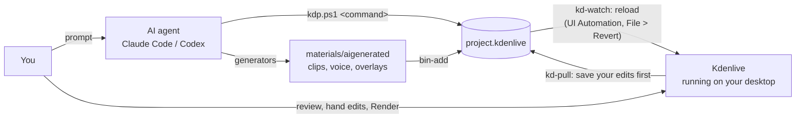

<div align="center">

# Movie Engine

**ШІ-агент монтує ваше відео в Kdenlive у вас на очах, а ви можете перехопити роботу будь-якої миті.**

ШІ-агенти для програмування (Claude Code, Codex) створюють і змінюють справжні проєкти Kdenlive: фільми, пояснювальні ролики та вертикальні шортси. Правки одразу з'являються у відкритому у вас редакторі. Портативно, Windows, без патчів редактора.


[English](../../README.md) · [简体中文](README.zh-CN.md) · [繁體中文](README.zh-TW.md) · [हिन्दी](README.hi.md) · [Español](README.es.md) · [Français](README.fr.md) · [العربية](README.ar.md) · [বাংলা](README.bn.md) · [Português](README.pt.md) · [Русский](README.ru.md) · [اردو](README.ur.md) · [Bahasa Indonesia](README.id.md) · [Deutsch](README.de.md) · [日本語](README.ja.md) · [Türkçe](README.tr.md) · [한국어](README.ko.md) · **Українська** · [Italiano](README.it.md) · [Polski](README.pl.md) · [Tiếng Việt](README.vi.md) · [فارسی](README.fa.md) · [ไทย](README.th.md) · [Kiswahili](README.sw.md) · [አማርኛ](README.am.md) · [Avañe'ẽ](README.gn.md) · [Setswana](README.tn.md)

*Це переклад. Основною вважається англійська версія README.*

</div>

---

## Зміст

- [Навіщо](#навіщо)
- [Як це працює](#як-це-працює)
- [Можливості](#можливості)
- [Вимоги](#вимоги)
- [Встановлення](#встановлення)
- [Швидкий старт](#швидкий-старт)
- [Робота з агентом](#робота-з-агентом)
- [Командний рядок для монтажу (`kdp.ps1`)](#командний-рядок-для-монтажу-kdpps1)
- [Синхронізація з відкритим редактором](#синхронізація-з-відкритим-редактором)
- [Генератори: те, чого не вміє Kdenlive](#генератори-те-чого-не-вміє-kdenlive)
- [Озвучення та звук](#озвучення-та-звук)
- [Мова інтерфейсу](#мова-інтерфейсу)
- [Структура папок](#структура-папок)
- [Тести та докази](#тести-та-докази)
- [Обмеження](#обмеження)
- [Усунення несправностей](#усунення-несправностей)
- [Часті запитання](#часті-запитання)
- [Участь у розробці](#участь-у-розробці)
- [Подяки](#подяки)
- [Ліцензія](#ліцензія)

## Навіщо

Відеоредактори створені для руки на миші. ШІ-агенти добре справляються зі структурою, таймінгом і повторюваною роботою: розставити 300 кліпів у такт музиці, прив'язати кожен субтитр до голосу, переробити сцену за зауваженнями. Але клацати по інтерфейсу вони не можуть, не захопивши ваш робочий стіл.

Kdenlive — потужний редактор із відкритим кодом, але під Windows у нього **немає API для автоматизації**: керування через D-Bus є лише у збірках для Linux, а форки, які його додають, або закинуті, або небезпечні. Movie Engine розв'язує це без патчів редактора:

1. Агент змінює файл проєкту `.kdenlive` через перевірений тестами командний рядок (`engine/kdp.ps1`).
2. Запущеному Kdenlive через Windows UI Automation надходить команда перечитати файл — без натискань клавіш, без миші й без перехоплення фокуса.
3. Ваші незбережені правки спершу зберігаються і ніколи не перезаписуються.

Тож агент монтує, а ви переглядаєте — або правите самі. Ви обоє працюєте над одним проєктом, в одному редакторі, одночасно.

## Як це працює



Кожна команда монтажу проходить той самий безпечний цикл:

1. **Pull.** Якщо в Kdenlive є незбережені зміни, йому дають команду їх зберегти (кнопка «Зберегти» на панелі інструментів через UI Automation), і збереження підтверджується.
2. **Правка.** Команда змінює XML під блокуванням, після перевірки хешу та зі знімком для скасування. Якщо файл тим часом змінився, нічого не записується.
3. **Перезавантаження.** Спостерігач бачить мітку ШІ й виконує у відкритому редакторі File > Revert. Успіхом вважається лише справжнє перебудування віджета таймлайну.
4. **Конфлікт.** Якщо ви тим часом почали правити, перезавантаження не буде, і ваша робота залишиться. Версія ШІ відкладається окремо, а агент заново застосовує свою правку поверх вашої.

## Можливості

- **Повноцінний монтаж проєкту без інтерфейсу**: близько 120 команд — кошик проєкту, таймлайн, ефекти, композиції, доріжки, напрямні, маркери, субтитри, секвенції, швидкість і перепризначення часу, слайд-шоу, титри, проксі, рендер і скасування/повтор. Див. [довідник команд](#командний-рядок-для-монтажу-kdpps1).
- **Синхронізація з відкритим редактором.** Правки ШІ з'являються в тому Kdenlive, на який ви дивитеся; ваші незбережені правки спершу зберігаються і ніколи не губляться.
- **Не заважає працювати за комп'ютером.** Жодного перехоплення фокуса, натискань клавіш чи рухів миші. Тестові екземпляри редактора запускаються на невидимому робочому столі Windows.
- **Портативність.** Редактор, налаштування, Node.js, шрифти та інструменти лежать в одній папці. Скопіюйте її на інший комп'ютер — і все запрацює; нічого не записується в Program Files чи у ваш профіль Windows.
- **Генератори для того, чого не вміє Kdenlive**: кінетичний текст з анімацією по літерах, намальовані від руки позначки, 3D-сцени інтерфейсу, анімація курсора та довгі інтерактивні пояснювальні ролики. Вони рендеряться на GPU зі справжнім розмиттям руху і ставляться на таймлайн як звичайні кліпи.
- **Озвучення з таймінгом слів** (Microsoft Edge TTS, без ключа API). Субтитри й дії спрацьовують точно на потрібному слові.
- **Синтезовані звукові ефекти** (whoosh, click, pop, riser, impact та інші), створені кодом.
- **Перевірено, а не припущено.** Кожна команда має перевірку результату, ефекти й композиції перевіряються по одному, а сирі результати лежать у `docs/proof/`.
- **Інструкції для агентів у комплекті.** `AGENTS.md` і навички в `.claude/skills/` пояснюють Claude Code і Codex порядок роботи, формат файлу та підводні камені.

## Вимоги

| | |
|---|---|
| ОС | Windows 10 або 11, x64 |
| Редактор | Kdenlive **26.08.3**, портативна збірка (standalone). Інші версії не перевірялися. |
| Node.js | 18 або новіший: `.zip` для Windows x64 з nodejs.org, розпакований у `engine/node/` |
| Браузер | Microsoft Edge (входить до Windows); рендерери сцен використовують його в headless-режимі |
| Агент | [Claude Code](https://claude.com/claude-code) або Codex. Не обов'язково: кожен інструмент можна запустити й вручну. |
| Диск | близько 1 ГБ на редактор та інструменти плюс ваші медіафайли |
| GPU | будь-яка відеокарта з апаратним кодуванням H.264 прискорює `film-render.mjs` (без неї використовується програмне кодування) |

## Встановлення

Усе встановлюється **всередину папки**. Права адміністратора не потрібні.

```powershell
git clone https://github.com/vladtarrow/movie-engine.git
cd movie-engine
```

**1. Node.js.** Завантажте `.zip` для Windows x64 з Node.js 18 або новішим з <https://nodejs.org/en/download> і розпакуйте його вміст у `engine\node\`, щоб там опинилися `engine\node\node.exe` і `engine\node\npm.cmd`. Ні інсталятор, ні системний Node не потрібні. Усі скрипти запускаються через `engine\node.cmd`, ніколи не через системний Node.

**2. Пакети Node** для інструмента озвучення та рендерерів (версії зафіксовано в `engine/voice/package.json`):

```powershell
engine\node\npm.cmd install --prefix engine\voice
```

**3. Портативний Kdenlive 26.08.3.** Завантажте `kdenlive-26.08.3_standalone.exe` з <https://download.kde.org/stable/kdenlive/26.08/windows/> у `engine\installer\`, перевірте й розпакуйте:

```powershell
(Get-FileHash engine\installer\kdenlive-26.08.3_standalone.exe -Algorithm SHA256).Hash
# expected: A25427B1DFF2C17E3B0386E991BB1A719382BB3176D1A90E441CDAEB6E0A967D
engine\installer\kdenlive-26.08.3_standalone.exe -o"engine\Kdenlive" -y
```

Редактор опиниться в `engine\Kdenlive\kdenlive-26.08.3_standalone\bin\`. У ньому вже є `melt.exe` і `ffmpeg.exe`.

**4. Перший запуск.**

```powershell
engine\kdenlive.cmd
```

Kdenlive зберігає всі налаштування в `engine\profile-kdenlive\`, а не у вашому профілі Windows. Під час першого запуску він один раз покаже майстер налаштування.

## Швидкий старт

### З агентом

Відкрийте папку в Claude Code (або Codex) і попросіть звичайними словами:

> Зроби новий вертикальний проєкт «launch-teaser» на 30 fps. Постав на таймлайн три скриншоти з `materials/designers/launch/`, по 2,5 с кожен з короткими переходами, додай озвучення з `script.txt` і прив'яжи до кожного рядка кінетичний підпис.

> Відкрий його мені в Kdenlive.

> Другий план задовгий. Скороти його до 1,8 с і підніми логотип трохи вище.

Агент дотримується `AGENTS.md`: править через `kdp.ps1`, рендерить лише ті кліпи, які потрібні монтажу, і тримає відкритий редактор в актуальному стані. Ви переглядаєте результат у Kdenlive, правите вручну коли завгодно і натискаєте «Рендер», коли все влаштовує.

### Вручну

```powershell
# a new 1080x1920 30 fps project with 2 video and 2 audio tracks
powershell -NoProfile -ExecutionPolicy Bypass -File engine\kdp.ps1 new -Project projects\hello\hello.kdenlive -Profile vertical_hd_30

# a 3-second title and a colour background
powershell -NoProfile -ExecutionPolicy Bypass -File engine\kdp.ps1 bin-color -Project projects\hello\hello.kdenlive -Color '#203060' -Seconds 3 -Name bg
powershell -NoProfile -ExecutionPolicy Bypass -File engine\kdp.ps1 title -Project projects\hello\hello.kdenlive -Text "Hello" -Seconds 3 -Name hi

# place them: background on V1, title above it on V2
powershell -NoProfile -ExecutionPolicy Bypass -File engine\kdp.ps1 add -Project projects\hello\hello.kdenlive -Bin bg -Track V1 -At 0
powershell -NoProfile -ExecutionPolicy Bypass -File engine\kdp.ps1 add -Project projects\hello\hello.kdenlive -Bin hi -Track V2 -At 0

# a check frame, then open it in the editor
powershell -NoProfile -ExecutionPolicy Bypass -File engine\kdp.ps1 frame -Project projects\hello\hello.kdenlive -At 1.5 -Out out\hello\check.png
engine\kdenlive.cmd projects\hello\hello.kdenlive
```

Щоб згодом знову відкрити останній проєкт, двічі клацніть `open-last-project.cmd`.

## Робота з агентом

Агент читає `AGENTS.md` (Codex) або `CLAUDE.md`, який його імпортує (Claude Code), а також дві навички:

| Навичка | Чого навчає |
|---|---|
| `.claude/skills/kdenlive-project-file` | формат `.kdenlive` / MLT XML, `kdp.ps1`, перевірка через `melt` |
| `.claude/skills/kdenlive-live` | безпечне керування запущеним редактором: запуск, pull, перезавантаження, знімок його вікна |

Правила, яких дотримується агент і на які можна покластися:

- Він ніколи не забирає мишу, клавіатуру чи фокус і ніколи не робить знімків вашого робочого стола (лише вікна самого редактора).
- Кроки в інтерфейсі (зберегти, відкрити, перезавантажити) він виконує сам, а не просить вас клацнути.
- Він питає, перш ніж щось завантажити чи видалити.
- Він рендерить лише те, що потрібно для роботи (кліпи сцен, контрольні кадри). Готовий фільм він рендерить, тільки якщо ви попросите.
- Якщо Kdenlive чогось не вміє робити добре, агент збирає це ззовні кодом і вставляє результат як кліп. Він не спрощує ефект.

## Командний рядок для монтажу (`kdp.ps1`)

```powershell
powershell -NoProfile -ExecutionPolicy Bypass -File engine\kdp.ps1 <command> -Project <file.kdenlive> [options]
```

Час задається в секундах, через крапку (`2.5`). Доріжки називаються `V1 V2 …` (V1 — нижня) і `A1 A2 …`. Кліп визначається через `-Track` плюс будь-який момент `-At` усередині нього. Параметри ефектів передаються в `-Params "name=value||name=value"`. Повний список з усіма опціями — у заголовку `engine/kdp.ps1`.

| Група | Команди |
|---|---|
| Проєкт | `new`, `profiles`, `info`, `validate`, `fonts`, `profile-set`, `profile-from-clip`, `zone`, `archive`, `backups`, `rebase`, `otio-export`, `otio-import` |
| Кошик проєкту | `bin-add`, `bin-color`, `title`, `title-text`, `title-save`, `title-template`, `bin-rename`, `bin-remove`, `bin-info`, `bin-set`, `bin-duplicate`, `bin-replace-file`, `bin-reload`, `folder`, `bin-folder`, `relink`, `clean`, `generator`, `playlist-clip`, `extract-audio`, `transcode` |
| Таймлайн | `add`, `add-av`, `move`, `copy`, `trim`, `ripple-trim`, `slip`, `split`, `remove`, `speed`, `remap`, `disable`, `enable`, `group`, `ungroup`, `mix`, `unmix`, `space-insert`, `space-remove`, `spaces-remove-all`, `track-clear`, `replace-in-timeline` |
| Ефекти | `effects`, `effect-info`, `effect-add`, `effect-list`, `effect-set`, `effect-remove`, `effect-copy`, `effect-clear`, `effects-all`, `bin-effect`, `effect-templates`, `effect-template` |
| Композиції | `compositions`, `comp-info`, `comp-add`, `comp-list`, `comp-set`, `comp-remove` |
| Доріжки | `track-add`, `track-remove`, `track-set` |
| Напрямні та маркери | `guide-add`, `guide-list`, `guide-remove`, `guide-set`, `guide-clear`, `guide-export`, `guide-category`, `marker`, `marker-list`, `marker-set`, `marker-remove` |
| Субтитри | `sub-add`, `sub-import`, `sub-export`, `sub-state` |
| Секвенції | `sequence-add`, `sequences`, `copy-to-sequence`, `expand`; будь-яка команда з `-Sequence <name>` працює всередині цієї секвенції |
| Особливі | `slideshow`, анімації Lottie / Glaxnimate через `bin-add`, `proxy`, `stabilize`, `scene-split`, `speed-job`, `subclip` |
| Виведення | `frame` (один PNG), `preview` (швидкий рендер через melt), `render` (власний рендерер Kdenlive або пресет), `presets` |
| Історія | `undo`, `redo`, `clear-history` (знімки в `projects/<name>/.kdp-history`) |

Що корисно знати про поведінку:

- Пов'язані половини аудіо й відео переміщуються, обрізаються, розрізаються та видаляються разом (`-Alone` — лише одна половина).
- Команда з помилкою завершується з кодом 1 і нічого не записує.
- Ефекти, які збірка під Windows не може виконати, відхиляються, а не мовчки пропускаються (список: `docs/proof/assets.txt`).
- Кожну дію з меню Kdenlive зіставлено з командою, іншим способом або позначкою «лише перегляд» у `engine/tools/data/kdenlive-actions.csv`. Див. `docs/kdenlive-coverage.md`.

## Синхронізація з відкритим редактором

| Скрипт | Що робить | Коди виходу |
|---|---|---|
| `engine\kd-pull.ps1 -Project <f>` | змушує Kdenlive зберегти ваші правки й підтверджує це | 0 файл актуальний, 3 не запущено, 4 не підтверджено |
| `engine\kd-reload.ps1 -Project <f>` | File > Revert, підтверджується перебудованим таймлайном | 0 підтверджено, 2 у вас є незбережені правки (нічого не відкинуто), 3 не запущено, 4 помилка |
| `engine\kd-watch.ps1 -Project <f>` | фоновий спостерігач: перезавантажує після кожного запису ШІ, записує конфлікти в журнал | журнал у `engine\kd-watch.log`; щоб зупинити, видаліть `engine\kd-watch.run` |
| `engine\kdenlive-bg.ps1 [project]` | запускає Kdenlive згорнутим для агента | 0 завантажено, 4 не підтверджено |
| `engine\kdenlive.cmd [project]` | запускає Kdenlive для вас | |

Запускайте спостерігач один раз за сеанс:

```powershell
Start-Process powershell -WindowStyle Hidden -ArgumentList '-NoProfile','-ExecutionPolicy','Bypass','-File','engine\kd-watch.ps1','-Project','projects\hello\hello.kdenlive'
```

Великі проєкти: перезавантаження проєкту на 1000 кліпів триває хвилини, і інструменти чекають на нього, а не звітують передчасно. Проєкти відкриваються через *File > Open Recent* у порожньому редакторі, бо під час прямого відкриття файлу Qt обходить кожен елемент таймлайну для спеціальних можливостей, і це було приблизно на 10 хвилин довше.

## Генератори: те, чого не вміє Kdenlive

У Kdenlive/MLT немає анімації тексту по літерах, немає виразів (expressions) і майже немає 3D, а важкі ефекти гальмують відтворення. Movie Engine рендерить такі частини ззовні й ставить їх на таймлайн як звичайні кліпи, зазвичай з альфа-каналом, на доріжку над зображенням. Скрипт генератора та його вхідні дані залишаються в папці проєкту, тож кліп можна створити заново, якщо змінився текст, шрифт чи таймінг.

| Інструмент | Що створює |
|---|---|
| `engine/tools/kinetic-text.ps1` | кінетичні підписи з анімацією по літерах, кожне слово прив'язане до `voice.json`, плашка-виділення |
| `engine/tools/annotate.ps1` | намальовані від руки кола, рамки, підкреслення та стрілки, що промальовуються поверх скриншота |
| `engine/tools/card-entrance.ps1` | картка зі скриншотом, яка спливає і збільшується з м'якою тінню |
| `engine/tools/pdf-to-png.ps1` | слайди з експорту в PDF |
| `engine/tools/html-render.mjs` | будь-яка сцена на HTML/CSS/canvas у відео: анімація інтерфейсу, курсори, 3D, маски |
| `engine/tools/film-render.mjs` + `film/` | довгі інтерактивні пояснювальні ролики на canvas: один кліп на репліку озвучення, дії спрацьовують на вимовлених словах, розмиття руху на GPU приблизно при 45 fps |

Обидва рендерери керують вбудованим у Windows Microsoft Edge у headless-режимі, з одноразовим профілем і без доступу до мережі.

### Демо

```powershell
# a 3-second 3D title card with a cursor click
engine\node.cmd engine\tools\html-render.mjs examples\demo\scene\scene.html examples\demo\out --frames 0,30,60,89
engine\node.cmd engine\tools\html-render.mjs examples\demo\scene\scene.html examples\demo\out\scene.mp4

# a 4-shot interactive film timed to two voice lines
engine\node.cmd engine\tools\film-render.mjs examples\demo\film\film.html examples\demo\out --check
engine\node.cmd engine\tools\film-render.mjs examples\demo\film\film.html examples\demo\out --shots all --width 640
engine\node.cmd engine\tools\film-render.mjs examples\demo\film\film.html examples\demo\out\clips --suffix -v01
```

Ролик — це три невеликі файли. У `data.js` лежать плани та час слів. У `direction.js` — по одному рядку на план:

```text
1 | hover 192 108 @brand | tag 300 60 Your brand @deserves | confetti 192 90 @film
2 say=A film that/*explains* it
3 | click 116 108 @before | click 268 108 @after | chips Before~After @after
4 scene=counter | count 0 120 % @count
```

У `scenes.js` лежать плани, які малюються з нуля. `@word` запускає дію, коли голос вимовляє це слово. Серед дій: click, hover, drag, zoom, lens, ring, arrow, chips, toggle, slider, toast, type, count і confetti; повний синтаксис — на початку `engine/tools/film/film-kit.js`.

## Озвучення та звук

```powershell
engine\node.cmd engine\voice\voice.mjs lines.json materials\aigenerated\hello\voice en-US-AndrewMultilingualNeural +0%
```

`lines.json` — це список реплік. Інструмент записує по одному mp3 на репліку та файл `voice.json` із тривалістю, а також початком і кінцем кожного слова. Репліки кешуються, тож у разі зміни однієї репліки заново створюється лише вона. Використовується онлайн-синтез мовлення Microsoft Edge через пакет `msedge-tts`: ключ не потрібен, але сервіс неофіційний і потребує інтернету.

```powershell
engine\node.cmd engine\audio\sfx.mjs materials\aigenerated\sfx
```

Ця команда синтезує кодом whoosh, whoosh-long, swipe, click, pop, tick, riser, impact, ding і reveal; готовий набір лежить у `materials/aigenerated/sfx/`. Звуки, коротші за один кадр, перед розміщенням доповніть тишею (`-af apad=whole_dur=0.0667`).

## Мова інтерфейсу

Типово лаунчери запускають Kdenlive **англійською**. Щоб вибрати іншу мову, перед запуском задайте `MOVIE_ENGINE_UI_LANG`:

```powershell
$env:MOVIE_ENGINE_UI_LANG = 'ru'; engine\kdenlive.cmd
```

UI Automation знаходить пункти меню за їхніми видимими назвами. Назви для 31 мови інтерфейсу вже вбудовано (`engine/tools/kd-ui.ps1`, `$KdNames`). Для будь-якої іншої мови додайте туди її назви й перевірте командою:

```powershell
powershell -NoProfile -ExecutionPolicy Bypass -File engine\tools\kd-langcheck.ps1
```

## Структура папок

```text
movie-engine/
├─ AGENTS.md, CLAUDE.md          instructions for AI agents
├─ .claude/skills/               agent skills: project file format, live editor
├─ engine/
│  ├─ kdp.ps1                    the editing command line
│  ├─ kd-pull / kd-reload / kd-watch .ps1, kdenlive.cmd, kdenlive-bg.ps1
│  ├─ tools/                     internals, generators, tests, data (action map)
│  ├─ voice/  audio/  fonts/     TTS, synthesized SFX, Poppins (OFL)
│  ├─ Kdenlive/  node/           portable editor and Node.js (not in git)
│  └─ profile-kdenlive/          the editor's settings (not in git)
├─ projects/<name>/<name>.kdenlive
├─ materials/
│  ├─ download/                  stock and downloaded files (not in git)
│  ├─ aigenerated/               everything the AI made (sfx/ and test-kit/ ship with the engine)
│  ├─ designers/  brand/         files from your team, brand assets
├─ examples/demo/                demos of the scene and film renderers
├─ out/                          renders (not in git)
└─ docs/                         proofs, coverage, translations of this README
```

Шляхи до медіафайлів усередині проєктів відносні. Якщо ви переносите або копіюєте папку, `kdp.ps1 rebase` (його також автоматично запускає `kdenlive.cmd`) записує в проєкт нове розташування.

## Тести та докази

Твердження про те, що працює, підкріплені перевірками результату, а не тим, що «функція виконалася». Підсумок — у [`docs/kdenlive-proof.md`](../../docs/kdenlive-proof.md), сирий вивід — у `docs/proof/`.

| Тест | Що перевіряє |
|---|---|
| `engine\tools\kdp-clitest.ps1` | кожну команду `kdp.ps1` через командний рядок, порівнюючи отриманий проєкт |
| `engine\tools\kd-livetest.ps1` | pull, перезавантаження, спостерігач, конфлікти та гонки на справжньому Kdenlive на невидимому робочому столі |
| `engine\tools\kdp-assetsweep.ps1` | кожен ефект і кожну композицію: рендерить і порівнює кадри |
| `engine\tools\kdp-portabletest.ps1` | копіює папку в інше місце і працює з копії |
| `engine\tools\kd-langcheck.ps1` | мову інтерфейсу і те, що UI Automation знаходить меню |
| `engine\tools\kdp-coverage-check.ps1` | що кожну дію меню зіставлено і жоден доказ не старший за код |

```powershell
powershell -NoProfile -ExecutionPolicy Bypass -File engine\tools\kdp-clitest.ps1 -Report docs\proof\clitest.txt
powershell -NoProfile -ExecutionPolicy Bypass -File engine\tools\kd-livetest.ps1 -Report docs\proof\live-en.txt
```

Тестові екземпляри редактора запускаються лише на прихованому робочому столі з власним профілем, тож тести ніколи не чіпають ваш відкритий Kdenlive і ваш фокус.

## Обмеження

- **Лише Windows** і лише Kdenlive **26.08.3**. У Linux є D-Bus, і там знадобився б інший міст.
- Під час запуску редактор забирає фокус клавіатури приблизно на 3 секунди, поки з'являється порожнє вікно. Агенти питають, перш ніж запускати його, поки ви працюєте. Перезавантаження й правки фокус не забирають.
- У збірці під Windows немає модулів MLT sox, ladspa і movit та частини ефектів frei0r/avfilter; `kdp.ps1` їх відхиляє (`docs/proof/assets.txt`).
- Експорт та імпорт OpenTimelineIO переносять лише кліпи та проміжки. У мультикамері немає перемикання ракурсів наживо (склейки робляться через split/remove/hide).
- «Зберегти як…» через UI Automation у згорнутому вікні не відкриває діалог; натомість агент використовує `archive` або копіювання файлів.
- Для розпізнавання мовлення (автоматичних субтитрів) потрібен Whisper або Vosk, вони не входять до комплекту.
- Титри, зроблені в редакторі титрів Kdenlive, використовують шрифти, встановлені в Windows. Для гарантованої типографіки рендерте текст генераторами — вони завантажують шрифти з `engine/fonts/`.
- Edge TTS — неофіційний онлайн-сервіс, він може змінитися або перестати працювати.

## Усунення несправностей

| Симптом | Причина та рішення |
|---|---|
| Kdenlive запущено, але клацання по ньому на панелі завдань нічого не показує | Збережене положення вікна поза межами екрана. Закрийте його й видаліть записи `kdockLayout` у `engine\profile-kdenlive\AppData\Local\kdenliverc` або перемістіть вікно через `SetWindowPos` (див. `AGENTS.md`). |
| `kd-reload.ps1` завершується з кодом 2 | У вас є незбережені правки. Нічого не відкинуто. Запустіть `kd-pull.ps1`, потім застосуйте зміну заново (`kdp.ps1` робить це сам). |
| `CONFLICT` в `engine\kd-watch.log` | Ви й агент правили одночасно. Ваша версія залишається в редакторі, а версія ШІ лежить у `projects\<name>\.kdp-history\<name>\conflict\`. Попросіть агента застосувати свою правку заново. |
| Команда завершується з кодом 1 і повідомленням «pull not confirmed» | Kdenlive зайнятий або показує діалог. Закрийте діалог або дочекайтеся завершення завантаження, потім повторіть. |
| Скрипт PowerShell не розбирається | Скрипти з текстом не в ASCII треба зберігати в UTF-8 **з BOM** для Windows PowerShell 5.1. |
| `voice.mjs` зупиняється з «Stream closed before the synthesis completed» | Зазвичай це проблема мережі або неекранований SSML у старих копіях. `voice.mjs` сам екранує `& < >`. |
| Великий проєкт відкривається багато хвилин | Відкривайте його через `kdenlive.cmd` / `kdenlive-bg.ps1`, а не як `kdenlive.exe project.kdenlive`. |

## Часті запитання

**Чи потрібен мені Claude Code або Codex?**
Ні. Кожен інструмент — звичайний скрипт, який можна запустити вручну. Агент робить роботу швидкою: він планує монтаж, запускає інструменти й тримає редактор в актуальному стані.

**Чи перезапише агент мої ручні правки?**
Ні. Перед будь-яким записом ваші незбережені правки зберігаються, і це підтверджується. Якщо ви правите, поки агент записує, запис відхиляється або відкладається як конфлікт, але ніколи не застосовується поверх вашої роботи.

**Чи можна й далі користуватися Kdenlive як зазвичай?**
Так. Це стандартний Kdenlive із власною папкою налаштувань. Монтуйте, переглядайте й рендерте як зазвичай.

**Чи працюватиме це з уже встановленим у мене Kdenlive?**
Використовується власна портативна копія в `engine\Kdenlive\`, тож встановлений Kdenlive і його налаштування залишаються недоторканими.

**Чому не форк Kdenlive з API чи інший редактор?**
Під Windows немає підтримуваного й безпечного форку (огляд від листопада 2026 року). Було розглянуто OpenShot, Blender VSE, DaVinci Resolve, Shotcut і вебредактори; Kdenlive дав найбільші можливості монтажу. За пропозицією REST API в основному проєкті (merge request !902) ми стежимо.

**Чи може він відрендерити готове відео?**
Так, командою `kdp.ps1 render` (власний рендерер Kdenlive, у прихованому режимі), або ви самі натискаєте «Рендер» у редакторі.

**Чи завантажуються кудись мої медіафайли?**
Ні. Під час створення озвучення до сервісу Edge TTS надсилається лише її текст. Рендерери сцен працюють із вимкненою мережею.

## Участь у розробці

Ми раді внеску в проєкт. Див. [CONTRIBUTING.md](../../CONTRIBUTING.md). Коротко:

- Кожна нова чи змінена операція `kdp.ps1` потребує перевірки результату в `kdp-clitest.ps1`, запису в мапі дій і свіжого прогону `kdp-coverage-check.ps1`.
- Ніколи не запускайте тестовий Kdenlive на видимому робочому столі; використовуйте `engine/tools/kd-hidden.ps1`.
- Зберігайте портативність: жодних встановлень за межами папки, жодних абсолютних шляхів у проєктах.
- Записуйте перевірені особливості в `AGENTS.md` або у відповідну навичку.

## Подяки

- [Kdenlive](https://kdenlive.org) і [MLT](https://www.mltframework.org): редактор і рушій під ним.
- [FFmpeg](https://ffmpeg.org), постачається разом із Kdenlive.
- [msedge-tts](https://www.npmjs.com/package/msedge-tts) для озвучення.
- [Poppins](https://fonts.google.com/specimen/Poppins) від Indian Type Foundry, SIL Open Font License (`engine/fonts/OFL.txt`).
- `engine/tools/data/kdenliveui-26.08.3.rc`: файл меню Kdenlive, узятий із вихідного коду Kdenlive 26.08.3; використовується лише перевіркою покриття. Він залишається під ліцензією GPL Kdenlive, а не під MIT License.

## Ліцензія

Власний код Movie Engine поширюється під [ліцензією MIT](../../LICENSE). Kdenlive, MLT, FFmpeg, пакети Node.js і шрифт Poppins поширюються під своїми ліцензіями.
