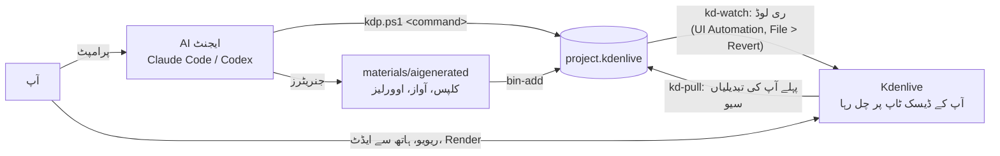

<div align="center">

# movie-engine

**ایک AI ایجنٹ آپ کی آنکھوں کے سامنے Kdenlive میں آپ کی ویڈیو ایڈٹ کرتا ہے، اور آپ کسی بھی لمحے کنٹرول اپنے ہاتھ میں لے سکتے ہیں۔**

AI کوڈنگ ایجنٹ (Claude Code، Codex) اصل Kdenlive پروجیکٹ بناتے اور بدلتے ہیں: فلمیں، explainer ویڈیوز اور ورٹیکل شارٹس۔ تبدیلیاں اسی ایڈیٹر میں لائیو نظر آتی ہیں جو آپ کے سامنے کھلا ہے۔ پورٹیبل، Windows، ایڈیٹر میں کوئی پیچ نہیں۔


[English](../../README.md) · [简体中文](README.zh-CN.md) · [हिन्दी](README.hi.md) · [Español](README.es.md) · [Français](README.fr.md) · [العربية](README.ar.md) · [বাংলা](README.bn.md) · [Português](README.pt.md) · [Русский](README.ru.md) · **اردو** · [Bahasa Indonesia](README.id.md) · [Deutsch](README.de.md) · [日本語](README.ja.md) · [Türkçe](README.tr.md) · [한국어](README.ko.md)

*یہ ایک ترجمہ ہے؛ حوالہ جاتی نسخہ انگریزی README ہے۔*

</div>

<div dir="rtl">

---

## فہرست

- [کیوں](#کیوں)
- [یہ کیسے کام کرتا ہے](#یہ-کیسے-کام-کرتا-ہے)
- [خصوصیات](#خصوصیات)
- [تقاضے](#تقاضے)
- [انسٹالیشن](#انسٹالیشن)
- [فوری آغاز](#فوری-آغاز)
- [ایجنٹ کے ساتھ کام](#ایجنٹ-کے-ساتھ-کام)
- [ایڈیٹنگ کمانڈ لائن (`kdp.ps1`)](#ایڈیٹنگ-کمانڈ-لائن-kdpps1)
- [کھلے ایڈیٹر کے ساتھ لائیو سنک](#کھلے-ایڈیٹر-کے-ساتھ-لائیو-سنک)
- [جنریٹرز: جو Kdenlive نہیں کر سکتا](#جنریٹرز-جو-kdenlive-نہیں-کر-سکتا)
- [وائس اوور اور ساؤنڈ](#وائس-اوور-اور-ساؤنڈ)
- [انٹرفیس کی زبان](#انٹرفیس-کی-زبان)
- [فولڈر کی ساخت](#فولڈر-کی-ساخت)
- [ٹیسٹ اور ثبوت](#ٹیسٹ-اور-ثبوت)
- [حدود](#حدود)
- [مسائل کا حل](#مسائل-کا-حل)
- [عام سوالات (FAQ)](#عام-سوالات-faq)
- [تعاون](#تعاون)
- [اظہار تشکر](#اظہار-تشکر)
- [لائسنس](#لائسنس)

## کیوں

ویڈیو ایڈیٹر ماؤس پر رکھے ہاتھوں کے لیے بنائے جاتے ہیں۔ AI ایجنٹ ڈھانچے، ٹائمنگ اور دہرائے جانے والے کاموں میں اچھے ہیں: بیٹ پر 300 کلپ رکھنا، ہر کیپشن کو آواز کے ساتھ ملانا، فیڈبیک کے بعد کسی سین کو دوبارہ بنانا۔ لیکن وہ آپ کے ڈیسک ٹاپ پر قبضہ کیے بغیر GUI میں کلک نہیں کر سکتے۔

Kdenlive ایک طاقتور اوپن سورس ایڈیٹر ہے، لیکن Windows پر اس میں **کوئی آٹومیشن API نہیں**: D-Bus کنٹرول صرف Linux بلڈز میں ہے، اور جو فورکس اسے شامل کرتے ہیں وہ یا تو مینٹین نہیں ہوتے یا غیر محفوظ ہیں۔ movie-engine ایڈیٹر کو پیچ کیے بغیر یہ مسئلہ حل کرتا ہے:

1. ایجنٹ ایک ٹیسٹ شدہ کمانڈ لائن (`engine/kdp.ps1`) کے ذریعے `.kdenlive` پروجیکٹ فائل ایڈٹ کرتا ہے۔
2. چلتے ہوئے Kdenlive کو Windows UI Automation کے ذریعے فائل دوبارہ لوڈ کرنے کو کہا جاتا ہے، بغیر کی اسٹروکس، بغیر ماؤس اور بغیر فوکس چھینے۔
3. آپ کی اپنی غیر محفوظ شدہ تبدیلیاں پہلے سیو ہوتی ہیں اور کبھی اوور رائٹ نہیں ہوتیں۔

یعنی ایجنٹ ایڈٹ کرتا ہے اور آپ ریویو کرتے ہیں، یا آپ خود ہاتھ سے ایڈٹ کرتے ہیں۔ آپ دونوں ایک ہی پروجیکٹ پر، ایک ہی ایڈیٹر میں، ایک ہی وقت میں کام کرتے ہیں۔

## یہ کیسے کام کرتا ہے



ہر ایڈیٹنگ کمانڈ ایک ہی محفوظ چکر پر چلتی ہے:

1. **Pull.** اگر Kdenlive میں غیر محفوظ شدہ تبدیلیاں ہوں تو اسے انہیں سیو کرنے کو کہا جاتا ہے (UI Automation کے ذریعے ٹول بار کا Save)، اور سیو کی تصدیق کی جاتی ہے۔
2. **Edit.** کمانڈ ایک لاک کے اندر، ہیش چیک کے بعد اور undo اسنیپ شاٹ کے ساتھ XML بدلتی ہے۔ اگر اس دوران فائل بدل گئی ہو تو کچھ بھی نہیں لکھا جاتا۔
3. **Reload.** واچر AI کی مہر دیکھتا ہے اور کھلے ایڈیٹر میں File > Revert چلاتا ہے۔ کامیابی تبھی مانی جاتی ہے جب ٹائم لائن ویجٹ واقعی دوبارہ بن چکا ہو۔
4. **Conflict.** اگر آپ نے بیچ میں ایڈٹ شروع کر دیا تو کچھ بھی ری لوڈ نہیں ہوتا اور آپ کا کام محفوظ رہتا ہے۔ AI کا ورژن الگ رکھ دیا جاتا ہے، اور ایجنٹ اپنی تبدیلی آپ کی تبدیلیوں کے اوپر دوبارہ لاگو کرتا ہے۔

## خصوصیات

- **GUI کے بغیر مکمل پروجیکٹ ایڈیٹنگ**: تقریباً 120 کمانڈز، جو bin، ٹائم لائن، ایفیکٹس، کمپوزیشنز، ٹریکس، گائیڈز، مارکرز، سب ٹائٹلز، سیکوئنسز، اسپیڈ اور ٹائم ری میپ، سلائیڈ شوز، ٹائٹلز، پراکسیز، رینڈرنگ اور undo/redo کا احاطہ کرتی ہیں۔ دیکھیں [کمانڈ ریفرنس](#ایڈیٹنگ-کمانڈ-لائن-kdpps1)۔
- **کھلے ایڈیٹر کے ساتھ لائیو سنک۔** AI کی تبدیلیاں اسی Kdenlive میں نظر آتی ہیں جسے آپ دیکھ رہے ہیں؛ آپ کی غیر محفوظ شدہ تبدیلیاں پہلے سیو ہوتی ہیں اور کبھی ضائع نہیں ہوتیں۔
- **آپ کے ڈیسک ٹاپ میں کبھی خلل نہیں۔** نہ فوکس چھیننا، نہ کی اسٹروکس، نہ ماؤس ان پٹ۔ ٹیسٹ ایڈیٹرز ایک نظر نہ آنے والے Windows ڈیسک ٹاپ پر چلتے ہیں۔
- **پورٹیبل۔** ایڈیٹر، سیٹنگز، Node.js، فونٹس اور ٹولز ایک ہی فولڈر میں رہتے ہیں۔ اسے کسی دوسرے PC پر کاپی کریں اور یہ کام کرے گا؛ Program Files یا آپ کی Windows پروفائل میں کچھ نہیں لکھا جاتا۔
- **جو Kdenlive نہیں کر سکتا، اس کے لیے جنریٹرز**: حرف بہ حرف کائنیٹک ٹیکسٹ، ہاتھ سے بنی اینوٹیشنز، 3D UI سینز، کرسر اینیمیشنز اور طویل انٹرایکٹو "explainer" فلمیں۔ یہ اصل موشن بلر کے ساتھ GPU پر رینڈر ہوتی ہیں اور ٹائم لائن پر عام کلپس کی طرح رکھی جاتی ہیں۔
- **الفاظ کی ٹائمنگ کے ساتھ وائس اوور** (Microsoft Edge TTS، کسی API key کی ضرورت نہیں)۔ کیپشنز اور ایکشنز عین اسی لفظ پر چلتے ہیں۔
- **سنتھیسائز کیے گئے ساؤنڈ ایفیکٹس** (whoosh، click، pop، riser، impact اور مزید)، کوڈ میں بنائے گئے۔
- **فرض نہیں کیا گیا، ثابت کیا گیا۔** ہر کمانڈ کے نتیجے کی جانچ ہوتی ہے، ایفیکٹس اور کمپوزیشنز ایک ایک کر کے پرکھے جاتے ہیں، اور خام نتائج `docs/proof/` میں ہیں۔
- **ایجنٹ کی ہدایات ساتھ شامل۔** `AGENTS.md` اور `.claude/skills/` کی اسکلز Claude Code اور Codex کو ورک فلو، فائل فارمیٹ اور عام غلطیاں سکھاتی ہیں۔

## تقاضے

| | |
|---|---|
| OS | Windows 10 یا 11، x64 |
| ایڈیٹر | Kdenlive **26.08.3** پورٹیبل (standalone) بلڈ۔ دوسرے ورژن ٹیسٹ نہیں کیے گئے۔ |
| Node.js | 18 یا نیا: nodejs.org سے Windows x64 کی `.zip`، جو `engine/node/` میں ان زپ کی گئی ہو |
| براؤزر | Microsoft Edge (Windows کا حصہ)؛ سین رینڈررز اسے headless موڈ میں استعمال کرتے ہیں |
| ایجنٹ | [Claude Code](https://claude.com/claude-code) یا Codex۔ اختیاری: ہر ٹول ہاتھ سے بھی چلتا ہے۔ |
| ڈسک | ایڈیٹر اور ٹولز کے لیے تقریباً 1 GB، ساتھ میں آپ کا میڈیا |
| GPU | ہارڈویئر H.264 انکوڈنگ والا کوئی بھی GPU `film-render.mjs` کو تیز کرتا ہے (ورنہ یہ سافٹ ویئر انکوڈنگ پر چلا جاتا ہے) |

## انسٹالیشن

سب کچھ **فولڈر کے اندر** انسٹال ہوتا ہے۔ کسی چیز کے لیے admin اختیارات درکار نہیں۔

```powershell
git clone <repository-url> movie-engine
cd movie-engine
```

**1. Node.js.** <https://nodejs.org/en/download> سے Node.js 18 یا نئے کی Windows x64 `.zip` ڈاؤن لوڈ کریں اور اس کا مواد `engine\node\` میں ان زپ کریں، تاکہ وہاں `engine\node\node.exe` اور `engine\node\npm.cmd` موجود ہوں۔ نہ انسٹالر چاہیے، نہ سسٹم کا Node۔ تمام اسکرپٹس `engine\node.cmd` کے ذریعے چلتی ہیں، کبھی سسٹم کے Node سے نہیں۔

**2. Node پیکجز**، وائس ٹول اور رینڈررز کے لیے (ورژن `engine/voice/package.json` میں طے ہیں):

```powershell
engine\node\npm.cmd install --prefix engine\voice
```

**3. Kdenlive 26.08.3 پورٹیبل۔** <https://download.kde.org/stable/kdenlive/26.08/windows/> سے `kdenlive-26.08.3_standalone.exe` کو `engine\installer\` میں ڈاؤن لوڈ کریں، اسے چیک کریں اور ان پیک کریں:

```powershell
(Get-FileHash engine\installer\kdenlive-26.08.3_standalone.exe -Algorithm SHA256).Hash
# متوقع: A25427B1DFF2C17E3B0386E991BB1A719382BB3176D1A90E441CDAEB6E0A967D
engine\installer\kdenlive-26.08.3_standalone.exe -o"engine\Kdenlive" -y
```

ایڈیٹر `engine\Kdenlive\kdenlive-26.08.3_standalone\bin\` میں پہنچ جاتا ہے۔ اس میں `melt.exe` اور `ffmpeg.exe` پہلے سے شامل ہیں۔

**4. پہلی بار چلانا۔**

```powershell
engine\kdenlive.cmd
```

Kdenlive اپنی تمام سیٹنگز `engine\profile-kdenlive\` میں رکھتا ہے، آپ کی Windows پروفائل میں نہیں۔ پہلی بار چلنے پر یہ ایک بار کا سیٹ اپ وزرڈ دکھاتا ہے۔

## فوری آغاز

### ایجنٹ کے ساتھ

فولڈر کو Claude Code (یا Codex) میں کھولیں اور سادہ الفاظ میں کہیں:

> ایک نیا ورٹیکل 30 fps پروجیکٹ "launch-teaser" بناؤ۔ `materials/designers/launch/` کے تینوں اسکرین شاٹس ٹائم لائن پر رکھو، ہر ایک 2.5 s کا، ایک چھوٹے cross-fade کے ساتھ، `script.txt` سے وائس اوور شامل کرو اور ہر لائن پر ایک کائنیٹک کیپشن ٹائم کرو۔

> اسے میرے لیے Kdenlive میں کھول دو۔

> دوسرا شاٹ بہت لمبا ہے۔ اسے کاٹ کر 1.8 s کا کر دو اور لوگو تھوڑا اوپر کر دو۔

ایجنٹ `AGENTS.md` پر عمل کرتا ہے: وہ `kdp.ps1` کے ذریعے ایڈٹ کرتا ہے، صرف وہی کلپس رینڈر کرتا ہے جن کی کٹ کو ضرورت ہے، اور کھلے ایڈیٹر کو سنک میں رکھتا ہے۔ آپ Kdenlive میں ریویو کرتے ہیں، جب چاہیں ہاتھ سے ایڈٹ کرتے ہیں، اور مطمئن ہونے پر Render دباتے ہیں۔

### ہاتھ سے

```powershell
# 2 ویڈیو اور 2 آڈیو ٹریکس والا نیا 1080x1920 30 fps پروجیکٹ
powershell -NoProfile -ExecutionPolicy Bypass -File engine\kdp.ps1 new -Project projects\hello\hello.kdenlive -Profile vertical_hd_30

# 3 سیکنڈ کا ٹائٹل اور ایک رنگین بیک گراؤنڈ
powershell -NoProfile -ExecutionPolicy Bypass -File engine\kdp.ps1 bin-color -Project projects\hello\hello.kdenlive -Color '#203060' -Seconds 3 -Name bg
powershell -NoProfile -ExecutionPolicy Bypass -File engine\kdp.ps1 title -Project projects\hello\hello.kdenlive -Text "Hello" -Seconds 3 -Name hi

# انہیں رکھیں: بیک گراؤنڈ V1 پر، ٹائٹل اس کے اوپر V2 پر
powershell -NoProfile -ExecutionPolicy Bypass -File engine\kdp.ps1 add -Project projects\hello\hello.kdenlive -Bin bg -Track V1 -At 0
powershell -NoProfile -ExecutionPolicy Bypass -File engine\kdp.ps1 add -Project projects\hello\hello.kdenlive -Bin hi -Track V2 -At 0

# ایک جانچ فریم، پھر اسے ایڈیٹر میں کھولیں
powershell -NoProfile -ExecutionPolicy Bypass -File engine\kdp.ps1 frame -Project projects\hello\hello.kdenlive -At 1.5 -Out out\hello\check.png
engine\kdenlive.cmd projects\hello\hello.kdenlive
```

بعد میں آخری پروجیکٹ دوبارہ کھولنے کے لیے `open-last-project.cmd` پر ڈبل کلک کریں۔

## ایجنٹ کے ساتھ کام

ایجنٹ `AGENTS.md` (Codex) یا `CLAUDE.md` پڑھتا ہے، جو اسے امپورٹ کرتی ہے (Claude Code)، اور ساتھ میں دو اسکلز:

| اسکل | کیا سکھاتی ہے |
|---|---|
| `.claude/skills/kdenlive-project-file` | `.kdenlive` / MLT XML فارمیٹ، `kdp.ps1`، `melt` سے جانچ |
| `.claude/skills/kdenlive-live` | چلتے ہوئے ایڈیٹر کو محفوظ طریقے سے چلانا: شروع کرنا، pull، reload، اس کی ونڈو کیپچر کرنا |

ایجنٹ جن اصولوں پر عمل کرتا ہے، اور جن پر آپ بھروسا کر سکتے ہیں:

- یہ کبھی آپ کا ماؤس، کی بورڈ یا فوکس نہیں لیتا، اور کبھی آپ کے ڈیسک ٹاپ کا اسکرین شاٹ نہیں لیتا (صرف ایڈیٹر کی اپنی ونڈو کا)۔
- یہ GUI کے مراحل (سیو، کھولنا، ری لوڈ) خود کرتا ہے، آپ سے کلک کرنے کو نہیں کہتا۔
- یہ کچھ بھی ڈاؤن لوڈ کرنے اور کچھ بھی ڈیلیٹ کرنے سے پہلے پوچھتا ہے۔
- یہ صرف وہی رینڈر کرتا ہے جس کی کام کو ضرورت ہو (سین کلپس، جانچ فریمز)۔ فائنل فلم یہ تبھی رینڈر کرتا ہے جب آپ کہیں۔
- جب Kdenlive کوئی چیز اچھی طرح نہیں کر پاتا، تو ایجنٹ اسے باہر کوڈ سے بناتا ہے اور نتیجہ کلپ کے طور پر شامل کرتا ہے۔ وہ ایفیکٹ کو ہلکا نہیں کرتا۔

## ایڈیٹنگ کمانڈ لائن (`kdp.ps1`)

```powershell
powershell -NoProfile -ExecutionPolicy Bypass -File engine\kdp.ps1 <command> -Project <file.kdenlive> [options]
```

وقت سیکنڈز میں ہوتا ہے، اعشاریہ کے لیے نقطے کے ساتھ (`2.5`)۔ ٹریکس `V1 V2 …` (V1 سب سے نیچے) اور `A1 A2 …` ہیں۔ کسی کلپ کی نشاندہی `-Track` اور اس کے اندر کسی بھی وقت `-At` سے کی جاتی ہے۔ ایفیکٹ پیرامیٹرز `-Params "name=value||name=value"` میں جاتے ہیں۔ ہر آپشن کے ساتھ مکمل فہرست `engine/kdp.ps1` کے ہیڈر میں ہے۔

| گروپ | کمانڈز |
|---|---|
| پروجیکٹ | `new`, `profiles`, `info`, `validate`, `fonts`, `profile-set`, `profile-from-clip`, `zone`, `archive`, `backups`, `rebase`, `otio-export`, `otio-import` |
| Bin | `bin-add`, `bin-color`, `title`, `title-text`, `title-save`, `title-template`, `bin-rename`, `bin-remove`, `bin-info`, `bin-set`, `bin-duplicate`, `bin-replace-file`, `bin-reload`, `folder`, `bin-folder`, `relink`, `clean`, `generator`, `playlist-clip`, `extract-audio`, `transcode` |
| ٹائم لائن | `add`, `add-av`, `move`, `copy`, `trim`, `ripple-trim`, `slip`, `split`, `remove`, `speed`, `remap`, `disable`, `enable`, `group`, `ungroup`, `mix`, `unmix`, `space-insert`, `space-remove`, `spaces-remove-all`, `track-clear`, `replace-in-timeline` |
| ایفیکٹس | `effects`, `effect-info`, `effect-add`, `effect-list`, `effect-set`, `effect-remove`, `effect-copy`, `effect-clear`, `effects-all`, `bin-effect`, `effect-templates`, `effect-template` |
| کمپوزیشنز | `compositions`, `comp-info`, `comp-add`, `comp-list`, `comp-set`, `comp-remove` |
| ٹریکس | `track-add`, `track-remove`, `track-set` |
| گائیڈز اور مارکرز | `guide-add`, `guide-list`, `guide-remove`, `guide-set`, `guide-clear`, `guide-export`, `guide-category`, `marker`, `marker-list`, `marker-set`, `marker-remove` |
| سب ٹائٹلز | `sub-add`, `sub-import`, `sub-export`, `sub-state` |
| سیکوئنسز | `sequence-add`, `sequences`, `copy-to-sequence`, `expand`؛ `-Sequence <name>` کے ساتھ کوئی بھی کمانڈ اسی سیکوئنس کے اندر کام کرتی ہے |
| خصوصی | `slideshow`، `bin-add` کے ذریعے Lottie / Glaxnimate اینیمیشنز، `proxy`, `stabilize`, `scene-split`, `speed-job`, `subclip` |
| آؤٹ پٹ | `frame` (ایک PNG)، `preview` (تیز melt رینڈر)، `render` (Kdenlive کا اپنا رینڈرر یا کوئی پری سیٹ)، `presets` |
| ہسٹری | `undo`, `redo`, `clear-history` (اسنیپ شاٹس `projects/<name>/.kdp-history` میں) |

جاننے کے لائق رویہ:

- جڑے ہوئے آڈیو اور ویڈیو حصے ایک ساتھ موو، ٹرم، اسپلٹ اور ریموو ہوتے ہیں (ایک حصے کے لیے `-Alone`)۔
- ناکام ہونے والی کمانڈ کوڈ 1 کے ساتھ ختم ہوتی ہے اور کچھ نہیں لکھتی۔
- جو ایفیکٹس Windows بلڈ نہیں چلا سکتا، انہیں مسترد کر دیا جاتا ہے، خاموشی سے نظرانداز نہیں کیا جاتا (فہرست: `docs/proof/assets.txt`)۔
- Kdenlive کے ہر مینو ایکشن کو `engine/tools/data/kdenlive-actions.csv` میں کسی کمانڈ، کسی دوسرے راستے، یا "صرف دیکھنے کے لیے" سے میپ کیا گیا ہے۔ دیکھیں `docs/kdenlive-coverage.md`۔

## کھلے ایڈیٹر کے ساتھ لائیو سنک

| اسکرپٹ | کیا کرتی ہے | ایگزٹ کوڈز |
|---|---|---|
| `engine\kd-pull.ps1 -Project <f>` | Kdenlive سے آپ کی تبدیلیاں سیو کرواتی ہے اور اس کی تصدیق کرتی ہے | 0 فائل تازہ ترین، 3 نہیں چل رہا، 4 تصدیق نہیں ہوئی |
| `engine\kd-reload.ps1 -Project <f>` | File > Revert، دوبارہ بنی ٹائم لائن سے تصدیق شدہ | 0 تصدیق شدہ، 2 آپ کی غیر محفوظ شدہ تبدیلیاں ہیں (کچھ ضائع نہیں کیا گیا)، 3 نہیں چل رہا، 4 ناکام |
| `engine\kd-watch.ps1 -Project <f>` | بیک گراؤنڈ واچر: AI کی ہر تحریر کے بعد ری لوڈ کرتا ہے، کنفلکٹس لاگ کرتا ہے | لاگ `engine\kd-watch.log` میں؛ روکنے کے لیے `engine\kd-watch.run` ڈیلیٹ کریں |
| `engine\kdenlive-bg.ps1 [project]` | ایجنٹ کے لیے Kdenlive کو منیمائز حالت میں شروع کرتی ہے | 0 لوڈ ہو گیا، 4 تصدیق نہیں ہوئی |
| `engine\kdenlive.cmd [project]` | آپ کے لیے Kdenlive شروع کرتی ہے | |

ہر سیشن میں واچر ایک بار شروع کریں:

```powershell
Start-Process powershell -WindowStyle Hidden -ArgumentList '-NoProfile','-ExecutionPolicy','Bypass','-File','engine\kd-watch.ps1','-Project','projects\hello\hello.kdenlive'
```

بڑے پروجیکٹس: 1000 کلپس والے پروجیکٹ کو ری لوڈ ہونے میں کئی منٹ لگتے ہیں، اور ٹولز جلدی رپورٹ کرنے کے بجائے اس کا انتظار کرتے ہیں۔ پروجیکٹس خالی ایڈیٹر میں *File > Open Recent* کے ذریعے کھلتے ہیں، کیونکہ فائل کو براہِ راست کھولنے پر Qt ایکسیسیبلٹی کے لیے ٹائم لائن کے ہر آئٹم سے گزرتا ہے، اور یہ تقریباً 10 منٹ سست تھا۔

## جنریٹرز: جو Kdenlive نہیں کر سکتا

Kdenlive/MLT میں حرف بہ حرف ٹیکسٹ اینیمیشن نہیں، expressions نہیں اور 3D بہت کم ہے، اور بھاری ایفیکٹس پلے بیک کو سست کر دیتے ہیں۔ movie-engine ایسے حصوں کو باہر رینڈر کرتا ہے اور انہیں ٹائم لائن پر عام کلپس کی طرح رکھتا ہے، عموماً alpha کے ساتھ، تصویروں کے اوپر والے ٹریک پر۔ جنریٹر اسکرپٹ اور اس کے ان پٹس پروجیکٹ فولڈر میں رہتے ہیں، تاکہ ٹیکسٹ، فونٹ یا ٹائمنگ بدلنے پر کلپ دوبارہ بنایا جا سکے۔

| ٹول | کیا بناتا ہے |
|---|---|
| `engine/tools/kinetic-text.ps1` | حرف بہ حرف کائنیٹک کیپشنز، ہر لفظ کی ٹائمنگ `voice.json` سے، ہائی لائٹ باکس |
| `engine/tools/annotate.ps1` | ہاتھ سے بنے دائرے، باکس، انڈر لائنز اور تیر جو اسکرین شاٹ کے اوپر بنتے چلے جاتے ہیں |
| `engine/tools/card-entrance.ps1` | ایک اسکرین شاٹ کارڈ جو ہلکے سائے کے ساتھ اوپر اٹھتا اور بڑا ہوتا ہوا آتا ہے |
| `engine/tools/pdf-to-png.ps1` | PDF ایکسپورٹ سے سلائیڈز |
| `engine/tools/html-render.mjs` | کوئی بھی HTML/CSS/canvas سین ویڈیو میں: انٹرفیس اینیمیشن، کرسرز، 3D، ماسکس |
| `engine/tools/film-render.mjs` + `film/` | canvas پر طویل، انٹرایکٹو explainer فلمیں: ہر وائس لائن کے لیے ایک کلپ، ایکشنز بولے گئے الفاظ پر چلتے ہیں، تقریباً 45 fps پر GPU موشن بلر |

دونوں رینڈررز Windows کے ساتھ آنے والے Microsoft Edge کو headless موڈ میں چلاتے ہیں، ایک عارضی پروفائل کے ساتھ اور بغیر نیٹ ورک رسائی کے۔

### ڈیمو

```powershell
# کرسر کلک کے ساتھ 3 سیکنڈ کا 3D ٹائٹل کارڈ
engine\node.cmd engine\tools\html-render.mjs examples\demo\scene\scene.html examples\demo\out --frames 0,30,60,89
engine\node.cmd engine\tools\html-render.mjs examples\demo\scene\scene.html examples\demo\out\scene.mp4

# دو وائس لائنوں پر ٹائم کی گئی 4 شاٹس والی انٹرایکٹو فلم
engine\node.cmd engine\tools\film-render.mjs examples\demo\film\film.html examples\demo\out --check
engine\node.cmd engine\tools\film-render.mjs examples\demo\film\film.html examples\demo\out --shots all --width 640
engine\node.cmd engine\tools\film-render.mjs examples\demo\film\film.html examples\demo\out\clips --suffix -v01
```

ایک فلم تین چھوٹی فائلوں پر مشتمل ہوتی ہے۔ `data.js` میں شاٹس اور الفاظ کے اوقات ہوتے ہیں۔ `direction.js` میں ہر شاٹ کے لیے ایک لائن ہوتی ہے:

```text
1 | hover 192 108 @brand | tag 300 60 Your brand @deserves | confetti 192 90 @film
2 say=A film that/*explains* it
3 | click 116 108 @before | click 268 108 @after | chips Before~After @after
4 scene=counter | count 0 120 % @count
```

`scenes.js` میں وہ شاٹس ہوتے ہیں جو شروع سے ڈرا کیے جاتے ہیں۔ `@word` اس وقت ایک ایکشن چلاتا ہے جب آواز وہ لفظ بولتی ہے۔ ایکشنز میں click، hover، drag، zoom، lens، ring، arrow، chips، toggle، slider، toast، type، count اور confetti شامل ہیں؛ مکمل سنٹیکس `engine/tools/film/film-kit.js` کے شروع میں ہے۔

## وائس اوور اور ساؤنڈ

```powershell
engine\node.cmd engine\voice\voice.mjs lines.json materials\aigenerated\hello\voice en-US-AndrewMultilingualNeural +0%
```

`lines.json` لائنوں کی ایک فہرست ہے۔ ٹول ہر لائن کے لیے ایک mp3 لکھتا ہے، اور ساتھ میں `voice.json`، جس میں دورانیہ اور ہر لفظ کا آغاز اور اختتام ہوتا ہے۔ لائنیں کیش ہوتی ہیں، اس لیے ایک لائن بدلنے پر صرف وہی لائن دوبارہ بنتی ہے۔ یہ `msedge-tts` پیکج کے ذریعے Microsoft Edge کی آن لائن text-to-speech استعمال کرتا ہے: کسی key کی ضرورت نہیں، لیکن یہ سروس غیر سرکاری ہے اور انٹرنیٹ درکار ہے۔

```powershell
engine\node.cmd engine\audio\sfx.mjs materials\aigenerated\sfx
```

یہ whoosh، whoosh-long، swipe، click، pop، tick، riser، impact، ding اور reveal کو کوڈ میں سنتھیسائز کرتا ہے؛ ایک تیار سیٹ `materials/aigenerated/sfx/` میں ہے۔ ایک فریم سے چھوٹی آوازوں کو رکھنے سے پہلے ان میں خاموشی شامل کر کے لمبا کریں (`-af apad=whole_dur=0.0667`)۔

## انٹرفیس کی زبان

لانچرز بطور ڈیفالٹ Kdenlive کو **انگریزی** میں شروع کرتے ہیں۔ کوئی اور زبان استعمال کرنے کے لیے، شروع کرنے سے پہلے `MOVIE_ENGINE_UI_LANG` سیٹ کریں:

```powershell
$env:MOVIE_ENGINE_UI_LANG = 'ru'; engine\kdenlive.cmd
```

UI Automation مینو آئٹمز کو ان کے نظر آنے والے ناموں سے تلاش کرتا ہے۔ انگریزی اور روسی نام پہلے سے شامل ہیں (`engine/tools/kd-ui.ps1`، `$KdNames`)۔ کسی بھی دوسری زبان کے لیے اس کے نام وہاں شامل کریں اور اس سے جانچیں:

```powershell
powershell -NoProfile -ExecutionPolicy Bypass -File engine\tools\kd-langcheck.ps1
```

## فولڈر کی ساخت

```text
movie-engine/
├─ AGENTS.md, CLAUDE.md          instructions for AI agents
├─ .claude/skills/               agent skills: project file format, live editor
├─ engine/
│  ├─ kdp.ps1                    the editing command line
│  ├─ kd-pull / kd-reload / kd-watch .ps1, kdenlive.cmd, kdenlive-bg.ps1
│  ├─ tools/                     internals, generators, tests, data (action map)
│  ├─ voice/  audio/  fonts/     TTS, synthesized SFX, Poppins (OFL)
│  ├─ Kdenlive/  node/           portable editor and Node.js (not in git)
│  └─ profile-kdenlive/          the editor's settings (not in git)
├─ projects/<name>/<name>.kdenlive
├─ materials/
│  ├─ download/                  stock and downloaded files (not in git)
│  ├─ aigenerated/               everything the AI made (sfx/ and test-kit/ ship with the engine)
│  ├─ designers/  brand/         files from your team, brand assets
├─ examples/demo/                demos of the scene and film renderers
├─ out/                          renders (not in git)
└─ docs/                         proofs, coverage, translations of this README
```

پروجیکٹس کے اندر میڈیا پاتھس relative ہوتے ہیں۔ اگر آپ فولڈر کو منتقل یا کاپی کریں، تو `kdp.ps1 rebase` (جو `kdenlive.cmd` خود بخود بھی چلاتا ہے) نیا مقام پروجیکٹ میں لکھ دیتا ہے۔

## ٹیسٹ اور ثبوت

کیا کام کرتا ہے، اس کے دعوے نتائج کی جانچ پر مبنی ہیں، "فنکشن چل گیا" پر نہیں۔ خلاصہ [`docs/kdenlive-proof.md`](../../docs/kdenlive-proof.md) میں ہے، اور خام آؤٹ پٹ `docs/proof/` میں۔

| ٹیسٹ | کیا جانچتا ہے |
|---|---|
| `engine\tools\kdp-clitest.ps1` | ہر `kdp.ps1` کمانڈ، کمانڈ لائن کے ذریعے، نتیجے میں بننے والے پروجیکٹ کا موازنہ کرتے ہوئے |
| `engine\tools\kd-livetest.ps1` | نظر نہ آنے والے ڈیسک ٹاپ پر اصل Kdenlive کے مقابلے میں pull، reload، واچر، کنفلکٹس اور race conditions |
| `engine\tools\kdp-assetsweep.ps1` | ہر ایفیکٹ اور کمپوزیشن: فریمز رینڈر کر کے موازنہ کرتا ہے |
| `engine\tools\kdp-portabletest.ps1` | فولڈر کو کہیں اور کاپی کرتا ہے اور اس کاپی سے کام کرتا ہے |
| `engine\tools\kd-langcheck.ps1` | انٹرفیس کی زبان، اور یہ کہ UI Automation مینو تلاش کر لیتا ہے |
| `engine\tools\kdp-coverage-check.ps1` | ہر مینو ایکشن میپ شدہ ہے، اور کوئی ثبوت کوڈ سے پرانا نہیں |

```powershell
powershell -NoProfile -ExecutionPolicy Bypass -File engine\tools\kdp-clitest.ps1 -Report docs\proof\clitest.txt
powershell -NoProfile -ExecutionPolicy Bypass -File engine\tools\kd-livetest.ps1 -Report docs\proof\live-en.txt
```

ٹیسٹ ایڈیٹرز صرف ایک چھپے ہوئے ڈیسک ٹاپ پر اپنی الگ پروفائل کے ساتھ چلتے ہیں، اس لیے ٹیسٹ کبھی آپ کے کھلے Kdenlive یا آپ کے فوکس کو نہیں چھوتے۔

## حدود

- **صرف Windows**، صرف Kdenlive **26.08.3**۔ Linux میں D-Bus ہے اور وہاں ایک مختلف برج درکار ہوگا۔
- ایڈیٹر شروع ہوتے وقت، جب خالی ونڈو ظاہر ہوتی ہے، یہ تقریباً 3 سیکنڈ کے لیے کی بورڈ فوکس لے لیتا ہے۔ آپ کے کام کے دوران ایجنٹس اسے شروع کرنے سے پہلے پوچھتے ہیں۔ ری لوڈ اور ایڈٹس فوکس نہیں لیتے۔
- Windows بلڈ میں sox، ladspa اور movit MLT ماڈیولز اور کچھ frei0r/avfilter ایفیکٹس موجود نہیں؛ `kdp.ps1` انہیں مسترد کر دیتا ہے (`docs/proof/assets.txt`)۔
- OpenTimelineIO ایکسپورٹ اور امپورٹ صرف کلپس اور گیپس منتقل کرتے ہیں۔ Multicam میں لائیو اینگل سوئچنگ نہیں ہے (کٹس split/remove/hide سے بنائے جاتے ہیں)۔
- منیمائز ونڈو پر UI Automation کے ذریعے "Save As…" کوئی ڈائیلاگ نہیں کھولتا؛ ایجنٹ اس کے بجائے `archive` یا فائل کاپیز استعمال کرتا ہے۔
- اسپیچ ریکگنیشن (آٹو سب ٹائٹلز) کے لیے Whisper یا Vosk درکار ہیں، جو ساتھ شامل نہیں۔
- Kdenlive کے ٹائٹل ٹول سے بنے ٹائٹلز Windows میں انسٹال فونٹس استعمال کرتے ہیں۔ یقینی ٹائپوگرافی کے لیے ٹیکسٹ کو جنریٹرز سے رینڈر کریں، جو فونٹس `engine/fonts/` سے لوڈ کرتے ہیں۔
- Edge TTS ایک غیر سرکاری آن لائن سروس ہے اور بدل سکتی ہے یا کام کرنا بند کر سکتی ہے۔

## مسائل کا حل

| علامت | وجہ اور حل |
|---|---|
| Kdenlive چل رہا ہے، لیکن ٹاسک بار پر کلک کرنے سے کچھ نظر نہیں آتا | اس کی محفوظ شدہ ونڈو پوزیشن اسکرین سے باہر ہے۔ اسے بند کریں اور `engine\profile-kdenlive\AppData\Local\kdenliverc` میں `kdockLayout` اندراجات ڈیلیٹ کریں، یا `SetWindowPos` سے ونڈو منتقل کریں (دیکھیں `AGENTS.md`)۔ |
| `kd-reload.ps1` کوڈ 2 کے ساتھ ختم ہوتا ہے | آپ کی غیر محفوظ شدہ تبدیلیاں ہیں۔ کچھ بھی ضائع نہیں کیا گیا۔ `kd-pull.ps1` چلائیں، پھر تبدیلی دوبارہ لاگو کریں (`kdp.ps1` یہ خود کرتا ہے)۔ |
| `engine\kd-watch.log` میں `CONFLICT` | آپ نے اور ایجنٹ نے ایک ہی لمحے میں ایڈٹ کیا۔ آپ کا ورژن ایڈیٹر میں رہتا ہے، اور AI کا ورژن `projects\<name>\.kdp-history\<name>\conflict\` میں ہے۔ ایجنٹ سے اپنی تبدیلی دوبارہ لاگو کرنے کو کہیں۔ |
| کوئی کمانڈ "pull not confirmed" کے ساتھ کوڈ 1 پر ختم ہوتی ہے | Kdenlive مصروف ہے یا کوئی ڈائیلاگ دکھا رہا ہے۔ ڈائیلاگ بند کریں یا لوڈنگ ختم ہونے کا انتظار کریں، پھر دہرائیں۔ |
| کوئی PowerShell اسکرپٹ پارس نہیں ہوتی | non-ASCII ٹیکسٹ والی اسکرپٹس Windows PowerShell 5.1 کے لیے UTF-8 **BOM کے ساتھ** سیو ہونی چاہئیں۔ |
| `voice.mjs` "Stream closed before the synthesis completed" کے ساتھ رک جاتا ہے | عموماً نیٹ ورک کا مسئلہ، یا پرانی کاپیوں میں unescaped SSML۔ `voice.mjs` خود `& < >` کو escape کرتا ہے۔ |
| بڑا پروجیکٹ کھلنے میں کئی منٹ لگتے ہیں | اسے `kdenlive.cmd` / `kdenlive-bg.ps1` کے ذریعے کھولیں، کبھی `kdenlive.exe project.kdenlive` کی طرح نہیں۔ |

## عام سوالات (FAQ)

**کیا مجھے Claude Code یا Codex کی ضرورت ہے؟**
نہیں۔ ہر ٹول ایک سادہ اسکرپٹ ہے جسے آپ ہاتھ سے چلا سکتے ہیں۔ ایجنٹ اسے تیز بناتا ہے: وہ کٹ کی منصوبہ بندی کرتا ہے، ٹولز چلاتا ہے اور ایڈیٹر کو سنک میں رکھتا ہے۔

**کیا ایجنٹ میری ہاتھ سے کی گئی تبدیلیاں اوور رائٹ کر دے گا؟**
نہیں۔ کسی بھی تحریر سے پہلے آپ کی غیر محفوظ شدہ تبدیلیاں سیو اور تصدیق کی جاتی ہیں۔ اگر ایجنٹ کے لکھتے وقت آپ ایڈٹ کریں، تو تحریر مسترد کر دی جاتی ہے یا کنفلکٹ کے طور پر الگ رکھ دی جاتی ہے، کبھی آپ کے کام کے اوپر لاگو نہیں کی جاتی۔

**کیا میں Kdenlive کو معمول کے مطابق استعمال کرتا رہ سکتا ہوں؟**
جی ہاں۔ یہ اسٹاک Kdenlive ہے، اپنے الگ سیٹنگز فولڈر کے ساتھ۔ ہمیشہ کی طرح ایڈٹ، پری ویو اور رینڈر کریں۔

**کیا یہ میرے پہلے سے انسٹال Kdenlive کے ساتھ کام کرتا ہے؟**
یہ `engine\Kdenlive\` میں اپنی پورٹیبل کاپی استعمال کرتا ہے، اس لیے آپ کا انسٹال شدہ Kdenlive اور اس کی سیٹنگز جوں کی توں رہتی ہیں۔

**API والا Kdenlive فورک یا کوئی دوسرا ایڈیٹر کیوں نہیں؟**
Windows پر کوئی مینٹین شدہ اور محفوظ فورک موجود نہیں (2026-11 کا سروے)۔ OpenShot، Blender VSE، DaVinci Resolve، Shotcut اور ویب ایڈیٹرز کو پرکھا گیا؛ Kdenlive نے ایڈیٹنگ میں سب سے زیادہ گہرائی دی۔ upstream میں ایک REST API تجویز (merge request !902) پر نظر رکھی جا رہی ہے۔

**کیا یہ فائنل ویڈیو رینڈر کر سکتا ہے؟**
جی ہاں، `kdp.ps1 render` کے ذریعے (Kdenlive کا اپنا رینڈرر، پوشیدہ حالت میں)، یا آپ خود ایڈیٹر میں Render دبائیں۔

**کیا میرا میڈیا کہیں اپ لوڈ ہوتا ہے؟**
نہیں۔ آواز بناتے وقت صرف وائس اوور کا ٹیکسٹ Edge TTS سروس کو بھیجا جاتا ہے۔ سین رینڈررز نیٹ ورکنگ بند کر کے چلتے ہیں۔

## تعاون

تعاون کا خیرمقدم ہے۔ دیکھیں [CONTRIBUTING.md](../../CONTRIBUTING.md)۔ مختصراً:

- ہر نئے یا تبدیل شدہ `kdp.ps1` آپریشن کے لیے `kdp-clitest.ps1` میں نتیجے کی جانچ، ایکشن میپ میں ایک اندراج، اور `kdp-coverage-check.ps1` کا تازہ رن ضروری ہے۔
- نظر آنے والے ڈیسک ٹاپ پر کبھی ٹیسٹ Kdenlive شروع نہ کریں؛ `engine/tools/kd-hidden.ps1` استعمال کریں۔
- سب کچھ پورٹیبل رکھیں: فولڈر سے باہر کوئی انسٹال نہیں، پروجیکٹس میں کوئی absolute پاتھ نہیں۔
- تصدیق شدہ عجیب رویے (quirks) `AGENTS.md` یا متعلقہ اسکل میں لکھیں۔

## اظہار تشکر

- [Kdenlive](https://kdenlive.org) اور [MLT](https://www.mltframework.org): ایڈیٹر اور اس کے نیچے کا انجن۔
- [FFmpeg](https://ffmpeg.org)، جو Kdenlive کے ساتھ آتا ہے۔
- وائس اوور کے لیے [msedge-tts](https://www.npmjs.com/package/msedge-tts)۔
- Indian Type Foundry کا [Poppins](https://fonts.google.com/specimen/Poppins)، SIL Open Font License (`engine/fonts/OFL.txt`)۔
- `engine/tools/data/kdenliveui-26.08.3.rc`: Kdenlive کی مینو فائل، Kdenlive 26.08.3 کے سورس کوڈ سے لی گئی؛ صرف کوریج چیک میں استعمال ہوتی ہے۔ یہ MIT کے بجائے Kdenlive کے GPL لائسنس کے تحت رہتی ہے۔

## لائسنس

movie-engine کا اپنا کوڈ [MIT لائسنس](../../LICENSE) کے تحت جاری کیا گیا ہے۔ Kdenlive، MLT، FFmpeg، Node.js پیکجز اور Poppins فونٹ اپنے اپنے لائسنسوں کے تحت رہتے ہیں۔

</div>
