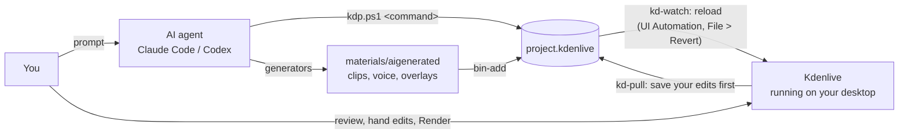

<div align="center">

# Movie Engine

**Ejente ya AI i edita vidio yaṋu kha Kdenlive ni tshi khou sedza, nahone ni nga dzhia mushumo tshifhinga tshiṅwe na tshiṅwe.**

Ejente dza AI (vhuṱali ha maitele) dzine dza ṅwala khoudu (Claude Code, Codex) dzi fhaṱa na u shandukisa phurojeke dza vhukuma dza Kdenlive: filimi, vidio dza ṱhalutshedzo na vidio pfufhi dzo imaho (vertical shorts). Tshanduko dzi vhonala nga u ṱavhanya kha edithara ye na i vula. I a pfukiswa (portable), ndi ya Windows, nahone a hu na tshanduko ine ya itwa kha edithara yone ine.


[English](../../README.md) · [简体中文](README.zh-CN.md) · [繁體中文](README.zh-TW.md) · [हिन्दी](README.hi.md) · [Español](README.es.md) · [Français](README.fr.md) · [العربية](README.ar.md) · [বাংলা](README.bn.md) · [Português](README.pt.md) · [Русский](README.ru.md) · [اردو](README.ur.md) · [Bahasa Indonesia](README.id.md) · [Deutsch](README.de.md) · [日本語](README.ja.md) · [Türkçe](README.tr.md) · [한국어](README.ko.md) · [Українська](README.uk.md) · [Italiano](README.it.md) · [Polski](README.pl.md) · [Tiếng Việt](README.vi.md) · [فارسی](README.fa.md) · [ไทย](README.th.md) · [Kiswahili](README.sw.md) · [አማርኛ](README.am.md) · [Avañe'ẽ](README.gn.md) · [Setswana](README.tn.md) · [Shqip](README.sq.md) · [Беларуская](README.be.md) · [Български](README.bg.md) · [Bosanski](README.bs.md) · [Hrvatski](README.hr.md) · [Српски](README.sr.md) · [Crnogorski](README.cnr.md) · [Македонски](README.mk.md) · [Slovenščina](README.sl.md) · [Slovenčina](README.sk.md) · [Čeština](README.cs.md) · [Magyar](README.hu.md) · [Română](README.ro.md) · [Dansk](README.da.md) · [Norsk bokmål](README.nb.md) · [Norsk nynorsk](README.nn.md) · [Svenska](README.sv.md) · [Íslenska](README.is.md) · [Suomi](README.fi.md) · [Eesti](README.et.md) · [Latviešu](README.lv.md) · [Lietuvių](README.lt.md) · [Nederlands](README.nl.md) · [Lëtzebuergesch](README.lb.md) · [Rumantsch](README.rm.md) · [Ελληνικά](README.el.md) · [Malti](README.mt.md) · [Gaeilge](README.ga.md) · [Català](README.ca.md) · [ქართული](README.ka.md) · [Հայերեն](README.hy.md) · [Azərbaycanca](README.az.md) · [Afrikaans](README.af.md) · [isiZulu](README.zu.md) · [isiXhosa](README.xh.md) · [Sesotho](README.st.md) · [Sepedi](README.nso.md) · [Xitsonga](README.ts.md) · **Tshivenḓa** · [siSwati](README.ss.md) · [isiNdebele (South Africa)](README.nr.md) · [isiNdebele (Zimbabwe)](README.nd.md) · [chiShona](README.sn.md) · [Chichewa](README.ny.md) · [Ikinyarwanda](README.rw.md) · [Ikirundi](README.rn.md) · [Malagasy](README.mg.md) · [Soomaali](README.so.md) · [Afaan Oromoo](README.om.md) · [Qafar af](README.aa.md) · [ትግርኛ](README.ti.md) · [Sängö](README.sg.md) · [Kreol Seselwa](README.crs.md) · [TjiKalanga](README.kck.md) · [ChiNdau](README.ndc.md)

*Hei ndi ṱhalutshedzo. README ya Luisimane ndi yone ine ya dzhiwa sa ya vhukuma.*

</div>

---

## Zwi re ngomu

- [Ndi ngani](#ndi-ngani)
- [Zwi shuma hani](#zwi-shuma-hani)
- [Zwine zwa kona u itwa](#zwine-zwa-kona-u-itwa)
- [Zwi ṱoḓeaho](#zwi-ṱoḓeaho)
- [U dzhenisa](#u-dzhenisa)
- [U thoma nga u ṱavhanya](#u-thoma-nga-u-ṱavhanya)
- [U shuma na ejente](#u-shuma-na-ejente)
- [Mutalo wa milayo wa u edita (`kdp.ps1`)](#mutalo-wa-milayo-wa-u-edita-kdpps1)
- [U tshimbilelana na edithara yo vulwaho](#u-tshimbilelana-na-edithara-yo-vulwaho)
- [Zwibveledzi: zwine Kdenlive ya sa kone u zwi ita](#zwibveledzi-zwine-kdenlive-ya-sa-kone-u-zwi-ita)
- [Ipfi na mubvumo](#ipfi-na-mubvumo)
- [Luambo lwa interface](#luambo-lwa-interface)
- [Nzudzanyo ya dzifolda](#nzudzanyo-ya-dzifolda)
- [Ndingo na vhuṱanzi](#ndingo-na-vhuṱanzi)
- [Mikano](#mikano)
- [U tandulula thaidzo](#u-tandulula-thaidzo)
- [Mbudziso dzine dza vhudziswa kanzhi](#mbudziso-dzine-dza-vhudziswa-kanzhi)
- [U shela mulenzhe](#u-shela-mulenzhe)
- [Ndivhuwo](#ndivhuwo)
- [Laisentsi](#laisentsi)

## Ndi ngani

Edithara dza vidio dzo itelwa zwanḓa zwi re kha mouse. Ejente dza AI dzi vhudi kha nzudzanyo, tshifhinga na mushumo une wa dovholowa: u vhea kilipi dza 300 u ya nga bitsi ḽa muzika, u ṱanganya maipfi oṱhe a ṅwaliwaho (captions) na ipfi, u dovha u ita tshipiḓa nga murahu ha mihumbulo ya vhathu. Fhedzi a dzi koni u kilika kha GUI (interface ya zwifanyiso) dzi sa dzhii desktop yaṋu.

Kdenlive ndi edithara khulwane ya open-source (khoudu yo vuleaho), fhedzi kha Windows **a i na API ya u ita zwithu nga hone yo ḓiitaho (automation)**: u langa nga D-Bus hu wanala kha dzi-build dza Linux fhedzi, nahone dzi-fork dzine dza i engedza kana dzo litshwa, kana a dzi tsireledzei. Movie Engine i tandulula hezwi i sa shandukisi edithara:

1. Ejente i edita faela ya phurojeke ya `.kdenlive` nga mutalo wa milayo wo lingwaho (`engine/kdp.ps1`).
2. Kdenlive ine ya khou shuma i vhudzwa uri i dovhe i vule faela nga Windows UI Automation, hu si na u puṱa khibodo, hu si na mouse nahone i sa dzhii focus.
3. Tshanduko dzaṋu dzi sa athu u seiviwa dzi thoma dza seiviwa, nahone a dzi ṅwalelwi nṱha.

Nga zwenezwo ejente i a edita inwi ni tshi sedza, kana ni edita nga zwanḓa. Inwi vhavhili ni shuma kha phurojeke nthihi, kha edithara nthihi, nga tshifhinga tshithihi.

## Zwi shuma hani



Mulayo muṅwe na muṅwe wa u edita u tevhela mutevhe muthihi wo tsireledzeaho:

1. **Pull (u dzhia).** Arali Kdenlive i na tshanduko dzi sa athu u seiviwa, i vhudzwa uri i dzi seive (Save kha toolbar nga UI Automation), nahone u seiva hu a khwaṱhisedzwa.
2. **U edita.** Mulayo u shandukisa XML i yo lokiwa (lock), nga murahu ha u sedza hash nahone hu na snapshot ya u vhuisa (undo). Arali faela yo shanduka zwenezwo, a hu ṅwalwi tshithu.
3. **U dovha u vula.** Muṱhogomeli (watcher) u vhona luswayo lwa AI nahone u ita File > Revert kha edithara yo vulwaho. Hu dzhiwa sa u bvelela fhedzi musi widget ya timeline yo fhaṱululwa zwa vhukuma.
4. **Khanedzano.** Arali no thoma u edita vhukati hazwo, a hu dovhi ha vulwa tshithu nahone mushumo waṋu u a sala. Vesheni ya AI i vhewa thungo, nahone ejente i dovha ya ita tshanduko yayo nṱha ha yaṋu.

## Zwine zwa kona u itwa

- **U edita phurojeke yoṱhe hu si na GUI**: milayo i ṱoḓaho u swika 120 ine ya katela bin, timeline, efekete, composition, dzithirakha, guide, marker, subtitle, sequence, luvhilo na time remap, slideshow, thaitili, proxy, u renda (rendering) na undo/redo. Sedzani [ṱhalutshedzo ya milayo](#mutalo-wa-milayo-wa-u-edita-kdpps1).
- **U tshimbilelana na edithara yo vulwaho.** Tshanduko dza AI dzi vhonala kha Kdenlive ine na khou i sedza; tshanduko dzaṋu dzi sa athu u seiviwa dzi thoma dza seiviwa nahone a dzi xedzwi.
- **A i ni dzhenelele kha desktop yaṋu.** A hu na u dzhia focus, u puṱa khibodo kana u shumisa mouse. Edithara dza ndingo dzi shuma kha desktop ya Windows i sa vhonali.
- **I a pfukiswa.** Edithara, zwo sedzwaho (settings), Node.js, fonti na zwishumiswa zwi dzula kha folda nthihi. I kopini kha PC iṅwe nahone i ḓo shuma; a hu na tshine tsha ṅwalwa kha Program Files kana kha profaili yaṋu ya Windows.
- **Zwibveledzi (generators) zwa zwine Kdenlive ya sa kone u zwi ita**: maipfi a tshimbilaho nga ḽiḽeḓere ḽithihi nga ḽithihi (kinetic text), zwiswayo zwo olwaho nga zwanḓa, zwifanyiso zwa interface zwa 3D, u tshimbila ha cursor na filimi dzilapfu dza ṱhalutshedzo dzine dza tshimbidzana na muthu (interactive "explainer"). Dzi rendiwa kha GPU na motion blur ya vhukuma nahone dzi vhewa kha timeline sa kilipi dza misi yoṱhe.
- **Ipfi ḽi ambaho (voice-over) na tshifhinga tsha ipfi ḽiṅwe na ḽiṅwe** (Microsoft Edge TTS, a hu ṱoḓei API key). Captions na zwiito zwi thoma kha ipfi ḽone ḽeneḽo.
- **Mubvumo wa efekete wo itwaho nga khoudu** (whoosh, click, pop, riser, impact na miṅwe), wo bveledzwa nga khoudu.
- **Zwo khwaṱhisedzwa, a si u humbulela.** Mulayo muṅwe na muṅwe u na ndingo ya mvelelo, efekete na composition dzi lingwa nga nthihi nga nthihi, nahone mvelelo dza vhukuma dzi kha `docs/proof/`.
- **Ndaela dza ejente dzo katelwa.** `AGENTS.md` na zwikili zwi re kha `.claude/skills/` zwi funza Claude Code na Codex nḓila ya u shuma, fomaṱe ya faela na zwine zwa nga khakhisa.

## Zwi ṱoḓeaho

| | |
|---|---|
| OS | Windows 10 kana 11, x64 |
| Edithara | Kdenlive **26.08.3**, build i pfukiswaho (standalone). Vesheni dziṅwe a dzo ngo lingwa. |
| Node.js | 18 kana ntswa: `.zip` ya Windows x64 u bva kha nodejs.org, yo bulwa kha `engine/node/` |
| Buraweza | Microsoft Edge (tshipiḓa tsha Windows); i shumiswa i sa vhonali (headless) nga zwirendi zwa zwifanyiso |
| Ejente | [Claude Code](https://claude.com/claude-code) kana Codex. A si khombekhombe: tshishumiswa tshiṅwe na tshiṅwe tshi a shuma na nga zwanḓa. |
| Disiki | u ṱoḓa u swika 1 GB ya edithara na zwishumiswa, u engedza media yaṋu |
| GPU | GPU iṅwe na iṅwe ine ya kona u encode H.264 nga hardware i ṱavhanyisa `film-render.mjs` (arali i siho, hu shumiswa software) |

## U dzhenisa

Zwoṱhe zwi dzheniswa **ngomu ha folda**. A hu na tshine tsha ṱoḓa ndugelo dza admin.

```powershell
git clone https://github.com/vladtarrow/movie-engine.git
cd movie-engine
```

**1. Node.js.** Davhuloudani `.zip` ya Windows x64 ya Node.js 18 kana ntswa u bva kha <https://nodejs.org/en/download> ni bule zwi re ngomu hayo kha `engine\node\`, uri `engine\node\node.exe` na `engine\node\npm.cmd` zwi vhe henefho. A hu ṱoḓei installer kana Node ya sisiṱeme. Zwikiripiti zwoṱhe zwi shuma nga `engine\node.cmd`, zwi sa shumi nga Node ya sisiṱeme.

**2. Phakhedzhi dza Node** dza tshishumiswa tsha ipfi na zwirendi (vesheni dzo khwaṱhisedzwa kha `engine/voice/package.json`):

```powershell
engine\node\npm.cmd install --prefix engine\voice
```

**3. Kdenlive 26.08.3 i pfukiswaho.** Davhuloudani `kdenlive-26.08.3_standalone.exe` u bva kha <https://download.kde.org/stable/kdenlive/26.08/windows/> kha `engine\installer\`, ni i sedze nahone ni i bule:

```powershell
(Get-FileHash engine\installer\kdenlive-26.08.3_standalone.exe -Algorithm SHA256).Hash
# expected: A25427B1DFF2C17E3B0386E991BB1A719382BB3176D1A90E441CDAEB6E0A967D
engine\installer\kdenlive-26.08.3_standalone.exe -o"engine\Kdenlive" -y
```

Edithara i ḓo wanala kha `engine\Kdenlive\kdenlive-26.08.3_standalone\bin\`. I no vha i na `melt.exe` na `ffmpeg.exe`.

**4. U thoma lwa u thoma.**

```powershell
engine\kdenlive.cmd
```

Kdenlive i vhulunga zwo sedzwaho zwayo zwoṱhe kha `engine\profile-kdenlive\`, hu si kha profaili yaṋu ya Windows. Musi i tshi thoma lwa u thoma i sumbedza wizard ya u dzudzanya lu luthihi fhedzi.

## U thoma nga u ṱavhanya

### Nga ejente

Vulani folda kha Claude Code (kana Codex) ni humbele nga maipfi a misi yoṱhe:

> Ita phurojeke ntswa yo imaho ya 30 fps i pfi "launch-teaser". Vhea zwifanyiso zwa tshikirini zwiraru zwi bvaho kha `materials/designers/launch/` kha timeline, tshiṅwe na tshiṅwe 2.5 s na cross-fade pfufhi, engedza voice-over u bva kha `script.txt` u dovhe u ṱanganye caption i tshimbilaho na mutalo muṅwe na muṅwe.

> Nthi vhulela yone kha Kdenlive.

> Tshifanyiso tsha vhuvhili tsho lapfa vhukuma. Tshi fhungudze tshi vhe 1.8 s u dovhe u gonyisa logo nṱha zwiṱuku.

Ejente i tevhela `AGENTS.md`: i edita nga `kdp.ps1`, i renda kilipi dzine dza ṱoḓea kha u edita fhedzi, nahone i ita uri edithara yo vulwaho i dzule i tshi tshimbilelana. Inwi ni sedza kha Kdenlive, ni edita nga zwanḓa tshifhinga tshiṅwe na tshiṅwe tshine na funa, nahone ni puṱa Render musi no fushea.

### Nga zwanḓa

```powershell
# a new 1080x1920 30 fps project with 2 video and 2 audio tracks
powershell -NoProfile -ExecutionPolicy Bypass -File engine\kdp.ps1 new -Project projects\hello\hello.kdenlive -Profile vertical_hd_30

# a 3-second title and a colour background
powershell -NoProfile -ExecutionPolicy Bypass -File engine\kdp.ps1 bin-color -Project projects\hello\hello.kdenlive -Color '#203060' -Seconds 3 -Name bg
powershell -NoProfile -ExecutionPolicy Bypass -File engine\kdp.ps1 title -Project projects\hello\hello.kdenlive -Text "Hello" -Seconds 3 -Name hi

# place them: background on V1, title above it on V2
powershell -NoProfile -ExecutionPolicy Bypass -File engine\kdp.ps1 add -Project projects\hello\hello.kdenlive -Bin bg -Track V1 -At 0
powershell -NoProfile -ExecutionPolicy Bypass -File engine\kdp.ps1 add -Project projects\hello\hello.kdenlive -Bin hi -Track V2 -At 0

# a check frame, then open it in the editor
powershell -NoProfile -ExecutionPolicy Bypass -File engine\kdp.ps1 frame -Project projects\hello\hello.kdenlive -At 1.5 -Out out\hello\check.png
engine\kdenlive.cmd projects\hello\hello.kdenlive
```

U dovha u vula phurojeke ya u fhedza nga murahu, kilikani kavhili kha `open-last-project.cmd`.

## U shuma na ejente

Ejente i vhala `AGENTS.md` (Codex) kana `CLAUDE.md`, ine ya i dzhenisa (Claude Code), u engedza zwikili zwivhili:

| Tshikili | Tshi funza |
|---|---|
| `.claude/skills/kdenlive-project-file` | fomaṱe ya `.kdenlive` / MLT XML, `kdp.ps1`, u sedza nga `melt` |
| `.claude/skills/kdenlive-live` | u langa edithara ine ya khou shuma zwo tsireledzeaho: u thoma, pull, u dovha u vula, u dzhia tshifanyiso tsha windo ḽayo |

Milayo ine ejente ya i tevhela, ine na nga i fulufhela:

- A i dzhii mouse, khibodo kana focus yaṋu, nahone a i dzhii tshifanyiso tsha desktop yaṋu (fhedzi windo ḽa edithara yone ine).
- I ita yone ine zwiṱepe zwa GUI (u seiva, u vula, u dovha u vula) i sa ni humbeli uri ni kilike.
- I a vhudzisa i sa athu u davhulouda tshithu na i sa athu u phumula tshithu.
- I renda fhedzi zwine mushumo wa zwi ṱoḓa (kilipi dza zwifanyiso, frame dza u sedza). I renda filimi yo fhelaho fhedzi musi ni tshi humbela.
- Musi Kdenlive i sa koni u ita tshiṅwe zwavhuḓi, ejente i tshi fhaṱa nnḓa nga khoudu nahone i vhea mvelelo sa kilipi. A i fhungudzi efekete.

## Mutalo wa milayo wa u edita (`kdp.ps1`)

```powershell
powershell -NoProfile -ExecutionPolicy Bypass -File engine\kdp.ps1 <command> -Project <file.kdenlive> [options]
```

Tshifhinga tshi kha sekonḓa, na tshikhala tsha dot (`2.5`). Dzithirakha ndi `V1 V2 …` (V1 ndi ya fhasi) na `A1 A2 …`. Kilipi i sumbedzwa nga `-Track` u engedza tshifhinga tshiṅwe na tshiṅwe `-At` tshi re ngomu hayo. Zwiteṅwa zwa efekete zwi ya kha `-Params "name=value||name=value"`. Mutevhe woṱhe na option iṅwe na iṅwe u kha ṱhoho ya `engine/kdp.ps1`.

| Tshigwada | Milayo |
|---|---|
| Phurojeke | `new`, `profiles`, `info`, `validate`, `fonts`, `profile-set`, `profile-from-clip`, `zone`, `archive`, `backups`, `rebase`, `otio-export`, `otio-import` |
| Bin | `bin-add`, `bin-color`, `title`, `title-text`, `title-save`, `title-template`, `bin-rename`, `bin-remove`, `bin-info`, `bin-set`, `bin-duplicate`, `bin-replace-file`, `bin-reload`, `folder`, `bin-folder`, `relink`, `clean`, `generator`, `playlist-clip`, `extract-audio`, `transcode` |
| Timeline | `add`, `add-av`, `move`, `copy`, `trim`, `ripple-trim`, `slip`, `split`, `remove`, `speed`, `remap`, `disable`, `enable`, `group`, `ungroup`, `mix`, `unmix`, `space-insert`, `space-remove`, `spaces-remove-all`, `track-clear`, `replace-in-timeline` |
| Efekete | `effects`, `effect-info`, `effect-add`, `effect-list`, `effect-set`, `effect-remove`, `effect-copy`, `effect-clear`, `effects-all`, `bin-effect`, `effect-templates`, `effect-template` |
| Composition | `compositions`, `comp-info`, `comp-add`, `comp-list`, `comp-set`, `comp-remove` |
| Dzithirakha | `track-add`, `track-remove`, `track-set` |
| Guide na marker | `guide-add`, `guide-list`, `guide-remove`, `guide-set`, `guide-clear`, `guide-export`, `guide-category`, `marker`, `marker-list`, `marker-set`, `marker-remove` |
| Subtitle | `sub-add`, `sub-import`, `sub-export`, `sub-state` |
| Sequence | `sequence-add`, `sequences`, `copy-to-sequence`, `expand`; mulayo muṅwe na muṅwe une wa vha na `-Sequence <name>` u shuma ngomu ha yeneyo sequence |
| Zwo khetheaho | `slideshow`, animation dza Lottie / Glaxnimate nga `bin-add`, `proxy`, `stabilize`, `scene-split`, `speed-job`, `subclip` |
| Zwi bvaho | `frame` (PNG nthihi), `preview` (u renda nga melt nga u ṱavhanya), `render` (tshirendi tsha Kdenlive yone ine kana preset), `presets` |
| Ḓivhazwakale | `undo`, `redo`, `clear-history` (snapshot kha `projects/<name>/.kdp-history`) |

Zwine zwa fanela u ḓivhiwa nga ha maitele:

- Zwipiḓa zwa audio na vidio zwo ṱanganywaho zwi tshimbila, zwi khaukanywa, zwi tumulwa nahone zwi bviswa zwothe (`-Alone` kha tshipiḓa tshithihi fhedzi).
- Mulayo u kundelwaho u fhela na khoudu 1 nahone a u ṅwali tshithu.
- Efekete dzine build ya Windows ya sa kone u dzi shumisa dzi a hanwa, a dzi litshwi zwi sa ḓivhiwi (mutevhe: `docs/proof/assets.txt`).
- Tshiito tshiṅwe na tshiṅwe tsha menu ya Kdenlive tsho ṱanganywa na mulayo, nḓila iṅwe, kana "u sedza fhedzi" kha `engine/tools/data/kdenlive-actions.csv`. Sedzani `docs/kdenlive-coverage.md`.

## U tshimbilelana na edithara yo vulwaho

| Tshikiripiti | Tshine tsha ita | Khoudu dza u bva |
|---|---|---|
| `engine\kd-pull.ps1 -Project <f>` | i ita uri Kdenlive i seive tshanduko dzaṋu nahone i zwi khwaṱhisedza | 0 faela ndi ntswa, 3 a i khou shuma, 4 a zwo ngo khwaṱhisedzwa |
| `engine\kd-reload.ps1 -Project <f>` | File > Revert, zwi khwaṱhisedzwa nga timeline yo fhaṱululwaho | 0 zwo khwaṱhisedzwa, 2 ni na tshanduko dzi sa athu u seiviwa (a hu na tsho laṱwaho), 3 a i khou shuma, 4 zwo kundelwa |
| `engine\kd-watch.ps1 -Project <f>` | muṱhogomeli wa murahu: u dovha u vula nga murahu ha u ṅwala huṅwe na huṅwe ha AI, u ṅwala khanedzano kha log | log i kha `engine\kd-watch.log`; phumulani `engine\kd-watch.run` u i imisa |
| `engine\kdenlive-bg.ps1 [project]` | i thoma Kdenlive yo fhungudzwa (minimized) ya ejente | 0 yo vulea, 4 a zwo ngo khwaṱhisedzwa |
| `engine\kdenlive.cmd [project]` | i thoma Kdenlive yaṋu | |

Thomani muṱhogomeli luthihi nga sesheni:

```powershell
Start-Process powershell -WindowStyle Hidden -ArgumentList '-NoProfile','-ExecutionPolicy','Bypass','-File','engine\kd-watch.ps1','-Project','projects\hello\hello.kdenlive'
```

Phurojeke khulwane: u dovha u vula phurojeke ya kilipi dza 1000 zwi dzhia mimunithi, nahone zwishumiswa zwi a lindela zwi sa vhigi nga u ṱavhanya. Phurojeke dzi vulwa nga *File > Open Recent* kha edithara i si na tshithu, ngauri u vula faela nga u ṱavhanya zwi ita uri Qt i tshimbile kha tshithu tshiṅwe na tshiṅwe tsha timeline u itela accessibility, nahone zwo vha zwi tshi ṱoḓa mimunithi i ṱoḓaho u swika 10 i engedzeaho.

## Zwibveledzi: zwine Kdenlive ya sa kone u zwi ita

Kdenlive/MLT a i na animation ya maipfi nga ḽiḽeḓere ḽithihi nga ḽithihi, a i na expressions nahone i na 3D i si nnzhi, nahone efekete dzi lemelaho dzi ongolosa u tamba. Movie Engine i renda zwipiḓa zwa vhuvha uho nnḓa nahone i zwi vhea kha timeline sa kilipi dza misi yoṱhe, kanzhi na alpha, kha thirakha i re nṱha ha zwifanyiso. Tshikiripiti tsha tshibveledzi na zwine tsha zwi shumisa zwi dzula kha folda ya phurojeke, uri kilipi i kone u dovha ya bveledzwa musi maipfi, fonti kana tshifhinga zwi tshi shanduka.

| Tshishumiswa | Tshi ita |
|---|---|
| `engine/tools/kinetic-text.ps1` | captions dzi tshimbilaho nga ḽiḽeḓere ḽithihi nga ḽithihi, ipfi ḽiṅwe na ḽiṅwe ḽo ṱanganywa na `voice.json`, bogisi ḽa u sumbedza |
| `engine/tools/annotate.ps1` | zwikhuḓu, mabogisi, mitalo nga fhasi na misevhe zwo olwaho nga zwanḓa zwine zwa ḓi ola nṱha ha tshifanyiso tsha tshikirini |
| `engine/tools/card-entrance.ps1` | khadi ya tshifanyiso tsha tshikirini ine ya gonya ya hula na murunzi muṱete |
| `engine/tools/pdf-to-png.ps1` | slide u bva kha PDF yo bviswaho |
| `engine/tools/html-render.mjs` | tshifanyiso tshiṅwe na tshiṅwe tsha HTML/CSS/canvas u ya kha vidio: animation ya interface, cursor, 3D, mask |
| `engine/tools/film-render.mjs` + `film/` | filimi dzilapfu dza ṱhalutshedzo dzine dza tshimbidzana na muthu kha canvas: kilipi nthihi nga mutalo muṅwe na muṅwe wa ipfi, zwiito zwi thoma kha maipfi a ambiwaho, motion blur ya GPU nga u ṱoḓa u swika 45 fps |

Zwirendi zwoṱhe zwivhili zwi langa Microsoft Edge ine ya ḓa na Windows, i sa vhonali (headless), na profaili ine ya laṱwa nga murahu nahone hu si na network.

### Dzidemo

```powershell
# a 3-second 3D title card with a cursor click
engine\node.cmd engine\tools\html-render.mjs examples\demo\scene\scene.html examples\demo\out --frames 0,30,60,89
engine\node.cmd engine\tools\html-render.mjs examples\demo\scene\scene.html examples\demo\out\scene.mp4

# a 4-shot interactive film timed to two voice lines
engine\node.cmd engine\tools\film-render.mjs examples\demo\film\film.html examples\demo\out --check
engine\node.cmd engine\tools\film-render.mjs examples\demo\film\film.html examples\demo\out --shots all --width 640
engine\node.cmd engine\tools\film-render.mjs examples\demo\film\film.html examples\demo\out\clips --suffix -v01
```

Filimi ndi faela ṱhukhu tharu. `data.js` i na zwifanyiso (shots) na tshifhinga tsha maipfi. `direction.js` i na mutalo muthihi nga tshifanyiso tshiṅwe na tshiṅwe:

```text
1 | hover 192 108 @brand | tag 300 60 Your brand @deserves | confetti 192 90 @film
2 say=A film that/*explains* it
3 | click 116 108 @before | click 268 108 @after | chips Before~After @after
4 scene=counter | count 0 120 % @count
```

`scenes.js` i na zwifanyiso zwine zwa olwa u thoma hu si na tshithu. `@word` i thoma tshiito musi ipfi ḽi tshi amba eḽo ipfi. Zwiito zwi katela click, hover, drag, zoom, lens, ring, arrow, chips, toggle, slider, toast, type, count na confetti; nḓila yoṱhe ya u ṅwala i kha mathomo a `engine/tools/film/film-kit.js`.

## Ipfi na mubvumo

```powershell
engine\node.cmd engine\voice\voice.mjs lines.json materials\aigenerated\hello\voice en-US-AndrewMultilingualNeural +0%
```

`lines.json` ndi mutevhe wa mitalo. Tshishumiswa tshi ṅwala mp3 nthihi nga mutalo muṅwe na muṅwe u engedza `voice.json`, na tshifhinga tshoṱhe na mathomo na magumo a ipfi ḽiṅwe na ḽiṅwe. Mitalo i vhulungwa (cache), nga zwenezwo u shandukisa mutalo muthihi zwi bveledza wonoyo mutalo fhedzi hafhu. I shumisa text-to-speech ya Microsoft Edge ya kha inthanete nga phakhedzhi ya `msedge-tts`: a hu ṱoḓei key, fhedzi tshumelo a si ya tshiofisi nahone i ṱoḓa inthanete.

```powershell
engine\node.cmd engine\audio\sfx.mjs materials\aigenerated\sfx
```

Hezwi zwi bveledza whoosh, whoosh-long, swipe, click, pop, tick, riser, impact, ding na reveal nga khoudu; tshigwada tsho lugaho tshi kha `materials/aigenerated/sfx/`. Mibvumo i pfufhi u fhira frame nthihi i engedzeni nga u fhumula ni sa athu u i vhea (`-af apad=whole_dur=0.0667`).

## Luambo lwa interface

Zwithomi (launchers) zwi thoma Kdenlive nga **Luisimane** sa zwine zwa itwa nga u ḓiitela. U shumisa luṅwe luambo, vheani `MOVIE_ENGINE_UI_LANG` ni sa athu u thoma:

```powershell
$env:MOVIE_ENGINE_UI_LANG = 'ru'; engine\kdenlive.cmd
```

UI Automation i wana zwithu zwa menu nga madzina azwo a vhonalaho. Madzina a nyambo dza interface dza 31 o no vha ngomu (`engine/tools/kd-ui.ps1`, `$KdNames`). Kha luṅwe luambo, engedzani madzina alwo henefho ni sedze nga:

```powershell
powershell -NoProfile -ExecutionPolicy Bypass -File engine\tools\kd-langcheck.ps1
```

## Nzudzanyo ya dzifolda

```text
movie-engine/
├─ AGENTS.md, CLAUDE.md          instructions for AI agents
├─ .claude/skills/               agent skills: project file format, live editor
├─ engine/
│  ├─ kdp.ps1                    the editing command line
│  ├─ kd-pull / kd-reload / kd-watch .ps1, kdenlive.cmd, kdenlive-bg.ps1
│  ├─ tools/                     internals, generators, tests, data (action map)
│  ├─ voice/  audio/  fonts/     TTS, synthesized SFX, Poppins (OFL)
│  ├─ Kdenlive/  node/           portable editor and Node.js (not in git)
│  └─ profile-kdenlive/          the editor's settings (not in git)
├─ projects/<name>/<name>.kdenlive
├─ materials/
│  ├─ download/                  stock and downloaded files (not in git)
│  ├─ aigenerated/               everything the AI made (sfx/ and test-kit/ ship with the engine)
│  ├─ designers/  brand/         files from your team, brand assets
├─ examples/demo/                demos of the scene and film renderers
├─ out/                          renders (not in git)
└─ docs/                         proofs, coverage, translations of this README
```

Nḓila dza media ngomu ha phurojeke ndi dza u elana (relative). Arali na pfulutsha kana na kopa folda, `kdp.ps1 rebase` (ine ya dovha ya shumiswa nga yoṱhe nga `kdenlive.cmd`) i ṅwala fhethu hu swa kha phurojeke.

## Ndingo na vhuṱanzi

Zwine zwa ambiwa nga ha zwine zwa shuma zwi tikedzwa nga ndingo dza mvelelo, hu si nga "funcṱhini yo shuma". Pfufhiso i kha [`docs/kdenlive-proof.md`](../../docs/kdenlive-proof.md), nahone zwo bvaho zwa vhukuma zwi kha `docs/proof/`.

| Ndingo | I sedza |
|---|---|
| `engine\tools\kdp-clitest.ps1` | mulayo muṅwe na muṅwe wa `kdp.ps1`, nga mutalo wa milayo, i tshi vhambedza phurojeke ine ya bvelela |
| `engine\tools\kd-livetest.ps1` | pull, u dovha u vula, muṱhogomeli, khanedzano na mitshimbilo i fhirisanaho (races) kha Kdenlive ya vhukuma kha desktop i sa vhonali |
| `engine\tools\kdp-assetsweep.ps1` | efekete iṅwe na iṅwe na composition iṅwe na iṅwe: i renda nahone i vhambedza frame |
| `engine\tools\kdp-portabletest.ps1` | i kopa folda fhethu huṅwe nahone i shuma u bva kha khophi |
| `engine\tools\kd-langcheck.ps1` | luambo lwa interface na uri UI Automation i a wana menu |
| `engine\tools\kdp-coverage-check.ps1` | tshiito tshiṅwe na tshiṅwe tsha menu tsho ṱanganywa, nahone a hu na vhuṱanzi vhu re vhuḓala u fhira khoudu |

```powershell
powershell -NoProfile -ExecutionPolicy Bypass -File engine\tools\kdp-clitest.ps1 -Report docs\proof\clitest.txt
powershell -NoProfile -ExecutionPolicy Bypass -File engine\tools\kd-livetest.ps1 -Report docs\proof\live-en.txt
```

Edithara dza ndingo dzi shuma fhedzi kha desktop yo dzumbamaho na profaili yadzo, nga zwenezwo ndingo a dzi kwami Kdenlive yaṋu yo vulwaho kana focus yaṋu.

## Mikano

- **Windows fhedzi**, Kdenlive **26.08.3** fhedzi. Linux i na D-Bus nahone yo vha i tshi ḓo ṱoḓa buroho yo fhambanaho.
- U thoma edithara zwi dzhia focus ya khibodo lwa sekonḓa dzi ṱoḓaho u swika 3 musi windo ḽi si na tshithu ḽi tshi bvelela. Ejente dzi a vhudzisa dzi sa athu u i thoma musi ni tshi khou shuma. U dovha u vula na u edita a zwi dzhii focus.
- Build ya Windows a i na modulu dza MLT dza sox, ladspa na movit na dziṅwe efekete dza frei0r/avfilter; `kdp.ps1` i a dzi hana (`docs/proof/assets.txt`).
- U export na u import ha OpenTimelineIO zwi fhirisa kilipi na zwikhala fhedzi. Multicam a i na u shandukisa angle nga tshifhinga tshenetsho (u tumula hu itwa nga split/remove/hide).
- "Save As…" nga UI Automation kha windo ḽo fhungudzwaho a ḽi vuli dialog; ejente i shumisa `archive` kana u kopa faela.
- U ḓivha ipfi (auto-subtitles) zwi ṱoḓa Whisper kana Vosk, zwine zwa si katelwe.
- Thaitili dzo itwaho nga tshishumiswa tsha thaitili tsha Kdenlive dzi shumisa fonti dzo dzheniswaho kha Windows. U itela uri ṱhalutshedzo ya maipfi i vhe yo khwaṱhisedzwaho, rendani maipfi nga zwibveledzi, zwine zwa vula fonti u bva kha `engine/fonts/`.
- Edge TTS ndi tshumelo ya kha inthanete i si ya tshiofisi nahone i nga shanduka kana ya ima u shuma.

## U tandulula thaidzo

| Tshiga | Tshiitisi na thandululo |
|---|---|
| Kdenlive i khou shuma, fhedzi u i kilika kha taskbar a zwi sumbedzi tshithu | Fhethu ha windo ḽayo ho vhulungwaho hu nnḓa ha tshikirini. I valeni ni phumule zwo ṅwalwaho zwa `kdockLayout` kha `engine\profile-kdenlive\AppData\Local\kdenliverc`, kana ni pfulutshe windo nga `SetWindowPos` (sedzani `AGENTS.md`). |
| `kd-reload.ps1` i bva na 2 | Ni na tshanduko dzi sa athu u seiviwa. A hu na tsho laṱwaho. Shumisani `kd-pull.ps1`, ndi hone ni dovhe ni ite tshanduko (`kdp.ps1` i zwi ita yone ine). |
| `CONFLICT` kha `engine\kd-watch.log` | Inwi na ejente no edita nga tshifhinga tshithihi. Vesheni yaṋu i sala kha edithara, nahone vesheni ya AI i kha `projects\<name>\.kdp-history\<name>\conflict\`. Humbelani ejente uri i dovhe i ite tshanduko yayo. |
| Mulayo u bva na 1 na "pull not confirmed" | Kdenlive i khou shuma kana i khou sumbedza dialog. Valani dialog kana ni lindele u vula hu tshi fhela, ndi hone ni dovhe. |
| Tshikiripiti tsha PowerShell a tshi koni u vhalwa (parse) | Zwikiripiti zwi re na maipfi a si a ASCII zwi fanela u seiviwa sa UTF-8 **na BOM** kha Windows PowerShell 5.1. |
| `voice.mjs` i ima na "Stream closed before the synthesis completed" | Kanzhi ndi thaidzo ya network, kana SSML i songo tsireledzwaho (unescaped) kha khophi dza kale. `voice.mjs` i tsireledza `& < >` yone ine. |
| U vula phurojeke khulwane zwi dzhia mimunithi minzhi | I vuleni nga `kdenlive.cmd` / `kdenlive-bg.ps1`, ni songo i vula sa `kdenlive.exe project.kdenlive`. |

## Mbudziso dzine dza vhudziswa kanzhi

**Ndi a ṱoḓa Claude Code kana Codex naa?**
Hai. Tshishumiswa tshiṅwe na tshiṅwe ndi tshikiripiti tsha misi yoṱhe tshine na nga tshi shumisa nga zwanḓa. Ejente ndi yone ine ya zwi ita uri zwi ṱavhanye: i pulana u edita, i shumisa zwishumiswa nahone i ita uri edithara i dzule i tshi tshimbilelana.

**Ejente i ḓo ṅwala nṱha ha tshanduko dzanga dza nga zwanḓa naa?**
Hai. I sa athu u ṅwala, tshanduko dzaṋu dzi sa athu u seiviwa dzi a seiviwa nahone zwa khwaṱhisedzwa. Arali na edita ejente i tshi khou ṅwala, u ṅwala hu a hanwa kana hu vhewa thungo sa khanedzano, a hu itwi nṱha ha mushumo waṋu.

**Ndi nga bvela phanḓa ndi tshi shumisa Kdenlive sa misi yoṱhe naa?**
Ee. Ndi Kdenlive ya misi yoṱhe na folda yayo ya zwo sedzwaho. Editani, sedzani (preview) na u renda sa misi yoṱhe.

**I a shuma na Kdenlive ye nda vha ndo i dzhenisa naa?**
I shumisa khophi yayo i pfukiswaho kha `engine\Kdenlive\`, nga zwenezwo Kdenlive yaṋu yo dzheniswaho na zwo sedzwaho zwayo a zwi kwamiwi.

**Ndi ngani hu si fork ya Kdenlive i re na API, kana iṅwe edithara?**
Kha Windows, a hu na fork i tshi khou ṱhogomelwa nahone yo tsireledzeaho (ṱhoḓisiso ya 2026-11). OpenShot, Blender VSE, DaVinci Resolve, Shotcut na edithara dza webu dzo lingwa; Kdenlive yo ṋea vhuḓalo vhuhulwane ha u edita. Tsumbo ya REST API kha phurojeke khulwane (merge request !902) i khou sedzwa.

**I nga renda vidio yo fhelaho naa?**
Ee, nga `kdp.ps1 render` (tshirendi tsha Kdenlive yone ine, tsho dzumbamaho), kana inwi ni puṱa Render kha edithara inwi vhaṋe.

**Media yanga i rumelwa huṅwe fhethu naa?**
Hai. Ndi maipfi a voice-over fhedzi ane a rumelwa kha tshumelo ya Edge TTS musi ni tshi bveledza ipfi. Zwirendi zwa zwifanyiso zwi shuma network yo dzimiwa.

## U shela mulenzhe

U shela mulenzhe hu a ṱanganedzwa. Sedzani [CONTRIBUTING.md](../../CONTRIBUTING.md). Nga u pfufhifhadza:

- Tshiito tshiṅwe na tshiṅwe tshiswa kana tsho shandukaho tsha `kdp.ps1` tshi ṱoḓa ndingo ya mvelelo kha `kdp-clitest.ps1`, tsho ṅwalwaho kha mapa wa zwiito, na u dovha u shumisa `kdp-coverage-check.ps1`.
- Ni songo thoma Kdenlive ya ndingo kha desktop i vhonalaho; shumisani `engine/tools/kd-hidden.ps1`.
- Zwoṱhe zwi dzule zwi tshi pfukiswa: a hu na u dzhenisa nnḓa ha folda, a hu na nḓila dzo khwaṱhaho (absolute paths) kha phurojeke.
- Ṅwalani zwiitea zwo khwaṱhisedzwaho kha `AGENTS.md` kana kha tshikili tsho teaho.

## Ndivhuwo

- [Kdenlive](https://kdenlive.org) na [MLT](https://www.mltframework.org): edithara na injini i re nga fhasi hayo.
- [FFmpeg](https://ffmpeg.org), ine ya ḓa na Kdenlive.
- [msedge-tts](https://www.npmjs.com/package/msedge-tts) ya voice-over.
- [Poppins](https://fonts.google.com/specimen/Poppins) nga Indian Type Foundry, SIL Open Font License (`engine/fonts/OFL.txt`).
- `engine/tools/data/kdenliveui-26.08.3.rc`: faela ya menu ya Kdenlive, yo dzhiwaho kha khoudu ya tshisima ya Kdenlive 26.08.3; i shumiswa fhedzi nga ndingo ya coverage. I dzula i fhasi ha laisentsi ya GPL ya Kdenlive, hu si MIT License.

## Laisentsi

Khoudu ya Movie Engine yone ine i bviswa nga fhasi ha [MIT License](../../LICENSE). Kdenlive, MLT, FFmpeg, phakhedzhi dza Node.js na fonti ya Poppins zwi dzula na laisentsi dzazwo.
