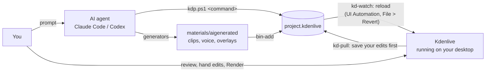

<div align="center">

# Movie Engine

**Một agent AI dựng video của bạn trong Kdenlive ngay trước mắt bạn, và bạn có thể tiếp quản bất cứ lúc nào.**

Các agent AI lập trình (Claude Code, Codex) tạo và chỉnh sửa những dự án Kdenlive thật: phim, video giải thích và video dọc ngắn. Các thay đổi hiện ra trực tiếp trong trình biên tập bạn đang mở. Di động (portable), chạy trên Windows, không vá trình biên tập.


[English](../../README.md) · [简体中文](README.zh-CN.md) · [繁體中文](README.zh-TW.md) · [हिन्दी](README.hi.md) · [Español](README.es.md) · [Français](README.fr.md) · [العربية](README.ar.md) · [বাংলা](README.bn.md) · [Português](README.pt.md) · [Русский](README.ru.md) · [اردو](README.ur.md) · [Bahasa Indonesia](README.id.md) · [Deutsch](README.de.md) · [日本語](README.ja.md) · [Türkçe](README.tr.md) · [한국어](README.ko.md) · [Українська](README.uk.md) · [Italiano](README.it.md) · [Polski](README.pl.md) · **Tiếng Việt** · [فارسی](README.fa.md) · [ไทย](README.th.md) · [Kiswahili](README.sw.md) · [አማርኛ](README.am.md) · [Avañe'ẽ](README.gn.md) · [Setswana](README.tn.md)

*Đây là bản dịch; bản README tiếng Anh là bản tham chiếu chính thức.*

</div>

---

## Mục lục

- [Tại sao](#tại-sao)
- [Cách hoạt động](#cách-hoạt-động)
- [Tính năng](#tính-năng)
- [Yêu cầu](#yêu-cầu)
- [Cài đặt](#cài-đặt)
- [Bắt đầu nhanh](#bắt-đầu-nhanh)
- [Làm việc với agent](#làm-việc-với-agent)
- [Dòng lệnh biên tập (`kdp.ps1`)](#dòng-lệnh-biên-tập-kdpps1)
- [Đồng bộ trực tiếp với trình biên tập đang mở](#đồng-bộ-trực-tiếp-với-trình-biên-tập-đang-mở)
- [Bộ tạo: những gì Kdenlive không làm được](#bộ-tạo-những-gì-kdenlive-không-làm-được)
- [Lồng tiếng và âm thanh](#lồng-tiếng-và-âm-thanh)
- [Ngôn ngữ giao diện](#ngôn-ngữ-giao-diện)
- [Cấu trúc thư mục](#cấu-trúc-thư-mục)
- [Kiểm thử và bằng chứng](#kiểm-thử-và-bằng-chứng)
- [Hạn chế](#hạn-chế)
- [Khắc phục sự cố](#khắc-phục-sự-cố)
- [Câu hỏi thường gặp](#câu-hỏi-thường-gặp)
- [Đóng góp](#đóng-góp)
- [Lời cảm ơn](#lời-cảm-ơn)
- [Giấy phép](#giấy-phép)

## Tại sao

Trình biên tập video được làm cho bàn tay cầm chuột. Agent AI thì giỏi về cấu trúc, căn thời gian và những việc lặp đi lặp lại: đặt 300 clip theo nhịp nhạc, khớp từng dòng phụ đề với giọng đọc, làm lại một cảnh sau khi nhận góp ý. Nhưng chúng không thể bấm qua giao diện đồ họa mà không chiếm lấy màn hình của bạn.

Kdenlive là một trình biên tập mã nguồn mở mạnh, nhưng trên Windows nó **không có API tự động hóa**: điều khiển qua D-Bus chỉ có trong các bản dựng cho Linux, còn những bản fork bổ sung API thì hoặc đã bị bỏ dở, hoặc không an toàn. Movie Engine giải quyết vấn đề này mà không cần vá trình biên tập:

1. Agent chỉnh sửa tệp dự án `.kdenlive` qua một dòng lệnh đã được kiểm thử (`engine/kdp.ps1`).
2. Kdenlive đang chạy được yêu cầu tải lại tệp thông qua Windows UI Automation, không gõ phím, không dùng chuột và không giành focus.
3. Các chỉnh sửa chưa lưu của bạn được lưu trước và không bao giờ bị ghi đè.

Vậy là agent dựng còn bạn duyệt, hoặc bạn tự tay chỉnh. Cả hai cùng làm trên một dự án, trong cùng một trình biên tập, cùng một lúc.

## Cách hoạt động



Mọi lệnh biên tập đều đi theo cùng một chu trình an toàn:

1. **Pull.** Nếu Kdenlive có thay đổi chưa lưu, nó được yêu cầu lưu lại (nút Save trên thanh công cụ qua UI Automation), và việc lưu được xác nhận.
2. **Chỉnh sửa.** Lệnh thay đổi XML dưới một khóa, sau khi kiểm tra hash và kèm một bản chụp để hoàn tác. Nếu tệp đã thay đổi trong lúc đó, không có gì được ghi.
3. **Tải lại.** Watcher nhận ra dấu mà AI để lại và chạy File > Revert trong trình biên tập đang mở. Chỉ tính là thành công khi widget timeline thực sự được dựng lại.
4. **Xung đột.** Nếu bạn bắt đầu chỉnh sửa giữa chừng, không có gì được tải lại và công việc của bạn được giữ nguyên. Phiên bản của AI được cất sang một bên, và agent áp dụng lại thay đổi của mình lên trên thay đổi của bạn.

## Tính năng

- **Biên tập dự án đầy đủ mà không cần giao diện**: khoảng 120 lệnh bao quát kho dự án (bin), timeline, hiệu ứng, phép ghép (composition), track, đường dẫn hướng, marker, phụ đề, sequence, tốc độ và ánh xạ lại thời gian, trình chiếu, tiêu đề, proxy, kết xuất và hoàn tác/làm lại. Xem [tài liệu tham khảo lệnh](#dòng-lệnh-biên-tập-kdpps1).
- **Đồng bộ trực tiếp với trình biên tập đang mở.** Chỉnh sửa của AI hiện ra trong chính Kdenlive bạn đang nhìn; chỉnh sửa chưa lưu của bạn được lưu trước và không bao giờ mất.
- **Không bao giờ làm phiền màn hình của bạn.** Không giành focus, không gõ phím, không điều khiển chuột. Các trình biên tập dùng để kiểm thử chạy trên một màn hình Windows ẩn.
- **Di động.** Trình biên tập, thiết lập, Node.js, phông chữ và công cụ nằm trong một thư mục. Sao chép nó sang máy khác là chạy được; không có gì được ghi vào Program Files hay hồ sơ Windows của bạn.
- **Bộ tạo cho những gì Kdenlive không làm được**: chữ chuyển động theo từng ký tự, chú thích vẽ tay, cảnh giao diện 3D, hoạt ảnh con trỏ và những phim "giải thích" tương tác dài. Chúng được kết xuất trên GPU với hiệu ứng nhòe chuyển động thật và được đặt lên timeline như những clip bình thường.
- **Lồng tiếng kèm thời điểm của từng từ** (Microsoft Edge TTS, không cần khóa API). Phụ đề và hành động kích hoạt đúng vào từ cần thiết.
- **Hiệu ứng âm thanh tổng hợp** (whoosh, click, pop, riser, impact và nhiều hơn nữa), được tạo bằng mã.
- **Đã chứng minh, không phải giả định.** Mỗi lệnh đều có bước kiểm tra kết quả, các hiệu ứng và phép ghép được kiểm lần lượt từng cái, và kết quả thô nằm trong `docs/proof/`.
- **Kèm sẵn hướng dẫn cho agent.** `AGENTS.md` và các skill trong `.claude/skills/` dạy Claude Code và Codex quy trình làm việc, định dạng tệp và những cạm bẫy.

## Yêu cầu

| | |
|---|---|
| Hệ điều hành | Windows 10 hoặc 11, x64 |
| Trình biên tập | Kdenlive **26.08.3**, bản dựng di động (standalone). Các phiên bản khác chưa được kiểm thử. |
| Node.js | 18 trở lên: tệp `.zip` Windows x64 từ nodejs.org, giải nén vào `engine/node/` |
| Trình duyệt | Microsoft Edge (có sẵn trong Windows); được các trình kết xuất cảnh dùng ở chế độ headless |
| Agent | [Claude Code](https://claude.com/claude-code) hoặc Codex. Không bắt buộc: mọi công cụ đều có thể chạy bằng tay. |
| Ổ đĩa | khoảng 1 GB cho trình biên tập và công cụ, cộng với dữ liệu media của bạn |
| GPU | bất kỳ GPU nào có mã hóa H.264 bằng phần cứng đều giúp `film-render.mjs` nhanh hơn (nếu không có, nó chuyển sang mã hóa bằng phần mềm) |

## Cài đặt

Mọi thứ được cài **bên trong thư mục**. Không cần quyền quản trị.

```powershell
git clone https://github.com/vladtarrow/movie-engine.git
cd movie-engine
```

**1. Node.js.** Tải tệp `.zip` Windows x64 của Node.js 18 trở lên từ <https://nodejs.org/en/download> và giải nén nội dung của nó vào `engine\node\`, sao cho có `engine\node\node.exe` và `engine\node\npm.cmd` ở đó. Không cần trình cài đặt và không cần Node của hệ thống. Mọi script đều chạy qua `engine\node.cmd`, không bao giờ qua Node của hệ thống.

**2. Các gói Node** cho công cụ lồng tiếng và các trình kết xuất (phiên bản được cố định trong `engine/voice/package.json`):

```powershell
engine\node\npm.cmd install --prefix engine\voice
```

**3. Kdenlive 26.08.3 bản di động.** Tải `kdenlive-26.08.3_standalone.exe` từ <https://download.kde.org/stable/kdenlive/26.08/windows/> vào `engine\installer\`, kiểm tra rồi giải nén:

```powershell
(Get-FileHash engine\installer\kdenlive-26.08.3_standalone.exe -Algorithm SHA256).Hash
# expected: A25427B1DFF2C17E3B0386E991BB1A719382BB3176D1A90E441CDAEB6E0A967D
engine\installer\kdenlive-26.08.3_standalone.exe -o"engine\Kdenlive" -y
```

Trình biên tập sẽ nằm trong `engine\Kdenlive\kdenlive-26.08.3_standalone\bin\`. Nó đã có sẵn `melt.exe` và `ffmpeg.exe`.

**4. Khởi động lần đầu.**

```powershell
engine\kdenlive.cmd
```

Kdenlive giữ toàn bộ thiết lập của nó trong `engine\profile-kdenlive\`, không phải trong hồ sơ Windows của bạn. Ở lần khởi động đầu tiên, nó hiển thị một trình hướng dẫn thiết lập một lần.

## Bắt đầu nhanh

### Với một agent

Mở thư mục trong Claude Code (hoặc Codex) và yêu cầu bằng lời lẽ bình thường:

> Tạo một dự án dọc mới 30 fps tên "launch-teaser". Đặt ba ảnh chụp màn hình từ `materials/designers/launch/` lên timeline, mỗi ảnh 2,5 giây với một chuyển cảnh hòa tan ngắn, thêm lồng tiếng từ `script.txt` và khớp một dòng chữ chuyển động với từng câu.

> Mở nó trong Kdenlive cho tôi.

> Cảnh thứ hai dài quá. Cắt xuống còn 1,8 giây và đẩy logo lên cao một chút.

Agent làm theo `AGENTS.md`: nó chỉnh sửa qua `kdp.ps1`, chỉ kết xuất những clip mà bản dựng cần, và giữ trình biên tập đang mở luôn đồng bộ. Bạn duyệt trong Kdenlive, tự tay chỉnh bất cứ khi nào muốn, và nhấn Render khi đã hài lòng.

### Bằng tay

```powershell
# a new 1080x1920 30 fps project with 2 video and 2 audio tracks
powershell -NoProfile -ExecutionPolicy Bypass -File engine\kdp.ps1 new -Project projects\hello\hello.kdenlive -Profile vertical_hd_30

# a 3-second title and a colour background
powershell -NoProfile -ExecutionPolicy Bypass -File engine\kdp.ps1 bin-color -Project projects\hello\hello.kdenlive -Color '#203060' -Seconds 3 -Name bg
powershell -NoProfile -ExecutionPolicy Bypass -File engine\kdp.ps1 title -Project projects\hello\hello.kdenlive -Text "Hello" -Seconds 3 -Name hi

# place them: background on V1, title above it on V2
powershell -NoProfile -ExecutionPolicy Bypass -File engine\kdp.ps1 add -Project projects\hello\hello.kdenlive -Bin bg -Track V1 -At 0
powershell -NoProfile -ExecutionPolicy Bypass -File engine\kdp.ps1 add -Project projects\hello\hello.kdenlive -Bin hi -Track V2 -At 0

# a check frame, then open it in the editor
powershell -NoProfile -ExecutionPolicy Bypass -File engine\kdp.ps1 frame -Project projects\hello\hello.kdenlive -At 1.5 -Out out\hello\check.png
engine\kdenlive.cmd projects\hello\hello.kdenlive
```

Để mở lại dự án gần nhất về sau, hãy nhấp đúp vào `open-last-project.cmd`.

## Làm việc với agent

Agent đọc `AGENTS.md` (Codex) hoặc `CLAUDE.md`, tệp này nhập lại `AGENTS.md` (Claude Code), cùng với hai skill:

| Skill | Dạy gì |
|---|---|
| `.claude/skills/kdenlive-project-file` | định dạng `.kdenlive` / MLT XML, `kdp.ps1`, kiểm tra bằng `melt` |
| `.claude/skills/kdenlive-live` | điều khiển an toàn trình biên tập đang chạy: khởi động, pull, tải lại, chụp cửa sổ của nó |

Những quy tắc agent tuân theo, mà bạn có thể tin cậy:

- Nó không bao giờ chiếm chuột, bàn phím hay focus của bạn, và không bao giờ chụp màn hình desktop của bạn (chỉ chụp cửa sổ riêng của trình biên tập).
- Nó tự thực hiện các bước trên giao diện (lưu, mở, tải lại) thay vì nhờ bạn bấm.
- Nó hỏi trước khi tải xuống bất cứ thứ gì và trước khi xóa bất cứ thứ gì.
- Nó chỉ kết xuất những gì công việc cần (clip cảnh, khung hình kiểm tra). Nó chỉ kết xuất phim hoàn chỉnh khi bạn yêu cầu.
- Khi Kdenlive không làm tốt một việc nào đó, agent dựng phần đó bên ngoài bằng mã và đưa kết quả vào dưới dạng một clip. Nó không làm nhạt hiệu ứng đi.

## Dòng lệnh biên tập (`kdp.ps1`)

```powershell
powershell -NoProfile -ExecutionPolicy Bypass -File engine\kdp.ps1 <command> -Project <file.kdenlive> [options]
```

Thời gian tính bằng giây, dùng dấu chấm (`2.5`). Các track là `V1 V2 …` (V1 nằm dưới cùng) và `A1 A2 …`. Một clip được xác định bằng `-Track` cộng với bất kỳ thời điểm `-At` nào nằm trong nó. Tham số hiệu ứng đặt trong `-Params "name=value||name=value"`. Danh sách đầy đủ với mọi tùy chọn nằm ở phần đầu của `engine/kdp.ps1`.

| Nhóm | Lệnh |
|---|---|
| Dự án | `new`, `profiles`, `info`, `validate`, `fonts`, `profile-set`, `profile-from-clip`, `zone`, `archive`, `backups`, `rebase`, `otio-export`, `otio-import` |
| Kho dự án (bin) | `bin-add`, `bin-color`, `title`, `title-text`, `title-save`, `title-template`, `bin-rename`, `bin-remove`, `bin-info`, `bin-set`, `bin-duplicate`, `bin-replace-file`, `bin-reload`, `folder`, `bin-folder`, `relink`, `clean`, `generator`, `playlist-clip`, `extract-audio`, `transcode` |
| Timeline | `add`, `add-av`, `move`, `copy`, `trim`, `ripple-trim`, `slip`, `split`, `remove`, `speed`, `remap`, `disable`, `enable`, `group`, `ungroup`, `mix`, `unmix`, `space-insert`, `space-remove`, `spaces-remove-all`, `track-clear`, `replace-in-timeline` |
| Hiệu ứng | `effects`, `effect-info`, `effect-add`, `effect-list`, `effect-set`, `effect-remove`, `effect-copy`, `effect-clear`, `effects-all`, `bin-effect`, `effect-templates`, `effect-template` |
| Phép ghép | `compositions`, `comp-info`, `comp-add`, `comp-list`, `comp-set`, `comp-remove` |
| Track | `track-add`, `track-remove`, `track-set` |
| Đường dẫn hướng và marker | `guide-add`, `guide-list`, `guide-remove`, `guide-set`, `guide-clear`, `guide-export`, `guide-category`, `marker`, `marker-list`, `marker-set`, `marker-remove` |
| Phụ đề | `sub-add`, `sub-import`, `sub-export`, `sub-state` |
| Sequence | `sequence-add`, `sequences`, `copy-to-sequence`, `expand`; mọi lệnh có `-Sequence <name>` đều hoạt động bên trong sequence đó |
| Đặc biệt | `slideshow`, hoạt ảnh Lottie / Glaxnimate qua `bin-add`, `proxy`, `stabilize`, `scene-split`, `speed-job`, `subclip` |
| Đầu ra | `frame` (một ảnh PNG), `preview` (kết xuất nhanh bằng melt), `render` (trình kết xuất riêng của Kdenlive hoặc một preset), `presets` |
| Lịch sử | `undo`, `redo`, `clear-history` (bản chụp trong `projects/<name>/.kdp-history`) |

Những hành vi nên biết:

- Hai nửa âm thanh và hình ảnh được liên kết sẽ cùng được di chuyển, cắt tỉa, chia tách và xóa (`-Alone` để chỉ tác động một nửa).
- Một lệnh thất bại sẽ thoát với mã 1 và không ghi gì cả.
- Các hiệu ứng mà bản dựng Windows không chạy được sẽ bị từ chối, chứ không bị lặng lẽ bỏ qua (danh sách: `docs/proof/assets.txt`).
- Mọi hành động trong menu của Kdenlive đều được ánh xạ tới một lệnh, một cách khác, hoặc "chỉ xem" trong `engine/tools/data/kdenlive-actions.csv`. Xem `docs/kdenlive-coverage.md`.

## Đồng bộ trực tiếp với trình biên tập đang mở

| Script | Chức năng | Mã thoát |
|---|---|---|
| `engine\kd-pull.ps1 -Project <f>` | yêu cầu Kdenlive lưu chỉnh sửa của bạn và xác nhận điều đó | 0 tệp đã cập nhật, 3 không chạy, 4 chưa xác nhận |
| `engine\kd-reload.ps1 -Project <f>` | File > Revert, được xác nhận bằng timeline đã dựng lại | 0 đã xác nhận, 2 bạn có chỉnh sửa chưa lưu (không có gì bị hủy), 3 không chạy, 4 thất bại |
| `engine\kd-watch.ps1 -Project <f>` | watcher chạy nền: tải lại sau mỗi lần AI ghi, ghi nhật ký xung đột | nhật ký trong `engine\kd-watch.log`; xóa `engine\kd-watch.run` để dừng |
| `engine\kdenlive-bg.ps1 [project]` | khởi động Kdenlive ở dạng thu nhỏ cho agent | 0 đã tải, 4 chưa xác nhận |
| `engine\kdenlive.cmd [project]` | khởi động Kdenlive cho bạn | |

Khởi động watcher một lần cho mỗi phiên làm việc:

```powershell
Start-Process powershell -WindowStyle Hidden -ArgumentList '-NoProfile','-ExecutionPolicy','Bypass','-File','engine\kd-watch.ps1','-Project','projects\hello\hello.kdenlive'
```

Dự án lớn: tải lại một dự án 1000 clip mất vài phút, và các công cụ chờ cho xong thay vì báo kết quả sớm. Dự án được mở qua *File > Open Recent* trên một trình biên tập trống, vì mở trực tiếp một tệp khiến Qt duyệt qua từng phần tử trên timeline cho tính năng trợ năng, và cách đó chậm hơn khoảng 10 phút.

## Bộ tạo: những gì Kdenlive không làm được

Kdenlive/MLT không có hoạt ảnh chữ theo từng ký tự, không có biểu thức (expressions) và rất ít 3D, còn các hiệu ứng nặng làm chậm việc phát lại. Movie Engine kết xuất những phần như vậy ở bên ngoài và đặt chúng lên timeline như những clip bình thường, thường có kênh alpha, trên một track nằm phía trên hình ảnh. Script của bộ tạo và dữ liệu đầu vào của nó nằm lại trong thư mục dự án, nên có thể tạo lại clip khi chữ, phông chữ hay thời gian thay đổi.

| Công cụ | Tạo ra |
|---|---|
| `engine/tools/kinetic-text.ps1` | phụ đề chuyển động theo từng ký tự, mỗi từ được căn thời gian theo `voice.json`, hộp làm nổi bật |
| `engine/tools/annotate.ps1` | vòng tròn, khung, gạch chân và mũi tên vẽ tay, tự vẽ dần lên trên ảnh chụp màn hình |
| `engine/tools/card-entrance.ps1` | một tấm thẻ ảnh chụp màn hình trồi lên và phóng to dần với bóng đổ mềm |
| `engine/tools/pdf-to-png.ps1` | các slide từ một bản xuất PDF |
| `engine/tools/html-render.mjs` | bất kỳ cảnh HTML/CSS/canvas nào thành video: hoạt ảnh giao diện, con trỏ, 3D, mặt nạ |
| `engine/tools/film-render.mjs` + `film/` | phim giải thích tương tác dài trên canvas: mỗi câu lồng tiếng là một clip, hành động kích hoạt theo từ được nói, nhòe chuyển động trên GPU ở khoảng 45 fps |

Cả hai trình kết xuất đều điều khiển Microsoft Edge có sẵn trong Windows ở chế độ headless, với một hồ sơ dùng một lần và không có truy cập mạng.

### Demo

```powershell
# a 3-second 3D title card with a cursor click
engine\node.cmd engine\tools\html-render.mjs examples\demo\scene\scene.html examples\demo\out --frames 0,30,60,89
engine\node.cmd engine\tools\html-render.mjs examples\demo\scene\scene.html examples\demo\out\scene.mp4

# a 4-shot interactive film timed to two voice lines
engine\node.cmd engine\tools\film-render.mjs examples\demo\film\film.html examples\demo\out --check
engine\node.cmd engine\tools\film-render.mjs examples\demo\film\film.html examples\demo\out --shots all --width 640
engine\node.cmd engine\tools\film-render.mjs examples\demo\film\film.html examples\demo\out\clips --suffix -v01
```

Một phim gồm ba tệp nhỏ. `data.js` chứa các cảnh quay và thời điểm của các từ. `direction.js` có một dòng cho mỗi cảnh quay:

```text
1 | hover 192 108 @brand | tag 300 60 Your brand @deserves | confetti 192 90 @film
2 say=A film that/*explains* it
3 | click 116 108 @before | click 268 108 @after | chips Before~After @after
4 scene=counter | count 0 120 % @count
```

`scenes.js` chứa những cảnh quay được vẽ từ đầu. `@word` kích hoạt một hành động khi giọng đọc nói đến từ đó. Các hành động gồm click, hover, drag, zoom, lens, ring, arrow, chips, toggle, slider, toast, type, count và confetti; cú pháp đầy đủ nằm ở đầu tệp `engine/tools/film/film-kit.js`.

## Lồng tiếng và âm thanh

```powershell
engine\node.cmd engine\voice\voice.mjs lines.json materials\aigenerated\hello\voice en-US-AndrewMultilingualNeural +0%
```

`lines.json` là một danh sách các câu. Công cụ ghi ra một tệp mp3 cho mỗi câu cùng với `voice.json`, chứa thời lượng và điểm bắt đầu, kết thúc của từng từ. Các câu được lưu vào bộ nhớ đệm, nên khi đổi một câu thì chỉ câu đó được tạo lại. Công cụ dùng dịch vụ chuyển văn bản thành giọng nói trực tuyến của Microsoft Edge qua gói `msedge-tts`: không cần khóa, nhưng dịch vụ này không chính thức và cần có internet.

```powershell
engine\node.cmd engine\audio\sfx.mjs materials\aigenerated\sfx
```

Lệnh này tổng hợp bằng mã các âm whoosh, whoosh-long, swipe, click, pop, tick, riser, impact, ding và reveal; một bộ có sẵn nằm trong `materials/aigenerated/sfx/`. Với những âm ngắn hơn một khung hình, hãy chèn thêm khoảng lặng trước khi đặt chúng lên timeline (`-af apad=whole_dur=0.0667`).

## Ngôn ngữ giao diện

Theo mặc định, các trình khởi chạy mở Kdenlive bằng **tiếng Anh**. Để dùng ngôn ngữ khác, hãy đặt `MOVIE_ENGINE_UI_LANG` trước khi khởi động:

```powershell
$env:MOVIE_ENGINE_UI_LANG = 'ru'; engine\kdenlive.cmd
```

UI Automation tìm các mục menu theo tên hiển thị của chúng. Tên cho 31 ngôn ngữ giao diện đã có sẵn (`engine/tools/kd-ui.ps1`, `$KdNames`). Với bất kỳ ngôn ngữ nào khác, hãy thêm tên của ngôn ngữ đó vào đây rồi kiểm tra bằng:

```powershell
powershell -NoProfile -ExecutionPolicy Bypass -File engine\tools\kd-langcheck.ps1
```

## Cấu trúc thư mục

```text
movie-engine/
├─ AGENTS.md, CLAUDE.md          instructions for AI agents
├─ .claude/skills/               agent skills: project file format, live editor
├─ engine/
│  ├─ kdp.ps1                    the editing command line
│  ├─ kd-pull / kd-reload / kd-watch .ps1, kdenlive.cmd, kdenlive-bg.ps1
│  ├─ tools/                     internals, generators, tests, data (action map)
│  ├─ voice/  audio/  fonts/     TTS, synthesized SFX, Poppins (OFL)
│  ├─ Kdenlive/  node/           portable editor and Node.js (not in git)
│  └─ profile-kdenlive/          the editor's settings (not in git)
├─ projects/<name>/<name>.kdenlive
├─ materials/
│  ├─ download/                  stock and downloaded files (not in git)
│  ├─ aigenerated/               everything the AI made (sfx/ and test-kit/ ship with the engine)
│  ├─ designers/  brand/         files from your team, brand assets
├─ examples/demo/                demos of the scene and film renderers
├─ out/                          renders (not in git)
└─ docs/                         proofs, coverage, translations of this README
```

Đường dẫn media bên trong dự án là đường dẫn tương đối. Nếu bạn di chuyển hoặc sao chép thư mục, `kdp.ps1 rebase` (cũng được `kdenlive.cmd` tự động chạy) sẽ ghi vị trí mới vào dự án.

## Kiểm thử và bằng chứng

Những khẳng định về những gì hoạt động được đều dựa trên việc kiểm tra kết quả, chứ không phải dựa vào việc "hàm đã chạy". Bản tóm tắt nằm trong [`docs/kdenlive-proof.md`](../../docs/kdenlive-proof.md), còn đầu ra thô nằm trong `docs/proof/`.

| Kiểm thử | Kiểm tra gì |
|---|---|
| `engine\tools\kdp-clitest.ps1` | mọi lệnh của `kdp.ps1`, chạy qua dòng lệnh, so sánh dự án thu được |
| `engine\tools\kd-livetest.ps1` | pull, tải lại, watcher, xung đột và tranh chấp (race) với một Kdenlive thật trên một màn hình ẩn |
| `engine\tools\kdp-assetsweep.ps1` | mọi hiệu ứng và phép ghép: kết xuất và so sánh khung hình |
| `engine\tools\kdp-portabletest.ps1` | sao chép thư mục sang chỗ khác và làm việc từ bản sao |
| `engine\tools\kd-langcheck.ps1` | ngôn ngữ giao diện và việc UI Automation tìm được menu |
| `engine\tools\kdp-coverage-check.ps1` | mọi hành động menu đều được ánh xạ, và không bằng chứng nào cũ hơn mã |

```powershell
powershell -NoProfile -ExecutionPolicy Bypass -File engine\tools\kdp-clitest.ps1 -Report docs\proof\clitest.txt
powershell -NoProfile -ExecutionPolicy Bypass -File engine\tools\kd-livetest.ps1 -Report docs\proof\live-en.txt
```

Các trình biên tập dùng để kiểm thử chỉ chạy trên một màn hình ẩn với hồ sơ riêng, nên các bài kiểm thử không bao giờ đụng tới Kdenlive bạn đang mở hay focus của bạn.

## Hạn chế

- **Chỉ Windows**, chỉ Kdenlive **26.08.3**. Linux có D-Bus và sẽ cần một cầu nối khác.
- Khi khởi động, trình biên tập chiếm focus bàn phím khoảng 3 giây trong lúc cửa sổ trống hiện ra. Agent sẽ hỏi trước khi khởi động nó trong lúc bạn đang làm việc. Việc tải lại và chỉnh sửa không chiếm focus.
- Bản dựng Windows thiếu các mô-đun MLT sox, ladspa và movit cùng một số hiệu ứng frei0r/avfilter; `kdp.ps1` từ chối chúng (`docs/proof/assets.txt`).
- Xuất và nhập OpenTimelineIO chỉ mang theo clip và khoảng trống. Multicam không có chuyển góc quay trực tiếp (các điểm cắt được làm bằng split/remove/hide).
- "Save As…" qua UI Automation trên một cửa sổ đang thu nhỏ không mở hộp thoại nào; thay vào đó agent dùng `archive` hoặc sao chép tệp.
- Nhận dạng giọng nói (phụ đề tự động) cần Whisper hoặc Vosk, vốn không đi kèm.
- Tiêu đề làm bằng công cụ tiêu đề của Kdenlive dùng phông chữ cài trong Windows. Để đảm bảo kiểu chữ, hãy kết xuất chữ bằng các bộ tạo, vốn tải phông chữ từ `engine/fonts/`.
- Edge TTS là một dịch vụ trực tuyến không chính thức và có thể thay đổi hoặc ngừng hoạt động.

## Khắc phục sự cố

| Triệu chứng | Nguyên nhân và cách khắc phục |
|---|---|
| Kdenlive đang chạy, nhưng bấm vào nó trên thanh tác vụ không hiện gì | Vị trí cửa sổ đã lưu của nó nằm ngoài màn hình. Đóng nó lại và xóa các mục `kdockLayout` trong `engine\profile-kdenlive\AppData\Local\kdenliverc`, hoặc di chuyển cửa sổ bằng `SetWindowPos` (xem `AGENTS.md`). |
| `kd-reload.ps1` thoát với mã 2 | Bạn có chỉnh sửa chưa lưu. Không có gì bị hủy. Chạy `kd-pull.ps1`, rồi áp dụng lại thay đổi (`kdp.ps1` tự làm việc này). |
| `CONFLICT` trong `engine\kd-watch.log` | Bạn và agent chỉnh sửa cùng một lúc. Phiên bản của bạn được giữ trong trình biên tập, còn phiên bản của AI nằm trong `projects\<name>\.kdp-history\<name>\conflict\`. Hãy nhờ agent áp dụng lại thay đổi của nó. |
| Một lệnh thoát với mã 1 và thông báo "pull not confirmed" | Kdenlive đang bận hoặc đang hiện một hộp thoại. Đóng hộp thoại hoặc chờ tải xong, rồi thử lại. |
| Một script PowerShell không phân tích được | Các script có văn bản không phải ASCII phải được lưu ở dạng UTF-8 **có BOM** cho Windows PowerShell 5.1. |
| `voice.mjs` dừng với thông báo "Stream closed before the synthesis completed" | Thường là do lỗi mạng, hoặc SSML chưa được thoát ký tự trong các bản sao cũ. `voice.mjs` tự thoát `& < >`. |
| Mở một dự án lớn mất nhiều phút | Hãy mở qua `kdenlive.cmd` / `kdenlive-bg.ps1`, không bao giờ mở theo kiểu `kdenlive.exe project.kdenlive`. |

## Câu hỏi thường gặp

**Tôi có cần Claude Code hoặc Codex không?**
Không. Mọi công cụ đều là script thông thường mà bạn có thể chạy bằng tay. Agent là thứ làm mọi việc nhanh hơn: nó lên kế hoạch dựng, chạy các công cụ và giữ trình biên tập luôn đồng bộ.

**Agent có ghi đè các chỉnh sửa thủ công của tôi không?**
Không. Trước mỗi lần ghi, các chỉnh sửa chưa lưu của bạn được lưu lại và xác nhận. Nếu bạn chỉnh sửa trong lúc agent đang ghi, lần ghi đó bị từ chối hoặc được cất sang một bên dưới dạng xung đột, không bao giờ được áp lên trên công việc của bạn.

**Tôi có thể tiếp tục dùng Kdenlive như bình thường không?**
Có. Đây là Kdenlive nguyên bản với thư mục thiết lập riêng. Hãy dựng, xem trước và kết xuất như thường lệ.

**Nó có hoạt động với Kdenlive tôi đã cài sẵn không?**
Nó dùng bản sao di động riêng trong `engine\Kdenlive\`, nên Kdenlive bạn đã cài và các thiết lập của nó không bị đụng tới.

**Sao không dùng một bản fork Kdenlive có API, hoặc một trình biên tập khác?**
Trên Windows không có bản fork nào vừa được duy trì vừa an toàn (khảo sát tháng 11/2026). OpenShot, Blender VSE, DaVinci Resolve, Shotcut và các trình biên tập trên web đã được đánh giá; Kdenlive cho chiều sâu biên tập tốt nhất. Một đề xuất REST API ở dự án gốc (merge request !902) đang được theo dõi.

**Nó có kết xuất được video hoàn chỉnh không?**
Có, bằng `kdp.ps1 render` (trình kết xuất riêng của Kdenlive, chạy ẩn), hoặc bạn tự nhấn Render trong trình biên tập.

**Media của tôi có bị tải lên đâu không?**
Không. Chỉ có văn bản lồng tiếng được gửi tới dịch vụ Edge TTS khi bạn tạo giọng đọc. Các trình kết xuất cảnh chạy với mạng bị tắt.

## Đóng góp

Mọi đóng góp đều được hoan nghênh. Xem [CONTRIBUTING.md](../../CONTRIBUTING.md). Tóm lại:

- Mỗi thao tác `kdp.ps1` mới hoặc được thay đổi cần có một bước kiểm tra kết quả trong `kdp-clitest.ps1`, một mục trong bản đồ hành động, và một lần chạy mới `kdp-coverage-check.ps1`.
- Không bao giờ khởi động một Kdenlive kiểm thử trên màn hình đang hiển thị; hãy dùng `engine/tools/kd-hidden.ps1`.
- Giữ mọi thứ di động: không cài đặt gì bên ngoài thư mục, không dùng đường dẫn tuyệt đối trong dự án.
- Ghi lại các điểm khác thường đã được xác minh vào `AGENTS.md` hoặc skill tương ứng.

## Lời cảm ơn

- [Kdenlive](https://kdenlive.org) và [MLT](https://www.mltframework.org): trình biên tập và bộ máy bên dưới nó.
- [FFmpeg](https://ffmpeg.org), đi kèm với Kdenlive.
- [msedge-tts](https://www.npmjs.com/package/msedge-tts) cho phần lồng tiếng.
- [Poppins](https://fonts.google.com/specimen/Poppins) của Indian Type Foundry, SIL Open Font License (`engine/fonts/OFL.txt`).
- `engine/tools/data/kdenliveui-26.08.3.rc`: tệp menu của Kdenlive, lấy từ mã nguồn Kdenlive 26.08.3; chỉ được dùng bởi bước kiểm tra độ bao phủ. Tệp này vẫn thuộc giấy phép GPL của Kdenlive, không thuộc Giấy phép MIT.

## Giấy phép

Mã nguồn riêng của Movie Engine được phát hành theo [Giấy phép MIT](../../LICENSE). Kdenlive, MLT, FFmpeg, các gói Node.js và phông chữ Poppins giữ nguyên giấy phép riêng của chúng.
