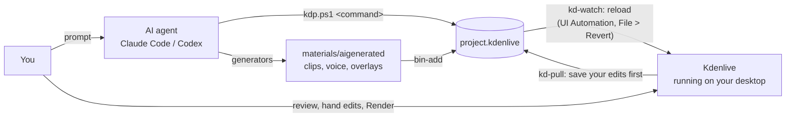

<div align="center">

# Movie Engine

**Iarhente ye-AI ihlela ividiyo yakho kwi-Kdenlive ngelixa ubukele, kwaye ungayithatha nangaliphi na ixesha.**

Iiarhente ze-AI ezibhala ikhowudi (Claude Code, Codex) zakha kwaye zitshintshe iiprojekthi zokwenene ze-Kdenlive: iifilimu, iividiyo ezicacisayo ("explainers") neevidiyo ezimfutshane ezithe nkqo ("shorts"). Utshintsho luvela ngoko nangoko kwisihleli osivulileyo. Iphathekayo (portable), i-Windows, akukho kutshintshwa kwekhowudi yesihleli.


[English](../../README.md) · [简体中文](README.zh-CN.md) · [繁體中文](README.zh-TW.md) · [हिन्दी](README.hi.md) · [Español](README.es.md) · [Français](README.fr.md) · [العربية](README.ar.md) · [বাংলা](README.bn.md) · [Português](README.pt.md) · [Русский](README.ru.md) · [اردو](README.ur.md) · [Bahasa Indonesia](README.id.md) · [Deutsch](README.de.md) · [日本語](README.ja.md) · [Türkçe](README.tr.md) · [한국어](README.ko.md) · [Українська](README.uk.md) · [Italiano](README.it.md) · [Polski](README.pl.md) · [Tiếng Việt](README.vi.md) · [فارسی](README.fa.md) · [ไทย](README.th.md) · [Kiswahili](README.sw.md) · [አማርኛ](README.am.md) · [Avañe'ẽ](README.gn.md) · [Setswana](README.tn.md) · [Shqip](README.sq.md) · [Беларуская](README.be.md) · [Български](README.bg.md) · [Bosanski](README.bs.md) · [Hrvatski](README.hr.md) · [Српски](README.sr.md) · [Crnogorski](README.cnr.md) · [Македонски](README.mk.md) · [Slovenščina](README.sl.md) · [Slovenčina](README.sk.md) · [Čeština](README.cs.md) · [Magyar](README.hu.md) · [Română](README.ro.md) · [Dansk](README.da.md) · [Norsk bokmål](README.nb.md) · [Norsk nynorsk](README.nn.md) · [Svenska](README.sv.md) · [Íslenska](README.is.md) · [Suomi](README.fi.md) · [Eesti](README.et.md) · [Latviešu](README.lv.md) · [Lietuvių](README.lt.md) · [Nederlands](README.nl.md) · [Lëtzebuergesch](README.lb.md) · [Rumantsch](README.rm.md) · [Ελληνικά](README.el.md) · [Malti](README.mt.md) · [Gaeilge](README.ga.md) · [Català](README.ca.md) · [ქართული](README.ka.md) · [Հայերեն](README.hy.md) · [Azərbaycanca](README.az.md) · [Afrikaans](README.af.md) · [isiZulu](README.zu.md) · **isiXhosa** · [Sesotho](README.st.md) · [Sepedi](README.nso.md) · [Xitsonga](README.ts.md) · [Tshivenḓa](README.ve.md) · [siSwati](README.ss.md) · [isiNdebele (South Africa)](README.nr.md) · [isiNdebele (Zimbabwe)](README.nd.md) · [chiShona](README.sn.md) · [Chichewa](README.ny.md) · [Ikinyarwanda](README.rw.md) · [Ikirundi](README.rn.md) · [Malagasy](README.mg.md) · [Soomaali](README.so.md) · [Afaan Oromoo](README.om.md) · [Qafar af](README.aa.md) · [ትግርኛ](README.ti.md) · [Sängö](README.sg.md) · [Kreol Seselwa](README.crs.md) · [TjiKalanga](README.kck.md) · [ChiNdau](README.ndc.md)

*Le yinguqulelo; i-README yesiNgesi yeyona ngxelo isisiseko.*

</div>

---

## Iziqulatho

- [Kutheni](#kutheni)
- [Indlela esebenza ngayo](#indlela-esebenza-ngayo)
- [Iimpawu](#iimpawu)
- [Iimfuno](#iimfuno)
- [Ukufaka](#ukufaka)
- [Ukuqala ngokukhawuleza](#ukuqala-ngokukhawuleza)
- [Ukusebenza nearhente](#ukusebenza-nearhente)
- [Umgca womyalelo wokuhlela (`kdp.ps1`)](#umgca-womyalelo-wokuhlela-kdpps1)
- [Ukuvumelanisa ngoko nangoko nesihleli esivulekileyo](#ukuvumelanisa-ngoko-nangoko-nesihleli-esivulekileyo)
- [Ii-generator: oko i-Kdenlive ingakwaziyo ukukwenza](#ii-generator-oko-i-kdenlive-ingakwaziyo-ukukwenza)
- [I-voice-over nesandi](#i-voice-over-nesandi)
- [Ulwimi lojongano](#ulwimi-lojongano)
- [Ubume beefolda](#ubume-beefolda)
- [Iimvavanyo nobungqina](#iimvavanyo-nobungqina)
- [Imida](#imida)
- [Ukusombulula iingxaki](#ukusombulula-iingxaki)
- [Imibuzo ebuzwa rhoqo](#imibuzo-ebuzwa-rhoqo)
- [Ukuba negalelo](#ukuba-negalelo)
- [Imibulelo](#imibulelo)
- [Ilayisensi](#ilayisensi)

## Kutheni

Izihleli zevidiyo zenzelwe isandla esiphethe impuku (mouse). Iiarhente ze-AI zilungile kubume, kwixesha nasekuphindaphindeni: ukubeka ii-clip ezingama-300 ngesingqi somculo, ukuhambelanisa yonke imibhalo engezantsi (captions) nelizwi, ukwenza kwakhona umboniso emva kwengxelo. Kodwa azikwazi ukucofa kwi-interface yemifanekiso (GUI) ngaphandle kokuthatha i-desktop yakho.

I-Kdenlive sisihleli esinamandla somthombo ovulelekileyo (open-source), kodwa kwi-Windows **ayinayo i-API yokuzenzekela** (automation API): ulawulo nge-D-Bus lukho kuphela kwiinguqulelo ze-Linux, kwaye ii-fork ezongeza enye nokuba azisagcinwa okanye azikhuselekanga. I-Movie Engine isombulula oku ngaphandle kokutshintsha isihleli:

1. Iarhente ihlela ifayile yeprojekthi `.kdenlive` ngomgca womyalelo ovavanyiweyo (`engine/kdp.ps1`).
2. I-Kdenlive esebenzayo iyaxelelwa ukuba ilayishe kwakhona ifayile nge-Windows UI Automation, ngaphandle kokucofa amaqhosha, ngaphandle kwempuku kwaye ngaphandle kokuyiba i-focus.
3. Utshintsho lwakho ongekalugcini lugcinwa kuqala kwaye alubhalwa ngaphezulu.

Ngoko iarhente iyahlela wena uphonononge, okanye uhlele ngesandla. Nobabini nisebenza kwiprojekthi enye, kwisihleli esinye, ngexesha elinye.

## Indlela esebenza ngayo



Wonke umyalelo wokuhlela ulandela umjikelo ofanayo okhuselekileyo:

1. **Pull.** Ukuba i-Kdenlive inotshintsho olungekagcinwa, iyaxelelwa ukuba iyigcine (iqhosha elithi Save kwibha yezixhobo nge-UI Automation), kwaye ukugcina kuyaqinisekiswa.
2. **Ukuhlela.** Umyalelo utshintsha i-XML phantsi kwesitshixo (lock), emva kokujonga i-hash kwaye nomfanekiso wokurhoxisa (undo snapshot). Ukuba ifayile itshintshile kweli xesha, akukho nto ibhalwayo.
3. **Ukulayisha kwakhona.** Umlindi (watcher) ubona uphawu lwe-AI aze enze File > Revert kwisihleli esivulekileyo. Impumelelo ibalwa kuphela xa i-widget ye-timeline yakhiwe kwakhona ngokwenene.
4. **Ungquzulwano.** Ukuba uqalile ukuhlela kweli xesha, akukho nto ilayishwa kwakhona kwaye umsebenzi wakho uyahlala. Inguqulelo ye-AI igcinwa ecaleni, kwaye iarhente iphinda isebenzise utshintsho lwayo phezu kolwakho.

## Iimpawu

- **Ukuhlela iprojekthi ngokupheleleyo ngaphandle kwe-GUI**: malunga nemiyalelo eli-120 egubungela i-bin, i-timeline, ii-effect, ii-composition, ii-track, izikhokelo (guides), ii-marker, imibhalo engezantsi (subtitles), ii-sequence, isantya nokuhlengahlengiswa kwexesha (time remap), ii-slideshow, izihloko (titles), ii-proxy, ukurenda (rendering) kunye nokurhoxisa/ukuphinda (undo/redo). Bona [isalathiso semiyalelo](#umgca-womyalelo-wokuhlela-kdpps1).
- **Ukuvumelanisa ngoko nangoko nesihleli esivulekileyo.** Utshintsho lwe-AI luvela kwi-Kdenlive oyijongileyo; utshintsho lwakho ongekalugcini lugcinwa kuqala kwaye alulahleki.
- **Ayiyiphazamisi i-desktop yakho.** Akukho kubiwa kwe-focus, ukucofa amaqhosha okanye ukusebenzisa impuku. Izihleli zovavanyo zisebenza kwi-desktop ye-Windows engabonakaliyo.
- **Iphathekayo.** Isihleli, iisetingi, i-Node.js, iifonti nezixhobo zihlala kwifolda enye. Yikope uyise kwenye ikhompyutha kwaye iyasebenza; akukho nto ibhalwa kwi-Program Files okanye kwiprofayile yakho ye-Windows.
- **Ii-generator zoko i-Kdenlive ingakwaziyo ukukwenza**: umbhalo oshukumayo (kinetic text) unobumba ngamnye, iimpawu ezizotywe ngesandla, imiboniso ye-interface ye-3D, oopopayi be-cursor neefilimu ezinde ezicacisayo ezisebenzisanayo. Zirendwa kwi-GPU nge-motion blur yokwenene kwaye zibekwa kwi-timeline njengee-clip eziqhelekileyo.
- **I-voice-over enamaxesha amagama** (Microsoft Edge TTS, akufuneki sitshixo se-API). Imibhalo engezantsi nezenzo zenzeka kanye kwigama elichanekileyo.
- **Ii-effect zesandi ezenziwe ngekhowudi** (whoosh, click, pop, riser, impact nezinye), ezenziwa ngekhowudi.
- **Kungqinisisiwe, akuqikelelwanga.** Wonke umyalelo unovavanyo lwesiphumo, ii-effect nee-composition zivavanywa nganye nganye, kwaye iziphumo ezikrwada zikwi-`docs/proof/`.
- **Imiyalelo yeearhente ibandakanyiwe.** I-`AGENTS.md` nezakhono (skills) kwi-`.claude/skills/` zifundisa i-Claude Code ne-Codex indlela yokusebenza, ifomathi yefayile nemigibe.

## Iimfuno

| | |
|---|---|
| Inkqubo yokusebenza (OS) | Windows 10 okanye 11, x64 |
| Isihleli | Kdenlive **26.08.3** inguqulelo ephathekayo (standalone). Ezinye iinguqulelo azivavanywanga. |
| Node.js | 18 okanye entsha: i-`.zip` ye-Windows x64 esuka kwi-nodejs.org, ekhutshwe kwi-`engine/node/` |
| Isikhangeli | Microsoft Edge (iyinxalenye ye-Windows); isetyenziswa ngaphandle kwefestile (headless) zii-renderer zemiboniso |
| Iarhente | [Claude Code](https://claude.com/claude-code) okanye Codex. Ayinyanzelekanga: sonke isixhobo sinokusetyenziswa nangesandla. |
| Idiski | malunga ne-1 GB yesihleli nezixhobo, kunye nemidiya yakho |
| GPU | nayiphi na i-GPU ene-hardware H.264 encoding ikhawulezisa i-`film-render.mjs` (ukuba ayikho, isebenzisa i-software) |

## Ukufaka

Yonke into ifakwa **ngaphakathi kwefolda**. Akukho nto ifuna amalungelo omlawuli (admin).

```powershell
git clone https://github.com/vladtarrow/movie-engine.git
cd movie-engine
```

**1. Node.js.** Khuphela i-`.zip` ye-Windows x64 ye-Node.js 18 okanye entsha kwi-<https://nodejs.org/en/download> uze ukhuphe iziqulatho zayo kwi-`engine\node\`, ukuze i-`engine\node\node.exe` ne-`engine\node\npm.cmd` zibe lapho. Akufuneki sifaki (installer) okanye i-Node yenkqubo. Zonke izikripthi zisebenza nge-`engine\node.cmd`, zingaze zisebenze nge-Node yenkqubo.

**2. Iipakethe ze-Node** zesixhobo selizwi nee-renderer (iinguqulelo zimiselwe kwi-`engine/voice/package.json`):

```powershell
engine\node\npm.cmd install --prefix engine\voice
```

**3. Kdenlive 26.08.3 ephathekayo.** Khuphela i-`kdenlive-26.08.3_standalone.exe` kwi-<https://download.kde.org/stable/kdenlive/26.08/windows/> uyifake kwi-`engine\installer\`, uyijonge uze uyikhuphe:

```powershell
(Get-FileHash engine\installer\kdenlive-26.08.3_standalone.exe -Algorithm SHA256).Hash
# expected: A25427B1DFF2C17E3B0386E991BB1A719382BB3176D1A90E441CDAEB6E0A967D
engine\installer\kdenlive-26.08.3_standalone.exe -o"engine\Kdenlive" -y
```

Isihleli siphela kwi-`engine\Kdenlive\kdenlive-26.08.3_standalone\bin\`. Sele sine-`melt.exe` ne-`ffmpeg.exe`.

**4. Ukuqala okokuqala.**

```powershell
engine\kdenlive.cmd
```

I-Kdenlive igcina zonke iisetingi zayo kwi-`engine\profile-kdenlive\`, hayi kwiprofayile yakho ye-Windows. Ekuqaleni kokuqala ibonisa i-wizard yokuseta kube kanye kuphela.

## Ukuqala ngokukhawuleza

### Nearhente

Vula ifolda kwi-Claude Code (okanye kwi-Codex) uze ucele ngamagama aqhelekileyo:

> Yenza iprojekthi entsha ethe nkqo ye-30 fps ethi "launch-teaser". Beka imifanekiso-skrini emithathu esuka kwi-`materials/designers/launch/` kwi-timeline, nganye imizuzwana emi-2.5 kunye notshintsho olufutshane (cross-fade), yongeza i-voice-over esuka kwi-`script.txt` uze uhambelanise umbhalo oshukumayo nomgca ngamnye.

> Ndivulele yona kwi-Kdenlive.

> Umfanekiso wesibini mde kakhulu. Wusike ube yimizuzwana eyi-1.8 uze unyuse i-logo kancinci.

Iarhente ilandela i-`AGENTS.md`: ihlela nge-`kdp.ps1`, irenda kuphela ii-clip ezifunwa kukuhlela, kwaye igcina isihleli esivulekileyo sivumelana. Wena uphonononga kwi-Kdenlive, uhlela ngesandla nanini na ufuna, uze ucofe u-Render xa wanelisekile.

### Ngesandla

```powershell
# a new 1080x1920 30 fps project with 2 video and 2 audio tracks
powershell -NoProfile -ExecutionPolicy Bypass -File engine\kdp.ps1 new -Project projects\hello\hello.kdenlive -Profile vertical_hd_30

# a 3-second title and a colour background
powershell -NoProfile -ExecutionPolicy Bypass -File engine\kdp.ps1 bin-color -Project projects\hello\hello.kdenlive -Color '#203060' -Seconds 3 -Name bg
powershell -NoProfile -ExecutionPolicy Bypass -File engine\kdp.ps1 title -Project projects\hello\hello.kdenlive -Text "Hello" -Seconds 3 -Name hi

# place them: background on V1, title above it on V2
powershell -NoProfile -ExecutionPolicy Bypass -File engine\kdp.ps1 add -Project projects\hello\hello.kdenlive -Bin bg -Track V1 -At 0
powershell -NoProfile -ExecutionPolicy Bypass -File engine\kdp.ps1 add -Project projects\hello\hello.kdenlive -Bin hi -Track V2 -At 0

# a check frame, then open it in the editor
powershell -NoProfile -ExecutionPolicy Bypass -File engine\kdp.ps1 frame -Project projects\hello\hello.kdenlive -At 1.5 -Out out\hello\check.png
engine\kdenlive.cmd projects\hello\hello.kdenlive
```

Ukuze uvule kwakhona iprojekthi yokugqibela kamva, cofa kabini kwi-`open-last-project.cmd`.

## Ukusebenza nearhente

Iarhente ifunda i-`AGENTS.md` (Codex) okanye i-`CLAUDE.md`, engenisa leyo (Claude Code), kunye nezakhono ezibini:

| Isakhono | Okufundiswayo |
|---|---|
| `.claude/skills/kdenlive-project-file` | ifomathi ye-`.kdenlive` / MLT XML, `kdp.ps1`, ukujonga nge-`melt` |
| `.claude/skills/kdenlive-live` | ukulawula isihleli esisebenzayo ngokukhuselekileyo: ukuqala, i-pull, ukulayisha kwakhona, ukuthatha umfanekiso wefestile yaso |

Imithetho elandelwa yiarhente, onokuthembela kuyo:

- Ayize ithathe impuku yakho, ikhibhodi okanye i-focus, kwaye ayize ithathe umfanekiso we-desktop yakho (kuphela ifestile yesihleli ngokwaso).
- Yenza amanyathelo e-GUI ngokwayo (ukugcina, ukuvula, ukulayisha kwakhona) endaweni yokukucela ukuba ucofe.
- Iyabuza phambi kokukhuphela nantoni na naphambi kokucima nantoni na.
- Irenda kuphela oko kufunwa ngumsebenzi (ii-clip zemiboniso, ii-frame zokujonga). Ifilimu yokugqibela iyirenda kuphela xa ucela.
- Xa i-Kdenlive ingakwazi ukwenza into ethile kakuhle, iarhente iyakha ngaphandle ngekhowudi ize ifake isiphumo njenge-clip. Ayiyinciphisi i-effect.

## Umgca womyalelo wokuhlela (`kdp.ps1`)

```powershell
powershell -NoProfile -ExecutionPolicy Bypass -File engine\kdp.ps1 <command> -Project <file.kdenlive> [options]
```

Amaxesha akwimizuzwana, ngechaphaza (`2.5`). Ii-track zii-`V1 V2 …` (i-V1 yeyona isezantsi) kunye ne-`A1 A2 …`. I-clip ichongwa nge-`-Track` kunye naliphi na ixesha `-At` ngaphakathi kwayo. Iiparamitha ze-effect zifakwa kwi-`-Params "name=value||name=value"`. Uluhlu olupheleleyo nazo zonke iinketho lusentloko ye-`engine/kdp.ps1`.

| Iqela | Imiyalelo |
|---|---|
| Iprojekthi | `new`, `profiles`, `info`, `validate`, `fonts`, `profile-set`, `profile-from-clip`, `zone`, `archive`, `backups`, `rebase`, `otio-export`, `otio-import` |
| I-bin | `bin-add`, `bin-color`, `title`, `title-text`, `title-save`, `title-template`, `bin-rename`, `bin-remove`, `bin-info`, `bin-set`, `bin-duplicate`, `bin-replace-file`, `bin-reload`, `folder`, `bin-folder`, `relink`, `clean`, `generator`, `playlist-clip`, `extract-audio`, `transcode` |
| I-timeline | `add`, `add-av`, `move`, `copy`, `trim`, `ripple-trim`, `slip`, `split`, `remove`, `speed`, `remap`, `disable`, `enable`, `group`, `ungroup`, `mix`, `unmix`, `space-insert`, `space-remove`, `spaces-remove-all`, `track-clear`, `replace-in-timeline` |
| Ii-effect | `effects`, `effect-info`, `effect-add`, `effect-list`, `effect-set`, `effect-remove`, `effect-copy`, `effect-clear`, `effects-all`, `bin-effect`, `effect-templates`, `effect-template` |
| Ii-composition | `compositions`, `comp-info`, `comp-add`, `comp-list`, `comp-set`, `comp-remove` |
| Ii-track | `track-add`, `track-remove`, `track-set` |
| Izikhokelo nee-marker | `guide-add`, `guide-list`, `guide-remove`, `guide-set`, `guide-clear`, `guide-export`, `guide-category`, `marker`, `marker-list`, `marker-set`, `marker-remove` |
| Imibhalo engezantsi | `sub-add`, `sub-import`, `sub-export`, `sub-state` |
| Ii-sequence | `sequence-add`, `sequences`, `copy-to-sequence`, `expand`; nawuphi na umyalelo one-`-Sequence <name>` usebenza ngaphakathi kwelo sequence |
| Okukhethekileyo | `slideshow`, oopopayi be-Lottie / Glaxnimate nge-`bin-add`, `proxy`, `stabilize`, `scene-split`, `speed-job`, `subclip` |
| Okuphumayo | `frame` (i-PNG enye), `preview` (ukurenda okukhawulezayo nge-melt), `render` (i-renderer ye-Kdenlive ngokwayo okanye i-preset), `presets` |
| Imbali | `undo`, `redo`, `clear-history` (imifanekiso yemeko kwi-`projects/<name>/.kdp-history`) |

Indlela yokuziphatha ekufanele uyazi:

- Iinxalenye ezidityanisiweyo zesandi nevidiyo ziyashukunyiswa, zinqunyulwe, zahlulwe kwaye zisuswe kunye (`-Alone` kwinxalenye enye).
- Umyalelo osilelayo uphuma ngekhowudi 1 kwaye awubhali nto.
- Ii-effect ezingenako ukusetyenziswa yinguqulelo ye-Windows ziyaliwa, azityeshelwa cwaka (uluhlu: `docs/proof/assets.txt`).
- Sonke isenzo semenyu ye-Kdenlive sidityaniswe nomyalelo, enye indlela, okanye "ukujonga kuphela" kwi-`engine/tools/data/kdenlive-actions.csv`. Bona i-`docs/kdenlive-coverage.md`.

## Ukuvumelanisa ngoko nangoko nesihleli esivulekileyo

| Iskripthi | Oko ikwenzayo | Iikhowudi zokuphuma |
|---|---|---|
| `engine\kd-pull.ps1 -Project <f>` | yenza i-Kdenlive igcine utshintsho lwakho kwaye iyakuqinisekisa | 0 ifayile isexesheni, 3 ayisebenzi, 4 akuqinisekiswanga |
| `engine\kd-reload.ps1 -Project <f>` | File > Revert, kuqinisekiswa yi-timeline eyakhiwe kwakhona | 0 kuqinisekisiwe, 2 unotshintsho ongekalugcini (akukho nto ilahliweyo), 3 ayisebenzi, 4 kusilele |
| `engine\kd-watch.ps1 -Project <f>` | umlindi osemva: ulayisha kwakhona emva kokubhala ngakunye kwe-AI, ubhala ungquzulwano kwi-log | i-log ikwi-`engine\kd-watch.log`; cima i-`engine\kd-watch.run` ukuze uyimise |
| `engine\kdenlive-bg.ps1 [project]` | iqala i-Kdenlive incitshisiwe (minimized) yearhente | 0 ilayishiwe, 4 akuqinisekiswanga |
| `engine\kdenlive.cmd [project]` | iqala i-Kdenlive yakho | |

Qala umlindi kube kanye kwiseshoni nganye:

```powershell
Start-Process powershell -WindowStyle Hidden -ArgumentList '-NoProfile','-ExecutionPolicy','Bypass','-File','engine\kd-watch.ps1','-Project','projects\hello\hello.kdenlive'
```

Iiprojekthi ezinkulu: ukulayisha kwakhona iprojekthi enee-clip ezili-1000 kuthatha imizuzu, kwaye izixhobo ziyakulinda endaweni yokunika ingxelo kwangethuba. Iiprojekthi zivulwa nge-*File > Open Recent* kwisihleli esingenanto, kuba ukuvula ifayile ngokuthe ngqo kwenza i-Qt ihambe kuyo yonke into kwi-timeline ngenxa yokufikeleleka (accessibility), kwaye oko bekucotha ngemizuzu emalunga ne-10.

## Ii-generator: oko i-Kdenlive ingakwaziyo ukukwenza

I-Kdenlive/MLT ayinabo oopopayi bombhalo unobumba ngamnye, ayinazo ii-expression kwaye ine-3D encinci, kwaye ii-effect ezinzima zicothisa ukudlala. I-Movie Engine irenda iinxalenye ezinjalo ngaphandle iize izibeke kwi-timeline njengee-clip eziqhelekileyo, ngokuqhelekileyo ezine-alpha, kwi-track engaphezulu kwemifanekiso. Iskripthi se-generator negalelo laso zihlala kwifolda yeprojekthi, ukuze i-clip yenziwe kwakhona xa umbhalo, ifonti okanye ixesha litshintsha.

| Isixhobo | Oko isenzayo |
|---|---|
| `engine/tools/kinetic-text.ps1` | imibhalo engezantsi eshukumayo unobumba ngamnye, igama ngalinye linexesha elisuka kwi-`voice.json`, ibhokisi yokuqaqambisa |
| `engine/tools/annotate.ps1` | izangqa, iibhokisi, imigca engezantsi neentolo ezizotywe ngesandla, ezizizobayo phezu komfanekiso-skrini |
| `engine/tools/card-entrance.ps1` | ikhadi lomfanekiso-skrini eliphakamayo likhule linesithunzi esithambileyo |
| `engine/tools/pdf-to-png.ps1` | ii-slide ezisuka kwi-PDF ethunyelweyo |
| `engine/tools/html-render.mjs` | nawuphi na umboniso we-HTML/CSS/canvas uye kwividiyo: oopopayi be-interface, ii-cursor, i-3D, ii-mask |
| `engine/tools/film-render.mjs` + `film/` | iifilimu ezinde ezicacisayo ezisebenzisanayo kwi-canvas: i-clip enye ngomgca ngamnye welizwi, izenzo zenzeka kumagama athethwayo, i-motion blur ye-GPU malunga nama-45 fps |

Zombini ii-renderer zilawula i-Microsoft Edge eza ne-Windows, ngaphandle kwefestile (headless), ngeprofayile elahlwayo kwaye ngaphandle kokufikelela kwinethiwekhi.

### Imiboniso

```powershell
# a 3-second 3D title card with a cursor click
engine\node.cmd engine\tools\html-render.mjs examples\demo\scene\scene.html examples\demo\out --frames 0,30,60,89
engine\node.cmd engine\tools\html-render.mjs examples\demo\scene\scene.html examples\demo\out\scene.mp4

# a 4-shot interactive film timed to two voice lines
engine\node.cmd engine\tools\film-render.mjs examples\demo\film\film.html examples\demo\out --check
engine\node.cmd engine\tools\film-render.mjs examples\demo\film\film.html examples\demo\out --shots all --width 640
engine\node.cmd engine\tools\film-render.mjs examples\demo\film\film.html examples\demo\out\clips --suffix -v01
```

Ifilimu ziifayile ezintathu ezincinci. I-`data.js` iqulethe ii-shot namaxesha amagama. I-`direction.js` inomgca omnye nge-shot nganye:

```text
1 | hover 192 108 @brand | tag 300 60 Your brand @deserves | confetti 192 90 @film
2 say=A film that/*explains* it
3 | click 116 108 @before | click 268 108 @after | chips Before~After @after
4 scene=counter | count 0 120 % @count
```

I-`scenes.js` iqulethe ii-shot ezizotywa ukusuka ekuqaleni. I-`@word` yenza isenzo senzeke xa ilizwi lisitsho elo gama. Izenzo ziquka i-click, hover, drag, zoom, lens, ring, arrow, chips, toggle, slider, toast, type, count ne-confetti; i-syntax epheleleyo isentla kwi-`engine/tools/film/film-kit.js`.

## I-voice-over nesandi

```powershell
engine\node.cmd engine\voice\voice.mjs lines.json materials\aigenerated\hello\voice en-US-AndrewMultilingualNeural +0%
```

I-`lines.json` luluhlu lwemigca. Isixhobo sibhala i-mp3 enye ngomgca ngamnye kunye ne-`voice.json`, enobude bexesha kunye nesiqalo nesiphelo selo lonke igama. Imigca igcinwa kwi-cache, ngoko ukutshintsha umgca omnye kwenza kwakhona kuphela loo mgca. Isebenzisa ukuguqula umbhalo ube yintetho (text-to-speech) kwi-intanethi kwe-Microsoft Edge ngepakethe ye-`msedge-tts`: akufuneki sitshixo, kodwa inkonzo ayisiyiyo esemthethweni kwaye ifuna i-intanethi.

```powershell
engine\node.cmd engine\audio\sfx.mjs materials\aigenerated\sfx
```

Oku kwenza ngekhowudi i-whoosh, whoosh-long, swipe, click, pop, tick, riser, impact, ding ne-reveal; iseti esele ilungile ikwi-`materials/aigenerated/sfx/`. Izandi ezimfutshane kune-frame enye zongeze ngokuthula phambi kokuzibeka (`-af apad=whole_dur=0.0667`).

## Ulwimi lojongano

Ii-launcher ziqala i-Kdenlive **ngesiNgesi** ngokungagqibekanga. Ukuze usebenzise olunye ulwimi, seta i-`MOVIE_ENGINE_UI_LANG` phambi kokuqala:

```powershell
$env:MOVIE_ENGINE_UI_LANG = 'ru'; engine\kdenlive.cmd
```

I-UI Automation ifumana izinto zemenyu ngamagama azo abonakalayo. Amagama eelwimi zojongano ezingama-31 sele efakiwe (`engine/tools/kd-ui.ps1`, `$KdNames`). Kulo naluphi na olunye ulwimi, yongeza amagama alo apho uze ujonge nge:

```powershell
powershell -NoProfile -ExecutionPolicy Bypass -File engine\tools\kd-langcheck.ps1
```

## Ubume beefolda

```text
movie-engine/
├─ AGENTS.md, CLAUDE.md          instructions for AI agents
├─ .claude/skills/               agent skills: project file format, live editor
├─ engine/
│  ├─ kdp.ps1                    the editing command line
│  ├─ kd-pull / kd-reload / kd-watch .ps1, kdenlive.cmd, kdenlive-bg.ps1
│  ├─ tools/                     internals, generators, tests, data (action map)
│  ├─ voice/  audio/  fonts/     TTS, synthesized SFX, Poppins (OFL)
│  ├─ Kdenlive/  node/           portable editor and Node.js (not in git)
│  └─ profile-kdenlive/          the editor's settings (not in git)
├─ projects/<name>/<name>.kdenlive
├─ materials/
│  ├─ download/                  stock and downloaded files (not in git)
│  ├─ aigenerated/               everything the AI made (sfx/ and test-kit/ ship with the engine)
│  ├─ designers/  brand/         files from your team, brand assets
├─ examples/demo/                demos of the scene and film renderers
├─ out/                          renders (not in git)
└─ docs/                         proofs, coverage, translations of this README
```

Iindlela zemidiya ngaphakathi kweeprojekthi zinxulumene (relative). Ukuba uyayihambisa okanye uyikopa ifolda, i-`kdp.ps1 rebase` (ekwaqhutywa ngokuzenzekelayo yi-`kdenlive.cmd`) ibhala indawo entsha kwiprojekthi.

## Iimvavanyo nobungqina

Amabango malunga noko kusebenzayo axhaswa luvavanyo lweziphumo, hayi ngokuthi "umsebenzi (function) uqhubekile". Isishwankathelo sikwi-[`docs/kdenlive-proof.md`](../../docs/kdenlive-proof.md), kwaye iziphumo ezikrwada zikwi-`docs/proof/`.

| Uvavanyo | Okujongwayo |
|---|---|
| `engine\tools\kdp-clitest.ps1` | wonke umyalelo we-`kdp.ps1`, ngomgca womyalelo, kuthelekiswa iprojekthi ephumayo |
| `engine\tools\kd-livetest.ps1` | i-pull, ukulayisha kwakhona, umlindi, ungquzulwano nokukhuphisana (races) kwi-Kdenlive yokwenene kwi-desktop engabonakaliyo |
| `engine\tools\kdp-assetsweep.ps1` | yonke i-effect ne-composition: irenda kwaye ithelekise ii-frame |
| `engine\tools\kdp-portabletest.ps1` | ikopa ifolda iyise kwenye indawo kwaye isebenze ukusuka kwikopi |
| `engine\tools\kd-langcheck.ps1` | ulwimi lojongano nokuba i-UI Automation iyayifumana imenyu |
| `engine\tools\kdp-coverage-check.ps1` | ukuba sonke isenzo semenyu sidityanisiwe, nokuba akukho bungqina budala kunekhowudi |

```powershell
powershell -NoProfile -ExecutionPolicy Bypass -File engine\tools\kdp-clitest.ps1 -Report docs\proof\clitest.txt
powershell -NoProfile -ExecutionPolicy Bypass -File engine\tools\kd-livetest.ps1 -Report docs\proof\live-en.txt
```

Izihleli zovavanyo zisebenza kuphela kwi-desktop efihliweyo eneprofayile yazo, ngoko iimvavanyo azize zichukumise i-Kdenlive yakho evulekileyo okanye i-focus yakho.

## Imida

- **I-Windows kuphela**, i-Kdenlive **26.08.3** kuphela. I-Linux ine-D-Bus kwaye ibingafuna ibhulorho eyahlukileyo.
- Ukuqala isihleli kuthatha i-focus yekhibhodi malunga nemizuzwana emi-3 ngelixa ifestile engenanto ivela. Iiarhente ziyabuza phambi kokusiqala ngelixa usebenza. Ukulayisha kwakhona nokuhlela akuyithathi i-focus.
- Inguqulelo ye-Windows ayinazo ii-module ze-MLT i-sox, ladspa ne-movit kunye nezinye ii-effect ze-frei0r/avfilter; i-`kdp.ps1` iyazala (`docs/proof/assets.txt`).
- Ukuthumela nokungenisa nge-OpenTimelineIO kuthwala ii-clip nezithuba kuphela. I-multicam ayinakho ukutshintsha ii-angle ngoko nangoko (ukusika kwenziwa nge-split/remove/hide).
- I-"Save As…" nge-UI Automation kwifestile encitshisiweyo ayivuli bhokisi lencoko (dialog); iarhente isebenzisa i-`archive` okanye iikopi zeefayile endaweni yoko.
- Ukuqonda intetho (imibhalo engezantsi ezenzekelayo) kufuna i-Whisper okanye i-Vosk, ezingabandakanywanga.
- Izihloko ezenziwe ngesixhobo sezihloko se-Kdenlive zisebenzisa iifonti ezifakwe kwi-Windows. Ukuze uqiniseke ngobume bokubhala (typography), renda umbhalo ngee-generator, ezilayisha iifonti ezisuka kwi-`engine/fonts/`.
- I-Edge TTS yinkonzo ye-intanethi engekho semthethweni kwaye inokutshintsha okanye iyeke ukusebenza.

## Ukusombulula iingxaki

| Uphawu | Unobangela nesisombululo |
|---|---|
| I-Kdenlive iyasebenza, kodwa ukuyicofa kwi-taskbar akubonisi nto | Indawo yefestile egciniweyo ingaphandle kwesikrini. Yivale uze ucime amangeniso e-`kdockLayout` kwi-`engine\profile-kdenlive\AppData\Local\kdenliverc`, okanye uhambise ifestile nge-`SetWindowPos` (bona i-`AGENTS.md`). |
| I-`kd-reload.ps1` iphuma ngo-2 | Unotshintsho ongekalugcini. Akukho nto ilahliweyo. Qhuba i-`kd-pull.ps1`, uze uphinde usebenzise utshintsho (i-`kdp.ps1` iyakwenza oku ngokwayo). |
| I-`CONFLICT` kwi-`engine\kd-watch.log` | Wena nearhente nihlele ngexesha elinye. Inguqulelo yakho ihlala kwisihleli, kwaye inguqulelo ye-AI ikwi-`projects\<name>\.kdp-history\<name>\conflict\`. Cela iarhente iphinde isebenzise utshintsho lwayo. |
| Umyalelo uphuma ngo-1 nomyalezo othi "pull not confirmed" | I-Kdenlive ixakekile okanye ibonisa ibhokisi lencoko. Vala ibhokisi okanye ulinde ukulayisha kugqibe, uze uphinde. |
| Iskripthi se-PowerShell asikwazi ukuhlalutywa (parse) | Izikripthi ezinombhalo ongengowe-ASCII kufuneka zigcinwe njenge-UTF-8 **ene-BOM** kwi-Windows PowerShell 5.1. |
| I-`voice.mjs` iyema nomyalezo othi "Stream closed before the synthesis completed" | Ngokuqhelekileyo yingxaki yenethiwekhi, okanye i-SSML engakhuselwanga (unescaped) kwiikopi ezindala. I-`voice.mjs` ikhusela i-`& < >` ngokwayo. |
| Ukuvula iprojekthi enkulu kuthatha imizuzu emininzi | Yivule nge-`kdenlive.cmd` / `kdenlive-bg.ps1`, ungaze uyivule njenge-`kdenlive.exe project.kdenlive`. |

## Imibuzo ebuzwa rhoqo

**Ngaba ndiyayidinga i-Claude Code okanye i-Codex?**
Hayi. Sonke isixhobo siyiskripthi esiqhelekileyo onokusiqhuba ngesandla. Iarhente yiyo eyenza kukhawuleze: icwangcisa ukusika, iqhuba izixhobo kwaye igcina isihleli sivumelana.

**Ngaba iarhente iza kubhala ngaphezulu kotshintsho endilwenze ngesandla?**
Hayi. Phambi kokubhala nantoni na, utshintsho lwakho ongekalugcini luyagcinwa kwaye luqinisekiswe. Ukuba uhlela ngelixa iarhente ibhala, ukubhala kuyaliwa okanye kugcinwe ecaleni njengongquzulwano, akuze kusetyenziswe phezu komsebenzi wakho.

**Ngaba ndingaqhubeka ndisebenzisa i-Kdenlive ngokuqhelekileyo?**
Ewe. Yi-Kdenlive eqhelekileyo enefolda yayo yeesetingi. Hlela, jonga kuqala (preview) kwaye urende njengesiqhelo.

**Ngaba iyasebenza ne-Kdenlive esele ndiyifakile?**
Isebenzisa ikopi yayo ephathekayo kwi-`engine\Kdenlive\`, ngoko i-Kdenlive yakho efakiweyo neesetingi zayo azichukunyiswa.

**Kutheni ingeyiyo i-fork ye-Kdenlive ene-API, okanye esinye isihleli?**
Kwi-Windows akukho fork igcinwayo nekhuselekileyo (uphando lukaNovemba 2026). I-OpenShot, Blender VSE, DaVinci Resolve, Shotcut nezihleli zewebhu ziye zavavanywa; i-Kdenlive inike obona bunzulu bokuhlela. Isindululo se-REST API kwiprojekthi engundoqo (merge request !902) siyalandelwa.

**Ngaba inokurenda ividiyo yokugqibela?**
Ewe, nge-`kdp.ps1 render` (i-renderer ye-Kdenlive ngokwayo, efihliweyo), okanye ucofe u-Render kwisihleli ngokwakho.

**Ngaba imidiya yam ilayishwa (upload) naphi na?**
Hayi. Kuthunyelwa kuphela umbhalo we-voice-over kwinkonzo ye-Edge TTS xa usenza ilizwi. Ii-renderer zemiboniso zisebenza inethiwekhi icinyiwe.

## Ukuba negalelo

Amagalelo amkelekile. Bona i-[CONTRIBUTING.md](../../CONTRIBUTING.md). Ngamafutshane:

- Wonke umsebenzi omtsha okanye otshintshiweyo we-`kdp.ps1` ufuna uvavanyo lwesiphumo kwi-`kdp-clitest.ps1`, ungeniso kwimaphu yezenzo, nokuqhutywa okutsha kwe-`kdp-coverage-check.ps1`.
- Ungaze uqale i-Kdenlive yovavanyo kwi-desktop ebonakalayo; sebenzisa i-`engine/tools/kd-hidden.ps1`.
- Gcina yonke into iphathekayo: akukho kufaka ngaphandle kwefolda, akukho ndlela zipheleleyo (absolute paths) kwiiprojekthi.
- Bhala phantsi iimeko ezingaqhelekanga eziqinisekisiweyo kwi-`AGENTS.md` okanye kwisakhono esifanelekileyo.

## Imibulelo

- [Kdenlive](https://kdenlive.org) ne-[MLT](https://www.mltframework.org): isihleli ne-injini engaphantsi kwaso.
- [FFmpeg](https://ffmpeg.org), ebandakanywe ne-Kdenlive.
- [msedge-tts](https://www.npmjs.com/package/msedge-tts) ye-voice-over.
- [Poppins](https://fonts.google.com/specimen/Poppins) ngu-Indian Type Foundry, SIL Open Font License (`engine/fonts/OFL.txt`).
- `engine/tools/data/kdenliveui-26.08.3.rc`: ifayile yemenyu ye-Kdenlive, ethathwe kwikhowudi yomthombo ye-Kdenlive 26.08.3; isetyenziswa kuphela luvavanyo lokugubungela (coverage check). Ihlala phantsi kwelayisensi ye-GPL ye-Kdenlive, hayi phantsi kwe-MIT License.

## Ilayisensi

Ikhowudi ye-Movie Engine ngokwayo ikhutshwe phantsi kwe-[MIT License](../../LICENSE). I-Kdenlive, MLT, FFmpeg, iipakethe ze-Node.js nefonti ye-Poppins zigcina iilayisensi zazo.
