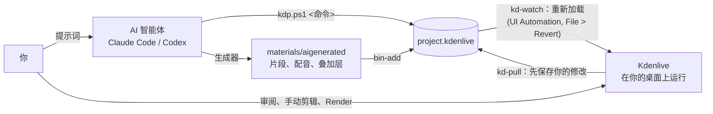

<div align="center">

# movie-engine

**AI 智能体在 Kdenlive 中剪辑你的视频，你在一旁实时观看，并且随时可以接手。**

AI 编程智能体（Claude Code、Codex）可以创建并修改真正的 Kdenlive 项目：影片、讲解视频和竖屏短视频。所有修改都会实时显示在你已打开的编辑器中。便携式、面向 Windows、无需给编辑器打补丁。


[English](../../README.md) · **简体中文** · [हिन्दी](README.hi.md) · [Español](README.es.md) · [Français](README.fr.md) · [العربية](README.ar.md) · [বাংলা](README.bn.md) · [Português](README.pt.md) · [Русский](README.ru.md) · [اردو](README.ur.md) · [Bahasa Indonesia](README.id.md) · [Deutsch](README.de.md) · [日本語](README.ja.md) · [Türkçe](README.tr.md) · [한국어](README.ko.md)

*本文为译文，英文 README 为权威参考版本。*

</div>

---

## 目录

- [为什么需要它](#为什么需要它)
- [工作原理](#工作原理)
- [功能特性](#功能特性)
- [系统要求](#系统要求)
- [安装](#安装)
- [快速开始](#快速开始)
- [与智能体协作](#与智能体协作)
- [编辑命令行 (`kdp.ps1`)](#编辑命令行-kdpps1)
- [与已打开编辑器的实时同步](#与已打开编辑器的实时同步)
- [用生成器补足 Kdenlive 做不到的事](#用生成器补足-kdenlive-做不到的事)
- [配音与音效](#配音与音效)
- [界面语言](#界面语言)
- [文件夹结构](#文件夹结构)
- [测试与验证](#测试与验证)
- [局限性](#局限性)
- [故障排除](#故障排除)
- [常见问题](#常见问题)
- [参与贡献](#参与贡献)
- [致谢](#致谢)
- [许可证](#许可证)

## 为什么需要它

视频编辑器是为握着鼠标的双手设计的。AI 智能体则擅长结构、节奏和重复性工作：把 300 个片段卡在节拍上、让每一条字幕与配音精确对齐、根据反馈重做某个场景。但它们无法在不接管你桌面的情况下去点击图形界面。

Kdenlive 是一款强大的开源编辑器，但在 Windows 上它**没有自动化 API**：D-Bus 控制只存在于 Linux 版本中，而添加了 API 的分支要么无人维护，要么不安全。movie-engine 在不修改编辑器的前提下解决了这个问题：

1. 智能体通过一个经过测试的命令行工具（`engine/kdp.ps1`）编辑 `.kdenlive` 项目文件。
2. 通过 Windows UI Automation 通知正在运行的 Kdenlive 重新加载文件，不发送按键、不操作鼠标、也不抢占焦点。
3. 你自己未保存的修改会先被保存，永远不会被覆盖。

于是，智能体负责剪辑、你负责审阅，或者你亲自动手剪辑。你们在同一时间、同一个编辑器里处理同一个项目。

## 工作原理



每条编辑命令都遵循同样的安全流程：

1. **拉取（Pull）。** 如果 Kdenlive 有未保存的更改，会通知它保存（通过 UI Automation 点击工具栏上的保存），并确认保存已完成。
2. **编辑（Edit）。** 命令在加锁状态下修改 XML，修改前先校验哈希，并创建撤销快照。如果文件在此期间发生了变化，则不会写入任何内容。
3. **重新加载（Reload）。** 监视器识别出 AI 留下的标记后，在已打开的编辑器中执行 File > Revert。只有当时间线控件确实被重建时，才算成功。
4. **冲突（Conflict）。** 如果你在这期间开始了编辑，则不会重新加载，你的工作保持原样。AI 的版本会被另行保存，智能体会在你的修改基础上重新应用它的更改。

## 功能特性

- **无需图形界面即可完整编辑项目**：约 120 条命令，涵盖素材箱、时间线、特效、合成、轨道、参考线、标记、字幕、序列、变速与时间重映射、幻灯片、标题、代理剪辑、渲染以及撤销/重做。参见[命令参考](#编辑命令行-kdpps1)。
- **与已打开的编辑器实时同步。** AI 的修改会出现在你正在查看的 Kdenlive 中；你未保存的修改会先被保存，绝不会丢失。
- **绝不打扰你的桌面。** 不抢占焦点、不发送按键、不操作鼠标。测试用的编辑器运行在一个不可见的 Windows 桌面上。
- **便携。** 编辑器、设置、Node.js、字体和工具都放在同一个文件夹里。复制到另一台电脑即可使用；不会向 Program Files 或你的 Windows 用户配置写入任何内容。
- **用生成器完成 Kdenlive 做不到的事**：逐字母动态文字、手绘标注、3D 界面场景、光标动画以及较长的交互式“讲解”影片。它们在 GPU 上渲染并带有真实的运动模糊，然后作为普通片段放到时间线上。
- **带逐词时间信息的配音**（Microsoft Edge TTS，无需 API 密钥）。字幕和动作会在说到对应单词的那一刻精确触发。
- **合成音效**（whoosh、click、pop、riser、impact 等），完全由代码生成。
- **经过验证，而非想当然。** 每条命令都有结果检查，特效和合成逐一测试，原始结果保存在 `docs/proof/` 中。
- **附带智能体说明。** `AGENTS.md` 和 `.claude/skills/` 中的技能文件会教 Claude Code 和 Codex 掌握工作流程、文件格式和常见陷阱。

## 系统要求

| | |
|---|---|
| 操作系统 | Windows 10 或 11，x64 |
| 编辑器 | Kdenlive **26.08.3** 便携版（standalone）。其他版本未经测试。 |
| Node.js | 18 或更高版本：从 nodejs.org 下载 Windows x64 `.zip`，解压到 `engine/node/` |
| 浏览器 | Microsoft Edge（Windows 自带）；场景渲染器以无头模式使用它 |
| 智能体 | [Claude Code](https://claude.com/claude-code) 或 Codex。可选：所有工具也都可以手动运行。 |
| 磁盘 | 编辑器和工具约占 1 GB，另加你的媒体文件 |
| GPU | 任何支持 H.264 硬件编码的 GPU 都能加快 `film-render.mjs`（否则回退到软件编码） |

## 安装

所有内容都安装在**该文件夹内部**。不需要管理员权限。

```powershell
git clone https://github.com/vladtarrow/movie-engine.git
cd movie-engine
```

**1. Node.js。** 从 <https://nodejs.org/en/download> 下载 Node.js 18 或更高版本的 Windows x64 `.zip`，把其中的内容解压到 `engine\node\`，使 `engine\node\node.exe` 和 `engine\node\npm.cmd` 都在那里。不需要安装程序，也不需要系统中的 Node。所有脚本都通过 `engine\node.cmd` 运行，从不使用系统中的 Node。

**2. Node 依赖包**，供配音工具和渲染器使用（版本固定在 `engine/voice/package.json` 中）：

```powershell
engine\node\npm.cmd install --prefix engine\voice
```

**3. Kdenlive 26.08.3 便携版。** 从 <https://download.kde.org/stable/kdenlive/26.08/windows/> 下载 `kdenlive-26.08.3_standalone.exe` 到 `engine\installer\`，校验后解压：

```powershell
(Get-FileHash engine\installer\kdenlive-26.08.3_standalone.exe -Algorithm SHA256).Hash
# 期望值：A25427B1DFF2C17E3B0386E991BB1A719382BB3176D1A90E441CDAEB6E0A967D
engine\installer\kdenlive-26.08.3_standalone.exe -o"engine\Kdenlive" -y
```

编辑器会被解压到 `engine\Kdenlive\kdenlive-26.08.3_standalone\bin\`。其中已包含 `melt.exe` 和 `ffmpeg.exe`。

**4. 首次启动。**

```powershell
engine\kdenlive.cmd
```

Kdenlive 会把所有设置保存在 `engine\profile-kdenlive\` 中，而不是你的 Windows 用户配置里。首次启动时会显示一次性的设置向导。

## 快速开始

### 使用智能体

在 Claude Code（或 Codex）中打开该文件夹，用日常语言提出要求：

> 新建一个竖屏 30 fps 的项目“launch-teaser”。把 `materials/designers/launch/` 中的三张截图放到时间线上，每张 2.5 秒，之间加短暂的交叉淡化；根据 `script.txt` 添加配音，并为每一句配上同步的动态字幕。

> 帮我在 Kdenlive 里打开它。

> 第二个镜头太长了。把它剪到 1.8 秒，再把 logo 往上挪一点。

智能体遵循 `AGENTS.md`：它通过 `kdp.ps1` 进行编辑，只渲染剪辑所需的片段，并让已打开的编辑器保持同步。你在 Kdenlive 中审阅，随时可以手动修改，满意后按下 Render 即可。

### 手动操作

```powershell
# 新建一个 1080x1920、30 fps 的项目，包含 2 条视频轨和 2 条音频轨
powershell -NoProfile -ExecutionPolicy Bypass -File engine\kdp.ps1 new -Project projects\hello\hello.kdenlive -Profile vertical_hd_30

# 一个 3 秒的标题和一个纯色背景
powershell -NoProfile -ExecutionPolicy Bypass -File engine\kdp.ps1 bin-color -Project projects\hello\hello.kdenlive -Color '#203060' -Seconds 3 -Name bg
powershell -NoProfile -ExecutionPolicy Bypass -File engine\kdp.ps1 title -Project projects\hello\hello.kdenlive -Text "Hello" -Seconds 3 -Name hi

# 放置它们：背景在 V1，标题在其上方的 V2
powershell -NoProfile -ExecutionPolicy Bypass -File engine\kdp.ps1 add -Project projects\hello\hello.kdenlive -Bin bg -Track V1 -At 0
powershell -NoProfile -ExecutionPolicy Bypass -File engine\kdp.ps1 add -Project projects\hello\hello.kdenlive -Bin hi -Track V2 -At 0

# 输出一帧检查图，然后在编辑器中打开
powershell -NoProfile -ExecutionPolicy Bypass -File engine\kdp.ps1 frame -Project projects\hello\hello.kdenlive -At 1.5 -Out out\hello\check.png
engine\kdenlive.cmd projects\hello\hello.kdenlive
```

以后要重新打开上一次的项目，双击 `open-last-project.cmd` 即可。

## 与智能体协作

智能体会读取 `AGENTS.md`（Codex）或导入了它的 `CLAUDE.md`（Claude Code），以及两个技能：

| 技能 | 教授内容 |
|---|---|
| `.claude/skills/kdenlive-project-file` | `.kdenlive` / MLT XML 格式、`kdp.ps1`、用 `melt` 进行检查 |
| `.claude/skills/kdenlive-live` | 安全地操控正在运行的编辑器：启动、拉取、重新加载、截取其窗口 |

智能体遵守的规则，你可以放心依赖：

- 它绝不占用你的鼠标、键盘或焦点，也绝不截取你的桌面（只截取编辑器自己的窗口）。
- 它自己完成图形界面操作（保存、打开、重新加载），而不是让你去点击。
- 下载任何内容之前、删除任何内容之前，它都会先征求你的同意。
- 它只渲染工作所需的内容（场景片段、检查帧）。只有在你要求时才渲染最终成片。
- 当 Kdenlive 无法很好地完成某件事时，智能体会在外部用代码把它做出来，再作为片段放入项目。它不会降低效果的质量。

## 编辑命令行 (`kdp.ps1`)

```powershell
powershell -NoProfile -ExecutionPolicy Bypass -File engine\kdp.ps1 <command> -Project <file.kdenlive> [options]
```

时间以秒为单位，使用小数点（`2.5`）。轨道为 `V1 V2 …`（V1 在最下方）和 `A1 A2 …`。通过 `-Track` 加上片段内任意时间点 `-At` 来定位一个片段。特效参数写在 `-Params "name=value||name=value"` 中。包含所有选项的完整列表位于 `engine/kdp.ps1` 的文件头部。

| 分组 | 命令 |
|---|---|
| 项目 | `new`, `profiles`, `info`, `validate`, `fonts`, `profile-set`, `profile-from-clip`, `zone`, `archive`, `backups`, `rebase`, `otio-export`, `otio-import` |
| 素材箱 | `bin-add`, `bin-color`, `title`, `title-text`, `title-save`, `title-template`, `bin-rename`, `bin-remove`, `bin-info`, `bin-set`, `bin-duplicate`, `bin-replace-file`, `bin-reload`, `folder`, `bin-folder`, `relink`, `clean`, `generator`, `playlist-clip`, `extract-audio`, `transcode` |
| 时间线 | `add`, `add-av`, `move`, `copy`, `trim`, `ripple-trim`, `slip`, `split`, `remove`, `speed`, `remap`, `disable`, `enable`, `group`, `ungroup`, `mix`, `unmix`, `space-insert`, `space-remove`, `spaces-remove-all`, `track-clear`, `replace-in-timeline` |
| 特效 | `effects`, `effect-info`, `effect-add`, `effect-list`, `effect-set`, `effect-remove`, `effect-copy`, `effect-clear`, `effects-all`, `bin-effect`, `effect-templates`, `effect-template` |
| 合成 | `compositions`, `comp-info`, `comp-add`, `comp-list`, `comp-set`, `comp-remove` |
| 轨道 | `track-add`, `track-remove`, `track-set` |
| 参考线与标记 | `guide-add`, `guide-list`, `guide-remove`, `guide-set`, `guide-clear`, `guide-export`, `guide-category`, `marker`, `marker-list`, `marker-set`, `marker-remove` |
| 字幕 | `sub-add`, `sub-import`, `sub-export`, `sub-state` |
| 序列 | `sequence-add`, `sequences`, `copy-to-sequence`, `expand`；任何命令加上 `-Sequence <name>` 都会在该序列内执行 |
| 特殊 | `slideshow`、通过 `bin-add` 导入的 Lottie / Glaxnimate 动画、`proxy`、`stabilize`、`scene-split`、`speed-job`、`subclip` |
| 输出 | `frame`（单张 PNG）、`preview`（快速 melt 渲染）、`render`（Kdenlive 自带渲染器或预设）、`presets` |
| 历史 | `undo`、`redo`、`clear-history`（快照保存在 `projects/<name>/.kdp-history`） |

值得了解的行为：

- 链接在一起的音频和视频两半会一起移动、修剪、分割和删除（用 `-Alone` 只操作其中一半）。
- 失败的命令以退出码 1 结束，并且不写入任何内容。
- Windows 版本无法运行的特效会被明确拒绝，而不是被悄悄忽略（列表见 `docs/proof/assets.txt`）。
- Kdenlive 的每个菜单操作都在 `engine/tools/data/kdenlive-actions.csv` 中映射到一条命令、另一种实现途径或“仅查看”。参见 `docs/kdenlive-coverage.md`。

## 与已打开编辑器的实时同步

| 脚本 | 作用 | 退出码 |
|---|---|---|
| `engine\kd-pull.ps1 -Project <f>` | 让 Kdenlive 保存你的修改并加以确认 | 0 文件为最新，3 未运行，4 未确认 |
| `engine\kd-reload.ps1 -Project <f>` | 执行 File > Revert，并以时间线重建作为确认 | 0 已确认，2 你有未保存的修改（未丢弃任何内容），3 未运行，4 失败 |
| `engine\kd-watch.ps1 -Project <f>` | 后台监视器：每次 AI 写入后重新加载，并记录冲突 | 日志位于 `engine\kd-watch.log`；删除 `engine\kd-watch.run` 即可停止 |
| `engine\kdenlive-bg.ps1 [project]` | 为智能体以最小化方式启动 Kdenlive | 0 已加载，4 未确认 |
| `engine\kdenlive.cmd [project]` | 为你启动 Kdenlive | |

每个会话启动一次监视器：

```powershell
Start-Process powershell -WindowStyle Hidden -ArgumentList '-NoProfile','-ExecutionPolicy','Bypass','-File','engine\kd-watch.ps1','-Project','projects\hello\hello.kdenlive'
```

大型项目：重新加载一个包含 1000 个片段的项目需要几分钟，工具会一直等待完成，而不会提前报告成功。项目会在空编辑器中通过 *File > Open Recent* 打开，因为直接打开文件会让 Qt 为无障碍功能遍历时间线上的每个元素，大约要慢 10 分钟。

## 用生成器补足 Kdenlive 做不到的事

Kdenlive/MLT 没有逐字母文字动画，没有表达式，3D 功能也很少，而且重型特效会拖慢播放。movie-engine 在外部渲染这些部分，再把它们作为普通片段放到时间线上，通常带有 alpha 通道，放在画面轨道之上。生成器脚本及其输入都保存在项目文件夹中，因此当文字、字体或时间发生变化时，可以重新生成片段。

| 工具 | 生成内容 |
|---|---|
| `engine/tools/kinetic-text.ps1` | 逐字母动态字幕，每个单词的时间都取自 `voice.json`，带高亮框 |
| `engine/tools/annotate.ps1` | 在截图上逐笔画出的手绘圆圈、方框、下划线和箭头 |
| `engine/tools/card-entrance.ps1` | 带柔和阴影、上升并缩放入场的截图卡片 |
| `engine/tools/pdf-to-png.ps1` | 从 PDF 导出生成幻灯片 |
| `engine/tools/html-render.mjs` | 把任意 HTML/CSS/canvas 场景渲染为视频：界面动画、光标、3D、遮罩 |
| `engine/tools/film-render.mjs` + `film/` | 在 canvas 上绘制的较长交互式讲解影片：每句配音一个片段，动作在说出对应单词时触发，GPU 运动模糊，约 45 fps |

两个渲染器都驱动 Windows 自带的 Microsoft Edge，以无头模式运行，使用一次性配置文件，且无法访问网络。

### 演示

```powershell
# 一个带光标点击的 3 秒 3D 标题卡
engine\node.cmd engine\tools\html-render.mjs examples\demo\scene\scene.html examples\demo\out --frames 0,30,60,89
engine\node.cmd engine\tools\html-render.mjs examples\demo\scene\scene.html examples\demo\out\scene.mp4

# 一部与两句配音同步的 4 个镜头交互式影片
engine\node.cmd engine\tools\film-render.mjs examples\demo\film\film.html examples\demo\out --check
engine\node.cmd engine\tools\film-render.mjs examples\demo\film\film.html examples\demo\out --shots all --width 640
engine\node.cmd engine\tools\film-render.mjs examples\demo\film\film.html examples\demo\out\clips --suffix -v01
```

一部影片由三个小文件组成。`data.js` 保存镜头和单词时间。`direction.js` 每个镜头写一行：

```text
1 | hover 192 108 @brand | tag 300 60 Your brand @deserves | confetti 192 90 @film
2 say=A film that/*explains* it
3 | click 116 108 @before | click 268 108 @after | chips Before~After @after
4 scene=counter | count 0 120 % @count
```

`scenes.js` 保存从零绘制的镜头。`@word` 会在配音说到该单词时触发一个动作。动作包括 click、hover、drag、zoom、lens、ring、arrow、chips、toggle、slider、toast、type、count 和 confetti；完整语法见 `engine/tools/film/film-kit.js` 的开头部分。

## 配音与音效

```powershell
engine\node.cmd engine\voice\voice.mjs lines.json materials\aigenerated\hello\voice en-US-AndrewMultilingualNeural +0%
```

`lines.json` 是一个台词列表。该工具为每句台词生成一个 mp3，外加一个 `voice.json`，其中包含时长以及每个单词的开始和结束时间。台词会被缓存，因此修改一句只会重新生成那一句。它通过 `msedge-tts` 包使用 Microsoft Edge 的在线文字转语音服务：无需密钥，但该服务是非官方的，并且需要联网。

```powershell
engine\node.cmd engine\audio\sfx.mjs materials\aigenerated\sfx
```

这条命令用代码合成 whoosh、whoosh-long、swipe、click、pop、tick、riser、impact、ding 和 reveal；现成的一套音效位于 `materials/aigenerated/sfx/`。短于一帧的声音在放置前要先用静音补齐（`-af apad=whole_dur=0.0667`）。

## 界面语言

启动器默认以**英文**界面启动 Kdenlive。如需使用其他语言，请在启动前设置 `MOVIE_ENGINE_UI_LANG`：

```powershell
$env:MOVIE_ENGINE_UI_LANG = 'ru'; engine\kdenlive.cmd
```

UI Automation 通过菜单项的可见名称来查找它们。英文和俄文名称已内置（`engine/tools/kd-ui.ps1`，`$KdNames`）。对于其他语言，请在那里添加相应名称，并用以下命令检查：

```powershell
powershell -NoProfile -ExecutionPolicy Bypass -File engine\tools\kd-langcheck.ps1
```

## 文件夹结构

```text
movie-engine/
├─ AGENTS.md, CLAUDE.md          instructions for AI agents
├─ .claude/skills/               agent skills: project file format, live editor
├─ engine/
│  ├─ kdp.ps1                    the editing command line
│  ├─ kd-pull / kd-reload / kd-watch .ps1, kdenlive.cmd, kdenlive-bg.ps1
│  ├─ tools/                     internals, generators, tests, data (action map)
│  ├─ voice/  audio/  fonts/     TTS, synthesized SFX, Poppins (OFL)
│  ├─ Kdenlive/  node/           portable editor and Node.js (not in git)
│  └─ profile-kdenlive/          the editor's settings (not in git)
├─ projects/<name>/<name>.kdenlive
├─ materials/
│  ├─ download/                  stock and downloaded files (not in git)
│  ├─ aigenerated/               everything the AI made (sfx/ and test-kit/ ship with the engine)
│  ├─ designers/  brand/         files from your team, brand assets
├─ examples/demo/                demos of the scene and film renderers
├─ out/                          renders (not in git)
└─ docs/                         proofs, coverage, translations of this README
```

项目中的媒体路径都是相对路径。如果你移动或复制了该文件夹，`kdp.ps1 rebase`（`kdenlive.cmd` 也会自动运行它）会把新位置写入项目。

## 测试与验证

关于哪些功能可用的说法，都有结果检查作为依据，而不是仅凭“函数运行过了”。汇总见 [`docs/kdenlive-proof.md`](../../docs/kdenlive-proof.md)，原始输出位于 `docs/proof/`。

| 测试 | 检查内容 |
|---|---|
| `engine\tools\kdp-clitest.ps1` | 通过命令行测试每一条 `kdp.ps1` 命令，并比对生成的项目 |
| `engine\tools\kd-livetest.ps1` | 在不可见桌面上针对真实的 Kdenlive 测试拉取、重新加载、监视器、冲突和竞争条件 |
| `engine\tools\kdp-assetsweep.ps1` | 每一个特效和合成：渲染并比对画面帧 |
| `engine\tools\kdp-portabletest.ps1` | 把文件夹复制到别处，并在副本中运行 |
| `engine\tools\kd-langcheck.ps1` | 界面语言，以及 UI Automation 能否找到菜单 |
| `engine\tools\kdp-coverage-check.ps1` | 每个菜单操作都已映射，且没有任何验证结果比代码更旧 |

```powershell
powershell -NoProfile -ExecutionPolicy Bypass -File engine\tools\kdp-clitest.ps1 -Report docs\proof\clitest.txt
powershell -NoProfile -ExecutionPolicy Bypass -File engine\tools\kd-livetest.ps1 -Report docs\proof\live-en.txt
```

测试用的编辑器只在隐藏桌面上运行，并使用独立的配置文件，因此测试永远不会触及你已打开的 Kdenlive 或你的焦点。

## 局限性

- **仅支持 Windows**，且仅支持 Kdenlive **26.08.3**。Linux 有 D-Bus，需要另一种桥接方式。
- 启动编辑器时，空窗口出现的约 3 秒内会占用键盘焦点。在你工作时，智能体会先征得同意再启动它。重新加载和编辑不会抢占焦点。
- Windows 版本缺少 sox、ladspa 和 movit 这几个 MLT 模块以及部分 frei0r/avfilter 特效；`kdp.ps1` 会拒绝使用它们（`docs/proof/assets.txt`）。
- OpenTimelineIO 的导出和导入只包含片段和空隙。多机位不支持实时切换机位（剪切通过 split/remove/hide 完成）。
- 在最小化的窗口上通过 UI Automation 调用“Save As…”不会打开任何对话框；智能体会改用 `archive` 或复制文件。
- 语音识别（自动字幕）需要 Whisper 或 Vosk，它们未随附提供。
- 用 Kdenlive 标题工具制作的标题使用 Windows 中已安装的字体。如需确保排版效果，请用生成器渲染文字，它们会从 `engine/fonts/` 加载字体。
- Edge TTS 是非官方的在线服务，可能会变更或停止工作。

## 故障排除

| 症状 | 原因与解决方法 |
|---|---|
| Kdenlive 正在运行，但点击任务栏上的图标什么也不显示 | 它保存的窗口位置在屏幕之外。关闭它并删除 `engine\profile-kdenlive\AppData\Local\kdenliverc` 中的 `kdockLayout` 条目，或者用 `SetWindowPos` 移动窗口（参见 `AGENTS.md`）。 |
| `kd-reload.ps1` 以退出码 2 结束 | 你有未保存的修改。没有丢弃任何内容。运行 `kd-pull.ps1`，然后重新应用更改（`kdp.ps1` 会自动完成这一步）。 |
| `engine\kd-watch.log` 中出现 `CONFLICT` | 你和智能体在同一时刻进行了编辑。你的版本保留在编辑器中，AI 的版本位于 `projects\<name>\.kdp-history\<name>\conflict\`。请让智能体重新应用它的更改。 |
| 命令以退出码 1 结束并提示 "pull not confirmed" | Kdenlive 正忙或正在显示对话框。关闭对话框或等待加载完成，然后重试。 |
| PowerShell 脚本解析失败 | 对于 Windows PowerShell 5.1，包含非 ASCII 文本的脚本必须保存为 **带 BOM** 的 UTF-8。 |
| `voice.mjs` 因 "Stream closed before the synthesis completed" 而停止 | 通常是网络问题，或者旧版副本中存在未转义的 SSML。`voice.mjs` 本身会转义 `& < >`。 |
| 打开大型项目需要很多分钟 | 请通过 `kdenlive.cmd` / `kdenlive-bg.ps1` 打开，切勿使用 `kdenlive.exe project.kdenlive`。 |

## 常见问题

**我一定需要 Claude Code 或 Codex 吗？**
不需要。每个工具都是可以手动运行的普通脚本。智能体的作用是让一切变快：它规划剪辑、运行工具，并让编辑器保持同步。

**智能体会覆盖我的手动修改吗？**
不会。在任何写入之前，你未保存的修改都会被保存并确认。如果你在智能体写入时进行编辑，这次写入会被拒绝或作为冲突另行保存，绝不会覆盖在你的工作之上。

**我还能像平常一样使用 Kdenlive 吗？**
可以。它就是原版 Kdenlive，只是有自己的设置文件夹。像往常一样编辑、预览和渲染即可。

**它能和我已经安装的 Kdenlive 一起使用吗？**
它使用 `engine\Kdenlive\` 中自带的便携副本，因此你已安装的 Kdenlive 及其设置都不会受到影响。

**为什么不用带 API 的 Kdenlive 分支，或者换一个编辑器？**
在 Windows 上，不存在既有人维护又安全的分支（2026-11 的调研结果）。我们评估过 OpenShot、Blender VSE、DaVinci Resolve、Shotcut 以及各类网页编辑器；Kdenlive 提供了最深入的编辑能力。我们正在关注上游的一个 REST API 提案（合并请求 !902）。

**它能渲染最终视频吗？**
能，使用 `kdp.ps1 render`（Kdenlive 自带的渲染器，在后台隐藏运行），或者你自己在编辑器中按下 Render。

**我的媒体会被上传到任何地方吗？**
不会。只有在生成配音时，配音文本才会被发送到 Edge TTS 服务。场景渲染器在禁用网络的状态下运行。

## 参与贡献

欢迎贡献。参见 [CONTRIBUTING.md](../../CONTRIBUTING.md)。简而言之：

- 每个新增或修改的 `kdp.ps1` 操作都需要在 `kdp-clitest.ps1` 中添加结果检查、在操作映射表中添加条目，并重新运行 `kdp-coverage-check.ps1`。
- 切勿在可见桌面上启动测试用的 Kdenlive；请使用 `engine/tools/kd-hidden.ps1`。
- 保持一切便携：不在文件夹之外安装任何东西，项目中不使用绝对路径。
- 把经过验证的怪异行为记录到 `AGENTS.md` 或对应的技能文件中。

## 致谢

- [Kdenlive](https://kdenlive.org) 和 [MLT](https://www.mltframework.org)：编辑器及其底层引擎。
- [FFmpeg](https://ffmpeg.org)，随 Kdenlive 一同提供。
- [msedge-tts](https://www.npmjs.com/package/msedge-tts)，用于配音。
- [Poppins](https://fonts.google.com/specimen/Poppins)，由 Indian Type Foundry 设计，采用 SIL Open Font License（`engine/fonts/OFL.txt`）。
- `engine/tools/data/kdenliveui-26.08.3.rc`：Kdenlive 的菜单文件，取自 Kdenlive 26.08.3 源代码，仅供覆盖检查使用。它仍采用 Kdenlive 的 GPL 许可证，而非 MIT 许可证。

## 许可证

movie-engine 自身代码采用 [MIT 许可证](../../LICENSE)发布。Kdenlive、MLT、FFmpeg、Node.js 依赖包和 Poppins 字体各自保留其原有许可证。
