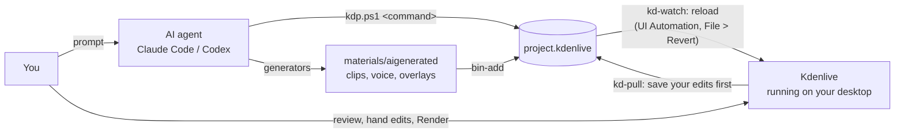

<div align="center">

# Movie Engine

**AI 代理在 Kdenlive 裡幫你剪片，你在旁邊即時看著，隨時都能接手。**

AI 程式代理（Claude Code、Codex）能建立並修改真正的 Kdenlive 專案：影片、解說影片和直式短影音。每一處修改都會即時出現在你已開啟的編輯器裡。免安裝可攜、適用 Windows、不需要修補編輯器。


[English](../../README.md) · [简体中文](README.zh-CN.md) · **繁體中文** · [हिन्दी](README.hi.md) · [Español](README.es.md) · [Français](README.fr.md) · [العربية](README.ar.md) · [বাংলা](README.bn.md) · [Português](README.pt.md) · [Русский](README.ru.md) · [اردو](README.ur.md) · [Bahasa Indonesia](README.id.md) · [Deutsch](README.de.md) · [日本語](README.ja.md) · [Türkçe](README.tr.md) · [한국어](README.ko.md) · [Українська](README.uk.md) · [Italiano](README.it.md) · [Polski](README.pl.md) · [Tiếng Việt](README.vi.md) · [فارسی](README.fa.md) · [ไทย](README.th.md) · [Kiswahili](README.sw.md) · [አማርኛ](README.am.md) · [Avañe'ẽ](README.gn.md) · [Setswana](README.tn.md) · [Shqip](README.sq.md) · [Беларуская](README.be.md) · [Български](README.bg.md) · [Bosanski](README.bs.md) · [Hrvatski](README.hr.md) · [Српски](README.sr.md) · [Crnogorski](README.cnr.md) · [Македонски](README.mk.md) · [Slovenščina](README.sl.md) · [Slovenčina](README.sk.md) · [Čeština](README.cs.md) · [Magyar](README.hu.md) · [Română](README.ro.md) · [Dansk](README.da.md) · [Norsk bokmål](README.nb.md) · [Norsk nynorsk](README.nn.md) · [Svenska](README.sv.md) · [Íslenska](README.is.md) · [Suomi](README.fi.md) · [Eesti](README.et.md) · [Latviešu](README.lv.md) · [Lietuvių](README.lt.md) · [Nederlands](README.nl.md) · [Lëtzebuergesch](README.lb.md) · [Rumantsch](README.rm.md) · [Ελληνικά](README.el.md) · [Malti](README.mt.md) · [Gaeilge](README.ga.md) · [Català](README.ca.md) · [ქართული](README.ka.md) · [Հայերեն](README.hy.md) · [Azərbaycanca](README.az.md) · [Afrikaans](README.af.md) · [isiZulu](README.zu.md) · [isiXhosa](README.xh.md) · [Sesotho](README.st.md) · [Sepedi](README.nso.md) · [Xitsonga](README.ts.md) · [Tshivenḓa](README.ve.md) · [siSwati](README.ss.md) · [isiNdebele (South Africa)](README.nr.md) · [isiNdebele (Zimbabwe)](README.nd.md) · [chiShona](README.sn.md) · [Chichewa](README.ny.md) · [Ikinyarwanda](README.rw.md) · [Ikirundi](README.rn.md) · [Malagasy](README.mg.md) · [Soomaali](README.so.md) · [Afaan Oromoo](README.om.md) · [Qafar af](README.aa.md) · [ትግርኛ](README.ti.md) · [Sängö](README.sg.md) · [Kreol Seselwa](README.crs.md) · [TjiKalanga](README.kck.md) · [ChiNdau](README.ndc.md)

*本文為翻譯版本，以英文 README 為準。*

</div>

---

## 目錄

- [為什麼要做這個](#為什麼要做這個)
- [運作方式](#運作方式)
- [功能特色](#功能特色)
- [系統需求](#系統需求)
- [安裝](#安裝)
- [快速上手](#快速上手)
- [與 AI 代理合作](#與-ai-代理合作)
- [編輯命令列 (`kdp.ps1`)](#編輯命令列-kdpps1)
- [與已開啟的編輯器即時同步](#與已開啟的編輯器即時同步)
- [產生器：補足 Kdenlive 做不到的事](#產生器補足-kdenlive-做不到的事)
- [旁白與音效](#旁白與音效)
- [介面語言](#介面語言)
- [資料夾結構](#資料夾結構)
- [測試與驗證](#測試與驗證)
- [限制](#限制)
- [疑難排解](#疑難排解)
- [常見問題](#常見問題)
- [參與貢獻](#參與貢獻)
- [致謝](#致謝)
- [授權條款](#授權條款)

## 為什麼要做這個

影片剪輯軟體是為握著滑鼠的手設計的。AI 代理擅長的則是結構、節奏和重複性的工作：把 300 個片段對準節拍、讓每一句字幕都跟上旁白、依照回饋重做某個場景。可是它們沒辦法在不霸占你桌面的情況下去點選圖形介面。

Kdenlive 是一套很強的開放原始碼剪輯軟體，但在 Windows 上它**沒有自動化 API**：D-Bus 控制只存在於 Linux 版本，而加上 API 的分支版本不是沒人維護，就是不安全。Movie Engine 不修改編輯器就解決了這個問題：

1. AI 代理透過一個經過測試的命令列工具（`engine/kdp.ps1`）編輯 `.kdenlive` 專案檔。
2. 透過 Windows UI Automation 通知正在執行的 Kdenlive 重新載入檔案，不送出按鍵、不動滑鼠，也不搶走焦點。
3. 你自己還沒儲存的修改會先被存檔，絕不會被覆蓋。

所以可以由 AI 代理剪、你來審，也可以你自己動手剪。你們同時在同一個編輯器裡處理同一個專案。

## 運作方式



每一道編輯指令都走同一套安全流程：

1. **拉取（Pull）。** 如果 Kdenlive 有尚未儲存的變更，就通知它存檔（透過 UI Automation 按下工具列的儲存），並確認存檔已完成。
2. **編輯（Edit）。** 指令在鎖定狀態下修改 XML，先比對雜湊值，並建立復原快照。如果檔案在這段期間被改過，就什麼都不寫入。
3. **重新載入（Reload）。** 監看程式看到 AI 留下的標記後，就在已開啟的編輯器裡執行 File > Revert。只有時間軸元件真的重建完成，才算成功。
4. **衝突（Conflict）。** 如果你在這段期間開始編輯，就不會重新載入，你的成果保持原樣。AI 的版本會另外保留，AI 代理會在你的修改之上重新套用它的變更。

## 功能特色

- **不必開圖形介面就能完整編輯專案**：大約 120 道指令，涵蓋素材匣、時間軸、特效、合成、軌道、參考線、標記、字幕、序列、變速與時間重新對應、投影片、標題、代理檔、算繪以及復原／重做。請參閱[指令參考](#編輯命令列-kdpps1)。
- **與已開啟的編輯器即時同步。** AI 的修改會出現在你正在看的 Kdenlive 裡；你尚未儲存的修改會先存檔，絕不會遺失。
- **絕不干擾你的桌面。** 不搶焦點、不送按鍵、不動滑鼠。測試用的編輯器在看不見的 Windows 桌面上執行。
- **免安裝可攜。** 編輯器、設定、Node.js、字型和工具全都放在同一個資料夾裡。複製到另一台電腦就能用；不會寫入 Program Files 或你的 Windows 使用者設定檔。
- **用產生器做出 Kdenlive 做不到的效果**：逐字母的動態文字、手繪標註、3D 介面場景、游標動畫，以及較長的互動式「解說」影片。它們用 GPU 算繪並帶有真實的動態模糊，再以一般片段的形式放上時間軸。
- **附逐字時間資訊的旁白**（Microsoft Edge TTS，不需要 API 金鑰）。字幕和動作會在唸到那個字的瞬間準確觸發。
- **合成音效**（whoosh、click、pop、riser、impact 等），完全用程式碼產生。
- **實際驗證，而非想當然。** 每道指令都有結果檢查，特效和合成逐一測過，原始結果放在 `docs/proof/`。
- **內附 AI 代理說明。** `AGENTS.md` 和 `.claude/skills/` 裡的技能會教 Claude Code 與 Codex 熟悉工作流程、檔案格式和常見陷阱。

## 系統需求

| | |
|---|---|
| 作業系統 | Windows 10 或 11，x64 |
| 編輯器 | Kdenlive **26.08.3** 可攜版（standalone）。其他版本未經測試。 |
| Node.js | 18 以上版本：從 nodejs.org 下載 Windows x64 的 `.zip`，解壓縮到 `engine/node/` |
| 瀏覽器 | Microsoft Edge（Windows 內建）；場景算繪器以無頭模式使用它 |
| AI 代理 | [Claude Code](https://claude.com/claude-code) 或 Codex。非必要：所有工具也都能手動執行。 |
| 磁碟空間 | 編輯器和工具約 1 GB，另加你的媒體檔案 |
| GPU | 任何支援 H.264 硬體編碼的 GPU 都能加快 `film-render.mjs`（沒有的話會改用軟體編碼） |

## 安裝

所有東西都安裝在**這個資料夾裡面**。完全不需要系統管理員權限。

```powershell
git clone https://github.com/vladtarrow/movie-engine.git
cd movie-engine
```

**1. Node.js。** 從 <https://nodejs.org/en/download> 下載 Node.js 18 以上版本的 Windows x64 `.zip`，把裡面的內容解壓縮到 `engine\node\`，讓 `engine\node\node.exe` 和 `engine\node\npm.cmd` 都位於該處。不需要安裝程式，也不需要系統上的 Node。所有指令碼都透過 `engine\node.cmd` 執行，絕不使用系統上的 Node。

**2. Node 套件**，供旁白工具和算繪器使用（版本固定在 `engine/voice/package.json`）：

```powershell
engine\node\npm.cmd install --prefix engine\voice
```

**3. Kdenlive 26.08.3 可攜版。** 從 <https://download.kde.org/stable/kdenlive/26.08/windows/> 下載 `kdenlive-26.08.3_standalone.exe` 到 `engine\installer\`，檢查後再解壓縮：

```powershell
(Get-FileHash engine\installer\kdenlive-26.08.3_standalone.exe -Algorithm SHA256).Hash
# expected: A25427B1DFF2C17E3B0386E991BB1A719382BB3176D1A90E441CDAEB6E0A967D
engine\installer\kdenlive-26.08.3_standalone.exe -o"engine\Kdenlive" -y
```

編輯器會解壓縮到 `engine\Kdenlive\kdenlive-26.08.3_standalone\bin\`，裡面已經內含 `melt.exe` 和 `ffmpeg.exe`。

**4. 第一次啟動。**

```powershell
engine\kdenlive.cmd
```

Kdenlive 會把所有設定存在 `engine\profile-kdenlive\`，而不是你的 Windows 使用者設定檔。第一次啟動時會出現一次性的設定精靈。

## 快速上手

### 交給 AI 代理

在 Claude Code（或 Codex）裡開啟這個資料夾，用平常說話的方式提出需求：

> 建立一個新的直式 30 fps 專案「launch-teaser」。把 `materials/designers/launch/` 裡的三張截圖放上時間軸，每張 2.5 秒，中間加短短的交叉淡化；用 `script.txt` 加上旁白，並讓每一句都配上同步的動態字幕。

> 幫我在 Kdenlive 裡打開它。

> 第二個鏡頭太長了。剪到 1.8 秒，再把 logo 往上移一點。

AI 代理會遵循 `AGENTS.md`：透過 `kdp.ps1` 編輯，只算繪這次剪輯需要的片段，並讓已開啟的編輯器保持同步。你在 Kdenlive 裡審片，想手動修改隨時都可以，滿意了再按下 Render。

### 手動操作

```powershell
# a new 1080x1920 30 fps project with 2 video and 2 audio tracks
powershell -NoProfile -ExecutionPolicy Bypass -File engine\kdp.ps1 new -Project projects\hello\hello.kdenlive -Profile vertical_hd_30

# a 3-second title and a colour background
powershell -NoProfile -ExecutionPolicy Bypass -File engine\kdp.ps1 bin-color -Project projects\hello\hello.kdenlive -Color '#203060' -Seconds 3 -Name bg
powershell -NoProfile -ExecutionPolicy Bypass -File engine\kdp.ps1 title -Project projects\hello\hello.kdenlive -Text "Hello" -Seconds 3 -Name hi

# place them: background on V1, title above it on V2
powershell -NoProfile -ExecutionPolicy Bypass -File engine\kdp.ps1 add -Project projects\hello\hello.kdenlive -Bin bg -Track V1 -At 0
powershell -NoProfile -ExecutionPolicy Bypass -File engine\kdp.ps1 add -Project projects\hello\hello.kdenlive -Bin hi -Track V2 -At 0

# a check frame, then open it in the editor
powershell -NoProfile -ExecutionPolicy Bypass -File engine\kdp.ps1 frame -Project projects\hello\hello.kdenlive -At 1.5 -Out out\hello\check.png
engine\kdenlive.cmd projects\hello\hello.kdenlive
```

之後想重新開啟上一個專案，按兩下 `open-last-project.cmd` 就行了。

## 與 AI 代理合作

AI 代理會讀取 `AGENTS.md`（Codex），或匯入了它的 `CLAUDE.md`（Claude Code），再加上兩個技能：

| 技能 | 教的內容 |
|---|---|
| `.claude/skills/kdenlive-project-file` | `.kdenlive` / MLT XML 格式、`kdp.ps1`、用 `melt` 檢查 |
| `.claude/skills/kdenlive-live` | 安全地操控正在執行的編輯器：啟動、拉取、重新載入、擷取它的視窗 |

AI 代理會遵守以下規則，你可以放心：

- 絕不占用你的滑鼠、鍵盤或焦點，也絕不擷取你的桌面畫面（只擷取編輯器本身的視窗）。
- 圖形介面上的步驟（儲存、開啟、重新載入）由它自己完成，不會叫你去點。
- 下載任何東西或刪除任何東西之前，都會先問過你。
- 只算繪工作需要的東西（場景片段、檢查畫格）。只有你要求時才會算繪最終成品。
- 遇到 Kdenlive 做不好的地方，AI 代理會在外部用程式碼做出來，再當成片段放進專案。它不會把效果打折扣。

## 編輯命令列 (`kdp.ps1`)

```powershell
powershell -NoProfile -ExecutionPolicy Bypass -File engine\kdp.ps1 <command> -Project <file.kdenlive> [options]
```

時間以秒為單位，小數點用句點（`2.5`）。軌道為 `V1 V2 …`（V1 在最下面）和 `A1 A2 …`。要指定某個片段，就用 `-Track` 加上該片段範圍內的任一時間點 `-At`。特效參數寫在 `-Params "name=value||name=value"` 裡。包含所有選項的完整清單在 `engine/kdp.ps1` 的檔頭。

| 分類 | 指令 |
|---|---|
| 專案 | `new`, `profiles`, `info`, `validate`, `fonts`, `profile-set`, `profile-from-clip`, `zone`, `archive`, `backups`, `rebase`, `otio-export`, `otio-import` |
| 素材匣 | `bin-add`, `bin-color`, `title`, `title-text`, `title-save`, `title-template`, `bin-rename`, `bin-remove`, `bin-info`, `bin-set`, `bin-duplicate`, `bin-replace-file`, `bin-reload`, `folder`, `bin-folder`, `relink`, `clean`, `generator`, `playlist-clip`, `extract-audio`, `transcode` |
| 時間軸 | `add`, `add-av`, `move`, `copy`, `trim`, `ripple-trim`, `slip`, `split`, `remove`, `speed`, `remap`, `disable`, `enable`, `group`, `ungroup`, `mix`, `unmix`, `space-insert`, `space-remove`, `spaces-remove-all`, `track-clear`, `replace-in-timeline` |
| 特效 | `effects`, `effect-info`, `effect-add`, `effect-list`, `effect-set`, `effect-remove`, `effect-copy`, `effect-clear`, `effects-all`, `bin-effect`, `effect-templates`, `effect-template` |
| 合成 | `compositions`, `comp-info`, `comp-add`, `comp-list`, `comp-set`, `comp-remove` |
| 軌道 | `track-add`, `track-remove`, `track-set` |
| 參考線與標記 | `guide-add`, `guide-list`, `guide-remove`, `guide-set`, `guide-clear`, `guide-export`, `guide-category`, `marker`, `marker-list`, `marker-set`, `marker-remove` |
| 字幕 | `sub-add`, `sub-import`, `sub-export`, `sub-state` |
| 序列 | `sequence-add`, `sequences`, `copy-to-sequence`, `expand`；任何指令加上 `-Sequence <name>` 都會在該序列裡執行 |
| 特殊 | `slideshow`、透過 `bin-add` 匯入的 Lottie / Glaxnimate 動畫、`proxy`、`stabilize`、`scene-split`、`speed-job`、`subclip` |
| 輸出 | `frame`（單張 PNG）、`preview`（快速的 melt 算繪）、`render`（Kdenlive 本身的算繪器或預設集）、`presets` |
| 歷史紀錄 | `undo`、`redo`、`clear-history`（快照存在 `projects/<name>/.kdp-history`） |

值得知道的行為：

- 連結在一起的音訊與視訊兩半會一起移動、修剪、分割和移除（用 `-Alone` 只處理其中一半）。
- 失敗的指令會以結束代碼 1 結束，而且不寫入任何東西。
- Windows 版本無法執行的特效會被明確拒絕，而不是默默略過（清單見 `docs/proof/assets.txt`）。
- Kdenlive 的每個選單動作，都在 `engine/tools/data/kdenlive-actions.csv` 裡對應到一道指令、另一種做法，或「僅供檢視」。請參閱 `docs/kdenlive-coverage.md`。

## 與已開啟的編輯器即時同步

| 指令碼 | 用途 | 結束代碼 |
|---|---|---|
| `engine\kd-pull.ps1 -Project <f>` | 讓 Kdenlive 儲存你的修改並加以確認 | 0 檔案已是最新，3 未執行，4 未確認 |
| `engine\kd-reload.ps1 -Project <f>` | 執行 File > Revert，以時間軸重建作為確認 | 0 已確認，2 你有尚未儲存的修改（沒有捨棄任何東西），3 未執行，4 失敗 |
| `engine\kd-watch.ps1 -Project <f>` | 背景監看程式：每次 AI 寫入後重新載入，並記錄衝突 | 記錄檔在 `engine\kd-watch.log`；刪除 `engine\kd-watch.run` 即可停止 |
| `engine\kdenlive-bg.ps1 [project]` | 替 AI 代理以最小化方式啟動 Kdenlive | 0 已載入，4 未確認 |
| `engine\kdenlive.cmd [project]` | 替你啟動 Kdenlive | |

每個工作階段啟動一次監看程式：

```powershell
Start-Process powershell -WindowStyle Hidden -ArgumentList '-NoProfile','-ExecutionPolicy','Bypass','-File','engine\kd-watch.ps1','-Project','projects\hello\hello.kdenlive'
```

大型專案：重新載入一個有 1000 個片段的專案要花好幾分鐘，工具會等它完成，不會提早回報。專案是在空白編輯器裡透過 *File > Open Recent* 開啟的，因為直接開啟檔案會讓 Qt 為了無障礙功能逐一走訪時間軸上的每個項目，大約會慢 10 分鐘。

## 產生器：補足 Kdenlive 做不到的事

Kdenlive/MLT 沒有逐字母的文字動畫、沒有運算式，3D 功能也很少，而且繁重的特效會拖慢播放。Movie Engine 會在外部算繪這些部分，再以一般片段的形式放上時間軸，通常帶有 Alpha 通道，放在畫面軌道的上方。產生器指令碼和它的輸入都留在專案資料夾裡，所以文字、字型或時間點改變時，可以重新產生片段。

| 工具 | 產出 |
|---|---|
| `engine/tools/kinetic-text.ps1` | 逐字母的動態字幕，每個字的時間點都取自 `voice.json`，附醒目標示框 |
| `engine/tools/annotate.ps1` | 在截圖上一筆一筆畫出來的手繪圓圈、方框、底線和箭頭 |
| `engine/tools/card-entrance.ps1` | 帶柔和陰影、往上升起並縮放進場的截圖卡片 |
| `engine/tools/pdf-to-png.ps1` | 從 PDF 匯出的投影片 |
| `engine/tools/html-render.mjs` | 把任何 HTML/CSS/canvas 場景轉成影片：介面動畫、游標、3D、遮罩 |
| `engine/tools/film-render.mjs` + `film/` | 在 canvas 上製作的較長互動式解說影片：每句旁白一個片段，動作在唸到對應的字時觸發，GPU 動態模糊，約 45 fps |

兩個算繪器都會以無頭模式驅動 Windows 內建的 Microsoft Edge，使用用完即丟的設定檔，而且不能連網。

### 示範

```powershell
# a 3-second 3D title card with a cursor click
engine\node.cmd engine\tools\html-render.mjs examples\demo\scene\scene.html examples\demo\out --frames 0,30,60,89
engine\node.cmd engine\tools\html-render.mjs examples\demo\scene\scene.html examples\demo\out\scene.mp4

# a 4-shot interactive film timed to two voice lines
engine\node.cmd engine\tools\film-render.mjs examples\demo\film\film.html examples\demo\out --check
engine\node.cmd engine\tools\film-render.mjs examples\demo\film\film.html examples\demo\out --shots all --width 640
engine\node.cmd engine\tools\film-render.mjs examples\demo\film\film.html examples\demo\out\clips --suffix -v01
```

一部影片由三個小檔案組成。`data.js` 存放鏡頭和每個字的時間點。`direction.js` 每個鏡頭寫一行：

```text
1 | hover 192 108 @brand | tag 300 60 Your brand @deserves | confetti 192 90 @film
2 say=A film that/*explains* it
3 | click 116 108 @before | click 268 108 @after | chips Before~After @after
4 scene=counter | count 0 120 % @count
```

`scenes.js` 存放從零開始繪製的鏡頭。`@word` 會在旁白唸到那個字時觸發動作。可用的動作包括 click、hover、drag、zoom、lens、ring、arrow、chips、toggle、slider、toast、type、count 和 confetti；完整語法寫在 `engine/tools/film/film-kit.js` 的開頭。

## 旁白與音效

```powershell
engine\node.cmd engine\voice\voice.mjs lines.json materials\aigenerated\hello\voice en-US-AndrewMultilingualNeural +0%
```

`lines.json` 是一份台詞清單。這個工具會為每句台詞產生一個 mp3，再加上一個 `voice.json`，記錄長度以及每個字的開始與結束時間。台詞會被快取，所以只改一句，就只會重新產生那一句。它透過 `msedge-tts` 套件使用 Microsoft Edge 的線上文字轉語音服務：不需要金鑰，但這項服務並非官方提供，而且需要連上網路。

```powershell
engine\node.cmd engine\audio\sfx.mjs materials\aigenerated\sfx
```

這道指令會用程式碼合成 whoosh、whoosh-long、swipe、click、pop、tick、riser、impact、ding 和 reveal；現成的一組音效放在 `materials/aigenerated/sfx/`。比一個畫格還短的聲音，放上時間軸之前要先用靜音補長（`-af apad=whole_dur=0.0667`）。

## 介面語言

啟動器預設以**英文**介面啟動 Kdenlive。若要使用其他語言，請在啟動前設定 `MOVIE_ENGINE_UI_LANG`：

```powershell
$env:MOVIE_ENGINE_UI_LANG = 'ru'; engine\kdenlive.cmd
```

UI Automation 是依照選單項目顯示的名稱來尋找它們。31 種介面語言的名稱已經內建（`engine/tools/kd-ui.ps1`，`$KdNames`）。其他語言請把對應名稱加到那裡，再用以下指令檢查：

```powershell
powershell -NoProfile -ExecutionPolicy Bypass -File engine\tools\kd-langcheck.ps1
```

## 資料夾結構

```text
movie-engine/
├─ AGENTS.md, CLAUDE.md          instructions for AI agents
├─ .claude/skills/               agent skills: project file format, live editor
├─ engine/
│  ├─ kdp.ps1                    the editing command line
│  ├─ kd-pull / kd-reload / kd-watch .ps1, kdenlive.cmd, kdenlive-bg.ps1
│  ├─ tools/                     internals, generators, tests, data (action map)
│  ├─ voice/  audio/  fonts/     TTS, synthesized SFX, Poppins (OFL)
│  ├─ Kdenlive/  node/           portable editor and Node.js (not in git)
│  └─ profile-kdenlive/          the editor's settings (not in git)
├─ projects/<name>/<name>.kdenlive
├─ materials/
│  ├─ download/                  stock and downloaded files (not in git)
│  ├─ aigenerated/               everything the AI made (sfx/ and test-kit/ ship with the engine)
│  ├─ designers/  brand/         files from your team, brand assets
├─ examples/demo/                demos of the scene and film renderers
├─ out/                          renders (not in git)
└─ docs/                         proofs, coverage, translations of this README
```

專案裡的媒體路徑都是相對路徑。如果你搬移或複製了這個資料夾，`kdp.ps1 rebase`（`kdenlive.cmd` 也會自動執行它）會把新的位置寫進專案。

## 測試與驗證

所有「什麼功能可以用」的說法，都以結果檢查為依據，而不是只憑「函式有跑過」。摘要在 [`docs/kdenlive-proof.md`](../../docs/kdenlive-proof.md)，原始輸出在 `docs/proof/`。

| 測試 | 檢查項目 |
|---|---|
| `engine\tools\kdp-clitest.ps1` | 透過命令列測試每一道 `kdp.ps1` 指令，並比對產生的專案 |
| `engine\tools\kd-livetest.ps1` | 在看不見的桌面上，以真正的 Kdenlive 測試拉取、重新載入、監看程式、衝突和競爭狀況 |
| `engine\tools\kdp-assetsweep.ps1` | 每一種特效和合成：算繪並比對畫格 |
| `engine\tools\kdp-portabletest.ps1` | 把資料夾複製到別處，並從副本執行 |
| `engine\tools\kd-langcheck.ps1` | 介面語言，以及 UI Automation 是否找得到選單 |
| `engine\tools\kdp-coverage-check.ps1` | 每個選單動作都有對應，而且沒有任何驗證結果比程式碼還舊 |

```powershell
powershell -NoProfile -ExecutionPolicy Bypass -File engine\tools\kdp-clitest.ps1 -Report docs\proof\clitest.txt
powershell -NoProfile -ExecutionPolicy Bypass -File engine\tools\kd-livetest.ps1 -Report docs\proof\live-en.txt
```

測試用的編輯器只在隱藏的桌面上執行，並使用自己的設定檔，所以測試絕不會碰到你已開啟的 Kdenlive，也不會搶走你的焦點。

## 限制

- **僅支援 Windows**，且僅支援 Kdenlive **26.08.3**。Linux 有 D-Bus，需要另一種橋接方式。
- 啟動編輯器時，空白視窗出現的約 3 秒內會占用鍵盤焦點。你在工作時，AI 代理會先問過你才啟動它。重新載入和編輯都不會搶走焦點。
- Windows 版本缺少 sox、ladspa 和 movit 這幾個 MLT 模組，以及部分 frei0r/avfilter 特效；`kdp.ps1` 會拒絕使用它們（`docs/proof/assets.txt`）。
- OpenTimelineIO 的匯出與匯入只會帶上片段和空隙。多機位沒有即時切換角度的功能（剪接是用 split/remove/hide 完成）。
- 在最小化的視窗上透過 UI Automation 執行「Save As…」不會開啟任何對話方塊；AI 代理會改用 `archive` 或複製檔案。
- 語音辨識（自動字幕）需要 Whisper 或 Vosk，這兩者都沒有隨附。
- 用 Kdenlive 標題工具做的標題，使用的是 Windows 已安裝的字型。若要確保排版一致，請用產生器算繪文字，它們會從 `engine/fonts/` 載入字型。
- Edge TTS 是非官方的線上服務，可能會有變動或停止運作。

## 疑難排解

| 症狀 | 原因與解法 |
|---|---|
| Kdenlive 正在執行，但點工作列上的圖示什麼都沒出現 | 它儲存的視窗位置在螢幕範圍外。關閉它，刪除 `engine\profile-kdenlive\AppData\Local\kdenliverc` 裡的 `kdockLayout` 項目，或用 `SetWindowPos` 移動視窗（請參閱 `AGENTS.md`）。 |
| `kd-reload.ps1` 以結束代碼 2 結束 | 你有尚未儲存的修改，沒有任何東西被捨棄。執行 `kd-pull.ps1`，再重新套用變更（`kdp.ps1` 會自動做這一步）。 |
| `engine\kd-watch.log` 裡出現 `CONFLICT` | 你和 AI 代理在同一時間編輯。你的版本留在編輯器裡，AI 的版本在 `projects\<name>\.kdp-history\<name>\conflict\`。請 AI 代理重新套用它的變更。 |
| 指令以結束代碼 1 結束，並顯示 "pull not confirmed" | Kdenlive 正在忙，或正顯示某個對話方塊。關閉對話方塊或等載入完成，再試一次。 |
| PowerShell 指令碼無法剖析 | 對 Windows PowerShell 5.1 而言，含有非 ASCII 文字的指令碼必須存成 **含 BOM** 的 UTF-8。 |
| `voice.mjs` 因 "Stream closed before the synthesis completed" 而中止 | 通常是網路問題，或舊版副本裡有未跳脫的 SSML。`voice.mjs` 本身會跳脫 `& < >`。 |
| 開啟大型專案要花好幾分鐘 | 請透過 `kdenlive.cmd` / `kdenlive-bg.ps1` 開啟，千萬不要用 `kdenlive.exe project.kdenlive`。 |

## 常見問題

**一定要用 Claude Code 或 Codex 嗎？**
不用。每個工具都是可以手動執行的一般指令碼。AI 代理的價值在於讓一切變快：它規劃剪輯、執行工具，並讓編輯器保持同步。

**AI 代理會覆蓋我手動做的修改嗎？**
不會。任何寫入之前，你尚未儲存的修改都會先存檔並確認。如果你在 AI 代理寫入時進行編輯，這次寫入會被拒絕，或當成衝突另外保留，絕不會蓋過你的成果。

**我還能照平常那樣使用 Kdenlive 嗎？**
可以。它就是原版的 Kdenlive，只是有自己的設定資料夾。照常編輯、預覽和算繪即可。

**它能搭配我已經安裝的 Kdenlive 使用嗎？**
它使用 `engine\Kdenlive\` 裡自己的可攜版，所以你已安裝的 Kdenlive 和它的設定都不會受到影響。

**為什麼不用有 API 的 Kdenlive 分支版本，或乾脆換一套編輯器？**
在 Windows 上，找不到既有人維護又安全的分支版本（2026-11 的調查結果）。我們評估過 OpenShot、Blender VSE、DaVinci Resolve、Shotcut 和各種網頁版編輯器；Kdenlive 的剪輯功能最完整深入。上游有一個 REST API 提案（合併請求 !902），我們正持續關注。

**它能算繪最終影片嗎？**
可以，用 `kdp.ps1 render`（Kdenlive 本身的算繪器，在背景隱藏執行），或由你自己在編輯器裡按下 Render。

**我的媒體會被上傳到任何地方嗎？**
不會。只有在產生旁白時，旁白文字才會傳送到 Edge TTS 服務。場景算繪器是在停用網路的狀態下執行的。

## 參與貢獻

歡迎貢獻。請參閱 [CONTRIBUTING.md](../../CONTRIBUTING.md)。簡單來說：

- 每個新增或修改的 `kdp.ps1` 操作，都需要在 `kdp-clitest.ps1` 裡加上結果檢查、在動作對應表裡加上項目，並重新執行一次 `kdp-coverage-check.ps1`。
- 絕對不要在看得見的桌面上啟動測試用的 Kdenlive；請使用 `engine/tools/kd-hidden.ps1`。
- 讓一切保持可攜：不在資料夾以外安裝任何東西，專案裡不使用絕對路徑。
- 把經過驗證的怪異行為記錄在 `AGENTS.md` 或對應的技能裡。

## 致謝

- [Kdenlive](https://kdenlive.org) 與 [MLT](https://www.mltframework.org)：編輯器以及它底層的引擎。
- [FFmpeg](https://ffmpeg.org)，隨 Kdenlive 一起提供。
- [msedge-tts](https://www.npmjs.com/package/msedge-tts)，用於旁白。
- [Poppins](https://fonts.google.com/specimen/Poppins)，由 Indian Type Foundry 設計，採用 SIL Open Font License（`engine/fonts/OFL.txt`）。
- `engine/tools/data/kdenliveui-26.08.3.rc`：Kdenlive 的選單檔，取自 Kdenlive 26.08.3 原始碼，只供涵蓋率檢查使用。它仍採用 Kdenlive 的 GPL 授權，而非 MIT 授權條款。

## 授權條款

Movie Engine 本身的程式碼以 [MIT 授權條款](../../LICENSE)釋出。Kdenlive、MLT、FFmpeg、Node.js 套件和 Poppins 字型各自沿用其原本的授權。
