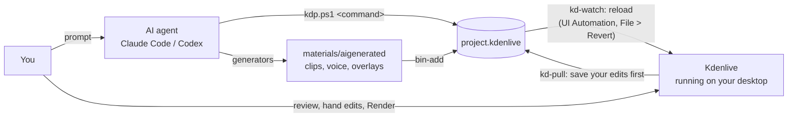

<div align="center">

# Movie Engine

**Umenzeli we-AI uhlela ividiyo yakho ku-Kdenlive ubukele, futhi ungayithatha noma nini.**

Abenzeli be-AI ababhala ikhodi (Claude Code, Codex) bakha futhi bashintshe amaphrojekthi angempela e-Kdenlive: amafilimu, amavidiyo achazayo ("explainers") namavidiyo amafushane aqondile ("shorts"). Izinguquko zivela ngokushesha (bukhoma) esihlelini osivulile. Iphathekayo (portable), i-Windows, akukho ukushintsha ikhodi yesihleli.


[English](../../README.md) · [简体中文](README.zh-CN.md) · [繁體中文](README.zh-TW.md) · [हिन्दी](README.hi.md) · [Español](README.es.md) · [Français](README.fr.md) · [العربية](README.ar.md) · [বাংলা](README.bn.md) · [Português](README.pt.md) · [Русский](README.ru.md) · [اردو](README.ur.md) · [Bahasa Indonesia](README.id.md) · [Deutsch](README.de.md) · [日本語](README.ja.md) · [Türkçe](README.tr.md) · [한국어](README.ko.md) · [Українська](README.uk.md) · [Italiano](README.it.md) · [Polski](README.pl.md) · [Tiếng Việt](README.vi.md) · [فارسی](README.fa.md) · [ไทย](README.th.md) · [Kiswahili](README.sw.md) · [አማርኛ](README.am.md) · [Avañe'ẽ](README.gn.md) · [Setswana](README.tn.md) · [Shqip](README.sq.md) · [Беларуская](README.be.md) · [Български](README.bg.md) · [Bosanski](README.bs.md) · [Hrvatski](README.hr.md) · [Српски](README.sr.md) · [Crnogorski](README.cnr.md) · [Македонски](README.mk.md) · [Slovenščina](README.sl.md) · [Slovenčina](README.sk.md) · [Čeština](README.cs.md) · [Magyar](README.hu.md) · [Română](README.ro.md) · [Dansk](README.da.md) · [Norsk bokmål](README.nb.md) · [Norsk nynorsk](README.nn.md) · [Svenska](README.sv.md) · [Íslenska](README.is.md) · [Suomi](README.fi.md) · [Eesti](README.et.md) · [Latviešu](README.lv.md) · [Lietuvių](README.lt.md) · [Nederlands](README.nl.md) · [Lëtzebuergesch](README.lb.md) · [Rumantsch](README.rm.md) · [Ελληνικά](README.el.md) · [Malti](README.mt.md) · [Gaeilge](README.ga.md) · [Català](README.ca.md) · [ქართული](README.ka.md) · [Հայերեն](README.hy.md) · [Azərbaycanca](README.az.md) · [Afrikaans](README.af.md) · **isiZulu** · [isiXhosa](README.xh.md) · [Sesotho](README.st.md) · [Sepedi](README.nso.md) · [Xitsonga](README.ts.md) · [Tshivenḓa](README.ve.md) · [siSwati](README.ss.md) · [isiNdebele (South Africa)](README.nr.md) · [isiNdebele (Zimbabwe)](README.nd.md) · [chiShona](README.sn.md) · [Chichewa](README.ny.md) · [Ikinyarwanda](README.rw.md) · [Ikirundi](README.rn.md) · [Malagasy](README.mg.md) · [Soomaali](README.so.md) · [Afaan Oromoo](README.om.md) · [Qafar af](README.aa.md) · [ትግርኛ](README.ti.md) · [Sängö](README.sg.md) · [Kreol Seselwa](README.crs.md) · [TjiKalanga](README.kck.md) · [ChiNdau](README.ndc.md)

*Lokhu kuyinguqulo; i-README yesiNgisi iyona eyinkomba.*

</div>

---

## Okuqukethwe

- [Kungani](#kungani)
- [Kusebenza kanjani](#kusebenza-kanjani)
- [Izici](#izici)
- [Okudingekayo](#okudingekayo)
- [Ukufaka](#ukufaka)
- [Ukuqala ngokushesha](#ukuqala-ngokushesha)
- [Ukusebenza nomenzeli](#ukusebenza-nomenzeli)
- [Umugqa womyalo wokuhlela (`kdp.ps1`)](#umugqa-womyalo-wokuhlela-kdpps1)
- [Ukuvumelanisa bukhoma nesihleli esivuliwe](#ukuvumelanisa-bukhoma-nesihleli-esivuliwe)
- [Ama-generator: lokho i-Kdenlive engakwazi ukukwenza](#ama-generator-lokho-i-kdenlive-engakwazi-ukukwenza)
- [I-voice-over nomsindo](#i-voice-over-nomsindo)
- [Ulimi lwesixhumi esibonakalayo](#ulimi-lwesixhumi-esibonakalayo)
- [Ukuhleleka kwamafolda](#ukuhleleka-kwamafolda)
- [Ukuhlola nobufakazi](#ukuhlola-nobufakazi)
- [Imikhawulo](#imikhawulo)
- [Ukuxazulula izinkinga](#ukuxazulula-izinkinga)
- [Imibuzo evame ukubuzwa](#imibuzo-evame-ukubuzwa)
- [Ukufaka isandla](#ukufaka-isandla)
- [Ukubonga](#ukubonga)
- [Ilayisensi](#ilayisensi)

## Kungani

Izihleli zevidiyo zakhelwe isandla esiphethe igundane (mouse). Abenzeli be-AI bayakwazi kahle ukwakheka, isikhathi nokuphindaphinda: ukubeka ama-clip angama-300 ngokwesigqi somculo, ukuhambisanisa yonke imibhalo engezansi (captions) nezwi, ukwenza kabusha isigcawu ngemva kokuphawula. Kodwa abakwazi ukuchofoza ku-interface yezithombe (GUI) ngaphandle kokuthatha i-desktop yakho.

I-Kdenlive yisihleli esinamandla somthombo ovulekile (open-source), kodwa ku-Windows **ayinayo i-API yokuzenzakalela** (automation API): ukulawula nge-D-Bus kukhona kuphela ezinguqulweni ze-Linux, futhi ama-fork ayengezayo kungenzeka angasanakekelwa noma awaphephile. I-Movie Engine ixazulula lokhu ngaphandle kokushintsha isihleli:

1. Umenzeli uhlela ifayela lephrojekthi `.kdenlive` ngomugqa womyalo ohloliwe (`engine/kdp.ps1`).
2. I-Kdenlive esebenzayo iyalwa ukuthi ilayishe kabusha ifayela nge-Windows UI Automation, ngaphandle kokucindezela okhiye, ngaphandle kwegundane futhi ngaphandle kokuntshontsha i-focus.
3. Izinguquko zakho ongakazilondolozi zilondolozwa kuqala futhi azibhalwa ngaphezulu neze.

Ngakho umenzeli uyahlela wena ubuyekeze, noma uhlele ngesandla. Nobabili nisebenza kuphrojekthi efanayo, esihlelini esifanayo, ngesikhathi esifanayo.

## Kusebenza kanjani



Wonke umyalo wokuhlela ulandela umjikelezo ofanayo ophephile:

1. **Pull.** Uma i-Kdenlive inezinguquko ezingakalondolozwa, iyalwa ukuthi izilondoloze (inkinobho ethi Save kubha yamathuluzi nge-UI Automation), bese ukulondoloza kuqinisekiswa.
2. **Ukuhlela.** Umyalo ushintsha i-XML ngaphansi kokhiye (lock), ngemva kokuhlola i-hash futhi nesithombe sokuhlehlisa (undo snapshot). Uma ifayela lishintshile phakathi naleso sikhathi, akukho okubhalwayo.
3. **Ukulayisha kabusha.** Umbukeli (watcher) ubona uphawu lwe-AI bese wenza File > Revert esihlelini esivuliwe. Impumelelo ibalwa kuphela uma i-widget ye-timeline isakhiwe kabusha ngempela.
4. **Ukungqubuzana.** Uma uqale ukuhlela phakathi naleso sikhathi, akukho okulayishwa kabusha futhi umsebenzi wakho uhlala. Inguqulo ye-AI igcinwa eceleni, bese umenzeli esebenzisa kabusha inguquko yakhe phezu kweyakho.

## Izici

- **Ukuhlela iphrojekthi ngokuphelele ngaphandle kwe-GUI**: cishe imiyalo eyi-120 ehlanganisa i-bin, i-timeline, ama-effect, ama-composition, ama-track, imihlahlandlela (guides), ama-marker, imibhalo engezansi (subtitles), ama-sequence, isivinini nokuhlela kabusha isikhathi (time remap), ama-slideshow, izihloko (titles), ama-proxy, ukurenda (rendering) kanye nokuhlehlisa/ukwenza kabusha (undo/redo). Bheka [inkomba yemiyalo](#umugqa-womyalo-wokuhlela-kdpps1).
- **Ukuvumelanisa bukhoma nesihleli esivuliwe.** Izinguquko ze-AI zivela ku-Kdenlive oyibukayo; izinguquko zakho ongakazilondolozi zilondolozwa kuqala futhi azilahleki neze.
- **Ayilokothi iphazamise i-desktop yakho.** Akukho kuntshontshwa kwe-focus, ukucindezela okhiye noma ukusebenzisa igundane. Izihleli zokuhlola zisebenza ku-desktop ye-Windows engabonakali.
- **Iphathekayo.** Isihleli, izilungiselelo, i-Node.js, amafonti namathuluzi kuhlala efolda eyodwa. Yikopishele kwenye ikhompyutha futhi iyasebenza; akukho okubhalwa ku-Program Files noma kuphrofayela yakho ye-Windows.
- **Ama-generator alokho i-Kdenlive engakwazi ukukwenza**: umbhalo onyakazayo (kinetic text) uhlamvu ngalunye, izimpawu ezidwetshwe ngesandla, izigcawu ze-interface ze-3D, opopayi be-cursor namafilimu amade achazayo asebenzisanayo. Arendwa ku-GPU nge-motion blur yangempela futhi abekwa ku-timeline njengama-clip avamile.
- **I-voice-over enezikhathi zamagama** (Microsoft Edge TTS, akudingeki ukhiye we-API). Imibhalo engezansi nezenzo kwenzeka ngqo egameni elifanele.
- **Ama-effect omsindo ahlanganiswe ngekhodi** (whoosh, click, pop, riser, impact nokunye), akhiqizwa ngekhodi.
- **Kufakazelwe, akucatshangwanga nje.** Wonke umyalo unokuhlolwa komphumela, ama-effect nama-composition ahlolwa ngamunye ngamunye, futhi imiphumela eluhlaza ikhona ku-`docs/proof/`.
- **Imiyalelo yabenzeli ifakiwe.** I-`AGENTS.md` namakhono (skills) ku-`.claude/skills/` afundisa i-Claude Code ne-Codex indlela yokusebenza, ifomethi yefayela nezingibe.

## Okudingekayo

| | |
|---|---|
| Uhlelo lokusebenza (OS) | Windows 10 noma 11, x64 |
| Isihleli | Kdenlive **26.08.3** inguqulo ephathekayo (standalone). Ezinye izinguqulo azihlolwanga. |
| Node.js | 18 noma entsha: i-`.zip` ye-Windows x64 evela ku-nodejs.org, ekhishwe ku-`engine/node/` |
| Isiphequluli | Microsoft Edge (ingxenye ye-Windows); isetshenziswa ngaphandle kwewindi (headless) ngama-renderer ezigcawu |
| Umenzeli | [Claude Code](https://claude.com/claude-code) noma Codex. Akuphoqelekile: wonke ithuluzi lingasetshenziswa nangesandla. |
| Idiski | cishe u-1 GB wesihleli namathuluzi, kanye nemidiya yakho |
| GPU | noma iyiphi i-GPU ene-hardware H.264 encoding isheshisa i-`film-render.mjs` (uma ingekho, isebenzisa i-software) |

## Ukufaka

Konke kufakwa **ngaphakathi kwefolda**. Akukho okudinga amalungelo omphathi (admin).

```powershell
git clone https://github.com/vladtarrow/movie-engine.git
cd movie-engine
```

**1. Node.js.** Landa i-`.zip` ye-Windows x64 ye-Node.js 18 noma entsha ku-<https://nodejs.org/en/download> bese ukhipha okuqukethwe kwayo ku-`engine\node\`, ukuze i-`engine\node\node.exe` ne-`engine\node\npm.cmd` kube khona lapho. Akudingeki isifaki (installer) noma i-Node yesistimu. Zonke izikripthi zisebenza nge-`engine\node.cmd`, hhayi nge-Node yesistimu.

**2. Amaphakheji e-Node** ethuluzi lezwi nama-renderer (izinguqulo zinqunywe ku-`engine/voice/package.json`):

```powershell
engine\node\npm.cmd install --prefix engine\voice
```

**3. Kdenlive 26.08.3 ephathekayo.** Landa i-`kdenlive-26.08.3_standalone.exe` ku-<https://download.kde.org/stable/kdenlive/26.08/windows/> uyifake ku-`engine\installer\`, uyihlole bese uyikhipha:

```powershell
(Get-FileHash engine\installer\kdenlive-26.08.3_standalone.exe -Algorithm SHA256).Hash
# expected: A25427B1DFF2C17E3B0386E991BB1A719382BB3176D1A90E441CDAEB6E0A967D
engine\installer\kdenlive-26.08.3_standalone.exe -o"engine\Kdenlive" -y
```

Isihleli sigcina siku-`engine\Kdenlive\kdenlive-26.08.3_standalone\bin\`. Sesivele sine-`melt.exe` ne-`ffmpeg.exe`.

**4. Ukuqala okokuqala.**

```powershell
engine\kdenlive.cmd
```

I-Kdenlive igcina zonke izilungiselelo zayo ku-`engine\profile-kdenlive\`, hhayi kuphrofayela yakho ye-Windows. Ekuqaleni kokuqala ikhombisa i-wizard yokusetha kanye kuphela.

## Ukuqala ngokushesha

### Ngomenzeli

Vula ifolda ku-Claude Code (noma ku-Codex) bese ucela ngamagama avamile:

> Yenza iphrojekthi entsha eqondile ye-30 fps ethi "launch-teaser". Beka izithombe-skrini ezintathu ezivela ku-`materials/designers/launch/` ku-timeline, ngamunye imizuzwana engu-2.5 nokushintsha okufushane (cross-fade), engeza i-voice-over evela ku-`script.txt` futhi uhambisanise umbhalo onyakazayo nomugqa ngamunye.

> Ngivulele yona ku-Kdenlive.

> Isithombe sesibili side kakhulu. Sinqume sibe imizuzwana engu-1.8 bese ukhuphula i-logo kancane.

Umenzeli ulandela i-`AGENTS.md`: uhlela nge-`kdp.ps1`, urenda kuphela ama-clip adingwa ukuhlela, futhi ugcina isihleli esivuliwe sivumelana. Wena ubuyekeza ku-Kdenlive, uhlela ngesandla noma nini lapho uthanda khona, bese ucindezela u-Render uma wenelisekile.

### Ngesandla

```powershell
# a new 1080x1920 30 fps project with 2 video and 2 audio tracks
powershell -NoProfile -ExecutionPolicy Bypass -File engine\kdp.ps1 new -Project projects\hello\hello.kdenlive -Profile vertical_hd_30

# a 3-second title and a colour background
powershell -NoProfile -ExecutionPolicy Bypass -File engine\kdp.ps1 bin-color -Project projects\hello\hello.kdenlive -Color '#203060' -Seconds 3 -Name bg
powershell -NoProfile -ExecutionPolicy Bypass -File engine\kdp.ps1 title -Project projects\hello\hello.kdenlive -Text "Hello" -Seconds 3 -Name hi

# place them: background on V1, title above it on V2
powershell -NoProfile -ExecutionPolicy Bypass -File engine\kdp.ps1 add -Project projects\hello\hello.kdenlive -Bin bg -Track V1 -At 0
powershell -NoProfile -ExecutionPolicy Bypass -File engine\kdp.ps1 add -Project projects\hello\hello.kdenlive -Bin hi -Track V2 -At 0

# a check frame, then open it in the editor
powershell -NoProfile -ExecutionPolicy Bypass -File engine\kdp.ps1 frame -Project projects\hello\hello.kdenlive -At 1.5 -Out out\hello\check.png
engine\kdenlive.cmd projects\hello\hello.kdenlive
```

Ukuze uvule kabusha iphrojekthi yokugcina kamuva, chofoza kabili ku-`open-last-project.cmd`.

## Ukusebenza nomenzeli

Umenzeli ufunda i-`AGENTS.md` (Codex) noma i-`CLAUDE.md`, eyingenisayo (Claude Code), kanye namakhono amabili:

| Ikhono | Okufundiswayo |
|---|---|
| `.claude/skills/kdenlive-project-file` | ifomethi ye-`.kdenlive` / MLT XML, `kdp.ps1`, ukuhlola nge-`melt` |
| `.claude/skills/kdenlive-live` | ukulawula isihleli esisebenzayo ngokuphephile: ukuqala, i-pull, ukulayisha kabusha, ukuthwebula iwindi laso |

Imithetho umenzeli ayilandelayo, ongathembela kuyo:

- Awulokothi uthathe igundane lakho, ikhibhodi noma i-focus, futhi awulokothi uthwebule i-desktop yakho (kuphela iwindi lesihleli uqobo).
- Wenza izinyathelo ze-GUI ngokwakhe (ukulondoloza, ukuvula, ukulayisha kabusha) esikhundleni sokukucela ukuthi uchofoze.
- Uyabuza ngaphambi kokulanda noma yini nangaphambi kokususa noma yini.
- Urenda kuphela lokho okudingwa umsebenzi (ama-clip ezigcawu, ama-frame okuhlola). Ifilimu yokugcina uyirenda kuphela uma ucela.
- Uma i-Kdenlive ingakwazi ukwenza okuthile kahle, umenzeli ukwakha ngaphandle ngekhodi bese efaka umphumela njenge-clip. Akawehlisi izinga le-effect.

## Umugqa womyalo wokuhlela (`kdp.ps1`)

```powershell
powershell -NoProfile -ExecutionPolicy Bypass -File engine\kdp.ps1 <command> -Project <file.kdenlive> [options]
```

Izikhathi zingamasekhondi, ngechashazi (`2.5`). Ama-track ngu-`V1 V2 …` (u-V1 ungezansi kakhulu) no-`A1 A2 …`. I-clip ikhonjwa nge-`-Track` kanye nanoma yisiphi isikhathi `-At` ngaphakathi kwayo. Amapharamitha e-effect afakwa ku-`-Params "name=value||name=value"`. Uhlu oluphelele nazo zonke izinketho lusekuqaleni kwe-`engine/kdp.ps1`.

| Iqembu | Imiyalo |
|---|---|
| Iphrojekthi | `new`, `profiles`, `info`, `validate`, `fonts`, `profile-set`, `profile-from-clip`, `zone`, `archive`, `backups`, `rebase`, `otio-export`, `otio-import` |
| I-bin | `bin-add`, `bin-color`, `title`, `title-text`, `title-save`, `title-template`, `bin-rename`, `bin-remove`, `bin-info`, `bin-set`, `bin-duplicate`, `bin-replace-file`, `bin-reload`, `folder`, `bin-folder`, `relink`, `clean`, `generator`, `playlist-clip`, `extract-audio`, `transcode` |
| I-timeline | `add`, `add-av`, `move`, `copy`, `trim`, `ripple-trim`, `slip`, `split`, `remove`, `speed`, `remap`, `disable`, `enable`, `group`, `ungroup`, `mix`, `unmix`, `space-insert`, `space-remove`, `spaces-remove-all`, `track-clear`, `replace-in-timeline` |
| Ama-effect | `effects`, `effect-info`, `effect-add`, `effect-list`, `effect-set`, `effect-remove`, `effect-copy`, `effect-clear`, `effects-all`, `bin-effect`, `effect-templates`, `effect-template` |
| Ama-composition | `compositions`, `comp-info`, `comp-add`, `comp-list`, `comp-set`, `comp-remove` |
| Ama-track | `track-add`, `track-remove`, `track-set` |
| Imihlahlandlela nama-marker | `guide-add`, `guide-list`, `guide-remove`, `guide-set`, `guide-clear`, `guide-export`, `guide-category`, `marker`, `marker-list`, `marker-set`, `marker-remove` |
| Imibhalo engezansi | `sub-add`, `sub-import`, `sub-export`, `sub-state` |
| Ama-sequence | `sequence-add`, `sequences`, `copy-to-sequence`, `expand`; noma yimuphi umyalo one-`-Sequence <name>` usebenza ngaphakathi kwaleyo sequence |
| Okukhethekile | `slideshow`, opopayi be-Lottie / Glaxnimate nge-`bin-add`, `proxy`, `stabilize`, `scene-split`, `speed-job`, `subclip` |
| Okukhiphayo | `frame` (i-PNG eyodwa), `preview` (ukurenda okusheshayo nge-melt), `render` (i-renderer ye-Kdenlive uqobo noma i-preset), `presets` |
| Umlando | `undo`, `redo`, `clear-history` (izithombe zesimo ku-`projects/<name>/.kdp-history`) |

Ukuziphatha okufanele ukwazi:

- Izingxenye ezixhunyiwe zomsindo nevidiyo zihanjiswa, zinqunywa, zihlukaniswa futhi zisuswa ndawonye (`-Alone` engxenyeni eyodwa).
- Umyalo ohlulekayo uphuma ngekhodi 1 futhi awubhali lutho.
- Ama-effect inguqulo ye-Windows engakwazi ukuwasebenzisa ayenqatshwa, awazibiwa buthule (uhlu: `docs/proof/assets.txt`).
- Sonke isenzo semenyu ye-Kdenlive sixhunywe nomyalo, enye indlela, noma "ukubuka kuphela" ku-`engine/tools/data/kdenlive-actions.csv`. Bheka i-`docs/kdenlive-coverage.md`.

## Ukuvumelanisa bukhoma nesihleli esivuliwe

| Iskripthi | Okwenzayo | Amakhodi okuphuma |
|---|---|---|
| `engine\kd-pull.ps1 -Project <f>` | yenza i-Kdenlive ilondoloze izinguquko zakho futhi iyakuqinisekisa | 0 ifayela lisesimweni samanje, 3 ayisebenzi, 4 akuqinisekisiwe |
| `engine\kd-reload.ps1 -Project <f>` | File > Revert, kuqinisekiswa yi-timeline eyakhiwe kabusha | 0 kuqinisekisiwe, 2 unezinguquko ongakazilondolozi (akukho okulahliwe), 3 ayisebenzi, 4 kuhlulekile |
| `engine\kd-watch.ps1 -Project <f>` | umbukeli osemuva: ulayisha kabusha ngemva kokubhala ngakunye kwe-AI, ubhala ukungqubuzana ku-log | i-log iku-`engine\kd-watch.log`; susa i-`engine\kd-watch.run` ukuze uyimise |
| `engine\kdenlive-bg.ps1 [project]` | iqala i-Kdenlive incishisiwe (minimized) yomenzeli | 0 ilayishiwe, 4 akuqinisekisiwe |
| `engine\kdenlive.cmd [project]` | iqala i-Kdenlive yakho | |

Qala umbukeli kanye ngeseshini ngayinye:

```powershell
Start-Process powershell -WindowStyle Hidden -ArgumentList '-NoProfile','-ExecutionPolicy','Bypass','-File','engine\kd-watch.ps1','-Project','projects\hello\hello.kdenlive'
```

Amaphrojekthi amakhulu: ukulayisha kabusha iphrojekthi enama-clip ayi-1000 kuthatha imizuzu, futhi amathuluzi ayakulinda esikhundleni sokubika ngaphambi kwesikhathi. Amaphrojekthi avulwa nge-*File > Open Recent* esihlelini esingenalutho, ngoba ukuvula ifayela ngqo kwenza i-Qt ihambe kuyo yonke into ku-timeline ngenxa yokufinyeleleka (accessibility), futhi lokho bekuhamba kancane ngemizuzu engaba ngu-10.

## Ama-generator: lokho i-Kdenlive engakwazi ukukwenza

I-Kdenlive/MLT ayinabo opopayi bombhalo uhlamvu ngalunye, ayinawo ama-expression futhi ine-3D encane, futhi ama-effect asindayo enza ukudlala kuhambe kancane. I-Movie Engine irenda izingxenye ezinjalo ngaphandle bese iyibeka ku-timeline njengama-clip avamile, imvamisa ane-alpha, ku-track engaphezu kwezithombe. Iskripthi se-generator nokokufaka kwaso kuhlala efolda yephrojekthi, ukuze i-clip ikhiqizwe kabusha uma umbhalo, ifonti noma isikhathi sishintsha.

| Ithuluzi | Okwenzayo |
|---|---|
| `engine/tools/kinetic-text.ps1` | imibhalo engezansi enyakazayo uhlamvu ngalunye, igama ngalinye linesikhathi esivela ku-`voice.json`, ibhokisi lokugqamisa |
| `engine/tools/annotate.ps1` | imibuthano, amabhokisi, imigqa engezansi nemicibisholo edwetshwe ngesandla, ezizidwebayo phezu kwesithombe-skrini |
| `engine/tools/card-entrance.ps1` | ikhadi lesithombe-skrini elikhuphukayo futhi likhule linethunzi elithambile |
| `engine/tools/pdf-to-png.ps1` | ama-slide avela ku-PDF ekhishiwe |
| `engine/tools/html-render.mjs` | noma yisiphi isigcawu se-HTML/CSS/canvas siye kuvidiyo: opopayi be-interface, ama-cursor, i-3D, ama-mask |
| `engine/tools/film-render.mjs` + `film/` | amafilimu amade achazayo asebenzisanayo ku-canvas: i-clip eyodwa ngomugqa ngamunye wezwi, izenzo zenzeka emagameni akhulunywayo, i-motion blur ye-GPU cishe ku-45 fps |

Womabili ama-renderer alawula i-Microsoft Edge efika ne-Windows, ngaphandle kwewindi (headless), ngephrofayela elahlwayo futhi ngaphandle kokufinyelela kunethiwekhi.

### Ama-demo

```powershell
# a 3-second 3D title card with a cursor click
engine\node.cmd engine\tools\html-render.mjs examples\demo\scene\scene.html examples\demo\out --frames 0,30,60,89
engine\node.cmd engine\tools\html-render.mjs examples\demo\scene\scene.html examples\demo\out\scene.mp4

# a 4-shot interactive film timed to two voice lines
engine\node.cmd engine\tools\film-render.mjs examples\demo\film\film.html examples\demo\out --check
engine\node.cmd engine\tools\film-render.mjs examples\demo\film\film.html examples\demo\out --shots all --width 640
engine\node.cmd engine\tools\film-render.mjs examples\demo\film\film.html examples\demo\out\clips --suffix -v01
```

Ifilimu ingamafayela amathathu amancane. I-`data.js` iqukethe ama-shot nezikhathi zamagama. I-`direction.js` inomugqa owodwa nge-shot ngayinye:

```text
1 | hover 192 108 @brand | tag 300 60 Your brand @deserves | confetti 192 90 @film
2 say=A film that/*explains* it
3 | click 116 108 @before | click 268 108 @after | chips Before~After @after
4 scene=counter | count 0 120 % @count
```

I-`scenes.js` iqukethe ama-shot adwetshwa kusukela ekuqaleni. I-`@word` yenza isenzo senzeke lapho izwi lisho lelo gama. Izenzo zihlanganisa i-click, hover, drag, zoom, lens, ring, arrow, chips, toggle, slider, toast, type, count ne-confetti; i-syntax ephelele isekuqaleni kwe-`engine/tools/film/film-kit.js`.

## I-voice-over nomsindo

```powershell
engine\node.cmd engine\voice\voice.mjs lines.json materials\aigenerated\hello\voice en-US-AndrewMultilingualNeural +0%
```

I-`lines.json` iwuhlu lwemigqa. Ithuluzi libhala i-mp3 eyodwa ngomugqa ngamunye kanye ne-`voice.json`, enobude besikhathi nokuqala nokuphela kwalo lonke igama. Imigqa igcinwa ku-cache, ngakho uma ushintsha umugqa owodwa kukhiqizwa kabusha kuphela lowo mugqa. Lisebenzisa ukuguqula umbhalo ube yinkulumo (text-to-speech) ku-inthanethi kwe-Microsoft Edge ngephakheji ye-`msedge-tts`: akudingeki ukhiye, kodwa insizakalo ayisemthethweni futhi idinga i-inthanethi.

```powershell
engine\node.cmd engine\audio\sfx.mjs materials\aigenerated\sfx
```

Lokhu kuhlanganisa ngekhodi i-whoosh, whoosh-long, swipe, click, pop, tick, riser, impact, ding ne-reveal; isethi esilungile iku-`materials/aigenerated/sfx/`. Imisindo emifushane kune-frame eyodwa yengeze ngokuthula ngaphambi kokuyibeka (`-af apad=whole_dur=0.0667`).

## Ulimi lwesixhumi esibonakalayo

Ama-launcher aqala i-Kdenlive **ngesiNgisi** ngokuzenzakalelayo. Ukuze usebenzise olunye ulimi, setha i-`MOVIE_ENGINE_UI_LANG` ngaphambi kokuqala:

```powershell
$env:MOVIE_ENGINE_UI_LANG = 'ru'; engine\kdenlive.cmd
```

I-UI Automation ithola izinto zemenyu ngamagama azo abonakalayo. Amagama ezilimi ze-interface ezingama-31 asevele efakiwe (`engine/tools/kd-ui.ps1`, `$KdNames`). Kunoma yiluphi olunye ulimi, engeza amagama alo lapho bese uhlola nge:

```powershell
powershell -NoProfile -ExecutionPolicy Bypass -File engine\tools\kd-langcheck.ps1
```

## Ukuhleleka kwamafolda

```text
movie-engine/
├─ AGENTS.md, CLAUDE.md          instructions for AI agents
├─ .claude/skills/               agent skills: project file format, live editor
├─ engine/
│  ├─ kdp.ps1                    the editing command line
│  ├─ kd-pull / kd-reload / kd-watch .ps1, kdenlive.cmd, kdenlive-bg.ps1
│  ├─ tools/                     internals, generators, tests, data (action map)
│  ├─ voice/  audio/  fonts/     TTS, synthesized SFX, Poppins (OFL)
│  ├─ Kdenlive/  node/           portable editor and Node.js (not in git)
│  └─ profile-kdenlive/          the editor's settings (not in git)
├─ projects/<name>/<name>.kdenlive
├─ materials/
│  ├─ download/                  stock and downloaded files (not in git)
│  ├─ aigenerated/               everything the AI made (sfx/ and test-kit/ ship with the engine)
│  ├─ designers/  brand/         files from your team, brand assets
├─ examples/demo/                demos of the scene and film renderers
├─ out/                          renders (not in git)
└─ docs/                         proofs, coverage, translations of this README
```

Izindlela zemidiya ngaphakathi kwamaphrojekthi zihlobene (relative). Uma uhambisa noma ukopisha ifolda, i-`kdp.ps1 rebase` (eqhutshwa nangokuzenzakalelayo yi-`kdenlive.cmd`) ibhala indawo entsha kuphrojekthi.

## Ukuhlola nobufakazi

Izimangalo zokuthi yini esebenzayo zisekelwa ukuhlolwa kwemiphumela, hhayi ngokuthi "umsebenzi (function) uqhubekile". Isifinyezo siku-[`docs/kdenlive-proof.md`](../../docs/kdenlive-proof.md), futhi okukhishwe okuluhlaza kuku-`docs/proof/`.

| Ukuhlola | Okuhlolwayo |
|---|---|
| `engine\tools\kdp-clitest.ps1` | wonke umyalo we-`kdp.ps1`, ngomugqa womyalo, kuqhathaniswa iphrojekthi ephumayo |
| `engine\tools\kd-livetest.ps1` | i-pull, ukulayisha kabusha, umbukeli, ukungqubuzana nokuncintisana (races) ku-Kdenlive yangempela ku-desktop engabonakali |
| `engine\tools\kdp-assetsweep.ps1` | yonke i-effect ne-composition: irenda futhi iqhathanise ama-frame |
| `engine\tools\kdp-portabletest.ps1` | ikopisha ifolda kwenye indawo futhi isebenze kusukela kukhophi |
| `engine\tools\kd-langcheck.ps1` | ulimi lwe-interface nokuthi i-UI Automation iyayithola imenyu |
| `engine\tools\kdp-coverage-check.ps1` | ukuthi sonke isenzo semenyu sixhunyiwe, nokuthi abukho ubufakazi obudala kunekhodi |

```powershell
powershell -NoProfile -ExecutionPolicy Bypass -File engine\tools\kdp-clitest.ps1 -Report docs\proof\clitest.txt
powershell -NoProfile -ExecutionPolicy Bypass -File engine\tools\kd-livetest.ps1 -Report docs\proof\live-en.txt
```

Izihleli zokuhlola zisebenza kuphela ku-desktop efihliwe enephrofayela yazo, ngakho ukuhlola akulokothi kuthinte i-Kdenlive yakho evuliwe noma i-focus yakho.

## Imikhawulo

- **I-Windows kuphela**, i-Kdenlive **26.08.3** kuphela. I-Linux ine-D-Bus futhi ibingadinga ibhuloho elihlukile.
- Ukuqala isihleli kuthatha i-focus yekhibhodi cishe imizuzwana emi-3 ngesikhathi iwindi elingenalutho livela. Abenzeli bayabuza ngaphambi kokusiqala ngesikhathi usebenza. Ukulayisha kabusha nokuhlela akuyithathi i-focus.
- Inguqulo ye-Windows ayinawo ama-module e-MLT e-sox, ladspa ne-movit kanye namanye ama-effect e-frei0r/avfilter; i-`kdp.ps1` iyawenqaba (`docs/proof/assets.txt`).
- Ukuthumela nokungenisa nge-OpenTimelineIO kuthwala ama-clip nezikhala kuphela. I-multicam ayinakho ukushintsha ama-angle bukhoma (ukusika kwenziwa nge-split/remove/hide).
- I-"Save As…" nge-UI Automation ewindini elincishisiwe ayivuli ibhokisi lengxoxo (dialog); umenzeli usebenzisa i-`archive` noma amakhophi amafayela esikhundleni salokho.
- Ukubona inkulumo (imibhalo engezansi ezenzakalelayo) kudinga i-Whisper noma i-Vosk, ezingafakiwe.
- Izihloko ezenziwe ngethuluzi lezihloko le-Kdenlive zisebenzisa amafonti afakwe ku-Windows. Ukuze uqiniseke ngokubhalwa (typography), renda umbhalo ngama-generator, alayisha amafonti avela ku-`engine/fonts/`.
- I-Edge TTS iyinsizakalo ye-inthanethi engekho emthethweni futhi ingashintsha noma iyeke ukusebenza.

## Ukuxazulula izinkinga

| Uphawu | Imbangela nesixazululo |
|---|---|
| I-Kdenlive iyasebenza, kodwa ukuyichofoza ku-taskbar akukhombisi lutho | Indawo yewindi elondoloziwe ingaphandle kwesikrini. Yivale bese ususa okufakiwe kwe-`kdockLayout` ku-`engine\profile-kdenlive\AppData\Local\kdenliverc`, noma uhambise iwindi nge-`SetWindowPos` (bheka i-`AGENTS.md`). |
| I-`kd-reload.ps1` iphuma ngo-2 | Unezinguquko ongakazilondolozi. Akukho okulahliwe. Qhuba i-`kd-pull.ps1`, bese usebenzisa inguquko futhi (i-`kdp.ps1` iyakwenza lokhu ngokwayo). |
| I-`CONFLICT` ku-`engine\kd-watch.log` | Wena nomenzeli nihlele ngesikhathi esisodwa. Inguqulo yakho ihlala esihlelini, futhi inguqulo ye-AI iku-`projects\<name>\.kdp-history\<name>\conflict\`. Cela umenzeli asebenzise inguquko yakhe futhi. |
| Umyalo uphuma ngo-1 nomlayezo othi "pull not confirmed" | I-Kdenlive imatasa noma ikhombisa ibhokisi lengxoxo. Vala ibhokisi noma ulinde ukulayisha kuqede, bese uphinda. |
| Iskripthi se-PowerShell sehluleka ukuhlaziywa (parse) | Izikripthi ezinombhalo ongewona we-ASCII kufanele zilondolozwe njenge-UTF-8 **ene-BOM** ku-Windows PowerShell 5.1. |
| I-`voice.mjs` iyama nomlayezo othi "Stream closed before the synthesis completed" | Imvamisa yinkinga yenethiwekhi, noma i-SSML engavikelwanga (unescaped) kumakhophi amadala. I-`voice.mjs` ivikela i-`& < >` ngokwayo. |
| Ukuvula iphrojekthi enkulu kuthatha imizuzu eminingi | Yivule nge-`kdenlive.cmd` / `kdenlive-bg.ps1`, ungalokothi uyivule njenge-`kdenlive.exe project.kdenlive`. |

## Imibuzo evame ukubuzwa

**Ingabe ngidinga i-Claude Code noma i-Codex?**
Cha. Wonke ithuluzi liyiskripthi esivamile ongasiqhuba ngesandla. Umenzeli yilokho okwenza kushesha: uhlela ukusika, aqhube amathuluzi futhi agcine isihleli sivumelana.

**Ingabe umenzeli uzobhala ngaphezulu kwezinguquko engizenze ngesandla?**
Cha. Ngaphambi kokubhala noma yini, izinguquko zakho ongakazilondolozi ziyalondolozwa futhi ziqinisekiswe. Uma uhlela ngesikhathi umenzeli ebhala, ukubhala kuyenqatshwa noma kugcinwe eceleni njengokungqubuzana, akulokothi kusetshenziswe phezu komsebenzi wakho.

**Ingabe ngingaqhubeka ngisebenzisa i-Kdenlive njengenjwayelo?**
Yebo. Yi-Kdenlive evamile enefolda yayo yezilungiselelo. Hlela, buka kuqala (preview) futhi urende njengenjwayelo.

**Ingabe isebenza ne-Kdenlive engisenayo ifakiwe?**
Isebenzisa ikhophi yayo ephathekayo ku-`engine\Kdenlive\`, ngakho i-Kdenlive yakho efakiwe nezilungiselelo zayo azithintwa.

**Kungani kungesona i-fork ye-Kdenlive ene-API, noma esinye isihleli?**
Ku-Windows ayikho i-fork enakekelwayo nephephile (ucwaningo lukaNovemba 2026). I-OpenShot, Blender VSE, DaVinci Resolve, Shotcut nezihleli zewebhu kuhloliwe; i-Kdenlive inikeze ukujula okungcono kakhulu kokuhlela. Isiphakamiso se-REST API ephrojekthini eyinhloko (merge request !902) siyabhekwa.

**Ingabe ingarenda ividiyo yokugcina?**
Yebo, nge-`kdp.ps1 render` (i-renderer ye-Kdenlive uqobo, efihliwe), noma ucindezele u-Render esihlelini ngokwakho.

**Ingabe imidiya yami ilayishwa (upload) kwenye indawo?**
Cha. Kuthunyelwa kuphela umbhalo we-voice-over kunsizakalo ye-Edge TTS lapho ukhiqiza izwi. Ama-renderer ezigcawu asebenza inethiwekhi ivaliwe.

## Ukufaka isandla

Iminikelo yamukelekile. Bheka i-[CONTRIBUTING.md](../../CONTRIBUTING.md). Ngamafuphi:

- Wonke umsebenzi omusha noma oshintshiwe we-`kdp.ps1` udinga ukuhlolwa komphumela ku-`kdp-clitest.ps1`, okufakiwe kumephu yezenzo, nokuqhutshwa okusha kwe-`kdp-coverage-check.ps1`.
- Ungalokothi uqale i-Kdenlive yokuhlola ku-desktop ebonakalayo; sebenzisa i-`engine/tools/kd-hidden.ps1`.
- Gcina konke kuphathekayo: akukho ukufaka ngaphandle kwefolda, azikho izindlela eziphelele (absolute paths) kumaphrojekthi.
- Bhala phansi izimo ezingavamile eziqinisekisiwe ku-`AGENTS.md` noma ekhonweni elifanele.

## Ukubonga

- [Kdenlive](https://kdenlive.org) ne-[MLT](https://www.mltframework.org): isihleli ne-injini engaphansi kwaso.
- [FFmpeg](https://ffmpeg.org), efakwe ne-Kdenlive.
- [msedge-tts](https://www.npmjs.com/package/msedge-tts) ye-voice-over.
- [Poppins](https://fonts.google.com/specimen/Poppins) ka-Indian Type Foundry, SIL Open Font License (`engine/fonts/OFL.txt`).
- `engine/tools/data/kdenliveui-26.08.3.rc`: ifayela lemenyu ye-Kdenlive, elithathwe kumthombo wekhodi we-Kdenlive 26.08.3; lisetshenziswa kuphela ukuhlolwa kokumbozwa (coverage check). Lihlala ngaphansi kwelayisensi ye-GPL ye-Kdenlive, hhayi ngaphansi kwe-MIT License.

## Ilayisensi

Ikhodi ye-Movie Engine uqobo ikhishwe ngaphansi kwe-[MIT License](../../LICENSE). I-Kdenlive, MLT, FFmpeg, amaphakheji e-Node.js nefonti ye-Poppins kugcina amalayisensi azo.
